# 01-从聊天机器人开始认识大语言模型

# 从聊天机器人开始认识大语言模型
很多同学第一次接触大语言模型，应该都是从聊天窗口开始的。

打开 DeepSeek、豆包或者其他 AI 聊天产品，随便问一个问题，几秒钟以后就能得到一段像模像样的回答。

继续追问，它还知道前面聊过什么。

用久了以后，很容易产生一种感觉：这 AI 真特么牛批。。。

但是，这里就有一个问题。

AI 它凭什么能做那么多的事情啊？

想要解释这个事，咱们接下来就先来看 **三个实验** 。

通过这几个实验来看看大语言模型究竟做了什么。实验做完以后，再回头解释它为什么能完成这些事情。

> 你可以使用任意支持多轮对话的 AI 聊天产品。如果不知道用什么，可以选择：DeepSeek 或者 豆包。
>
> 同时，为了让实验结果更容易观察，建议暂时关闭联网搜索、深度研究等附加功能。
>

## 实验一：同一个问题，为什么越问越准确
新建一个对话，输入：

```latex
介绍一下 NestJS。
```

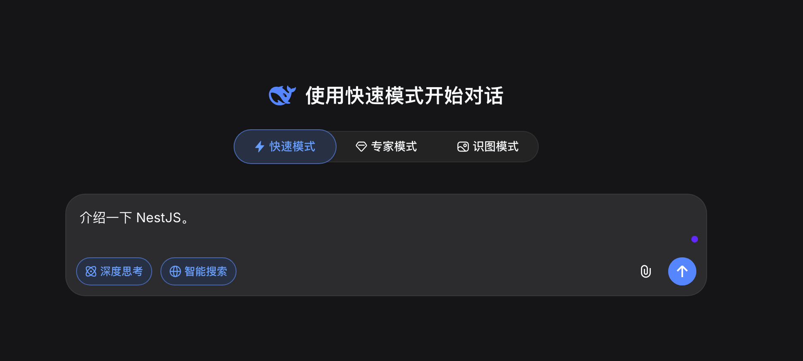

针对这样的问题，模型通常会给出一段通用的回答。内容里可能会提到 Node.js、TypeScript、模块化和依赖注入。

但是，它并不知道你为什么想了解 NestJS，也不知道你目前掌握了多少后端知识。

比如，刚才的提问，回答就是下面这样的（该回答来自 DeepSeek V4）：

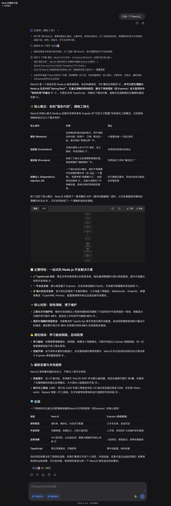

然后，咱们在同一个对话里补充要求：

```latex
我是一名前端开发者，没有后端开发经验。
不要先讲依赖注入，请用前端开发者容易理解的方式重新解释。
```

然后，再来观察内容的变化。

这个时候，大模型可能会拿前端框架做类比，也可能先解释后端项目通常要负责什么。

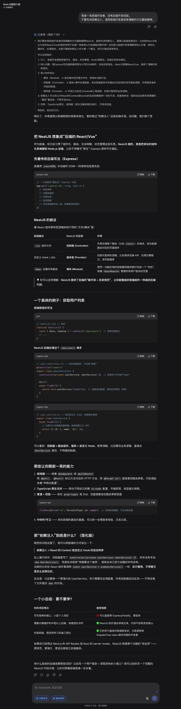

最后，咱们再输入：

```latex
还是有点长，压缩成三句话。
```

它又会按照新的要求改写答案。

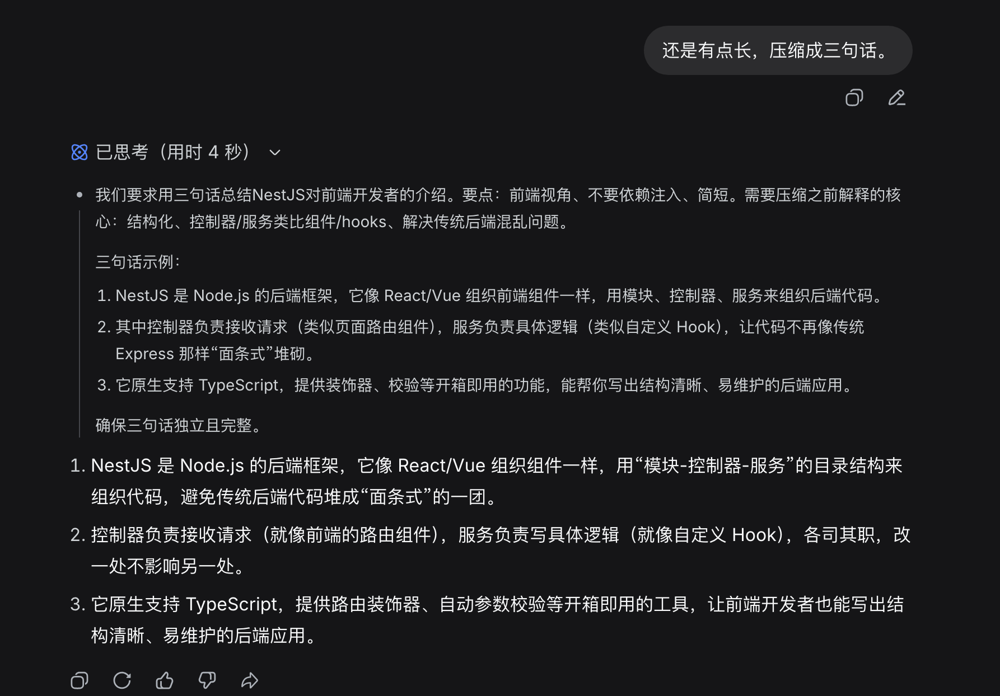

> PS：重点。
>
> 现在大家新建一个完全独立的对话
>
> 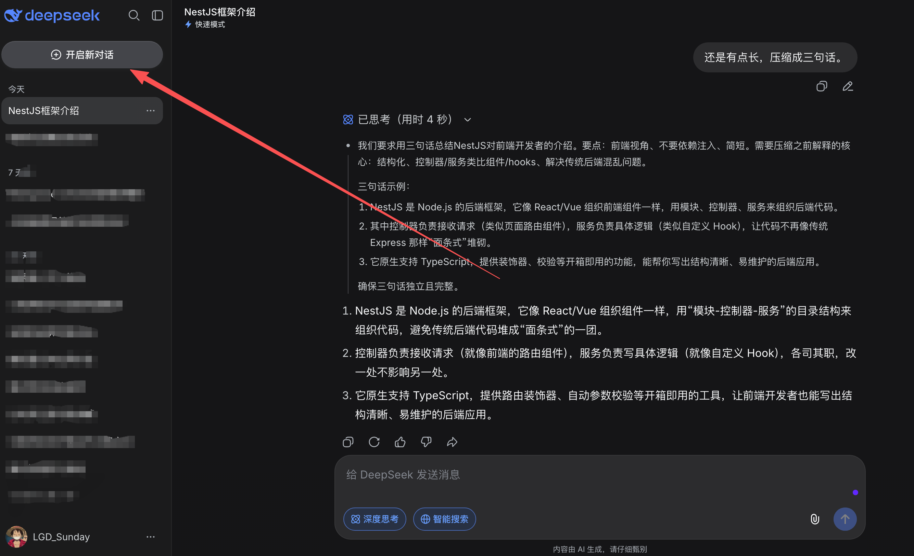
>


在新对话中，只输入最后一句：“还是有点长，压缩成三句话”。

由于缺少前面的内容，模型并不知道你想压缩什么。

最终得到的结果可能是这样的：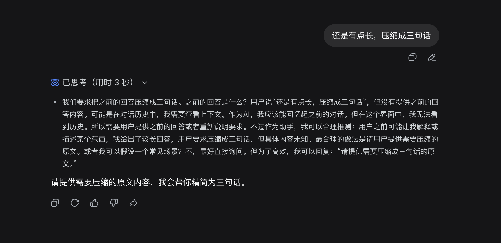


这个实验并不复杂，但是，它带来了一个很重要的结果，那就是：**模型每次生成回答时，都会参考当前能够看到的信息。前面的聊天内容，会影响它接下来写什么。**

> 这些能够被模型看到的信息，后面会统一叫作 **Context，也就是上下文**。
>
> 先不用急着研究 Context  是什么。后面咱们会详细说的 
>

现在，只需要记住：**模型不是在回答一个孤立的问题，它是在根据本次收到的全部内容生成结果。**

然后，咱们来看第二个实验。

## 实验二：模型不知道答案时，会发生什么
很多同学会认为 AI 会知道所有的事情。

其实不然。

我们可以故意问一个不存在的问题，看看它会怎么处理。

咱们新建一个对话，输入：

```latex
星河零售公司的“蓝鲸退款规则”具体是什么？
```

这里的公司名和规则名都是临时编出来的。如果雷同，绝对巧合。。。。

不同模型的反应可能会不太一样。有的会明确说不知道，有的会让你补充资料。也有些模型可能会根据“零售公司”和“退款规则”这些词，现场 **编出来** 出一套看起来很正式的回答（这就是所谓的 **AI 幻觉**）。

我们来看看 DeepSeek V4 的回答：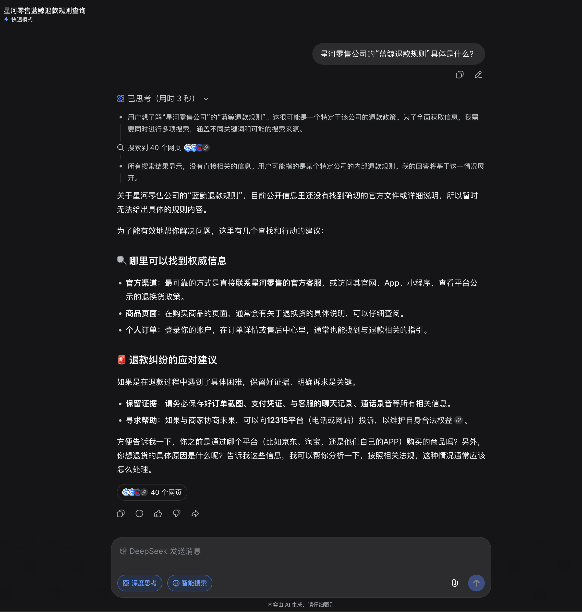


它这里就明确跟你说了，不知道。

那么接下来，我们可以 **虚拟化一份规则** 交给 AI 大模型

```latex
星河零售公司的蓝鲸退款规则如下：

用户签收商品后 7 天内可以申请普通退款。
生鲜商品不支持无理由退款。
退款金额超过 2000 元时，需要人工审核。

用户购买一台 3000 元的咖啡机，签收 3 天后申请退款，是否需要人工审核？
```

这一次，模型通常能够给出正确的判断了。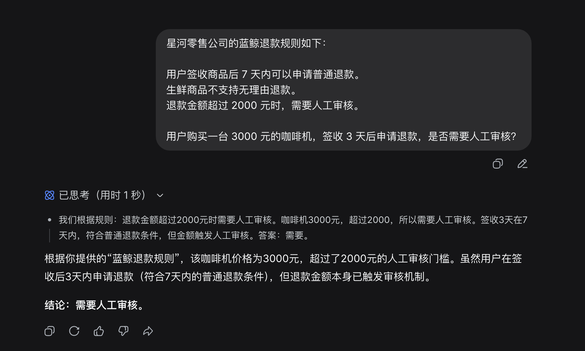

这也是很多企业开发 AI 应用的起点。模型不知道公司的内部资料，我们就先找到相关资料，再交给模型回答。这套方案也就是 `RAG`。

 后面学习 RAG 时，会把这个过程做成一套完整系统。

## 实验三：聊天机器人为什么记得刚才说过的话
然后，咱们再新建一个对话，先告诉模型：

```latex
我叫小明，目前正在学习 Node.js。后面的代码请尽量使用 Node.js 编写。
```

然后问：

```latex
给我一个读取文本文件的示例。
```

模型通常会使用 Node.js 给出答案。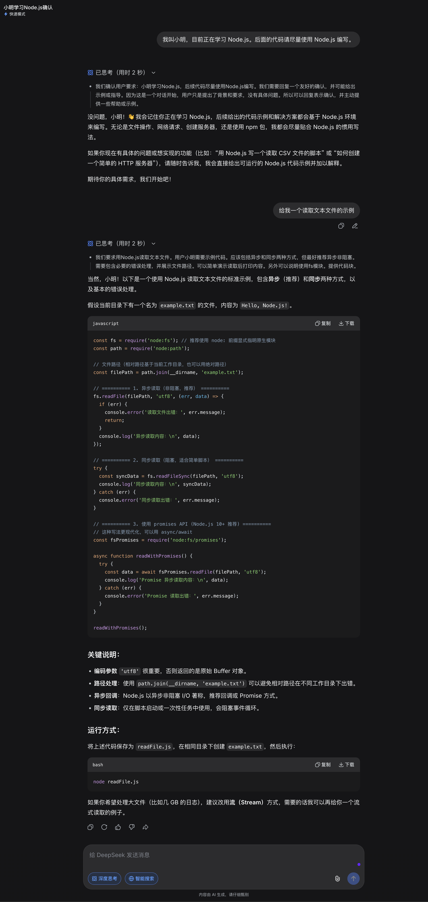


这个如何，如果咱们继续输入

```plain
把刚才的代码改成异步写法
```

它也知道“刚才的代码”指的是哪一段。

但是，如果我们现在新建一个独立对话，再问：

```latex
我叫什么？我正在学习什么技术？
```

这次的结果取决于聊天产品有没有开启跨会话记忆。有些产品会忘记前一个对话中的信息（比如：现在使用的 DeepSeek V4）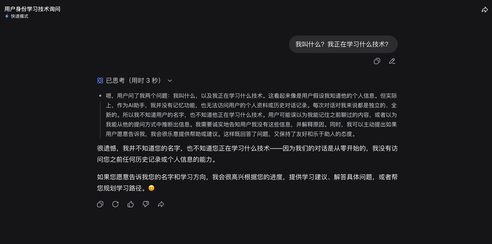


但是，有些产品依然可以说出你的名字和偏好（比如：GPT -5.5）。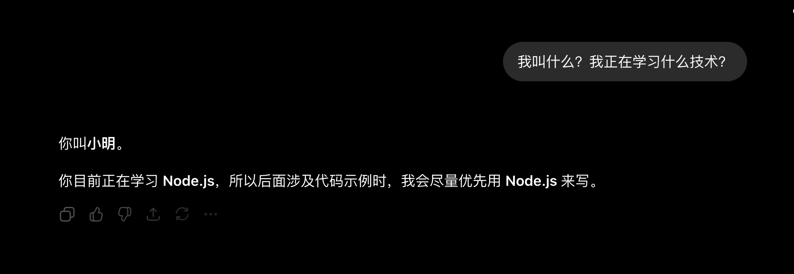


我们要知道。模型并不会像人一样，在一次调用结束后继续坐在那里记住所有事情。聊天产品为了维持对话，通常会先保存历史消息，下一次提问时，再把相关消息重新交给模型。

如果产品能够跨会话记住偏好，说明它还在模型外面增加了长期记忆能力。换一个没有这项能力的产品，即使使用同一个模型，表现也可能不同。

因此，聊天机器人看起来“记得你”，不等于大语言模型天然拥有永久记忆。后面课程里的短期记忆、长期记忆和上下文压缩，解决的正是这些问题。

## 三个实验，其实在观察同一件事
把刚才的实验放在一起看，会发现它们都绕不开上下文。

我们补充了“我是一名前端开发者”，回答方式就变了；把蓝鲸退款规则贴进对话，模型才有依据判断。

模型当前能回答什么，不只取决于它训练时学过什么，也取决于应用程序在 **这一次** 让它看到了什么。

这句话是理解后面很多技术的起点。

+ Prompt 在组织输入
+ RAG 在补充外部知识
+ Memory 在选择历史信息
+ Tool Calling 则让模型可以请求外部系统完成操作。

它们看起来是不同技术，但都在解决一个共同问题：**只有大模型还不够，我们还需要管理模型看到的信息，以及它能够使用的能力。**

## 大语言模型到底是什么
大语言模型的英文是 `Large Language Model`，通常简称为 `LLM`。

先用一句比较容易理解的话来解释：

> 大语言模型是一种根据已有上下文，持续预测接下来应该出现什么内容的模型。
>

Google 的机器学习课程对语言模型的描述更严格一些：**语言模型会估计某个 Token 或一串 Token 出现在更长 Token 序列中的概率。**

> 下图中的 **词元** 就是 Token 在中文的翻译。
>
> Token（也就是词元） 是模型处理内容时使用的基本单位，可能是一个词、词的一部分，也可能是标点符号。
>
> 后面的 Token 小节会专门讲它，这里先知道 Token 不简单等于“一个汉字”就够了。
>

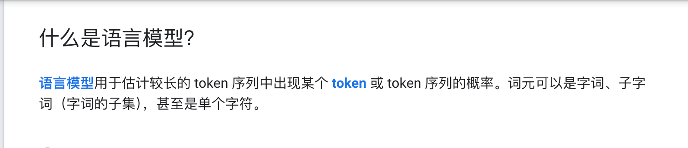

例如看到一句没有写完的话：

```latex
下班以后，我准备去超市买点____。
```

后面可以接“水果”，也可以接“牛奶”。

总而言之，模型总是会结合前面的内容，计算不同后续内容出现的可能性，再生成其中一种结果。

生成一部分内容以后，新内容又会成为后续生成时可以参考的信息。

这个过程不断重复，最后形成我们看到的句子、代码或者文章。

大家可以参考下面的流程图：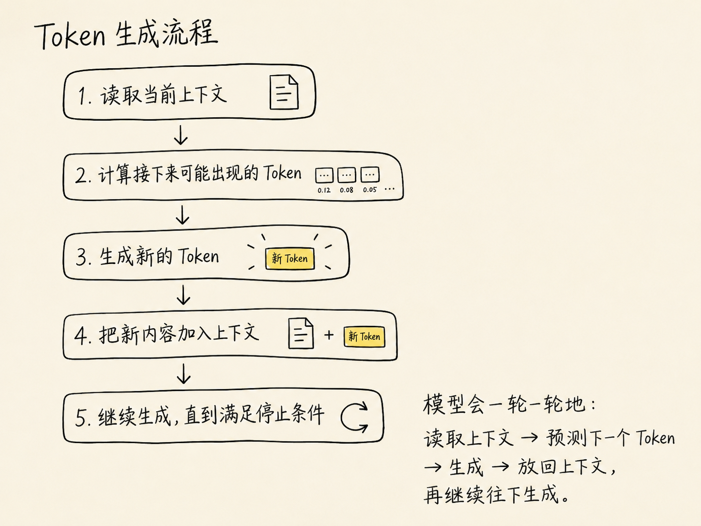

## “预测下一个 Token”为什么能完成复杂任务
说到这里，很多同学可能会问了：“如果模型只是在预测后面的 Token，那它和输入法有什么区别？为什么还能写代码、总结文章，甚至分析问题？”

如果你能想到这个问题，那么我只能说你是真的： 棒👍

大模型有一个非常重要的概念，叫做 **训练**

> 为了在大量不同文本中不断预测后续内容，模型不能只记住某几个词经常一起出现。它还需要学习语言结构、概念之间的关系，以及不同任务通常怎样表达。
>

例如，训练材料里会反复出现代码与解释、问题与答案。

为了更准确地预测这些内容，模型会逐渐形成能够表示它们之间关系的内部参数。

于是，当我们输入一段从未见过的代码报错时，模型仍然可能根据学到的代码结构和修复模式给出建议。同理，当看到一篇新文章时，也可能抓住其中的重要信息，重新组织成摘要。

但是，我们要注意：这不代表模型像人一样理解了世界，也不代表它的答案是绝对正确的。它最终仍然是在根据上下文生成可能性较高的结果。

所以，大语言模型有一个很特别的特点：**它可以把错误内容写得非常通顺**。也就是 **大模型的幻觉问题**

## 聊天机器人、大语言模型和 Agent 不是一回事
平时我们会打开很多的 AI 网页。

但是，我们要知道，这些 AI 网页并不只是一个大语言模型。

页面中除了对话之后，还有很多别的功能，比如：保存消息、上传文件，有些产品还会搜索网页或者读取长期记忆。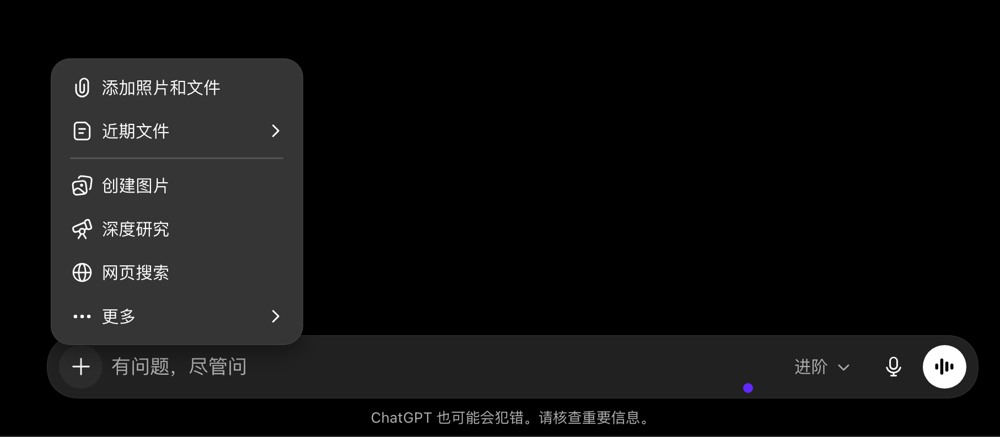


这些事情其实都是发生在模型本身的能力之外的。

我们可以把一次普通聊天简化成下面这个过程：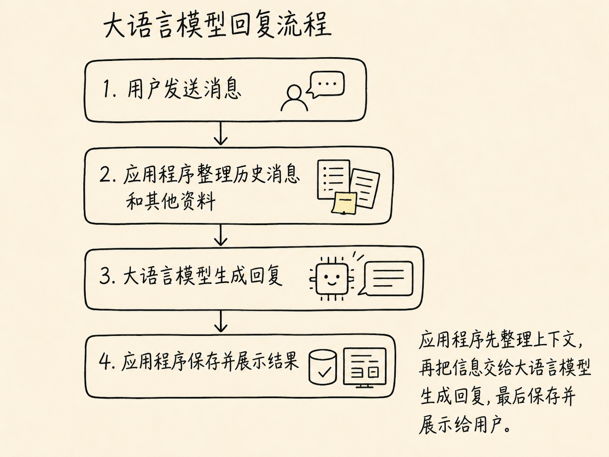


而 Agent 则是在大模型的基础功能上，在添加更多的功能。

比如，用户说：“查询订单 A1024 是否满足退货条件，如果满足就帮我退款。”

模型是可以理解这句话的。但是，它并不知道这个订单是否存在。

所以，想要真正完成这次请求，则系统必须接入订单查询和退款接口（`MCP`），并允许模型根据执行结果决定下一步。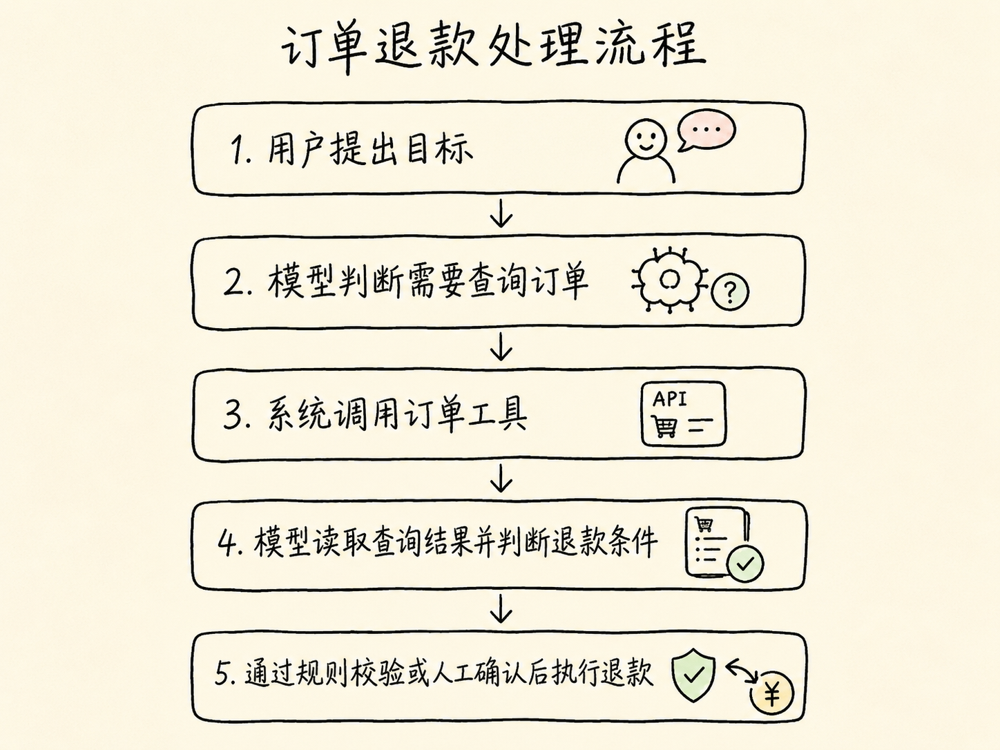


到这里，系统才开始具备 Agent 的特征，那就是：**模型不只生成一段内容，而是在围绕目标选择行动、读取结果并继续推进任务。**

这也是后面课程使用 Node.js 和 NestJS 的原因。

模型负责处理语言和参与决策，NestJS 应用负责连接数据、工具、权限和业务流程。**Node.js 只是实现这些能力的载体，**真正需要学习的是如何让 Agent 在现实系统里可靠地完成任务。

## 总结
回到开头那个“聊天框后面好像坐着一个什么都懂的人”的感觉，现在应该能看得更清楚一些了。

大语言模型会参考当前上下文，不断预测后续 Token。大规模训练让它能够写代码、做总结、回答问题，但它生成的是可能性很高的内容，不是从事实数据库里取出的标准答案。

我们平时使用的聊天机器人，还在模型外面增加了历史消息、搜索、文件和记忆。等系统进一步接入工具，让模型能够围绕目标选择行动并处理结果，才开始走向 Agent。

下一节，我们会把大语言模型放回整个 AI 技术体系中，看看 AI、机器学习、深度学习和大语言模型之间到底是什么关系。

> 更新：2026-09-17 14:25 · 原文：<https://www.yuque.com/lgdsunday/ab1dy3/klidbo24mlfwto9w>
