# 02-AI、机器学习、深度学习与大语言模型

上一节，咱们通过三个实验，简单认识了一下大语言模型。

然后问题就来了。

大语言模型和 AI 到底是什么关系？

平时大家还会听到机器学习、深度学习、生成式 AI、神经网络这些词。每一个词看起来都很牛批，但是放到一起以后，很容易彻底懵逼。

网上经常会用一张套娃图来解释，大致就是下面这样的：


这个关系看着是不是还挺专业的。

但是，如果你只看这张图，那基本没啥用。

因为你可能背下来了“大语言模型属于深度学习”，“深度学习属于机器学习”，“机器学习属于 AI”。确实没啥用

所以，这一节课，咱们就亲手训练一个模型出来，看看～～

## 先训练一个会识别手势的模型
这一次使用 Google 的 `Teachable Machine`。它是一个可以直接在浏览器里训练机器学习模型的实验工具，不需要安装环境，也不需要写代码。

官网地址在这里：[https://teachablemachine.withgoogle.com/train](https://teachablemachine.withgoogle.com/train)

现在打开大概就长成这样：

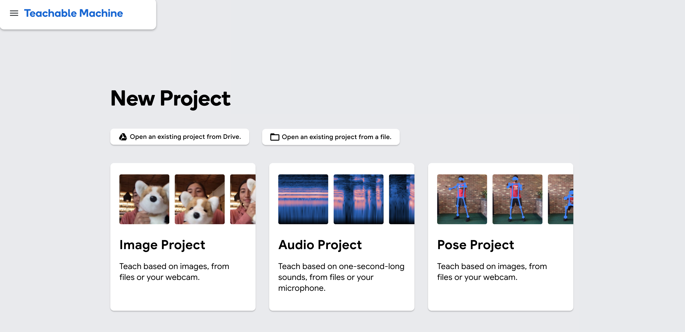


进入页面以后，选择 `Image Project`，再选择标准图片模型。

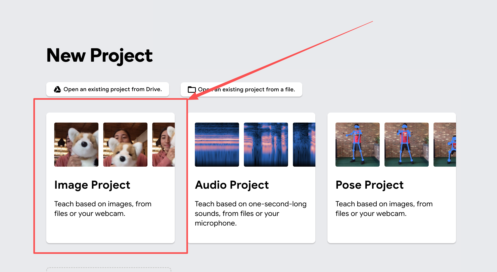


> Teachable Machine 的页面以后可能会发生变化。
>
> 只要找到图片分类项目就可以。咱们这次要做的事情很简单：给它一些图片，让它学会区分两个手势。
>
> 同时注意，大家可以直接在右下角的位置选择「简体中文」语言，美滴很
>
> 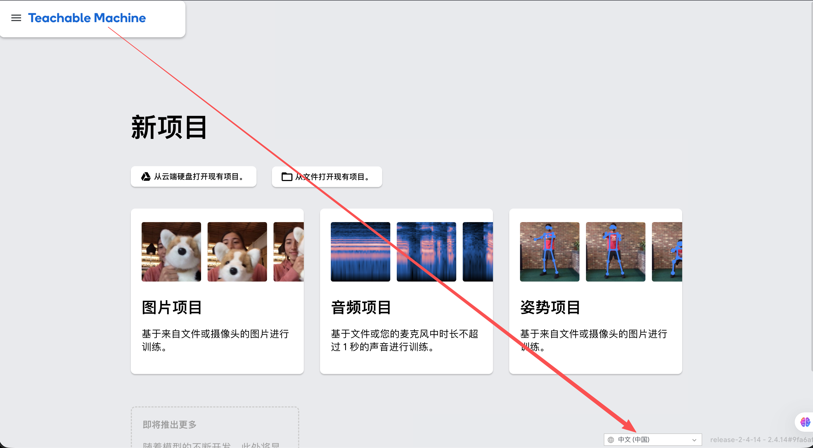
>

点击之后，他会给咱们两个选择，咱们就选择第一个「标准图像模型」就可以

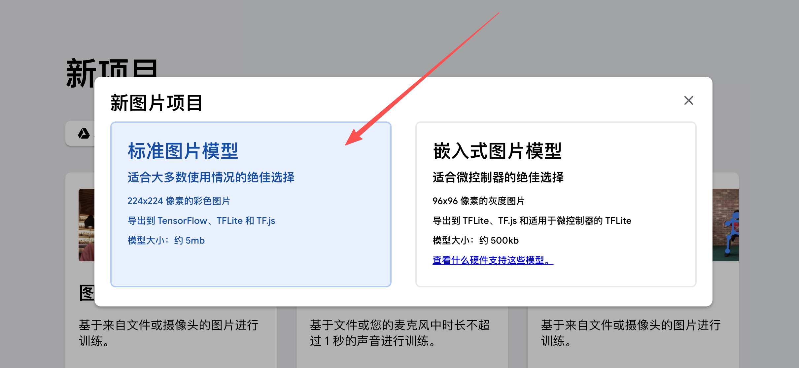


进入训练页面以后，可以看到两个分类。

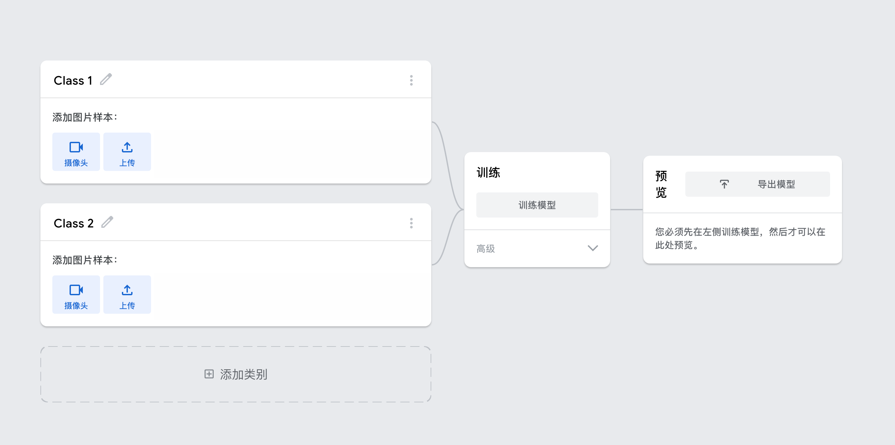


把 `Class 1` 改成：

```latex
握拳
```

把 `Class 2` 改成：

```latex
张开手掌
```

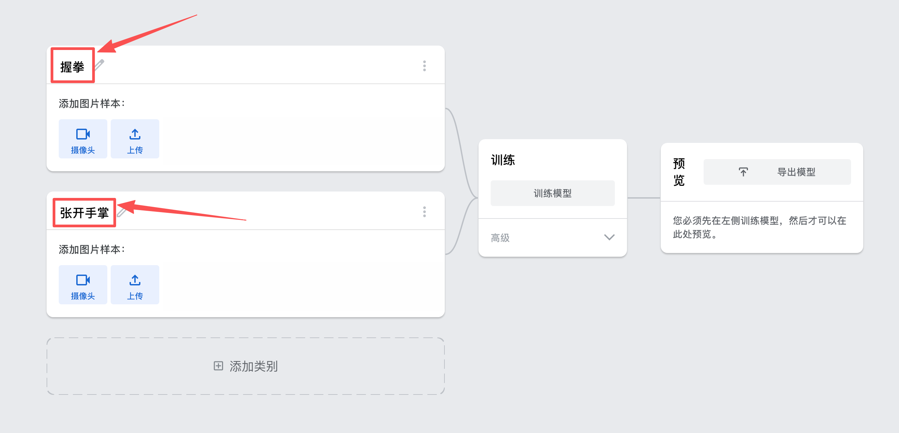


然后打开摄像头。

先对着摄像头握拳，为“握拳”录制一些样本。手可以稍微左右移动一下，也可以改变距离，不要让所有图片完全一样。

接着张开手掌，再为“张开手掌”录制一些样本。

每个分类录制几十张图片，就足够完成这次实验了。

这里给大家录了个视频，大家可以看下

[此处为语雀卡片，点击链接查看](https://www.yuque.com/lgdsunday/ab1dy3/nxup69tq2sia49a0#FKJoP)

准备完成以后，点击 `训练模型`。

等一会儿，页面右侧就会出现模型的预测结果。

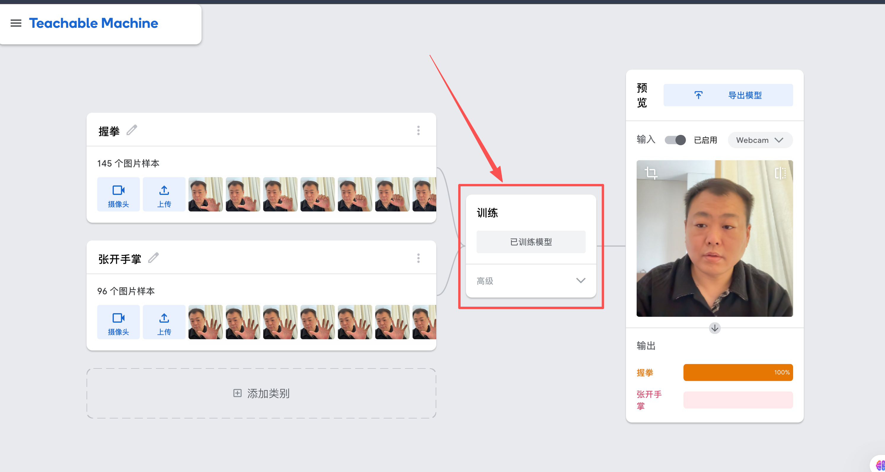


现在重新对着摄像头握拳。

如果训练正常，“握拳”的概率应该会明显升高。张开手掌以后，“张开手掌”的概率又会升高。就像下面这样

[此处为语雀卡片，点击链接查看](https://www.yuque.com/lgdsunday/ab1dy3/nxup69tq2sia49a0#jQ6PP)

咱们刚刚做的事情，看起来挺神奇。

整个过程中，我们没有写过任何的代码，我们只是给了它两组图片，并且告诉它每组图片分别叫什么。

模型通过这些带有正确答案的数据，学会了如何判断新的图片。

**这就是机器学习。**

## 机器学习，到底“学习”了什么
Google 对机器学习的解释是：使用数据训练一个叫作模型的软件，让它能够做出预测或者生成内容。

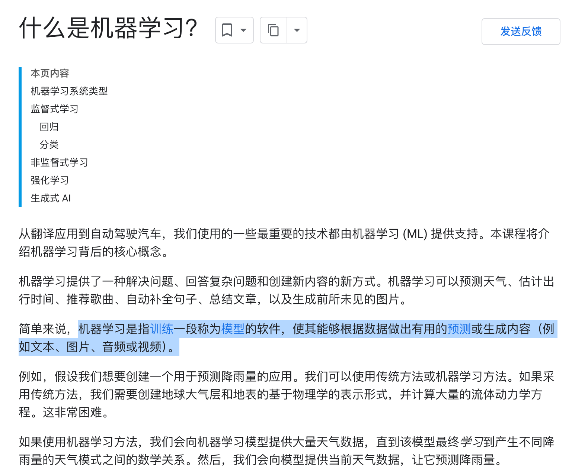


放到刚才的实验里，就很好理解了。

刚才录制的手势图片是 **训练数据**。

“握拳”和“张开手掌”是这些数据对应的正确答案，也叫作 **标签**。

点击训练模型以后，系统会不断调整模型内部的参数，让模型的预测结果尽量接近这些标签。这个过程叫作 **训练**。

训练结束以后，把一张新的摄像头画面交给模型，让它判断属于哪个分类。这个使用模型得到结果的过程，叫作 **推理**，英文是 `Inference`。

这里一定要注意。

> 机器学习中的“学习”，不是模型像人一样理解了什么是手，也不是它背下了一段关于拳头的定义。
>
> 它学习到的，是数据与结果之间的一种数学关系。
>

只不过，这种数学关系通常非常复杂，很难再用几个 `if...else` 把它完整写出来。

## 如果不用机器学习，会怎么样
假设，现在让咱们自己写程序识别“握拳”和“张开手掌”。

应该怎么写？

可能需要先找到手的位置，再识别每一根手指，判断手指有没有弯曲。还得考虑摄像头角度、光线、肤色和背景。

哪怕所有规则都写出来了，换一个角度，程序可能还是会判断错误。

传统程序的思路通常是：

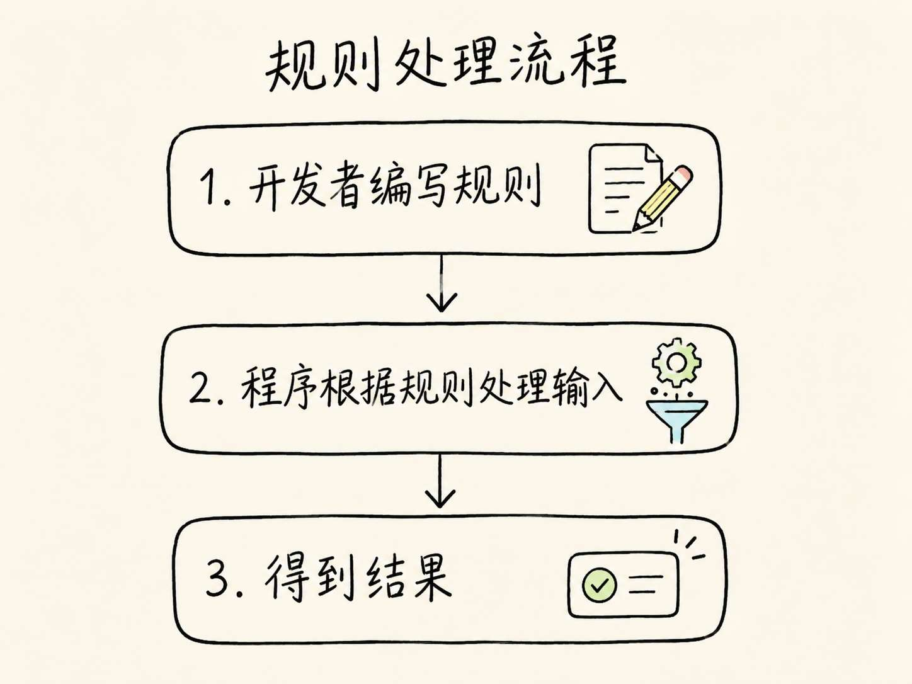

而机器学习和传统的代码是完全不同的，他是换了一种方式，大致流程是这样：

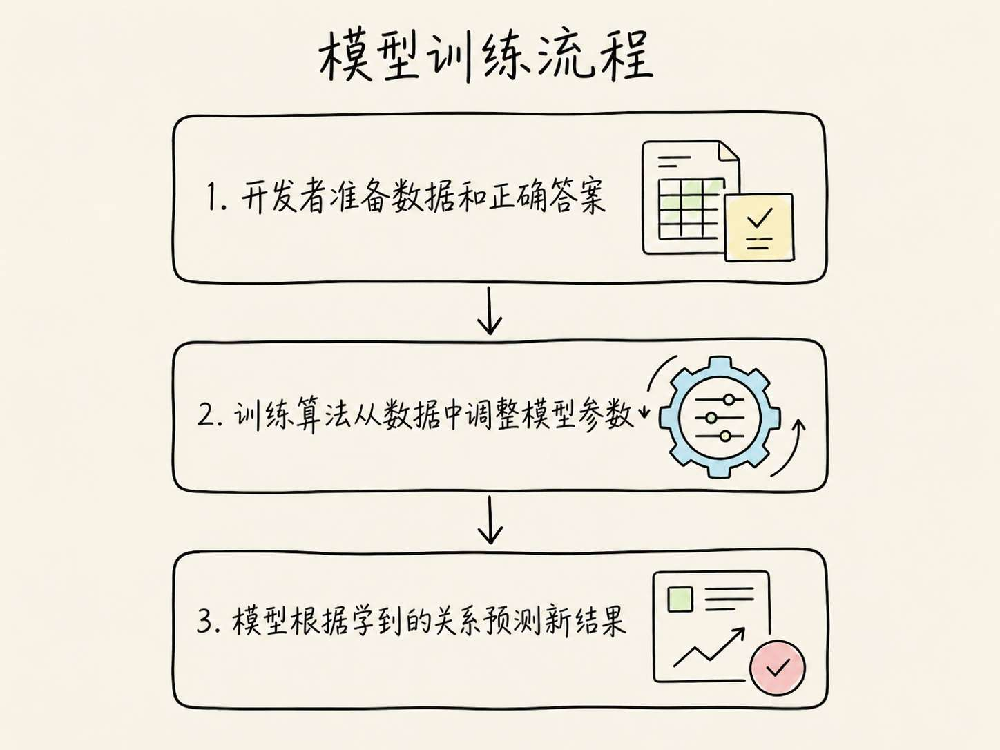


但是我们要注意哈。

这并不意味着机器学习比普通代码“高级”，更不意味着以后可以不写业务逻辑了。

他们之间只是适合的业务场景不同而已。

跟大家觉个例子，比如说：

+ 如果退款金额超过 2000 元必须人工审核，这条规则写成代码最清楚
+ 但是，要从用户发来的照片里判断商品有没有损坏，就很难提前写出完整规则。这种时候，机器学习往往更合适。

所以，他们的逻辑应该是：

**能写清楚规则的问题，优先考虑普通代码。规则很难写全，但手里有足够数据的问题，再考虑机器学习。**

## 再故意把模型教坏一次
刚才训练的模型，可能已经能够识别两个手势了。

接下来，**咱们故意做一个错误实验。** （后面会有录制好的视频流程）

把原来的样本清掉，重新录制。

这一次，录制“握拳”时，让手始终出现在白色墙壁前面；录制“张开手掌”时，让手始终出现在电脑屏幕前面。

训练完成以后，再换一个背景测试。

比如，在电脑屏幕前握拳，或者在白墙前张开手掌。

这个时候，模型的表现可能会明显变差。有时它甚至会把背景当成主要判断依据。

[此处为语雀卡片，点击链接查看](https://www.yuque.com/lgdsunday/ab1dy3/nxup69tq2sia49a0#OQVpf)

之所以会出现这种情况，是因为训练时提供给模型的，只有最终标签。

模型并不知道我们的真实想法是“请学习手指有没有张开”。它只会寻找训练数据中能够帮助降低错误率的模式。

如果“握拳”图片永远配着白墙，“张开手掌”图片永远配着电脑屏幕，那么背景恰好也是一个非常好用的判断线索。

这就是机器学习项目中非常麻烦的地方：**模型学到了规律，不代表它学到的是我们真正想要的规律。**

数据是否足够、分布是否合理、标签是否正确，都会直接影响模型最终的表现。

以后做 **Agent Evaluation（智能体评估/代理评估）** 时，咱们还会反复遇到类似问题。系统在测试集上表现不错，不代表它进入真实环境以后仍然可靠。

## AI 和机器学习不是同一个东西
做完上面的实验，再来看 AI 和机器学习的关系，应该就简单多了吧。

`AI` 是 `Artificial Intelligence` 的缩写，也就是人工智能。

它描述的是一个更大的研究领域和目标：让非人类的程序或模型，完成一些通常需要智能才能完成的复杂任务。

机器学习则是一种实现 AI 的重要方法。

它的特点，就是刚才看到的：**不是由开发者写出全部判断规则，而是让模型从数据中学习。**

但是，AI 并不只有机器学习。

比如早期的一些棋类程序（AlphaGo），会使用人工编写的规则和搜索算法，从大量可能走法中选择下一步。它可以被认为是 AI，但它不一定通过训练数据学习。

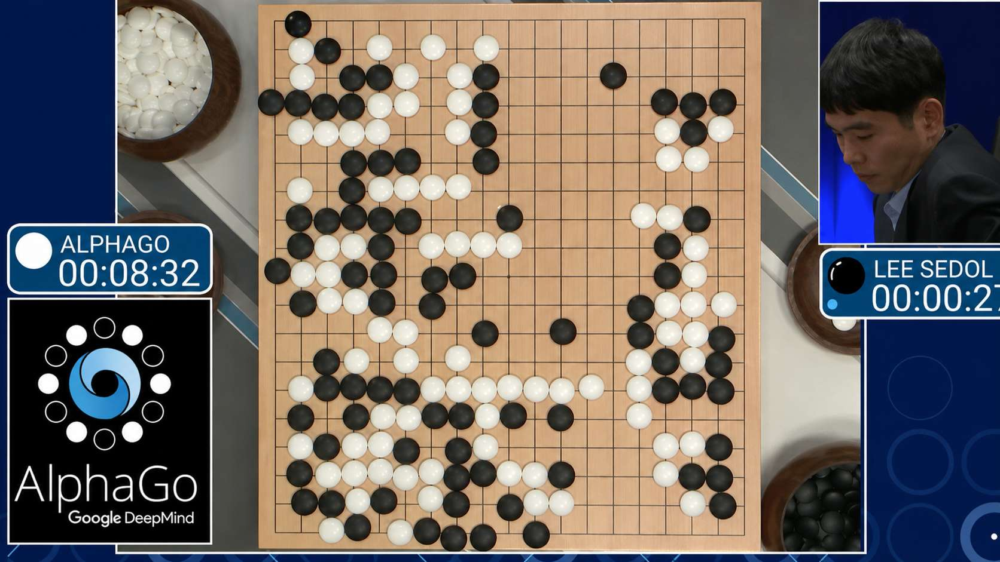


所以更准确的关系是：AI 是一个更大的领域，机器学习是实现 AI 的一种重要方法，但不是所有 AI 系统都使用机器学习

大家可能会看到平时很多的产品宣传里，经常会把 AI 和机器学习混着说。这个没有必要太较真。

## 深度学习的“深”，到底是什么意思
现在继续往下看。

机器学习里面，也有很多不同的模型和算法。

一些传统机器学习方案，会比较依赖开发者提前整理好的 **特征**。

举个例子：比如要预测一套房子的价格，我们可以把面积、房间数量、楼层和距离地铁站的距离交给模型。模型根据这些特征学习它们与房价之间的关系。

但是，图片就麻烦多了！

摄像头拿到的是一大片像素。让开发者手动写出“哪些像素组合代表一根手指”，基本不现实。

**神经网络** 就是为了处理这类复杂关系而发展起来的一类模型结构。

它会让数据经过一层又一层的计算，每一层继续处理上一层得到的结果。

对于图片识别，可以先用下面这个非常简化的过程来理解：

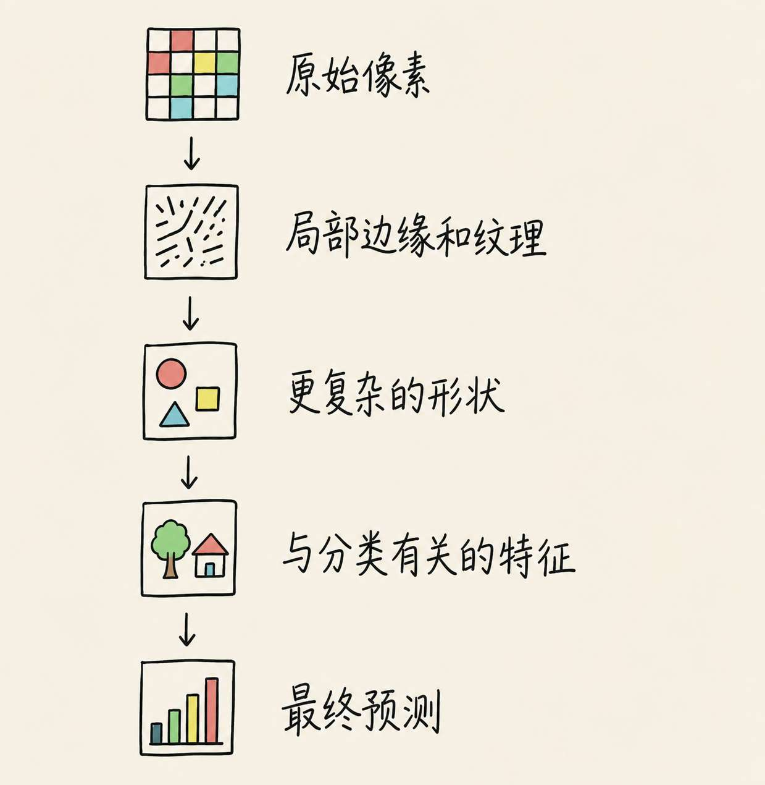


当神经网络中包含多层这样的处理结构时，通常就会被称为 **深度神经网络**。

使用深度神经网络进行学习，就是常说的 **深度学习**。

所以，深度学习里的“深”，主要说的是神经网络具有多层结构。

而不是因为它思考得特别深 😂。

Teachable Machine 的图片项目（就是咱们上面做的手势模型训练），底层使用的就是神经网络相关技术。它还会借助已经训练过的图片模型，再使用我们提供的少量样本完成新的分类任务。这种复用已有模型能力的方式，叫作 **迁移学习**。

要不然，只靠刚才随手录制的几十张图片，想从零训练一个真正能识别图片的深度学习模型，基本不现实。

## 那么，大语言模型在什么位置
现在终于可以把大语言模型放进来了。

大语言模型首先是一种 **语言模型**。上一节已经讲过，它会根据上下文，估计后续 Token 出现的可能性。

现代大语言模型通常基于深度神经网络构建，会使用大量文本和其他数据完成训练。

所以它同时属于机器学习，也属于深度学习。重新看下这张图

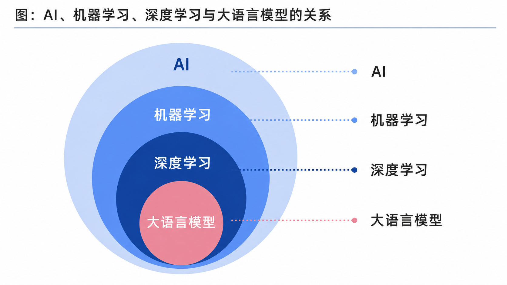


至于“大语言模型”中的“大”，通常指的不光是训练数据很多，还涉及模型参数规模和训练所需的计算资源。

这些概念放到一起，他们的关系就是上图这样的

不过，这张图只能说明技术上的包含关系。

它不能说明一个完整产品是怎么工作的。

比如，ChatGPT、DeepSeek 这样的聊天产品不是只有一个大语言模型（具体的细节上一小节提到过，这里就不多说了）。

**Agent 是一套应用系统。**

它可以使用大语言模型理解任务，也可以连接搜索、数据库、普通代码和其他机器学习模型，然后围绕目标推进任务。

所以，Agent 和前面这些概念的关系，更像下面这样：

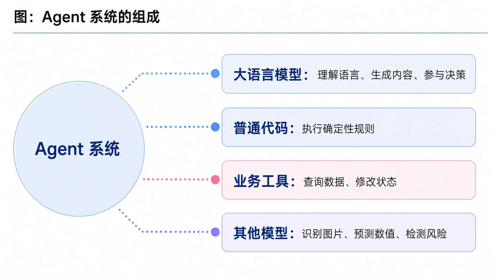

咱们需要知道的是真正的 Agent 全栈开发，不是只会调用一个大语言模型。

一个完整的 Agent 系统是有多个不同的能力与功能共同组成的。

## 来判断几个系统
最后，咱们做一个简单判断。

大家可以猜一下，下面的这几个系统，是应该属于哪种系统。可选的答案有 5 个：普通程序、AI、机器学习、深度学习、Agent 系统。

来了哈：

+ 使用 `if` 判断退款金额是否超过 2000 元
+ 使用搜索算法下棋的程序
+ 根据历史垃圾邮件训练出来的分类模型
+ 使用多层神经网络识别图片的模型
+ 根据上下文生成文字的大语言模型
+ 能查询订单、调用退款接口并持续处理任务的系统

大家可以先猜猜。

然后公布答案

---

| 系统 | 应该怎么理解 |
| --- | --- |
| 使用 `if` 判断退款金额是否超过 2000 元 | 普通程序。规则由开发者直接写出 |
| 使用搜索算法下棋的程序 | 可以属于 AI，但不一定使用机器学习 |
| 根据历史垃圾邮件训练出来的分类模型 | 属于机器学习 |
| 使用多层神经网络识别图片的模型 | 属于深度学习，同时也属于机器学习和 AI |
| 根据上下文生成文字的大语言模型 | 属于深度学习、机器学习和 AI |
| 能查询订单、调用退款接口并持续处理任务的系统 | 属于 Agent 系统，内部可能同时使用模型、工具和普通代码 |


咱们一定得知道：

> AI 描述的是一个大的领域，机器学习和深度学习描述实现智能能力的方法，大语言模型是一类具体模型，而 Agent 是把模型和外部能力组织起来完成任务的系统。
>

## 总结
回头看一下刚才训练的手势模型。

我们没有写出识别拳头的完整规则，而是准备图片和标签，让模型从数据中学习。这就是机器学习。

图片中的规律非常复杂，模型需要依靠多层神经网络处理像素和特征，这就进入了深度学习的范围。

大语言模型同样建立在深度学习之上，只不过它主要处理的是语言与 Token，并且拥有非常大的参数规模和训练数据。

而 Agent 并不在这层套娃关系里面。

它是一套真正工作的应用系统，会根据任务选择大语言模型、其他模型、普通代码或者业务工具。

下一节，咱们会继续深入大语言模型内部，看看它收到一段输入以后，到底是怎么一步一步生成内容的。````

> 更新：2026-07-04 17:11 · 原文：<https://www.yuque.com/lgdsunday/ab1dy3/nxup69tq2sia49a0>
