# 03-大语言模型究竟是如何生成内容的？

平时使用 AI 聊天产品时，大家应该都见过这样的效果：

发送一个问题以后，答案不是一次性出现在页面上的，而是像打字一样，一点一点显示出来。

> PS：**不要认为是因为 SSE 导致的打字效果。这就大错特错了！**
>
> SSE 只是流式传输，前端通过 UI 展示出打字效果而已，这和 大模型本身的生成原理，**毫无关系！！！**
>

[此处为语雀卡片，点击链接查看](https://www.yuque.com/lgdsunday/ab1dy3/mezm7hq5m7inu3xi#Y7Qem)

很多同学第一次看到这个效果，可能会觉得：“模型应该已经把完整答案写好了，现在只是在慢慢展示给我看。”

但是，实际并不是这个样子的。

还记不记得咱们在 [第一章：01 - 从聊天机器人开始认识大语言模型已付费](https://mp.weixin.qq.com/s/Ule7xfE7PBWi5hURNC1feQ) 的时候提到过：**大语言模型是一种根据已有上下文，持续预测接下来应该出现什么内容的模型**

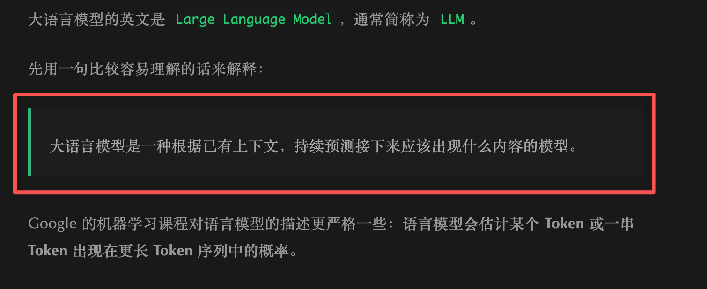


也就是说，如果我们仅从逻辑上看，大语言模型甚至会出现 **先生成下一个 Token，再把生成的 Token 插入到原有的上下文，然后再继续生成后面的内容的情况**

也就是说，当页面上只出现半句话时，另外半句话要写啥，大模型可能还真的没有  “想出来”。

那么这个时候问题就来了。

**大模型到底是根据什么样的逻辑、什么样的过程来生成语言内容的呢？**

**大模型到底是通过什么样的逻辑、什么样的方式来生成文字内容的呢？**

这就是咱们这一小节要说的。

> PS：
>
> 本节只解释文本生成的大致过程。
>
> 至于延伸出的更多的复杂逻辑，比如：Token 切分、Temperature 和 Top P 、流式响应如何传到前端 这些。
>
> 后面会分别详细讲解。
>

## 做个实验：让模型补完一句话
先打开任意一个 AI 聊天工具（咱们这里使用 `DeepSeek`），新建一个对话

> 深度思考 和 智能搜索，可开可不开。不影响咱们这次实验
>

在模型上输入下面这段内容：

```latex
请补全下面这句话，只补充后面的内容，不要解释：

退款金额超过 2000 元时，需要
```

模型很可能会继续写 “需要人工审核”。也可能会回复 “提交人工审核”。

而 DeepSeek V4 给我的回复是这样的

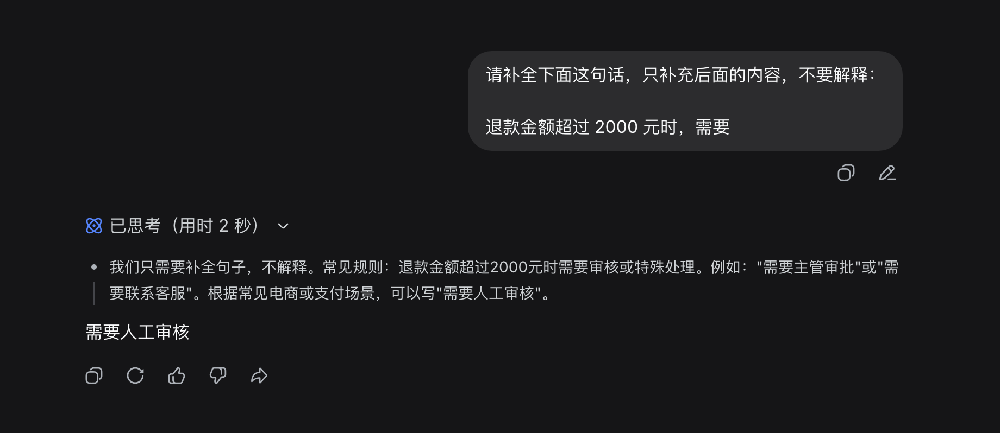


现在，**新建一个完全独立的对话**，再输入：

```latex
星河零售公司的退款规则规定：
退款金额超过 2000 元时，系统会自动拒绝退款。

请补全下面这句话，只补充后面的内容，不要解释：

退款金额超过 2000 元时，需要
```

这一次，模型生成的内容通常会发生变化。

比如：DeepSeek 给我的回复是下面这样的（大家如果用别的模型，应该也差不多）

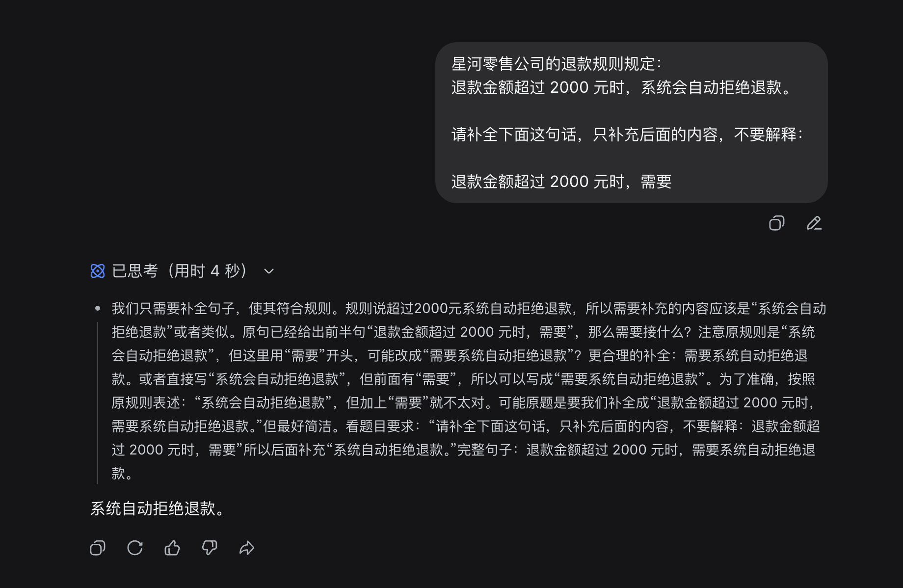


但是这个时候大家可以对比这两次 AI 回复的内容。

在这两次问答中，「退款金额超过 2000 元时，需要」这段话是没有变化的

但是两次 AI 回复的内容却完全不一样。

+ 模型第一次生成时，会结合训练中学到的常见表达，认为“人工审核”是一个很合理的后续内容。
+ 但是，在第二次生成时，上下文已经明确提供了星河零售公司的规则。于是，“自动拒绝退款”变成了更合理的后续内容。

那么，由此我们可知：

**大语言模型不是先找到一个固定答案，再把它复制出来。它会根据当前上下文，重新计算接下来出现什么内容更合适。**

不过，只观察最终答案还是不够直观。

咱们继续看一个可以把大模型内部的工作过程直接展示出来的工具 `Transformer`

## 看看模型生成下一个 Token 时发生了什么
打开下面这个网站：[Transformer Explainer](https://poloclub.github.io/transformer-explainer/)

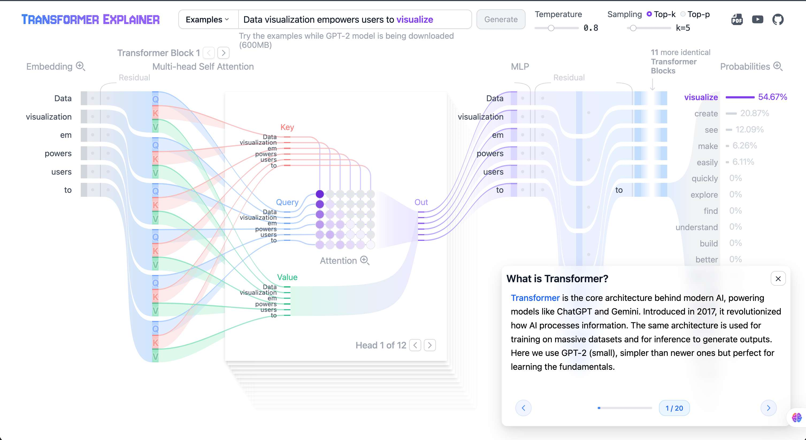


Transformer Explainer 是一个 **可互动 + 可视化** 的工具。我们可以使用它来直观的看到 大模型（如：GPT）的工作原理。

这个工具目前使用的是 `GPT-2` ，可能会有点老了。但是这并不影响，因为咱们主要看的是模型内容的生成原理，用的是什么模型无所谓。

但是，咱们要注意哈：

> Transformer Explainer 主要用于教学演示。
>
> 咱们用它理解核心流程，**不要把其中展示的模型规模和实现细节，当成所有现代大语言模型的通用结构。**
>
> 同时，他这个页面是全英文的，不太好看。大家可以尝试把它翻译成中文。
>
> 这里给大家推荐一个叫做 `Sider` 的 Chrome 插件，可以直接翻译页面
>
> 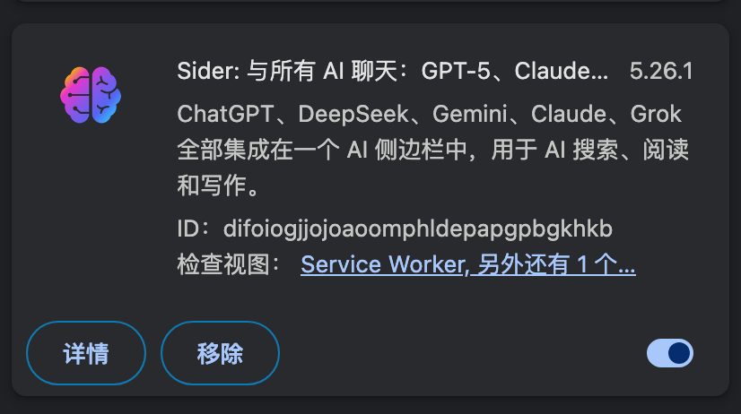
>
> 翻译之后大概页面大概就长这样：就好看很多了。
>
> 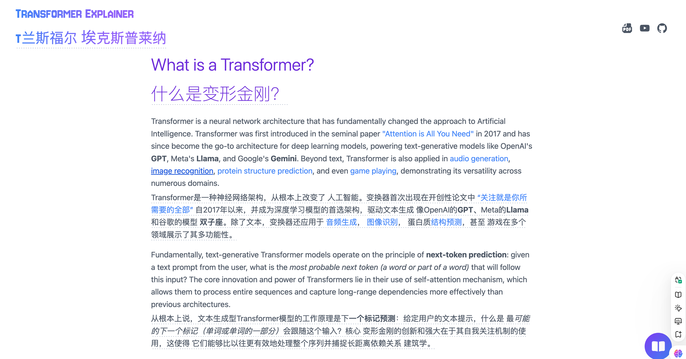
>

接下来回到正题，咱们来看 `Transformer Explainer ` 怎么使用。

在整个页面的顶部，咱们可以看到这样一块内容：

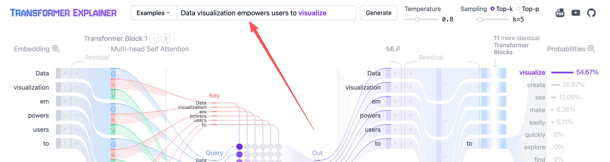


这块内容中，黑字部分 `Data visualization empowers users to` 就是我们在模型上输入的内容。蓝字部分 `visualize` 就是预计模型会生成的内容。

我们把这个英文内容转化成中文，像之前一样，先输入 `退款金额超过 2000 元时，需要` ，然后点击 `Generate` 按钮

> **特别注意：** 这里不支持直接输入中文，如果输入中文，则预测生成的内容会无法解析，以 ❓ 的形式展示。
>
> 所以，我们需要通过翻译软件把中文转化成英文然后输入。
>
> 比如：上面的中文转化之后的英文就是 ：`When the refund amount exceeds 200, it is necessary to`
>

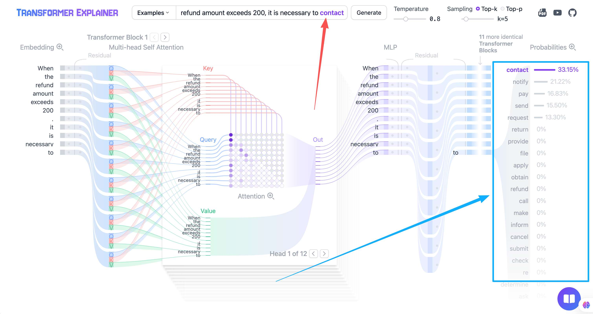


+ 红色箭头指的地方就是：模型预测最可能出现的 **下一个 Token** 
+ 蓝色箭头指的地方就是：各个 Token 出现的不同概率

这里的整张表就表示了 模型预计生成下一个 Token 的详细流程。

首先，先看左上角的 **Temperature（温度）** 和 **Sampling（采样）**

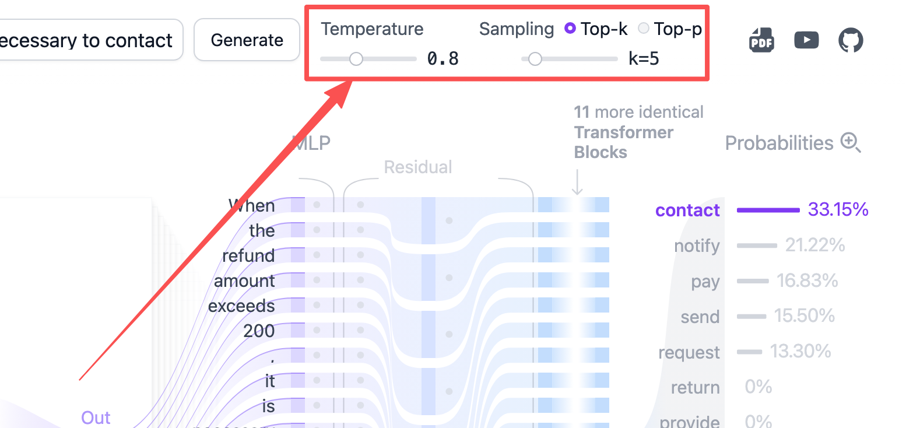


这里会涉及到 Agent 的一些概念，咱们现在先讲一下，让大家大致有个了解。看不太懂也没关系，后面会再详细解释

+ **Temperature（温度）**：它的作用是 **控制生成结果的随机性（也叫做 “创造性”）。** 较低的温度（如 0.2～0.5）的时候：模型倾向于选择概率更高的词，会输出更确定（保守）的结果，表现就是会让人感觉有点呆。较高的温度（如 1.0 以上）：概率会分布的更平均，模型更愿意尝试低概率的词，输出更多样、有创意的词汇，但是可能表现的内容不连贯。咱们这里使用的 `0.8` 是一个常见的 “温度”，属于大部分情况下会使用的
+ **Sampling（采样）**：表示为 **一种生成策略**，指的是 不总会选择出现概率最高的词，而是会按照概率分布随机抽取下一个词。它具体呈现分为两种：
    - **Top‑k**：限制采样的范围。比如这里的 Top-k = 5。则表示 **每一步只考虑最可能的 5 个词，忽略其他所有词。** 这也是为什么 **红色区域** 的可选词汇只有 5 个的原因

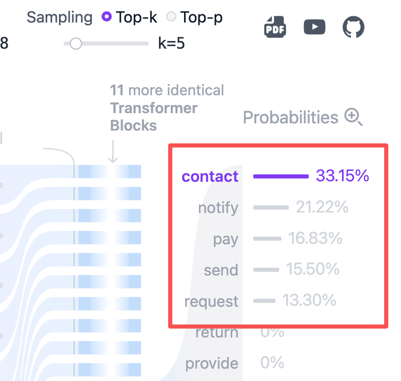

+ **Top‑p**：动态限制候选词范围的方法。比如这里的 Top-p = 0.5 （也就是 50%） 就表示：模型会选取所有概率最高的若干个词，使它们的概率和刚好 ≥ 50%。以咱们这里为例 那就是只会选择 红框里面 的词

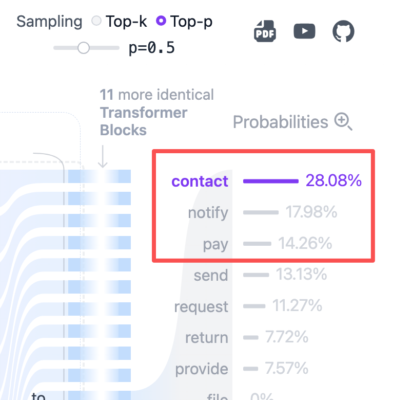


明确好了这个概念之后，接下来咱们来看这个大的流程图

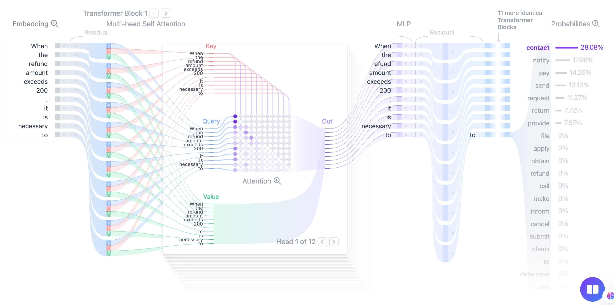


这个流程图其实所描述的只有一个事情，那就是：根据左侧已经存在的内容，计算下一个 Token 可能是什么（最右侧）。

现在，咱们从头把这个过程拆开。

这里咱们输入的内容是 `When the refund amount exceeds 200, it is necessary to（翻译：退款金额超过 2000 元时，需要）`

这个时候我们要注意 **模型并不能直接处理这些文字。** 神经网络真正能够计算的是数字。

所以，文字进入模型以后，需要先被切分成一组更小的单位，也就是 `Token`。每个 Token 会对应一个数字编号。

为了方便理解，咱们先使用一个并不严格的示意：

```latex
When the refund amount exceeds 200
  ↓
["When", "the", "refund", " amount", "exceeds"]
  ↓
[1042, 8251, 3067, 19244, 822]
```

真实模型具体会如何切分，取决于它使用的 `Tokenizer`。

有些常见词可能是一个 Token，有些词会被拆成多个 Token，空格和标点也可能单独占用 Token。

下一节咱们会专门研究 Token。这里先记住一件事：**模型收到的不是一整句话，而是一串 Token 编号。** 编号本身仍然没有表达出任何含义。比如：编号 `1042` 比编号 `822` 大，不代表它表达的内容更重要。

所以，这种 Token 编号，并不能直接表示出每个单词具体代表了什么意思。

因此，模型还需要把每个 Token 编号转换成一组可以参与计算的数字。这个过程会用到 `Embedding`，也就是 **向量化**

这个流程，大家可以先把它理解成这样：

```latex
Token 编号 → 一组能够表示该 Token 的数字
```

这组数字通常被称为 **向量**。

这个向量大家可以理解为一个数组。类似于 `[0.12,  -0.38,  0.07,  1.24,]` 这样。

只不过这个数组极大。比如：`When` 这个单词，就由 `768` 个维度组成

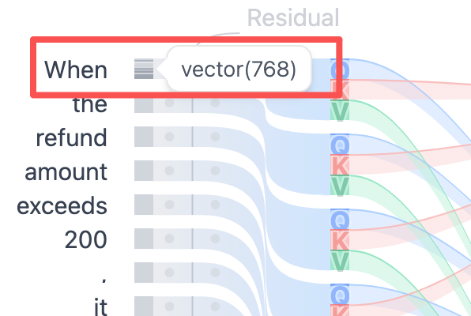


大模型就是通过 **Token 编号 来找到 这个 768 个维度组成的向量数组**， 从而知道每个 Token 代表的含义是什么的。

我生成了一张图片，可以更清楚的表示全过程：

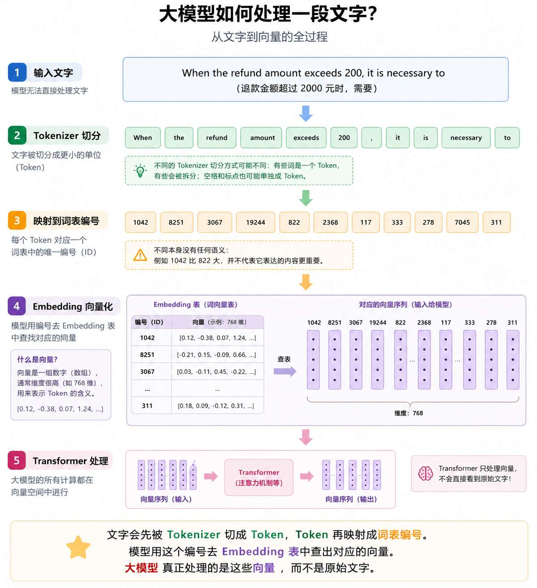


## Transformer 如何处理上下文
到现在咱们基本上把整个的输入表示理解清楚了。

完成输入表示以后，内容会进入模型内部的多层网络，也就是中间这一块的内容。这块内容会有点抽象，我尽量跟大家进行解释


现代文本生成大模型通常基于 Transformer 或相关架构构建。

Transformer 中有一个非常重要的机制，叫作 `Attention`，也就是注意力。

Attention 这个词听起来就有点抽象 😂。

咱们先看一句话：

```latex
小明把咖啡递给小红，因为她今天特别困。
```

当模型处理“她”时，需要结合前面的内容，判断“她”更可能指的是谁（小红）。

当模型继续生成“特别困”后面的内容时，会参考前面的关键信息。比如：“小红”、“咖啡”、“困”相关的信息就比 “把”、“递给” 更重要。

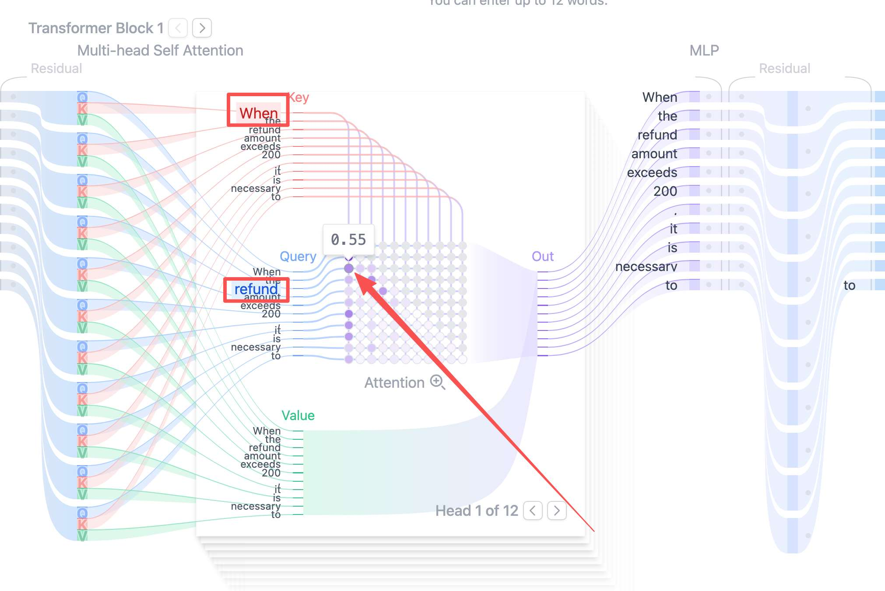


比如上图中的 0.55，就表示 **在当前这一层、当前这个注意力头里，模型在处理 **`refund`** 这个 token 时，对前面的 **`When`** 这个 token 给予了 0.55 的注意力权重。也就是说，模型认为 **`When`** 对更新 **`refund`** 的当前语义表示有一定参考价值。**

所以，Attention 做的事情，可以先理解为：

> 模型在处理当前内容时，会计算上下文中哪些部分与当前任务更相关，并组合这些信息。
>

## 模型如何决定接下来生成什么
经过 Transformer 处理以后，模型需要为词表中的候选 Token 计算分数。

这个分数通常叫作 `Logit`。

> Logit 是模型根据当前上下文，为每个候选 Token 计算出的原始分数。
>

接着，这些分数会经过 `Softmax` ，`Softmax`  会把这些分数转换成概率分布。

为了方便大家理解，咱们可以假设模型看到：

```latex
退款金额超过 2000 元时，需要
```

计算出的部分候选结果是：

| 候选内容 | 概率 |
| --- | ---: |
| 人工 | 54% |
| 进行 | 21% |
| 提交 | 13% |
| 系统 | 7% |
| 其他候选 | 5% |


这张表只是用来解释过程，并不是真实模型在当前输入下的实际概率。

但是，它能够说明一个重要问题：

**模型得到的是一组候选内容的概率分布，不是一个已经写好的标准答案。**

接下来，系统会根据当前的解码策略，从候选 Token 中选择一个。

最简单的方式，就是每次都选择概率最高的候选。

真实应用也可以按照概率进行采样，让生成结果保留一定变化。

至于 Temperature、Top P 为什么会改变选择范围，咱们会在后面的采样参数的时候再详细研究。

这里大家不要把“概率”理解成“答案正确率”。

模型认为某个 Token 很适合接在后面，只代表它在当前上下文中很可能出现。

一个事实错误的句子，同样可能写得非常通顺。

这也是模型会产生幻觉的原因之一。

## 生成出来的内容，会立刻影响后面
假设模型刚刚选择了：

```latex
人工
```

原来的上下文就会变成：

```latex
退款金额超过 2000 元时，需要人工
```

模型会根据这段更新后的内容，再次计算下一个 Token。

这一次，候选内容可能变成：

| 候选内容 | 概率 |
| --- | ---: |
| 审核 | 71% |
| 确认 | 12% |
| 处理 | 9% |
| 其他候选 | 8% |


如果选择了“审核”，上下文又会继续变成：

```latex
退款金额超过 2000 元时，需要人工审核
```

然后继续预测。

这类根据之前内容不断生成后续内容的方式，通常叫作 **自回归生成**，英文是 `Autoregressive Generation`。

说白了就是：**从逻辑上看，模型每次只向前走一步，刚走过的路，又会影响它下一步往哪里走。**

这也解释了为什么模型有时会在回答中途逐渐跑偏的问题。

只要前面某一步选中了不太合适的内容，后续生成就会基于这个新上下文继续展开。内容越往后走，偏差可能越明显。

## 第一个 Token 和后面的 Token 有什么不同
> 这个涉及到的概念有点多，后面学习模型延迟、吞吐与稳定性时，咱们还会继续研究这里提到的问题。
>
> 目前这个模块，大家可以选看。不看也不影响
>

虽然模型一直在预测后续 Token，但是第一次预测和后面的逐步生成，并不完全一样。

当用户发送一段输入以后，模型需要先处理这段输入中的全部 Token，并建立后续生成需要使用的中间状态。

这个阶段通常叫作 `Prefill`。

Prefill 完成以后，模型才会生成第一个输出 Token。

接下来，模型进入 `Decode` 阶段，继续根据已有内容逐步生成新的 Token。

如果每生成一个 Token，都重新计算前面全部内容，会浪费大量计算。

因此，推理服务通常会使用 `KV Cache` 保存 Attention 计算中可以复用的中间结果。生成新 Token 时，模型可以读取缓存，而不需要从头计算全部历史内容。

这也解释了为什么输入特别长时，等待第一个 Token 出现可能会变慢；而回答不断变长以后，KV Cache 又会占用越来越多的内存。


## 用 Node.js 模拟一次生成循环
到这里，生成过程已经讲得差不多了。

不过，只看文字还是有点抽象。

接下来咱们用一个很小的 Node.js 代码，把“计算候选、选择结果、追加内容、继续预测”的过程跑一遍。

> 但是要注意哈。这个程序不是大语言模型。
>
> 它没有 Transformer，也没有经过训练。候选结果是提前写好的，只用来观察自回归生成循环。
>
> 在这次（包括以后）的代码，大家其实不需要进行手写。因为未来都是 VibeCoding 的时代了，手写代码会越来越少。
>
> 所以，对于大家来说，核心是 **关注业务流程** ，而不是手写代码
>

创建一个空目录：

```bash
mkdir llm-generation-demo
cd llm-generation-demo
```

在目录中创建 `generation-loop.mjs`：

```javascript
// candidateMap 用来模拟：在不同上下文下，模型可能生成的候选 Token 及其 Logit 分数
// Map 的 key 表示“当前上下文”
// Map 的 value 表示“候选 Token 列表”
// 每个候选项的格式是：[候选 Token, Logit 分数]
const candidateMap = new Map([
  [
    "周末我准备",
    [
      ["学习", 3.2],
      ["休息", 2.6],
      ["出门", 2.1],
    ],
  ],
  [
    "周末我准备学习",
    [
      [" Agent", 3.8],
      [" Node.js", 2.7],
      ["英语", 1.6],
    ],
  ],
  [
    "周末我准备学习 Agent",
    [
      ["。", 3.1],
      ["开发", 2.4],
      ["相关知识", 1.8],
    ],
  ],
  [
    "周末我准备学习 Agent。",
    [
      ["<EOS>", 4.2],
      ["然后", 1.1],
    ],
  ],
]);

/**
 * 将候选 Token 的 Logit 分数转换成概率分布
 *
 * Logit 是模型输出的原始分数，不能直接当作概率使用。
 * softmax 的作用是：
 * 1. 把所有候选 Token 的分数转换成正数
 * 2. 再归一化，让所有候选 Token 的概率加起来等于 1
 */
function softmax(candidates) {
  // 找出最大的 Logit
  // 这里用它做数值稳定处理，避免 Math.exp(logit) 计算时数值过大
  const maxLogit = Math.max(...candidates.map(([, logit]) => logit));

  // 对每个 Logit 做指数运算
  // logit - maxLogit 不会改变最终 softmax 的概率比例，
  // 但可以避免指数运算时出现数值溢出
  const items = candidates.map(([token, logit]) => [
    token,
    Math.exp(logit - maxLogit),
  ]);

  // 计算所有指数值的总和
  // 后面需要用每一项除以总和，得到归一化概率
  const total = items.reduce((sum, [, value]) => sum + value, 0);

  // 返回每个候选 Token 对应的概率
  return items.map(([token, value]) => [token, value / total]);
}

/**
 * 从概率列表中选择概率最高的 Token
 *
 * 这里采用的是“贪心选择”：
 * 每一步都直接选择当前概率最高的 Token。
 *
 * 真实大模型生成时，也可以使用 temperature、top-k、top-p 等采样策略，
 * 不一定每次都选择概率最高的 Token。
 */
function chooseHighest(probabilities) {
  return probabilities.reduce((best, current) =>
    current[1] > best[1] ? current : best,
  );
}

// 初始上下文
// 可以理解为用户已经输入给模型的内容
let context = "周末我准备";

// 最多生成 10 步，防止生成过程无限循环
for (let step = 1; step <= 10; step += 1) {
  // 根据当前上下文，查找对应的候选 Token 列表
  const candidates = candidateMap.get(context);

  // 如果当前上下文没有对应的候选内容，
  // 说明模拟数据中已经没有后续可生成的内容了
  if (!candidates) {
    console.log("没有更多候选内容，生成结束。");
    break;
  }

  // 把候选 Token 的 Logit 分数转换成概率
  const probabilities = softmax(candidates);

  // 从概率分布中选择概率最高的 Token
  const [selectedToken] = chooseHighest(probabilities);

  // 打印当前生成步骤
  console.log(`\n第 ${step} 步`);

  // 打印当前上下文
  console.log(`当前上下文：${context}`);

  // 以表格形式打印每个候选 Token 的概率
  console.table(
    probabilities.map(([token, probability]) => ({
      候选内容: token,
      概率: `${(probability * 100).toFixed(2)}%`,
    })),
  );

  // 打印本轮最终选择的 Token
  console.log(`本次选择：${selectedToken}`);

  // <EOS> 表示 End Of Sequence，也就是“结束标记”
  // 如果模型生成了 <EOS>，说明本次生成应该停止
  if (selectedToken === "<EOS>") {
    console.log("模型生成了结束标记，生成结束。");
    break;
  }

  // 将本次选择的 Token 拼接到上下文后面
  // 下一轮生成时，模型会基于更新后的上下文继续预测下一个 Token
  context += selectedToken;
}

// 打印最终生成出来的完整内容
console.log(`\n最终内容：${context}`);
```

运行：

```bash
node generation-loop.mjs
```

终端会依次展示每一步的当前上下文、候选概率和最终选择。

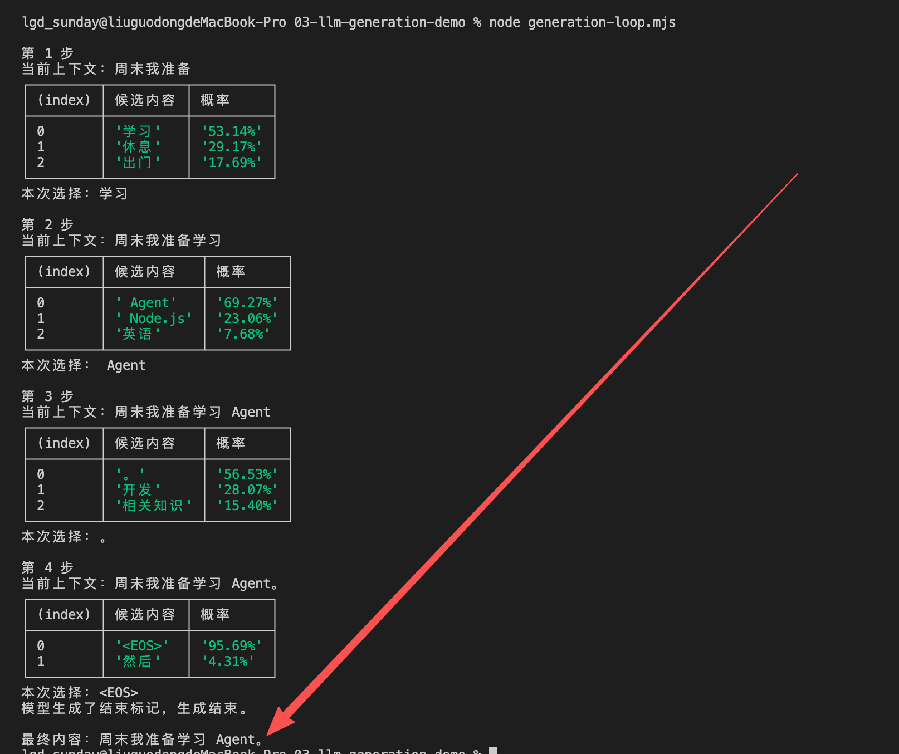


最后应该得到：

```latex
最终内容：周末我准备学习 Agent。
```

现在回头看代码。

+ `candidateMap` 模拟模型根据不同上下文计算出的候选分数。
+ `softmax` 把这些原始分数转换成概率。
+ `chooseHighest` 使用了最简单的选择方式：每次都选择概率最高的候选内容。
+ 选中的内容会被追加到 `context`，下一轮再使用新的上下文寻找候选。
+ 直到程序选择 `<EOS>`，生成结束。

这就是一次非常简化的自回归生成。

真实大语言模型不会使用咱们手写的 `candidateMap`。

它会通过训练得到的海量参数和 Transformer 计算，根据当前输入动态生成候选分数。但是，**外层的生成循环与这个代码表达的过程是相似的。**

## 为什么聊天页面会一个字一个字出现
现在再回到开头的问题。

为什么聊天页面上的回答会逐渐出现？

现在大家应该知道了，这玩意和 SSE 没毛线关系。

而是因为模型本身就在逐步生成内容。

模型服务每生成一部分内容，就可以通过流式响应把结果发送给应用程序。应用程序再把收到的新内容追加到页面上。

整个过程可以简单理解为：

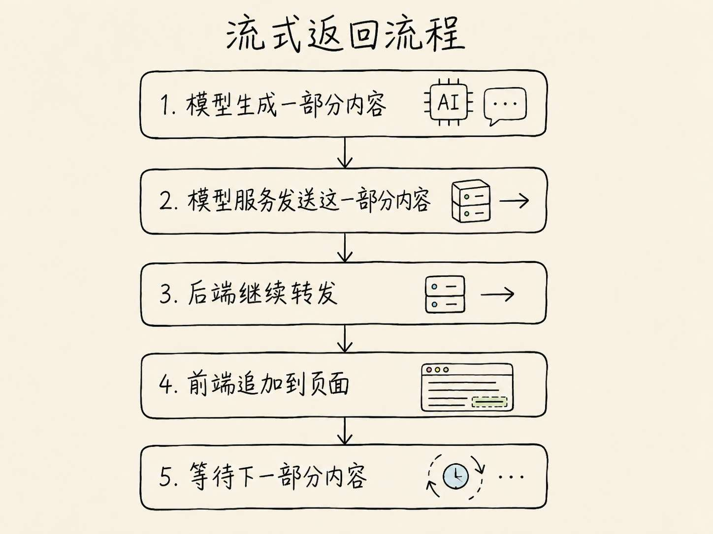


**不同模型服务每次传输的内容不一定正好是一个 Token，也不一定对应一个完整汉字。**

服务端可能合并多个增量再发送，前端也可能为了显示效果调整刷新节奏。

所以，页面上的“逐字显示”是用户看到的交互效果，不能直接拿它判断模型内部每次生成了几个 Token。

流式响应更加不会让模型生成的内容更准确。

它主要解决的是 **等待体验问题**：用户不需要等完整回答全部生成以后，才能看到第一部分结果。

后面的模型 API 与流式响应章节，会把这条链路真正写成代码。

## 模型是在思考，还是在预测
讲到这里，很多同学可能会问：模型一步一步生成内容，看起来很像一边思考、一边写答案。那它到底算不算在思考？

这个问题没有必要用一句“算”或者“不算”强行回答。

从生成机制来看，语言模型最终仍然需要根据当前上下文预测后续 Token。

但是，为了生成更合适的后续内容，模型内部会通过多层网络处理上下文中的关系。一些推理模型还会在输出最终答案前使用额外的推理计算。

所以，咱们可以观察模型是否能够完成推理任务，也可以研究它使用了多少推理预算。

但是，不应该因为回答写得很像人，就默认它一定拥有和人相同的思考过程。

后面咱们学习普通模型、推理模型与思考预算时，还会继续讨论这个问题。

## 总结
现在，咱们把前面的内容放到一起。

一次简化的大语言模型生成过程，大致可以表示为：

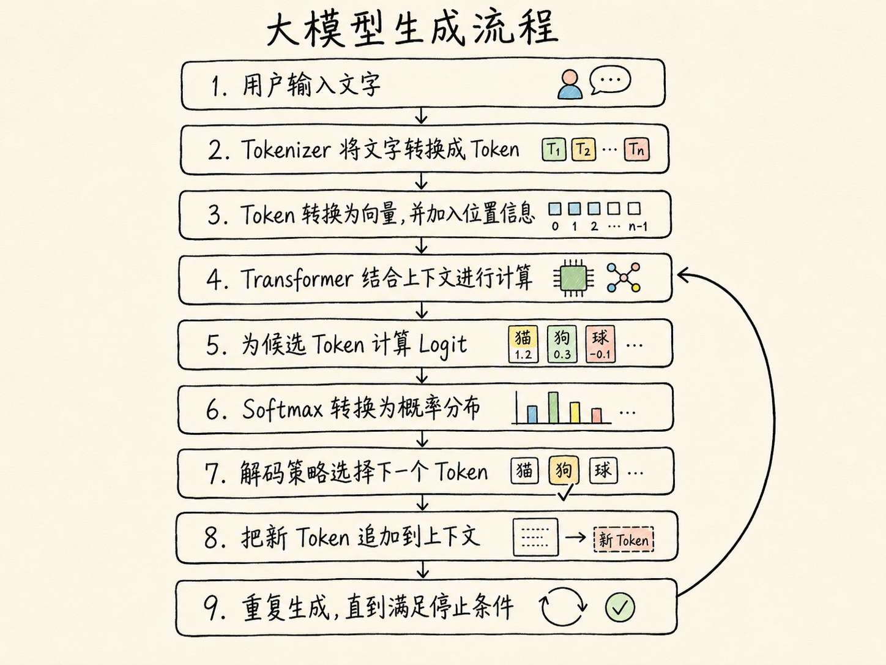


真实模型的内部实现会比这张流程图复杂很多。

不同模型也可能使用不同的 Tokenizer、位置编码、Attention 优化、模型结构和解码方案。

但是，对 Agent 应用开发来说，这张流程已经能够解释很多问题了。比如：为什么上下文会影响结果，为什么同一个问题可能得到不同回答，为什么回答可以流式传输，以及为什么模型输出必须经过验证。

这个循环不断重复，直到模型生成结束标记，或者应用程序触发其他停止条件。

所以，大语言模型生成内容的核心，是在当前上下文与训练参数的共同作用下，一步一步构造出结果。

下一节，咱们会专门研究这个过程中反复出现的 Token，看看同一段文字到底会被模型切成多少份，以及 Token 为什么会直接影响上下文长度、生成速度和调用成本。

> 更新：2026-07-29 15:54 · 原文：<https://www.yuque.com/lgdsunday/ab1dy3/mezm7hq5m7inu3xi>
