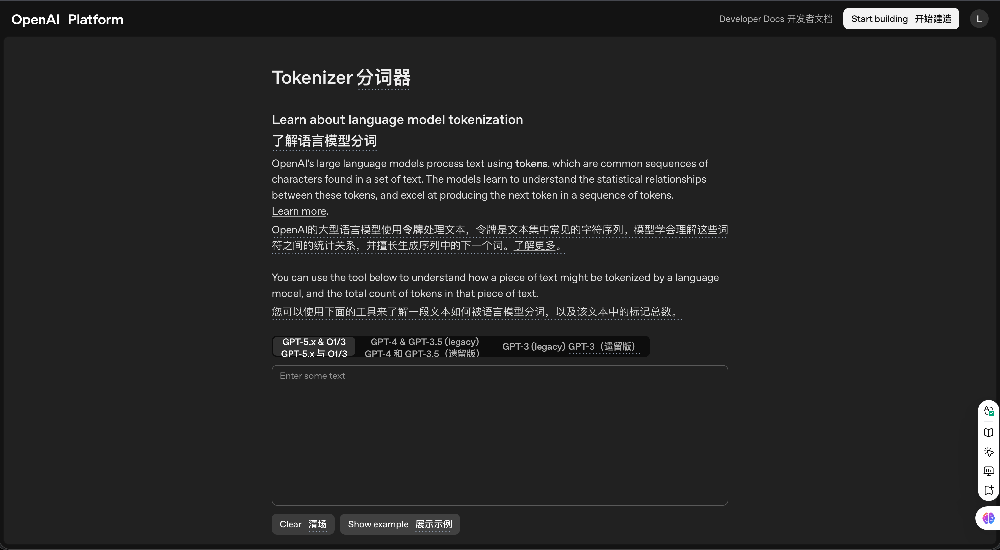
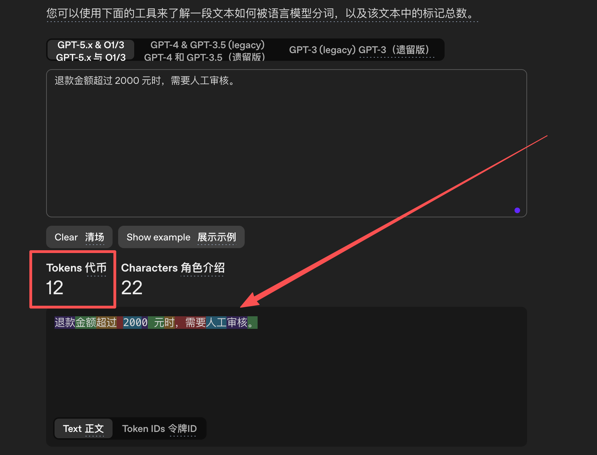
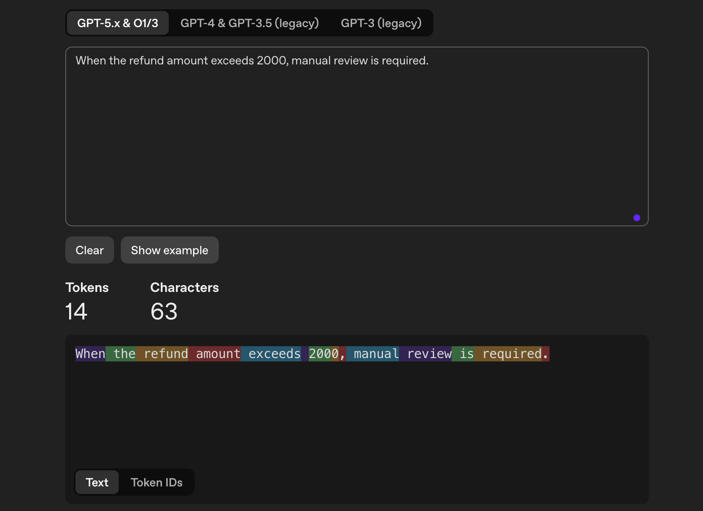
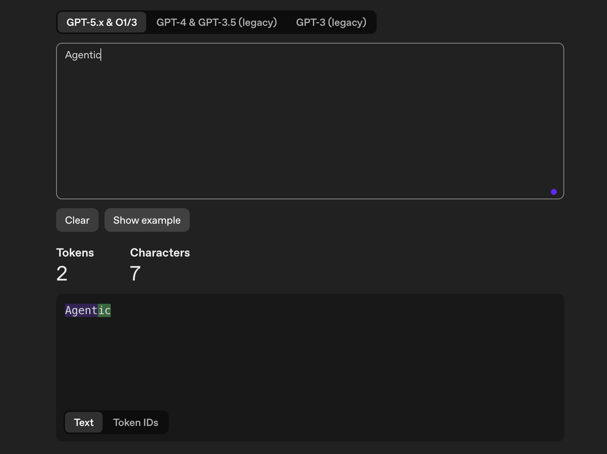
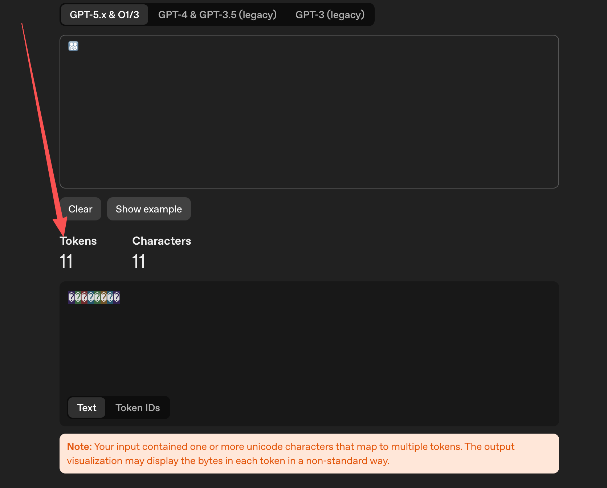
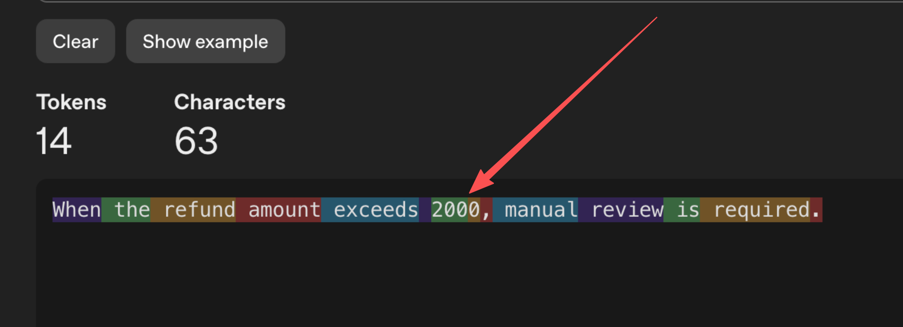
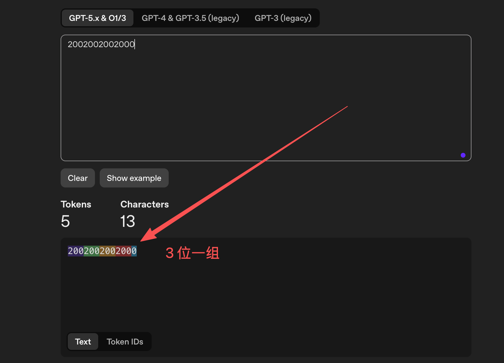
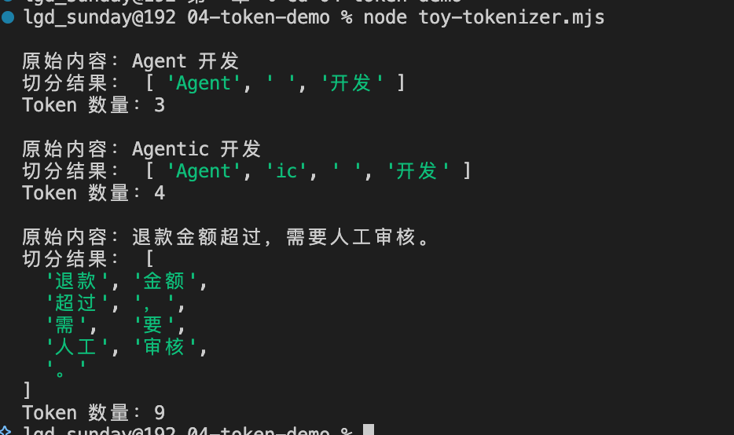

# 04-深入 Token，模型处理的基本概念

在上一节中，咱们已经知道了：大语言模型生成内容的时候，并不是一次性就把所有内容全部生成的。而是通过不断的预测下一个 `Token`，逐步生成内容的。

但是，这样就会有一个很重要的问题，那就是：**Token 到底是什么？**

网上有很多的文章都说，一个 Token 就是一个（或半个）汉字，或者一个（或几个）英文单词。

但是大家想想。如果真是这样，那 Token 似乎也没什么好研究的了。

其实，真实情况下 Token 要比网上说的复杂得多。

+ 同一个英文单词，换一下大小写，可能会被切成不同数量的 Token
+ 一串看起来只有一个的 Emoji 的文本，背后可能会占用多个 Token
+ 甚至多输入一个空格，也可能改变整段内容的切分结果。

看着是不是挺迷的。

同时，在咱们以后做 Agent 项目的时候，模型给咱们发送的内容、RAG 的检索结果 都会先变成 Token（这个流程在 [上一小节](https://mp.weixin.qq.com/s/-Qm7yAoVc6_rE8ApUcS84w?payreadticket=HIc5RoGOqKA0ghJNtOdfbJ-WbZTqK6fYWH0MWSj-f5jlxmFagIw0XCABcVacW71WNFALrKM) 讲了，忘记的同学可以先回去看下哈）

所以，Token 到底是什么？怎么切分的？ 还是蛮重要的

## 大模型的一句话会被切成多少份？
OpenAI 提供了一个叫做 [Tokenizer](https://platform.openai.com/tokenizer) 的功能





这个工具可以把输入的文字切成不同颜色的块。**页面上看到的每一个色块，就代表一个 Token。**

咱们来试试。

先输入一句前面已经用过很多次的话：

```latex
退款金额超过 2000 元时，需要人工审核。
```

然后，咱们观察页面上的切分结果（PS：咱们这里使用的是 GPT-5.x 的模型，不同的模型切分的逻辑会有所不同）。




在这里大家可以发现，这个 Token 的处理就很迷。

+ “退款” 是一个 Token
+ “空格” 是一个 Token
+ “200” 是一个 Token
+ “0” 是一个 Token
+ “，需要” 是一个 Token
+ “。” 是一个 Token

咱们会发现，有些词汇是一个单独的 Token。有些数字（比如：「2000」）会被分成两个 Token。有些符号（比如：「。」）是一个 Token，但是有些 符号 + 汉字（比如「，需要」）又是一个 Token。

先保留这个疑惑哈。

然后，咱们试试英文的：

```latex
When the refund amount exceeds 2000, manual review is required.
```




相比中文来说好点，但是也挺迷的。比如 `2000` 还是被拆分成了 2 个 Token

接下来，咱们做个有意思的事，分别输入：`Agent` 和 `Agentic`

这两个都是单独的单词，但是 `Agentic` 就会被拆分成 两个 Token




最后，咱们再试试这个 Emoji：

```latex
👨‍👩‍👧‍👦
```

显示不出来没事，但是我们可以看到的是，他一共被拆成了 11 个 Token




OK ，实验做到这里就差不多了。

接下来咱们就可以带着这些疑惑，来看看所谓的 Token ，到底是什么？

## Token 到底是什么
上一节已经讲过，文字进入模型之前，会先经过 Tokenizer 切分，再转换成 Token 编号。

所以，这里咱们不再重复整个转换流程，只把 Token 这件事说清楚。

> **Token 是 Tokenizer 根据自己的词表和切分规则，从文本中切出来的一小段内容。它是模型计算文本长度时使用的基本单位。**
>

这里最重要的是：**Token 不是按照人类语言的语法切分的。它最终会怎样切分，由 Tokenizer 预设的分组规则和已经学习到的词表共同决定。**

跟大家举个例子哈。

比如：某个 Tokenizer 的词表中存在完整的 `Agent` 这个单词，那么它可以直接把 `Agent` 当成一个 Token。

但是，加入词表中没有完整的 `Agentic` 这个单词，只有 `Agent` 和 `ic`，那么它就会把 `Agentic` 切成，就像咱们上面的图一样


这就是为什么一个 Token 有时是单词，有时是半个单词，也可能是单个汉字、空格或者标点的原因。

但是，如果咱们只看词表，那么仍然解释不了前面实验中的一个现象，那就是：**2000 被切成了 ["200", "0"]**




难道是因为词表中没有 2000 吗？

这肯定是不可能的！

那么，为什么不直接把 `2000` 当成一个 Token 呢？

这是因为真实 Tokenizer 在查找词表之前，通常还会先按照 **预设规则**，对输入内容进行一次初步分组。

例如，前面在 OpenAI Tokenizer 的实验中，Tokenizer 会先**把连续数字按照最多三位一组进行拆分**。




因此，四位数字 `2000` 会先被分成 `200` 和 `0`。完成分组以后，这两部分才会继续查找词表并转换成 Token。

也就是说，Tokenizer 的切分结果通常会同时受到两部分影响：

+ 预设的文本分组规则，决定哪些内容可以放在一起继续处理
+ Tokenizer 的词表，决定分组后的内容最终能否合并成一个 Token

所以，Token 并不是简单地 “在词表中寻找最长的文字”。不同 Tokenizer 使用的分组规则和词表都可能不同，同一段文字得到的 Token 数量也可能不同。

所以说：**Token 没有一套适用于所有模型的固定切分答案。**

不同的模型，甚至同样模型的不同版本（比如：GPT 5.x 和 GPT 4）切分的逻辑都会有所不同

## 用 Node.js 模拟一次切分逻辑
接下来，咱们用 Node.js 模拟一次非常简单的子词切分。

先创建项目目录：

```bash
mkdir token-demo
cd token-demo
```

在目录中创建 `toy-tokenizer.mjs`：

```javascript
// 模拟一个很小的词表
// 真实大模型的词表会非常大，可能包含几万到几十万个 Token
const vocabulary = [
  "Agent",
  "ic",
  "退款",
  "金额",
  "超过",
  "人工",
  "审核",
  "开发",
  " ",
  "。",
];

// 对词表进行排序：长度越长的 Token 越靠前
// 这样在匹配时，会优先匹配更长的内容
//
// 例如：
// 如果词表里同时有 "Agent" 和 "A"
// 那么应该优先匹配 "Agent"，而不是先匹配 "A"
const sortedVocabulary = [...vocabulary].sort(
  (first, second) => second.length - first.length,
);

/**
 * 将一段文本切分成 Token
 *
 * 这里模拟的是一种简化版 Tokenizer：
 * 从左到右扫描文本，每次都在词表中寻找一个可以匹配当前位置的最长 Token。
 */
function tokenize(text) {
  // 用来保存最终切分出来的 Token
  const tokens = [];

  // rest 表示当前还没有被切分的剩余文本
  let rest = text;

  // 只要还有剩余文本，就继续切分
  while (rest.length > 0) {
    // 从排序后的词表中查找第一个能够匹配当前开头的 Token
    // 因为 sortedVocabulary 已经按长度从长到短排序，
    // 所以 find 找到的第一个结果，就是当前能匹配到的最长 Token
    const matchedToken = sortedVocabulary.find((token) =>
      rest.startsWith(token),
    );

    // 如果在词表中找到了匹配的 Token
    if (matchedToken) {
      // 把匹配到的 Token 放入结果数组
      tokens.push(matchedToken);

      // 从剩余文本中移除已经匹配过的部分
      // 然后继续处理后面的内容
      rest = rest.slice(matchedToken.length);
      continue;
    }

    // 如果词表中没有任何 Token 能匹配当前开头，
    // 就把当前第一个字符当作未知 Token 处理
    //
    // 这里使用 [...rest] 是为了更安全地处理 Unicode 字符，
    // 避免某些特殊字符被错误切分
    const [unknownCharacter] = [...rest];

    // 将未知字符加入 Token 列表
    tokens.push(unknownCharacter);

    // 从剩余文本中移除这个未知字符
    rest = rest.slice(unknownCharacter.length);
  }

  // 返回最终的 Token 切分结果
  return tokens;
}

// 准备几组测试文本
const samples = [
  "Agent 开发",
  "Agentic 开发",
  "退款金额超过，需要人工审核。",
];

// 依次对每段文本进行 Token 切分
for (const sample of samples) {
  // 调用 tokenize 方法，把原始文本切成 Token
  const tokens = tokenize(sample);

  // 打印原始文本
  console.log(`\n原始内容：${sample}`);

  // 打印 Tokenizer 的切分结果
  console.log("切分结果：", tokens);

  // 打印 Token 数量
  // 这可以帮助理解：同一段文字经过不同词表切分后，Token 数可能不同
  console.log(`Token 数量：${tokens.length}`);
}
```

运行：

```bash
node toy-tokenizer.mjs
```

终端中应该可以看到类似下面的结果：




代码中的 `vocabulary`，就相当于咱们为这个简化 Tokenizer 准备的词表。

当程序处理 `Agent 开发` 时，可以直接在词表中找到完整的 `Agent` 和 `开发`。

但是，处理 `Agentic 开发` 时，词表中找不到完整的 `Agentic`，程序只能继续寻找更小的内容，最后把它拆成 `Agent` 和 `ic`。

这个示例已经可以解释前面实验中看到的现象：**Tokenizer 怎样切分一段内容，主要取决于它拥有什么词表，以及使用什么切分规则。**

真实 Tokenizer 的词表和算法会复杂很多。咱们不需要自己实现它，只需要知道：**看到的文字长度，不等于模型最终处理的 Token 数量。** 就可以了

## Token 会怎样影响 Agent 开发
讲了半天，Token 对 Agent 开发到底有什么影响呢？

最直接的影响就是：**模型不是按照字符数量限制输入，而是按照 Token 数量限制输入。**

以后开发 Agent 的时候，咱们会向模型发送 提示词、大模型的聊天内容、RAG 检索结果。这些不同功能，都需要发送给模型 Token 。

假设一个模型一次最多处理 `8000` 个 Token（这只是举例哈。现在通用模型的上下文通常是 百万 Token）。

如果聊天历史已经占用了 `5000` 个 Token，系统提示词和工具描述又占用了 `1000` 个 Token，那么留给 RAG 检索结果和模型回答的空间，就只剩下 `2000` 个 Token。

一旦超过限制，就必须删除、压缩或者重新选择部分内容（大模型压缩的几种方式，后面会详细讲）。否则，请求可能直接失败，或者咱们不得不在发送请求前粗暴地截断文本。

Token 还会影响调用成本。

大部分模型服务会根据输入和输出使用的 Token 数量计算费用。Agent 执行一个任务时，可能会连续调用模型很多次。单次请求多出一点内容，看起来不明显，累积到大量任务以后，成本就可能出现很大差距。

最后是处理速度。

模型需要处理的 Token 越多，通常就需要进行更多计算。特别是系统提示词、聊天记录和工具返回结果不断变长以后，用户等待第一个输出内容的时间也可能增加。

所以，真正开发 Agent 时，不能只关心“要不要把这段内容发给模型”，还需要关心：**这段内容会占用多少 Token，它是否真的值得放进本次请求？**

这也是后面学习 Context Window、RAG 文档切分、记忆压缩和模型成本时，会遇到的问题。搞不明白 Token 的计算方法，后续就会很麻烦了。

## 总结
Token 并不固定等于一个汉字或者一个单词。

它是 Tokenizer 根据自己的词表和规则，从文本中切分出来的内容。词表和规则发生变化，同一段文字的 Token 数量也可能发生变化。

下一节，咱们会研究 Prompt、Message 与模型输入 的内容。咱们一起来看看聊天页面中用户输入的的一句话，最终到底会以什么形式交给模型。

> 更新：2026-06-11 20:37 · 原文：<https://www.yuque.com/lgdsunday/ab1dy3/gt61n9xy4sq8tn4n>
