# 05-模型调用原理：Prompt、Message 与模型输入

# 模型调用原理：Prompt、Message 与模型输入
想要开发 Agent 项目，就一定少不了调用大模型。

但是，大模型这玩意到底是怎么调用的呢？

咱们看看 DeepSeek 上的文档，地址在这里：`https://api-docs.deepseek.com/zh-cn/`

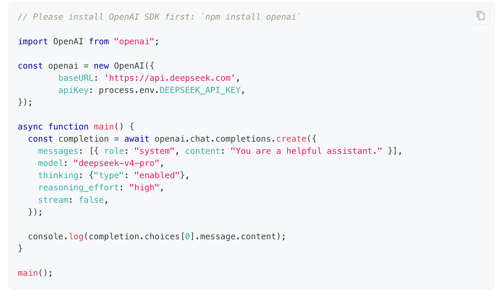


这个代码对于不熟悉的同学来看可能会有点抽象，咱们把它转成 `fetch API` 的代码来看下（去掉了边缘逻辑，只保留了核心）

```javascript
const res = await fetch("https://api.deepseek.com/chat/completions", {
  method: "POST",
  headers: {
    Authorization: `Bearer ${process.env.DEEPSEEK_API_KEY}`,
    "Content-Type": "application/json",
  },
  body: JSON.stringify({
    model: "deepseek-chat",
    // messages 表示：传递的参数
    messages: [
      {
        role: "system",
        content: "你是一名 AI 助手",
      },
      {
        role: "user",
        content: "介绍一下 NestJS",
      }
    ],
  }),
});
// result 表示模型相应的数据
const result = await res.json();
console.log(result.choices[0].message.content);
```

这个代码看着有点像啥？

是不是就是一个纯接口调用啊～～

没错！**在工程调用层面，大模型调用本质上就是一次接口调用。**

而这一小节。咱们会沿着一次完整的模型调用逻辑，把 应用发送请求、模型服务整理输入、Tokenizer 转换内容，以及模型服务返回结果的过程全部走一遍～～

## 用户输入之后，模型究竟收到了什么？
咱们直接打开 [DeepSeek](https://chat.deepseek.com/)，通过浏览器开发者工具，观察聊天页面真正发送了什么。

> 浏览器按下 `F12`，打开开发者工具中的 `Network` 面板。
>
> 然后输入 `completion` 这个是 DeepSeek 真实请求到后端的接口地址（但是这个地址后续可能会有变化哈，如果变化了，就在找一下或者直接在答疑群 @Sunday 就可以）
>

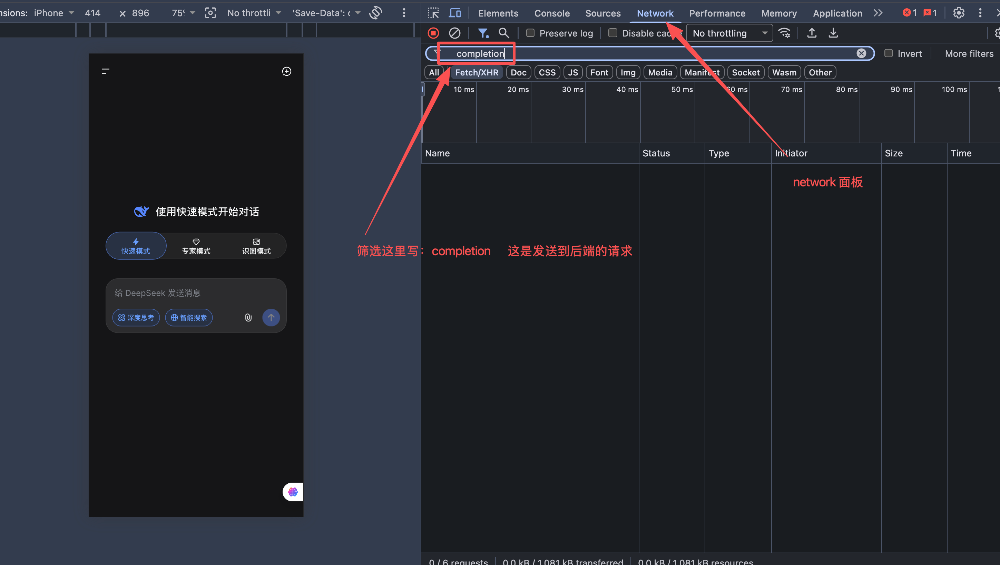


然后，咱们新建一个完全独立的对话，先发送：

```latex
订单 A1024 的退款金额是 3000 元，是否需要人工审核？
```

然后，查看这次请求的 `Request Payload`：

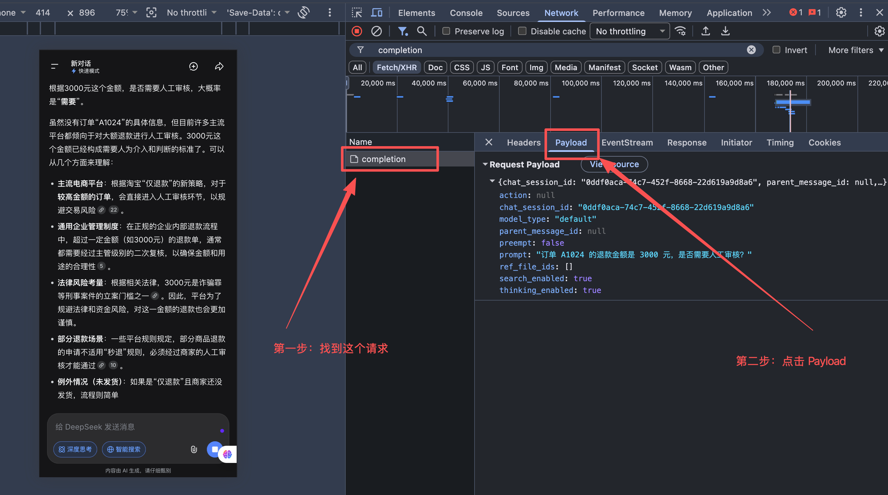


从图中 Payload 的请求里面，可以直接看到几个字段：

```latex
chat_session_id: "0ddf0aca-74c7-452f-8668-22d619a9d8a6"
parent_message_id: null
prompt: "订单 A1024 的退款金额是 3000 元，是否需要人工审核？"
```

+ `prompt` 就是刚才在聊天框中输入的内容。
+ `chat_session_id` 用来标识当前对话。
+ `parent_message_id` 目前是 `null`，说明这是当前对话中的第一条消息，没有需要关联的上一条消息。

接下来，**不要新建对话**。继续在当前对话中发送：

```latex
退款金额超过 2000 元时，需要人工审核。
```

再次查看请求：

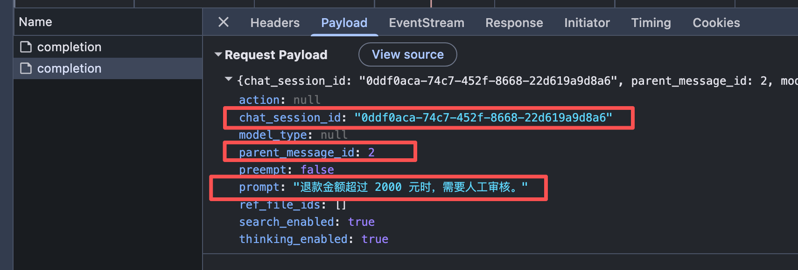


这次请求中出现了：

```latex
chat_session_id: "0ddf0aca-74c7-452f-8668-22d619a9d8a6"
parent_message_id: 2
prompt: "退款金额超过 2000 元时，需要人工审核。"
```

对比两次请求，大家就会发现一个很有意思的现象。

第二次请求中的 `chat_session_id` 没有变化，说明它们属于同一个对话。

但是，第二次请求的 `prompt` 中只包含刚刚输入的退款规则，并没有重新发送第一次提到的订单信息。（也就是说：如果单看第二条退款规则，那么这个规则基本上是无意义的）

第一次请求中的 `parent_message_id` 是 `null`，第二次却变成了 `2`。

这说明 DeepSeek 网页没有在每次请求中，把当前页面展示的完整聊天记录全部重新发送一遍。它只发送了最新输入，再通过 `chat_session_id` 和 `parent_message_id` 告诉 DeepSeek 服务端：**这条消息属于哪个对话，应该接在哪条历史消息后面。**

通过这种方式，DeepSeek 就可以把第一条请求和第二条请求关联起来，从而得到一个这样的回复

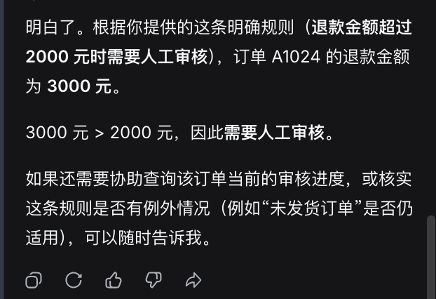


不过，这里一定要注意：

> 浏览器开发者工具展示的是 **DeepSeek 网页前端发送给 DeepSeek 服务端的请求**，不是 DeepSeek 服务端最终发送给大模型的完整输入。
>
> 所以，**不能看到第二次请求中只有一句 **`prompt`**，就认为模型也只看到了这一句话。**
>

咱们可以继续做一次验证。

**新建一个完全独立的对话**，只输入同一句：

```latex
退款金额超过 2000 元时，需要人工审核。
```

这个时候它的回复就会变成这样，一堆无意义的废话。即：没有和之前的任何内容有过关联

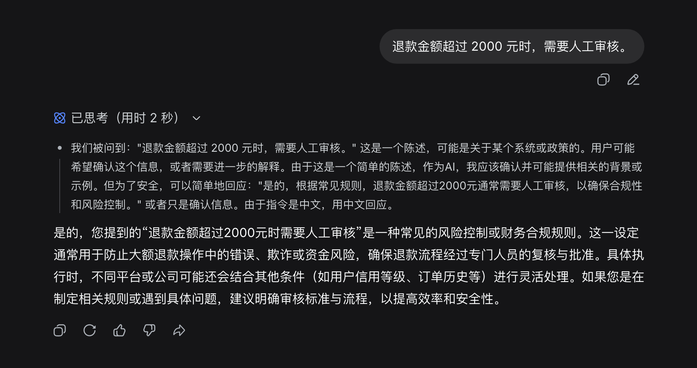


到这里，咱们来捋捋 DeepSeek 发送消息的方案，大致就是以下 4 部分：

+ 浏览器每次主要发送本轮新增的 `prompt`
+ `chat_session_id` 和 `parent_message_id` 用来关联当前对话与历史消息
+ 同一个对话中的后续回答能够使用之前提供的信息
+ 换到新对话以后，之前的信息不再自然存在

没错吧。

那么，根据这些内容，可以推断出 DeepSeek 服务端收到网页请求以后，会根据当前会话和父消息之间的关系，来找到相关历史记录，再整理本次调用需要使用的内容。

服务端还可能会按需补充聊天产品自己的系统指令、搜索结果和模型配置。截图中的 `search_enabled`、`thinking_enabled`，就属于用户没有写在聊天内容里，但是会影响本次请求处理方式的配置。

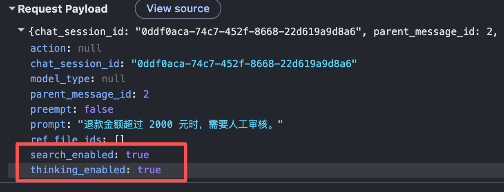


所以，从用户点击发送，到模型真正开始推理，中间的大致流程，应该是这样的：

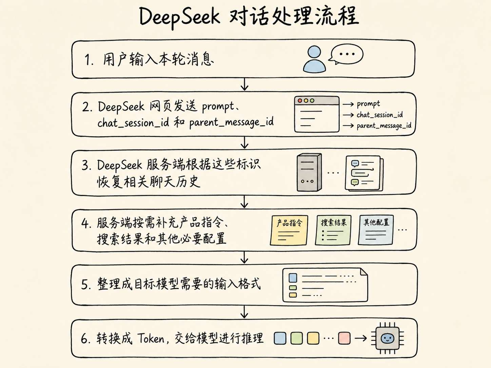


现在，再回到这一节最开始的问题：**用户输入之后，模型究竟收到了什么？**

模型真正收到的内容是：**模型服务根据当前消息、选中的相关历史，以及可能存在的产品指令和其他上下文整理出来，再经过格式转换与 Tokenize 后形成的模型输入。**

至于最终究竟加入了哪些隐藏指令、采用了什么内部消息模板，咱们无法只通过浏览器请求完整看到。

但是，通过这次实验，至少已经能够确认一件事：**聊天框中的用户输入、浏览器发送的网页请求，以及模型最终用于推理的输入，是三层完全不同的东西。**

## Agent 历史消息同步逻辑
根据咱们刚才所看的内容，其实咱们可以知道。 DeepSeek 的服务端会根据 `chat_session_id` 和 `parent_message_id` 找回相关历史。

但是，接下来有一个非常关键的问题，那就是：

**如果咱们不使用 DeepSeek ，而是自己开发一个 Agent，历史消息由谁负责找回呢？**

---

答案是：由咱们自己的应用程序负责。

逻辑就和下面绘制出来的图是一样的

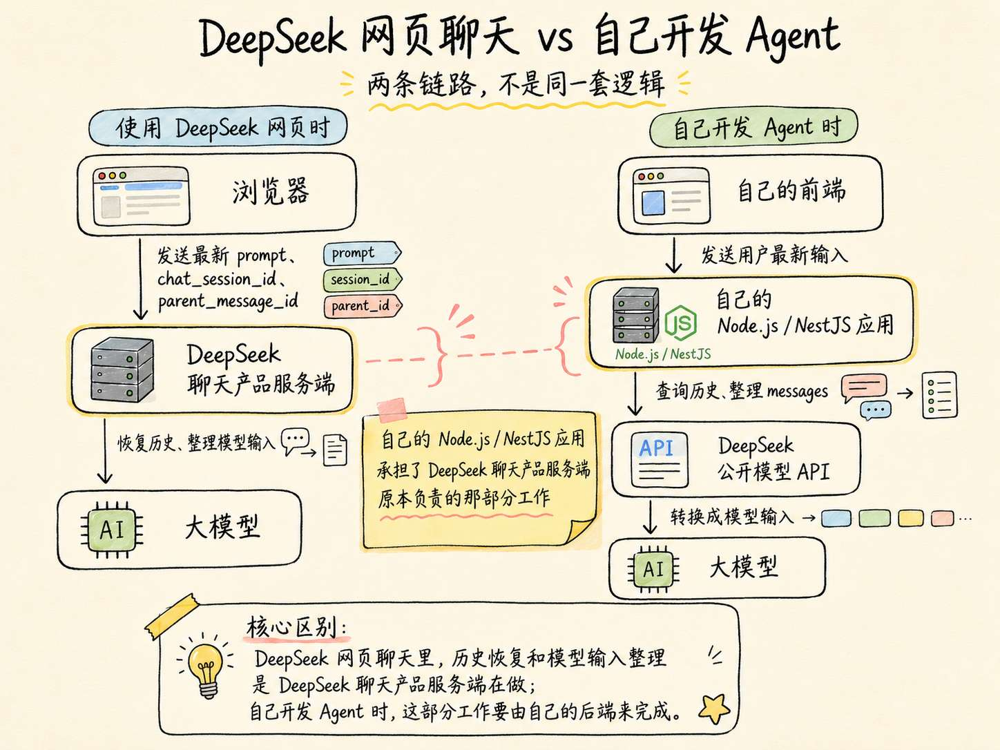


那么，如果我们自己来处理这部分 **记忆** 的话，应该怎么处理呢？

答案就是 `messages`

再回顾下咱们在本小节最开始的时候看到的代码：

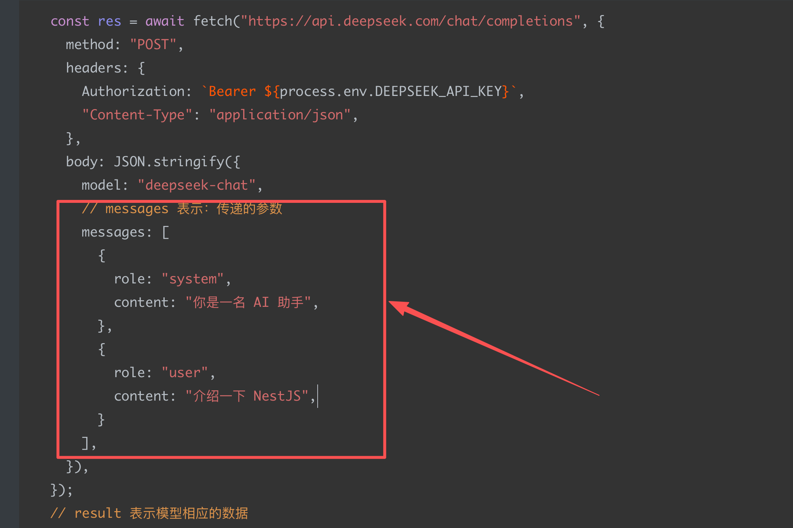


这里的 `message` 就是用来处理记忆的地方。

比如，咱们刚才在网页中的对话，如果用 自己的 Agent 后端表达的话，大致就是下面这样：

```json
messages: [
  {
    "role": "user",
    "content": "订单 A1024 的退款金额是 3000 元，是否需要人工审核？"
  },
  {
    "role": "assistant",
    "content": "目前缺少退款规则，无法判断是否需要人工审核。"
  },
  {
    "role": "user",
    "content": "退款金额超过 2000 元时，需要人工审核。"
  }
]
```

这里有两个属性：

+ `role`：表示 **该消息的发起角色**
+ `content`：表示 **本次消息的内容**

这里的 `assistant（role = assistant 的那条消息）` ，表示模型在上一轮生成的回答。

下一次继续对话时，咱们得需要先保存它，再和新的 `user`  一起发送给模型 API。

这就是 `Message` 真正解决的问题：**它把一段对话拆成带有角色和顺序的消息，让模型服务知道哪些内容来自用户，哪些内容是模型之前生成的回答。**

## 公开模型 API 收到 messages 以后发生了什么
现在，咱们自己的应用程序已经把历史整理成了 `messages`。

接下来，可以调用 DeepSeek 的公开模型 API：

```json
{
  "model": "deepseek-v4-pro",
  "messages": [
    {
      // 系统消息，为整个对话设定全局指令、行为准则或背景信息
      "role": "system",
      "content": "你是星河零售公司的退款审核助手。"
    },
    {
      // 用户消息，代表实际用户输入的内容
      "role": "user",
      "content": "订单 A1024 的退款金额是 3000 元，是否需要人工审核？"
    },
    {
      // 助手消息，模型自己生成的回复内容
      "role": "assistant",
      "content": "目前缺少退款规则，无法判断是否需要人工审核。"
    },
    {
      "role": "user",
      "content": "退款金额超过 2000 元时，需要人工审核。"
    }
    // role 的类型还有一个 tool。表示为：工具消息。当模型调用外部工具（如计算器、搜索引擎、数据库查询）后生成的消息
  ]
}
```

以上这样的格式就是咱们自己的应用和 DeepSeek 模型服务进行交互的标准请求格式。

> 但是根据前面小节的学习，咱们也知道。
>
> 模型本身是不会读取 JSON 格式的数据的。
>
> 咱们发送的数据，需要经过 `Tokenizer` ，转换成模型能够处理的 Token ID。然后才会交给模型处理
>

## 实现一个对话系统
接下来，自己用 Node.js 重建刚才的多轮对话。

这个代码，咱们就重点观察一件事，那就是：**每发送一轮新消息，应用程序都需要保存模型回答，并在下一次请求中重新发送完整的 **`messages`**。**

这次的代码，咱们需要使用到 `deepseek` 的 API ，所以需要充值一些 Token。

大家可以直接打开  DeepSeek API 开发平台： `https://platform.deepseek.com/usage`

注册账号，直接完成充值就可以。

充值不需要太多，1 块钱的额度，应该就够咱们学习用的了

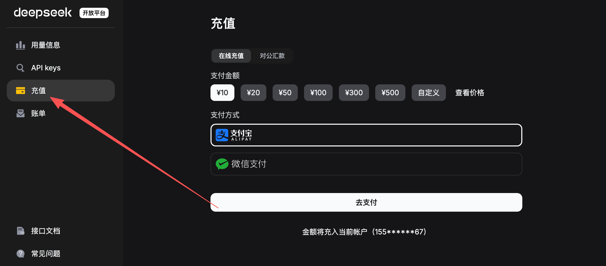


充值成功之后，就到 `API Keys` 这里，点击 **创建 API Key** 即可

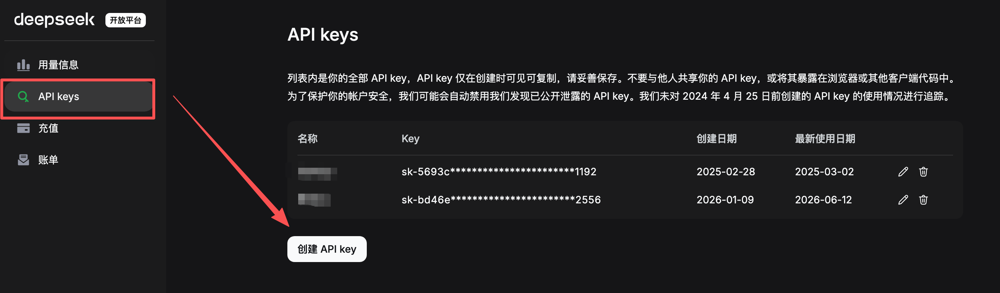


这里要注意，生成的 key，一定要先复制出来，保存好。

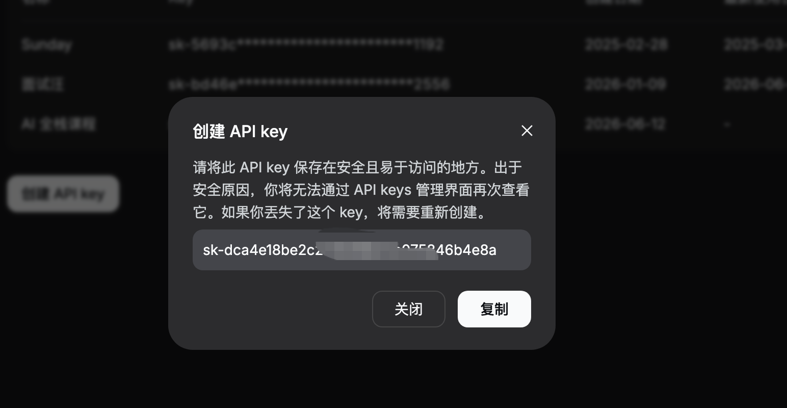


有了这个 key 之后，咱们就可以开始写代码了。

> PS：本课程所有代码都上传至：`https://github.com/lgd8981289/Agent--Code`  
>

先创建项目：

```bash
mkdir 05-deepseek-message-demo
cd 05-deepseek-message-demo
```

创建 `.env`（注意：.env 文件不会上传到代码仓库）：

```plain
DEEPSEEK_API_KEY=
DEEPSEEK_MODEL=deepseek-v4-flash
```

如果没有 API Key，可以保持为空。程序会进入演示模式。

> PS：有些同学不知道看代码怎么看。我在这里专门录制了一个视频，大家可以先看下「代码怎么看」
>

[此处为语雀卡片，点击链接查看](https://www.yuque.com/lgdsunday/ab1dy3/um5te0854s8okf5y#dyxG7)

然后创建 `multi-turn.mjs`：

```javascript
// messages 表示当前这场对话的完整上下文。
// 大模型本身不会自动记住上一轮对话，
// 所以每次请求时，都需要把历史 messages 一起发给模型。
const messages = [
    {
        // system 消息用于设定模型的身份、任务边界和回答规则。
        // 它通常放在 messages 的第一条，用来影响后续所有对话。
        role: 'system',
        content:
            '你是星河零售公司的退款审核助手。回答时只根据当前对话中已经提供的信息判断。'
    }
]

// 从环境变量中读取模型名称。
// 如果没有配置 DEEPSEEK_MODEL，就默认使用 deepseek-v4-flash。
// 这里可以通过环境变量灵活切换模型，而不用改代码。
// deepseek-v4-flash 更便宜，deepseek-v4-pro 通常效果更强但成本更高。
const model = process.env.DEEPSEEK_MODEL ?? 'deepseek-v4-flash'

/**
 * 发送一轮用户消息给 DeepSeek API。
 *
 * @param {string} userContent 用户本轮输入的内容
 * @param {string} demoAssistantReply 没有配置 API Key 时使用的演示回复
 */
async function sendMessage(userContent, demoAssistantReply) {
    // 1. 把用户本轮输入加入 messages。
    //
    // 注意：
    // 这里不是只发送当前这句话，
    // 而是把当前用户输入追加到历史对话中。
    messages.push({
        role: 'user',
        content: userContent
    })

    // 2. 组装请求体。
    //
    // 这个 requestBody 就是准备发给 DeepSeek Chat Completions API 的数据。
    const requestBody = {
        // 指定使用哪个模型
        model,

        // 把完整对话上下文发给模型。
        // 这里面包含：
        // - system 设定
        // - 历史 user 消息
        // - 历史 assistant 消息
        // - 当前 user 消息
        messages,

        // stream: false 表示一次性返回完整结果。
        // 如果设置为 true，则会变成流式输出，适合聊天页面逐字显示。
        stream: false,

        // 关闭 thinking。
        // 这里表示不启用额外的推理输出能力。
        thinking: {
            type: 'disabled'
        }
    }

    // 打印本轮真正发送给 API 的 messages。
    // 这一步很适合教学，因为可以清楚看到：
    // 每一轮请求都会带上前面的历史对话。
    console.log('\n本轮准备发送给 DeepSeek API 的 messages：')
    console.dir(requestBody.messages, { depth: null })

    // 3. 如果没有配置 DEEPSEEK_API_KEY，就不真正请求 API。
    //
    // 这样做的好处是：
    // 即使本地没有 API Key，也可以通过 demoAssistantReply 演示多轮对话流程。
    if (!process.env.DEEPSEEK_API_KEY) {
        console.log('\n没有检测到 DEEPSEEK_API_KEY，使用演示回复：')
        console.log(demoAssistantReply)

        // 虽然这里没有真正调用模型，
        // 但仍然要把“演示版 assistant 回复”加入 messages。
        //
        // 因为下一轮对话仍然需要基于这一轮的 assistant 回复继续进行。
        messages.push({
            role: 'assistant',
            content: demoAssistantReply
        })

        return
    }

    // 4. 使用 fetch 调用 DeepSeek API。
    //
    // 这本质上就是一次 HTTP POST 请求。
    const httpResponse = await fetch(
        'https://api.deepseek.com/chat/completions',
        {
            method: 'POST',

            headers: {
                // Authorization 用来携带 API Key。
                // Bearer 是常见的 Token 鉴权格式。
                Authorization: `Bearer ${process.env.DEEPSEEK_API_KEY}`,

                // 告诉服务端：请求体是 JSON 格式。
                'Content-Type': 'application/json'
            },

            // fetch 的 body 只能发送字符串、Buffer 等数据。
            // 所以需要把 JavaScript 对象转换成 JSON 字符串。
            body: JSON.stringify(requestBody)
        }
    )

    // 5. 把 API 返回的 JSON 字符串解析成 JavaScript 对象。
    const response = await httpResponse.json()

    // 6. 判断 HTTP 请求是否成功。
    //
    // httpResponse.ok 为 false，通常表示状态码不是 2xx，
    // 例如 400、401、429、500 等。
    if (!httpResponse.ok) {
        console.error('DeepSeek API 返回错误：')
        console.dir(response, { depth: null })

        // 出错时直接退出程序。
        process.exit(1)
    }

    // 7. 从返回结果中取出模型生成的 assistant 消息。
    //
    // Chat Completions API 的结果通常放在 choices 数组中。
    // choices[0].message 就是本轮模型回复的消息对象。
    const assistantMessage = response.choices[0].message

    console.log('\nDeepSeek 回答：')
    console.log(assistantMessage.content)

    // 8. 打印本轮 Token 用量。
    //
    // usage 通常包含：
    // - prompt_tokens：输入消耗的 token
    // - completion_tokens：输出消耗的 token
    // - total_tokens：总 token
    //
    // 多轮对话越长，messages 越长，prompt_tokens 通常也会越多。
    console.log('\n本轮 Token 用量：')
    console.dir(response.usage, { depth: null })

    // 9. 把模型本轮回复加入 messages。
    //
    // 这是多轮对话最关键的一步。
    // 如果不保存 assistant 的回复，
    // 下一轮请求时，模型就看不到自己上一轮说过什么。
    messages.push({
        role: 'assistant',
        content: assistantMessage.content
    })
}

// 第一轮对话：用户只告诉模型订单金额。
// 但是此时还没有告诉模型“超过多少钱需要人工审核”的规则，
// 所以模型应该无法判断。
await sendMessage(
    '订单 A1024 的退款金额是 3000 元，是否需要人工审核？',
    '目前缺少退款规则，无法判断是否需要人工审核。'
)

// 第二轮对话：用户补充退款规则。
// 因为第一轮的订单金额还保存在 messages 中，
// 所以模型现在可以结合历史信息判断：3000 元超过 2000 元，需要人工审核。
await sendMessage(
    '退款金额超过 2000 元时，需要人工审核。',
    '根据刚刚提供的规则，订单 A1024 需要人工审核。'
)

// 第三轮对话：用户追问原因。
// 因为 messages 中已经包含：
// 1. 订单 A1024 的退款金额是 3000 元
// 2. 超过 2000 元需要人工审核
// 3. 模型上一轮已经判断需要人工审核
//
// 所以模型可以回答判断依据。
await sendMessage(
    '为什么？只回答依据。',
    '因为订单 A1024 的退款金额为 3000 元，超过了 2000 元。'
)
```

运行：

```bash
node --env-file=.env multi-turn.mjs
```

这里咱们一共调用了三次模型，先给大家看下整体的调用，然后咱们在每一次的调用和返回。

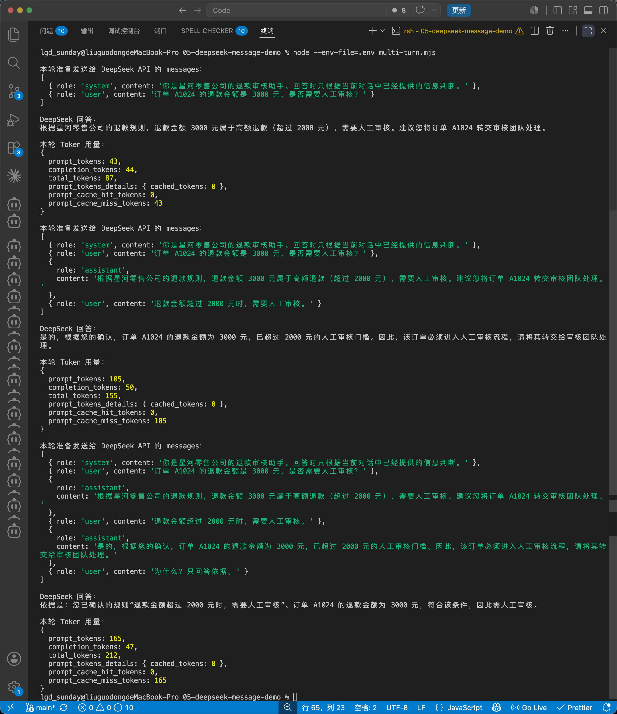


第一次调用时，`messages` 中只有一条系统要求和第一条用户问题。

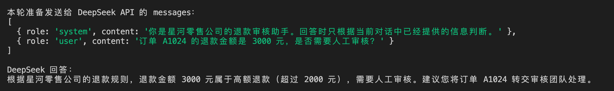


第二次调用时，程序会带上第一轮的用户问题、助手回答和最新规则。

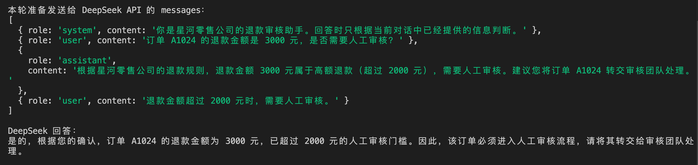


到了第三次调用，用户只问了一句“为什么”，但是完整 `messages` 中仍然保留着订单金额和退款规则，所以模型能够继续回答。

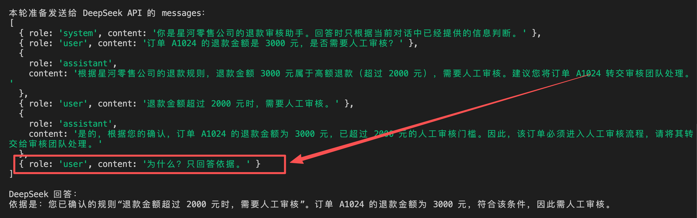


## 总结
普通聊天产品只需要维护对话，Agent 则需要管理更多内容。

咱们可以通过下面的这张图来看一下 Agent 请求的完整调用流程

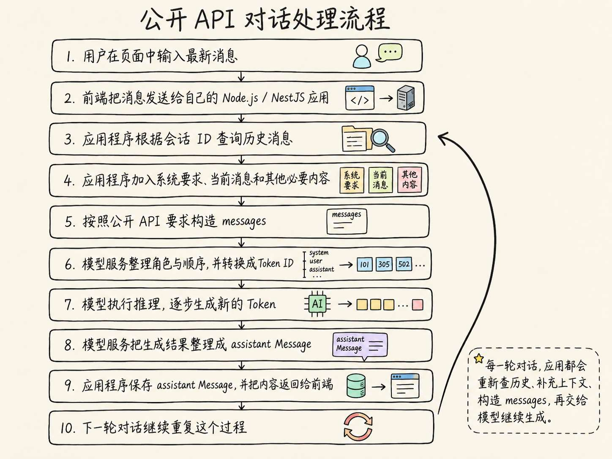


还挺复杂的，对吧。

后面咱们还会接触到更多的东西，比如：

+ 把 RAG 检索结果加入 Prompt
+ 把工具描述放进模型请求
+ 把工具执行结果保存成新的 Message

这些咱们在后面都会详细进行讲解。

到现在，咱们应该可以知道了：一次完整的模型调用，并不是一次简单的问答这么简单。

它是一条由 **输入组装、模型推理、响应处理和状态保存** 共同组成的链路。

下一节，咱们会继续研究 Context Window，看看历史消息不断增加以后，模型一次究竟能够看到多少内容。

> 更新：2026-07-04 17:08 · 原文：<https://www.yuque.com/lgdsunday/ab1dy3/um5te0854s8okf5y>
