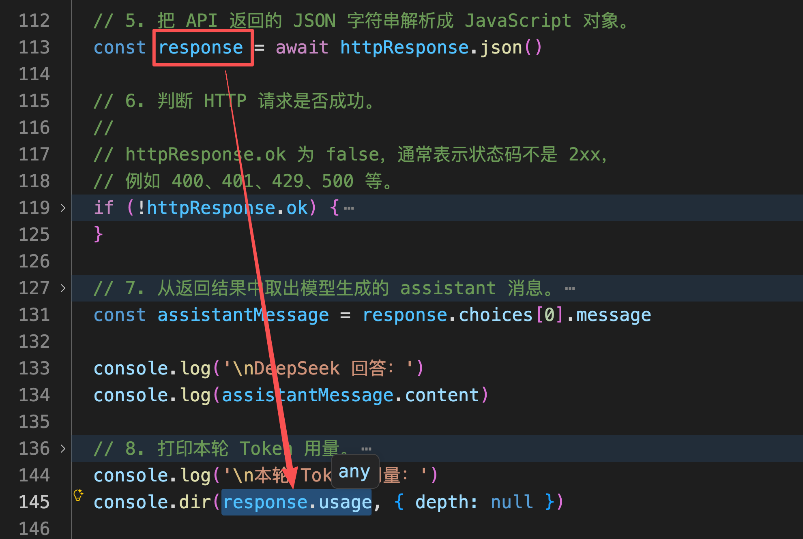
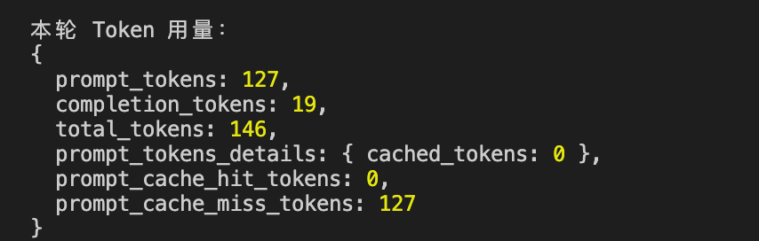
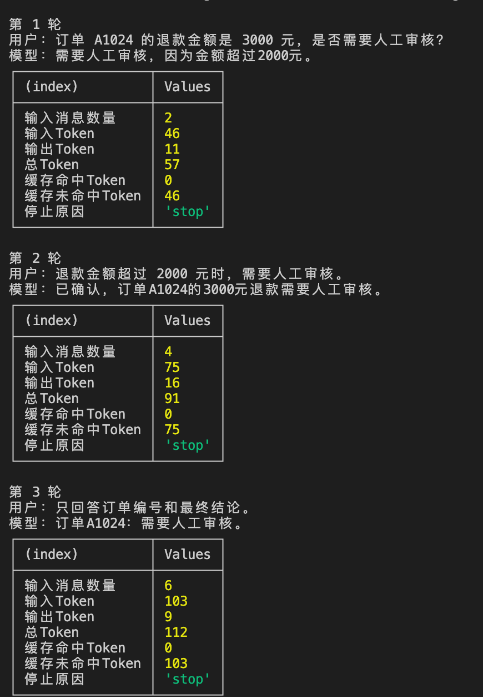
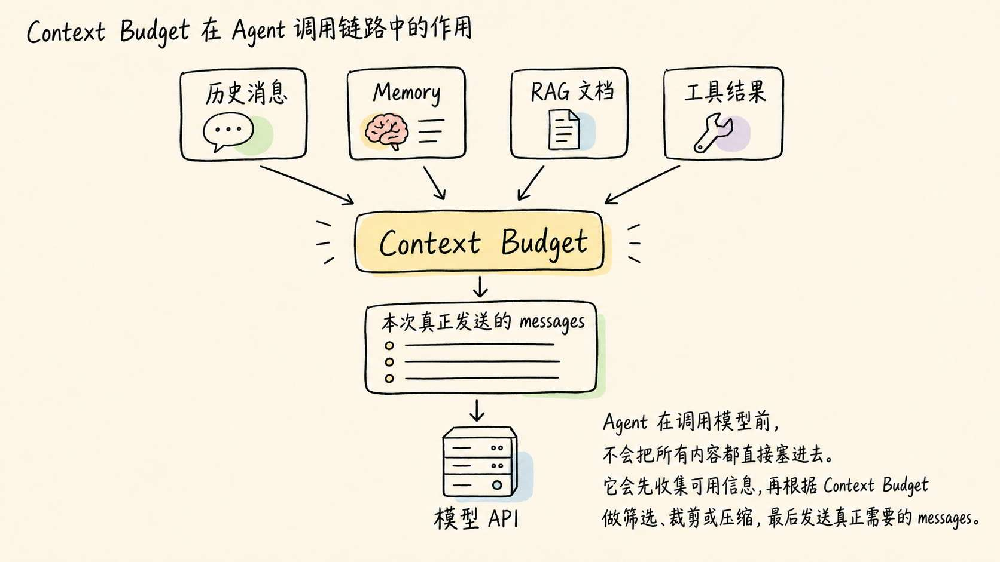
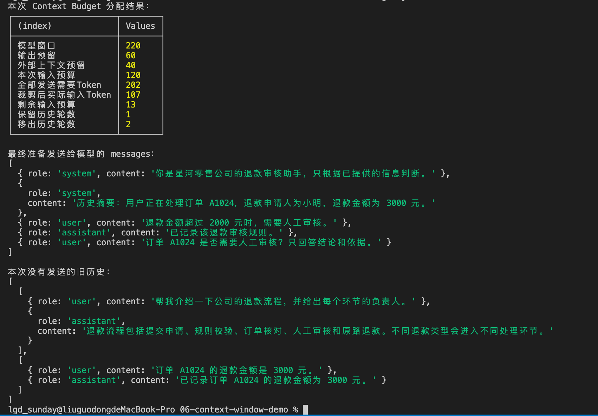
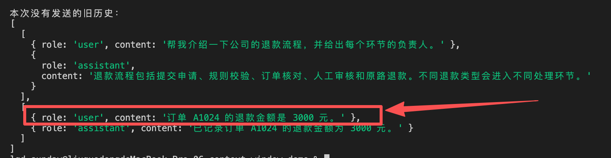
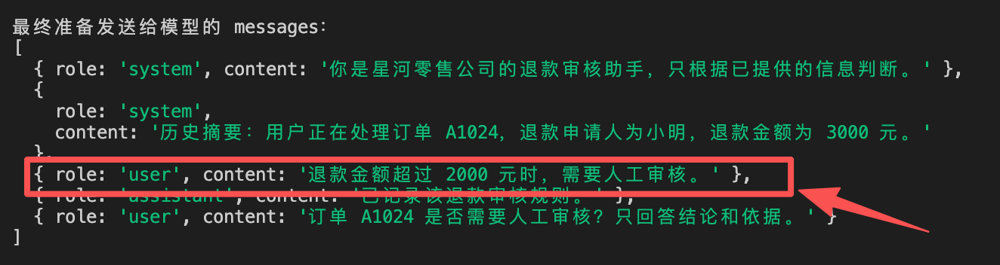
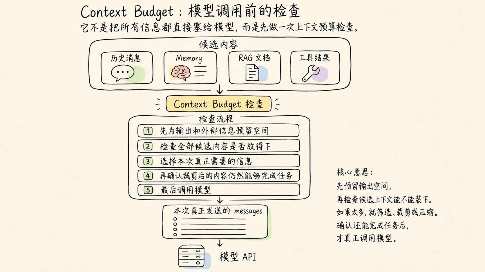

# 06-深入上下文管理：为 Agent 实现一个 Context Budget

上一节，咱们已经实现了一个最简单的多轮对话系统。

每当用户发送一条新消息，应用程序都会取出之前保存的聊天记录，把它们和最新消息一起放进 `messages`，然后重新发送给模型。

这样一来，模型就能回答“为什么？”、“把刚才的代码改一下”这类必须结合历史内容才能理解的问题。

但是，这套逻辑继续运行下去，会遇到一个很现实的问题。

**如果用户一直聊下去，难道咱们要把几百条、几千条历史消息，永远全部发送给模型吗？**

肯定不行。

因为大语言模型一次能够处理的信息是有限的。这个限制，就是本节要学习的 `Context Window`，也就是 **上下文窗口**。（截止到现在通用模型的上下文一般是 1M 也就是 100 万 Token 的上下文）

## 对话越聊越长，会发生什么？
先回忆一下上一节实现的多轮对话。

第一次调用模型时，发送的 `messages` 大概是这样的：

```json
[
  {
    "role": "system",
    "content": "你是星河零售公司的退款审核助手。"
  },
  {
    "role": "user",
    "content": "订单 A1024 的退款金额是 3000 元，是否需要人工审核？"
  }
]
```

模型回答以后，应用程序会保存它生成的 `assistant` 消息。

第二次调用时，发送的内容就变成了：

```json
[
  {
    "role": "system",
    "content": "你是星河零售公司的退款审核助手。"
  },
  {
    "role": "user",
    "content": "订单 A1024 的退款金额是 3000 元，是否需要人工审核？"
  },
  {
    "role": "assistant",
    "content": "目前缺少退款规则，无法判断。"
  },
  {
    "role": "user",
    "content": "退款金额超过 2000 元时，需要人工审核。"
  }
]
```

到了第三轮，又会在后面继续追加新的 `assistant` 和 `user` 消息。

循环往复下去，请求的内容也就会越来越多了。

还记得上一节 DeepSeek API 返回的 `usage` 吗？



打印出的内容如下：




其中：

+ `prompt_tokens` 表示本次输入占用的 Token；
+ `completion_tokens` 表示模型本次生成的 Token；
+ `total_tokens` 表示两者之和。

多轮对话继续进行时，`messages` 会越来越长，`prompt_tokens` 通常也会跟着增长。

所以，聊天机器人看起来只是在回答用户最新输入的一句话。

但是模型真正处理的，却是前面已经积累了很久的一整段内容。

这就是 Context Window 会出现的地方。

## Context Window 到底是什么
`Context Window` 可以先理解成：**模型完成一次生成时，能够放在当前工作区中处理的 Token 数量上限。即：「上下文窗口」**

这里面有两个词非常的重要：

+ 第一个是 **一次生成：** 上下文窗口只描述模型本次调用能够看的内容。本次调用结束之后，内容消失。
+ 第二个是 **Token 数量上限：** 这些内容经过 Tokenizer 处理以后，占据的 Token 的数量。

同时，我们还需要注意一点，那就是：**模型即将生成的内容，也需要占用 上下文**

举个例子：

> 假设某个模型的 Context Window（上下文窗口） 是 `8,000 Token`。
>
> 如果本次请求的输入已经占用了 `7,500 Token`，那么理论上留给模型继续生成的空间，就只剩 `500 Token`。
>
> 所以，如果模型即将输出一个很长的内容，就不能等输入把窗口全部占满以后，才开始考虑输出空间。
>
> 而需要先对当前的 Contxt Window 进行处理（压缩、摘要、删除 等）
>

如果用一个公式表示，就是下面这样：

```latex
Context Window = 输入的 Token + 输出的 Token + 即将生成内容占据的 Token
```

## 用 DeepSeek API 观察上下文增长逻辑
只看概念肯定是不直观的。

接下来，咱们写段代码来观察下。

> 本课程所有代码均已上传到：[https://github.com/lgd8981289/Agent--Code](https://github.com/lgd8981289/Agent--Code)
>

先创建项目：

```bash
mkdir 06-context-window-demo
cd 06-context-window-demo
```

创建 `.env` （还用上次的就行）：

```plain
DEEPSEEK_API_KEY=替换成自己的_API_Key
DEEPSEEK_MODEL=deepseek-v4-flash
```

然后创建 `observe-context.js`：

```javascript
// 读取环境变量中的模型名称。
// 如果没有单独配置，就使用 deepseek-v4-flash。
const model = process.env.DEEPSEEK_MODEL ?? "deepseek-v4-flash";

// messages 保存当前对话中已经发生的所有消息。
// 每完成一轮对话，新的 user 和 assistant 消息都会继续加入这里。
const messages = [
  {
    role: "system",
    content:
      "你是星河零售公司的退款审核助手。回答必须简洁，并且只能根据当前对话中已经提供的信息判断。",
  },
];

// 准备三轮需要发送的用户消息。
// 后两轮都需要结合前面的内容才能正确理解。
const userMessages = [
  "订单 A1024 的退款金额是 3000 元，是否需要人工审核？",
  "退款金额超过 2000 元时，需要人工审核。",
  "只回答订单编号和最终结论。",
];

if (!process.env.DEEPSEEK_API_KEY) {
  console.error("没有检测到 DEEPSEEK_API_KEY，请先在 .env 中配置。");
  process.exit(1);
}

for (const [index, userContent] of userMessages.entries()) {
  // 把用户本轮输入加入历史消息。
  messages.push({
    role: "user",
    content: userContent,
  });

  const response = await fetch("https://api.deepseek.com/chat/completions", {
    method: "POST",
    headers: {
      Authorization: `Bearer ${process.env.DEEPSEEK_API_KEY}`,
      "Content-Type": "application/json",
    },
    body: JSON.stringify({
      model,
      messages,

      // 这次实验不需要模型生成很长的内容。
      // 限制输出长度，可以减少实验消耗。
      max_tokens: 120,
      stream: false,
      thinking: {
        type: "disabled",
      },
    }),
  });

  const result = await response.json();

  if (!response.ok) {
    console.error("DeepSeek API 返回错误：");
    console.dir(result, { depth: null });
    process.exit(1);
  }

  const assistantMessage = result.choices[0].message;
  const usage = result.usage;

  console.log(`\n第 ${index + 1} 轮`);
  console.log(`用户：${userContent}`);
  console.log(`模型：${assistantMessage.content}`);

  // prompt_tokens 表示模型本轮真正收到的输入 Token 数量。
  // 随着 messages 逐渐增加，这个数字通常也会不断增加。
  console.table({
    输入消息数量: messages.length,
    输入Token: usage.prompt_tokens,
    输出Token: usage.completion_tokens,
    总Token: usage.total_tokens,
    缓存命中Token: usage.prompt_cache_hit_tokens ?? 0,
    缓存未命中Token: usage.prompt_cache_miss_tokens ?? 0,
    停止原因: result.choices[0].finish_reason,
  });

  // 保存模型回答。
  // 下一轮请求时，这条 assistant 消息也会重新发送给模型。
  messages.push({
    role: "assistant",
    content: assistantMessage.content,
  });
}
```

运行：

```bash
node --env-file=.env observe-context.js
```

运行以后，终端会展示三轮模型回答，以及每一轮对应的 Token 用量。




我们可以非常明确的看到：**随着不断加入 **`messages`**，后续请求中的 **`prompt_tokens`** 会逐渐增加。**

然后，这里还有两个需要注意的点：

+ 输出的内容里面有一个 **停止原因（finish_reason）**。正常生成完成时，它通常会是 `stop`。如果出现 `length`，说明输出达到了 `max_tokens`，返回的内容可能并不完整。
+ 还有一个 **缓存命中 Token（prompt_cache_hit_tokens）** 。这里咱们要注意：大模型的上下文缓存可以让「重复出现」的 「输入内容」命中缓存，从而降低部分调用成本和处理时间。但是 **依然会占用 Context Window**

## 为 Agent 实现一个 Context Budget
前面的实验已经证明了：随着对话不断进行，发送给模型的 `messages` 会越来越长，`prompt_tokens` 也会跟着增加。

这样的话，哪怕现在模型的上下文再大，总有一天也是会超出的。对不对。

那么怎么避免超出上下文呢？

最简单的处理方式，就是每次调用模型之前，检查一下当前准备发送的内容有没有超过 Context Window。

但是，只检查是否超出上限还不够。

假设某个模型的窗口还剩 `1000 Token`，当前 Agent 手里却有 `3000 Token` 的历史消息、RAG 文档和数据结果。

这个时候，应用程序就必须在调用模型之前做出选择：哪些内容必须发送？哪些内容可以暂时不发送？

负责做出这次选择的逻辑，就可以称为 `Context Budget`。

它的作用是：**在调用模型以前，为不同内容分配空间，并决定哪些信息能够进入本次请求。**

我们可以用下面的这张图来表示 Context Budget 在 Agent 调用链路中的作用




也就是说，Memory、RAG 和工具负责提供可能有用的信息，Context Budget 则负责在模型调用之前做最后一次筛选。

这样应该是解释清楚了哈。

那么接下来咱们就实现一个案例，来模拟下 `Context Budget`

---

为了让结果容易观察，咱们故意把模型窗口设置成 `220 Token`。

其中，提前为模型回答预留 `60 Token`，再为后续可能加入的 RAG 文档和工具结果预留 `40 Token`。

经过分配以后，本次请求真正能够用来放置系统指令、历史消息和当前问题的空间，只剩下：

```latex
220 - 60 - 40 = 120 Token
```

但是，当前 Agent 保存的全部历史消息已经超过了这 `120 Token`。

所以说，我们准备好的内容就 **不能全部发送** 了。但是，如果不能全部发送，又会导致内容不全的问题。

所以，咱们本小节的第二个案例需要同时完成两件事：

+ 把不重要的旧对话移出本次请求
+ 保留完成当前任务真正需要的信息

从而达到 **既不超过 120 Token ，又不会导致内容不全的问题。**

你看，这才是实现 Context Budget 的意义。

在 `06-context-window-demo` 中创建 `context-budget.js` 来模拟 Context Budget 的流程（注意：这里是模拟哈。别头脑一热认为 大模型 内部也是这么处理的，可不是）

```javascript
// 为了让实验结果更明显，这里故意设置一个很小的窗口。
const MODEL_CONTEXT_LIMIT = 220;

// Context Window 不只容纳输入，还需要为模型回答预留空间。
const OUTPUT_RESERVE = 60;

// Agent 后续还可能加入 RAG 文档、工具描述和工具结果。
const EXTERNAL_CONTEXT_RESERVE = 40;

/**
 * 粗略估算文字占用的 Token。
 * 这不是任何真实模型的 Tokenizer，只用于演示预算分配流程。
 */
function estimateTextTokens(text) {
  const characters = [...text];
  const chineseCharacterCount = characters.filter((character) =>
    /\p{Script=Han}/u.test(character),
  ).length;
  const otherCharacterCount = characters.length - chineseCharacterCount;

  return Math.ceil(chineseCharacterCount * 0.7 + otherCharacterCount / 4);
}

function estimateMessageTokens(message) {
  // role、分隔符和消息模板同样会占用 Token。
  // 这里使用固定数值模拟这部分开销。
  return estimateTextTokens(message.content) + 6;
}

function estimateMessagesTokens(messages) {
  return messages.reduce(
    (total, message) => total + estimateMessageTokens(message),
    0,
  );
}

/**
 * 在输入预算内，组装本次真正发送给模型的 messages。
 */
function buildContext({ systemMessage, summaryMessage, historyTurns, userMessage }) {
  // 从完整窗口中，减去输出和外部上下文预留。
  const inputBudget =
    MODEL_CONTEXT_LIMIT - OUTPUT_RESERVE - EXTERNAL_CONTEXT_RESERVE;

  // 这三部分是当前任务必须保留的内容。
  const requiredMessages = [systemMessage, summaryMessage, userMessage];
  const requiredTokens = estimateMessagesTokens(requiredMessages);

  if (requiredTokens > inputBudget) {
    throw new Error("必选内容已经超过输入预算，需要继续压缩摘要或当前输入。");
  }

  let remainingBudget = inputBudget - requiredTokens;
  const selectedTurns = [];
  const discardedTurns = [];

  // 从最近一轮开始向前选择，每次保留完整的 user + assistant。
  for (let index = historyTurns.length - 1; index >= 0; index -= 1) {
    const turn = historyTurns[index];
    const turnTokens = estimateMessagesTokens(turn);

    if (turnTokens <= remainingBudget) {
      selectedTurns.unshift(turn);
      remainingBudget -= turnTokens;
    } else {
      discardedTurns.unshift(turn);
    }
  }

  const messages = [
    systemMessage,
    summaryMessage,
    ...selectedTurns.flat(),
    userMessage,
  ];

  return {
    messages,
    selectedTurns,
    discardedTurns,
    inputBudget,
    usedInputTokens: estimateMessagesTokens(messages),
    remainingInputTokens: remainingBudget,
  };
}

const systemMessage = {
  role: "system",
  content: "你是星河零售公司的退款审核助手，只根据已提供的信息判断。",
};

// 历史摘要保留旧对话中仍然重要的事实。
// 这里直接准备摘要，后续 Memory 章节会继续学习如何生成和保存它。
const summaryMessage = {
  role: "system",
  content:
    "历史摘要：用户正在处理订单 A1024，退款申请人为小明，退款金额为 3000 元。",
};

// 按完整对话轮次保存历史，避免只留下问题或者回答。
const historyTurns = [
  [
    {
      role: "user",
      content: "帮我介绍一下公司的退款流程，并给出每个环节的负责人。",
    },
    {
      role: "assistant",
      content:
        "退款流程包括提交申请、规则校验、订单核对、人工审核和原路退款。不同退款类型会进入不同处理环节。",
    },
  ],
  [
    {
      role: "user",
      content: "订单 A1024 的退款金额是 3000 元。",
    },
    {
      role: "assistant",
      content: "已记录订单 A1024 的退款金额为 3000 元。",
    },
  ],
  [
    {
      role: "user",
      content: "退款金额超过 2000 元时，需要人工审核。",
    },
    {
      role: "assistant",
      content: "已记录该退款审核规则。",
    },
  ],
];

const userMessage = {
  role: "user",
  content: "订单 A1024 是否需要人工审核？只回答结论和依据。",
};

// 先计算：如果什么都不删除，全部发送需要多少 Token。
const allMessages = [
  systemMessage,
  summaryMessage,
  ...historyTurns.flat(),
  userMessage,
];
const allMessagesTokens = estimateMessagesTokens(allMessages);

// 再根据预算，组装本次真正需要发送的内容。
const result = buildContext({
  systemMessage,
  summaryMessage,
  historyTurns,
  userMessage,
});

console.log("本次 Context Budget 分配结果：");
console.table({
  模型窗口: MODEL_CONTEXT_LIMIT,
  输出预留: OUTPUT_RESERVE,
  外部上下文预留: EXTERNAL_CONTEXT_RESERVE,
  本次输入预算: result.inputBudget,
  全部发送需要Token: allMessagesTokens,
  裁剪后实际输入Token: result.usedInputTokens,
  剩余输入预算: result.remainingInputTokens,
  保留历史轮数: result.selectedTurns.length,
  移出历史轮数: result.discardedTurns.length,
});

console.log("\n最终准备发送给模型的 messages：");
console.dir(result.messages, { depth: null });

console.log("\n本次没有发送的旧历史：");
console.dir(result.discardedTurns, { depth: null });
```

运行：

```bash
node context-budget.js
```

结果如下：




运行以后，先看表格中的三个数字：

```latex
本次输入预算  120
全部发送需要 Token  202
裁剪后实际输入 Token  107
```

`全部发送需要 Token` 大于 `本次输入预算`，说明这些内容无法按照原样全部进入本次请求。

经过 `buildContext` 处理以后，`裁剪后实际输入 Token` 已经回到了预算以内。到了这里，Context Budget 完成了第一件事：**避免输入内容挤占本次调用的全部空间。**

观察最终的 `messages`，可以看到“订单 A1024 的退款金额是 3000 元”所在的原始对话已经被移出了本次请求。




但是，这个事实仍然存在于 `summaryMessage` 中。配合保留下来的“超过 2000 元需要人工审核”规则，模型依然拥有完成当前判断所需的信息。




这说明 Context Budget 还完成了第二件事：**虽然减少了输入内容，但是没有丢掉当前任务所需的关键信息。**

这也是这个案例真正想让大家理解的地方。

Context Budget 它是一个发生在模型调用之前的检查，下面画了张图，大家可以参考下：




当然了。

当前代码只是一个最小版本，真实 Agent 还会结合当前任务、消息重要程度、RAG 检索结果和工具调用状态决定保留什么。但无论以后采用哪种复杂方案，它们都在解决同一个问题：

**Context Window 是有限的，Agent 必须在每次调用以前，主动决定本次让模型看到什么。**

所以，这个案例的作用可以用一句话概括：

> **它让咱们第一次实现了 Agent 的上下文组装层：不再把所有信息直接扔给模型，而是在调用前检查预算、选择内容，并验证剩余信息是否足以完成任务。**
>

## 总结
前面的示例使用了一个固定预算。

真实项目不会只有一套数字，因为不同任务需要的重点不同。

普通客服问答中，回答通常比较短，可以把更多空间分给历史消息和 RAG 文档。

如果用户要求生成一份完整报告，就需要为输出预留更多空间。否则模型可能写到一半，就因为达到输出限制而停止。

工具很多的 Agent，还需要单独关注工具描述。几十个工具的名称、说明和参数结构全部放进请求，不只会消耗窗口，还可能让模型更难选对工具。

现在再回到开头的问题。

用户一直聊下去以后，应用程序当然不能把所有历史永远发送给模型。

Context Window 限制了模型一次调用能够处理的 Token 数量，而且这个空间需要同时容纳输入和模型即将生成的输出。

对 Agent 来说，系统指令、历史消息、RAG 文档、工具描述和工具结果，都会竞争同一块上下文空间。

所以，真正重要的能力不是“把更多内容塞给模型”，而是：**在每次调用之前，选择当前任务真正需要的信息，并为不同内容分配合理的 Context Budget。**

后面学习 RAG、短期记忆、长期记忆和上下文压缩时，咱们会逐步补全这套能力，让 Agent 不需要记住所有内容，也能在需要的时候找到真正重要的信息。

下一节，咱们会继续研究模型生成结果时的随机性、幻觉与能力边界，看看为什么输入内容完全相同，模型依然可能给出不同答案。

> 更新：2026-06-14 22:05 · 原文：<https://www.yuque.com/lgdsunday/ab1dy3/gmk3nrat8d1780mt>
