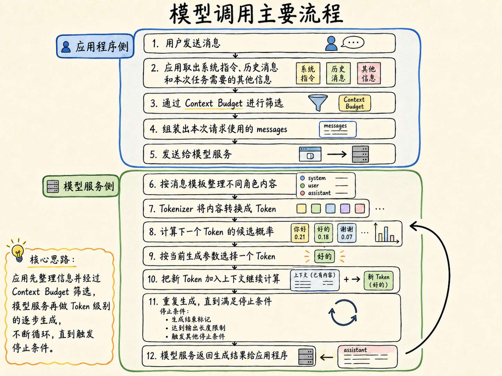
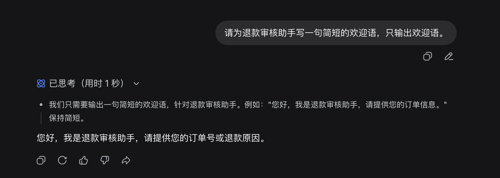
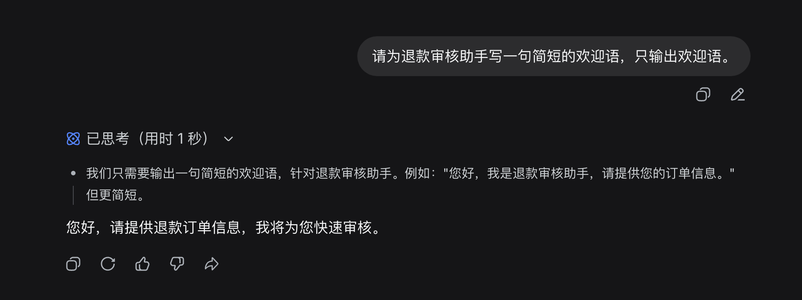
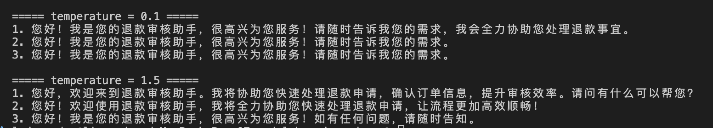
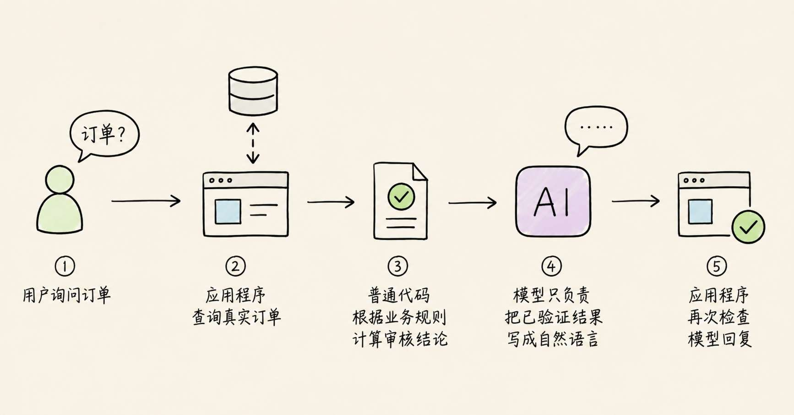
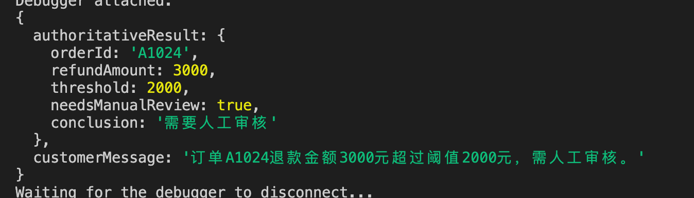

# 07-解决：生成随机性、模型幻觉与模型能力边界的问题

前面几节，咱们已经把一次模型调用的主要流程走通了。

用户发送消息后，应用程序会先整理系统指令、历史消息和任务相关信息，再通过 Context Budget 筛选内容，组装成本次请求的 `messages`，发送给模型服务。

模型服务会把 `messages` 转换成 Token，模型根据这些 Token 预测下一个 Token，并按照生成参数选择结果。新 Token 会继续加入上下文，模型不断重复这个过程，直到满足停止条件。

大致的流程可以用下图表示：




整个过程看起来已经挺完整了。

但是，如果我们真正把模型接进业务系统以后，很快就会遇到两个特别麻烦的问题。

+ 第一个问题是：同样的问题，连续问几次，模型给出的答案可能是完全不一样的
+ 第二个问题是：模型有时候可能会直接给出一个错误的答案

这就是咱们这一小节要讲的问题，一共三个点：

+ 生成随机性：为什么相同输入可能得到不同回答？
+ 模型幻觉：降低随机性以后，为什么模型仍然可能回答错误？
+ 模型的能力边界：哪些事情可以交给模型，哪些事情必须由 Agent 外部系统负责？

然后，最后，咱们会实现一个 **退款审核 Agent 项目** 来验证下咱们说的这三点内容

## 生成随机性：为什么相同输入可能得到不同回答？
先做个最简单的实验。

打开任意一个 AI 聊天产品，新建几个完全独立的对话（一定要是独立的对话），然后分别输入：

```latex
请为退款审核助手写一句简短的欢迎语，只输出欢迎语。
```

大家会发现模型返回的内容是完全不一样的：







那么为什么明明输入内容没有变化，但是输出的内容会发生变化呢？

还记得在《[大语言模型如何生成内容](https://mp.weixin.qq.com/s/-Qm7yAoVc6_rE8ApUcS84w?payreadticket=HC3two2O6icgHTXDvVg1Y8RMDR2te5ItLdF9XeOejRteyWXmJW-H_F6xBE8FH_6ieNsromo)》中讲过的内容吗？

> 模型每次生成下一个 Token 时，得到的并不是一个已经写好的标准答案，而是一组候选 Token 的分数。
>

假设模型现在要继续生成：**欢迎使用退款审核____**

经过模型计算以后，候选 Token 可能是下面这样：

| 候选 Token | 概率 |
| --- | ---: |
| 助手 | 48% |
| 服务 | 31% |
| 系统 | 16% |
| 其他内容 | 5% |


在这个随机的表里面，`助手` 的概率是最高的。

但是！我们得注意，这并不意味着 **模型每次都必须选择它**。

模型服务可以按照当前采样策略，从候选结果中选择后续 Token。只要某一步选择发生变化，后面的内容又会基于新的上下文继续生成，最终答案就可能逐渐走向不同方向。

所以：**生成随机性本就是模型正常的工作方式**。

## 决定随机性的关键指标：Temperature
想要验证随机性，咱们得需要使用到一个东西，那就是 ：**温度：Temperature **。

它主要用来 **控制AI生成文本的随机性。Temperature 值越高则随机概率越大。** （在《[大语言模型如何生成内容](https://mp.weixin.qq.com/s/-Qm7yAoVc6_rE8ApUcS84w?payreadticket=HC3two2O6icgHTXDvVg1Y8RMDR2te5ItLdF9XeOejRteyWXmJW-H_F6xBE8FH_6ieNsromo)》中也提到过这个东西，大家也可以回去做对比参考）

假设模型为三个候选 Token 计算出的原始分数分别是：

+ 助手：3.2
+ 服务：2.7
+ 系统：2.2

这些原始分数会参与后续概率计算。

在常见实现中，Temperature 会在 Softmax 之前参与调整（在《[大语言模型如何生成内容](https://mp.weixin.qq.com/s/-Qm7yAoVc6_rE8ApUcS84w?payreadticket=HC3two2O6icgHTXDvVg1Y8RMDR2te5ItLdF9XeOejRteyWXmJW-H_F6xBE8FH_6ieNsromo)》这里讲过）。整个调整的公式大概就是这样 `probability = softmax(logit / temperature)` 。（看不懂也没事，就看下面的文字描述）

+ temperature 作为分母：当 `temperature` 较低时（分母越低，分值越高），原本分数最高的候选会变得更加突出，模型更倾向于选择它。
+ 当 `temperature` 较高时（分母越高，分值越低），候选结果之间的差距会被拉近，原本概率较低的内容也更容易被选中。

所以，Temperature 控制的就是：**模型生成内容时，选择结果的集中度。**

还不好理解哈。

没关系，下面咱们通过一个代码，来看下 Temperature 的实际场景结果

咱们继续使用 DeepSeek API，对一个完全相同的 Prompt 连续发起多次请求，再观察不同 `temperature` 下生成结果的变化。

先创建项目：

```bash
mkdir 07-model-boundary-demo
cd 07-model-boundary-demo
```

还是用之前的 `.env` 文件，这里不重复说了

然后创建 `temperature-demo.js`：

```javascript
const model = process.env.DEEPSEEK_MODEL ?? 'deepseek-v4-flash'

if (!process.env.DEEPSEEK_API_KEY) {
    console.error('没有检测到 DEEPSEEK_API_KEY，请先在 .env 中配置。')
    process.exit(1)
}

const prompt = '请为退款审核助手写几句简短的欢迎语，只输出欢迎语。'

/**
 * 使用指定的 temperature 连续调用三次模型。
 */
async function runGroup(temperature) {
    console.log(`\n===== temperature = ${temperature} =====`)

    for (let index = 1; index <= 3; index += 1) {
        const response = await fetch('https://api.deepseek.com/chat/completions', {
            method: 'POST',
            headers: {
                Authorization: `Bearer ${process.env.DEEPSEEK_API_KEY}`,
                'Content-Type': 'application/json'
            },
            body: JSON.stringify({
                model,
                messages: [
                    {
                        role: 'user',
                        content: prompt
                    }
                ],
                max_tokens: 80,
                temperature,
                stream: false,

                // DeepSeek V4 默认开启思考模式。
                // 官方文档明确说明：思考模式下 temperature 和 top_p 不会生效。
                // 所以这次研究 temperature 时，需要显式关闭思考模式。
                thinking: {
                    type: 'disabled'
                }
            })
        })

        const result = await response.json()

        if (!response.ok) {
            console.error('DeepSeek API 返回错误：')
            console.dir(result, { depth: null })
            process.exit(1)
        }

        console.log(`${index}. ${result.choices[0].message.content}`)
    }
}

async function main() {
    // 低 temperature：生成的内容会更加集中，几次回答可能比较相似。
    await runGroup(0.1)
    // 高 temperature：模型更容易选择原本概率较低的 Token，所以回答通常会出现更多变化。
    await runGroup(1.5)
}

main().catch((error) => {
    console.error('实验执行失败：', error)
    process.exit(1)
})
```

运行（**注意看 main 方法里面的注释哈、注意看 main 方法里面的注释哈、注意看 main 方法里面的注释哈**）：

```bash
node --env-file=.env temperature-demo.js
```

打印结果




大家应该可以看出来差别。

+ 在  temperature = 0.1 的时候，模型的回答几乎无变化（三次有两次是完全一致的）
+ 在  temperature = 1.5 的时候，模型的回答变化就比较大了

现在大家应该可以比较好的理解 temperature 的作用了吧。

temperature 就是：**控制AI生成文本的随机性的。Temperature 值越高则随机概率越大，反之则越低。**

## Temperature 低了，就不会产生幻觉了吗？
大家还记不记得咱们在 [第一章：01 - 从聊天机器人开始认识大语言模型](https://mp.weixin.qq.com/s/Ule7xfE7PBWi5hURNC1feQ?payreadticket=HEYBXIaPj1VlYDQ67TcIj-9CIuiyn_sDjcCY9-zfd7u4ZjE-Q2prT1QNltEx5IIcmdd1FVc) 中做过的【实验二】。那就是一个典型的幻觉问题。（忘记的同学可以简单回顾一下）

那么现在。咱们已经理解了 Temperature 了。

那么大家会不会想一个问题，那就是：**既然业务系统需要稳定，那直接把 **`temperature`** 设置成最低，是不是就可以解决模型回答错误（幻觉）的问题？**

答案肯定是：**不可以的。**

这里，大家必须区分两个完全不同的问题：

+ 随机性 指的是：同一输入可能生成不同内容
+ 模型回答错误（幻觉）指的是：模型生成了没有任何事实依据的、错误的内容

Temperature 可以影响随机性，但是它不能决定内容的任何真实性。同时，当 Temperature 的值过低的时候，还会出现模型的回答 “不够聪明” 的问题

## 模型的能力边界
大家来思考一下。

假设，现在有一个专门负责退款的 Agent。

用户对退款 Agent 说：“帮我查询订单 A1024 是否满足退款条件，如果满足就直接退款。”

那么大家想一下，这句话里面包含了几个任务？？？

---

其实有三个：

+ 第一：大模型需要 理解用户想做什么
+ 第二：大模型需要 查询真实订单与退款规则
+ 第三：大模型需要 执行退款操作

理解自然语言，是大语言模型擅长的事情。

但是，模型并不知道咱们业务数据库中是否真的存在订单 A1024，也不能只靠生成一段文字就完成退款转账。

如果没有提供工具，模型最多只能根据当前上下文生成一个回答。

**但是**，即便他生成了已经退款完成的回答。也不会真实发生退款。

因为大模型根本就不知道应该从哪里进行退款，对不对。

所以，在开发大模型的时候，它的能力边界，咱们是必须要知道的。

这个边界有三个：

| 边界 | 需要问的问题 |
| --- | --- |
| 信息边界 | 模型当前是否拥有回答所需的可信信息？ |
| 行动边界 | 模型是否接入了能够执行真实操作的工具？ |
| 决策边界 | 这件事可以由模型判断，还是必须交给确定性规则、人工或其他系统？ |


但是，只知道模型存在这些边界，还是不够的。

因为模型不会主动替咱们划分边界。

如果应用程序直接把用户问题发送给模型，模型仍然可能在看不到订单数据的情况下给出输出，也就是依然会产生幻觉问题。

所以，真正负责限制模型能力的，必须是 Agent 外部的应用程序（传统的 后端代码）。

那么接下来，咱们就实现一个案例，来看下这种场景。

这个案例要达到一个目的，那就是：**即使模型会产生随机输出，甚至模型调用失败，Agent 仍然能够得到可信的审核结论，并且不会执行超出边界的操作。**

## 实现一个退款审核的 Agent 项目
> 本项目所有代码地址：`https://github.com/lgd8981289/Agent--Code`
>

整个案例的流程大概是这样的：




下面的代码给大家专门录制了一个讲解的视频，大家可以先看下面的代码，看不懂的话，再回过头来看这个录制好的讲解视频

[此处为语雀卡片，点击链接查看](https://www.yuque.com/lgdsunday/ab1dy3/bp6ul1sggqdom15h#qQKtb)

在 `07-model-boundary-demo` 中创建 `reliable-refund-agent.js`：

```javascript
const model = process.env.DEEPSEEK_MODEL ?? 'deepseek-v4-flash'

// 使用本地数据模拟订单数据库。
// 真实项目中，这里应该查询数据库或者调用订单服务。
const orders = new Map([
    [
        'A1024',
        {
            orderId: 'A1024',
            refundAmount: 3000,
            status: 'refund_requested'
        }
    ]
])

// 这是一条能够明确写成代码的业务规则。
// 审核结论应该由确定性代码计算，而不是交给模型猜测。
const MANUAL_REVIEW_THRESHOLD = 2000

function queryOrder(orderId) {
    return orders.get(orderId)
}

/**
 * 根据订单信息评估是否需要人工审核
 */
function evaluateRefund(order) {
    const needsManualReview = order.refundAmount > MANUAL_REVIEW_THRESHOLD

    return {
        orderId: order.orderId,
        refundAmount: order.refundAmount,
        threshold: MANUAL_REVIEW_THRESHOLD,
        needsManualReview,
        conclusion: needsManualReview ? '需要人工审核' : '无需人工审核'
    }
}

/**
 * 让模型把已经验证的结果改写成用户容易理解的回复。
 *
 * 注意：模型只负责表达。
 * result 中的业务事实和审核结论，已经由应用程序提前确定。
 */
async function generateCustomerMessage(result) {
    const response = await fetch('https://api.deepseek.com/chat/completions', {
        method: 'POST',
        headers: {
            Authorization: `Bearer ${process.env.DEEPSEEK_API_KEY}`,
            'Content-Type': 'application/json'
        },
        body: JSON.stringify({
            model,
            messages: [
                {
                    role: 'system',
                    content:
                        '你负责把已经验证的退款审核结果改写成一句简洁回复。不得修改订单编号、金额、阈值和审核结论，也不得声称已经执行退款。'
                },
                {
                    role: 'user',
                    // {"orderId":"A1024","refundAmount":3000,"threshold":2000,"needsManualReview":true,"conclusion":"需要人工审核"}
                    content: JSON.stringify(result)
                }
            ],
            max_tokens: 120,
            temperature: 0.2,
            stream: false,
            thinking: {
                type: 'disabled'
            }
        })
    })

    const data = await response.json()

    return data.choices[0].message.content
}

/**
 * 审核退款申请
 */
async function reviewRefund(orderId) {
    // 第一步：应用程序查询真实订单。
    const order = queryOrder(orderId)

    // 第二步：普通代码根据业务规则计算审核结论。
    const authoritativeResult = evaluateRefund(order)

    // 第三步：模型只负责把已验证结果写成自然语言。
    const customerMessage = await generateCustomerMessage(authoritativeResult)

    return {
        authoritativeResult,
        customerMessage
    }
}

async function main() {
    // 查询 A1024 的审核结果，并让模型生成给客户的回复。
    const result = await reviewRefund('A1024')
    console.dir(result, { depth: null })
}

main()
```

运行：

```bash
node --env-file=.env reliable-refund-agent.js
```

得到的结果如下：




> PS：代码看不懂的话，可以看上面的讲解视频
>

## 总结
现在，咱们再回头看开头提出的问题。

相同输入可能得到不同回答，是因为模型每一步都在候选 Token 中继续生成，采样策略会影响最终选择。

Temperature 可以调整生成结果有多集中，但是它不负责验证事实。降低 Temperature 可能让模型更稳定，也可能让它更加稳定地生成同一个错误答案。

幻觉真正危险的地方，是模型可以把没有依据的内容写得非常合理。

所以，开发 Agent 时不能只关心模型“回答得像不像”，还需要检查它有没有可信信息、是否拥有真实工具，以及最终决策应该由谁负责。

本节实现的退款审核 Agent，把订单查询和审核结论留在了模型外部。模型只负责组织表达，即使模型调用失败或者生成内容没有通过检查，系统仍然拥有一份确定性结果。

这就是模型能力边界真正落到工程里的样子：**让模型完成它擅长的事情，同时不让它决定自己无法验证的事实。**

下一节，咱们会继续比较普通模型、推理模型与多模态模型，看看不同任务究竟应该选择哪一种模型能力。

> 更新：2026-08-13 23:22 · 原文：<https://www.yuque.com/lgdsunday/ab1dy3/bp6ul1sggqdom15h>
