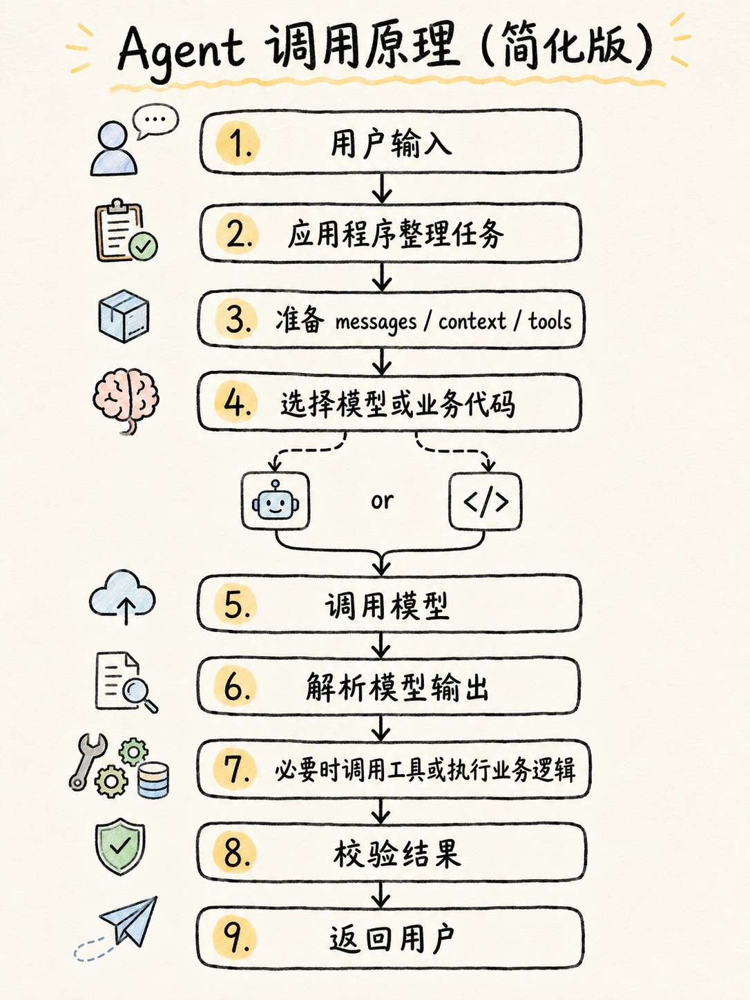
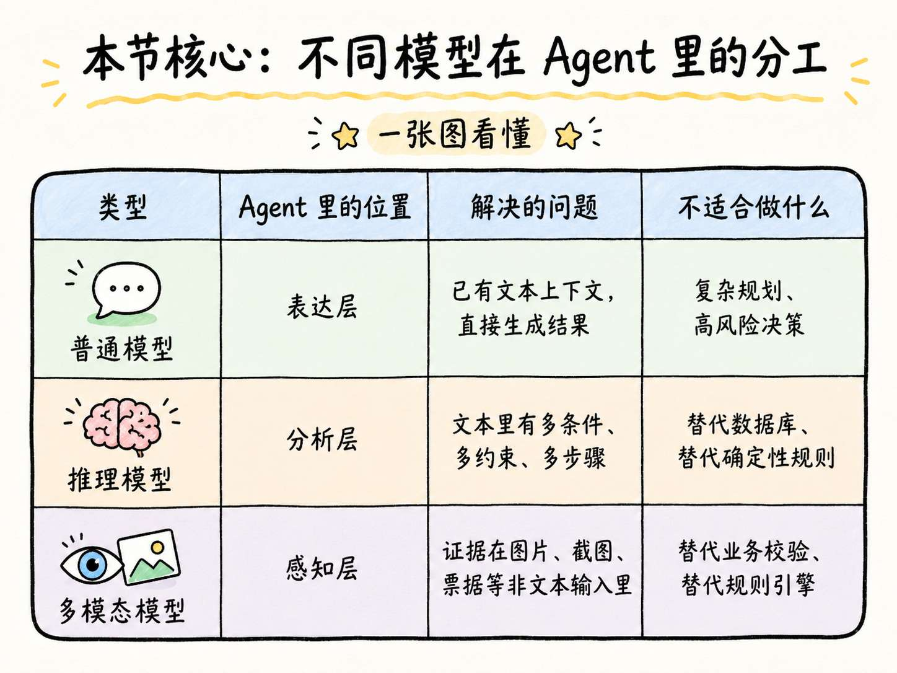
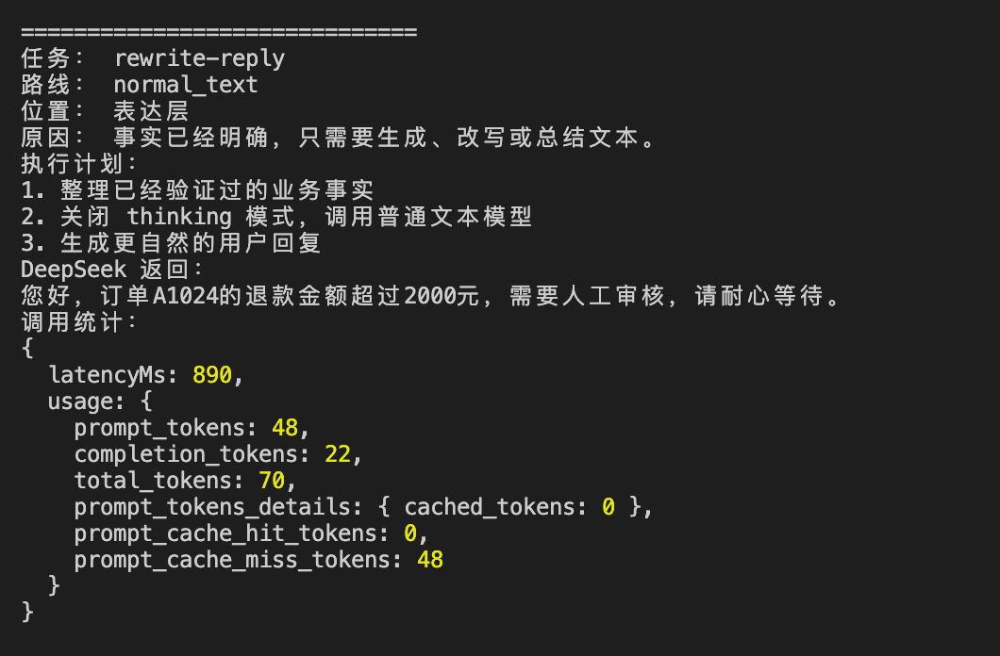
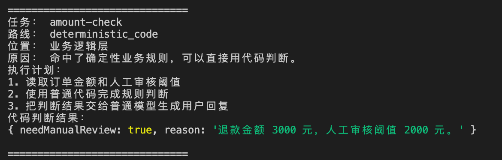
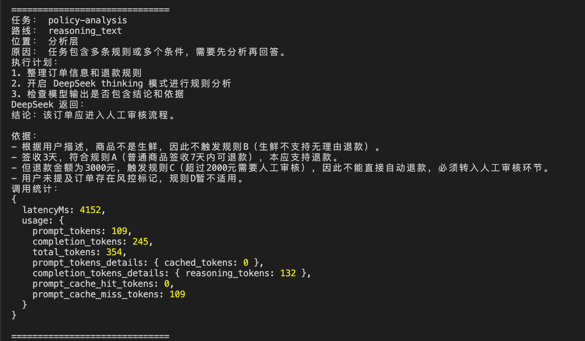
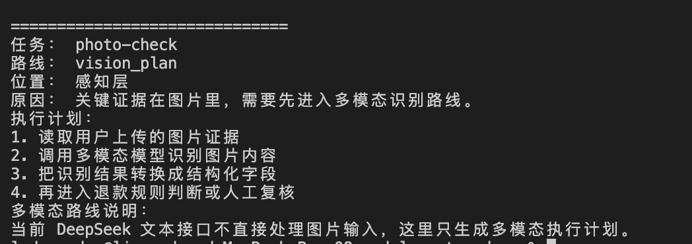

# 08-深入模型分类，实现一个 model-router

上一节，咱们实现了一个退款审核 Agent。

那个案例里，模型并没有直接决定 “是否需要人工审核”。订单查询、金额判断、规则判断，都是代码完成的。模型只负责把已经确定的结果改写成一句人话。

那么通过这个案例，我们就可以知道：**Agent 应用，也并不是要把所有事情都交给大模型去做。**

Agent 本身是一个应用程序，它会根据任务选择不同能力：有些任务走普通代码，有些任务走普通文本模型，有些任务需要推理模型，有些任务必须接多模态模型。

你看，这里模型还分为 三种 呢。

+ 那么这三种模型有什么区别呢？
+ 咱们又应该如何来判断让任务走哪个模型呢？

这就是咱们这一小节要讲的内容。

对了，本节还会做一个可运行的 `Model Router （模型路由）`。作用是：**Agent 收到任务以后，怎么判断它应该走普通模型、推理模型、多模态模型，还是根本不该走模型。**

来，咱们开始。

## 普通模型、推理模型和多模态模型 到底都是什么？
想讲清楚这三个模型，咱们得先从 Agent 的底层流程看。

在前面，咱们已经讲过一次模型调用的大概过程了。

用户输入内容以后，Agent 系统并不是直接把用户输入的内容丢给模型。

Agent 会先做一些准备工作：整理用户问题、补充历史上下文、拼好 `messages`，必要时还会准备工具、业务数据和系统规则 等等的。

准备完成以后，应用程序才会决定下一步怎么处理。

有些任务需要调用模型，有些任务应该直接走业务代码。

所以，一个 Agent 的完整过程，不是简单的：【用户输入 → 模型回答】

而是更接近下面这样的：




通过这张图我们就可以知道 **调用模型（第五条）** 本身知识 Agent 系统中的一个能力模块而已。

理解了这一点，咱们再来看普通模型、推理模型、多模态模型。

这三种不同的模型，它们也只是 Agent 在不同任务下调用的不同能力。

更准确地说，它们解决的是三个不同问题：

+ 普通模型：文本输入已经足够，直接生成结果
+ 推理模型：文本输入够了，但需要更长的分析过程
+ 多模态模型：文本输入不够，证据在图片、截图、票据等非文本内容里

### 普通模型
> PS：首先咱们得明确一点。普通模型并不是能力差的模型。
>

它的特点是：**速度快，费用低，适合处理无需复杂拼接业务的逻辑**

比如上一节的退款审核结果已经由代码判断出来了：

```latex
订单 A1024 的退款金额为 3000 元，超过 2000 元人工审核阈值，因此需要人工审核。
```

这时候模型要做的事情很简单：把这句话改写成客服回复。

从调用接口看，普通模型通常就是一次 **文本到文本 的生成 （文生文）**。

在 DeepSeek V4 API 里，可以通过关闭 `thinking` 来走非思考模式：

```javascript
const normalTextCall = {
  model: "deepseek-v4-flash",
  messages: [
    {
      role: "user",
      content: "把“订单 A1024 需要人工审核”改写成一句客服回复。",
    },
  ],
  // 关闭思考模式
  thinking: {
    type: "disabled",
  },
};
```

关闭之后，你会发现，上一小节的整个案例，完全不会收到影响。

所以，我们可以说：

> 在 Agent 里，普通模型更像是 **表达层**。
>
> 它负责把系统已经确定的内容，说得更自然、更适合用户阅读。
>

### 推理模型
推理模型仍然主要处理文本内容。

但是它处理不同的是：**文本里有多个条件、多个约束、多个可能路径，需要模型先分析，再输出结果。** 的场景

比如用户给了这样一段内容：

```latex
用户签收 3 天，商品不是生鲜，退款金额 3000 元。
规则 A：普通商品签收 7 天内可退款。
规则 B：生鲜不支持无理由退款。
规则 C：超过 2000 元需要人工审核。
规则 D：如果订单存在风控标记，必须进入人工复核。

请判断当前订单应该进入哪个流程，并说明依据。
```

你看，这里就不是简单的 “翻译” 了。

模型要先识别订单信息，再筛选相关规则，再判断哪些规则命中，最后组织答案。

这就是推理模型更适合的地方。

从底层调用看，推理模型仍然是模型调用。唯一的区别知识 **它会在最终答案之前使用更多推理预算**，同时也意味着会消耗更多的 时间 以及  Token。

如果想要开启推理模型，那么可以写成这样：

```javascript
const reasoningCall = {
  model: "deepseek-v4-pro",
  messages: [
    {
      role: "user",
      content: "根据退款规则判断订单 A1024 应该进入哪个处理流程，并说明依据。",
    },
  ],
  // 开启推理模式
  thinking: {
    type: "enabled",
  },
  // 控制推理强度。high 中高推理，max 最大推理
  reasoning_effort: "high",
};
```

所以，推理模型在 Agent 里更像是 **分析层**。

它适合做复杂规则分析、代码问题定位、工具调用前的计划、多个条件之间的取舍。

### 多模态模型
多模态模型解决的是另一类问题：**模型看的内容是非文本的内容（比如：图片、视频、pdf 等）。**

比如用户上传一张商品照片，然后问：“这个咖啡机外壳是不是破了？”

如果你把这句话发给普通文本模型，它只会看到“这个咖啡机外壳是不是破了”这几个字。

它看不到图片。这时哪怕换成推理模型也没用。

从底层看，多模态模型会把图片、截图这类输入转换成模型可以处理的视觉表示。很多模型会把图片切成 patch 或按图片 token 计费，然后和文本一起进入模型。

所以，多模态模型在 Agent 里更像是 **感知层**。

它负责把图片、票据、截图、PDF 页面里的内容 “读” 出来。

在 DeepSeek 里面，如果要实现一个多模态模型，那么它的大概是下面这样的：

```javascript
const visionInputExample = {
  // 注意，这里不是 messages 了，而是 input
  input: [
    {
      role: "user",
      content: [
        {
          type: "input_text",
          text: "判断这张商品照片里，外壳是否有明显破损。",
        },
        {
          type: "input_image",
          image_url: "data:image/jpeg;base64,<base64-image>",
        },
      ],
    },
  ],
};
```

这样，模型才真的 “看到” 图片。

咱们把三类模型放在一起来看下（有些同学问图片生成用的是什么，我这里用的是  gpt-image-2。图片可不是手画的哈，没那手艺，，，AI 生成的手绘风格）：




## 实现一个模型选择器
来吧，纸上得来终觉浅。

写个案例。把咱们上面的判断逻辑捋一捋

咱们做一个 **可以真实调用 DeepSeek 的 Model Router（模型路由）**。这个代码会有点点复杂，涉及到多个 js 文件

> 注意哈：咱们这里只做  普通文本模型 和 推理模型。 多模态这里不真实调用 DeepSeek ，等到后面的多模态大章再去讲
>
> 代码地址：`https://github.com/lgd8981289/Agent--Code`
>

先创建项目：

```bash
mkdir 08-model-router-demo
cd 08-model-router-demo
```

这个案例需要 Node.js 18 以上，因为后面会用到 Node 内置的 `fetch`。

`.env` 文件还是使用之前的就可以

先创建 `task-profiler.js` 文件，这个文件负责把用户请求变成任务画像（代码中的备注全部由 AI 生成的哈，这备注没有手写的必要）

```javascript
/**
 * 对任务进行分析和配置，帮助模型路由器做出更智能的决策
 */
function profileTask(task) {
    // 取出用户输入的文本，没有就用空字符串
    const text = task.userText || ''

    // 收集本次任务的输入类型：默认有 text，也可能有图片等附件
    const inputTypes = [
        'text',
        ...(task.attachments || []).map((item) => item.type)
    ]

    // 判断是否包含图片
    const hasImage = inputTypes.includes('image')

    // 判断是否有订单数据
    const hasOrder = Boolean(task.order)

    // 判断用户是否在问“金额是否超过阈值”
    const asksAmountCheck = text.includes('超过') && text.includes('阈值')

    // 判断用户是否提到了规则或流程
    const mentionsPolicy = text.includes('规则') || text.includes('流程')

    // 判断用户是否只是想改写内容或生成客服回复
    const asksRewrite = text.includes('改写') || text.includes('客服回复')

    // 有订单，并且用户问了阈值问题，就可以走确定性规则
    const deterministicRuleMatched = asksAmountCheck && hasOrder

    // 涉及规则或流程时，认为需要更多推理
    const reasoningComplexity = mentionsPolicy ? 'high' : 'low'

    // 涉及订单或退款时，认为风险较高
    const riskLevel = hasOrder || text.includes('退款') ? 'high' : 'low'

    // 返回分析后的任务信息
    return {
        id: task.id,
        userText: text,
        inputTypes,
        hasImage,
        hasOrder,
        asksRewrite,
        deterministicRuleMatched,
        reasoningComplexity,
        riskLevel,
        expectedOutput: task.expectedOutput || 'text'
    }
}

module.exports = {
    profileTask
}
```

再创建 `model-router.js`。

这个文件是模型路由器。

这里注意它的 **判断顺序**：先看非文本输入，再看确定性规则，再看复杂推理，最后才走普通模型。

```javascript
// 定义不同任务对应的执行路线
const routes = {
    normalText: {
        name: 'normal_text',
        layer: '表达层',
        provider: 'deepseek',
        model: 'deepseek-v4-flash',
        thinking: { type: 'disabled' },
        reason: '事实已经明确，只需要生成、改写或总结文本。'
    },

    reasoningText: {
        name: 'reasoning_text',
        layer: '分析层',
        provider: 'deepseek',
        model: 'deepseek-v4-pro',
        thinking: { type: 'enabled' },
        reasoning_effort: 'high',
        reason: '任务包含多条规则或多个条件，需要先分析再回答。'
    },

    deterministicCode: {
        name: 'deterministic_code',
        layer: '业务逻辑层',
        provider: 'application',
        model: null,
        reason: '命中了确定性业务规则，可以直接用代码判断。'
    },

    visionPlan: {
        name: 'vision_plan',
        layer: '感知层',
        provider: 'vision-provider',
        model: 'vision-capable-model',
        reason: '关键证据在图片里，需要先进入多模态识别路线。'
    }
}

/**
 * 根据任务分析结果决定执行路线
 */
function routeTask(profile) {
    // 有图片时，优先走多模态路线
    if (profile.hasImage) {
        return routes.visionPlan
    }

    // 命中确定性规则时，优先用普通代码处理
    if (profile.deterministicRuleMatched) {
        return routes.deterministicCode
    }

    // 任务复杂度较高时，走推理模型
    if (profile.reasoningComplexity === 'high') {
        return routes.reasoningText
    }

    // 默认走普通文本模型
    return routes.normalText
}

function buildExecutionPlan(profile, route) {
    // 多模态任务的执行步骤
    if (route.name === 'vision_plan') {
        return [
            '读取用户上传的图片证据',
            '调用多模态模型识别图片内容',
            '把识别结果转换成结构化字段',
            '再进入退款规则判断或人工复核'
        ]
    }

    // 确定性规则任务的执行步骤
    if (route.name === 'deterministic_code') {
        return [
            '读取订单金额和人工审核阈值',
            '使用普通代码完成规则判断',
            '把判断结果交给普通模型生成用户回复'
        ]
    }

    // 复杂文本推理任务的执行步骤
    if (route.name === 'reasoning_text') {
        return [
            '整理订单信息和退款规则',
            '开启 DeepSeek thinking 模式进行规则分析',
            '检查模型输出是否包含结论和依据'
        ]
    }

    // 普通文本生成任务的执行步骤
    return [
        '整理已经验证过的业务事实',
        '关闭 thinking 模式，调用普通文本模型',
        '生成更自然的用户回复'
    ]
}

module.exports = {
    routeTask,
    buildExecutionPlan
}
```

接着创建 `deepseek-client.js`。

这个文件负责：**真正调用 DeepSeek。**

```javascript
async function callDeepSeek({ route, messages }) {
  // 组装发送给 DeepSeek 的请求体
  const body = {
    model: route.model,
    messages,
    thinking: route.thinking,
  };

  // 如果当前路线需要推理强度，就额外传入 reasoning_effort
  if (route.reasoning_effort) {
    body.reasoning_effort = route.reasoning_effort;
  }

  // 没有配置 API Key 时，不真正调用接口，只返回请求体方便查看
  if (!process.env.DEEPSEEK_API_KEY) {
    return {
      skipped: true,
      reason: "未设置 DEEPSEEK_API_KEY，本次只打印请求体。",
      requestBody: body,
    };
  }

  // 记录开始时间，用来计算接口耗时
  const startedAt = Date.now();

  // 调用 DeepSeek Chat Completions 接口
  const response = await fetch("https://api.deepseek.com/chat/completions", {
    method: "POST",
    headers: {
      "Content-Type": "application/json",
      Authorization: `Bearer ${process.env.DEEPSEEK_API_KEY}`,
    },
    body: JSON.stringify(body),
  });

  // 解析接口返回结果
  const data = await response.json();

  // 如果接口调用失败，直接抛出错误
  if (!response.ok) {
    throw new Error(`DeepSeek 调用失败：${response.status} ${JSON.stringify(data)}`);
  }

  // 取出模型返回的消息内容
  const message = data.choices?.[0]?.message || {};

  // 返回整理后的调用结果
  return {
    skipped: false,
    latencyMs: Date.now() - startedAt,
    content: message.content,
    reasoningContent: message.reasoning_content,
    usage: data.usage,
  };
}

module.exports = {
  callDeepSeek,
};
```

最后创建 `demo.js`。

负责把任务画像、模型路由、DeepSeek 调用串起来。

```javascript
const { profileTask } = require('./task-profiler')
const { routeTask, buildExecutionPlan } = require('./model-router')
const { callDeepSeek } = require('./deepseek-client')

// 准备几种不同类型的测试任务
const tasks = [
    {
        id: 'rewrite-reply',
        userText:
            '把审核结果改写成一句客服回复：订单 A1024 退款金额超过 2000 元，需要人工审核。',
        expectedOutput: 'text'
    },
    {
        id: 'amount-check',
        userText: '订单 A1024 的退款金额是 3000 元，是否超过人工审核阈值 2000 元？',
        order: {
            id: 'A1024',
            refundAmount: 3000,
            manualReviewThreshold: 2000
        },
        expectedOutput: 'decision'
    },
    {
        id: 'policy-analysis',
        userText: `
用户签收 3 天，商品不是生鲜，退款金额 3000 元。
规则 A：普通商品签收 7 天内可退款。
规则 B：生鲜不支持无理由退款。
规则 C：超过 2000 元需要人工审核。
规则 D：如果订单存在风控标记，必须进入人工复核。

请判断当前订单应该进入哪个流程，并说明依据。
`,
        expectedOutput: 'reasoned_decision'
    },
    {
        id: 'photo-check',
        userText: '这张图片里的咖啡机外壳是不是破损了？我要申请退款。',
        attachments: [
            {
                type: 'image',
                name: 'coffee-machine.jpg'
            }
        ],
        expectedOutput: 'vision_decision'
    }
]

// 用普通代码执行确定性规则判断
function runDeterministicRule(task) {
    const { refundAmount, manualReviewThreshold } = task.order

    return {
        needManualReview: refundAmount > manualReviewThreshold,
        reason: `退款金额 ${refundAmount} 元，人工审核阈值 ${manualReviewThreshold} 元。`
    }
}

// 根据不同路线，组装要发送给模型的 messages
function buildMessages(task, route) {
    if (route.name === 'normal_text') {
        return [
            {
                role: 'system',
                content: '你是退款客服助手。请把业务结果改写成简洁、自然的用户回复。'
            },
            {
                role: 'user',
                content: task.userText
            }
        ]
    }

    return [
        {
            role: 'system',
            content:
                '你是退款审核助手。请基于用户给出的订单信息和规则，给出结论与依据。'
        },
        {
            role: 'user',
            content: task.userText
        }
    ]
}

// 执行单个任务
async function runTask(task) {
    // 先分析任务特征
    const profile = profileTask(task)

    // 根据任务特征选择执行路线
    const route = routeTask(profile)

    // 生成当前路线的执行计划
    const plan = buildExecutionPlan(profile, route)

    console.log('\n==============================')
    console.log('任务：', task.id)
    console.log('路线：', route.name)
    console.log('位置：', route.layer)
    console.log('原因：', route.reason)
    console.log('执行计划：')

    plan.forEach((step, index) => {
        console.log(`${index + 1}. ${step}`)
    })

    // 如果命中确定性规则，就直接用代码判断，不调用模型
    if (route.name === 'deterministic_code') {
        console.log('代码判断结果：')
        console.dir(runDeterministicRule(task), { depth: null })
        return
    }

    // 如果是图片任务，这里只打印多模态执行计划
    if (route.name === 'vision_plan') {
        console.log('多模态路线说明：')
        console.log(
            '当前 DeepSeek 文本接口不直接处理图片输入，这里只生成多模态执行计划。'
        )
        return
    }

    // 其他文本任务，调用 DeepSeek
    const result = await callDeepSeek({
        route,
        messages: buildMessages(task, route)
    })

    // 没有配置 API Key 时，只打印请求体
    if (result.skipped) {
        console.log(result.reason)
        console.log('DeepSeek 请求体：')
        console.dir(result.requestBody, { depth: null })
        return
    }

    // 打印模型返回结果和调用统计
    console.log('DeepSeek 返回：')
    console.log(result.content)
    console.log('调用统计：')
    console.dir(
        {
            latencyMs: result.latencyMs,
            usage: result.usage
        },
        { depth: null }
    )
}

// 依次执行所有测试任务
async function main() {
    for (const task of tasks) {
        await runTask(task)
    }
}

main()
```

现在运行：

```bash
node --env-file=.env demo.js
```

运行之后代码会打印出 4 段结果，正好对应 Agent 里的四种处理路线。

咱们一段段来看。

##### 先看第一段：`rewrite-reply`。



这个任务走的是 `normal_text`，也就是普通文本模型路线。

从结果里也能看到，DeepSeek 返回了一句很短的客服话术："您好，订单A1024的退款金额超过2000元，需要人工审核，请耐心等待。"

这次调用耗时 `890ms`，总共消耗 `70` 个 Token，而且没有出现 `reasoning_tokens`。

这说明它没有走复杂推理过程。

##### 第二段是 `amount-check`。



这个任务没有调用 DeepSeek，而是走了 `deterministic_code`。

这里用户问的是："退款金额 3000 元是否超过 2000 元阈值"

这个问题不需要模型进行思考。直接走 if 判断就可以

所以程序直接用代码得出结果：

```plain
{ needManualReview: true, reason: '退款金额 3000 元，人工审核阈值 2000 元。' }
```

在真实 Agent 里，这类确定性规则应该优先交给代码。

##### 第三段是 `policy-analysis`



这个任务走的是 `reasoning_text`，也就是推理模型路线。

因为他这里有多条规则，模型需要先理解订单信息，再筛选哪些规则命中，哪些规则不适用，最后给出结论和依据。

从返回结果里可以看到，模型没有只回答“需要人工审核”，而是把规则 A、B、C、D 分别分析了一遍。

这就是推理模型的价值。

再看调用统计。

这次耗时 `4152ms`，总共消耗 `354` 个 Token，其中 `reasoning_tokens` 是 `132`。

这表示在 **开启 thinking 模式以后，模型确实使用了额外的推理预算。**

结果通常会更完整，但时间和 Token 成本也会更高。

##### 最后一段是 `photo-check`



这个任务走的是 `vision_plan`，也就是 多模态。

---

上面这个案例稍微复杂一点点，不过其实还好。毕竟大家都是老开发了。

以上这个代码的核心就是帮大家判断不同的业务，走不同的模型的逻辑。

## 总结
真实 Agent 里，模型选择器一般会放在模型调用之前。

先通过模型选择器确定调用啥样的模型，然后在选择是不是要调用模型，以及调用什么样的模型

+ 如果只是把已经确定的结果改写成用户回复，那就走 普通模型
+ 如果是多规则、多条件分析，那就走 推理模型
+ 如果是图片，那就走 多模态
+ 如果只是金额阈值、订单状态、权限判断这类确定性规则，那就不要调用模型，直接走代码

所以，模型选择器的作用不是简单“选一个模型”。

它真正做的是：**在模型调用之前，先判断这件事该不该交给模型，以及应该交给哪一种能力。**

> 更新：2026-06-16 22:34 · 原文：<https://www.yuque.com/lgdsunday/ab1dy3/wbt6x2v46hhatbtq>
