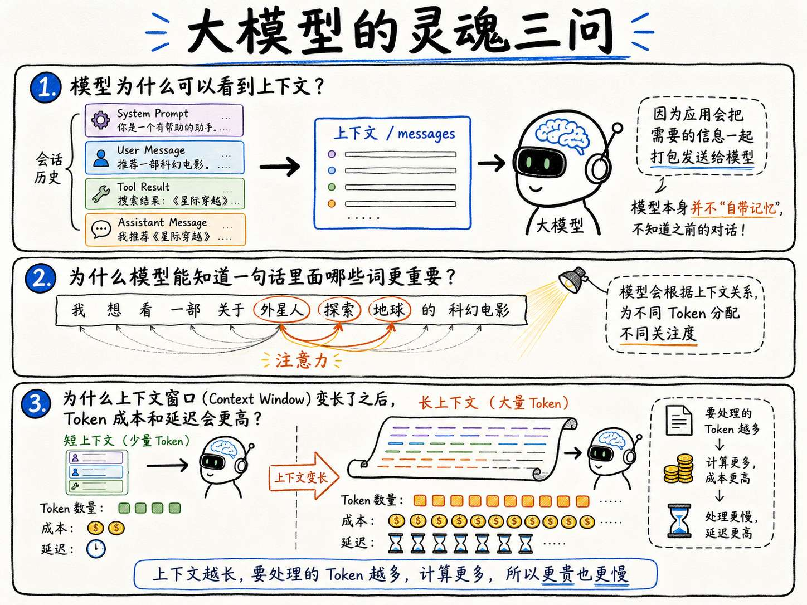
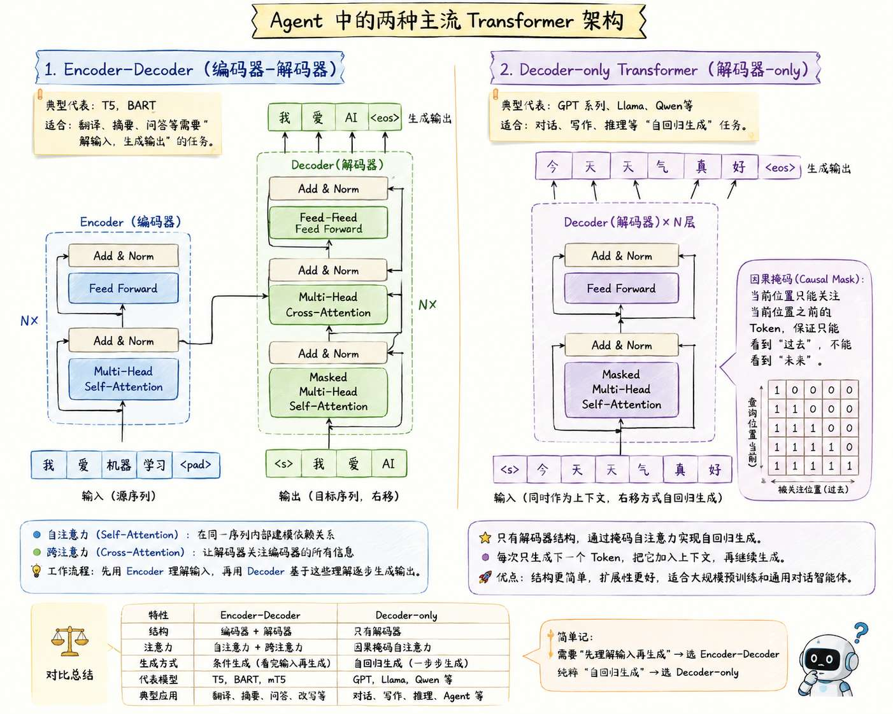
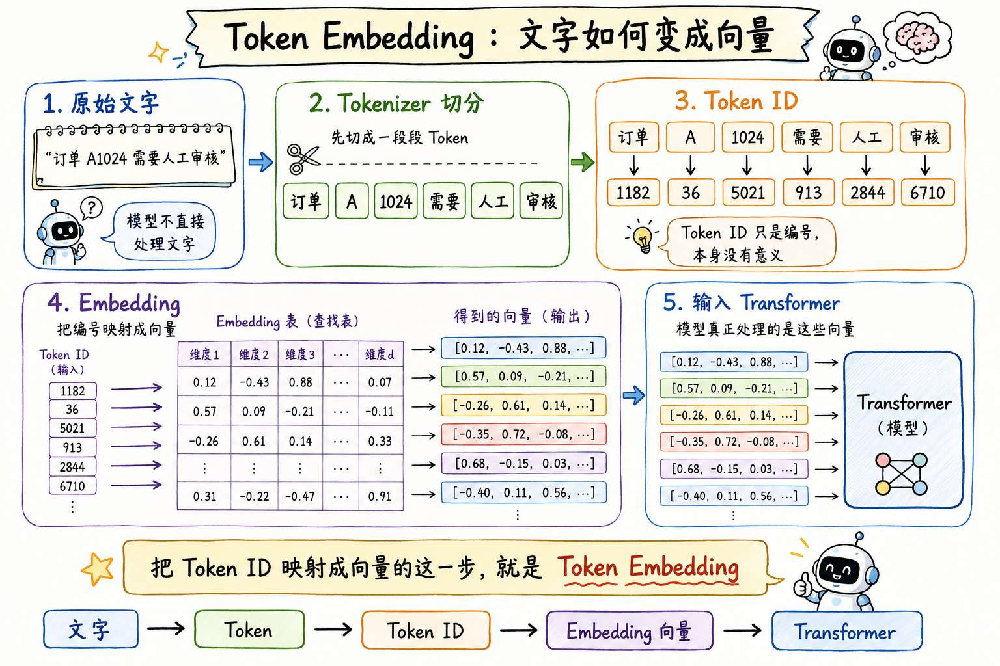
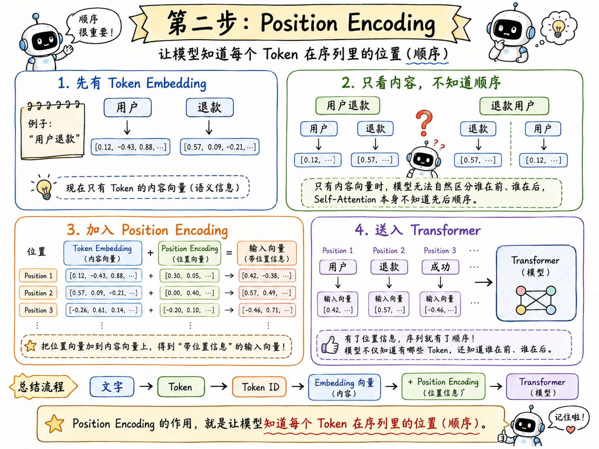
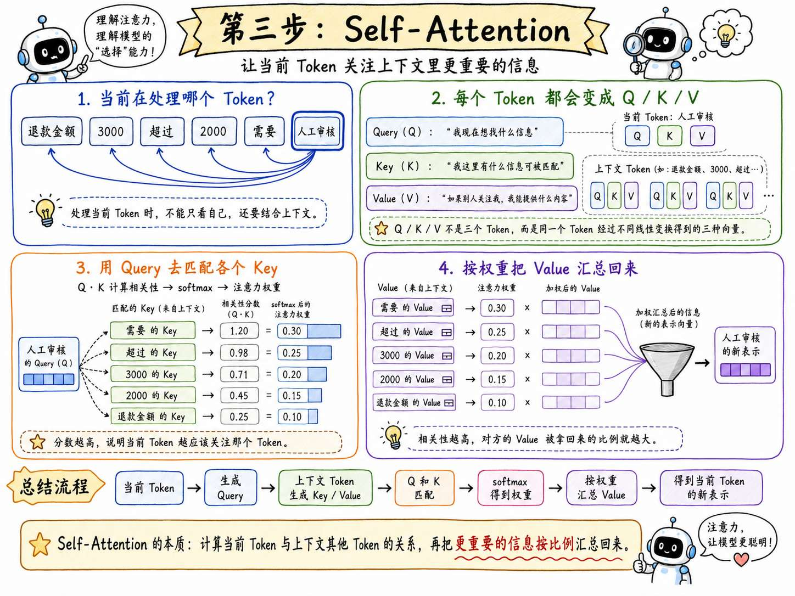
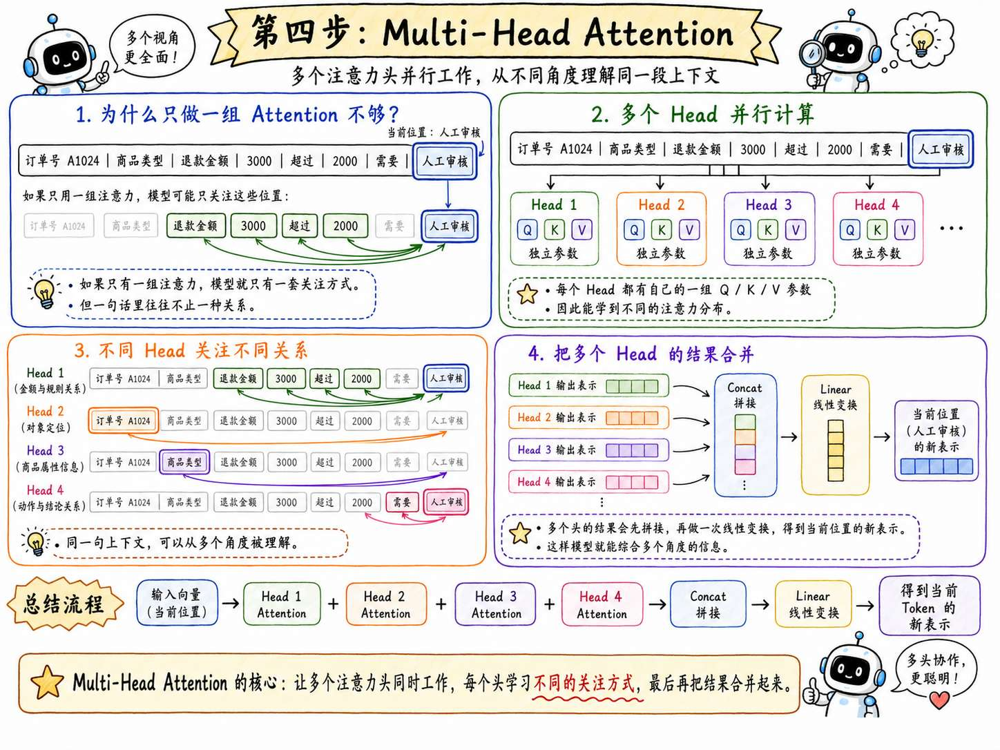
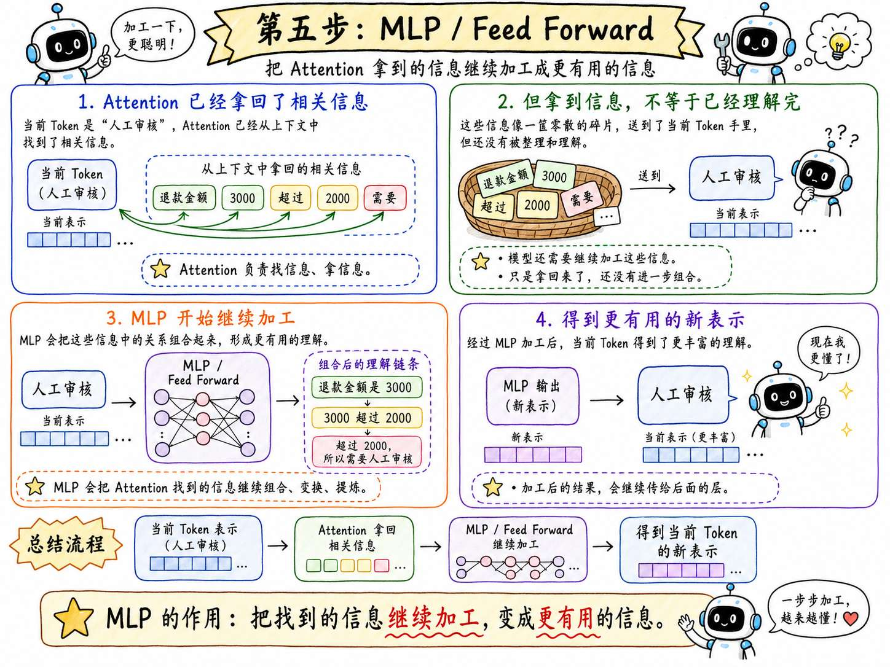
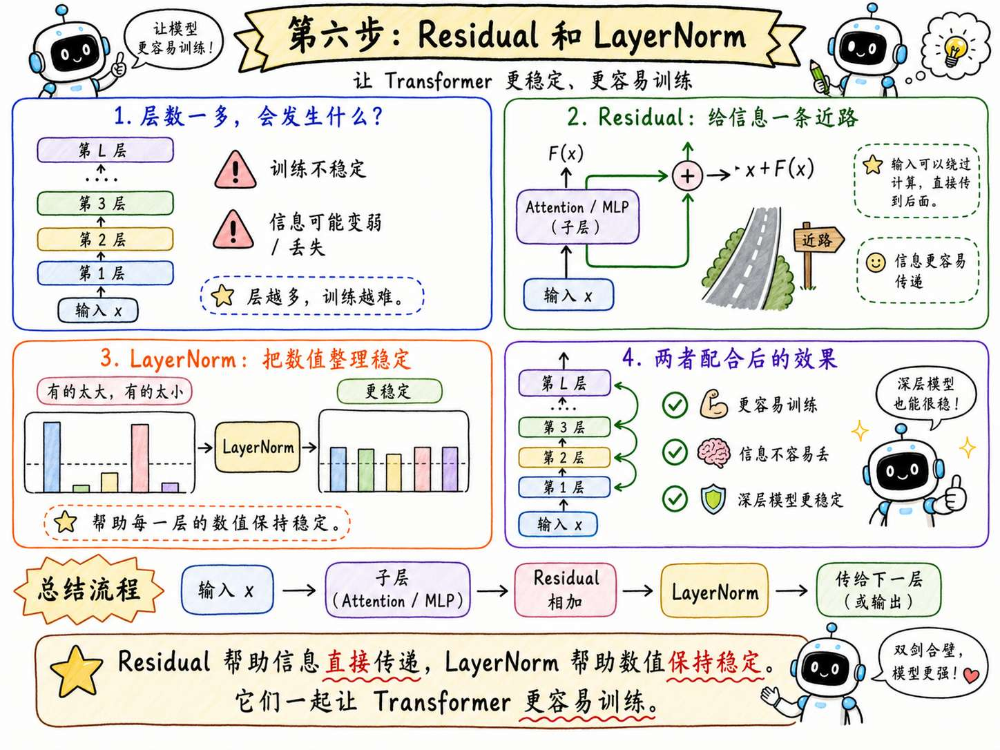
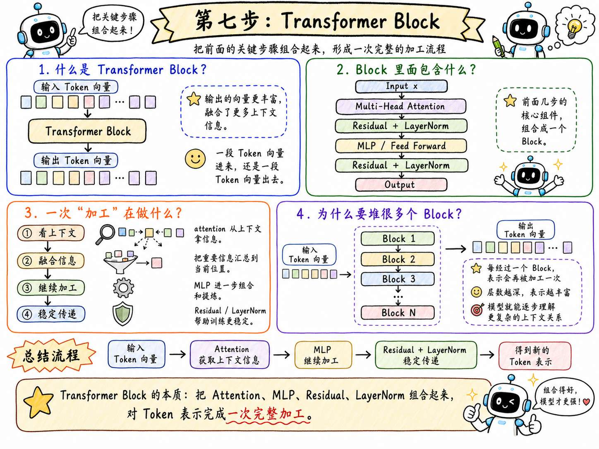
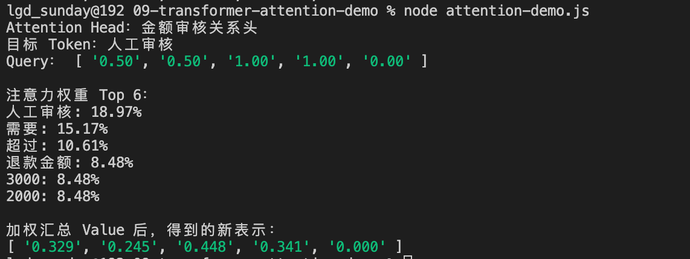

# 09-深入 Transformer 架构：大模型为什么能理解上下文与生成内容？

前面几节课，咱们已经看到了很多大模型的原理内容了

咱们现在已经知道大模型可以根据上下文回答问题，可以根据 Prompt 调整输出，可以在 Context Window 里参考前面的内容，也会因为随机采样和上下文不足产生幻觉。

上一节，咱们又讲了普通模型、推理模型和多模态模型怎么选择。

那么现在，我请问大家几个问题，那就是：

1. **模型为什么可以看到上下文？**
2. **为什么模型能知道一句话里面哪些词更重要？**
3. **为什么上下文窗口（Context Window）变长了之后，Token 成本和延迟会更高？**




那么想要理解这些问题，就需要涉及到一个 Agent 全新的知识点了，这就是 `Transformer 架构`

## 为什么要有 Transformer 架构
咱们先假设没有 Transformer。

大家想一下，**模型要处理一句话，最直接的办法是什么？**

很简单：一个字一个字的读就可以了，对不对。

这样理解应该还蛮简单的。

但是！如果一个字一个字的读，那么就会遇到两个问题：

+ **第一个问题：越往后读，前面的信息越容易被 “遗忘” 掉。** 就和人看了后面的忘了前面的一个意思
+ **第二个问题：逐个往后读，很难并行。**  举个例子：

> 假设模型要处理这句话：“订单 A1024 的退款金额是 3000 元，超过 2000 元时，需要人工审核。”
>
> 没有 Transformer 的前提下，模型就不能一下子读取整段话处理完，必须得 **一个字一个字的读**。
>
> 类似于  「订单」->「A1024」->「退款」 这样
>
> 必须得这样 **按照顺序** 才可以
>
> 这样效率就会特别低，比如 大模型要训练 1 亿 Token 的数据，这几年都读不完了。
>

所以，理想中的大模型架构就必须要解决两个问题才可以：

+ **长距离信息怎么保留下来？** 模型不能读到后面以后，就把前面重要的信息给忘了
+ **大规模文本怎么高效计算？** 也就是必须要并行处理

那么想要解决这两个问题，就需要用到 `Transformer 架构` 了

## Transformer 架构到底是什么
Transformer 最早是在论文《Attention Is All You Need》里提出的。

原始 Transformer 其实是一个 `Encoder-Decoder` 架构，这玩意主要是用来做机器翻译这类序列到序列任务的。

而现在很多生成式大语言模型使用的其实是 Transformer 的 **变体**。比如常见文本生成模型，多数是 `Decoder-only Transformer` 路线。

### Encoder-Decoder 和 Decoder-only-Transformer
你看，这里又有两个概念 Encoder-Decoder 和 Decoder-only-Transformer。

这两个东西大家不需要深入理解，咱们这里给大家 简单介绍一下，哪怕看不懂也没关系，完全不影响哈。

原始 Transformer 主要是为机器翻译设计的。

比如把英文翻译成中文：`I want to refund this order.`  变成   我想退款这个订单。

那么，此时这个场景下，这个任务就有两个阶段。

+ 第一阶段，模型先读取英文句子，理解输入内容。这个部分就叫做 `Encoder`。
+ 第二阶段，模型再根据理解到的内容，一个 Token 一个 Token 生成中文句子。这个部分叫 `Decoder`。

所以，`Encoder-Decoder` 可以简单理解成：**Encoder：负责读懂输入，Decoder：负责生成输出**

它比较适合翻译、摘要这种 “需要先读一段输入，然后再生成另一段输出” 的任务。

但是，咱们现在常见的聊天大模型，很多不是这种完整的 Encoder-Decoder 结构，而是 `Decoder-only Transformer`。

`Decoder-only` 的意思是：**模型只保留“生成”这部分结构。**

它的核心功能是根据已经看到的上下文，预测下一个 Token。

比如：`订单 A1024 的退款金额超过 2000 元，所以需要____`

模型要生成后面的：「人工审核」

这就是咱们之前在 [03 - 探究大语言模型原理。大语言模型究竟是如何生成内容的？](https://mp.weixin.qq.com/s/-Qm7yAoVc6_rE8ApUcS84w?payreadticket=HCOwYVQV7h2cq-YsAiToncKAcCS4ie8-V4-otmF7soyxoH7xD-2ng3uicwzayQKvkCytyJ8) 提到了 “预测下一个 Token” 的原理

现在，很多生成式大语言模型都采用 `Decoder-only Transformer` 方案

差不多了解到这里就可以了。

针对这块，大家只需要记住以下两点就行：

+ 原始 Transformer 是 Encoder-Decoder 架构，适合序列到序列任务。
+ 现在很多聊天大模型使用 Decoder-only Transformer，核心是根据已有上下文不断预测下一个 Token。

下面是我用 GPT-Image-2 生成的一个详解图，感兴趣的可以看下，不感兴趣的直接跳过就行：





### 回过头继续说 Transformer
刚才咱们其实就已经知道了：**不同模型可能会采用不同的 Transformer 结构，但它们底层依然离不开 Transformer Block。**

实现细节会一些变化，但核心模块差基本上都绕不开以下这几点：

+ Token Embedding
+ Position Encoding
+ Self-Attention
+ Multi-Head Attention
+ MLP / Feed Forward
+ Residual + LayerNorm
+ 多层 Transformer Block 堆叠

可能有点多，但是没关系，咱们一个个来说。

> 下面的每部分都会给大家生成一个手绘图，大家可以作为参考。
>
> **注意：** 先看文字，再看手绘图。
>

##### 第一步：Token Embedding
这是整个 Transformer 的第一步，也就是：文字会先变成 Token。

这一点其实在 [第 04 节](https://mp.weixin.qq.com/merchant/mppaysubscribe?action=go_paid_article&article_url=https%3A%2F%2Fmp.weixin.qq.com%2Fs%2F0bKlLgHz0T2m-B_dSWfUqg&token=184833191&lang=zh_CN) 也说过。模型不直接处理“文字”，而是处理 Token。

比如：“订单 A1024 需要人工审核”

进入模型前，会先被 Tokenizer 切成一段段 Token，再变成 Token ID。

但 Token ID 只是编号，编号本身是没有意义的。

所以还需要 `Embedding`，把每个 Token ID 映射成一串向量。

**那么这样一套把  Token ID 映射成 向量的流程，就是 **`Token Embedding`





##### 第二步：Position Encoding
映射好了之后，咱们得处理位置信息

因为 Self-Attention（第三步的） 本身并不知道顺序。

如果只把一堆 Token 向量丢进去，它知道有哪些 Token，但不知道谁在前、谁在后。

而在语言里面，文字的顺序肯定是非常重要的。比如说：用户退款 和 退款用户 ，就完全不是一个意思

因此，`Position Encoding` 的作用就是 **让模型知道每个 Token 在序列里的位置（顺序）**




##### 第三步： Self-Attention。
Self-Attention 是 Transformer 的核心步骤。

他做的事情，可以先用一句大白话理解，那就是：**对于当前位置的 Token，模型会计算上下文里哪些 Token 更值得关注，然后把这些 Token 的信息汇总回来。**

跟大家举个例子。

> 比如：模型正在处理 “人工审核” 这几个文字。但是这几个字并不是单独的。
>
> 想要处理好这几个字，他还需要关注前面的 “退款金额” “3000” “超过”“2000 ” “需要” 这些 Token。
>

那模型怎么知道应该关注谁呢？

这里就用到了 `Q / K / V` 了

Transformer 会把每个 Token 的向量，分别转换成三种向量：

+ Query：我现在想找什么信息
+ Key：我这里有什么信息可以被别人匹配
+ Value：如果别人关注我，我能提供什么内容

注意，这三者不是三个 Token。而是 **同一个 Token 经过不同线性变换后得到的三种向量。**

> 比如 “人工审核” 这个 Token，会生成自己的 Query、Key、Value。
>
> “退款金额” “3000” “超过” 这些 Token，也都会生成自己的 Query、Key、Value。
>
> 当模型处理“人工审核”这个位置时，它会拿“人工审核”的 Query，去和上下文里每个 Token 的 Key 做匹配。
>
> 匹配分数越高，说明“人工审核”这个位置越需要关注那个 Token。
>

这些匹配分数会经过 `softmax` 变成一组权重。比如：“需要：0.30” 、 “超过：0.25” 这样的。

这个权重就表示：**当前位置应该从每个 Token 那里拿多少信息。**

接下来，模型就会按照刚才算出来的权重，把上下文里各个 Token 的 Value 加权汇总回来。

也就是说：**Self-Attention 是在计算当前 Token 和上下文中其他 Token 的关系；相关性越高，对方的 Value 被拿回来的比例就越大。**




##### 第四步： Multi-Head Attention。
刚才讲 Self-Attention 时，咱们说当前位置会根据 `Q / K / V` 计算一组注意力权重。

但这里有一个问题。

如果只计算一组注意力权重，那么模型就只有一套“关注方式”。

跟大家举个例子：

> 处理“人工审核”这个位置时，这一组权重可能主要关注："退款金额" "3000" "超过"。
>
> 但是，一句话里往往不止一种关系。他可能还和订单号 “A1024” 有关系，和 商品类型也有关系。
>

所以 Transformer 不只做一组 Self-Attention，而是并行做多组 Self-Attention。

其中，每一组就叫一个 `Attention Head`，也就是一个注意力头。

而多组注意力头，就是 `Multi-Head Attention` 。

大家可以理解为：`Multi-Head Attention`** 可以让多个注意力头同时工作，每个头都有自己的一组 **`Q / K / V`** 参数，因此可以算出不同的注意力分布。**

最后，模型再把多个头的结果合并起来，这样模型就有机会从多个角度理解同一段上下文。




##### 第五步：MLP，也叫 Feed Forward。
Attention 可以帮当前 Token 从上下文里拿到了相关信息。

但是，拿到信息还不等于已经理解完了。

模型还需要继续加工这些信息。

比如它要把这些关系进一步组合起来，大概是下面这个意思：

```plain
退款金额是 3000
3000 超过 2000
超过 2000 所以需要人工审核
```

这个“继续加工”的过程，就是 MLP 负责的。

所以，大家可以把 MLP 理解成：**负责把找到的信息继续加工成更有用的信息**




##### 第六步： Residual 和 LayerNorm。
这俩东西有点类似于一个 **规范** 的东西。

根据上面的内容，咱们其实可以知道，Transformer 分成了很多层。层数一多，训练就容易不稳定，信息也可能在一层一层中丢失。

而 **Residual 可以让输入绕过某些计算直接传到后面，LayerNorm 可以帮助每一层的数值保持稳定**。

听起来有点复杂，不过没关系，这玩意不需要掌握的太深。

大家只需要知道：这两个东西可以让基于 Transformer 架构的模型更容易训练就可以了。




##### 第七步：Transformer Block
把以上所有的内容推到一起，就得到一个 Transformer Block。也就是一个  **Transformer 块**

你可以把一个 `Transformer Block` 理解成模型里的一次“加工”（每次加工都会走上面的流程）。

一段 Token 向量进来，经过这个 Block 以后，还是一段 Token 向量出去。只不过，出去的 Token 已经融合了上下文信息了。




## 用 Node 模拟一次 Q/K/V Self-Attention
接下来咱们还是做个小案例吧。

在前面咱们一直在说 `Q / K / V` ，感觉这玩意还是挺难理解的。

所以说，想着用 Node 写一个小例子，把这个过程跑出来，让大家看看大致的流程，或许理解起来会更容易。

> 注意哈：代码本身并不重要，重要的是 **通过代码验证流程**
>
> 代码地址：`https://github.com/lgd8981289/Agent--Code`
>

创建 `09-transformer-attention-demo` 文件夹

创建 `attention-demo.js`：

```javascript
// 模拟已经切好的 Token
const tokens = [
    '订单',
    'A1024',
    '退款金额',
    '3000',
    '元',
    '超过',
    '2000',
    '元',
    '需要',
    '人工审核'
]

// 模拟每个 Token 对应的向量
// 真实模型里的向量是训练出来的，这里是为了演示手动写的
const features = {
    订单: [0, 0, 0, 0, 1],
    A1024: [0, 0, 0, 0, 1],
    退款金额: [1, 0, 0, 0, 0],
    3000: [1, 0, 0, 0, 0],
    元: [0.4, 0.4, 0, 0, 0],
    超过: [0, 0, 1, 0, 0],
    2000: [0, 1, 0, 0, 0],
    需要: [0, 0, 1, 1, 0],
    人工审核: [0.5, 0.5, 1, 1, 0]
}

// 模拟一个 Attention Head
// 这个 Head 更关注“金额、阈值、超过、审核”这些信息
const head = {
    name: '金额审核关系头',
    queryWeights: [1, 1, 1, 1, 0],
    keyWeights: [1, 1, 1, 0.8, 0],
    valueWeights: [1, 1, 1, 1, 0]
}

// 简化版投影：用权重调整向量
function project(vector, weights) {
    return vector.map((value, index) => value * weights[index])
}

// 计算两个向量的相似度
function dot(a, b) {
    return a.reduce((sum, value, index) => sum + value * b[index], 0)
}

// 把分数转换成注意力权重
function softmax(scores) {
    const max = Math.max(...scores)
    const exps = scores.map((score) => Math.exp(score - max))
    const total = exps.reduce((sum, value) => sum + value, 0)

    return exps.map((value) => value / total)
}

// 按照注意力权重，把多个 Value 汇总成一个新向量
function weightedSum(values, weights) {
    const result = Array.from({ length: values[0].length }, () => 0)

    for (let i = 0; i < values.length; i++) {
        for (let j = 0; j < values[i].length; j++) {
            result[j] += values[i][j] * weights[i]
        }
    }

    return result
}

// 对指定 Token 执行一次 Attention 计算
function runAttention(targetToken) {
    const targetIndex = tokens.indexOf(targetToken)

    // 只看当前 Token 以及它前面的内容
    const visibleTokens = tokens.slice(0, targetIndex + 1)

    // 当前 Token 生成 Query
    const query = project(features[targetToken], head.queryWeights)

    // 前文 Token 分别生成 Key 和 Value
    const keys = visibleTokens.map((token) =>
        project(features[token], head.keyWeights)
    )
    const values = visibleTokens.map((token) =>
        project(features[token], head.valueWeights)
    )

    // 计算当前 Token 和前文每个 Token 的相关性
    const scores = keys.map((key) => dot(query, key) / Math.sqrt(query.length))

    // 将相关性分数转换成注意力权重
    const weights = softmax(scores)

    // 根据注意力权重汇总 Value，得到新的表示
    const newRepresentation = weightedSum(values, weights)

    // 整理注意力权重，方便查看
    const attentionList = visibleTokens
        .map((token, index) => ({ token, weight: weights[index] }))
        .sort((a, b) => b.weight - a.weight)

    return { query, attentionList, newRepresentation }
}

// 观察“人工审核”这个 Token 会关注哪些前文信息
const result = runAttention('人工审核')

console.log(`Attention Head：${head.name}`)
console.log('目标 Token：人工审核')
console.log(
    'Query：',
    result.query.map((value) => value.toFixed(2))
)

console.log('\n注意力权重 Top 6：')
for (const item of result.attentionList.slice(0, 6)) {
    console.log(`${item.token}: ${(item.weight * 100).toFixed(2)}%`)
}

console.log('\n加权汇总 Value 后，得到的新表示：')
console.log(result.newRepresentation.map((value) => value.toFixed(3)))
```

运行：

```plain
node attention-demo.js
```

你会看到类似这样的结果：




这段输出要分两层看。

第一，看注意力权重。

当模型处理“人工审核”这个位置时，它不是平均看前面的所有 Token，而是更关注 “需要” “超过” “退款金额” “3000” “2000” 这些和审核判断有关的内容。

第二，看最后的新表示。

新表示是按照注意力权重，把这些 Token 的 `Value` 向量加权汇总，得到“人工审核”这个位置的新向量表示。

把这个案例结合前面的内容来看，应该会更好理解一些

## 总结
最后，咱们回到开头的三个问题。

### 第一个问题：**模型为什么可以看到上下文？**
这是因为文本进入模型以后，会先变成一段 Token 向量。

这些 Token 向量会进入 Transformer Block，在 Self-Attention 里互相计算关系。

所以，模型所谓“看到上下文”，更准确地说是：**当前位置的 Token 表示，可以在可见范围内和其他 Token 表示发生计算，并把相关信息融合进自己的新表示里。**

这也是为什么前面讲 Context Window 时，咱们一直说模型只能参考当前窗口里能看到的信息。

如果关键信息不在窗口里，Attention 就没有办法和它建立关系。

### 第二个问题：**为什么模型能知道一句话里面哪些词更重要？**
这就和 Self-Attention 里的 `Q / K / V` 有关。

当前 Token 会生成自己的 `Query`。上下文里的每个 Token 会提供自己的 `Key` 和 `Value`。

模型用当前 Token 的 `Query` 去匹配其他 Token 的 `Key`，得到一组相关性分数。

分数再经过 `softmax`，就变成注意力权重。

权重越高，说明当前 Token 越应该从那个位置拿更多信息。

最后，模型按照这些权重，把各个位置的 `Value` 向量加权汇总回来，形成当前 Token 的新表示。

### 第三个问题：**为什么上下文窗口变长以后，Token 成本和延迟会更高？**
原因也在 Transformer 这里。

上下文窗口变长，意味着一次请求里会有更多 Token 进入模型。

Token 越多，模型要处理的向量就越多。

更重要的是，Self-Attention 不是只处理单个 Token。它要计算 Token 之间的关系。

也就是说，窗口越长，需要计算的 Token 关系就越多。调用成本也就越大了

这就是为什么后面做 Agent 时，不能把所有历史消息、所有文档、所有工具结果都一股脑塞进上下文。

理解到这里，再回头看 Prompt、RAG、Memory、模型选择和成本控制，就会更清楚了。

> 更新：2026-06-17 21:49 · 原文：<https://www.yuque.com/lgdsunday/ab1dy3/fx81yu97n3etf9nx>
