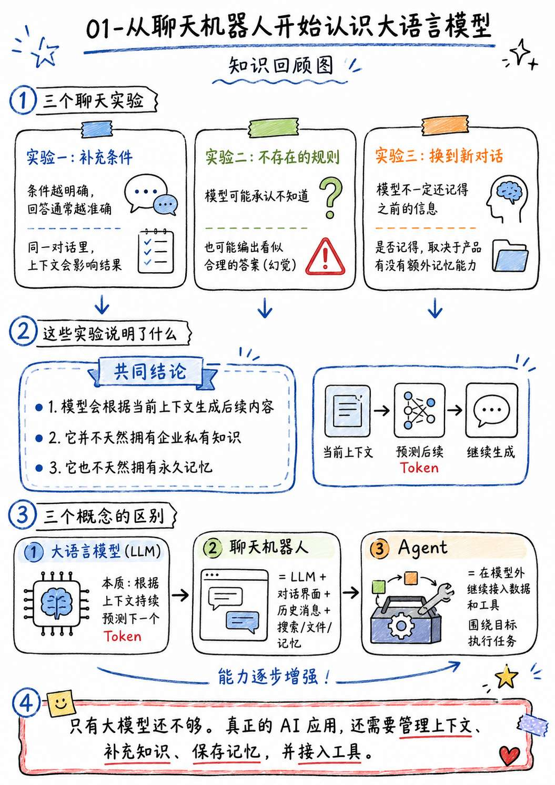
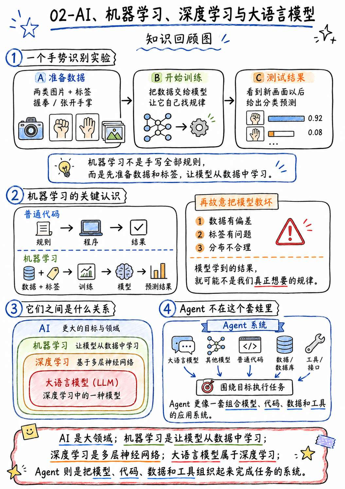
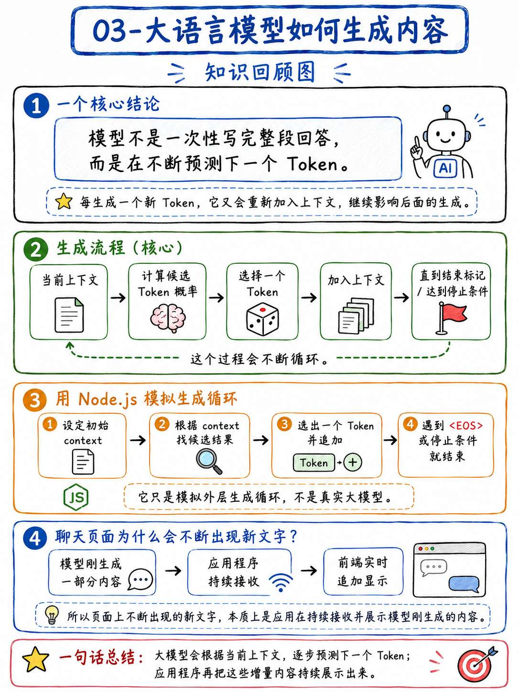
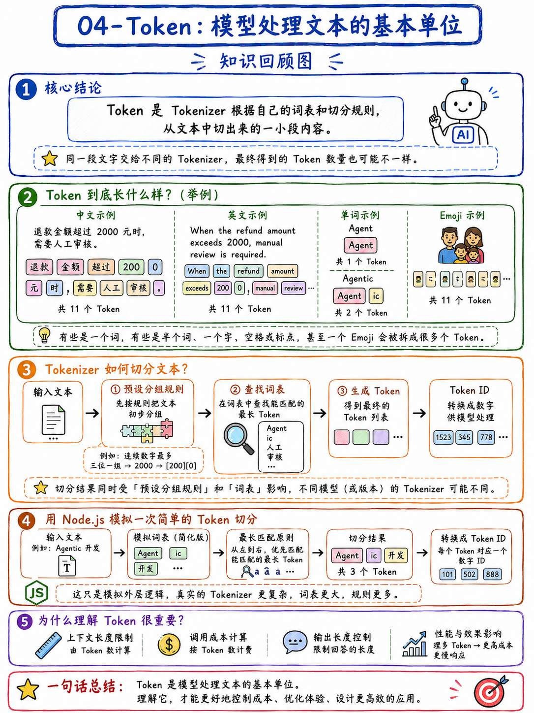
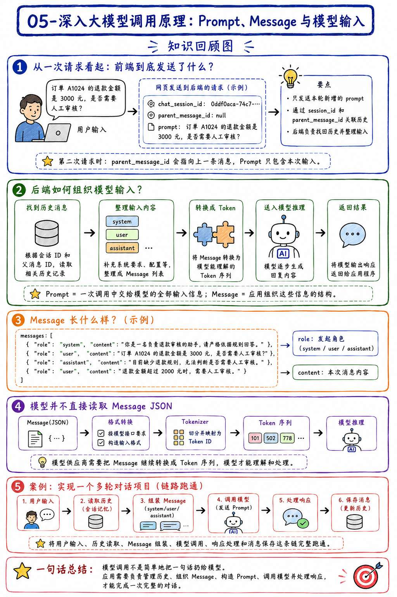
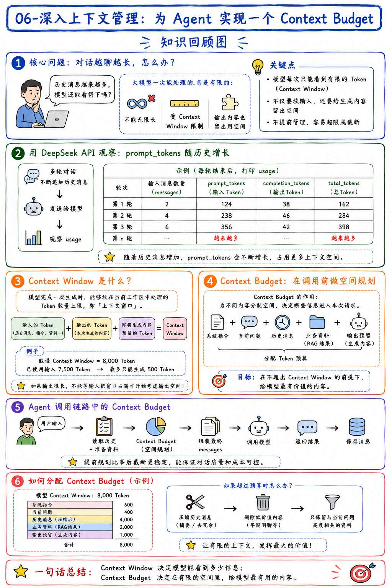
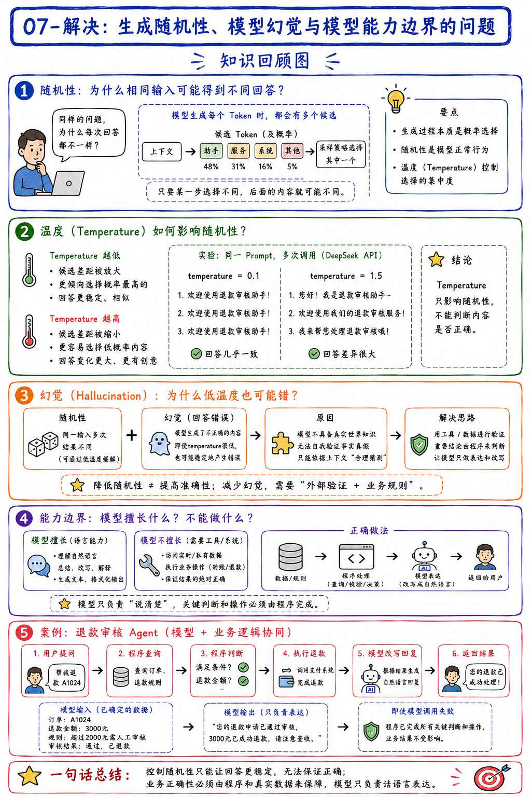
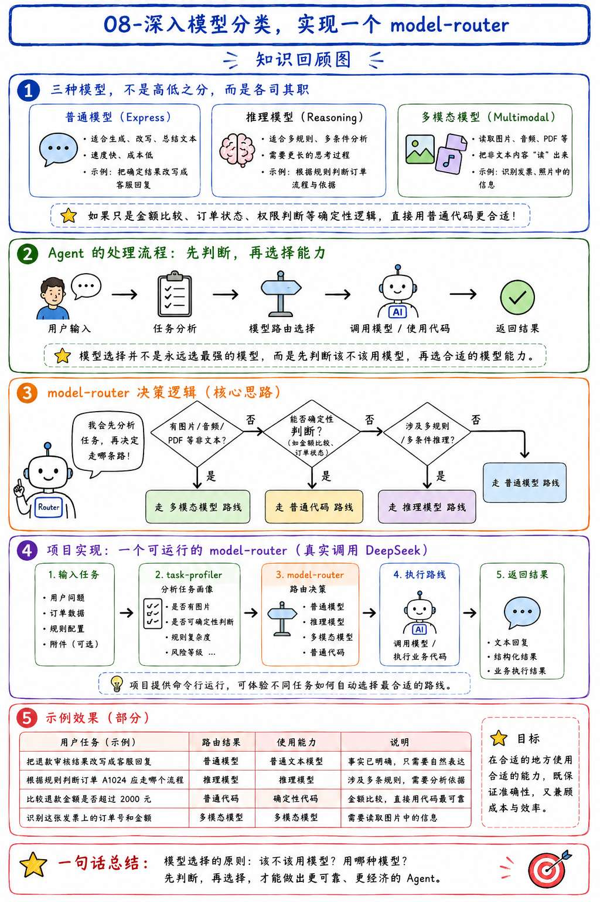
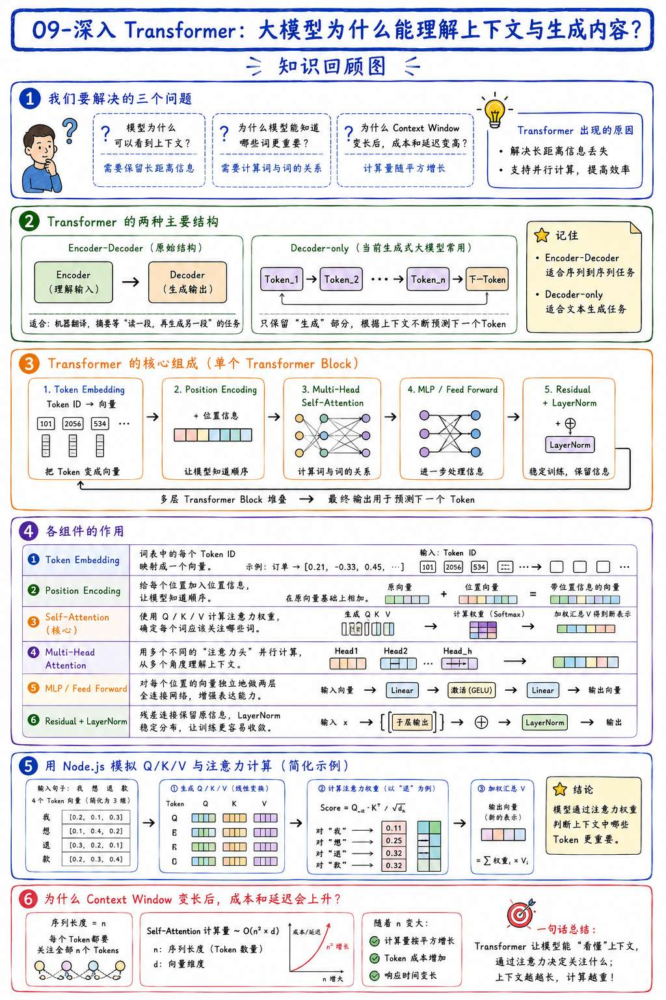
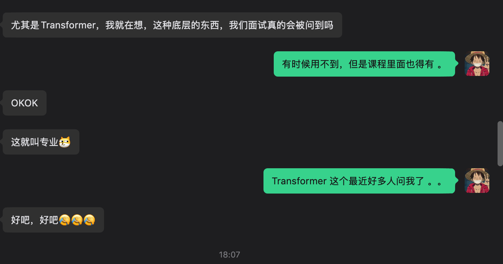

# 10-第一章总结：学到的知识如何在简历和面试中体现

到这里，第一大章就结束了。

前面九节课里，咱们聊了大语言模型、Token、Message、Context Window、模型幻觉、模型选择和 Transformer，也写了不少 Node.js 实验。

内容确实不少。

但是，学过了 和 会了，完全是两回事。

很多同学看文章的时候就觉得懵懵的，到写简历基本上就把这些知识全还给我了。

所以说这一章，咱们就把第一章学过的东西全部捋一遍，看看每一节到底解决了什么问题，然后把这些内容转成简历和面试中能用的内容。

开始吧～

## 第一大章都学了啥
第一章一共分成了 9 个小节。

咱们先把这 9 个小节回顾一遍。其中每个小节我都会带一嘴，同时也会让 gpt-image-2 为他们各自生成一个回顾图，希望大家看完之后可以把过去学到的这些串起来。

### 01-从聊天机器人开始认识大语言模型



全文开篇第一节，讲的内容其实蛮基础的。

一开始咱们先在聊天窗口里做了三个实验，通过这三个实验来确定 XXXX 的信息

通过这样的确定信息，我们可以知道模型会根据当前上下文预测后续 Token。

但是，大模型并不真正拥有独属于企业自己的私有知识。

而聊天机器人只不过是在模型外增加了对话界面、历史消息、搜索等能力。

如果我们真正想要实现一个 Agent ，那么还必须要继续接入其他的数据或者工具才可以。

### 02-AI、机器学习、深度学习与大语言模型



第二节，咱们开始正式进入 AI 的基础知识。

一开始先训练了一个可以识别手势的模型。

通过这个实验，咱们就可以知道：**机器学习并不是让开发者手写出每一条判断规则，而是先准备数据和标签，让模型自己从这些数据中找到规律**。

当然，如果咱们准备的数据有问题，那么模型最终学到的结果也会有问题。

然后，咱们又进一步理清了 AI、机器学习、深度学习和大语言模型之间的关系。

咱们知道了大语言模型其实是深度学习中的一种模型。而 Agent 和它们不在同一个包含关系里，Agent 更像是一套组合模型、代码、数据和工具的应用系统。

### 03-大语言模型如何生成内容



第三节，咱们开始研究大语言模型到底是怎么生成一段内容的。

这里最重要的一点就是：**模型不是一次性把整段回答全部写出来，而是不断预测下一个 Token。**

每生成一个新的 Token，这个 Token 又会重新加入上下文，然后继续影响后面的生成结果。

为了把这个过程搞明白，咱们还使用 Node.js 模拟了一次完整的生成循环。

通过这个例子，咱们就可以知道，模型会先计算候选 Token 的概率，再选择其中一个结果，直到生成结束标记或者达到停止条件。

聊天页面中不断出现的新文字，其实就是应用程序在持续接收模型刚刚生成出来的内容。

### 04-Token：模型处理文本的基本单位



第四节，咱们把前面一直提到的 Token 单独拿出来讲了一下。

因为很多同学很多同学搞不明白 **一个 Token 到底对应什么？**。甚至很多同学会认为，一个汉字或者一个英文单词就是一个 Token。

其实并不是这样的。

Token 是 Tokenizer 根据自己的词表和切分规则，从文本中切出来的一小段内容。同一段文字交给不同的 Tokenizer，最终得到的 Token 数量也可能不一样。

然后，咱们使用 Node 模拟了一次简单的 Token 切分，让大家看到了文本怎样变成 Token，又怎样继续变成 Token ID。

理解 Token 很重要，因为模型的上下文长度、调用成本和输出长度，基本上都是围绕 Token 进行计算的。

### 05-深入大模型调用原理：Prompt、Message 与模型输入



第五节，咱们开始讲模型调用，开始逐步偏向于应用层了。

一开始咱们先通过 DeepSeek 的 API 请求，观察了用户输入一句话以后，前端的聊天产品到底向后端发送了什么内容。

通过两次连续请求可以发现，网页不一定会把全部聊天记录重新发送一遍。它可能只会发送当前输入和会话信息，再由后端找到历史消息。

找到历史消息以后，应用程序会把系统要求、用户输入和模型之前的回答，重新整理成 `system`、`user`、`assistant` 等 Message。

在这里，**Prompt 指的是一次调用中交给模型的全部输入信息**，而 Message 是应用程序组织这些信息时使用的结构。

但是模型也不会直接读取这些 Message JSON。模型供应商还需要继续把它们转换成模型能够处理的 Token 序列。

最后，咱们实现了一个多轮对话的项目（案例），相当于是把用户输入、历史读取、Message 组装、模型调用、响应处理和消息保存这条链跑通了。

### 06-深入上下文管理：为 Agent 实现一个 Context Budget



第六节算是在第五节的扩展，所要解决的核心问题就是：**如果对话一直进行下去，历史消息越来越多，该怎么办？**

模型不可能一次看到无限多的内容，它能处理的 Token 数量会受到 Context Window 的限制。

而且这块空间不只是放用户问题和历史消息，模型接下来准备生成的内容，也需要占用 Context Window。

咱们通过 DeepSeek API 观察了历史消息不断增加以后，`prompt_tokens` 是怎么跟着变化的。

然后，又为 Agent 实现了一个 Context Budget。

Context Budget 的作用，就是提前为系统指令、当前问题、历史消息、业务资料和最终输出分配空间。

### 07-解决：生成随机性、模型幻觉与模型能力边界的问题已



第七节，咱们开始处理大模型开发中一个特别常见的问题：**为什么完全相同的输入，得到的回答却可能不一样？**

这是因为模型在生成每个 Token 时，通常都有多个候选结果，最终选择哪一个，会受到采样策略的影响。

其中 Temperature 可以控制生成结果的随机程度。

但是，Temperature 只能影响随机性，它并不能帮助模型判断一件事情到底是真是假。

所以，把 Temperature 调得再低，模型依然可能特别稳定地生成一个错误答案。这也就是咱们经常说的 **大模型幻觉**。

最后，咱们实现了一个退款审核 Agent。

在这个案例里，订单数据、退款金额和审核结论全部由普通代码处理，模型只负责把已经确定的结果改写成用户回复。

这样即使模型调用失败了，也不会影响最终的业务判断。

### 08-深入模型分类，实现一个 model-router



第八节，咱们又继续分析了普通模型、推理模型和多模态模型的区别，并且实现了一个 model-router

先说这三个模型。他们不是低级、中级、高级的关系，它们只是负责处理的问题不一样。

+ 普通模型适合生成、改写和总结文本
+ 推理模型适合处理多规则、多条件分析
+ 多模态模型则可以读取图片、音频等非文本内容

但是，如果只是金额比较、订单状态或者权限判断，那么通常根本不需要调用模型，**直接交给普通代码反而更加合适。**

然后，咱们实现了一个可以真实调用 DeepSeek 的 model-router。

这个 model-router 会先分析任务，再决定走普通模型、推理模型、多模态路线，还是直接使用普通代码。

看完这一小节，咱们肯定得知道：**模型选择并不是永远选择能力最强的模型**，而是先判断这件事情该不该交给模型，再选择合适的模型能力。

### 09-深入 Transformer：大模型为什么能理解上下文与生成内容



第九节，主要讲 Transformer。

今天还有同学问我：“Transformer 这种底层的东西，在面试的时候真的会被问到吗？”

我是这么回复的。。。。 目前在面试中确实很少很少被问到，但是 **课程得有。。。。** 




Transformer 架构说实话不好讲，想要让大家听懂就更难了。

咱们咱们先从几个问题开始，通过问题逐步的来一点点理解 Transformer。

在讲 Transformer 还涉及到了原始 Transformer 的 Encoder-Decoder 结构，和现在很多生成式大模型使用的 Decoder-only Transformer 结构。

大模型之所以需要 Transformer，是因为以前按照顺序逐个处理文本的方式，不仅计算效率比较低，而且文本变长以后，前面的重要信息也更容易丢失。

然后，咱们又依次讲解了 Token Embedding、Position Encoding、Self-Attention、Multi-Head Attention、MLP、Residual、LayerNorm 和 Transformer Block。

这些名字确实有点多，不过核心目的其实就一个：**让模型可以结合上下文，重新计算每个 Token 应该表示什么信息。**

最后，咱们使用 Node.js 模拟了 Q/K/V 和注意力权重的计算过程。

通过这个案例，大家应该可以理解模型为什么能够判断上下文中哪些 Token 更重要，也可以理解 Context Window 变长以后，模型的计算成本和响应时间为什么会跟着增加。

---

现在再回头看，第一章的知识其实可以串成两条线。

一条是模型内部的（Token、向量、Transformer），另一条是模型外部的（Message、Context Budget、模型选择）

嗯。。。大致就是这些了。

## 怎么把第一章体现到简历上
学完了，总得写出来。

第一章的内容体现在简历上，主要是两部分：

1. 技能特长部分
2. 项目经历部分

### 先说技能特长
技能特长需要表达的核心是：你理解什么机制，能够处理什么问题。

可以参考下面这版：

```latex
技能特长

• 具备 LLM 应用开发基础，理解 Token、Message、Context Window、Temperature、模型幻觉与 Transformer 基础机制，能够分析模型输入、内容生成、上下文成本和能力边界。

• 能够基于 Node.js 完成大模型调用、对话消息装配和 Context Budget 控制，并根据输入类型、任务复杂度和业务确定性选择普通模型、推理模型、多模态模型或普通代码。

• 理解聊天机器人、大语言模型与 Agent 的区别，能够将业务规则和可信数据留在应用层处理，让模型负责自然语言生成和需要语言理解的任务。
```

这三条已经足够了。

至于 RAG、MCP、LangChain、A2A 这些，后面学到了咱们再往里加，现在先不用管。

### 然后是项目部分
很多同学会说：“这些都是课程实验，怎么伪造成一个项目？”

都是文化人，说伪造多难听，咱们叫包装～～

包装的项目可以这样写（仅供参考，请勿照抄）：

```latex
项目名称：LLM 调用与模型路由实验平台

技术栈：Node.js、JavaScript、DeepSeek API、Fetch API

项目介绍：
围绕大语言模型调用与 Agent 基础能力构建的实验项目，覆盖 Token 生成、对话消息管理、上下文预算、模型幻觉控制和任务路由，用于验证模型输入、生成过程、成本与能力边界之间的关系。

负责内容：

• 基于 DeepSeek API 实现多轮对话链路，完成 messages 装配、历史消息同步、模型调用、响应解析和 Token Usage 记录。

• 设计 Context Budget 策略，根据系统指令、历史消息和输出预留空间筛选模型输入，避免上下文持续增长导致请求超过窗口限制。

• 构建退款审核案例，将金额阈值和审核结论交给确定性代码处理，模型只负责生成用户回复，降低模型幻觉对业务结果的影响。

• 实现 model-router，根据任务输入和复杂度选择普通文本、推理、多模态或确定性代码路线，并记录不同模型调用的 Token 用量与响应耗时。

• 使用 Node.js 模拟 Token 切分、逐 Token 生成和 Q/K/V Self-Attention 计算，辅助验证 Transformer 处理上下文的核心过程。
```

以上这些内容我相信只要你对咱们本章学到的看过一遍，应该都可以吼得住。

## 面试可能会问什么
只要把前面的内容写进简历，面试官就有可能沿着关键词继续追问。

这里跟大家列了一些常见的问题，还有对应的答案（答案部分仅供参考，并非最终口语化版本）

### 大语言模型、聊天机器人和 Agent 有什么区别？
大语言模型是底层能力，负责根据上下文生成文本、代码或判断结果，但它没有永久记忆，也不能直接查询订单、操作业务系统。

聊天机器人是模型外面的一层产品封装。它会保存 conversation_id、历史消息和文件，在下一次请求时重新组织上下文，所以它“记得你”通常是应用在管理状态。

Agent 则从“回答问题”到“完成目标”。比如用户要求查询订单并退款，它会调用订单工具、读取结果、判断规则，再调用退款接口，形成“选择行动、执行、观察结果、继续推进”的闭环。

工程上，Agent 还需要工具白名单、参数校验、超时重试、执行 trace，以及高风险操作的人工确认。

如果要判断一个系统是不是 Agent，关键在于它能否围绕目标选择行动，并根据结果继续执行。

### 大语言模型为什么只是预测下一个 Token，却能回答复杂问题？
“预测下一个 Token”只是训练目标和生成方式，不代表模型每次只能看到前一个词。

生成时，Transformer 的注意力机制会读取当前上下文，计算问题、条件和已有输出之间的关系，再给候选 Token 分配概率。

除此之外，另外一个关键在于训练。

训练阶段，模型会读取海量的文章、代码、问答和推理过程。比如看到“退款金额是 3000 元，超过 2000 元需要人工审核，所以……”，要准确预测后续内容，模型不能只统计哪些词经常连在一起，还需要捕捉金额大小、规则条件和最终结论之间的关系。

而且，模型预测时并不是只看前一个 Token，而是会参考当前上下文中所有可见的信息。输入内容先被转换成 Token 和向量，Transformer 的注意力机制再计算哪些信息更相关。比如处理退款问题时，“3000”“超过”“2000”“人工审核”之间会建立关联；经过多层 Transformer 反复加工后，模型才会得到下一个 Token 的概率分布。

### Token 是什么？为什么会影响成本？
Token 是模型处理文本和计算用量的基本单位，但它不固定等于一个汉字或一个单词。文本进入模型前，会先经过 Tokenizer，也就是分词器，根据自己的切分规则和词表拆成 Token，再转换成数字编号供模型计算。

比如 `Agent` 可能是一个 Token，`Agentic` 可能被拆成 `Agent` 和 `ic`；数字 `2000` 也可能被拆成 `200` 和 `0`。

空格、标点、Emoji 同样会占 Token。所以不能直接用字数估算，而且不同模型使用的 Tokenizer 不同，同一段文本的 Token 数也可能不一样。

Token 会影响成本，是因为模型服务通常分别按照输入和输出 Token 计费。。成本大致可以理解为：

> 总成本 = 输入 Token × 输入单价 + 输出 Token × 输出单价
>

### 用户发送一句话以后，模型真正收到了什么？
模型真正收到的是 **应用和模型服务组装后的一整段上下文转化成的 token** 。

以多轮对话为例，用户在前端输入“为什么？”，浏览器可能只发送本轮内容，同时携带 `conversation_id`、`parent_message_id` 这类关联字段。后端收到请求后，会根据会话 ID 找回历史消息，再加入产品预设的系统指令、用户长期记忆、RAG 检索结果、工具描述或者上一轮工具返回值。

应用调用模型 API 时，通常会把这些内容组织成有顺序和角色的 `messages`：

```plain
[
  { "role": "system", "content": "你是退款审核助手" },
  { "role": "user", "content": "订单 A1024 是否需要人工审核？" },
  { "role": "assistant", "content": "需要人工审核" },
  { "role": "user", "content": "为什么？" }
]
```

`role` 用来区分系统指令、用户输入、模型历史回答和工具结果。

模型服务收到这些消息后，还会按照内部消息模板把它们拼接起来，再通过 Tokenizer 转换成 Token ID。

进入神经网络后，Token ID 又会映射成向量，模型实际计算的是这些向量之间的关系


### Context Window 和 Context Budget 有什么区别？
区别是：Context Window 决定“最多能装多少 token”，Context Budget 决定“这次 token 怎么分配和选择”。

Context Window，也就是上下文窗口，是模型一次调用能够处理的 Token 数量上限。

这个空间不只包含用户问题，还包括系统指令、历史消息、RAG 文档、工具描述、工具结果，以及模型即将生成的内容。它是模型本身的能力约束，超过以后，请求可能失败、也可能被截断，或者输出因为达到长度限制而提前结束。

Context Budget 则是应用在调用模型之前制定的上下文预算。因为 Agent 手里的信息经常多于模型窗口，所以应用必须决定哪些内容必须发送、哪些可以压缩、哪些暂时舍弃，还要提前为输出预留空间。

比如模型窗口是 8000 Token，我可能为模型回答预留 1000，为系统指令和当前问题预留 1000，为 RAG 文档和工具结果预留 2000，历史消息最多使用剩下的 4000。历史超出预算后，不是从中间粗暴截断，而是保留最近的完整对话轮次，把较早的内容压缩成摘要。

所以，Context Window 是模型给出的上限，Context Budget 是应用在这个上限之内做的信息取舍。

### Temperature 调低以后，为什么模型仍然会产生幻觉？
Temperature 调低只能减少生成的随机性，不能提高事实正确率。

Temperature 控制的是模型如何从候选 Token 中进行选择，而不是负责验证候选内容是否真实。

模型会先根据上下文为候选 Token 计算分数，然后通过类似 `softmax(logit / temperature)` 的方式形成概率分布。

Temperature 越低，概率越集中，模型越倾向于选择分数最高的候选。因此，相同输入下的回答可能更稳定，但如果最高概率的内容本身就是错的，模型只会更稳定地输出同一个错误答案。

而幻觉的根源通常是信息或能力边界。

比如：模型没有看到企业内部数据、训练知识已经过时，在这种情况下模型瞎说，导致的。

例如用户问“订单 A1024 是否可以退款”，即使把 Temperature 调成很低，模型看不到真实订单和退款规则，仍然可能瞎说。也就是依然会有幻觉。

### 普通模型、推理模型和多模态模型应该怎么选？
选择模型时，我不会先比较哪个模型更强，而是先判断任务是否需要模型。

如果事实和结论已经确定，只需要改写、摘要、分类或者生成客服回复，我会选择普通模型。

如果输入虽然都是文本，但包含多条规则、多个约束或多个可能路径，例如：需要综合商品类型、签收时间、退款金额和风控标记判断处理流程，我会选择推理模型。

如果关键证据在图片、音频、截图或 PDF 页面里，就需要多模态模型。比如判断商品照片是否破损，普通文本模型和推理模型都看不到图片。

### Self-Attention 中的 Q、K、V 分别负责什么？
Q 和 K 负责决定“应该关注谁”，V 负责决定“关注以后拿回什么信息”。

一段文本进入 Transformer 后，每个 Token 都会通过三组不同的可训练参数，生成自己的 Q、K、V 向量。它们不是三个不同的 Token，而是同一个 Token 的三种表示。

+ Q 是 Query，可以理解成“我当前需要寻找什么信息”
+ K 是 Key，表示“我有什么特征，可以被别人匹配”
+ V 是 Value，表示“如果别人关注我，我能够提供什么具体信息”

例如处理“人工审核”这个位置时，它的 Q 会分别与上下文中“退款金额”“3000”“超过”“2000”等 Token 的 K 计算相关性。计算过程可以简化成：

```plain
Attention(Q, K, V) = softmax(QKᵀ / √d) × V
```

`QKᵀ` 得到匹配分数，除以根号维度是为了让数值更稳定，再经过 `softmax` 转成注意力权重。

模型最后按照这些权重，对各个 Token 的 V 进行加权汇总，得到当前 Token 融合了上下文后的新表示。

Transformer 通常还会同时运行多个注意力头。每个头都有独立的 Q、K、V 参数，因此可以分别关注金额关系、语法关系、指代关系等不同信息。

## 总结：下一章开始学习完整 RAG
接下来，课程会进入第二大章：RAG。

不知道大家还记不记得。

在第一节里面，咱们把“蓝鲸退款规则”整段复制到聊天窗口，模型看到规则以后才可以回答指定的问题。

但是真实企业不会只有三条规则的，对不对。

当资料变成几百份文档以后，应用程序必须先找到和问题相关的内容，再把这些内容放进模型上下文。这个过程，就是 RAG 要解决的核心问题。

RAG 是现在面试的重点问题之一，无论是大中小厂面试都在问。

所以，下一章的内容还蛮重要的。

来吧，敬请期待吧～～～～

> 更新：2026-06-18 23:21 · 原文：<https://www.yuque.com/lgdsunday/ab1dy3/vwenmflgtx41xlhu>
