# 01-初识 RAG：从手动补充资料到检索增强生成

在第一章第一节的时候，咱们做过一个“蓝鲸退款规则”的实验（实验二）。

一开始，咱们直接问模型：“星河零售公司的“蓝鲸退款规则”具体是什么？”


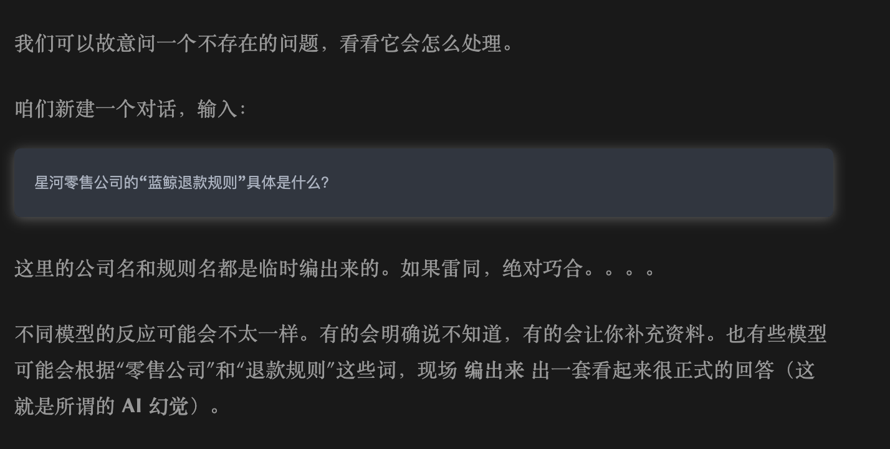


后来，咱们把退款规则复制到聊天窗口里，再问同一个问题，模型就可以回答了。

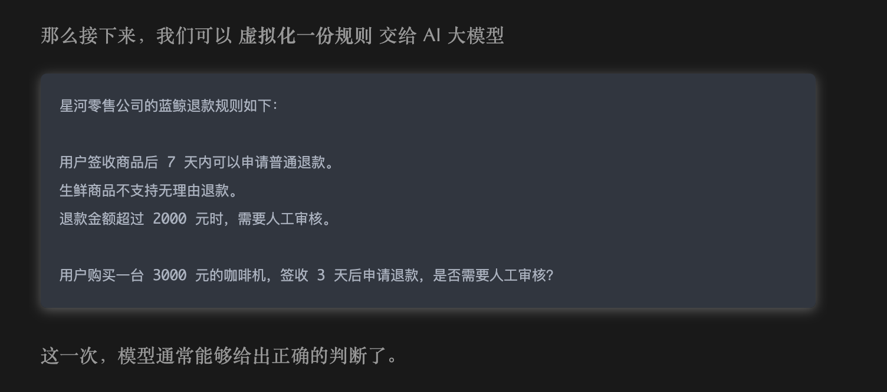


当时咱们说，这就是 RAG 的起点。

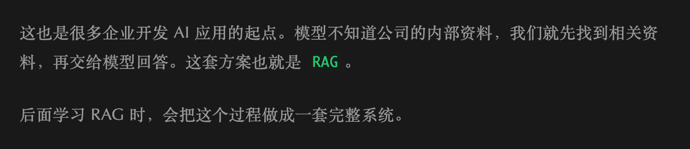


那么现在，咱们要开始正式学习 RAG 了 ～～

## RAG 到底是什么
RAG 的完整名称是 `Retrieval-Augmented Generation`，中文通常翻译成 **检索增强生成**。

先说大白话，所谓 RAG 就是：**在调用模型之前，先从外部知识中找到和问题相关的资料，再把这些资料交给模型生成回答。** （这句话现在只需要记住就行，后面会有详细解释和案例）

大家会发现，这里比直接问大模型多出来一步，那就是：“**先从外部知识中找到和问题相关的资料**”

为什么需要多出这一步呢？

因为模型会写答案，但是大模型并不一开始就知道所有的知识。

大模型在训练之后，学到的内容会保存在模型参数里。这些参数不是全知全能的。

一个公司刚发布的制度、用户自己的文件、数据库里的实时数据，模型是看不到的。

所以，缺少资料时，把 Prompt 写得再复杂也没有用。

而 RAG 所做的事情，就是在模型参数之外，再给 Agent 一套外部知识来源。

这个外部知识来源不一定非要是向量数据库。向量数据库只是后面用来提高检索能力的一种实现，并不等于 RAG 本身。

这个外部知识可以是 Markdown 文件、PDF、产品文档、数据库记录，也可以是某个业务系统返回的数据。比如本小节开头的内容，我们通过 Prompt 直接告诉大模型也算。

当用户提出问题以后，RAG 会经历三个核心步骤：

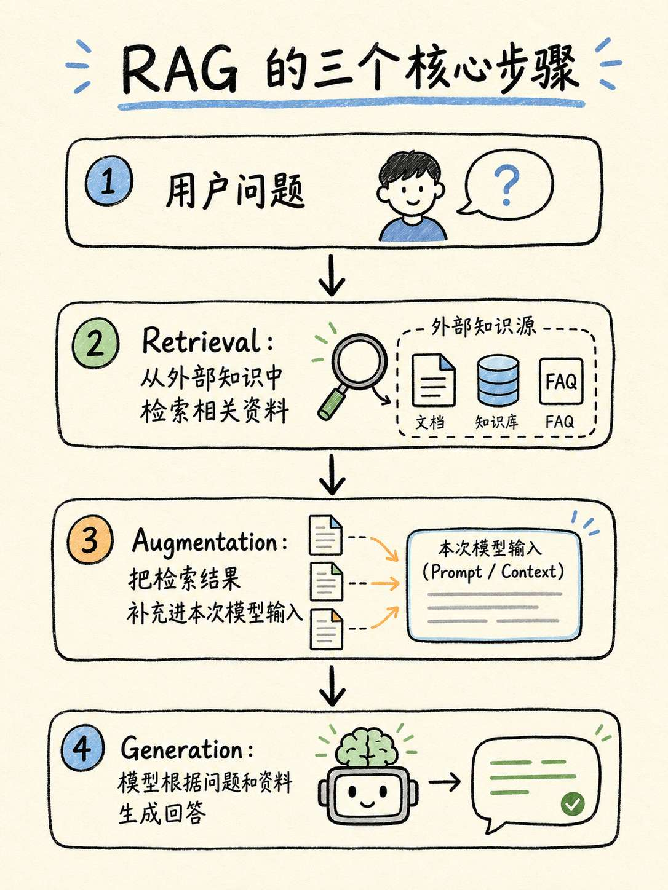


而这三部就是 R  A  G  的关键：

+ R ===`Retrieval` ：解决的是“这次应该让模型看哪份资料”
+ A ===`Augmentation`： 解决的是“怎样把资料、用户问题和回答组织成模型本次能够看到的内容”。
+ G ===`Generation`：模型真正开始工作。模型读取已经补充好的上下文，再生成最终答案。

这样看，开头手动复制资料的操作，其实只完成了后面两步。

资料是咱们自己找到的，然后手动放进聊天窗口，模型负责生成回答。

所以我们才说，那只是 RAG 的一个雏形。

只有当应用程序可以根据用户问题自动选择资料以后，才会形成一条完整的 RAG 链路。

说到这里，相信大家已经大概知道 RAG 是什么了。

接下来，咱们自己实现一次。

## 用 Node.js 实现一个最小 RAG
这个案例，咱们会准备多个多个资料，然后给每个资料配置几个关键词，再通过关键词匹配找到和问题相关的文档。

通过这种方式来模拟一个完整的 RAG 流程

等大家看清楚 RAG 的完整数据流以后，下一节再把关键词匹配替换成真正的向量检索。

### 创建项目
> 所有代码均存放在：`https://github.com/lgd8981289/Agent--Code`
>

创建项目目录：

```bash
mkdir 01-minimal-rag
cd 01-minimal-rag
```

创建 `.env` （还用第一章的就行）：

```plain
DEEPSEEK_API_KEY=
DEEPSEEK_MODEL=deepseek-v4-flash
```

### 准备三份企业资料
创建 `knowledge-base.js`：

```javascript
export const knowledgeBase = [
  {
    id: 'blue-whale-refund',
    title: '蓝鲸退款规则',
    keywords: ['退款', '退货', '人工审核', '签收', '生鲜'],
    content: `普通商品签收后 7 天内可以申请退款。
生鲜商品不支持无理由退款。
退款金额超过 2000 元时，需要人工审核。`
  },
  {
    id: 'shipping-policy',
    title: '商品发货规则',
    keywords: ['发货', '物流', '配送', '运费'],
    content: `现货商品将在付款后 48 小时内发货。
偏远地区可能增加 1 到 3 天配送时间。`
  },
  {
    id: 'invoice-policy',
    title: '电子发票规则',
    keywords: ['发票', '抬头', '税号', '开票'],
    content: `订单完成后可以申请电子发票。
企业发票需要提供公司抬头和税号。`
  }
]
```

每份资料 `content` 大家就可以理解为是需要补充的资料。

同时还有一组用于检索的 `keywords`。

后面连接向量数据库时，数据结构会复杂一些，但是“资料内容”和“用于检索的信息”依然会存在。

### 编写 RAG 代码
创建 `mini-rag.js`：

```javascript
import { knowledgeBase } from './knowledge-base.js'

const apiKey = process.env.DEEPSEEK_API_KEY
const model = process.env.DEEPSEEK_MODEL ?? 'deepseek-v4-flash'

/**
 * 根据用户问题，从知识库中检索相关资料
 *
 * 这里用的是一个非常简化的检索逻辑：
 * - 判断用户问题中是否包含文档的关键词
 * - 匹配到的关键词越多，分数越高
 * - 最后按分数排序，取前 limit 条资料
 */
function retrieve(question, limit = 1) {
    return (
        knowledgeBase
            .map((document) => {
                // 找出当前文档中，被用户问题命中的关键词
                const matchedKeywords = document.keywords.filter((keyword) =>
                    question.includes(keyword)
                )

                return {
                    ...document,
                    score: matchedKeywords.length,
                    matchedKeywords
                }
            })
            // 只保留有关键词命中的文档
            .filter((document) => document.score > 0)

            // 分数越高，说明和用户问题越相关
            .sort((a, b) => b.score - a.score)

            // 只取前 limit 条资料
            .slice(0, limit)
    )
}

/**
 * 把检索到的文档整理成模型可以阅读的上下文
 */
function buildContext(documents) {
    if (documents.length === 0) {
        return '未提供任何企业资料。'
    }

    // 将多篇资料拼接成一段文本，作为参考资料交给模型
    return documents
        .map((document) => `[${document.title}]\n${document.content}`)
        .join('\n\n')
}

/**
 * 调用模型生成回答
 *
 * 注意：
 * 这里的模型只负责根据“参考资料”回答问题。
 * 如果资料不足，系统指令会要求模型明确说无法判断，而不是自己编造规则。
 */
async function callModel({ question, documents, demoReply }) {
    // 将文档转换成模型输入中的参考资料
    const context = buildContext(documents)

    const messages = [
        {
            role: 'system',
            content:
                '你是星河零售公司的知识助手。只能根据参考资料回答。资料不足时，必须明确回答“根据当前资料无法判断”，不要编造公司规则。'
        },
        {
            role: 'user',
            content: `参考资料：\n${context}\n\n用户问题：\n${question}`
        }
    ]

    console.log('\n本次交给模型的参考资料：')
    console.log(context)

    // 如果没有配置 API Key，就不真实调用模型，直接使用演示回答
    if (!apiKey) {
        console.log('\n没有检测到 DEEPSEEK_API_KEY，使用演示回答：')
        console.log(demoReply)
        return demoReply
    }

    // 调用 DeepSeek Chat Completions API
    const response = await fetch('https://api.deepseek.com/chat/completions', {
        method: 'POST',
        headers: {
            Authorization: `Bearer ${apiKey}`,
            'Content-Type': 'application/json'
        },
        body: JSON.stringify({
            model,
            messages,
            stream: false
        })
    })

    // 请求失败时，把接口返回的错误信息抛出来，方便排查问题
    if (!response.ok) {
        const errorText = await response.text()
        throw new Error(`DeepSeek API 调用失败：${response.status} ${errorText}`)
    }

    const result = await response.json()

    // 取出模型最终生成的回答
    const answer = result.choices?.[0]?.message?.content

    if (!answer) {
        throw new Error('DeepSeek API 没有返回可用的回答。')
    }

    console.log('\n模型回答：')
    console.log(answer)

    return answer
}

// 用户本次提出的问题
const question =
    '用户购买了一台 3000 元的咖啡机，签收 3 天后申请退款，是否需要人工审核？'

console.log('\n================ 实验一：不提供企业资料 ================')

// 实验一：不给模型任何企业资料
// 预期结果：模型应该回答“根据当前资料无法判断”，而不是自己编造退款规则
await callModel({
    question,
    documents: [],
    demoReply: '根据当前资料无法判断。'
})

console.log('\n================ 实验二：手动补充退款规则 ================')

// 实验二：手动把退款规则传给模型
// 预期结果：模型可以根据资料判断是否需要人工审核
await callModel({
    question,
    documents: [knowledgeBase[0]],
    demoReply: '需要人工审核，因为退款金额 3000 元超过了 2000 元。'
})

console.log('\n================ 实验三：先检索，再回答 ================')

// 实验三：先根据用户问题，从知识库中检索相关资料
const retrievedDocuments = retrieve(question)

console.log('\n检索结果：')
console.table(
    retrievedDocuments.map(({ id, title, score, matchedKeywords }) => ({
        id,
        title,
        score,
        matchedKeywords: matchedKeywords.join('、')
    }))
)

// 再把检索到的资料交给模型回答
// 这就是一个非常简化版的 RAG 流程：Retrieval → Augmentation → Generation
await callModel({
    question,
    documents: retrievedDocuments,
    demoReply: '需要人工审核，因为退款金额 3000 元超过了 2000 元。'
})
```

这段代码稍微有点长，但真正和 RAG 有关的核心逻辑并不多，一共只有三个方法

+ `retrieve()` 会遍历知识库，统计用户问题命中了每份资料中的多少个关键词。命中数量就是当前案例里的检索分数。分数大于 0 的资料会按照分数从高到低排序，最后只取最相关的一份。
+ `buildContext()` 则负责把检索结果整理成模型可以阅读的文本。这个过程看起来只是字符串拼接，其实对应的就是 RAG 中的 Augmentation。
+ 最后，`callModel()` 把参考资料和用户问题一起装进 `messages`，再调用 DeepSeek 的 `/chat/completions` 接口生成回答。

大家看这个代码的时候，按照咱们之前所说的：**先把所有的方法都收起来，从实验一的第一次 **`callModel`** 调用看起**。难度应该不大。

## 运行项目
执行：

```bash
node --env-file=.env mini-rag.js
```

### 第一次：不提供企业资料
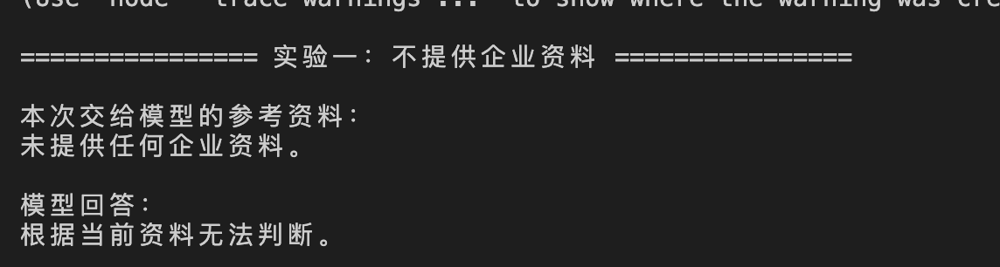


第一次调用中，`documents` 是空数组。模型看到的参考资料只有：“未提供任何企业资料。”

所以，他的回答是 “根据当前资料无法判断。”

> PS：
>
> 这里有极小的概率，模型会出现幻觉。
>
> 如果出现幻觉了，那么大家可以检查下 system 下面的 content 写的是啥。
>
> 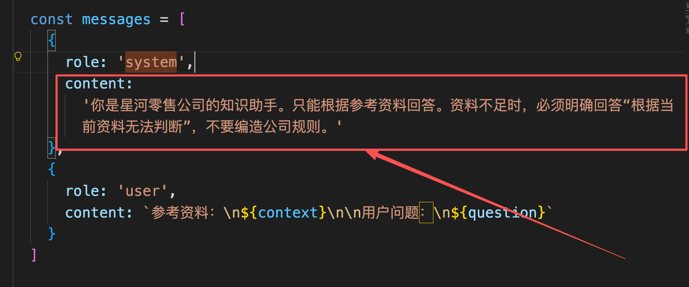
>

> 然后重新再试一次。
>

### 第二次：由咱们手动选择退款规则
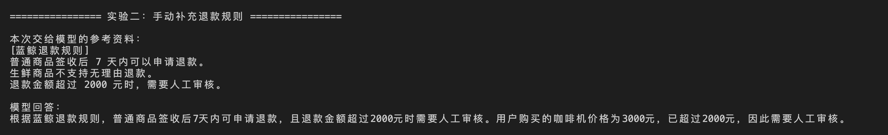


第二次调用直接把 `knowledgeBase[0]` 交给模型。也就是这个：

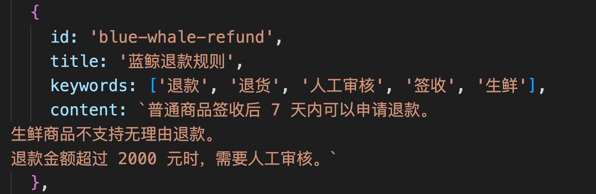


有了这份资料以后，模型就能判断 3000 元超过 2000 元，因此需要人工审核。

但是，这份资料是代码提前写死了的


换句话说，检索工作其实还是咱们手动完成的。

### 第三次：让程序先找到资料
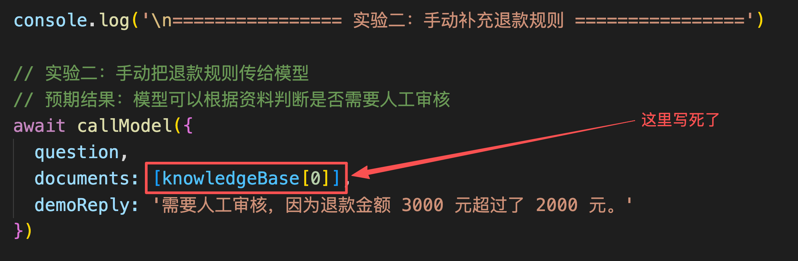


这个就有意思了。

第三次调用之前，代码先执行了 `const retrievedDocuments = retrieve(question)`

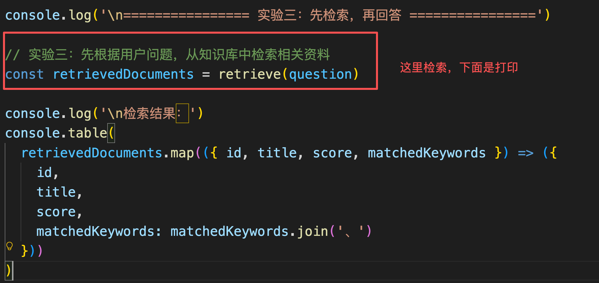


这个时候咱们看下面的打印：

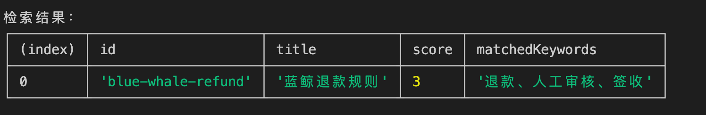


咱们模拟出来了一个检索的过程

然后，检索出来的资料继续进入 `callModel()` 

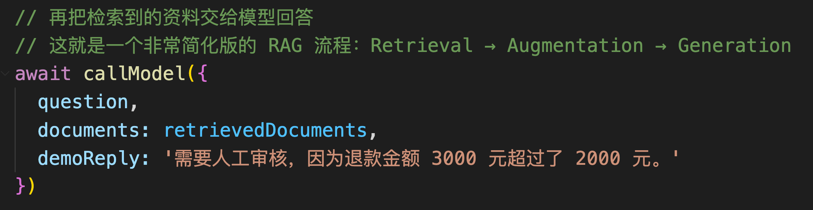


从 `callModel` 在进入 `buildContext`


最终得到回答。

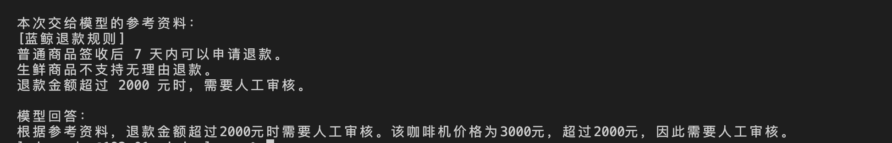


这就是一个完整的 RAG 链路，即文章开头所说的：**在调用模型之前，先从外部知识中找到和问题相关的资料，再把这些资料交给模型生成回答。** 

> PS：这里稍微补充一点点
>
> 上面的例子，其实描述的是一条完整的问答流程。
>
> 但是，咱们需要知道的是：真实的 RAG 系统通常不只有这一条问答流程。它实际上还包含 **离线建库** 和 **在线检索** 这两种不同的方案
>
> 后面咱们要学习的文档分块、Embedding、向量数据库、BM25、Metadata Filter 和 Rerank，都在这两条方案里面。
>


## 总结
上面的代码已经把 RAG 的流程跑通了，但是大家想想，上面的代码还有什么问题吗？

肯定是有的！

最明显的问题就是关键词匹配。

咱们的问题里出现了 “退款” 这两个字，所以程序可以找到蓝鲸退款规则。

但是如果用户换一种说法呢？比如说：“咖啡机不想要了，3000 元的订单应该走自动流程还是人工处理？”

那么上面的程序就懵逼了。

所以说，**文字完全相同和语义相关不是一回事。**

那咋办呢？

下一小节再说～～

这一小节，咱们就只需要知道：**应用程序需要在模型调用之前完成检索，再把检索结果补充进模型输入，最后由模型生成回答。这三步连接起来，就是 RAG。**

就够了

> 更新：2026-06-21 16:12 · 原文：<https://www.yuque.com/lgdsunday/ab1dy3/rasw9ewcbikbio03>
