# 02-RAG 的关键流程：实战 Embedding 模型向量化语义检索方案

上一节最后，咱们给关键词检索留下了一个问题。

知识库里的退款规则写的是：“退款金额超过 2000 元时，需要人工审核。”

但是，用户没有按照规则里的原话提问，而是换了一种说法：“咖啡机不想要了，3000 元的订单应该走自动流程还是人工处理？”

咱们正常人能看出来这俩句话其实是一个意思。

**但是！** 大模型咋知道他们是同一个意思呢？

所以，在 RAG 场景中，如果想要让大模型可以理解这种 **是同一个意思，但是文本表示又不一样的内容的话**，就得用到一个东西了。

这个东西就是：`Embedding（向量化）` 。

## Embedding 到底是什么
很多同学会把 `Embedding` 直接理解为“向量”。

这个说法不能算错，但不够准确。

严格来说，`Embedding` 指的是 **使用模型把文本转换成向量的过程**，而向量是转换之后得到的结果。

即：

> **Embedding 模型会把一段文本转换成一组固定长度的数字。这组数字叫作向量，用来表示文本在语义空间中的位置。**
>

这个数字长啥样呢？

不知道大家还记不记得，咱们在 [第一章：03 - 探究大语言模型原理](https://mp.weixin.qq.com/s/-Qm7yAoVc6_rE8ApUcS84w?payreadticket=HKtIR4FwTkvwV8jyqtFL4KtAvu5fkUCI8usW3jQeUGn24hOL-lZz-2Y51_ytpo18v8o8tBU) 这一节里，其实已经看到过向量：

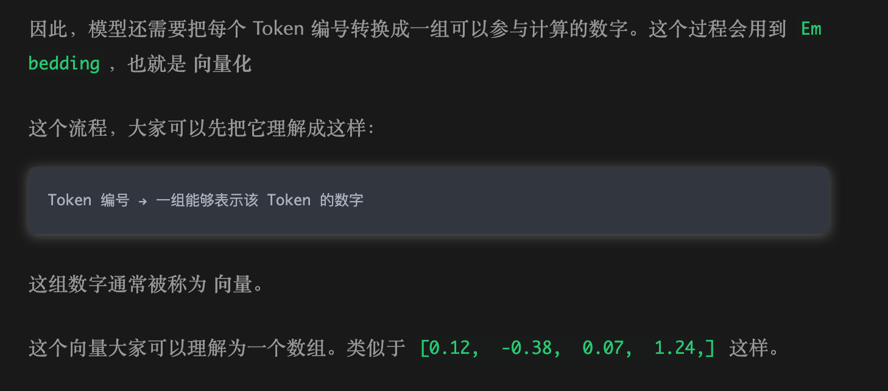


上面的 `[0.12, -0.38, 0.07, 1.24, ...]`，看着很像数组，这就是一个向量。

那么，说了这么多之后，大家肯定还是会有疑惑的，那就是：**这些向量和一开始说的 “同一个意思，但是文本又不一样” 之间有啥关系呢？**

假设现在有一张专门存放售后资料的二维地图。这张地图只有两个方向：

+ 横向表示一段话和“退款售后”的相关程度；
+ 纵向表示一段话和“人工处理”的相关程度。

相关程度越高，对应的数字就越大。

假设，下面几段文字的向量表示是这样的：

```latex
“退款金额超过 2000 元，需要人工审核”  →    [0.96, 0.92]
“3000 元订单应该自动处理还是转人工”   →    [0.91, 0.88]
“订单将在付款后 48 小时内发货”       →    [0.12, 0.08]
“电子发票会发送到用户邮箱”           →    [0.06, 0.11]
```

把这几个坐标画到图上，大概是下面这样：


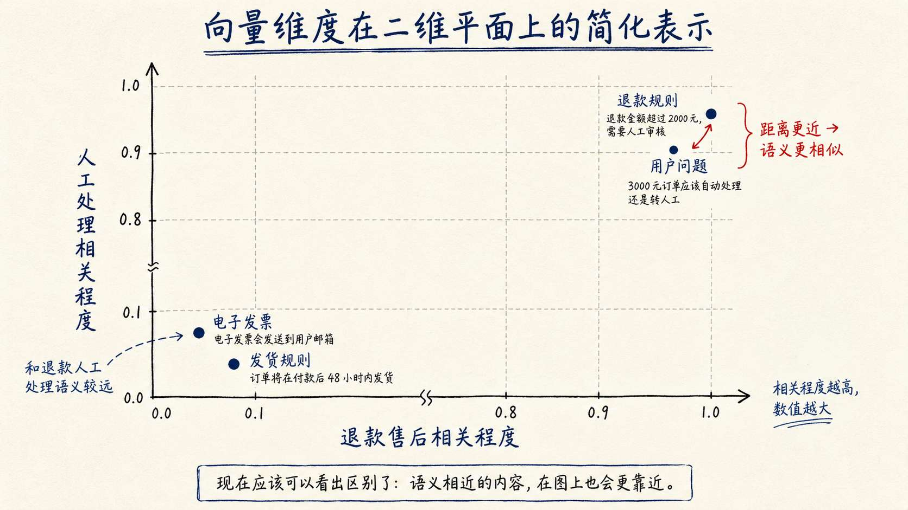


现在应该可以看出区别了。

“退款金额超过 2000 元，需要人工审核” 和 “3000 元订单应该自动处理还是转人工”，文字并不相同，但它们讨论的都是 **高金额退款需要人工处理**，所以在这张图上的位置就非常接近。

发货规则和电子发票讨论的是其他问题，位置就会远一些

这就是向量能够表示语义的基本思路：

> **Embedding 模型不是判断两段文字用了多少相同的字，而是把文本映射到同一个语义空间。含义越接近的文本，向量在这个空间里的距离通常也越近。**
>

需要注意，这张二维图只是为了方便理解。真实的 Embedding 模型并不会真的给咱们两个写着“退款售后”和“人工处理”的坐标轴。

真实模型输出的向量，可能包含 512 个、1024 个甚至更多数字，就像这样：`[0.018, -0.042, 0.007, 0.031, ...]`

向量里一共有多少个数字，就叫多少维。

比如：

```latex
[0.3, -0.7]              → 2 维向量
[0.3, -0.7, 0.2]         → 3 维向量
[0.12, -0.38, 0.07, 1.24] → 4 维向量
...
```

因此，**向量维度说白了就是一个向量中包含多少个数字。**

而每一个维度都代表了当前的一个语义。

还是拿退款问题来说。

模型除了需要表示它和 “退款 ” “人工审核“ 的关系之外，可能还需要表示：金额、时间、商品类型、订单状态、处理动作以及大量其他语义信息。

不过，这些维度都是模型在训练过程中学习出来的，通常不能把某一个数字单独解释成 ”退款维度“ 或者 ”金额维度“ 。文本的语义分散在整组向量中，只有把这些数字放在一起比较才有意义。

同时，咱们要知道 **维度的长度** 和 **文本的长度** 也 **不是一回事**。

想要执行 `Embedding`  操作，那么需要使用 **Embedding 模型**

假设咱们使用 Embedding 模型输出 512 维向量，那么无论输入的是一句话，还是一段较长的退款规则，最终都会得到 512 个数字：

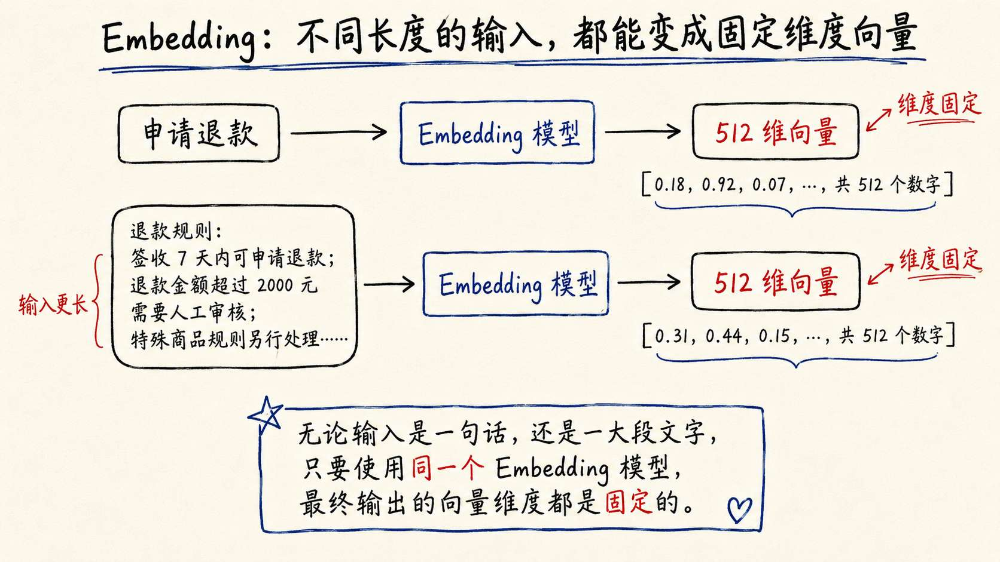


但是，我们需要注意的是：**维度越高，模型可以使用的表示空间通常越大，存储和检索的耗时也会更大**

> PS：在实际开发中，这些向量数据咱们都会保存到「向量数据库」中。数据总数越多，数据单个越大，则查询耗时越大
>

那么说到这里，Embedding 模型的作用应该也说清楚吧。

> Embedding 模型 就是专门负责把文本转换成向量的
>

它在训练过程中学习文本之间的语义关系，然后把每段输入映射到同一套高维空间中。只要使用的是 **同一个 Embedding 模型、同一种维度配置**，咱们就可以比较它们的向量距离。

**注意**：这里有一个前提是 **同一个 Embedding 模型、同一种维度配置**

不同模型学到的语义空间不同，就像两张地图采用了不同的坐标系。两边生成的数字即使维度碰巧一样，也不能直接拿来比较。

因此，真实项目一旦更换 Embedding 模型，通常需要把知识库中的文档重新生成向量，并重建向量索引。


## 用 Node.js 生成真实 Embedding
概念说完以后，咱们开始写代码。

> 代码地址：`https://github.com/lgd8981289/Agent--Code`
>

之前咱们都是用的 DeepSeek。不过，DeepSeek 当前公开接口中没有 Embeddings API，所以咱们还需要选择一个专门的 Embedding 模型。

现在可以选择的方案很多。

+ 国外有 OpenAI 的 `text-embedding-3-small` （链接：`https://developers.openai.com/api/docs/guides/embeddings`）
+ 国内有 智谱 GLM Embedding 系列中的 `embedding-3` （链接：`https://docs.bigmodel.cn/cn/guide/models/embedding/embedding-3`）
+ 阿里云百炼的 `text-embedding-v4` （链接：`https://help.aliyun.com/zh/model-studio/embedding`）
+ 也可以在自己的服务器上部署开源的 `BGE-M3`

咱们这里就用 智谱 GLM Embedding 系列中的 `embedding-3`。

一方面，咱们申请 API Key 和调用接口都比较方便。另一方面，`embedding-3` 支持直接传入字符串数组，也支持输出 256、512、1024 或者 2048 维向量

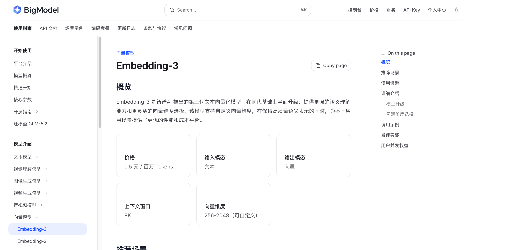


> PS：大家得注意，**GLM 的模型使用是收费的**。阿里百炼有一定的免费额度，领取地址在这里：`https://help.aliyun.com/zh/model-studio/new-free-quota?spm=a2c4g.11186623.help-menu-2400256.d_0_1_0.57a33ba29KKYoe` ，但是阿里百炼的文档比较复杂一点，会涉及到别的概念。这些概念在后面才能用到，放到这里不太搭
>

所以，咱们这次还是用 GLM 的 `embedding-3`  就行。充值不用多，充 1 快就足足够了。地址在这里：`https://bigmodel.cn/finance-center/finance/overview`

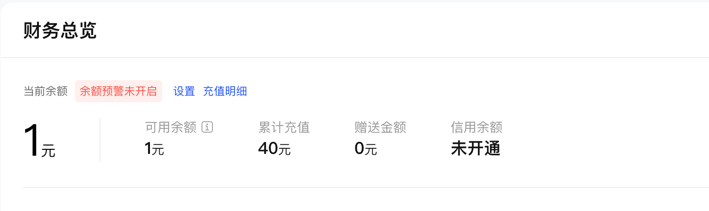


### 创建项目
创建一个新的目录：

```bash
mkdir 02-embedding-search
cd 02-embedding-search
```

创建 `.env`。这里需要填写智谱开放平台的 API Key，不能继续使用 DeepSeek 的 API Key：

```plain
# 智谱开放平台 API Key
ZHIPU_API_KEY=
# 使用哪个 Embedding 模型
EMBEDDING_MODEL=embedding-3
# 返回多少维度的向量
EMBEDDING_DIMENSIONS=512
```

`ZHIPU_API_KEY` 可以在智谱开放平台的 API Key 管理页面 `https://bigmodel.cn/usercenter/proj-mgmt/apikeys` 创建。

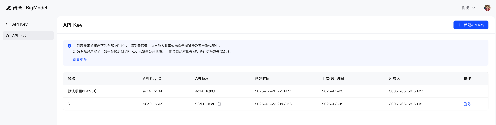

### 实现语义检索
创建 `embedding-search.js`：

```javascript
// 从环境变量中读取智谱 API Key。
// 真实项目中不要把 API Key 直接写死在代码里。
const apiKey = process.env.ZHIPU_API_KEY

// 使用的 Embedding 模型，默认使用 embedding-3。
const model = process.env.EMBEDDING_MODEL ?? 'embedding-3'

// 指定向量维度。
// 这里默认生成 512 维向量，也就是每段文本最终会变成 512 个数字。
const dimensions = Number(process.env.EMBEDDING_DIMENSIONS ?? 512)

// embedding-3 支持的向量维度范围。
// 不是所有维度都可以随便填，必须是模型支持的值。
const supportedDimensions = new Set([256, 512, 1024, 2048])

// 继续使用上一节的三份企业资料。
// 这里可以理解为一个非常小的“知识库”。
const documents = [
    {
        id: 'blue-whale-refund',
        title: '蓝鲸退款规则',
        content: `普通商品签收后 7 天内可以申请退款。
退款金额超过 2000 元时，需要人工审核。`
    },
    {
        id: 'shipping-policy',
        title: '商品发货规则',
        content: `现货商品将在付款后 48 小时内发货。
偏远地区可能增加 1 到 3 天配送时间。`
    },
    {
        id: 'invoice-policy',
        title: '电子发票规则',
        content: `订单完成后可以申请电子发票。
企业发票需要提供公司抬头和税号。`
    }
]

/**
 * 调用 Embeddings API，把多段文本批量转换成向量。
 *
 * 例如：
 * [
 *   '用户问题',
 *   '退款规则',
 *   '发货规则'
 * ]
 *
 * 会被转换成：
 * [
 *   [0.01, 0.23, ...],
 *   [0.88, 0.12, ...],
 *   [0.33, 0.45, ...]
 * ]
 */
async function createEmbeddings(inputs) {
    // 没有 API Key 时直接终止，避免发起无效请求。
    if (!apiKey) {
        throw new Error('没有检测到 ZHIPU_API_KEY，请先在 .env 中配置。')
    }

    // 检查向量维度是否合法。
    // 如果维度不符合模型要求，API 调用大概率会失败。
    if (!supportedDimensions.has(dimensions)) {
        throw new Error('EMBEDDING_DIMENSIONS 只能是 256、512、1024 或 2048。')
    }

    // 向智谱 Embeddings API 发送请求。
    // input 支持传入多段文本，因此这里可以一次性批量生成向量。
    const response = await fetch(
        'https://open.bigmodel.cn/api/paas/v4/embeddings',
        {
            method: 'POST',
            headers: {
                Authorization: `Bearer ${apiKey}`,
                'Content-Type': 'application/json'
            },
            body: JSON.stringify({
                model,
                input: inputs,
                dimensions
            })
        }
    )

    const result = await response.json()

    // 如果 API 返回错误，把状态码和错误信息一起抛出，方便排查问题。
    if (!response.ok) {
        throw new Error(
            `Embedding API 调用失败：${response.status} ${JSON.stringify(result)}`
        )
    }

    // API 会为每一段输入返回一条 embedding。
    // 这里先根据 index 恢复输入顺序，再取出真正的向量数组。
    return result.data
        .sort((first, second) => first.index - second.index)
        .map((item) => item.embedding)
}

/**
 * 计算两个向量的余弦相似度。
 *
 * 余弦相似度可以用来衡量两个向量方向是否接近。
 * 在语义检索里，方向越接近，通常表示两段文本语义越相似。
 */
function cosineSimilarity(firstVector, secondVector) {
    // 两个向量必须维度一致，否则不能直接计算相似度。
    if (firstVector.length !== secondVector.length) {
        throw new Error(
            `向量维度不一致：${firstVector.length} !== ${secondVector.length}`
        )
    }

    let dotProduct = 0
    let firstLength = 0
    let secondLength = 0

    // 遍历每一维，计算：
    // 1. 点积 dotProduct
    // 2. 第一个向量的长度平方
    // 3. 第二个向量的长度平方
    for (let index = 0; index < firstVector.length; index += 1) {
        dotProduct += firstVector[index] * secondVector[index]
        firstLength += firstVector[index] ** 2
        secondLength += secondVector[index] ** 2
    }

    // 零向量没有方向，因此不能计算余弦相似度。
    if (firstLength === 0 || secondLength === 0) {
        throw new Error('不能计算零向量的余弦相似度。')
    }

    // 余弦相似度公式：
    // 两个向量的点积 / 两个向量长度的乘积
    return dotProduct / (Math.sqrt(firstLength) * Math.sqrt(secondLength))
}

async function main() {
    // 这个问题没有直接出现“退款”和“人工审核”两个关键词。
    // 但是它的语义和“退款金额超过 2000 元，需要人工审核”是接近的。
    const question = '咖啡机不想要了，3000 元的订单应该走自动流程还是人工处理？'

    // 把用户问题和所有资料放在同一个请求里批量生成向量。
    // 第 1 个向量对应用户问题，后面的向量依次对应每份企业资料。
    const inputs = [question, ...documents.map((document) => document.content)]
    const [questionVector, ...documentVectors] = await createEmbeddings(inputs)

    console.log(`Embedding 模型：${model}`)
    console.log(`向量维度：${questionVector.length}`)

    // 这里只打印前 8 个数字，方便观察向量的大致形态。
    // 实际向量长度可能是 256、512、1024 或 2048。
    console.log('问题向量的前 8 个数字：')
    console.log(questionVector.slice(0, 8))

    // 分别计算“用户问题”与“每份资料”的相似度。
    // 相似度越高，说明这份资料越可能和用户问题相关。
    const results = documents
        .map((document, index) => ({
            id: document.id,
            title: document.title,
            similarity: cosineSimilarity(questionVector, documentVectors[index])
        }))
        // 按相似度从高到低排序，让最相关的资料排在最前面。
        .sort((first, second) => second.similarity - first.similarity)

    console.log('\n语义检索结果：')
    console.table(
        results.map((item) => ({
            ...item,
            // 控制小数位数，让输出结果更方便阅读。
            similarity: item.similarity.toFixed(6)
        }))
    )

    // 排序后的第一个结果，就是本次语义检索认为最相关的资料。
    console.log(`最相关的资料：${results[0].title}`)
}

main()
```

这段代码主要完成了三件事情。

+ `createEmbeddings()` 方法： 把用户问题和三份资料一起发送给 Embeddings API。接口会为每段输入分别返回一个向量。
+ `cosineSimilarity()` 方法：用来计算两个向量的相似程度。这里暂时只需要知道结果越大，通常代表两个向量越接近。它的计算原理以及为什么要使用余弦相似度，后面会详细讲。
+ `main()` 方法： 把问题向量分别和三份资料向量进行比较，再按照相似度从高到低排序。

执行：

```bash
node --env-file=.env embedding-search.js
```

结果：

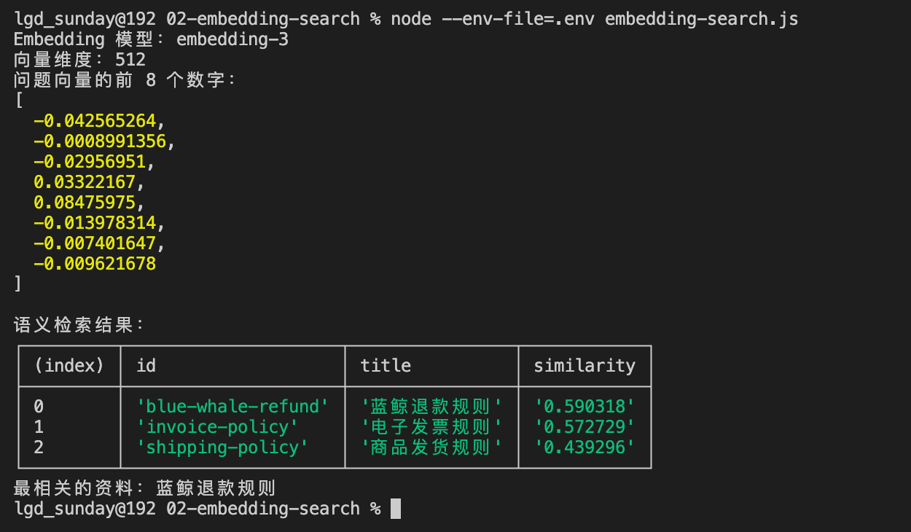


运行以后，终端会先打印当前使用的 Embedding 模型和向量维度：


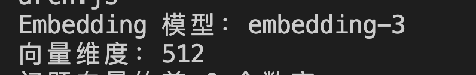


紧接着，还会打印问题向量最前面的 8 个数字。

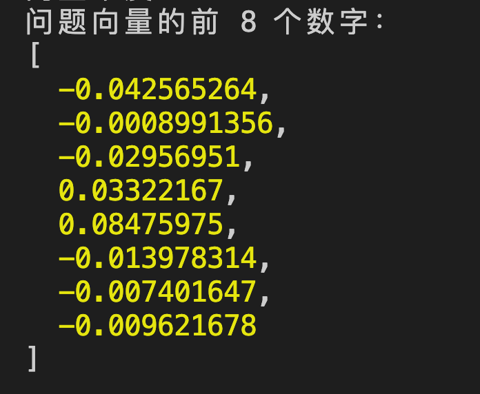


然后，终端会按照相似度展示三份资料。具体小数可能会随着模型更新和输入内容发生变化，所以不要照着某个固定分数检查。

真正需要观察的是排序：**蓝鲸退款规则应该排在最前面。**

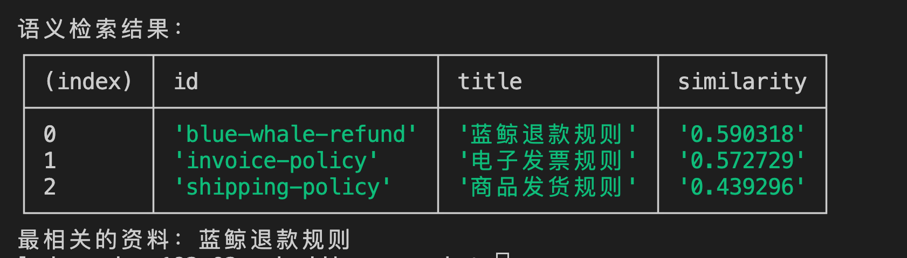


用户没有说“退款”，而是说“咖啡机不想要了”。

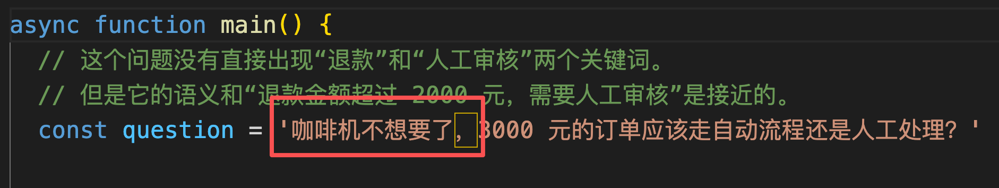


但是根据结果我们依然可以发现 **最后检索出来的最相关内容依然是 「退款规则」**

这就是语义检索和上一节关键词匹配最直观的区别。

## 总结
这一节出现了好几个容易混在一起的概念。最后，咱们再把它们分开看一次。

+ 首先：**向量，是文本经过转换以后得到的结果。**

它看起来是一组数字，例如 `[0.018, -0.042, 0.007, ...]`。这组数字共同表示文本在语义空间中的位置。语义相近的文本，向量通常也会更接近。

向量中包含多少个数字，就是多少维。维度会影响向量的表示空间、存储大小和检索计算量，但维度越高，不代表实际检索效果就一定越好。

+ 其次：**Embedding，是把文本转换成向量的过程。** 注意：是过程～
+ **Embedding 模型，是负责执行这个转换过程的模型。**

这节课使用的是智谱 `embedding-3`。咱们把文本发送给它，它会返回指定维度的向量。文档和用户问题必须使用同一个 Embedding 模型以及相同的维度配置，这样生成的向量才处于同一套语义空间中，才能继续比较。

这些东西能掌握好，这一小节就没啥问题了。

最后的小案例，大家作为参考就行。

在 Vibe Coding 时代，所有的代码都意义不大了，**也不需要手写**。 能看明白流程就可以了

下一节，咱们继续研究向量相似度、距离度量和 TopK。

come on～

> 更新：2026-06-22 21:12 · 原文：<https://www.yuque.com/lgdsunday/ab1dy3/zd4m7ceyuc0cw6pv>
