# 03 - 完整向量检索实现：距离度量、相似度、 TopK 与 similarity

上一节，咱们学了 向量、Embedding，并且用 GLM 的 embedding-3 实现了一个语义检索的方案。

最终实现可以实现当用户问到：“咖啡机不想要了，3000 元的订单应该走自动流程还是人工处理？” 的时候，可以检索出 “蓝鲸退款规则” 这样的功能

看着是不是还挺牛的。

但是，大家想一下，这里其实还有几个问题没有讲清楚。

+ 第一，程序凭什么知道两个向量“更接近”？
+ 第二，相似度这个分数到底是怎么算出来的？
+ 第三，真实 RAG 系统里，难道每次只拿最相关的 1 条资料就够了吗？

这些问题，就是这一节要解决的。

## 距离、相似度到底是什么
继续回到上一节的向量。

Embedding 模型会把一段文本转换成一组数字（为了方便理解，这里还是用二维向量举例），比如：

```latex
用户问题向量： [0.91, 0.88]
退款规则向量： [0.96, 0.92]
发货规则向量： [0.12, 0.08]
```

这里无论维度是多少，解决的问题都是固定的，那就是：**给定一个用户问题向量，找出知识库里和它最接近的文档向量。**

那这个时候问题就来了：**怎么判断 “接近”  呢？**

大家想想咱们上一小节是怎么做的？

咱们直接把向量理解成二维地图上的坐标，两个点离得越近，则表示越接近。

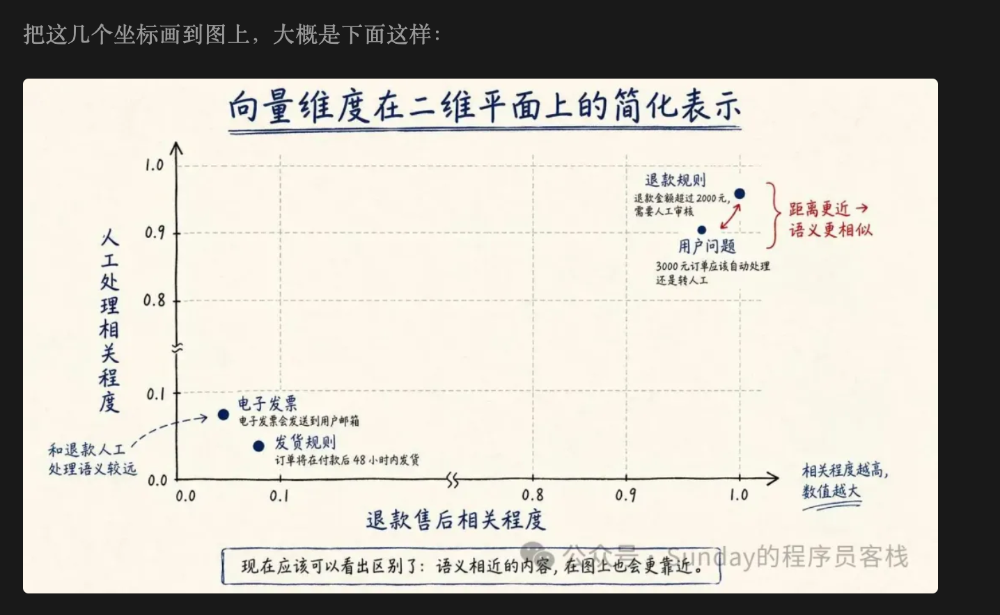


这里咱们得知道哈，这个图片是我专门做出来给大家看的。

咱们人一看就知道：哦～用户问题和退款规则更近，和发货规则更远。

但是，程序可不是这么看问题的。

程序必须把 “近不近” 转换成一个可以计算、可以排序的数字。

这个数字通常会有两种表达方式。

### 第一：距离
这个最好理解。


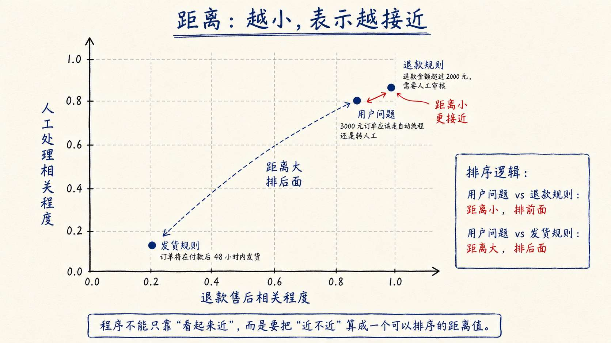


如果把向量看成地图上的点，那么用户问题离退款规则越近，距离就越小；用户问题离发货规则越远，距离就越大。

即：**距离越小，表示越接近。**

### 第二：相似度
相似度不是看“离得有多远”，而是给两个向量进行打分。打分的逻辑就是 “像不像” 

在文本向量检索里，比较常见的一种相似度计算方式叫 **余弦相似度**。

咱们可以直接看下面的 **向量夹角图**：夹角就越小，余弦相似度就越高。

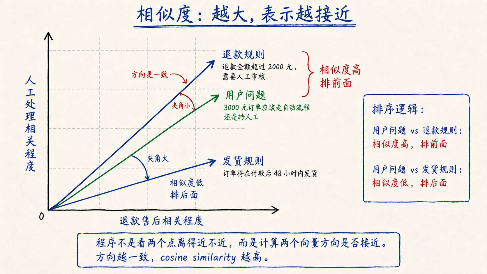


也就是说：**相似度越大，表示夹角越小，方向越一致，语义越接近。**

---

所以说，距离和相似度都在解决同一个问题：用户问题和哪个资料更相关。

只不过，**距离是越小越相关，相似度是越大越相关。**

但是，我们知道无论是 距离，还是相似度 ， 都不会只有一个相关的，对不对。

通常会有多个距离都比较接近，相似度也都比较大。

那么，问题又来了。

**在出现多个比较相关的答案时** ，我们应该选择哪个呢？

这就要讲 `TopK` 了。

## TopK：按照相关性取前 K 条资料
`TopK` 这个名字看着像算法，其实没那么复杂。

他其实有两层意思：

+ `Top`：表示排在前面的
+ `K` 表示数量

所以，`TopK` 的意思就是：**按照相关性分数排序以后，取排在前面的 K 条结果。**

假如 `TopK = 3`，意思就是取前 3 条。

还是拿退款问题来说。

如果用户问：“3000 元退款需要人工审核吗？”  这个问题比较单一。程序只要检索出“蓝鲸退款规则”，基本就够了。

但是，如果用户问：“我买的咖啡机 3000 元，现在想退货。这个订单需要人工审核吗？如果要退，具体流程怎么走？”

这个问题就不一样了。

它包含两个信息需求：

+ 一个是：3000 元是否需要人工审核
+ 另一个是：用户接下来应该怎么申请，客服怎么处理，系统状态怎么流转

那么假如说，现在知识库里刚好有两份资料：

+ 蓝鲸退款规则
+ 退款申请流程

那么大家想想，这两个是不是取哪一个都不合适？

所以，这里更合理的做法就不是只取第一条，而是 **取前几条**。

假设相似度排序结果是这样的：

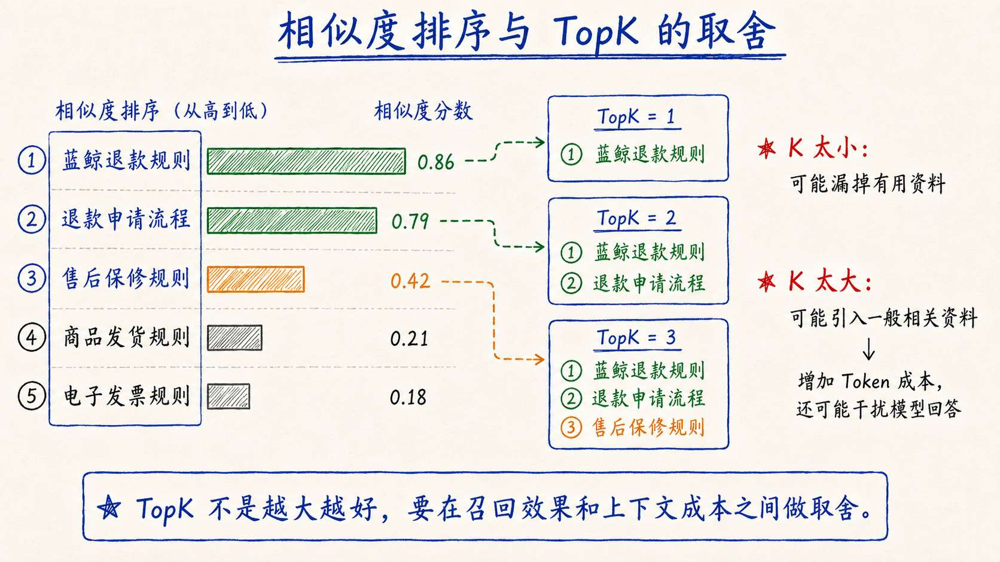


+ 如果 `TopK = 1`，程序只会取 “蓝鲸退款规则”
+ 如果 `TopK = 2`，程序会取 “蓝鲸退款规则” 和“ 退款申请流程”
+ 如果 `TopK = 3`，程序还会把 “售后保修规则” 也取进来

K 太小，可能漏掉真正有用的资料。

K 太大，又可能把相关性一般的资料也塞进上下文里，增加 Token 成本，还可能干扰模型回答。

所以，TopK 应该是一个根据业务来动态设置的值。

## 用 Node.js 实现一个内存向量检索器
接下来，咱们把上一节的代码继续往后写。

上一节的代码咱们实现的是：Embedding 可以让“表达不同但意思相近”的文本被找出来。

但是上一节的代码比较简单一点。它只是把用户问题和几份资料一起向量化，然后马上算相似度，最后打印一个排序结果。

所以，这一节咱们要把这个案例往真实 RAG 的检索上在进一步。

目标是：**实现一个最小版的内存向量检索器。** 

也就是完成 RAG 流程里的第一步：`Retrieval`：让程序可以根据用户问题，从本地知识库中找出最相关的资料。

> 整个的一个 Retrieval 流程，说白了就是先把知识库文档转换成向量，放到内存数组（真实项目会放到：向量数据库里面）
>
> 等用户问题进来以后，再把问题转换成向量，和内存里的文档向量逐个比较，最后返回 TopK 结果。
>

一个完整的流程大概就是下面这样：

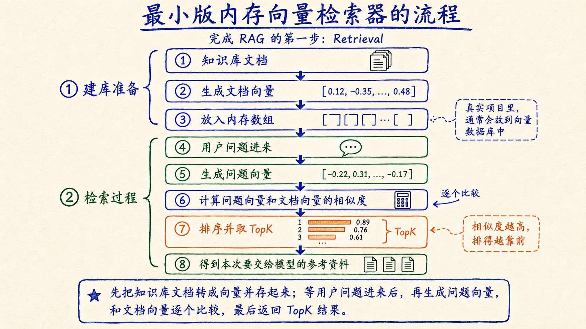


### 创建项目
> 代码地址还是放在：`https://github.com/lgd8981289/Agent--Code`
>

创建一个新的目录：

```bash
mkdir 03-memory-vector-search
cd 03-memory-vector-search
```

上一节已经有两个能力了：

+ createEmbeddings() 生成向量
+ cosineSimilarity() 计算相似度

这一节会继续沿用这两部分。

然后再新增两块能力：

+ `buildMemoryVectorStore()` 构建内存向量库
+ `searchTopK()` 根据用户问题检索 TopK

也就是在 上一节的 Embedding + 相似度计算 的基础上，**再加上“建库”和“查询”两个方法。**

> PS：别忘了创建 `.env` （直接用上一节的就行）
>
> 模型还是用上一节的智谱 `embedding-3`。
>

### 编写内存向量检索代码
创建 `memory-vector-search.js`：

```javascript
const apiKey = process.env.ZHIPU_API_KEY
const model = process.env.EMBEDDING_MODEL ?? 'embedding-3'
const dimensions = Number(process.env.EMBEDDING_DIMENSIONS ?? 512)

const supportedDimensions = new Set([256, 512, 1024, 2048])

// 本节的测试知识库。
// 后面接入真实文档时，这些内容会来自 Markdown、PDF、数据库或者后台系统。
const documents = [
    {
        id: 'blue-whale-refund-rule',
        title: '蓝鲸退款规则',
        content: `普通商品签收后 7 天内可以申请退款。
生鲜商品不支持无理由退款。
退款金额超过 2000 元时，需要人工审核。`
    },
    {
        id: 'refund-apply-process',
        title: '退款申请流程',
        content: `用户可以在订单详情页提交退款申请。
系统会先校验订单状态、签收时间和商品类型。
需要人工审核的退款申请，会进入客服审核队列。`
    },
    {
        id: 'shipping-policy',
        title: '商品发货规则',
        content: `现货商品将在付款后 48 小时内发货。
偏远地区可能增加 1 到 3 天配送时间。`
    },
    {
        id: 'invoice-policy',
        title: '电子发票规则',
        content: `订单完成后可以申请电子发票。
企业发票需要提供公司抬头和税号。`
    },
    {
        id: 'warranty-policy',
        title: '售后保修规则',
        content: `电器商品享受 1 年整机保修。
人为损坏、进水和自行拆机不在免费保修范围内。`
    },
    {
        id: 'coupon-policy',
        title: '优惠券使用规则',
        content: `优惠券需要在有效期内使用。
已经过期的优惠券不能恢复，也不能兑换成现金。`
    }
]

// 沿用上一节：调用 embedding-3，把文本转换成向量。
async function createEmbeddings(inputs) {
    if (!apiKey) {
        throw new Error('没有检测到 ZHIPU_API_KEY，请先在 .env 中配置。')
    }

    if (!supportedDimensions.has(dimensions)) {
        throw new Error('EMBEDDING_DIMENSIONS 只能是 256、512、1024 或 2048。')
    }

    if (inputs.length > 64) {
        throw new Error('embedding-3 单次请求的数组最大不能超过 64 条。')
    }

    const response = await fetch(
        'https://open.bigmodel.cn/api/paas/v4/embeddings',
        {
            method: 'POST',
            headers: {
                Authorization: `Bearer ${apiKey}`,
                'Content-Type': 'application/json'
            },
            body: JSON.stringify({
                model,
                input: inputs,
                dimensions
            })
        }
    )

    const result = await response.json()

    if (!response.ok) {
        throw new Error(
            `Embedding API 调用失败：${response.status} ${JSON.stringify(result)}`
        )
    }

    return result.data
        .sort((first, second) => first.index - second.index)
        .map((item) => item.embedding)
}

// 沿用上一节：计算两个向量的余弦相似度。
function cosineSimilarity(firstVector, secondVector) {
    if (firstVector.length !== secondVector.length) {
        throw new Error(
            `向量维度不一致：${firstVector.length} !== ${secondVector.length}`
        )
    }

    let dotProduct = 0
    let firstLength = 0
    let secondLength = 0

    for (let index = 0; index < firstVector.length; index += 1) {
        dotProduct += firstVector[index] * secondVector[index]
        firstLength += firstVector[index] ** 2
        secondLength += secondVector[index] ** 2
    }

    if (firstLength === 0 || secondLength === 0) {
        throw new Error('不能计算零向量的余弦相似度。')
    }

    return dotProduct / (Math.sqrt(firstLength) * Math.sqrt(secondLength))
}

// 本节新增：构建内存向量库。
// 也就是把每份文档都转换成向量，并和原文档放在一起。
async function buildMemoryVectorStore(rawDocuments) {
    const vectors = await createEmbeddings(
        rawDocuments.map((document) => document.content)
    )

    return rawDocuments.map((document, index) => ({
        ...document,
        vector: vectors[index]
    }))
}

// 本节新增：根据用户问题检索 TopK 文档。
async function searchTopK({ store, query, topK = 3, minSimilarity = 0 }) {
    const [queryVector] = await createEmbeddings([query])

    return store
        .map((document) => {
            const similarity = cosineSimilarity(queryVector, document.vector)

            return {
                id: document.id,
                title: document.title,
                content: document.content,
                similarity,
                distance: 1 - similarity
            }
        })
        .filter((document) => document.similarity >= minSimilarity)
        .sort((first, second) => second.similarity - first.similarity)
        .slice(0, topK)
}

// 本节新增：格式化打印检索结果。
function printSearchResults(results) {
    console.table(
        results.map((item, index) => ({
            rank: index + 1,
            id: item.id,
            title: item.title,
            similarity: item.similarity.toFixed(6),
            distance: item.distance.toFixed(6)
        }))
    )
}

async function main() {
    console.log(`Embedding 模型：${model}`)
    console.log(`向量维度：${dimensions}`)

    console.log('\n正在构建内存向量索引...')
    const store = await buildMemoryVectorStore(documents)
    console.log(`索引构建完成，文档数量：${store.length}`)

    const query =
        '我买的咖啡机 3000 元，现在想退货。这个订单需要人工审核吗？如果要退，具体流程怎么走？'

    console.log('\n用户问题：')
    console.log(query)

    const results = await searchTopK({
        store,
        query,
        topK: 3,
        minSimilarity: 0
    })

    console.log('\nTopK 检索结果：')
    printSearchResults(results)

    console.log('\n准备交给模型的参考资料：')
    console.log(
        results.map((item) => `【${item.title}】\n${item.content}`).join('\n\n')
    )
}

main()
```

按照“在上一节基础上继续加能力”的思路来看，前面的 `createEmbeddings()` 和 `cosineSimilarity()` 都是上一节已经用过的函数了，这里不多说了。

这一节真正新增的，是 `buildMemoryVectorStore()` 和 `searchTopK()`。

+ `buildMemoryVectorStore()` 负责建库。它会把每份文档的 `content` 发送给 Embedding 模型，拿到向量以后，再把原始文档和向量放在一起。

最后得到的 `store` 大概是这个样子：

```javascript
[
    {
        id: 'blue-whale-refund-rule',
        title: '蓝鲸退款规则',
        content: '...',
        vector: [0.018, -0.042, 0.007, ...]
    }
]
```

这就是一个最小版的内存向量库。

+ 然后是 `searchTopK()`。

用户问题进来以后，它先把问题转换成 `queryVector`，再遍历内存里的每一份文档。

每遍历一份文档，就做一次余弦相似度计算：

```javascript
const similarity = cosineSimilarity(queryVector, document.vector)
```

计算完以后，代码会按照相似度从高到低排序：

```javascript
.sort((first, second) => second.similarity - first.similarity)
```

最后再取前 `topK` 条：

```javascript
.slice(0, topK)
```

### 运行项目
执行：

```bash
node --env-file=.env memory-vector-search.js
```

完整的打印结果：

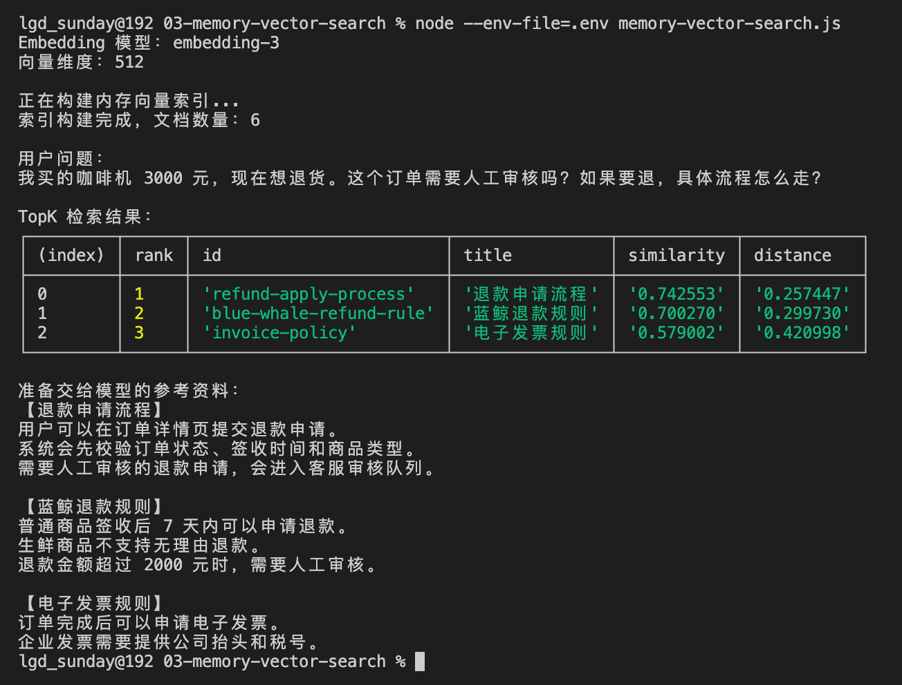


咱们从打印出的用户问题开始看。

这里用的问题是：

```latex
我买的咖啡机 3000 元，现在想退货。这个订单需要人工审核吗？如果要退，具体流程怎么走？
```

他的问题有两个。

所以，比较理想的检索结果里，`蓝鲸退款规则` 和 `退款申请流程` 都应该排在比较靠前的位置。

最后，代码会把 TopK 的资料拼成一段参考资料：

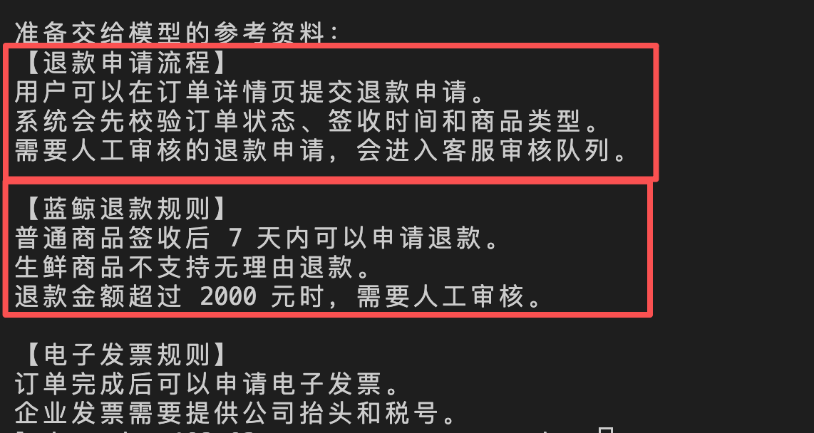


从结果咱们可以看出来 【退款申请流程】 和 【蓝鲸退款规则】 都拿到了。

### minSimilarity
这里还有一个小参数，咱们顺手补充一下。

它不算这一节的主线知识，但是代码里已经写到了。如果不解释清楚，总觉得少了点啥

前面咱们一直在讲 `TopK`。

`TopK` 解决的是：**最多取几条资料。**

比如 `TopK = 3`，程序就会按照相似度排序，尽量取前 3 条。

但是这里有一个问题：**排在前 3，不代表这 3 条资料真的相关。** （大家看看上面的截图，「电子发票规则」就不相关）

TopK 只代表，在当前知识库里，这 3 条是“相对更像”的。

比如用户问：“公司年会在哪里举办？”

但是咱们的知识库里只有退款规则、发货规则、发票规则。

这个时候，如果只看 `TopK` 还是能排出一个第一名、第二名、第三名。

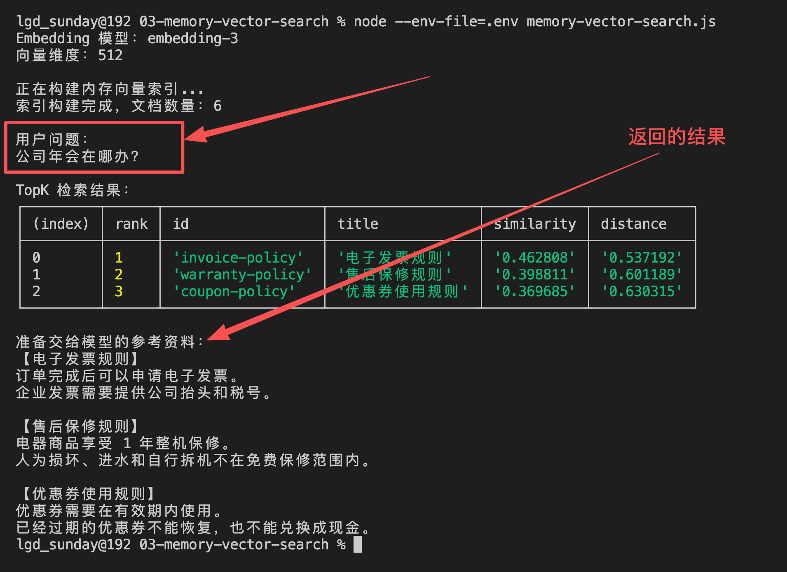


可问题是，这些资料跟“年会在哪里举办”其实都没啥关系。

这就是 `minSimilarity` 要解决的问题。

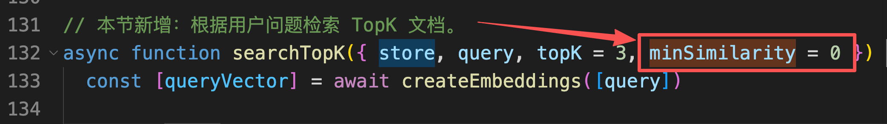


从名字也能看出来：

+ `min`  ：最小
+ `similarity` ：相似度

所以，`minSimilarity` 的意思就是：**最低相似度要求。**

它的作用很简单：**只有文档和用户问题的相似度大于等于这个值，才允许进入最终结果。**

对应到代码里，就是这一行：

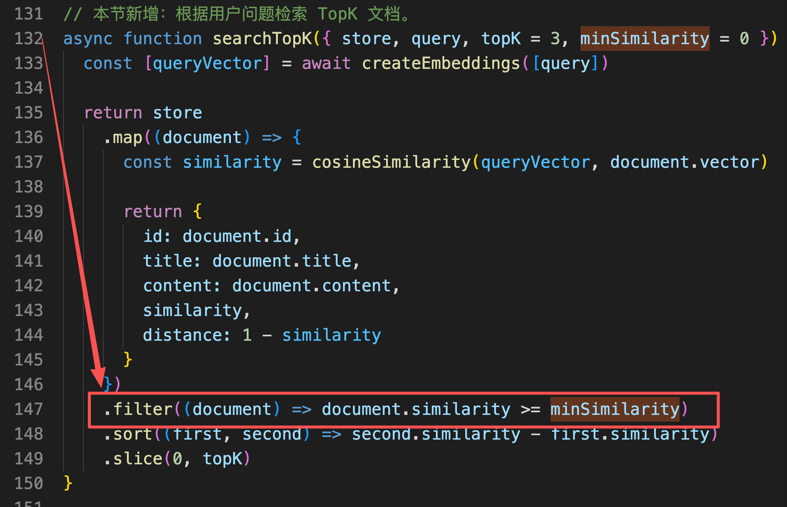


这行代码做的事情就是过滤。

咱们可以看下 `document.similarity` 的值（此时问题是：「公司年会在哪办」）：

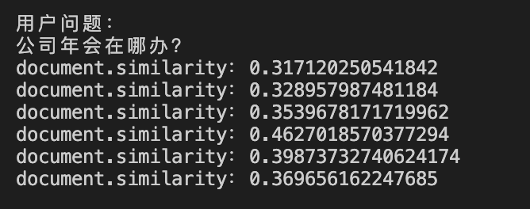


可以看到基本上都在 `0.3 ～ 0.4 ` 左右。

然后咱们来看当问题变成「我买的咖啡机 3000 元，现在想退货。这个订单需要人工审核吗？」之后，`document.similarity` 的值

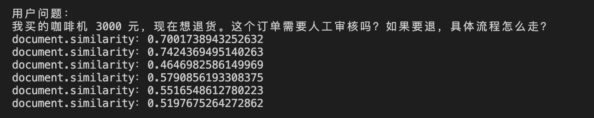


基本上都在 `0.5 ～ 0.7` 左右。

其中最高的两个 `similarity` 对应的内容分别是：

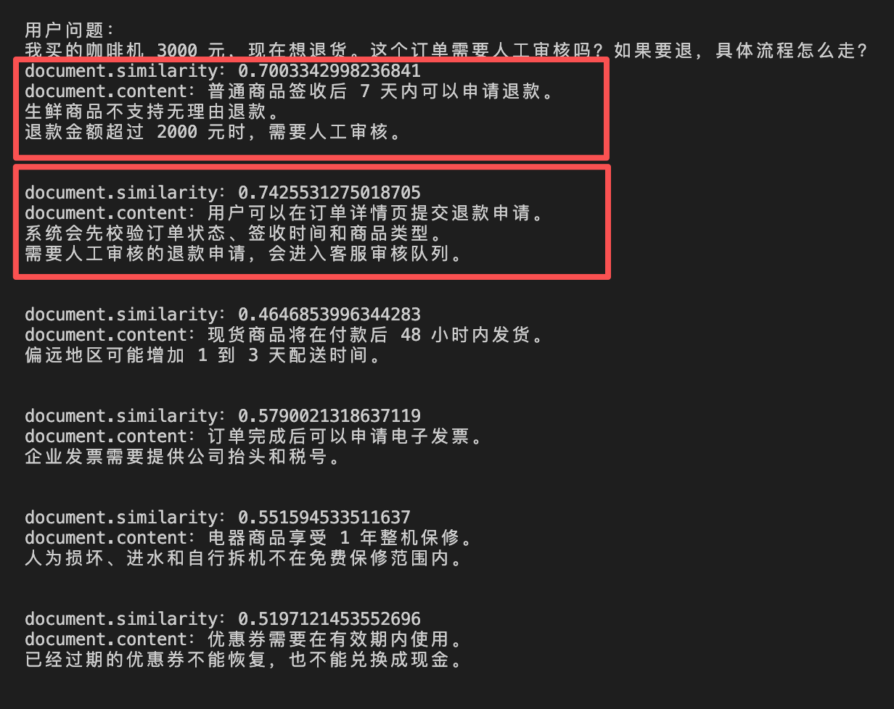


和咱们的问题相似度就极高了。

所以，大家可以这样理解：

+ `TopK` 控制的是“最多返回几条”
+ `minSimilarity` 控制的是“低于什么分数就不要返回”

两个配合起来，就可以得到比较准确的结果了。


## 总结
现在咱们已经知道，Embedding 模型只负责把文本变成向量。

变成向量以后，应用程序还得继续做三件事：

+ 计算问题向量和文档向量的相似度
+ 按照相似度排序
+ 取出 TopK 作为候选资料

距离和相似度描述的是同一件事，只是方向不同。**距离越小，通常越接近；相似度越大，通常越接近。**

同时 `TopK` 也不是万能的，如果不做别的配置（比如：`minSimilarity` 依然可能返回牛头不对马嘴的答案）

到这里，RAG 的检索部分已经开始有点样子了。

但是，这样依然还不够。

因为咱们现在的数据 **太少了，也太小了**

在真实的企业开发中，一份文档不可能只有几行文字，她可能特别特别的复杂。

所以，咱们下一小节就得来看看，当咱们遇到特别复杂的文档时，都应该怎么处理呢？

> 更新：2026-06-23 18:08 · 原文：<https://www.yuque.com/lgdsunday/ab1dy3/ucpgg1zpyd11az2i>
