# 04 - 实现 文档解析、清洗和分块！设计一套完整的  Metadata、Chunk ID 与版本更新 方案

上一节，咱们已经实现了一个向量检索器。

用户问一句话，程序会把问题转换成向量，再和知识库里的文档向量做相似度计算，最后取出 TopK。

做到这里，RAG 的检索链路已经像点样了。

但是，上一节的知识库其实太理想化了。

每一份资料都只有几行，而且都是咱们手写在代码里的：

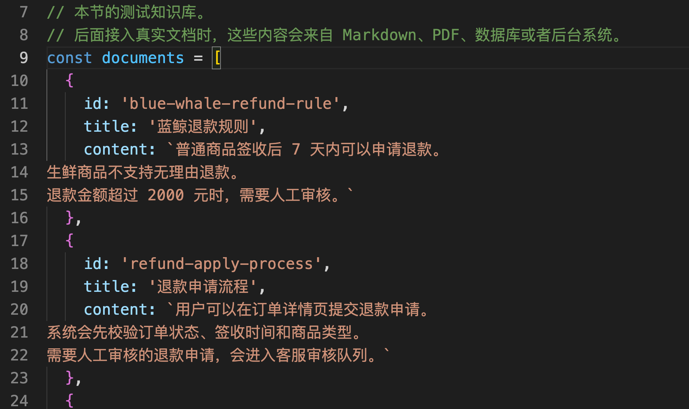

在真实企业项目里面这肯定不行。

真实企业里的资料会是各种各样的格式，比如： Markdown、PDF、Word，甚至是：飞书文档、后台配置、数据库记录、音频、视频 都有可能。

**并且这些资料还可能会变！**

比如：现在是「金额超过 2000 需要人工」，以后可能是「金额超过 3000 才需要人工」

这种资料的更新也是非常重要的场景。

所以说，这一小节，咱们就得来看一个在实际开发场景中非常重要的问题

那就是：**一份原始资料，应该怎样变成适合 RAG 检索的数据？以及如何保证数据的更新？**

这就是 文档解析、清洗、分块、Metadata、Chunk ID 和 版本更新 要解决的事。

## RAG 入库前到底要做什么
咱们还是从一个例子开始。

假设，现在公司有一份《售后手册.md》文件，这个文件有好几万字，大概描述的就是下面这些东西：

```markdown
# 售后手册

## 退款规则
普通商品签收后 7 天内可以申请退款。
退款金额超过 2000 元时，需要进入人工审核流程。

## 发货规则
现货商品会在付款后 48 小时内发货。
偏远地区可能增加 1 到 3 天配送时间。

## 发票规则
订单完成后可以申请电子发票。
企业发票需要提供公司抬头和税号。

## 保修规则
电器商品享受 1 年整机保修。
人为损坏、进水和自行拆机不在免费保修范围内。
```

那么，假设咱们现在已经把这个数据存到向量库里面了。

现在用户问：“3000 元退款需要人工审核吗？”

这个问题要用到的，其实只有 “退款规则” 这一小段内容。其他的那几条规则都没啥用

但是，如果咱们直接把整份《售后手册》拿去做 Embedding，向量数据库里就只有一条数据，那就是 **售后手册全文  -> 一个向量**

### 验证一下
光这么说还是有点抽象。

所以，咱们直接用上一节 `03-memory-vector-search.js` 的思路做一个验证。

还是老指令：

```bash
mkdir 04-document-chunking
cd 04-document-chunking
```

然后把 `03-memory-vector-search` 里面的代码，复制到 `04-document-chunking` 中。

`memory-vector-search.js` 的代码需要改一点，但是大致的内容是不变的。

> 这里就不给大家把整个代码都贴上了，只给大家几个关键表示的部分
>
> 想要源码可以看这里：`https://github.com/lgd8981289/Agent--Code`
>

```javascript
// 模拟用户问题。
const query = '3000 元退款需要人工审核吗？'

// 方案一：把整份售后手册当成一个检索单位。
// 这样做的问题是：一旦命中，返回的是整篇文档，里面会混入很多无关内容。
const wholeManual = {
    id: 'after-sales-manual-full',
    title: '售后手册全文',
    type: 'whole-document',
    content: `# 售后手册

## 退款规则
普通商品签收后 7 天内可以申请退款。
退款金额超过 2000 元时，需要进入人工审核流程。
用户提交退款申请后，系统会先校验订单状态、签收时间和商品类型。
如果订单命中人工审核规则，退款申请会进入客服审核队列。

## 发货规则
现货商品会在付款后 48 小时内发货。
偏远地区可能增加 1 到 3 天配送时间。
如果订单中包含预售商品，整单会按照预售商品的发货时间处理。

## 发票规则
订单完成后可以申请电子发票。
企业发票需要提供公司抬头和税号。
发票开具后会发送到用户邮箱。

## 保修规则
电器商品享受 1 年整机保修。
人为损坏、进水和自行拆机不在免费保修范围内。

## 优惠券规则
优惠券需要在有效期内使用。
已经过期的优惠券不能恢复，也不能兑换成现金。

## 会员积分规则
用户完成订单后可以获得积分。
积分可以在积分商城兑换优惠券。`
}

// 方案二：把售后手册提前拆成多个 Chunk。
// 每个 Chunk 只保存一个相对独立的规则片段。
// 这样检索时更容易命中和用户问题真正相关的内容。
const chunkDocuments = [
    {
        id: 'refund-rule-chunk',
        title: 'Chunk 1：退款规则',
        type: 'chunk',
        content: `普通商品签收后 7 天内可以申请退款。
退款金额超过 2000 元时，需要进入人工审核流程。
用户提交退款申请后，系统会先校验订单状态、签收时间和商品类型。
如果订单命中人工审核规则，退款申请会进入客服审核队列。`
    },
    {
        id: 'shipping-rule-chunk',
        title: 'Chunk 2：发货规则',
        type: 'chunk',
        content: `现货商品会在付款后 48 小时内发货。
偏远地区可能增加 1 到 3 天配送时间。
如果订单中包含预售商品，整单会按照预售商品的发货时间处理。`
    },
    {
        id: 'invoice-rule-chunk',
        title: 'Chunk 3：发票规则',
        type: 'chunk',
        content: `订单完成后可以申请电子发票。
企业发票需要提供公司抬头和税号。
发票开具后会发送到用户邮箱。`
    },
    {
        id: 'warranty-rule-chunk',
        title: 'Chunk 4：保修规则',
        type: 'chunk',
        content: `电器商品享受 1 年整机保修。
人为损坏、进水和自行拆机不在免费保修范围内。`
    },
    {
        id: 'coupon-rule-chunk',
        title: 'Chunk 5：优惠券规则',
        type: 'chunk',
        content: `优惠券需要在有效期内使用。
已经过期的优惠券不能恢复，也不能兑换成现金。`
    },
    {
        id: 'points-rule-chunk',
        title: 'Chunk 6：会员积分规则',
        type: 'chunk',
        content: `用户完成订单后可以获得积分。
积分可以在积分商城兑换优惠券。`
    }
]
。。。
async function main() {
  ...

    // 方案一：只在“整份文档”里检索。
    // 因为只有一份完整手册，所以 TopK 返回的一定是整份手册。
    const wholeDocumentResults = searchTopK({
        queryVector,
        store: vectorStore.filter((document) => document.type === 'whole-document'),
        topK: 1
    })

    // 方案二：只在“Chunk 文档”里检索。
    // 这样可以观察模型是否能命中更具体的“退款规则 Chunk”。
    const chunkResults = searchTopK({
        queryVector,
        store: vectorStore.filter((document) => document.type === 'chunk'),
        topK: 1
    }) 
  ...
}
```

这个代码咱们其实是做了两组实验。

第一组 `wholeManual` ：把整份《售后手册》当成一个文档做 Embedding。

第二组 `chunkDocuments` ：把同一份《售后手册》拆成多个 Chunk，再分别做 Embedding。

为了让差异看得更清楚，两组实验都只取 `TopK = 1`。

也就是说，我们只看“最相关的第一条”到底是什么。

执行代码：

```bash
node --env-file=.env memory-vector-search.js
```

运行以后，第一组会打印整个文档的所有内容：

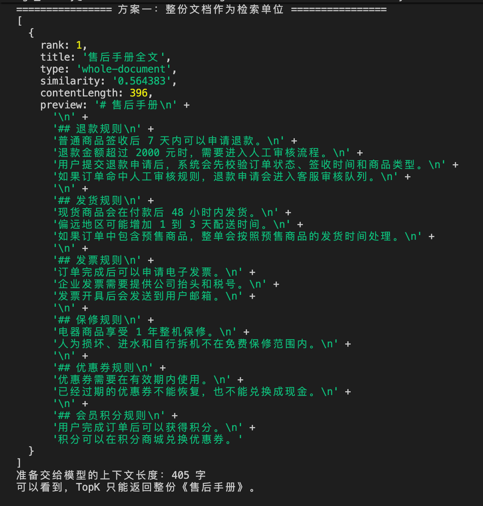


这个结果说明啥呢？

这个结果说明：**如果整份文档只生成一个向量，那么 TopK 只能返回整份《售后手册》。**

它里面虽然包含退款规则，但是同时也包含了很多其他不需要的内容

也就是说，**模型拿到的是一整份混合内容。**

然后再看第二组：

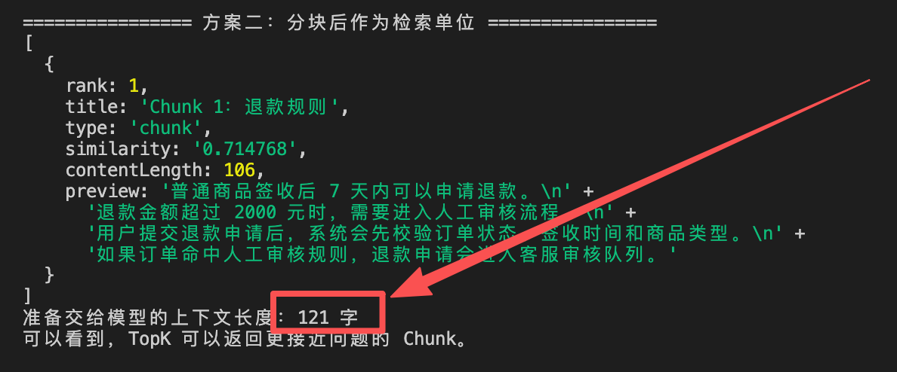


这个结果就很清楚了。

同样的问题，同样的 Embedding 模型，同样的 TopK 逻辑。

当检索单位变成 Chunk 以后，排在第一位的就不是整份手册，而是更精准的 `退款规则 Chunk`。

同时，准备塞给模型的上下文长度也从 405 字变成了 121 字。

到这里，前面说的 **售后手册全文 -> 一个向量** 大家应该就可以明白是啥意思了

当然，这样勉强也能用。

但是问题在于，**这个检索单位太粗了。**

上一节咱们讲 TopK 的时候，提到过：**知识库里的每一条数据，都是一个可以被排序、被召回的检索单位。**

因此，如果想要实现 RAG 入库，那么第一个要解决的问题就是 **数据资料应该如何被拆分！**

我们必须把一个大的数据拆分成不同的小块。即：**先把原始文档切成更适合检索的小片段，再对这些小片段做 Embedding。**

> **这就是 RAG 中的「切块」操作**。 
>
> 其中每一个小块，都被叫做一个 `Chunk`。
>
> 而这种把相关内容找回来的过程，就是 **召回**
>

比如刚才那份《售后手册》，就可以先切成下面几块：

```latex
Chunk 1：退款规则
普通商品签收后 7 天内可以申请退款。
退款金额超过 2000 元时，需要进入人工审核流程。

Chunk 2：发货规则
现货商品会在付款后 48 小时内发货。
偏远地区可能增加 1 到 3 天配送时间。

Chunk 3：发票规则
订单完成后可以申请电子发票。
企业发票需要提供公司抬头和税号。

Chunk 4：保修规则
电器商品享受 1 年整机保修。
人为损坏、进水和自行拆机不在免费保修范围内。
```

这样一来，向量数据库里存的就不再是一条大的 “售后手册全文向量”。

而是几条更小、更明确的 Chunk 向量了：

```latex
退款规则 Chunk  →  一个向量
发货规则 Chunk  →  一个向量
发票规则 Chunk  →  一个向量
保修规则 Chunk  →  一个向量
```

说到这里，为什么要分块，应该就比较清楚了。

但是，咱们得注意一点，那就是：**Chunk 也不是越小越好的。**

太大了的问题咱们前面已经知道了。

但是，如果太小了，也会出问题。

比如，把这句话切成两段：

+ 退款金额超过 2000 元时
+ 需要进入人工审核流程

单独看第一段，模型不知道超过 2000 元以后要干啥。

单独看第二段，模型又不知道什么条件下需要人工审核。

所以，一个好的 Chunk，应该尽量表达一个相对完整的意思。

更准确地说，Chunk 应该是：**RAG 检索时能够独立作为答案依据的一小段内容。**

但是，只有 Chunk 还不够。

很多同学会把一个 Chunk 设计成这样：

```javascript
{
    content: '退款金额超过 2000 元时，需要进入人工审核流程。'
}
```

这样能不能做向量检索？

能。

但是它 **不可维护**

因为真实项目里，一旦检索到了这段内容之后，咱们还需要继续处理几个问题。

+ 这段内容来自哪份文档？
+ 它属于退款、发货，还是发票？
+ 它是哪个版本的规则？
+ 如果用户质疑答案，咱们能不能回到原文？
+ 如果文档更新了，咱们怎么知道应该删掉哪些旧向量？

所以，一个真正能维护的 Chunk，应该是一个完成的 JSON 对象。

比如，下面这样：

```javascript
{
    chunkId: 'refund-policy:2026-06-01:003:a8f12c9b7e01',
    content: '退款金额超过 2000 元时，需要进入人工审核流程。',
    metadata: {
        source: 'refund-policy.md',
        title: '蓝鲸退款规则',
        category: 'refund',
        owner: 'customer-service',
        sourceVersion: '2026-06-01',
        chunkIndex: 3,
        contentHash: 'a8f12c9b7e01'
    }
}
```

其中：

+ `source` 可以告诉咱们答案来自哪份文档
+ `category` 可以让后面的检索在指定的哪一个库做查询
+ `sourceVersion` 可以判断这段内容属于哪个版本
+ `chunkIndex` 可以知道它在原文档里的顺序。
+ `contentHash` 可以判断这段内容有没有发生变化。
+ 而 `chunkId` 则是这条 Chunk 在系统里的唯一身份。

这些字段合在一起，就是这一节要讲的第二个核心东西：`Metadata`。

Metadata 大家可以理解为是一个综合信息体。咱们后面做来源引用、权限隔离、分类检索、版本更新、问题排查，都会依赖这个东西

那么到这里，整个 RAG 入库前的流程基本上就有了：

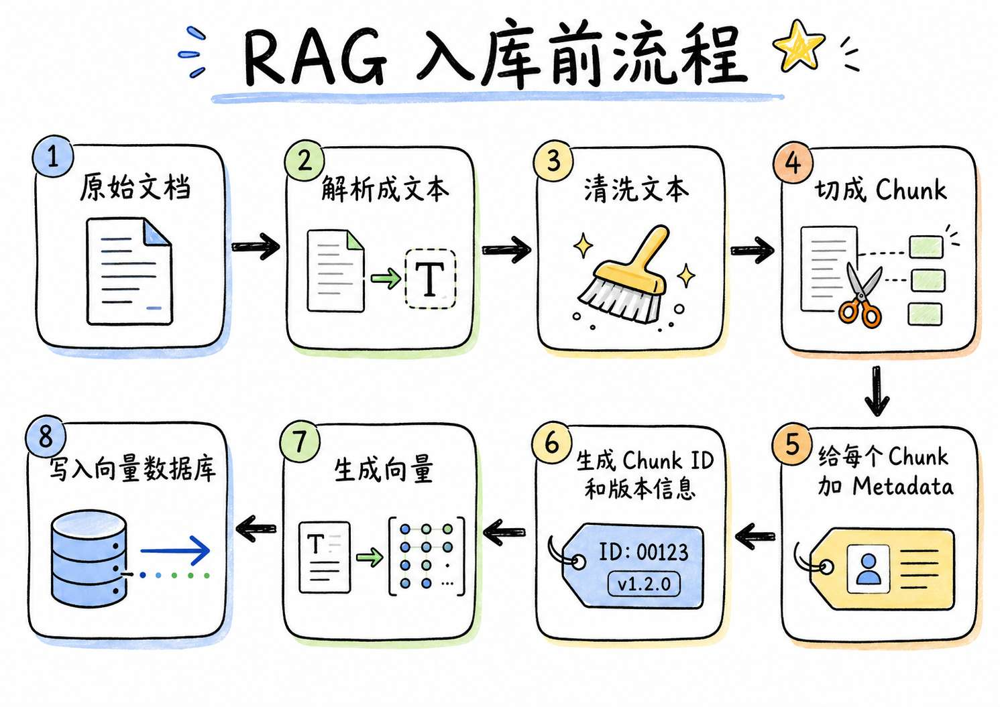


+ **文档解析**，解决的是：原始文件里的内容怎么读出来。比如 Markdown 文件可以直接读取文本；PDF 需要解析页面；Word 需要解析段落；网页需要抽取正文。这一节为了让大家先看清主流程，只处理 Markdown。复杂格式后面做企业知识库的时候再接。
+ **文档清洗**，解决的是：读出来的文本能不能直接用于检索。有些文本里会有多余空行、连续空格、页眉页脚、导航文字、版权声明，甚至 OCR 错字。如果不清洗，这些噪声也会进入 Embedding，影响检索结果。
+ **文档分块**，解决的是：一份文档应该拆成多大的检索单元。块太大，检索不够精准，也浪费 Token。块太小，语义可能被切断。 
+ **Metadata**，解决的是：这个 Chunk 从哪里来、属于什么业务、后面怎么过滤和追踪。


## 用 Node.js 实现文档解析、清洗和分块
接下来，咱们写一个最小案例。

这个案例只做一件事，那就是：**把本地 Markdown 文档处理成一批标准 Chunk。** 最后会生成一个 `chunks.json` 文件。

这个文件就是下一节写入向量数据库之前的数据形态。

> 代码地址还是放在：`https://github.com/lgd8981289/Agent--Code`
>

### 创建项目
还是在 `04-document-chunking` 文件夹里面

然后咱们要创建两个文件夹：

```bash
mkdir documents output
```

再创建一个 `package.json`：

```json
{
  // 因为后面的代码会使用 `import` 语法，所以这里明确告诉 Node.js 按照 ESM 方式执行。
  "type": "module"
}
```

整个结构创建好之后，大概长这样：

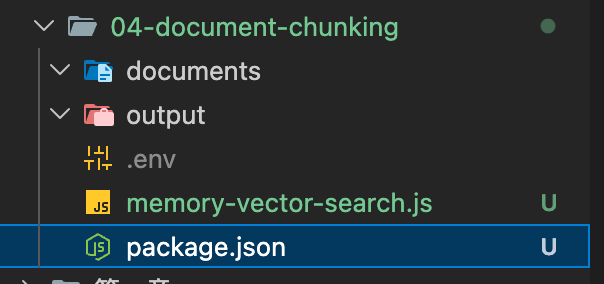


### 准备两份 Markdown 文档
先创建 `documents/refund-policy.md`：

```markdown
# 蓝鲸退款规则
category: refund
owner: customer-service
version: 2026-06-01

普通商品签收后 7 天内可以申请退款。

生鲜商品不支持无理由退款。

退款金额超过 2000 元时，需要进入人工审核流程。

用户提交退款申请后，系统会先校验订单状态、签收时间和商品类型。

如果订单命中人工审核规则，退款申请会进入客服审核队列。
客服审核通过后，系统再进入退款打款流程。
```

再创建 `documents/shipping-policy.md`：

```markdown
# 商品发货规则
category: shipping
owner: fulfillment
version: 2026-06-01

现货商品会在付款后 48 小时内发货。

偏远地区可能增加 1 到 3 天配送时间。

如果订单中包含预售商品，整单会按照预售商品的发货时间处理。

用户可以在订单详情页查看物流单号。
物流信息通常会在发货后 24 小时内更新。
```

### 编写文档处理代码
> PS 插一嘴：
>
> 真实项目里不会所有解析、分块逻辑都自己手写。
>
> Markdown 可以用 remark/unified 做结构化解析。
>
> RAG 项目可以用 LangChain JS 的 Document Loader 和 Text Splitter。
>
> 更复杂的 PDF、扫描件和表格，可以交给 LlamaParse 这类专门的文档解析服务。
>
> 但这一节先手写，目的是为了让大家看清 RAG 入库前到底发生了什么。等后面讲 LangChain 和企业知识库时，再用现成库就行
>

创建 `build-chunks.js`：

```javascript
import { mkdir, readdir, readFile, writeFile } from 'node:fs/promises'
import { createHash } from 'node:crypto'
import path from 'node:path'

// 原始 Markdown 文档所在目录。
// 程序会读取 documents 目录下的所有 .md 文件。
const documentDir = path.join(process.cwd(), 'documents')

// 切块结果输出目录。
const outputDir = path.join(process.cwd(), 'output')

// 最终生成的 Chunk 数据文件。
const outputFile = path.join(outputDir, 'chunks.json')

// 每个 Chunk 的最大长度，默认 120 个字符。
// 真实项目中一般会按 Token 数量控制，这里为了演示，先按字符数控制。
const chunkMaxLength = 120

// Chunk 之间的重叠长度，默认 40 个字符。
// overlap 可以减少上下文被切断的问题。
const chunkOverlapLength = 40

/**
 * 计算文本的 sha256 哈希值。
 *
 * 这里主要用于生成 contentHash，
 * 方便判断 Chunk 内容是否发生变化。
 */
function sha256(text) {
    return createHash('sha256').update(text).digest('hex')
}

/**
 * 对原始文本做基础清洗。
 *
 * 主要处理：
 * 1. 统一换行符
 * 2. 替换 tab
 * 3. 合并多余空格
 * 4. 合并过多空行
 * 5. 去掉首尾空白
 */
function normalizeText(text) {
    return text
        .replace(/\r\n/g, '\n')
        .replace(/\t/g, ' ')
        .replace(/[ ]{2,}/g, ' ')
        .replace(/\n{3,}/g, '\n\n')
        .trim()
}

/**
 * 从 Markdown 文档里读取简单的元信息。
 *
 * 例如：
 * category: after-sales
 * owner: customer-service
 * version: v1
 *
 * 如果没有读取到，就使用 fallback 默认值。
 */
function readMetaLine(lines, name, fallback) {
    const line = lines.find((item) => item.startsWith(`${name}:`))

    if (!line) {
        return fallback
    }

    return line.replace(`${name}:`, '').trim()
}

/**
 * 解析 Markdown 文档。
 *
 * 这一步会从原始 Markdown 中提取：
 * - 文件名
 * - 标题
 * - category
 * - owner
 * - version
 * - 正文内容
 */
function parseMarkdown({ fileName, rawText }) {
    const normalizedText = normalizeText(rawText)
    const lines = normalizedText.split('\n')

    // 默认把一级标题作为文档标题。
    // 如果文档里没有一级标题，就使用文件名作为标题。
    const titleLine = lines.find((line) => line.startsWith('# '))
    const title = titleLine?.replace(/^#\s+/, '').trim() ?? fileName

    // 从文档中读取 Metadata。
    const category = readMetaLine(lines, 'category', 'unknown')
    const owner = readMetaLine(lines, 'owner', 'unknown')
    const sourceVersion = readMetaLine(lines, 'version', 'v1')

    // 正文中不再保留 category / owner / version 这些元信息行。
    // 这些信息会被放到 metadata 字段里。
    const body = lines
        .filter((line) => !line.startsWith('category:'))
        .filter((line) => !line.startsWith('owner:'))
        .filter((line) => !line.startsWith('version:'))
        .join('\n')

    return {
        fileName,
        title,
        category,
        owner,
        sourceVersion,
        text: normalizeText(body)
    }
}

/**
 * 处理超长段落。
 *
 * 如果某个段落本身已经超过 chunkMaxLength，
 * 就只能按照固定长度继续切成多个小片段。
 */
function splitLongParagraph(paragraph) {
    const parts = []

    for (let start = 0; start < paragraph.length; start += chunkMaxLength) {
        parts.push(paragraph.slice(start, start + chunkMaxLength).trim())
    }

    return parts.filter(Boolean)
}

/**
 * 把文档正文拆成段落数组。
 *
 * 规则：
 * - 先按空行拆分段落
 * - 段落内部的换行替换成空格
 * - 过滤空段落
 * - 如果段落太长，再继续切小
 */
function splitIntoParagraphs(text) {
    return text
        .split(/\n\s*\n/)
        .map((paragraph) => paragraph.replace(/\n/g, ' ').trim())
        .filter(Boolean)
        .flatMap((paragraph) => {
            if (paragraph.length <= chunkMaxLength) {
                return [paragraph]
            }

            return splitLongParagraph(paragraph)
        })
}

/**
 * 从当前 Chunk 末尾取一段文本作为 overlap。
 *
 * overlap 的作用是：
 * 让相邻 Chunk 之间保留一点重复内容，
 * 避免重要语义刚好被切断。
 */
function takeOverlap(text) {
    if (chunkOverlapLength <= 0) {
        return ''
    }

    return text.slice(-chunkOverlapLength).trim()
}

/**
 * 生成稳定的 Chunk ID。
 *
 * Chunk ID 中包含：
 * - 来源文件名
 * - 来源版本
 * - Chunk 序号
 * - 内容哈希
 *
 * 这样做的好处是：
 * 当文档内容或版本变化时，可以更容易识别哪些 Chunk 发生了变化。
 */
function toChunkId({ fileName, sourceVersion, chunkIndex, content }) {
    const sourceName = fileName.replace(/\.md$/, '')
    const contentHash = sha256(content).slice(0, 12)
    const indexText = String(chunkIndex).padStart(3, '0')

    return `${sourceName}:${sourceVersion}:${indexText}:${contentHash}`
}

/**
 * 把一份文档切成多个 Chunk。
 *
 * 整体流程：
 * 1. 先把正文拆成段落
 * 2. 尽量把多个段落合并成一个 Chunk
 * 3. 如果超过最大长度，就结束当前 Chunk
 * 4. 新 Chunk 开头带上一点 overlap
 * 5. 最后为每个 Chunk 补充 metadata
 */
function createChunks(document) {
    const paragraphs = splitIntoParagraphs(document.text)

    const chunks = []
    let current = []

    for (const paragraph of paragraphs) {
        // 尝试把当前段落加入正在构建的 Chunk。
        const nextText = [...current, paragraph].join('\n\n')

        // 如果加入后超过最大长度，就先保存当前 Chunk。
        if (current.length > 0 && nextText.length > chunkMaxLength) {
            const content = current.join('\n\n')
            chunks.push(content)

            // 从上一个 Chunk 的末尾取一小段作为下一个 Chunk 的开头。
            const overlap = takeOverlap(content)
            current = overlap ? [overlap, paragraph] : [paragraph]
            continue
        }

        current.push(paragraph)
    }

    // 循环结束后，如果还有未保存的内容，需要补上最后一个 Chunk。
    if (current.length > 0) {
        chunks.push(current.join('\n\n'))
    }

    // 把普通字符串 Chunk 转成结构化数据。
    return chunks.map((content, index) => {
        const chunkIndex = index + 1
        const contentHash = sha256(content).slice(0, 12)

        return {
            chunkId: toChunkId({
                fileName: document.fileName,
                sourceVersion: document.sourceVersion,
                chunkIndex,
                content
            }),

            // Chunk 的正文内容。
            // 后续会对这个 content 做 Embedding。
            content,

            // Chunk 的元信息。
            // 后续检索、过滤、展示来源、版本更新都会用到这些信息。
            metadata: {
                source: document.fileName,
                title: document.title,
                category: document.category,
                owner: document.owner,
                sourceVersion: document.sourceVersion,
                chunkIndex,
                contentHash,
                chunkLength: content.length
            }
        }
    })
}

/**
 * 从 documents 目录中加载所有 Markdown 文档。
 *
 * 这里只处理 .md 文件，并且按照文件名排序，
 * 这样每次运行时的处理顺序更稳定。
 */
async function loadMarkdownDocuments() {
    const entries = await readdir(documentDir, { withFileTypes: true })

    const markdownFiles = entries
        .filter((entry) => entry.isFile())
        .filter((entry) => entry.name.endsWith('.md'))
        .map((entry) => entry.name)
        .sort()

    const documents = []

    for (const fileName of markdownFiles) {
        const filePath = path.join(documentDir, fileName)
        const rawText = await readFile(filePath, 'utf8')

        // 读取文件后，立刻解析成统一的文档结构。
        documents.push(parseMarkdown({ fileName, rawText }))
    }

    return documents
}

async function main() {
    // 基础参数校验。
    if (chunkMaxLength <= 0) {
        throw new Error('CHUNK_MAX_LENGTH 必须大于 0。')
    }

    if (chunkOverlapLength < 0) {
        throw new Error('CHUNK_OVERLAP_LENGTH 不能小于 0。')
    }

    // 读取 Markdown 文档。
    const documents = await loadMarkdownDocuments()

    // 对每份文档进行切块。
    // flatMap 会把多份文档生成的 Chunk 合并成一个数组。
    const chunks = documents.flatMap(createChunks)

    // 确保 output 目录存在。
    await mkdir(outputDir, { recursive: true })

    // 把切块结果写入 chunks.json。
    // 后续可以继续读取这个文件，再做 Embedding 和入库。
    await writeFile(outputFile, JSON.stringify(chunks, null, 2), 'utf8')

    console.log(`文档数量：${documents.length}`)
    console.log(`Chunk 数量：${chunks.length}`)
    console.log(`已写入：${outputFile}`)

    console.log('\n前 3 个 Chunk：')

    // 打印前 3 个 Chunk 的核心信息，方便快速检查切块结果。
    console.table(
        chunks.slice(0, 3).map((chunk) => ({
            chunkId: chunk.chunkId,
            title: chunk.metadata.title,
            category: chunk.metadata.category,
            version: chunk.metadata.sourceVersion,
            length: chunk.metadata.chunkLength
        }))
    )
}

main()
```

这段代码稍微有点多，但是整体难度并不多。

因为 **咱们没必要搞明白里面每一行代码的意思**。 这些代码我也都是 Vibe Coding 写，然后自己稍微调整一下（很多都不用调整）就可以了

上面的代码，大家只需要知道他干了 4 件事：

+ 读取 documents 目录里的 Markdown
+ 解析标题、分类、负责人和版本号
+ 按段落把正文切成多个 Chunk
+ 给每个 Chunk 生成 chunkId 和 metadata

给大家把代码大致的捋一遍，大家能看到我捋的足足够了

##### 先看 `parseMarkdown()`。
它负责把一份 Markdown 文档解析成标准对象。

比如 `refund-policy.md` 解析完以后，大概会变成这样：

```javascript
{
    fileName: 'refund-policy.md',
    title: '蓝鲸退款规则',
    category: 'refund',
    owner: 'customer-service',
    sourceVersion: '2026-06-01',
    text: '...清洗后的正文...'
}
```

这里的 `text` 就是后面要分块的正文。

而 `title`、`category`、`owner`、`sourceVersion`，后面都会进入每个 Chunk 的 metadata。

##### 然后是 `normalizeText()`。
它负责做最基础的清洗。

比如把 Windows 换行统一成 `\n`，把 Tab 变成空格，把连续多个空格压成一个，把过多空行压缩掉。

##### `splitIntoParagraphs()` 和 `createChunks()`
这两个方法负责分块。

咱们这里没有按固定字数切，而是先按段落切块。

因为政策文档、客服手册、FAQ 这类资料，本身就经常按段落表达一个相对完整的意思。

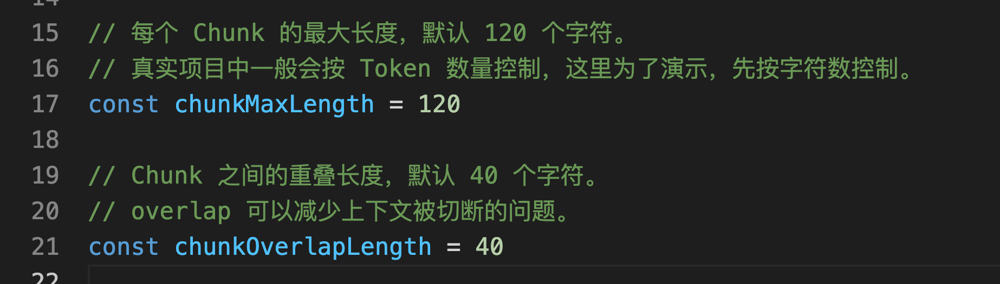


如果一段内容太长，超过了 `CHUNK_MAX_LENGTH`，代码才会继续按长度拆开。

这里还有一个 `CHUNK_OVERLAP_LENGTH`，它的作用是给相邻 Chunk 留一点重叠内容。

比如：一个规则刚好出现在上一个 Chunk 的结尾，完全不重叠的话，下一个 Chunk 可能会丢掉一点上下文。

使用 overlap 可以解决这个问题。不过 overlap 也不能太大。太大会让多个 Chunk 重复内容变多，向量数据库里数据膨胀，检索结果里也容易出现一堆相似的重复片段。

##### 最后是 `toChunkId()`
它生成的 ID 大概是这个格式：`refund-policy:2026-06-01:003:a8f12c9b7e01`

这几个部分分别表示：

+ refund-policy：文档名
+ 2026-06-01：文档版本
+ 003：Chunk 序号
+ a8f12c9b7e01：内容 Hash

## 运行项目
执行：

```bash
node build-chunks.js
```

正常情况下，终端会看到类似这样的结果：

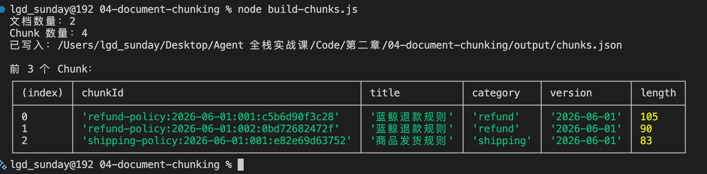


如果你完全按照上面的示例文档复制，默认会得到 4 个 Chunk。然后打开 `output/chunks.json`。

它是一个数组，大概就长成这样：

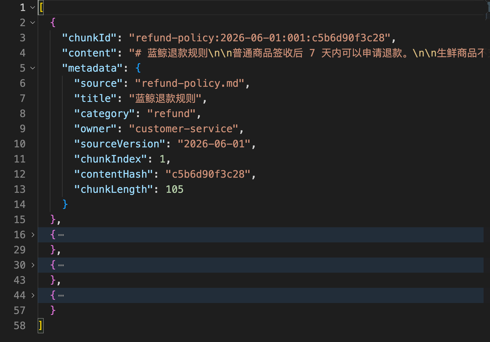


里面的每一个对象，就是一个标准 Chunk。

## 资料更新了应该怎么处理
现在咱们模拟一次文档更新。

把 `documents/refund-policy.md` 里的版本号改一下：`version: 2026-06-15`

然后把退款规则改成：`退款金额超过 3000 元时，需要进入人工审核流程。`

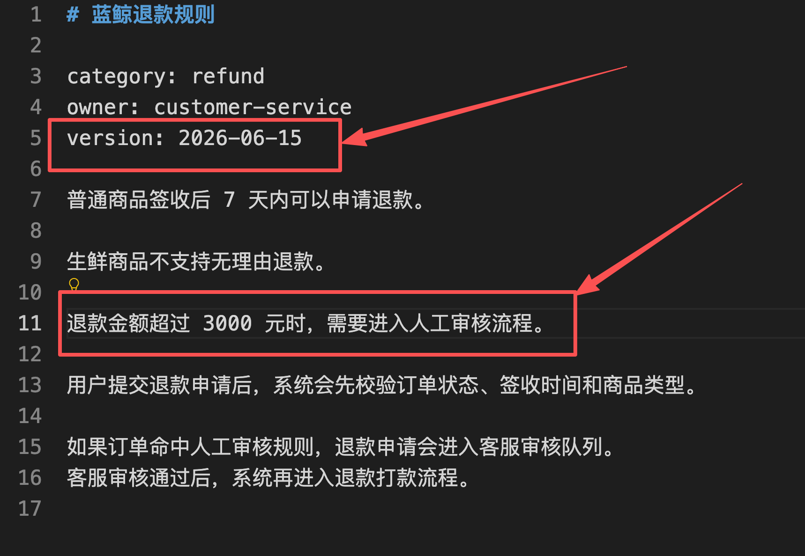


再次执行：

```bash
node build-chunks.js
```

这时你会发现，`refund-policy` 对应的 Chunk ID 和 version 都变了。


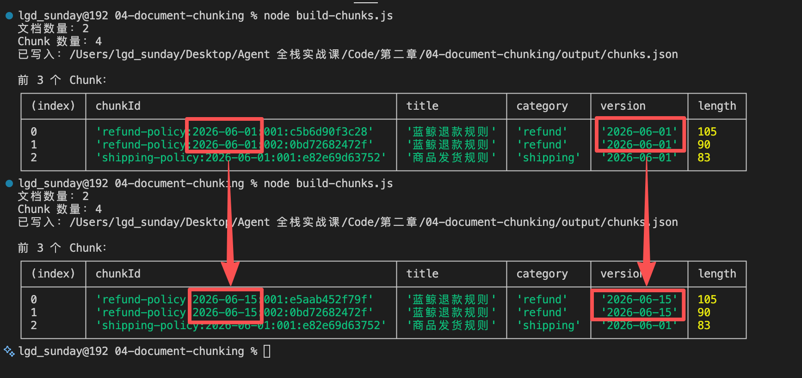


真实项目里，向量数据库通常会按下面的思路更新：

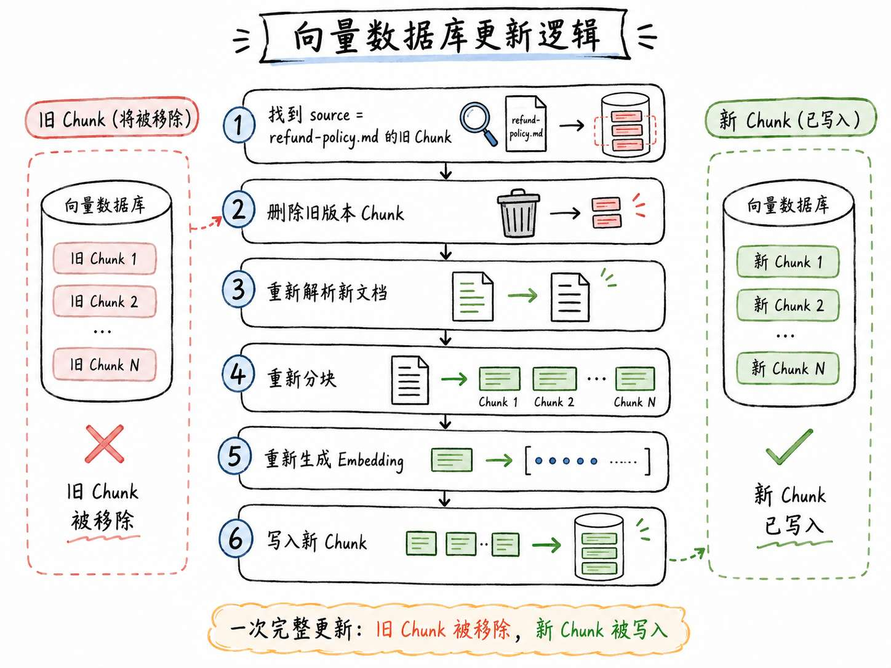


这里也可以做得更细。

比如只比较 `contentHash`，只更新内容发生变化的 Chunk。

但是第一版系统不建议一上来做得太复杂。

对课程来说，大家先把主线搞清楚就行了

## 分块大小应该怎么设置
这一节代码里，咱们用了：

```javascript
// 每个 Chunk 的最大长度，默认 120 个字符。
const chunkMaxLength = 120

// Chunk 之间的重叠长度，默认 40 个字符。
const chunkOverlapLength = 40
```

这个值只是为了让示例文档更容易切出多个 Chunk，方便大家观察分块效果。

真实项目里分块大小取决于你的 **文档类型** 和 **检索目标** 。

所以不能照抄这个大小。

下面给大家列了一下常见的分块大小（面试的时候常问），大家可以作为参考

| 场景 | Chunk 大小参考 | Overlap 参考 |
| --- | --- | --- |
| FAQ、客服规则、短事实问答 | 100～300 字 | 10%～20% |
| 普通知识库文档、Markdown、产品文档 | 300～800 字 | 10%～20% |
| 长报告、制度文档、法律/技术说明 | 500～1000 字 | 10%～20% |
| 需要精确命中一句话的场景 | 偏小一些 | 少量重叠 |
| 需要上下文理解的场景 | 偏大一些 | 适当重叠 |


整个的核心原则就是：**Chunk 要大到足够表达一个完整意思，又不能大到塞进太多无关信息。** 

## 总结
这一节其实就讲了一件事：**一份原始资料，怎么变成适合 RAG 检索和后续维护的数据。**

再给大家捋一下这一小节讲的内容哈：

最开始的时候，咱们先从一个问题开始，这个问题是：真实文档不可能都像上一节那样，刚好是一条条干净的小文本。

如果有一个《售后手册》，把它做成了一个向量，向量库里就只有一条数据。用户问退款问题时，TopK 最后也只能返回整份手册。

这个时候，检索单位就太粗糙了。

所以，这一节第一个核心概念就是 `Chunk`。

Chunk 可以理解为 RAG 里真正参与检索的一小段内容。

Chunk 太大，检索会不精准，还浪费 Context。

Chunk 太小，语义又可能被切断，模型拿到以后也很难判断。

所以分块不是一个纯粹的字数问题，而是：**什么内容适合作为一次检索的基本单位。**

然后，咱们又讲了 `文档解析`。

文档解析解决的是：原始资料怎么读出来。

Markdown、PDF、Word、网页、飞书文档，来源都不一样，但最后都要先变成可以继续处理的文本。

这一节为了把主流程讲清楚，只用了 Markdown （后面真实做企业知识库时，才会继续扩展到更多文档来源）

接着是 `文档清洗`。

文档清洗解决的是：读出来的文本能不能直接用于检索。

多余空行、连续空格、无意义导航、页眉页脚、版权声明，这些东西对 Embedding 来说都是无用的，也不需要进入向量表示。

再往后，就是 `Metadata`。

因为真实项目里，咱们不只要知道“检索到了什么内容”，还要知道这段内容来自哪里、属于什么业务、是什么版本、能不能做权限过滤

这些信息就放在 metadata 里。

然后是 `Chunk ID`。

Chunk ID 解决的是：每个 Chunk 在系统里的唯一身份。

一个标准的 Chunk ID ，应该由多个部分组成，比如：`refund-policy:2026-06-01:003:a8f12c9b7e01`

最后是 `版本更新`。

RAG 知识库不是一次性写死的。

今天规则是“超过 2000 元需要人工审核”，明天可能就改成“超过 3000 元需要人工审核”。

如果没有版本和内容 Hash，向量库里就可能同时存在旧规则和新规则。

这样 Agent 回答的时候，就会出现前后矛盾的问题

所以，版本信息和 `contentHash` 的作用，就是让系统知道文档有没有变、哪些 Chunk 更新了

到这里，咱们已经完成了 RAG 入库前最关键的一步。

下一节，咱们就可以把这些 Chunk 真正写入向量数据库了。

> 更新：2026-08-21 11:36 · 原文：<https://www.yuque.com/lgdsunday/ab1dy3/urdvgcll58sabll4>
