# 05 - 实战：使用 Milvus 与 Zilliz Cloud 完成持久化、索引、过滤与更新

回忆下咱们前面几节讲的东西，大概是做了三件事：

+ 第一，使用 Embedding 模型把文本变成向量
+ 第二，用相似度计算和 TopK 找最相关的资料
+ 第三，把原始文档拆成 Chunk，并给每个 Chunk 补上 metadata、chunkId 和版本信息

现在就差：**这些 Chunk 应该存在哪里，以及后面怎么检索、过滤和更新了。** 

在传统项目里面，存数据一定得用到数据库。

传统数据库大致可以分为两类：`SQL 型数据库` 和 `NoSQL 型数据库`。

+ SQL 型数据库常见的有 MySQL、PostgreSQL、Oracle、SQL Server。这类数据库更适合处理结构化数据。
+ NoSQL 型数据库常见的有 MongoDB、Redis、Elasticsearch、Cassandra。他们更适合处理 文档结构不固定、读写吞吐很高、缓存访问很频繁 的数据

所以在普通业务系统里，咱们会根据数据的特点去选对应的数据库。

那么，大家想想，在之前咱们的写过的项目里面，是不是也涉及到了很多的 **向量数据**

比如：

```javascript
{
    chunkId: 'refund-policy:2026-06-15:001:e5aab452f79f',
    content: '退款金额超过 3000 元时，需要进入人工审核流程。',
    metadata: {
        category: 'refund',
        sourceVersion: '2026-06-15'
    },
    embedding: [0.013, -0.245, 0.781, ...]
}
```

现在问题来了。

这种数据是不是也需要数据库存储呢？

**但是**，向量数据的存储和普通数据的存储是不一样的。

向量数据在查询时会有一个特点，那就是：**给定一个问题向量，在几十万条 Chunk 向量里，找出语义最接近的 TopK。**

你看，这是要找 **语义最接近的**。 传统的数据库可实现不了这一点

传统数据库是精确查询。而 RAG 需要的是 **向量相似度检索**。

这就得用 **向量数据库** 了

向量数据库可以解决以下四个问题：

+ 第一，持久化
+ 第二，向量索引。用户提问以后，系统会把问题变成问题向量，然后在大量 Chunk 向量里找最相似的 TopK。
+ 第三，业务过滤。比如用户问退款问题，系统不应该在发货规则、财务制度、人事手册里乱搜。
+ 第四，更新。企业资料会变，比如：今天规则是“超过 3000 元需要人工审核”，明天可能改成“超过 5000 元需要人工审核”

所以，向量数据库在 RAG 里真正负责的是这一整套能力：

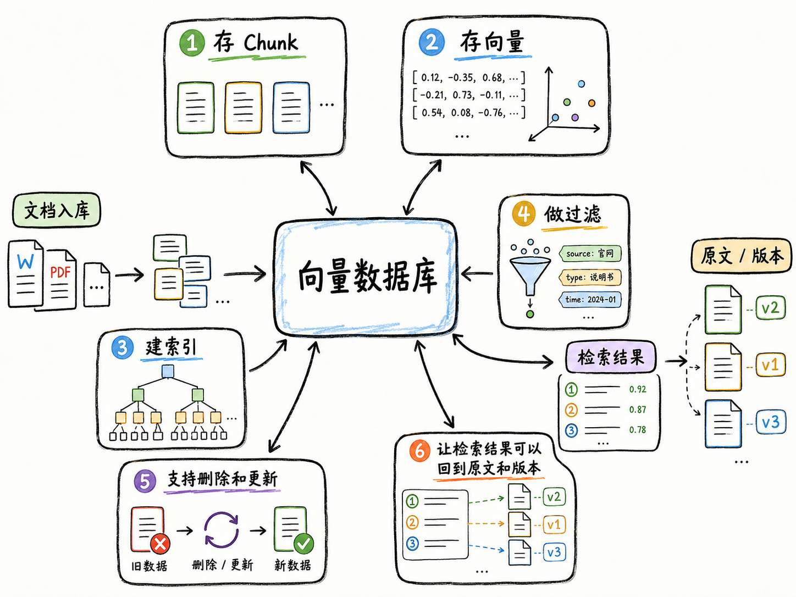


向量数据库也有很多，大概可以分成三类。

+ 一类是 **云厂商托管型数据库**。比如：腾讯云 `VectorDB`、阿里云 `DashVector`、火山引擎 `VikingDB`、百度智能云 `VectorDB`。
+ 一类是 **开源专用向量数据库**。比如： `Milvus`、`Qdrant`、`Weaviate`
+ 一类是 **扩展型的数据库**。比如：`PostgreSQL + pgvector`，或者 Elasticsearch / OpenSearch / Redis 里的向量检索能力。

而咱们这里选择用的是 `Milvus` + `Zilliz Cloud` 。这两个是目前国内企业用的比较多的。

### Milvus
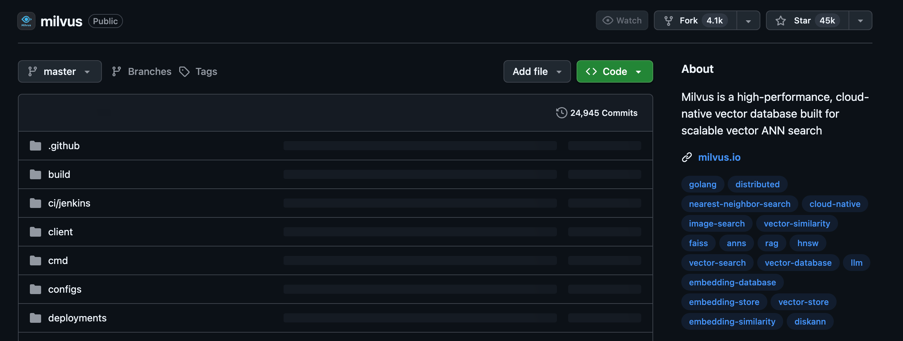


一个开源的向量数据库，有 `45K` 的 star 了，算是挺多的。

### Zilliz Cloud
`Milvus` 就是由 `Zilliz` 团队创建的。

而 `Zilliz Cloud` 则是有 `Zilliz` 提供的 `Milvus` 托管云服务.


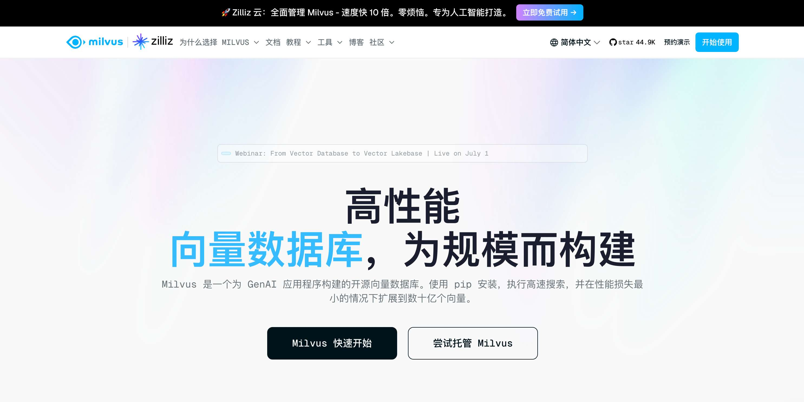


milvus 、zilliz、Zilliz Cloud 三者之间的关系，给大家做个了图：

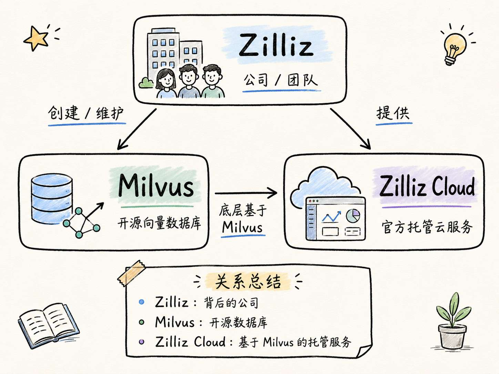


那么明确好了这些概念之后，接下来咱们是 **实战一波** ，看看向量数据库到底咋用

## 项目准备
先创建代码文件夹：

```bash
mkdir 05-milvus-zilliz-vector-store
cd 05-milvus-zilliz-vector-store
```

安装依赖：

```bash
npm init -y
npm install @zilliz/milvus2-sdk-node@3.0.3
```

`@zilliz/milvus2-sdk-node` 这个包就是专门用来控制 `Milvus` 的

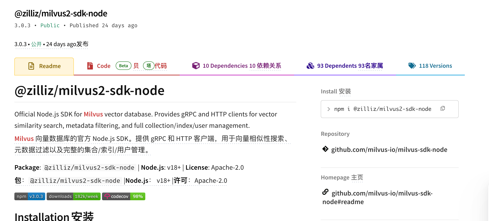


### 启动本地 Milvus
想要在本地安装 `Milvus`，得先安装 `Docker`。

按照官方 standalone compose 文件启动时，本地会同时跑起 `Milvus`、`etcd` 和 `MinIO` 三个服务：

+ `Milvus` 负责向量检索
+ `etcd` 负责保存元数据
+ `MinIO` 负责对象存储。

而是用 `Docker` 之后，就可以直接一条命令把这三个服务都起来。

#### 安装 Docker Desktop
> 如果你已经安装过 Docker，可以直接跳过。
>

Mac 同学先打开 Docker Desktop 的官方安装页面： `https://docs.docker.com/desktop/setup/install/mac-install/`

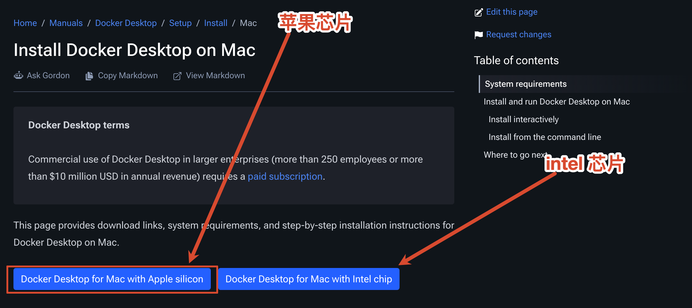


这里提供了两种不同的芯片（A 系列 和 Intel 系列的），大家根据自己电脑的情况选择下载就行

下载完成之后就是一个安装包，直接双击安装就可以了。这个就不给大家描述了哈

Windows 同学安装地址在这里：`https://docs.docker.com/desktop/setup/install/windows-install/`

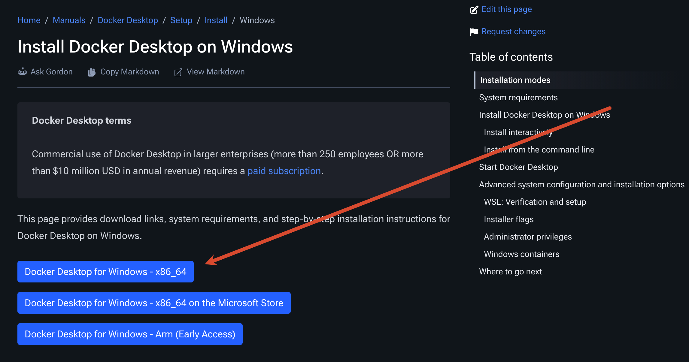


根据自己的系统下载就可以了，windows 一般都是 64 位的。

安装完成之后，直接打开就可以：

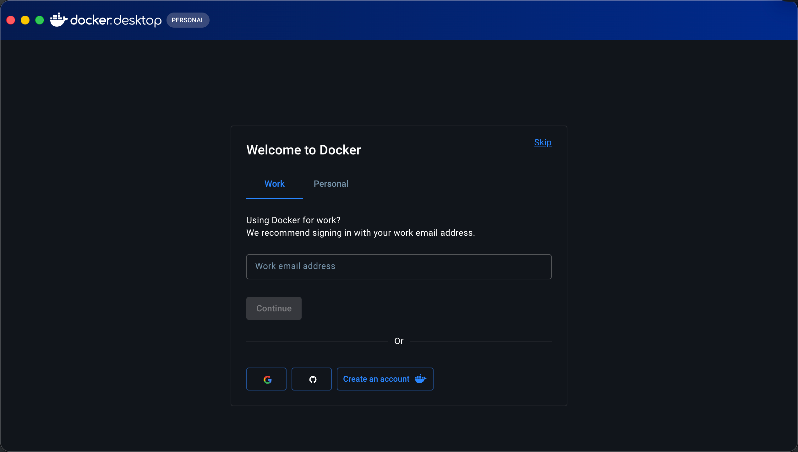


这里可以自己创建一个新的账号，也可以直接用 github 的账号关联登录（比如我，就直接用 github 账号了）

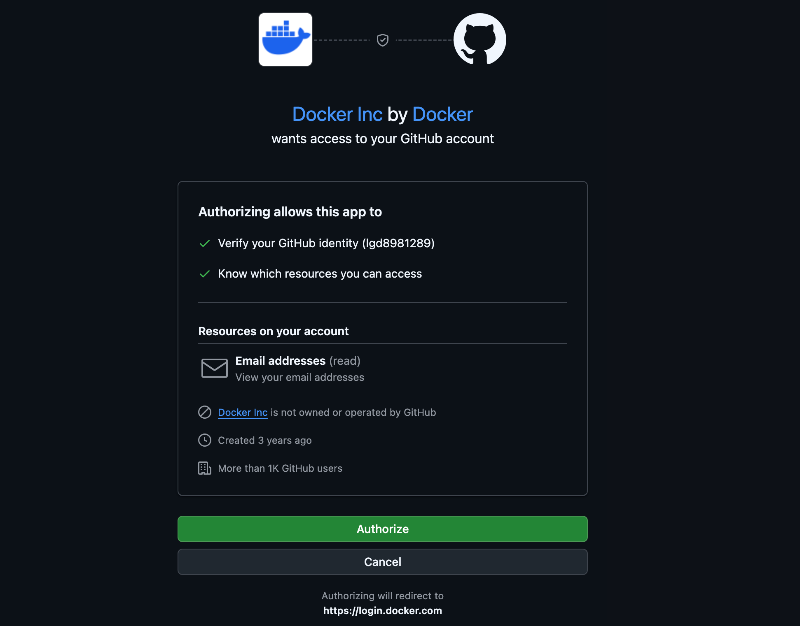


登录成功之后，基本上就长这样：

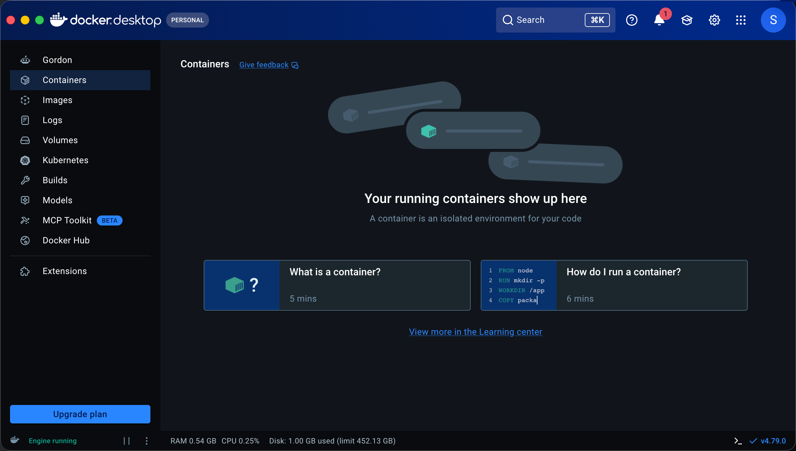


#### 验证 Docker 是否可用
在终端里执行：

```bash
docker --version
docker compose version
```

如果能看到 Docker 和 Docker Compose 的版本号，就说明命令已经可以用了。

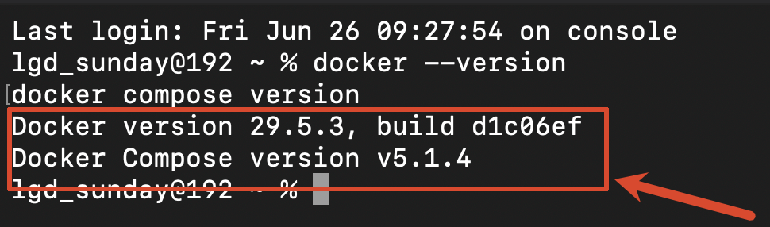


然后再执行一个最小验证：

```bash
docker run hello-world
```

如果最后能看到类似 `Hello from Docker!` 的输出，就说明 Docker 可以正常拉取镜像并启动容器。

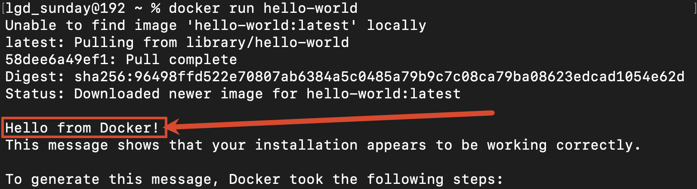


这里最常见的问题是两种。

+ 如果提示 `docker: command not found`，通常是 Docker Desktop 没装好，或者安装完成后没有重新打开终端。
+ 如果提示 `Cannot connect to the Docker daemon`，通常是 Docker Desktop 没有启动。

如果这一块搞不定，那么可以在 **答疑群 @LGD_Sunday** 。没有进答疑群的同学，可以加我 V：`sunday9189`

#### 下载 Milvus Compose 文件
Docker 没问题以后，进入本节代码目录：

```bash
cd 05-milvus-zilliz-vector-store
```

然后下载 Milvus 官方 release 里的 standalone compose 文件：

```bash
curl -L https://github.com/milvus-io/milvus/releases/download/v2.6.18/milvus-standalone-docker-compose.yml -o docker-compose.yml

or

wget -L https://github.com/milvus-io/milvus/releases/download/v2.6.18/milvus-standalone-docker-compose.yml -o docker-compose.yml
```

下载完成后，目录里会多一个 `docker-compose.yml` 文件。

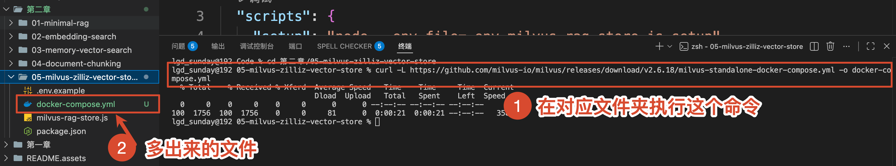


打开 `docker-compose.yml` 可以看到里面主要有三个服务：

+ milvus-etcd：Milvus 的元数据存储服务，用来保存 Collection、索引、分区、节点状态等管理信息
+ milvus-minio：Milvus 的对象存储服务，用来保存真实的数据文件、向量数据、索引文件等持久化内容
+ milvus-standalone：Milvus 的核心服务，负责接收写入、建立向量索引、执行向量检索和管理 Collection 等主要数据库能力

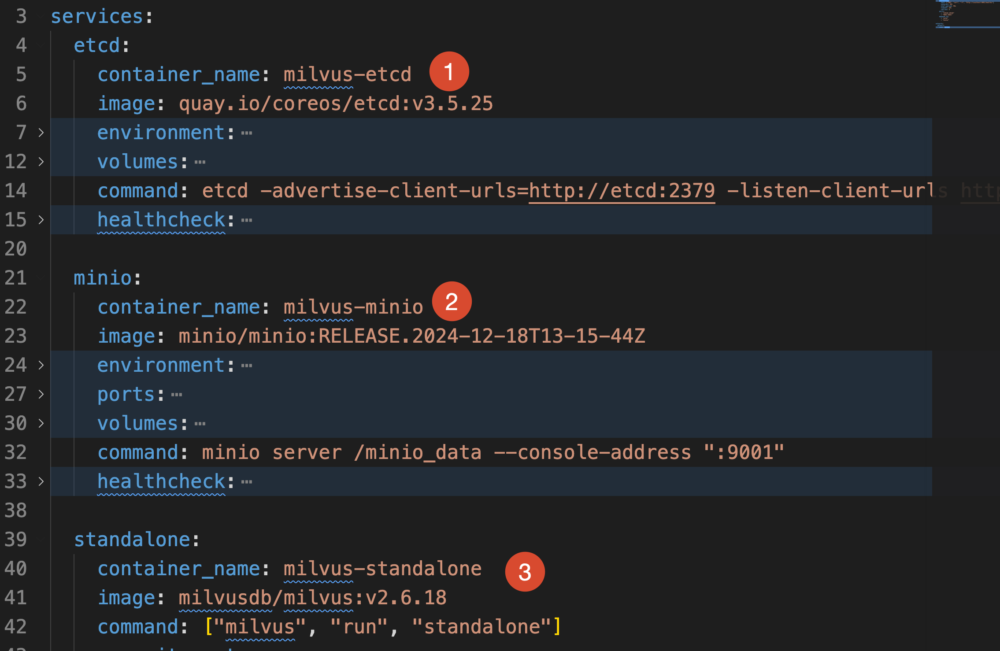


#### 启动 Milvus
接下来执行：

```bash
docker compose up -d
```

第一次启动会拉取镜像，可能会比较慢。

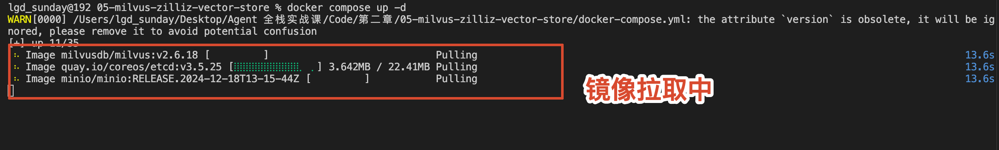


等命令执行完成以后，看一下容器状态：

```bash
docker compose ps
```

正常情况下，应该能看到 `etcd`、`minio`、`standalone` 这几个服务都在运行。

状态应该是 是 `healthy` ：

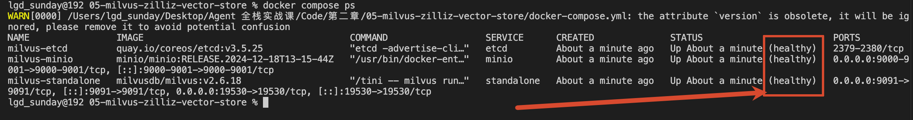


只要 `milvus-standalone` 跑起来，本地连接地址就是：`localhost:19530`

#### Attu：Milvus 最佳 GUI 工具
就和 sql 数据库、nosql 数据库都有 GUI 工具一样。向量数据库也有对应的 GUI 工具。

这里咱们使用官方推荐的 `Attu` 就行

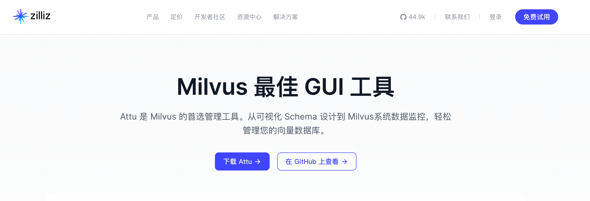


下载地址在这里：`https://github.com/zilliztech/attu/releases`  。根据自己对应的系统下载就行

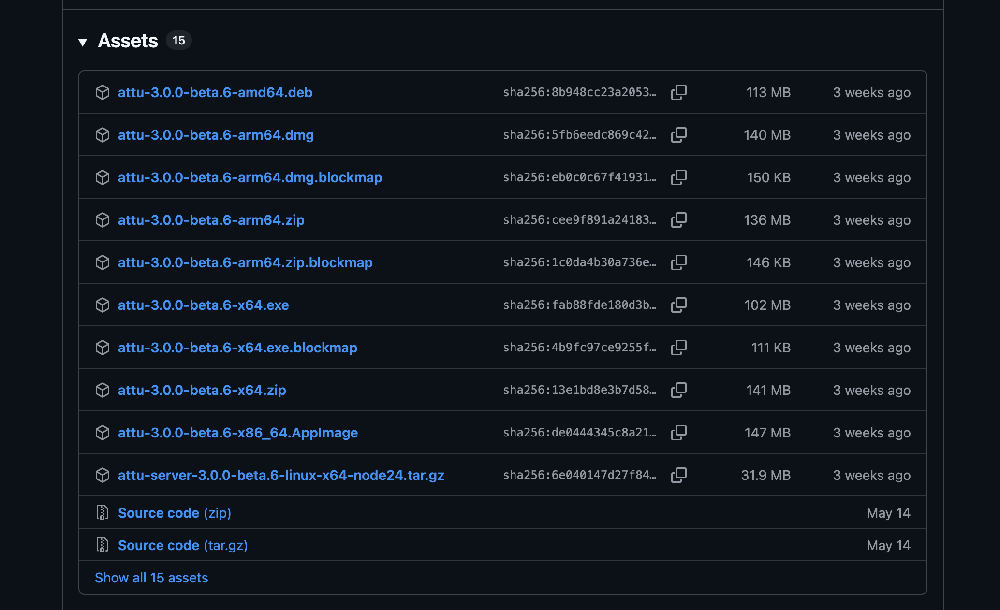


安装之后，打开就长这样：

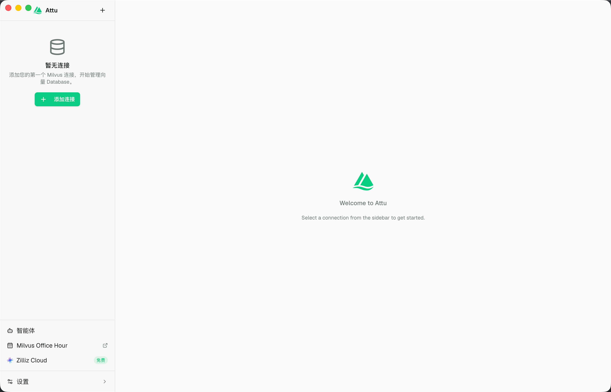


然后点击左侧的 **「添加连接」** 按钮，写入 milvus 的信息就可以了

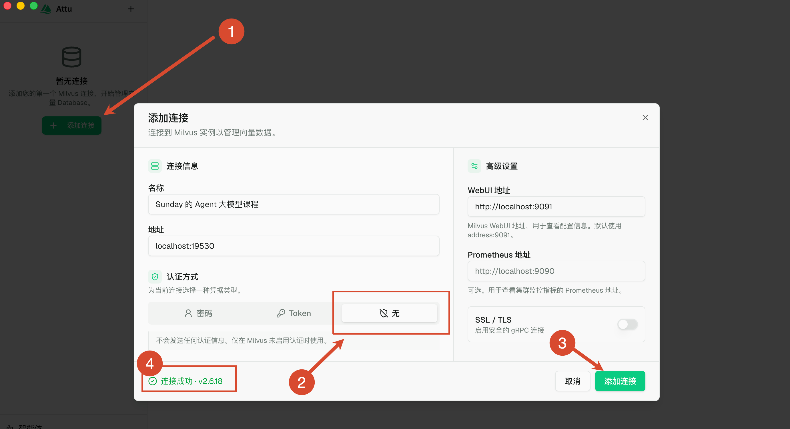


链接成功之后，看到的数据基本上就是这样了，还是蛮好看的哈：

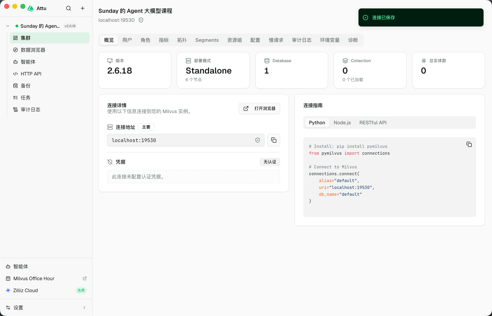


那么到这里，基本上整个本地的 Milvus 安装、GUI 查看 就差不多了。

### 使用 Zilliz Cloud
如果你准备直接用 Zilliz Cloud，就不需要本地启动 Milvus 了。

Zilliz Cloud 本质上就是托管版 Milvus。就和现在 阿里云、腾讯云 里面的 云数据库 一个意思。

我们只需要在控制台里创建一个 cluster，然后把连接地址和 token 填到代码里就可以。

先打开 Zilliz Cloud：`https://zilliz.com.cn/cloud` 。

> PS：这里注意 `https://zilliz.com.cn/cloud` 有 **国际站** 和 **国内站** 两个不同的选择。
>
> 咱们这里用的是国内站。国际站使用的云厂商是 亚马逊、微软云、谷歌云，咱们使用不方便。
>
> 国内站可以用 阿里云 和 腾讯云，就比较爽了
>

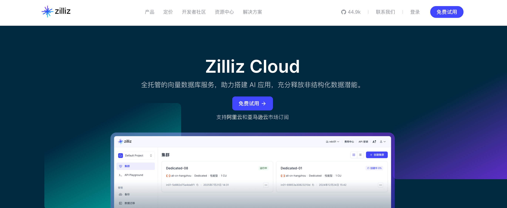


然后点击 「免费试用」，完成注册就可以了

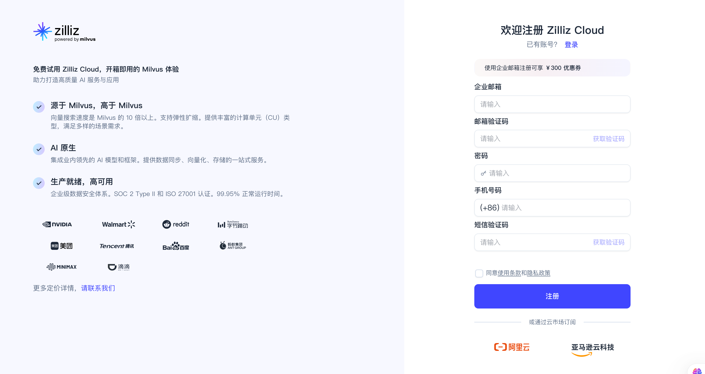


注册功能之后有个问卷，给送 `300 额度的优惠券`

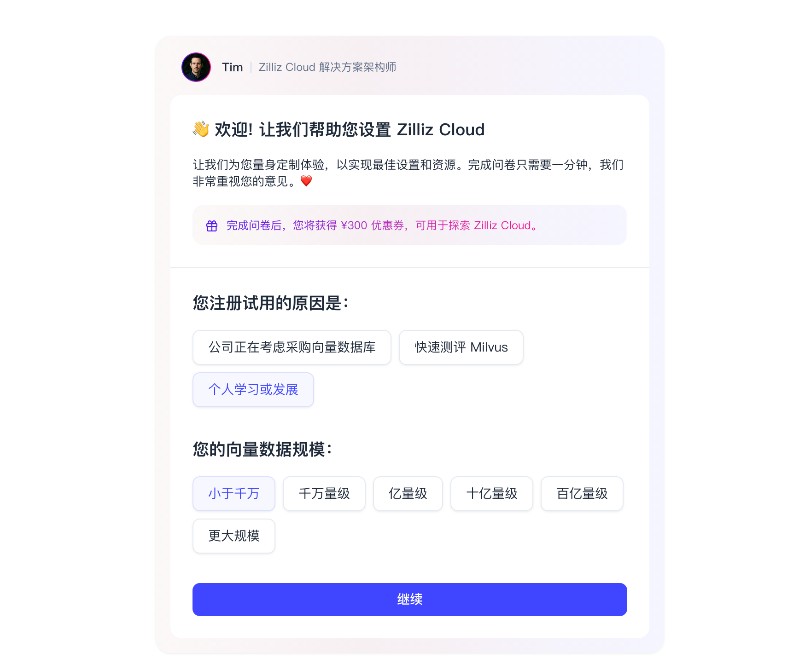


然后就是完整账号设置了（**注意：云区域只有选择「杭州」才有试用**）

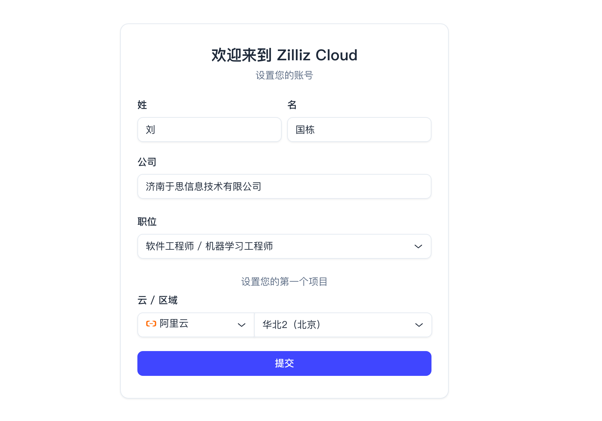


进来之后就长这样了：

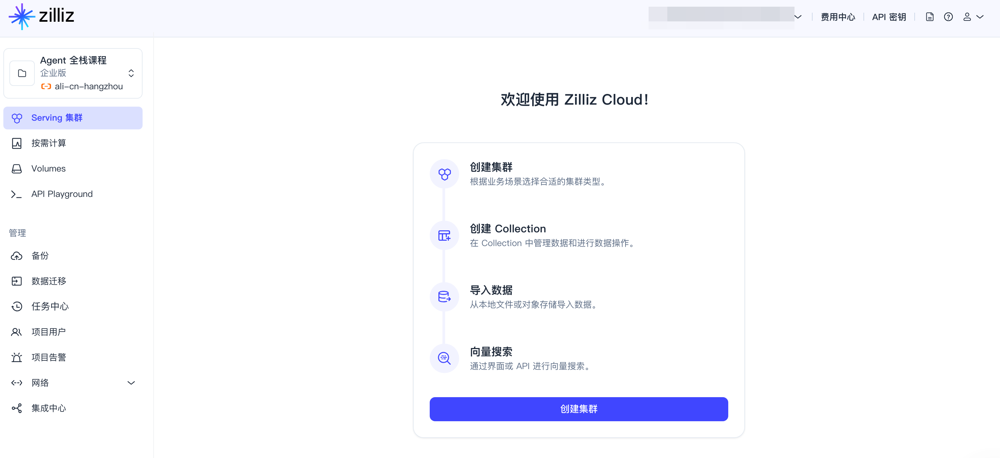


不过这里要注意哈，你如果直接在这里创建集群的话，那么是云服务是收费的，还挺贵 900/月 ，就没必要。

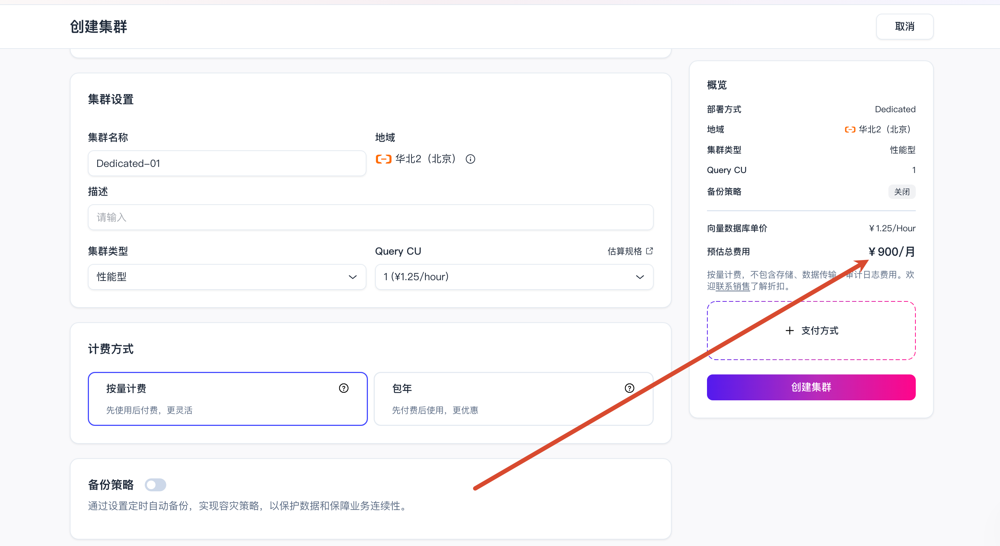


但是，咱们可以在这个页面的顶部，选择创建 Free 集群，是可以 **免费试用的（注意：必须是 杭州的节点）**

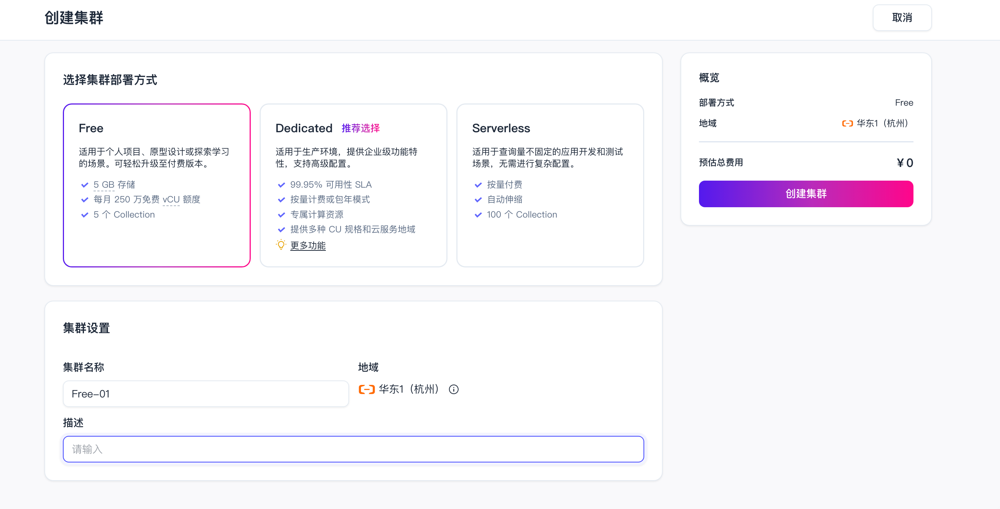


创建好之后，基本上就长成这样：

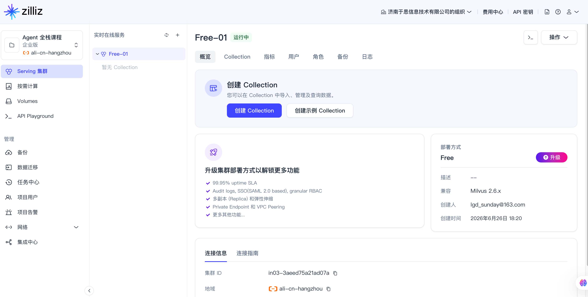


大家可以在 「连接信息」的位置获取到 咱们后面项目中需要的数据

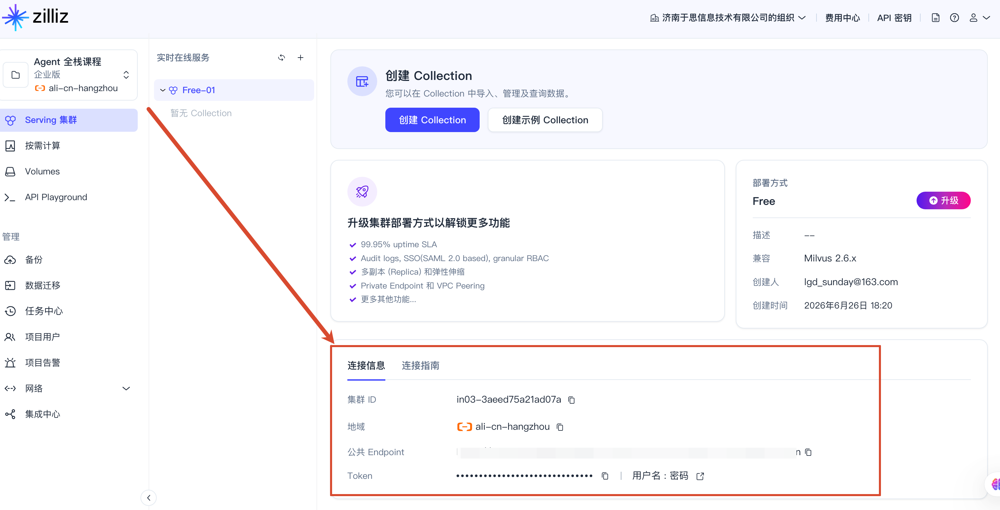


剩下的大家就可以自己玩了。就不多说了哈

对了，这里要注意一下：**在创建好了集群之后，会有一个弹窗，弹窗会告诉你 用户名 和  密码，你要保存好。（这是唯一一次查看密码的机会）**

### 配置环境变量
接下来，咱们还是继续回到代码里面。咱们接下来需要创建环境变量文件：

```bash
cp .env.example .env
```

如果使用本地 Milvus，那么就配置`.env` 文件大概这样：

```plain
ZHIPU_API_KEY=你的智谱 API Key
EMBEDDING_MODEL=embedding-3
EMBEDDING_DIMENSIONS=512

MILVUS_ADDRESS=localhost:19530
MILVUS_TOKEN=
MILVUS_COLLECTION=agent_course_chunks
RESET_COLLECTION=false
```

如果使用 Zilliz Cloud，就改成：

```plain
ZHIPU_API_KEY=你的智谱 API Key
EMBEDDING_MODEL=embedding-3
EMBEDDING_DIMENSIONS=512

MILVUS_ADDRESS=你的 Zilliz Cloud Public Endpoint
MILVUS_TOKEN=你的 Zilliz Cloud Token
MILVUS_COLLECTION=agent_course_chunks
RESET_COLLECTION=false
```

这样的话，配置文件就 OK 了。

## 连接 Milvus 和 Zilliz Cloud
> 源码地址：[https://github.com/lgd8981289/Agent--Code](https://github.com/lgd8981289/Agent--Code)
>
> 这里代码比较多，给大家录了一个讲解视频，可以看下哈：
>

[此处为语雀卡片，点击链接查看](https://www.yuque.com/lgdsunday/ab1dy3/iv45lnoknl4acagc#sEQCm)

打开 `milvus-rag-store.js`。

这里有一些比较关键的代码：

### 连接数据库
```javascript
/**
 * 创建 Milvus 客户端。
 *
 * 这里同时兼容两种连接方式：
 * 1. 本地 Milvus：只配置 MILVUS_ADDRESS 即可；
 * 2. Token 认证：适合 Zilliz Cloud；
 */
function createClient() {
    const address = process.env.MILVUS_ADDRESS ?? 'localhost:19530'
    const token = process.env.MILVUS_TOKEN?.trim()

    return new MilvusClient({
        address,
        token
    })
}
```

这段代码的设计很简单。

+ 本地 Milvus 不需要 token，`MILVUS_ADDRESS` 使用 `localhost:19530`
+ Zilliz Cloud 需要 token，`MILVUS_ADDRESS` 使用控制台里的 public endpoint

连接这一步做完以后，后面的代码其实就可以按照数据库的 **增删改查** 来看了。

还是那句话：vibe coding 时代，代码不需要全部自己写，大致理解什么意思就可以了

所以咱们只需要关注几个方法就可以：

+ 建表：ensureCollection()
+ 新增：insertChunks()
+ 查询：searchQuestion()
+ 删除：client.delete()
+ 更新：先 delete 旧 Chunk，再 insert 新 Chunk（原因会在后面说）

然后额外的三个概念性的问题，跟大家在明确一下：

+ “表” 在 Milvus 里叫 `Collection`
+ “数据行”就是咱们前面生成的每一个 `Chunk`
+ 用于语义检索的字段，就是每一行里的 `embedding`。

OK 吧，这样咱们就可以看后续的内容了

### 建表：设计 Collection Schema
先看建表。

关键代码在这里

```javascript
/**
 * 确保 Milvus Collection 存在。
 *
 * 如果 Collection 已存在：
 * - RESET_COLLECTION=true：先删除，再重新创建；
 * - 否则：直接 load 到内存，供后续检索使用。
 *
 * 如果 Collection 不存在：
 * - 创建 Collection；
 * - 创建向量索引；
 * - load Collection。
 */
async function ensureCollection(client) {
    const exists = await client.hasCollection({
        collection_name: collectionName
    })

    if (exists.value) {
        if (process.env.RESET_COLLECTION === 'true') {
            // 开发调试时可以重置 Collection，避免旧数据影响结果。
            await client.dropCollection({ collection_name: collectionName })
        } else {
            // Collection 已存在时，加载到内存后即可使用。
            await client.loadCollection({ collection_name: collectionName })
            return
        }
    }

    await client.createCollection({
        ...
    })

    // 创建完成后，需要 load 到内存，后续才能执行 search。
    await client.loadCollection({ collection_name: collectionName })
}
```

这个函数做了三件事。

+ 第一，先用 `hasCollection()` 看一下 collection 是否已经存在
+ 第二，如果你在本地调试时把 `RESET_COLLECTION=true` 打开，它会先执行 `dropCollection()`，把旧 collection 删除掉，然后重新创建。（这个只适合本地开发，不适合生产环境）
+ 第三，如果 collection 不存在，就继续往下执行 `createCollection()`

真正的表结构，也就是 schema，就在 `createCollection()` 里面定义。

关键代码就是 `client.createCollection` 这段：

```javascript
await client.createCollection({
    collection_name: collectionName,
    fields: [
        {
            // Chunk 的唯一 ID，作为主键。
            name: 'chunk_id',
            data_type: DataType.VarChar,
            is_primary_key: true,
            max_length: 256
        },
        ...
    ],
    index_params: [
        {
            // 给 embedding 字段创建向量索引。
            field_name: 'embedding',

            // AUTOINDEX 让 Milvus / Zilliz 自动选择合适的索引策略。
            index_type: IndexType.AUTOINDEX,

            // 使用余弦相似度，适合大多数文本向量检索场景。
            metric_type: MetricType.COSINE
        }
    ]
})
```

### 新增：把 Chunk 写入向量数据库
Collection 创建好以后，就可以写入数据了。

不过写入之前，还需要先把 Chunk 的 `content` 转成向量。

代码里是这么做的：

```javascript
/**
 * 写入 Chunk 到 Milvus。
 *
 * 核心流程：
 * 1. 取出所有 Chunk 内容；
 * 2. 调用 Embedding API 生成向量；
 * 3. 把 Chunk + 向量组装成 Milvus row；
 * 4. insert 写入；
 * 5. flush 落盘；
 * 6. load Collection，确保后续可以检索。
 */
async function insertChunks(client, chunks) {
    // 取出每个 Chunk 的正文内容，并批量调用 Embedding 模型生成向量。
    // embeddings[index] 和 chunks[index] 是一一对应的。
    const embeddings = await createEmbeddings(
        chunks.map((chunk) => chunk.content)
    )

    // 将 Chunk 元数据、正文内容、Embedding 向量组装成 Milvus 的写入格式。
    // toRow 内部通常会把 chunk_id、source、content、version、vector 等字段整理成一行数据。
    const rows = chunks.map((chunk, index) => toRow(chunk, embeddings[index]))

    // 将整理好的 rows 批量写入 Milvus collection。
    const result = await client.insert({
        collection_name: collectionName,
        data: rows
    })

    // 检查 Milvus 返回结果，确认本次写入是否成功。
    ensureOk(result, '写入 Chunk')

    // flushSync 会等待数据真正写入存储层。
    // 这样可以避免刚 insert 完，数据还没完全落盘时就立刻去检索。
    await client.flushSync({
        collection_names: [collectionName]
    })

    // 写入后重新 load collection。
    // 目的是确保最新写入的数据进入可检索状态，后续 search 能查到新 Chunk。
    await client.loadCollection({
        collection_name: collectionName
    })

    // 返回本次实际写入的 Chunk 数量，方便外层打印日志或做结果统计。
    return rows.length
}
```

这个流程要看清楚。

不是把 `chunks.json` 原封不动丢进 Milvus。而是先拿每个 Chunk 的正文调用 Embedding 模型。

得到向量以后，再数据进行组合，最后写入 Milvus。

执行：

```bash
node --env-file=.env milvus-rag-store.js setup
```

大家应该可以看到如下打印：

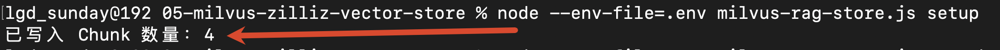


### 查询
只会做向量检索还不够。

真实 Agent 里，很多问题不能直接在全库里搜。

比如用户问的是退款问题，那就应该优先查售后退款相关资料。

所以这里要用到上一节特意保留下来的 `category`。

看 `search()` 里的这段代码：

```javascript
const question = '3000 元退款需要人工审核吗？'
const filter = 'category == "refund"'

const results = await searchQuestion(client, question, filter)
```

真正调用 Milvus search 时，filter 会一起传进去：

```javascript
const result = await client.search({
    collection_name: collectionName,

    // 指定在哪个向量字段上做 ANN Search。
    anns_field: 'embedding',

    // 查询向量。这里传数组，是因为 Milvus 支持一次查多个向量。
    data: [queryVector],

    // 返回最相似的前 3 条。
    limit: 3,

    // Metadata Filter，例如：category == "refund"。
    filter,

    // 指定检索结果里需要返回哪些字段。
    output_fields: [
        'chunk_id',
        'content',
        'source',
        'title',
        'category',
        'owner',
        'source_version',
        'chunk_index',
        'content_hash'
    ]
})
```

这里的意思是：

+ 先限制 category == "refund"
+ 再在退款相关 Chunk 里面做向量相似度检索
+ 最后返回最相关的 3 条

执行：

```bash
node --env-file=.env milvus-rag-store.js search
```

你会看到类似这样的表格：

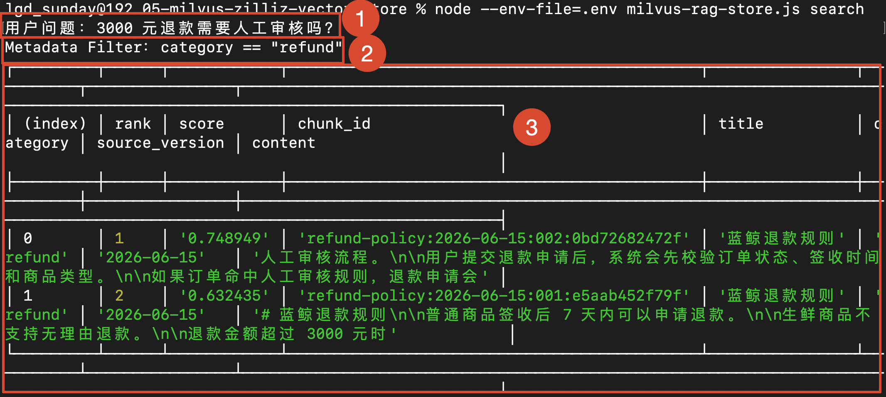


### 更新和删除
更新操作比较特殊。有两种更新方式：

1. 直接通过 upsert 方法
2. **先 delete 旧 Chunk，再 insert 新 Chunk**

但是第一种方法有时候会有一些问题，那就是：**文档更新后，Chunk 数量和 Chunk ID 很可能会变。**

比如旧文档切出来 2 个 Chunk：

```plain
refund-policy.md:chunk-001
refund-policy.md:chunk-002
```

新文档改短了，只切出来 1 个 Chunk：

```plain
refund-policy.md:chunk-001
```

如果你只 `upsert` 新的 1 个 Chunk，那么旧的 `refund-policy.md:chunk-002`。可能还留在库里，后面检索时就可能召回过期内容。

所以，针对于 RAG 知识库来说，更新常见的做法是 **删掉旧版本 Chunk，再写入新版本 Chunk**。

而 `upsert` 的使用通常是在 **只修正某个字段，并且主键不变** 的场景下

看更新代码：

```javascript
await client.delete({
    collection_name: collectionName,
    filter: 'source == "refund-policy.md"'
})

const updatedChunks = createUpdatedRefundChunks()
const count = await insertChunks(client, updatedChunks)
```

这里先删除 `refund-policy.md` 对应的旧 Chunk。

然后再写入新版本退款规则。

应该比较好理解。

执行：

```bash
node --env-file=.env milvus-rag-store.js update
```

你会看到类似结果：

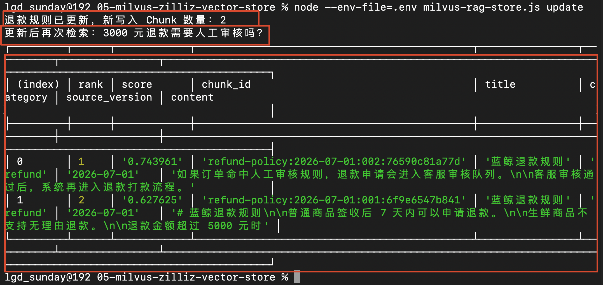


## 总结
这一节其实就讲了一件事：**上一节生成出来的 Chunk，应该怎么真正存进向量数据库，并且能够被检索、过滤和更新。**

再给大家捋一下这一小节讲的内容哈。

最开始的时候，咱们先从一个问题开始：前面几节已经能把文本变成向量，也能做内存向量检索，还能把文档拆成 Chunk。

但是，真实项目不可能把这些 Chunk 一直放在内存里。

因为内存数据不能长期保存，也不适合几十万、几百万条 Chunk 的检索，更没法很好地做版本更新、业务过滤和权限控制。

所以，这一节第一个核心概念就是 `向量数据库`。

向量数据库不是只负责存一个 `embedding` 数组。

它真正负责的是把 `content`、`metadata`、`embedding`、`index` 这些东西放在一起，变成一套可以长期维护的 RAG 知识库。

然后，咱们讲了 `Milvus` 和 `Zilliz Cloud`。

+ `Milvus` 可以理解为开源版向量数据库，适合本地学习、自建部署和理解底层流程。
+ `Zilliz Cloud` 可以理解为托管版 Milvus，适合不想自己维护数据库机器、存储、备份和升级的场景。

所以本节才会想要同时讲本地 Milvus 和 Zilliz Cloud。

本地用来学习和验证。

云上用来理解真实项目里更常见的托管数据库接入方式。（当然了，代码跑的都在本地了，线上的大家可以自己测测跑一跑）

然后就是一堆 向量数据库的概念了：Collection、Index 等等的，大家有个了解就可以了

针对于向量数据库的增删改查，大家特别要注意的是 **改** 的部分。一定要知道：**先删除、再添加**，不容易出错

下一节，咱们来看： BM25、混合检索、Metadata Filter 和 RRF 这些内容。

> 更新：2026-07-04 17:30 · 原文：<https://www.yuque.com/lgdsunday/ab1dy3/iv45lnoknl4acagc>
