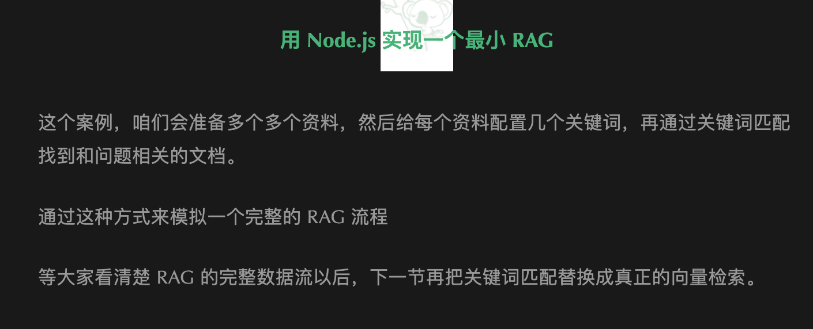
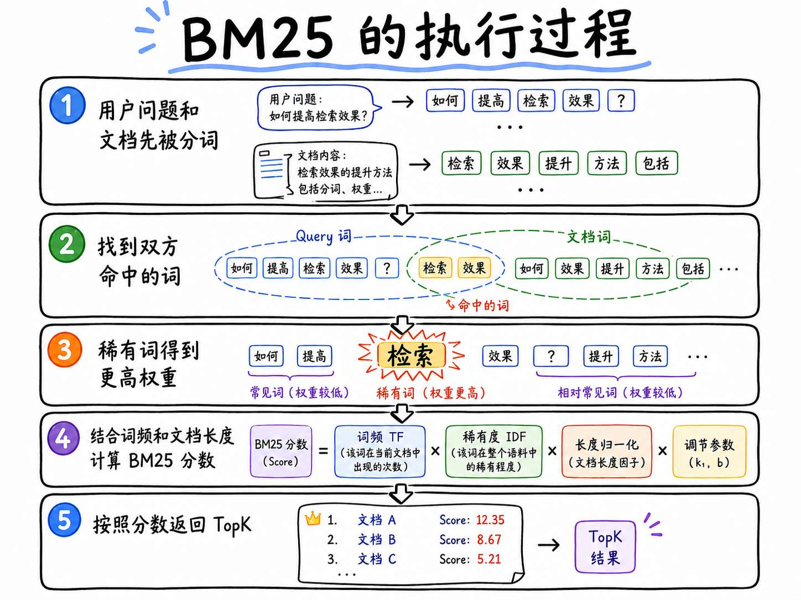
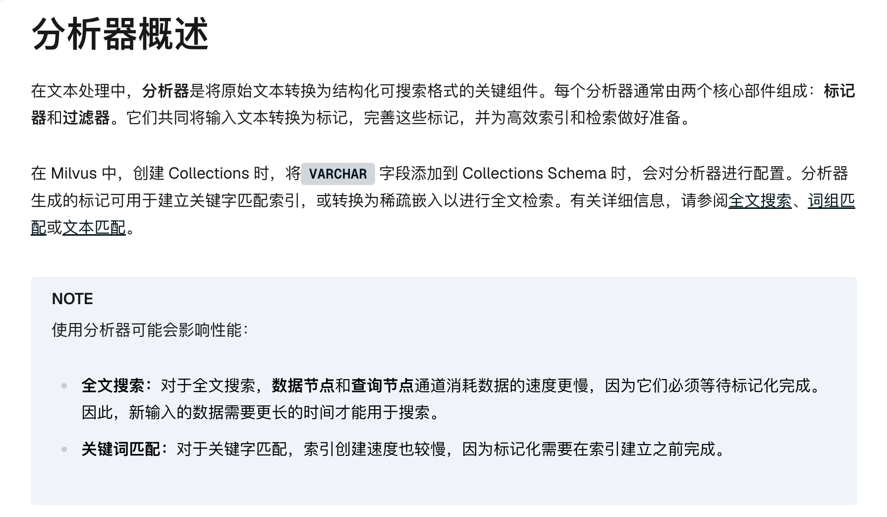
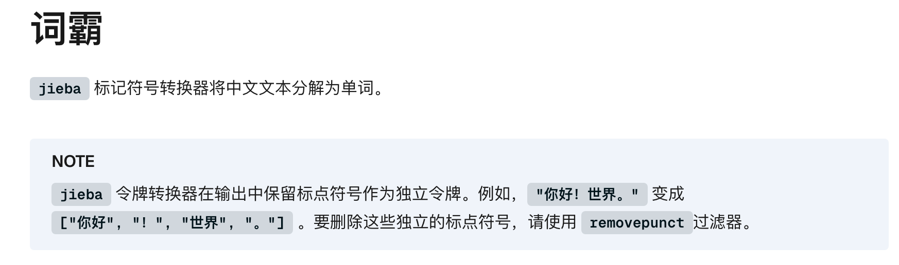
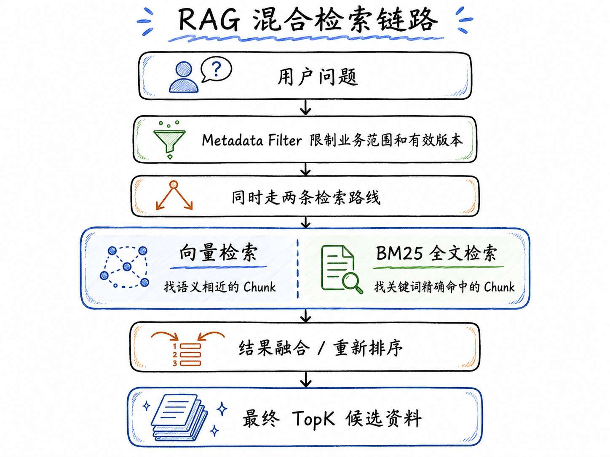
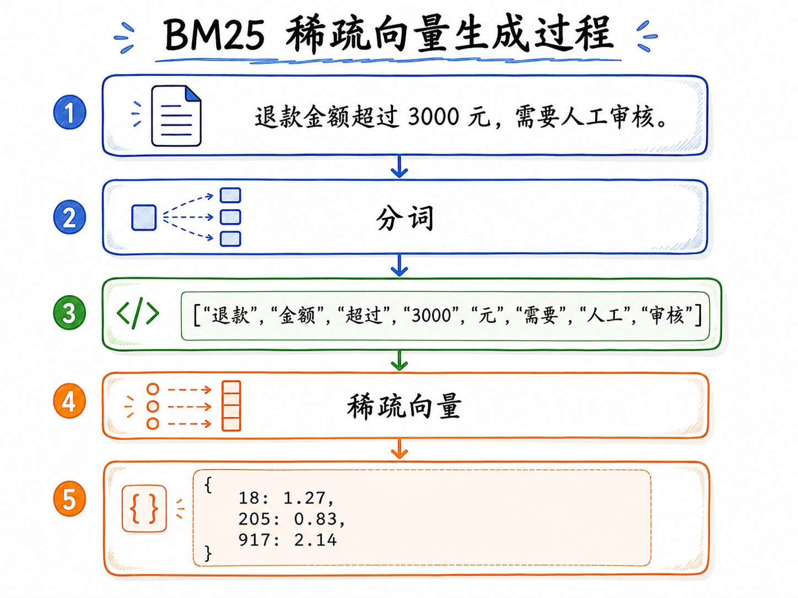
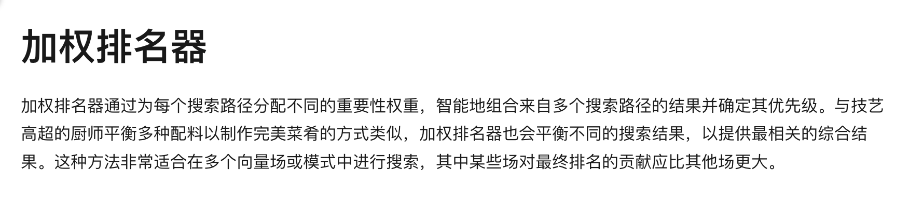
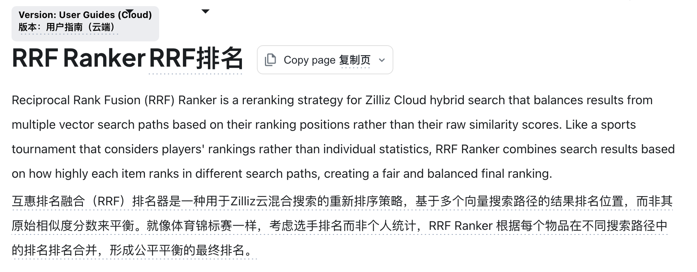

# 06 - BM25 与混合检索：使用 XXRerank 提高召回率

上一小节，咱们已经完成了 Milvus 与 Zilliz Cloud 的基本使用。

目前可以做到：用户提问以后，先生成问题向量，再到 `embedding` 字段中检索 TopK。

看起来猛猛的。

但是，在真实的企业项目里，如果咱们只做向量检索，那通常是不太够的。

跟大家举个例子，比如用户问：

```latex
请查一下规则编号 BW-RF-2026 对应哪一份售后规则？
```

这里有一个很关键的点，那就是 编号：`BW-RF-2026`。

在 向量检索（Embedding）的过程中，它可以理解两个问题表达的 **相似度** （“不想要了”和“申请退款” 是一个意思）。

但是！

**它并不保证每一个编号和专有名词都能在检索排序中得到足够高的【权重】。**

那么想要解决这个问题，咱们就得用到一个新的东西，那就是 `BM25 算法`。

## BM25 到底是什么
不知道大家还记不记得，在 [第一节](https://mp.weixin.qq.com/s/75pt8NkJAeWNATDcqVe16A?payreadticket=HCcbqGTx5xGuHvNMJpaPgcabZgXTzSsFlQllOQntP1cmUv45fROtG9f7NOL1emsvM2VqF8c) 的时候，咱们写过一次最简单的关键词检索。





当时的逻辑是：**用户问题命中了多少个关键词，就给当前的文档多少分。**

下下面是一段之前的代码，代码的内容其实不重要，大家只需要知道，这段代码的意思就是 **命中几个关键词，就给当前文档记几分** ：

```javascript
// 统计用户问题命中了当前文档的哪些关键词
const matchedKeywords = document.keywords.filter((keyword) =>
    question.includes(keyword)
)

// 命中几个关键词，就给当前文档记几分
const score = matchedKeywords.length
```

但是，大家仔细琢磨琢磨， **关键词出现的次数多，就意味着一定是最重要的吗？**

举个例子：

```latex
比如有两份文档：

文档 A：
退款规则：编号 BW-RF-2026，退款金额超过 2000 元需要人工审核。

文档 B：
退款、退款、退款、退款、退款，售后规则，商品规则，订单规则……
```

如果只看关键词出现次数，文档 B 里面 “退款” 出现了很多次，那么分数就会更高。但是 文档 A 才是用户真正需要的

所以说，**虽然 `BW-RF-2026` 出现在文档中的数量很少，但是只要命中，那么他就是最重要的信息 **

而，`BM25` 就是用来解决 **某个词出现的频率很低，但是很重要** 的问题的

> BM25 是一种全文检索相关性算法。
>
> 它会根据查询词是否命中、这个词在当前文档中出现的情况、这个词在整个知识库中是否稀有，以及文档长度等信息，为每份文档计算相关性分数。
>

在 `BM25 算法` 中存在两个关键指标：

+ 第一个 `IDF` ：他表示每个词的权重占比
+ 第二个 `TF`：他表示一个词出现的次数

同时，`BM25 算法`  还会考虑文档长度。一个只有几十个字的 Chunk 命中了关键术语，和一份几万字的文档碰巧包含这个词，不能完全按照同一种方式处理。

所以，BM25 可以先理解成下面这个过程：




### Analyzer 和 稀疏向量
根据上面的流程咱们可以知道，BM25 比较的不是完整句子，而是句子里面的词（**文档先被分词**）。

例如：

```plain
退款金额超过 3000 元，需要人工审核。
```

BM25 需要先把它拆成类似下面的结果：

```plain
退款
金额
超过
3000
元
需要
人工
审核
```

BM25 会根据每个词的出现次数、稀有程度等信息，为这些词计算权重，然后生成一个 **稀疏向量**。

稀疏向量大概就长这样：

```plain
{
  18: 1.27,
  205: 0.83,
  917: 2.14
}
```

>  这里的 `18`、`205`、`917` 可以理解为词语在内部词表中的位置，后面的数字则是对应词语的权重。
>

这个把原始文字处理成一组词的过程，在 Milvus 里由 `Analyzer（分析器）` 负责，文档在这里 `https://milvus.io/docs/zh/analyzer-overview.md`




`Analyzer（分析器）` 是一条文本处理流程，里面主要包含两个部分：

+ 标记器 `Tokenizer`：负责把原始文字切分成 Token
+ 过滤器 `Filter`：负责对切分结果进行清理或转换

英文单词之间通常有空格，分词相对简单。

但是中文没有天然空格。比如 “退款金额需要人工审核” ，程序不能直接通过空格判断 “退款金额” 和 “人工审核” 是两个独立的词

所以，Milvus 需要使用适合中文的分词器。

这节课使用的是 `jieba` 中文是 **词霸** （不是结巴。。。）




在 Milvus 中，不需要单独安装 jieba，使用也贼简单：

`Node` 的代码这么样写：

```javascript
// 简单配置：仅指定令牌化器名称
const analyzer_params = {
    "tokenizer": "jieba",
};
```

`Python` 的代码这样写：

```python
# 简单配置：仅指定令牌化器名称
analyzer_params = {
    "tokenizer": "jieba",  # 使用默认设置: dict=["_default_"], mode="search", hmm=True
}
```

> 更多的定制化配置，大家可以查看这里 `https://milvus.io/docs/zh/jieba-tokenizer.md`
>

在 `jieba` 处理分词的时候会保留标点符号（上图的 `NOTE` 部分有描述），如果想要去掉可以使用  `removepunct` 

```javascript
const analyzer_params = {
    tokenizer: 'jieba',
    filter: ['removepunct']
}
```

那么到这里，大家应该就可以理清楚什么是 `BM25` 了吧。

`BM25` 就是 **全文检索相关性算法**。它会先把文本拆成词，再根据词是否命中、词频、词在整个知识库里的稀有程度，以及文档长度，为每个 Chunk 计算相关性分数。


## 为什么有了 BM25，还需要混合检索
写到这里，可能有同学会冒出一个想法：

```plain
既然向量检索对编号、专有名词、精确关键词不够敏感，而 BM25 刚好可以解决这个问题，那是不是直接用 BM25 就可以了？
```

不行！

因为 BM25 解决的是 **词语命中** 的问题，而不是 **语义理解** 的问题。

比如用户问：

```latex
咖啡机不想要了，3000 元订单应该自动处理还是转人工？
```

而知识库里面写的是：

+ 普通商品签收后 7 天内可以申请退款。
+ 退款金额超过 2000 元时，需要人工审核。

这两段话在语义上是相关的。

但是，如果只靠 BM25 就不行了。BM25 会看这些词有没有 **命中**。

如果用户问题里没有直接出现 “退款” “人工审核” “超过 2000” 这些词，那么 BM25 的召回效果就可能不稳定。

所以：

+ 向量检索擅长找 **语义相近** 的内容
+ BM25 擅长找 **关键词、编号、专有名词精确命中** 的内容

一种互相补充的关系。

而这种 **互相补充的关系** 就是 `混合检索（Hybrid Search）` 要解决的问题。

### 什么是混合检索
混合检索，简单理解就是：

> 同一个用户问题，不只走一种检索方式，而是同时走多种检索方式（向量检索 + BM25），然后把多路结果合并成最终的 TopK。
>

在 RAG 的检索链路里面，就是下面这样：




也就是说，当用户问：

```latex
请查一下规则编号 BW-RF-2026 对应哪一份售后规则？
```

+ BM25 这一路会因为 `BW-RF-2026` 这个编号被精确命中，把对应 Chunk 召回出来。
+ 而向量检索这一路，也可能根据“售后规则”这样的语义，把相关的退款、售后、审核规则找出来。

最后，系统再把两路结果合并，得到一个更稳定的最终结果。

### 向量检索和 BM25 检索到底有什么区别
为了更好理解混合检索，咱们可以把这两条路拆开看。

##### 第一条路是 **向量检索**
它使用的是 `Embedding` 生成出来的 **稠密向量**。

比如：

```latex
“退款金额超过 2000 元，需要人工审核”
        ↓↓↓↓↓↓↓↓
[0.12, -0.03, 0.88, 0.41, ...]
```

这种向量一般是几百维或者几千维，而且大部分位置都有数值，所以它也叫 `Dense Vector（稠密向量）`。

它擅长回答的是：**两段话意思像不像？** 的问题

##### 第二条路是 **BM25 全文检索**
它使用的是 Analyzer 分词之后生成的 **稀疏向量**。

绘制了一张图，大家看下：




这种向量不是每一个位置都有值，而是只有命中的词才会有权重，所以它叫 `Sparse Vector（稀疏向量）`。

它擅长回答的是：**这些关键词、编号、专有名词有没有被命中？** 的问题

所以，混合检索的核心简单来说就是：**使用 向量检索 理解「意思」，使用 BM25 算法检索 命中词语**

## 融合排序
现在大家应该可以理解什么是 **混合检索** 了吧。

但是，大家想想，这样是不是还有一个问题，那就是：**在混合检索中，向量检索会返回一批结果，BM25 也会返回一批结果，那么最终的结果应该是什么样的？？**

比如说哈：向量检索返回

```latex
第 1 名：Chunk A
第 2 名：Chunk B
第 3 名：Chunk C
```

BM25 返回：

```latex
第 1 名：Chunk C
第 2 名：Chunk D
第 3 名：Chunk A
```

那最终 TopK 到底应该怎么排呢？

这一步就叫 **融合排序**

在 Milvus 里面，常用的融合方式有两种：

+ `WeightedRanker`：加权融合
+ `RRFRanker`：排名融合

咱们一个一个来看。

### WeightedRanker：加权融合



`WeightedRanker` 比较好理解。

它的意思是：**给不同检索路线设置不同权重。**

比如：

```latex
向量检索权重：0.7
BM25 权重：0.3
```

那么最终排序时，因为权重不一样，所以两者就更好对比了

这种方式适合你明确知道哪一路（向量检索 ｜｜ BM25）更重要的时候。

比如在客服知识库里，大多数用户不会严格按照文档原文提问，他们可能会说：

+ 东西不想要了怎么办？
+ 能不能退款？
+ 赚人工

这时候语义理解就很重要，可以让向量检索权重大一点。

但是，如果你的知识库里有大量规则编号、合同编号。

那么就得把 BM25 的权重调高

### RRFRanker：根据排名做融合



另一种方式是 `RRFRanker` （没有找到中文说明文档，只能这样凑活看了）

RRF 的作用是 **关注搜索的排名**

比如有一个 Chunk：

+ 在向量检索里排第 2
+ 在 BM25 检索里排第 3

另一个 Chunk：

+ 只在向量检索里排第 1
+ 但是 BM25 完全没有召回

RRF 就会认为：如果一个 Chunk 能在多条检索路线里都排得比较靠前，那它通常更值得信任。

所以 RRF 的思路可以简单理解成：**只看一个结果在多个排行榜里是不是都靠前**

这个方式特别适合刚开始做混合检索的时候使用。

### 混合检索最终解决了什么问题
到这里，咱们再回头看一开始的问题：

```latex
请查一下规则编号 BW-RF-2026 对应哪一份售后规则？
```

如果只用向量检索，模型可能理解“售后规则”的语义，但是不一定给 `BW-RF-2026` 足够高的权重。

如果只用 BM25，它可以很好地命中 `BW-RF-2026`，但是对于用户换一种说法提问的场景，又可能召回不稳定。

所以，咱们就必须要使用 **混合检索**。

> 让向量检索负责找意思更相近的，让 BM25 找词语命中率更高的。
>
> 最后通过融合排序把多路结果合并成最终 TopK
>

## 总结
代码放到下一节了，要不内容太多了，大家估计都看懵了。

回顾一下这一小节的内容吧。

这小节，咱们主要讲了三个概念：

+ BM25
+ 混合检索
+ 融合排序（XX Rerank）

BM25 就是个算法，叫做 **全文检索相关性算法**。它会先把文本拆成词，再根据词是否命中、词频、词在整个知识库里的稀有程度，以及文档长度，为每个 Chunk 计算相关性分数。

在这个过程中会用到 **稀疏向量** 和 **分析器（Analyzer）** 的概念。

虽然咱们截图都是通过 milvus 的官网文档截图的，不过咱们得知道，**这些概念可不是 milvus 独有的哈**

然后是 混合检索，他就是为了**同时走多种检索方式（向量检索 + BM25）**

在混合检索的过程中，会涉及到权重排序的问题，这就得用 **融合排序** 了。

这玩意在面试中经常被当做一个难点来问，大家可得注意。

融合排序可以分为两种：

+ `WeightedRanker` 加权融合：**给不同检索路线设置不同权重。**
+ `RRFRanker` 排名融合： **更关注搜索的排名**

那么下一小节，咱们就把这些概念，通过代码写一遍。

在 Milvus 中配置 Analyzer、BM25 稀疏向量、Metadata Filter 和混合检索，并分别使用 `WeightedRanker` 和 `RRFRanker` 合并结果。来看看实战的样子

> 更新：2026-07-12 22:17 · 原文：<https://www.yuque.com/lgdsunday/ab1dy3/lkhqcnk25bkkwbhd>
