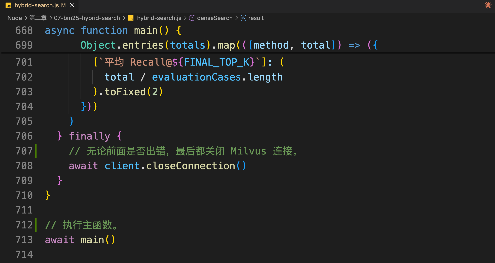
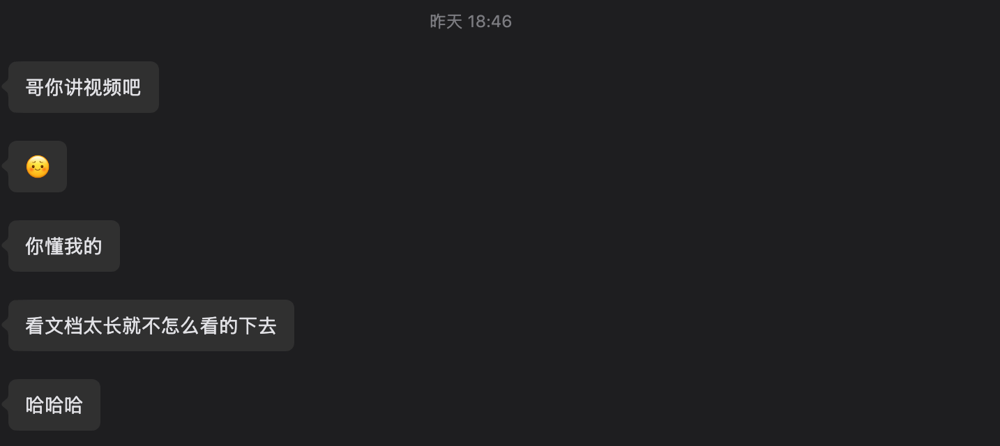
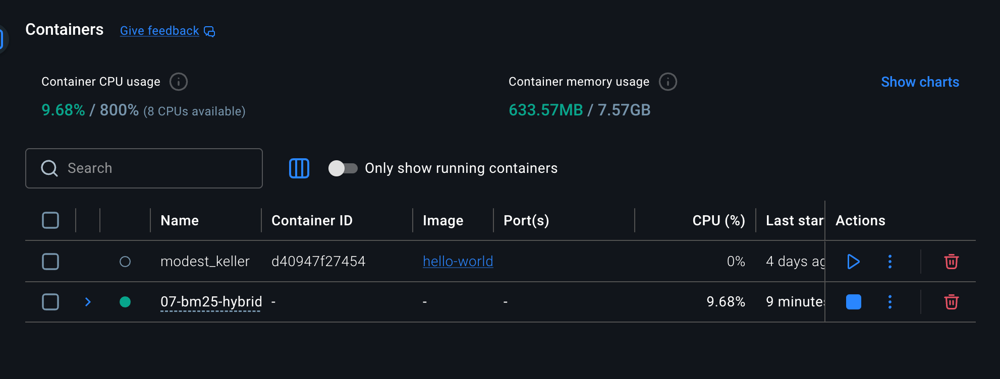
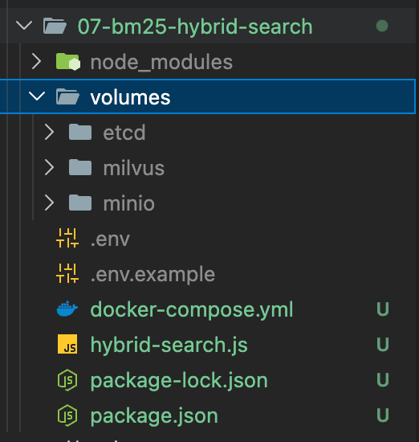
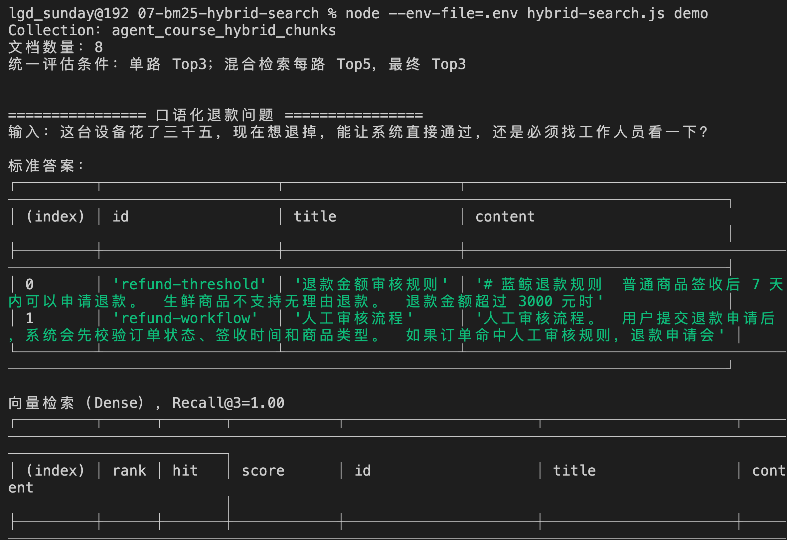

# 07 - 实战：使用 Milvus 实现 BM25 与 混合检索

上一节，咱们已经把 BM25 和混合检索的原理讲清楚了。

向量检索负责理解“意思像不像”，BM25 负责判断关键词有没有命中。两路结果出来以后，还可以使用加权融合或者 RRF 得到最终的 TopK。

但是，只知道这个流程还不够。

咱们还得看看代码是怎么写的。

之前给大家看代码的时候，都会把代码给大家直接贴出来，然后配上对应的注释。

但是，这一次的代码贴不出来了，，，

**因为代码太多了。。。**





加上注释，已经 800 多行了，要炸。。。

再加上昨天有同学提到：“如果 Agent 课程中视频占比能更高一点就好了”




所以说，这一小节咱们想要 **通过视频的方式**，来完整讲解一下整个代码的运行效果。

没办法，就这么宠粉～～

> 源码链接在这里：`https://github.com/lgd8981289/Agent--Code`
>

### 代码讲解视频
[此处为语雀卡片，点击链接查看](https://www.yuque.com/lgdsunday/ab1dy3/gwpmp7m6uxp9c8bc#a07Sz)

## 代码注意事项
### 确保环境运行正常
代码运行需要依赖 `Docker` 和 `milvus`。（忘记的同学可以重新看下 [第二章05 - 实战：使用 Milvus 与 Zilliz Cloud 完成持久化、索引、过滤与更新](https://mp.weixin.qq.com/s/e4j2Xg70AcJjiflJBvkdPg?payreadticket=HN8TxsjshEzRlF-H3UZ0VKTze004UG9jCyMO4EFxOqtSUGMFV3F_Y6Xjj4atOh8F1AvXYsE)）

所以，在执行代码前请确认：

1. Docker 已正常启动（确认 05 的代码仓库是暂停的状态）



2. 执行 

```bash
curl -L https://github.com/milvus-io/milvus/releases/download/v2.6.18/milvus-standalone-docker-compose.yml -o docker-compose.yml

or

wget -L https://github.com/milvus-io/milvus/releases/download/v2.6.18/milvus-standalone-docker-compose.yml -o docker-compose.yml
```

生成 `docker-compose.yml` 文件

3. 执行 `docker compose up -d` 拉取镜像（之前拉取过，这次应该会快很多）
4. 查看容器状态 `docker compose ps`，正常情况下，应该能看到 `etcd`、`minio`、`standalone` 这几个服务都在运行。

  


5. 执行 `curl http://127.0.0.1:9091/healthz` 正常返回 `OK` 就没问题了

最终的目录结构生成应该就是这样：




然后执行 `node --env-file=.env hybrid-search.js demo  ` ，就可以成功了：



### 使用新的 Collection（向量数据库的 “表”）
在 `.env` 文件中，修改如下代码：

```plain
MILVUS_COLLECTION=agent_course_hybrid_chunks
```

这表示 07 会使用新的集合，别和 05 用同一个。

## 总结
不知道讲解的代码大家听着是否习惯，特别是在现在的 AI 时代。

就和视频里面说的一样，大家不需要关心每一行代码，只需要关注最终结果。

能够通过结果来知道 向量检索 、BM25、混合检索的区别，就可以了。

不过，现在的检索器现在仍然直接使用用户的原始问题。

如果用户说得很含糊，或者问题中的表达和知识库完全不同，即使已经使用混合检索，也可能找不到正确资料。

下一节，咱们继续学习 Query Rewrite 和 Multi-Query，看看怎么在真正检索之前，把用户问题改造成更适合知识库的查询。

> 更新：2026-07-04 17:03 · 原文：<https://www.yuque.com/lgdsunday/ab1dy3/gwpmp7m6uxp9c8bc>
