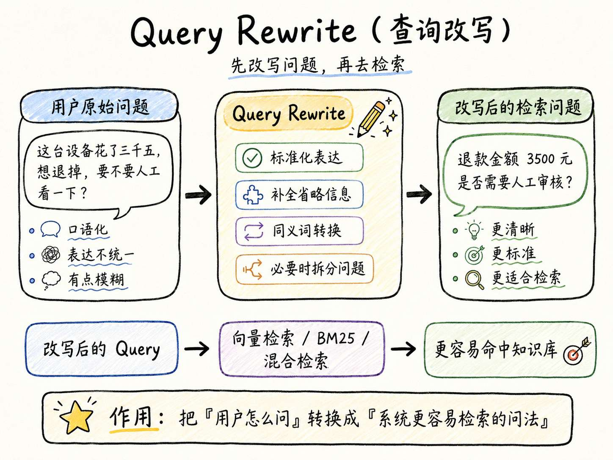
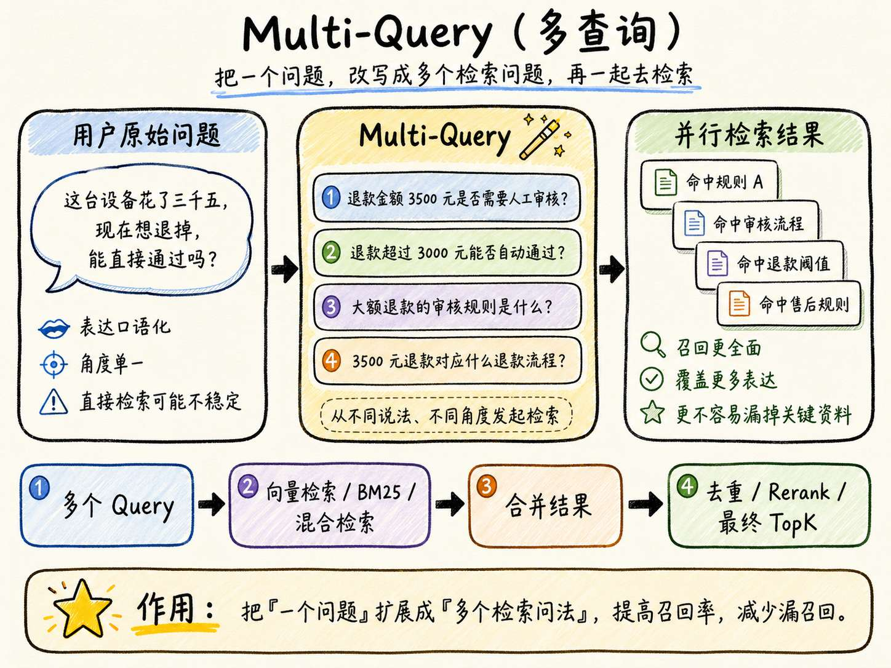
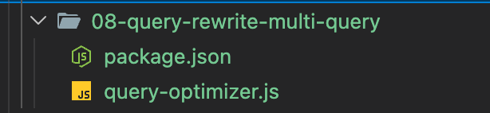
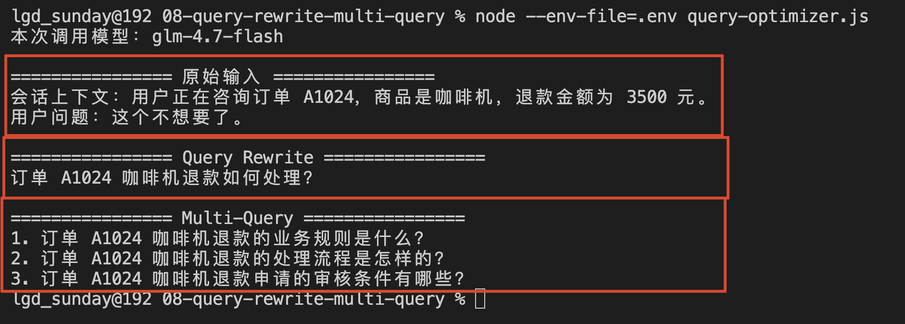
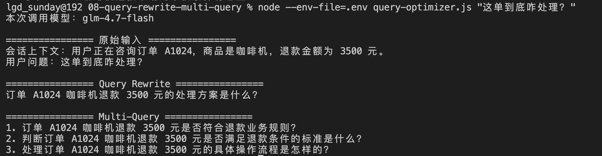

# 08 - 用户不会提问怎么办？使用 Query Rewrite 与 Multi-Query，解决问题和文档不一致问题

上一小节，咱们已经完成了 向量检索、BM25 和 混合检索 了。

向量检索负责查找语义相近的内容，BM25 负责精准匹配。然后再做个混合检索，搜索的结果就比较准确了。

但是，大家有没有想过一个问题：“如果用户压根就不会提问呢？”

比如，用户直接问：“这个不想要了。”

这就会让人（agent）很懵了，agent 极有可能不能理解是什么意思。

所以，很多 Agent 的系统为了防止用户“瞎问”，都会先把用户的问题处理一下，然后再给 AI 大模型。

而这个 【处理一下】的操作，就是咱们这一小节要学习的 `Query Rewrite` 和 `Multi-Query`。

## Query Rewrite 到底是什么
`Query Rewrite` 翻译过来就是 **查询改写**。

说白了就是：**结合当前可以使用的「会话上下文」，把用户含糊、不完整或者不适合检索的问题，改写成一条清晰的问题。**

经过 Query Rewrite 修正后，得到的可能是：

```latex
退款金额 3500 元，是否需要人工审核
```

这个概念还挺清晰的.

给大家生成一个解释图，大家可以看下：




## 什么是 Multi-Query ？
`Multi-Query`  中的 `Multi` 是多次的意思，而  `Query` 是查询的意思，连起来就是 **多次查询问题**

什么叫多次查询问题呀？

跟大家举个例子，比如用户问：“我想退货！必须得找人工吗？”（你看，用户说话就是会很随意）

但是，这个问题用户真实想问的翻译成最适合 RAG 的语言，应该是：

```latex
“退款金额 3500 元，是否需要人工审核？”
```

能看出来两者的区别吧。

+ 如果咱们只拿用户原始提问的问题去检索的话，那么就有很大的可能会因为表达太口语化，导致资料没有被召回。
+ 用户只问了这么一句话，没有完整的上下文，那么  `Query Rewrite` 的改写也会不准确

所以说，这个时候就得用到 `Multi-Query` 了

Multi-Query 就会先把用户的问题改写成多个不同角度的查询问题，比如：

+ 退款金额 3500 元是否需要人工审核？
+ 退款金额超过多少需要人工审核？
+ 售后退款流程中，哪些情况不能自动通过？
+ 高金额退款是否需要工作人员审核？
+ 设备类商品退款是否可以系统自动通过？

然后系统会分别使用这些 Query 去检索知识库。

也就是说，原来只有一次检索，现在 **会检索很多次** 。

从而可以通过多次检索，寻找资料，提到文档被召回的概率～

所以，如果给  `Multi-Query` 一个定义，那就是：

> **Multi-Query 就是把用户的一个问题，扩展成多个不同角度的检索问题，然后分别检索知识库，从而提高 RAG 的召回率。**
>




## 实现一个问题优化器
概念讲完了，咱们接下来写个代码来看看。

这一小节的代码不会太复杂，主要就是用 `Query Rewrite` 和 `Multi-Query` 完成数据改写

因为这一小节的目标只有一个：**观察一条不适合检索的用户问题，经过模型处理以后，会变成什么样。**

> 代码地址：`https://github.com/lgd8981289/Agent--Code`
>

代码目录为：




在代码目录中创建 `.env` 文件：

```plain
ZHIPU_API_KEY=你的智谱 API Key
CHAT_MODEL=glm-4.7-flash
```

在 `query-optimizer.js` 中写入下面的代码：

```javascript
// 从环境变量中读取智谱 API Key。
// 这里要求在 .env 文件中配置：ZHIPU_API_KEY=你的 API Key
const apiKey = process.env.ZHIPU_API_KEY

// 从环境变量中读取本次要调用的对话模型。
// 如果没有配置 CHAT_MODEL，则默认使用 glm-4.7-flash。
const model = process.env.CHAT_MODEL ?? 'glm-4.7-flash'

// 默认的会话上下文。
// 真实项目中，这部分通常来自用户的历史对话、订单信息、业务系统查询结果等。
const defaultContext =
    '用户正在咨询订单 A1024，商品是咖啡机，退款金额为 3500 元。'

// 默认的用户原始问题。
// 这里的用户问题比较口语化，单独看并不完整。
const defaultQuestion = '这个不想要了。'

/**
 * 构造发送给大模型的 messages。
 *
 * 这里的目标不是让模型直接回答用户问题，
 * 而是让模型把用户的原始问题改写成更适合知识库检索的问题。
 *
 * @param {Object} params
 * @param {string} params.context 会话上下文
 * @param {string} params.question 用户原始问题
 * @returns {Array} 符合 Chat Completions 格式的 messages
 */
function buildMessages({ context, question }) {
    return [
        {
            // system 用来告诉模型它的角色、任务和输出规则。
            role: 'system',
            content: `你是企业知识库的检索问题优化器。

你的任务不是回答用户问题，而是生成更适合知识库检索的查询。

请严格遵守以下规则：
1. rewrittenQuery 必须是一条脱离会话上下文后仍能独立理解的完整问题。
2. multiQueries 必须包含 3 条查询，并且分别从业务规则、判断条件或处理流程等不同检索角度描述同一个需求，不能只是替换近义词。
3. 所有查询必须保留用户的核心意图，不能把“如何处理”改成“处理进度”，也不能改成其他问题。
4. 保留上下文中已经明确的订单号、商品、金额和业务条件。
5. 不得补充上下文中不存在的事实，也不要给出问题答案。
6. 只返回 JSON，格式为：
{"rewrittenQuery":"一条改写后的问题","multiQueries":["查询一","查询二","查询三"]}`
        },
        {
            // user 中放入真实的输入信息：
            // 1. 会话上下文
            // 2. 用户原始问题
            //
            // 模型需要结合上下文，把口语化、省略信息的问题补全。
            role: 'user',
            content: `会话上下文：${context}\n用户原始问题：${question}`
        }
    ]
}

/**
 * 校验模型返回的 JSON 结构是否符合预期。
 *
 * 因为模型虽然被要求返回 JSON，
 * 但真实项目中仍然需要对返回结果做校验，避免后续代码因为字段缺失而出错。
 *
 * @param {Object} result 模型返回并解析后的 JSON 对象
 * @returns {Object} 校验通过后的结果
 */
function validateResult(result) {
    // rewrittenQuery 必须存在，并且必须是字符串。
    if (typeof result?.rewrittenQuery !== 'string') {
        throw new Error('模型返回结果中缺少 rewrittenQuery。')
    }

    // multiQueries 必须满足三个条件：
    // 1. 是数组
    // 2. 长度必须是 3
    // 3. 数组里的每一项都必须是字符串
    if (
        !Array.isArray(result.multiQueries) ||
        result.multiQueries.length !== 3 ||
        result.multiQueries.some((query) => typeof query !== 'string')
    ) {
        throw new Error('模型返回的 multiQueries 必须包含 3 条字符串查询。')
    }

    return result
}

/**
 * 调用大模型，对用户问题进行 Query Rewrite 和 Multi-Query 生成。
 *
 * Query Rewrite：
 * 把用户原始问题改写成一条更完整、更适合检索的问题。
 *
 * Multi-Query：
 * 从多个检索角度生成多条查询，提高知识库召回率。
 *
 * @param {Object} params
 * @param {string} params.context 会话上下文
 * @param {string} params.question 用户原始问题
 * @returns {Promise<Object>} 改写后的 rewrittenQuery 和 multiQueries
 */
async function optimizeQuery({ context, question }) {
    // 如果没有配置 API Key，直接抛出错误。
    // 这样可以避免后面调用接口时才出现更难理解的鉴权错误。
    if (!apiKey) {
        throw new Error('没有检测到 ZHIPU_API_KEY，请先在 .env 中配置。')
    }

    // 调用智谱的 Chat Completions 接口。
    const response = await fetch(
        'https://open.bigmodel.cn/api/paas/v4/chat/completions',
        {
            method: 'POST',
            headers: {
                // 通过 Bearer Token 方式传递 API Key。
                Authorization: `Bearer ${apiKey}`,

                // 告诉接口，请求体是 JSON 格式。
                'Content-Type': 'application/json'
            },
            body: JSON.stringify({
                // 本次调用的模型名称。
                model,

                // 构造好的 system + user 消息。
                messages: buildMessages({ context, question }),

                // 要求模型尽量返回 JSON 对象。
                // 注意：即使设置了这个参数，后面仍然需要自己做 JSON.parse 和结构校验。
                response_format: { type: 'json_object' },

                // 温度设置低一点，让输出更稳定。
                // 这里是检索问题改写，不需要太强的随机性。
                temperature: 0.1,

                // 这里不使用流式输出，等待模型一次性返回完整结果。
                stream: false
            })
        }
    )

    // 先把响应解析成 JSON。
    const result = await response.json()

    // 如果 HTTP 状态码不是 2xx，说明接口调用失败。
    // 这里把状态码和接口返回内容一起抛出，方便排查问题。
    if (!response.ok) {
        throw new Error(
            `智谱 API 调用失败：${response.status} ${JSON.stringify(result)}`
        )
    }

    // 取出模型返回的正文内容。
    // Chat Completions 的结果通常在 choices[0].message.content 中。
    const content = result.choices?.[0]?.message?.content

    // 如果没有 content，说明模型没有返回可用文本。
    if (!content) {
        throw new Error('智谱 API 没有返回可用内容。')
    }

    try {
        // content 是字符串，需要先 JSON.parse 转成对象。
        // 然后再用 validateResult 校验字段结构。
        return validateResult(JSON.parse(content))
    } catch (error) {
        // 如果 JSON.parse 失败，说明模型返回的不是合法 JSON。
        if (error instanceof SyntaxError) {
            throw new Error(`模型没有返回合法 JSON：${content}`)
        }

        // 如果不是 JSON 语法错误，则继续向外抛出原始错误。
        // 例如 validateResult 中抛出的字段校验错误。
        throw error
    }
}

/**
 * 把原始输入和模型生成的结果打印到控制台。
 *
 * 这样可以清楚看到：
 * 1. 原始上下文是什么
 * 2. 用户原始问题是什么
 * 3. 改写后的单条查询是什么
 * 4. 生成的多条检索查询是什么
 *
 * @param {Object} params
 * @param {string} params.context 会话上下文
 * @param {string} params.question 用户原始问题
 * @param {Object} params.result 模型返回的优化结果
 */
function printResult({ context, question, result }) {
    console.log('\n================ 原始输入 ================')
    console.log(`会话上下文：${context}`)
    console.log(`用户问题：${question}`)

    console.log('\n================ Query Rewrite ================')
    console.log(result.rewrittenQuery)

    console.log('\n================ Multi-Query ================')
    result.multiQueries.forEach((query, index) => {
        console.log(`${index + 1}. ${query}`)
    })
}

// 从命令行参数中读取用户问题。
// 例如：
// node --env-file=.env query-rewrite.js 这个订单退款要不要人工审核
//
// process.argv.slice(2) 表示取出命令行中真正由用户传入的参数。
// 如果没有传入问题，则使用 defaultQuestion。
const question = process.argv.slice(2).join(' ').trim() || defaultQuestion

// 从环境变量 QUERY_CONTEXT 中读取会话上下文。
// 如果没有配置，则使用 defaultContext。
const context = process.env.QUERY_CONTEXT?.trim() || defaultContext

// 调用模型，对用户问题进行检索问题优化。
const result = await optimizeQuery({ context, question })

// 打印本次实际调用的模型名称。
console.log(`本次调用模型：${model}`)

// 打印 Query Rewrite 和 Multi-Query 的结果。
printResult({ context, question, result })

```

整个代码一共就 4 个方法：

+ optimizeQuery：这也是案例最核心的代码。它的主要作用就是：调用大模型，对用户问题进行 Query Rewrite 和 Multi-Query 生成
+ validateResult：针对模型返回的内容进行检测。主要用来确定：模型返回的内容是否是符合预期的
+ buildMessages：构建 message 数据结构，把构建出来的数据用作 `optimizeQuery` 方法中大模型请求的参数
+ printResult：打印的结构化处理，不需要过于关注了。

整个代码难度不大，就不多说了。

然后，咱们就直接执行：

```bash
npm run demo
```

执行结果：




同时，咱们的代码还支持在命令后面传入一个新的用户问题，比如：

```bash
node --env-file=.env query-optimizer.js "这单到底咋处理？"
```

得到的打印结果如下：




那么从这些打印结果，咱们就没看到 `Query Rewrite` 和 `Multi-Query` 针对固定问题处理之后的结果是什么样子的了。

## 总结
这一小节的内容应该不算难，主要就讲了两个点：

+ `Query Rewrite` ：它会结合会话上下文，把一些含糊问题，改写成可以脱离聊天记录独立理解的检索查询问题
+ `Multi-Query` ：它会根据一个问题，生成多条关注角度不同的查询问题，从而提高相关 Chunk 被召回的概率

下一节，咱们继续处理检索回来的候选资料，学习怎么通过 Rerank 和 Context Compression，把真正有用的 Chunk 留下来。

> 更新：2026-07-01 11:58 · 原文：<https://www.yuque.com/lgdsunday/ab1dy3/uab6l51pm49rlbzd>
