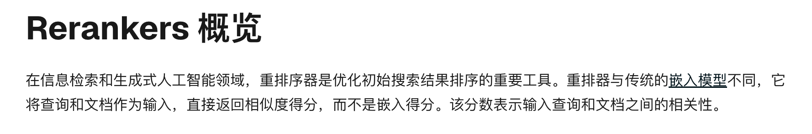
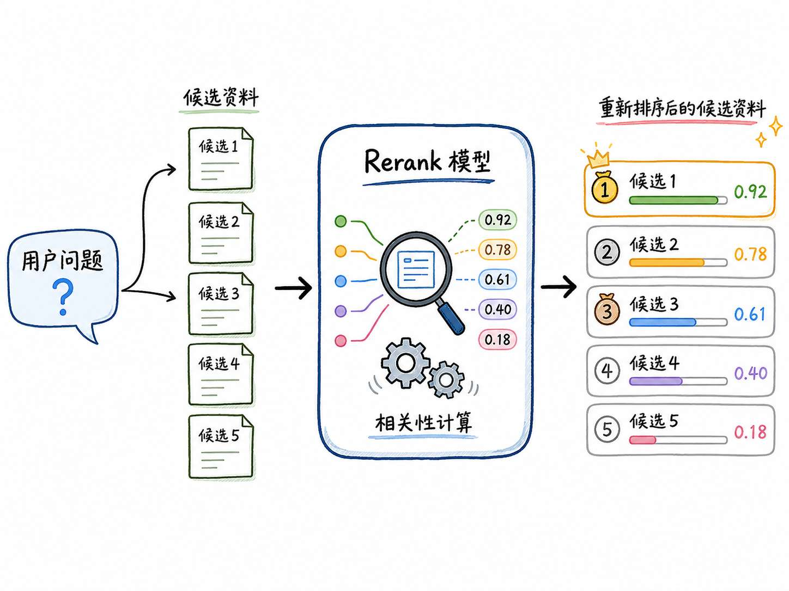
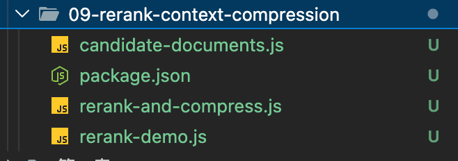
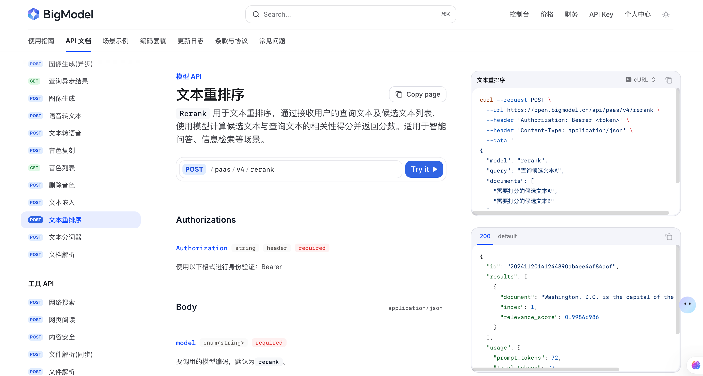
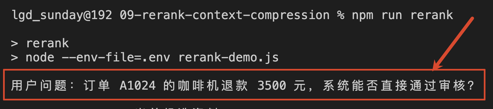
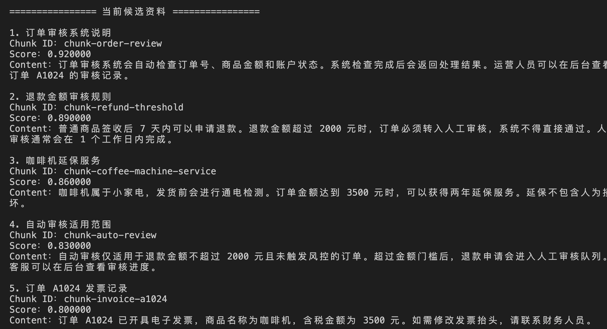
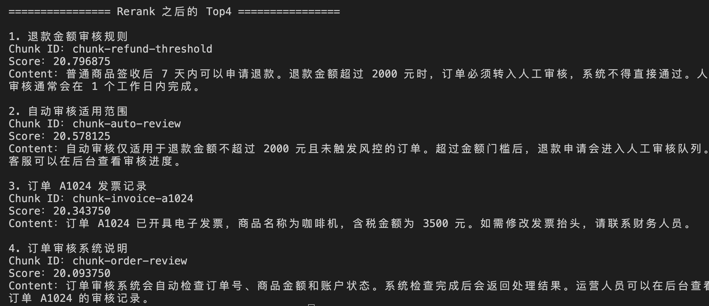
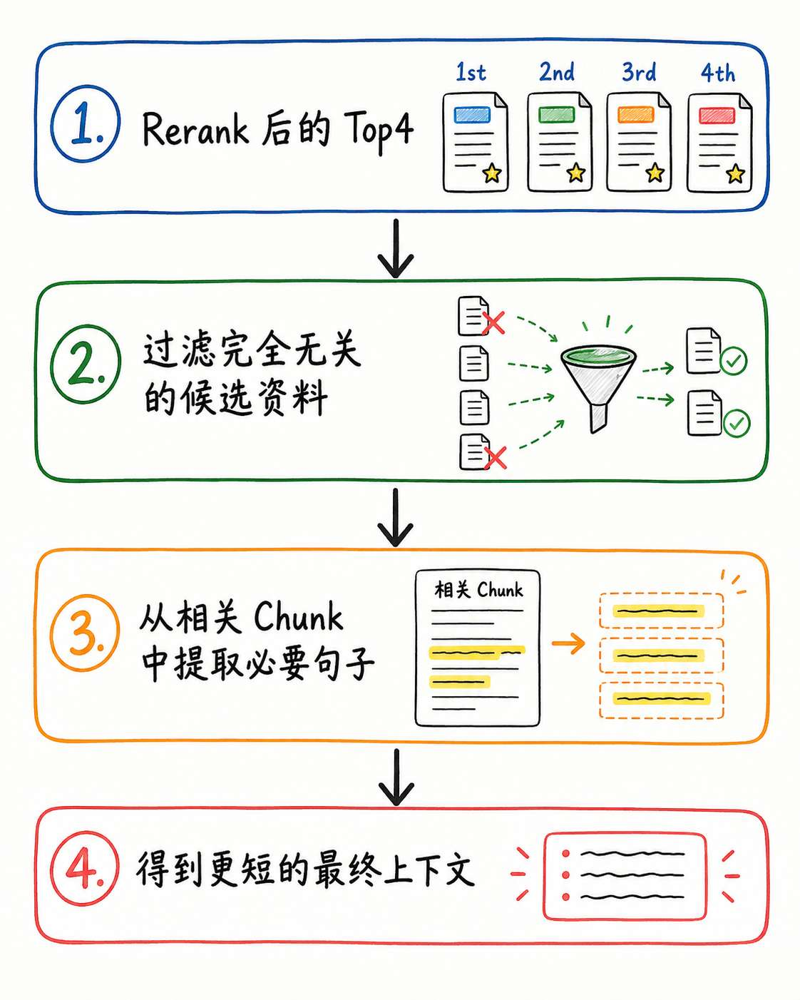
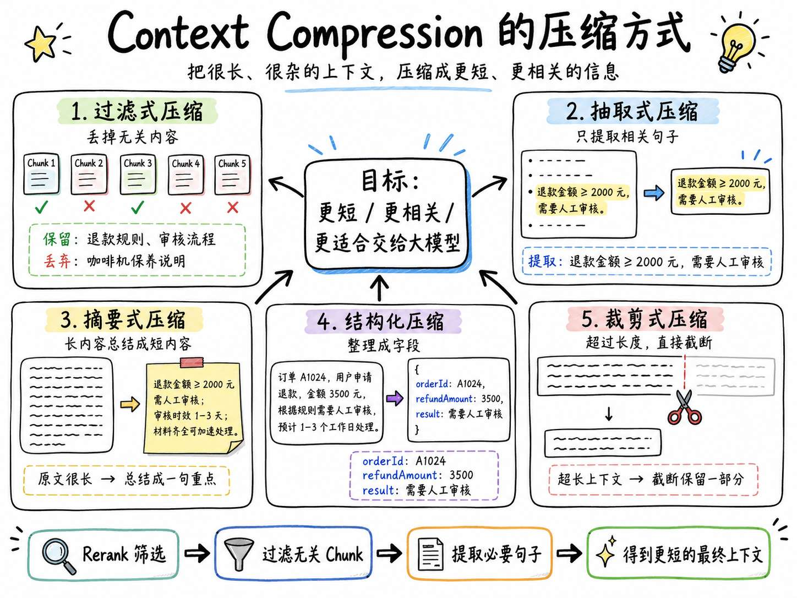
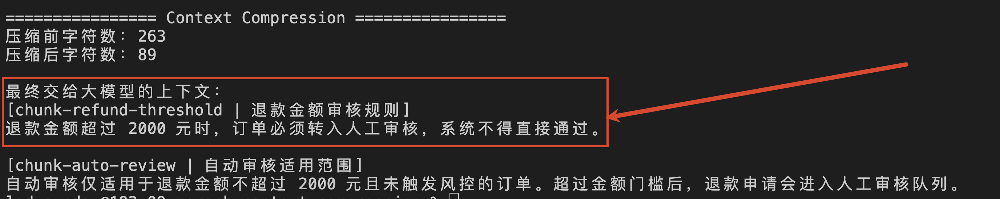

# 09 - Rerank 模型深度解析：候选文档精排、TopK 筛选与 chunk 抽离

经过前面几小节以后，咱们已经可以从知识库中找出和用户问题相关的数据了。

这些数据可能来自向量检索、BM25、混合检索或者 Multi-Query。

以上一小节咱们学到的 `Multi-Query` 为例

如果用户问了：“订单 A1024 的咖啡机退款 3500 元，系统是否可以直接通过审核？”   的问题

那么  `Multi-Query` 会基于用户的问题进行扩展。咱们把这些扩展内容暂时叫做 **候选资料**：

```latex
候选资料：
1. 订单审核系统说明
2. 退款金额审核规则
3. 咖啡机延保服务
4. 自动审核适用范围
5. 订单 A1024 发票记录
6. 退款到账时间
```

但是现在，问题就来了。

基于用户的问题，咱们扩展出来了 6 份候选资料。

**我们要把这 6 份候选资料全部交给大模型进行检索吗？**

显然是 **不行的** 。

因为候选资料只表示 “检索器认为它可能有关系” ，不代表它真的和问题有关系。

所以，咱们就得从这一堆候选资料里面，筛选出真正能回答问题的内容。

那么这个时候，就得用到 `Rerank` 了

## Rerank 到底是什么
`Rerank` 翻译过来就是 **重排序**。



>  Rerank 是专有模型提供的能力。提供这种能力的模型叫做 **Rerank 模型**
>
>  他会在召回阶段已经找出的候选文档中，重新判断每篇文档和用户问题的相关性，把最相关的内容排到最前面。
>

 **Rerank 模型** 会接受 一个用户问题 + 多个候选资料作为输入，然后计算每份候选资料和用户问题之间的相关性，再按照新的分数排序，把排序的结果作为输出。

用一张图表示，就是下面这样：




还是用咱们最开始的例子，假如用户的问题是：“订单 A1024 的咖啡机退款 3500 元，系统是否可以直接通过审核？” 

所有候选资料，最开始的候选顺序是：

```latex
1. 订单审核系统说明
2. 退款金额审核规则
3. 咖啡机延保服务
4. 自动审核适用范围
5. 订单 A1024 发票记录
6. 退款到账时间
```

那么经过 Rerank 模型之后，前四名变成：

```latex
1. 退款金额审核规则
2. 自动审核适用范围
3. 订单 A1024 发票记录
4. 订单审核系统说明
```

原本排在第二和第四的两份审核规则，被提到了最前面。

咖啡机延保和退款到账时间则掉出了 Top4。

这就是 Rerank 在当前案例中的作用：**重新判断现有候选资料的顺序。**

## 用 Node.js 实现最小 Rerank
接下来，咱们实现一个 Rerank 的排序

> 源码地址：`https://github.com/lgd8981289/Agent--Code`
>

创建 `09-rerank-context-compression` 的文件夹，代码目录是：




这里有三个 JS 文件：

+ `candidate-documents.js`  ：用来存放：用户问题 + 候选资料
+ `rerank-demo.js` ：负责调用 Rerank 模型
+ `rerank-and-compress.js`：咱们后面学  Context Compression  的时候用，暂时先不用管他

然后别忘记配置 `.env` 文件，格式如下 ：

```plain
ZHIPU_API_KEY=你的智谱 API Key
# 注意：RERANK_MODEL 需要使用 rerank 模型
RERANK_MODEL=rerank
CHAT_MODEL=glm-4.7-flash
```

rerank 模型对应的接口文档在这里：`https://docs.bigmodel.cn/api-reference/%E6%A8%A1%E5%9E%8B-api/%E6%96%87%E6%9C%AC%E9%87%8D%E6%8E%92%E5%BA%8F`





### 准备候选资料
在 `candidate-documents.js` 中写入如下代码：

> 这里的代码就两个变量：
>
> + question 表示用户的初始问题
> + candidates 模拟已经检索的候选资料
>

```javascript
// 用户的初始问题
export const question =
    '订单 A1024 的咖啡机退款 3500 元，系统能否直接通过审核？'

// 这些数据用来模拟检索器已经找回的候选资料。
export const candidates = [
    {
        id: 'chunk-order-review',
        title: '订单审核系统说明',
        retrievalScore: 0.92,
        content:
            '订单审核系统会自动检查订单号、商品金额和账户状态。系统检查完成后会返回处理结果。运营人员可以在后台查看订单 A1024 的审核记录。'
    },
    {
        id: 'chunk-refund-threshold',
        title: '退款金额审核规则',
        retrievalScore: 0.89,
        content:
            '普通商品签收后 7 天内可以申请退款。退款金额超过 2000 元时，订单必须转入人工审核，系统不得直接通过。人工审核通常会在 1 个工作日内完成。'
    },
    {
        id: 'chunk-coffee-machine-service',
        title: '咖啡机延保服务',
        retrievalScore: 0.86,
        content:
            '咖啡机属于小家电，发货前会进行通电检测。订单金额达到 3500 元时，可以获得两年延保服务。延保不包含人为损坏。'
    },
    {
        id: 'chunk-auto-review',
        title: '自动审核适用范围',
        retrievalScore: 0.83,
        content:
            '自动审核仅适用于退款金额不超过 2000 元且未触发风控的订单。超过金额门槛后，退款申请会进入人工审核队列。客服可以在后台查看审核进度。'
    },
    {
        id: 'chunk-invoice-a1024',
        title: '订单 A1024 发票记录',
        retrievalScore: 0.8,
        content:
            '订单 A1024 已开具电子发票，商品名称为咖啡机，含税金额为 3500 元。如需修改发票抬头，请联系财务人员。'
    },
    {
        id: 'chunk-refund-arrival',
        title: '退款到账时间',
        retrievalScore: 0.77,
        content:
            '退款审核通过后，款项会在 3 到 5 个工作日内原路退回。不同银行的到账时间可能存在差异。'
    }
]
```

### 调用 Rerank 模型
创建 `rerank-demo.js` ：

> 这里的代码就不给大家全贴上了哈。 全复制上去占空，阅读的时候也不能复制，所以这里只给大家列出关键方法的作用了
>

```javascript
...
/**
 * 使用 Rerank 模型对候选文档重新排序。
 *
 * @param {string} query 用户问题
 * @param {Array} documents 候选文档列表
 * @param {number} topN 返回相关性最高的前 N 条文档
 * @returns {Promise<Array>} 重新排序后的文档列表
 */
async function rerankDocuments(query, documents, topN = 4) {
    ...

    // 调用智谱 Rerank API，对候选文档进行相关性重排序
    const response = await fetch('https://open.bigmodel.cn/api/paas/v4/rerank', {
        method: 'POST',
        headers: {
            Authorization: `Bearer ${apiKey}`,
            'Content-Type': 'application/json'
        },
        body: JSON.stringify({
            // 使用的 Rerank 模型
            model: rerankModel,

            // 用户原始问题
            query,

            // Rerank 接收的是字符串数组，这里把标题和正文拼成完整候选文本
            documents: documents.map(
                (document) => `${document.title}\n${document.content}`
            ),

            // 只返回相关性最高的前 topN 条
            top_n: topN,

            // 不让接口返回原始文档内容，后面通过 index 从本地 documents 中取回
            return_documents: false,

            // 返回原始相关性分数，方便观察排序效果
            return_raw_scores: true
        })
    })

    // 解析接口返回结果
    const result = await response.json()
  ...
}
...

// 使用 Rerank 模型对候选资料重新排序，默认取 Top4
const rerankedDocuments = await rerankDocuments(question, candidates)

// 打印 Rerank 之后的排序结果
printDocuments('Rerank 之后的 Top4', rerankedDocuments, 'rerankScore')

```

这样代码应该比较清晰了。

从这个代码中，咱们可以看出，整个代码最核心的部分其实就是 `rerankDocuments` 方法中的 `await fetch('https://open.bigmodel.cn/api/paas/v4/rerank'...` 请求

在这个请求中，咱们会使用 智谱的 rerank 模型对候选资料进行重新排序

运行：

```bash
npm run rerank

or

node --env-file=.env rerank-demo.js
```

代码运行之后，在控制台会打印三部分内容：

##### 用户的原始问题



##### 当前候选资料


##### Rerank 重拍后的资料



根据这些打印咱们可以看出来：

1. “退款金额审核规则”从第二名升到了第一名
2. “自动审核适用范围”从第四名升到了第二名。

这两份资料都包含 金额门槛 和 审核结论 ，是当前用户问题下真正有价值的内容

**但是**，眼尖的同学肯定也可以发现一个问题，那就是：第三名仍然是“订单 A1024 发票记录”。

 **这个和用户的提问毫无关系**

所以，咱们需要知道 **Rerank 虽然可以重排候选资料的顺序，但是！并不能保证排在 TopK 中的每一份资料都绝对有用。**

因此，在真实项目中，咱们需要根据评估结果决定保留 Top2、Top3 还是 Top5，而不是仅仅只根据分数来确定阈值

## Top 1 中依然有无关资料
到这里，Rerank 的主线就已经讲完了，应该还是比较好理解的

但是，还有一个可以继续优化的地方。

咱们看一下 Rerank 之后目前排名第一的资料：

用户问题：“订单 A1024 的咖啡机退款 3500 元，系统能否直接通过审核？” 

```plain
普通商品签收后 7 天内可以申请退款。退款金额超过 2000 元时，订单必须转入人工审核，系统不得直接通过。人工审核通常会在 1 个工作日内完成。
```

根据用户的问题，响应这个资料，理论上没啥毛病吧。

**但是** 大家想一想，在这句话里面和用户问题真正有关的是不是只有这么几个字呀：**退款金额超过 2000 元时，订单必须转入人工审核，系统不得直接通过。**

其他的 “普通商品签收后 7 天内可以申请退款。” 和 “人工审核通常会在 1 个工作日内完成。” 是不是没啥用？

那如果我们就吹毛求疵一下。

老板就希望：**在一个完整的 chunk 里，我只要和用户直接相关的部分的 chunk 的内容**

那咋办？

## Context Compression：【可选的】上下文压缩
`Context Compression` 会根据用户问题，从已经筛选过的候选资料中，继续保留真正有用的内容。

在当前案例中，context compression 的作用就是：




而 `context compression ` 的压缩方式分成很多种，有：`过滤式压缩`、`抽取式压缩`、`摘要式压缩` 等等的

给大家生成了一张图，大家看参考下



而咱们这次使用的是 **抽取式压缩**。

**抽取式压缩** 会先把候选资料拆成一句一句的内容，并为每句话生成 ID ，比如下面这样：

```latex
chunk-refund-threshold-s1
普通商品签收后 7 天内可以申请退款。

chunk-refund-threshold-s2
退款金额超过 2000 元时，订单必须转入人工审核，系统不得直接通过。

chunk-refund-threshold-s3
人工审核通常会在 1 个工作日内完成。
```

然后，让模型只返回相关 ID 的 句子。 agent 再根据 ID 从原始 Chunk 中取回文字，就可以了。

这样做的好处是，模型负责判断“哪句话有用”，最终进入上下文的内容仍然来自企业原文。

### 代码实现
完整实现已经放在：`09-rerank-context-compression/rerank-and-compress.js` 里面

这里的代码会比较多，咱们只看其中核心的部分

```javascript
...
/**
 * 使用专用 Rerank 模型，对候选 Chunk 重新计算相关性并排序。
 */
async function rerankDocuments(query, documents, topN = 4) {
    ...
}

/**
 * 把 Chunk 拆成句子，并给每句话分配稳定 ID。
 *
 * 后面的模型只负责选择句子 ID，
 * 不让模型直接改写、总结或重新生成压缩后的正文。
 *
 * 这样可以保证最终上下文仍然来自原文，减少模型压缩时引入幻觉。
 */
function createSentenceRecords(documents) {
    return documents.flatMap((document) => {
        // 使用简单正则按中文/英文标点切句
        const sentences =
            document.content
                .match(/[^。！？!?]+[。！？!?]?/gu)
                ?.map((item) => item.trim()) ?? []

        // 给每个句子生成稳定 ID，并记录它来自哪个 Chunk
        return sentences.filter(Boolean).map((text, index) => ({
            sentenceId: `${document.id}-s${index + 1}`,
            chunkId: document.id,
            text
        }))
    })
}

/**
 * 构造 Context Compression 所需的 messages。
 *
 * system message 用来约束模型的行为：
 * 只选择句子 ID，不改写正文，不补充信息。
 */
function buildCompressionMessages(query, sentenceRecords) {
    return [
        {
            role: 'system',
            content: `你是 RAG 系统中的上下文过滤器。

请从候选句子中，选出能够直接回答用户问题，或者是得出答案所必需的原句。

要求：
1. 只返回句子 ID，不要改写、总结或补充原文。
2. 只选择包含业务规则、判断条件或处理结论，并且能支持当前问题答案的句子。
3. 仅仅重复订单号、商品、金额等用户信息，但不包含处理规则的句子，必须排除。
4. 发票、延保、到账时间、后台记录和处理进度等不能回答当前问题的内容，必须排除。
5. 保留原文中的关键业务条件、阈值和强制性表述。
6. 输出前逐条检查：删除这句话以后，是否仍然能够得出同样的审核结论？如果可以，就不要选择。
7. 只返回 JSON：{"selectedSentenceIds":["句子ID"]}`
        },
        {
            role: 'user',
            content: `用户问题：${query}\n\n候选句子：\n${JSON.stringify(sentenceRecords, null, 2)}`
        }
    ]
}

/**
 * 核心调用方法
 * 使用大模型选择相关句子，再由程序从原文中取回内容。
 *
 * 这种方式属于抽取式 Context Compression：
 * - 模型只判断哪些句子有用；
 * - 程序负责根据句子 ID 取回原文；
 * - 最终上下文不由模型重新生成。
 */
async function compressContext(query, documents) {
    // 先把 Chunk 拆成句子级别的候选项
    const sentenceRecords = createSentenceRecords(documents)

    // 调用 Chat Completions，让模型选择真正有用的句子 ID
    const response = await fetch(
        'https://open.bigmodel.cn/api/paas/v4/chat/completions',
        {
            method: 'POST',
            headers: {
                Authorization: `Bearer ${apiKey}`,
                'Content-Type': 'application/json'
            },
            body: JSON.stringify({
                model: chatModel,
        // 这里需要使用 buildCompressionMessages 的 message
                messages: buildCompressionMessages(query, sentenceRecords),

                // 强制模型返回 JSON 对象，降低解析失败概率
                response_format: { type: 'json_object' },

                // 关闭 thinking，降低延迟和成本；这里任务是抽取，不需要复杂推理
                thinking: { type: 'disabled' },

                // temperature 设为 0，让选择结果尽量稳定
                temperature: 0,

                // 这里不需要流式输出，直接拿完整 JSON 即可
                stream: false
            })
        }
    )

    const result = await response.json()
  ...

    // 建立 sentenceId 到原始句子的映射，方便后续快速取回原文
    const sentenceMap = new Map(
        sentenceRecords.map((sentence) => [sentence.sentenceId, sentence])
    )

    // 去重后，根据模型返回的句子 ID 找回对应句子
    const selectedSentences = [...new Set(selectedSentenceIds)].map(
        (sentenceId) => {
            const sentence = sentenceMap.get(sentenceId)

            if (!sentence) {
                throw new Error(`模型返回了不存在的句子 ID：${sentenceId}`)
            }

            return sentence
        }
    )

    // 按原始文档维度重新组装压缩后的上下文
    return (
        documents
            .map((document) => ({
                id: document.id,
                title: document.title,

                // 只保留当前文档中被模型选中的句子
                content: selectedSentences
                    .filter((sentence) => sentence.chunkId === document.id)
                    .map((sentence) => sentence.text)
                    .join('')
            }))

            // 过滤掉没有任何有效句子的文档
            .filter((document) => document.content)
    )
}

// ================= 主流程 =================

// 打印用户问题
console.log(`用户问题：${question}`)

// 打印检索阶段召回的原始候选资料
printDocuments('当前候选资料', candidates, 'retrievalScore')

// 第一步：使用 Rerank 模型对候选资料重新排序，选出最相关的 Top4
const rerankedDocuments = await rerankDocuments(question, candidates)
printDocuments('Rerank 之后的 Top4', rerankedDocuments, 'rerankScore')

// 第二步：对 Rerank 后的 Chunk 做抽取式上下文压缩
const compressedDocuments = await compressContext(question, rerankedDocuments)
...

```

上面代码中最核心的方法就是 `compressContext`  这个方法做了 3 件事：

+ 第一：调用 `createSentenceRecords` 把 Chunk 拆成句子，并给每句话分配 ID
+ 第二：调用 `buildCompressionMessages` 通过提示词的方式，让模型根据只返回句子的 ID
+ 第三：`compressContext` 最后的逻辑部分，根据模型返回的 ID ，从句子中摘取，拿到 ID 对应的句子

运行：

```bash
npm run compress

or

node --env-file=.env rerank-and-compress.js
```

看下结果：




### 注意点
Context Compression  看起来还挺神奇的，但是咱们需要知道 `Context Compression ` **不是必须的**

如果 Chunk 本身已经很短，Rerank 后只保留两三份资料，直接把原文交给答案生成模型通常就够了。

Context Compression 还 **会增加一次模型调用** 。

只有当 Chunk 较长，无用资料很多的时候才需要使用 Context Compression

所以，在这套课程里：

> **Rerank 是需要掌握的候选资料筛选能力，Context Compression 是根据项目情况决定是否启用的扩展能力。**
>

不要为了让 RAG 链路看起来更复杂，就默认把所有步骤全部打开。


## 总结
总结一下

这一小节，咱们其实核心学习的是 `Rerank` 重排序

`Rerank` 是 RAG 中非常蛮重要的一个概念，面试的时候也常问。

他的作用是 **接收用户问题和候选资料，重新判断候选资料之间的顺序，把更有可能支持答案的内容排到前面。**

如果 Rerank 后的 Chunk 仍然很长，还可以根据需要使用 `Context Compression`，继续过滤整个 Chunk 或抽取相关原句。

> 更新：2026-07-02 12:25 · 原文：<https://www.yuque.com/lgdsunday/ab1dy3/ts8aeg0nu2eg83x1>
