# 10 - 被大模型坑过一次之后，咱必须得把 RAG 的答案生成、来源引用和拒答机制补全了

上一小节，咱们学了 `Rerank` 和 `Context Compression`，目前已经可以从候选资料中找出真正有用的资料了。

最终得到的上下文，大概长成这样：


资料已经找到了。

按照 RAG 的逻辑，接下来就可以把 **这些内容 + 用户问题，组装成一个 Prompt**，一起交给大模型。这样大模型就知道怎么回答了。

怕部分同学忘了，再给大家来个 RAG 的流程图。

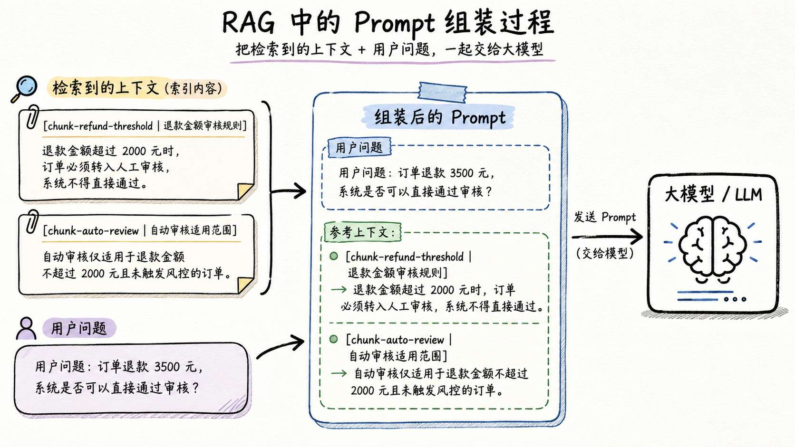


正常情况下的企业项目，做到这里，其实就差不多了。

**已经可以达到商用的标准了。**

但是，在这个基础上，咱们还是有机会做的更好的。

---

跟大家举个例子：


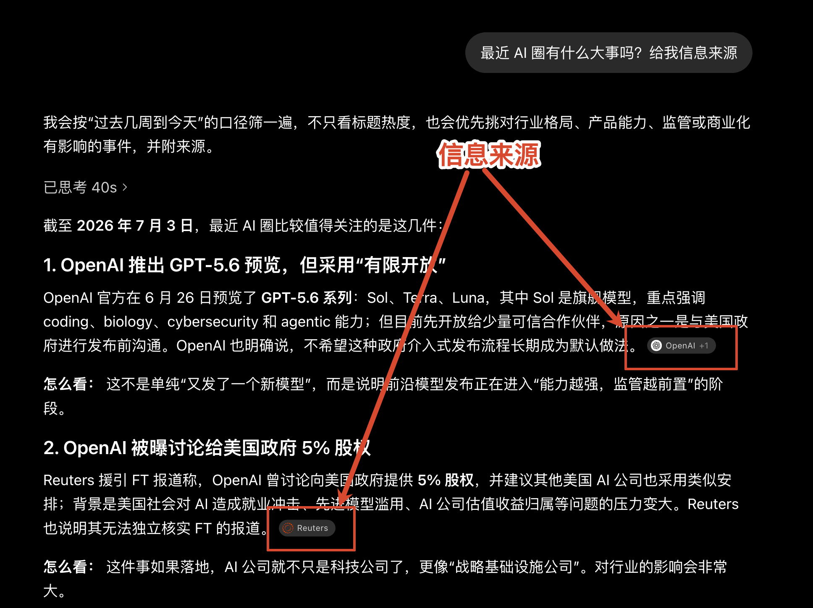


比如 GPT 的这个回答，就可以 **给出信息的来源**。

所以，这一小节咱们就要做两件事情：

1. **给出信息来源**：当用户质疑答案的真实性时，可以定位到信息来自哪份资料
2. **拒绝回答不知道的信息**：当知识库中的资料无法回答问题时，不能让模型继续胡编乱造

## 如何让 RAG 回答时给出信息来源
咱们先看第一个问题。

```plain
假设用户问：“订单 A1024 的咖啡机退款 3500 元，系统能否直接通过审核？”

- 模型根据检索到的退款规则，给出回答：“`该订单不能直接通过审核，需要转入人工审核。`”

然后用户问：“你凭什么这么说？？”
```

那么这个时候，咱们是不是就得有理有据的回答用户的问题了。

想要做到有理有据，就得展示咱们知识库里对应的资料，比如：

```latex
回答：该订单不能直接通过审核，需要转入人工审核。

信息来源：
[1] 退款金额审核规则
    文件：knowledge/refund-policy.md
    原文：退款金额超过 2000 元时，订单必须转入人工审核，系统不得直接通过。
```

这样用户就可以直接去看原始的规则了。

### 信息来源到底从哪来
大家还记得第  [04 小节](https://mp.weixin.qq.com/s/nH9hb014pEolJE6ZWVnOzQ?payreadticket=HL7LzsYGhC-seYo1db3nFXADXTJroW3eycFIwXXniEOoa8F4dim6Pfh5sGMN2KVVXqk5MkA) 里设计的 `Metadata` 和 `Chunk ID` 吗？


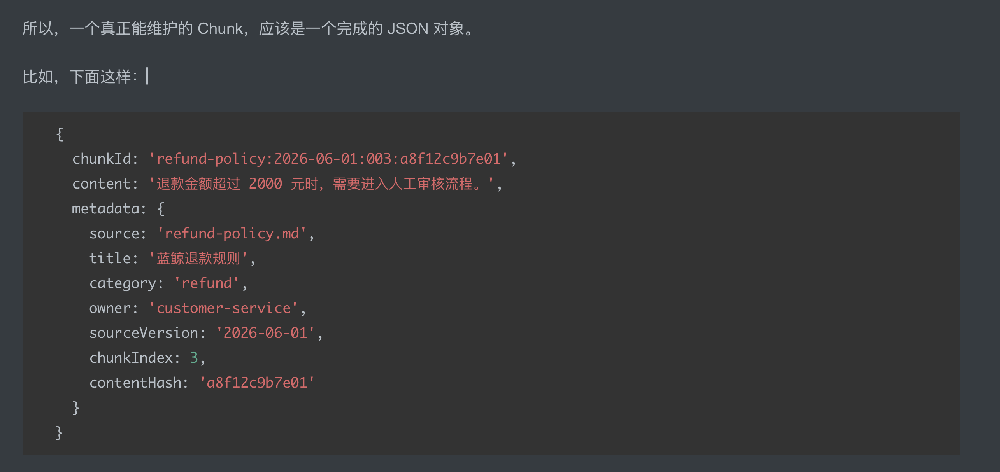

文档进入知识库之前，咱们已经把它拆成了多个 Chunk。每个 Chunk 除了正文，还会保存自己的 ID 和来源信息：

```javascript
{
  id: 'chunk-xxxx',
  title: '退款金额审核规则',
  source: 'refund-policy.md',
  content: '退款金额超过 2000 元时，需要进入人工审核流程。'
}
```

而这些信息就是 **信息来源的数据**

但是，在很多时候模型的一个回答可能会 **引用多个 Chunk**（就好比文章开头 GPT 的那个回答，会有多个来源）

这个时候，咱们可以构建一个数组，比如：

```json
{
  "answer": "该订单不能直接通过审核，需要转入人工审核。",
  "sourceChunkIds": ["chunk-xxxxx"]
}
```

其中 `answer` 是最终答案，`sourceChunkIds`** 就表示这段答案使用了哪些 Chunk。**

下面这张图就描述了整体 RAG 的流程：

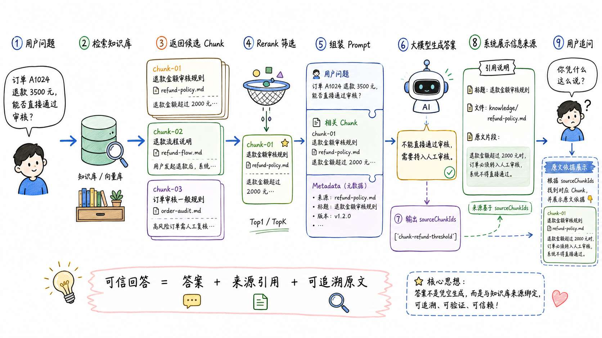


## 代码实现：让回答带上信息来源
> 课程中只展示部分关键逻辑
>
> 源码地址：`https://github.com/lgd8981289/Agent--Code`
>

创建文件夹 `10-grounded-answer-citations`

然后创建 `.env`：

```bash
ZHIPU_API_KEY=你的智谱 API Key
CHAT_MODEL=glm-4.7-flash
```

接着创建 `01-answer-with-sources.js`：

```javascript
// 用户提出的问题。
const question = '订单 A1024 的咖啡机退款 3500 元，系统能否直接通过审核？'

// 模拟第 09 节经过 Rerank 后留下的最终 Chunk。
//
const chunks = [
    ...
]

/**
 * 构造发给大模型的 messages。
 *
 * RAG 的关键就在这里：
 * 把“用户问题 + 检索出来的知识库 Chunk”一起放进 Prompt，
 * 让模型基于这些 Chunk 生成答案。
 *
 * 这里分成两个角色：
 * 1. system：告诉模型它应该如何回答，以及必须返回什么格式。
 * 2. user：提供真实的用户问题和知识库 Chunk。
 */
function buildMessages() {
    return [
        {
            role: 'system',
            content: `你是企业知识库问答助手。

请只根据用户提供的知识库 Chunk 回答问题。

返回要求：
1. answer 是给用户的最终答案。
2. sourceChunkIds 只填写直接支持答案的 Chunk ID。
3. sourceChunkIds 至少包含一个 ID，不得编造不存在的 ID。
4. 只返回下面结构的 JSON，不要返回其他内容：
{"answer":"最终答案","sourceChunkIds":["Chunk ID"]}`
        },
        {
            role: 'user',
            。。。
        }
    ]
}

/**
 * 调用大模型生成答案。
 */
async function callModel() {
    ...
}

/**
 * 根据模型返回的 sourceChunkIds，绑定真实来源信息。
 *
 * 模型只负责返回：
 * {
 *   answer: '...',
 *   sourceChunkIds: ['chunk-refund-threshold']
 * }
 *
 * 但最终展示给用户时，需要展示：
 * - 答案
 * - 来源标题
 * - 来源文件
 * - Chunk ID
 * - Chunk 原文
 *
 * 所以这里要把 sourceChunkIds 还原成完整 Chunk。
 */
function attachSources(modelResult) {
    ...

    // 把 chunks 转成 Map，方便通过 chunk.id 快速查找 Chunk。
    //
    // 结构大概是：
    // {
    //   'chunk-refund-threshold' => {...},
    //   'chunk-auto-review' => {...}
    // }
    const chunkMap = new Map(chunks.map((chunk) => [chunk.id, chunk]))

    // 根据模型返回的 sourceChunkIds 找到对应的 Chunk。
    //
    // 使用 Set 去重，避免模型重复返回同一个 Chunk ID。
    const sources = [...new Set(modelResult.sourceChunkIds)].map((chunkId) => {
        const chunk = chunkMap.get(chunkId)

        // 如果模型返回了一个不存在的 Chunk ID，必须直接报错。
        // 这一步很关键：
        // 可以防止模型编造来源。
        if (!chunk) {
            throw new Error(`模型引用了不存在的 Chunk ID：${chunkId}`)
        }

        return chunk
    })

    // 返回最终的答案和完整来源信息。
    return {
        // 去掉 answer 前后的空白字符。
        answer: modelResult.answer.trim(),

        // sources 是系统根据 Chunk ID 查出来的真实来源，
        // 不是模型自己生成的来源。
        sources
    }
}
...
```

我把上面代码的边缘逻辑去掉了，保留了两个核心方法：

1. `buildMessages`：提示词的构建方法，核心作用是让 大模型 返回 JSON 结构化的数据
2. `attachSources`：这个就是 **绑定信息来源的核心方法**。原理是：根据模型返回的 sourceChunkIds 找到对应的 Chunk，然后把找到的 chunk 数据组装起来，变成一个新的结构数据，返回给用户

接下来咱们执行 

```plain
node --env-file=.env 01-answer-with-sources.js
```

打印结果：

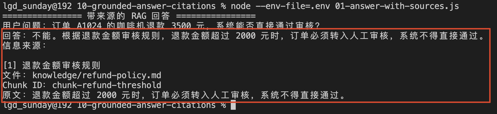


这里的 `[1]` 是 `printAnswer` 根据数组顺序生成的显示编号。

真正把答案和原始资料连接起来的，是模型返回的 `chunk-refund-threshold`。

咱们就是根据这个 ID 找到的 Chunk，又从 Chunk 的 Metadata 中取出了标题和文件地址。

这样用户点击来源、查看原文 的时候，就只需要给一个外链的地址，跳转就可以展示了～

---

那么到这里咱们在文章最初的第一个问题，就已经搞定了。

然后接下来咱们来看第二个问题 👇

## 拒绝回答不知道的信息
大模型有一个特点，有时候喜欢胡编乱造，也就是出现所谓的幻觉问题。

其实它的这种特点，咱们根据之前所学到的内容也很好理解。

大模型本质是根据上下文估计后续 Token 出现的概率

但是，如果咱们把大模型集成到系统中，特别是在一些具备承诺的系统中，就必须得避免它喜欢胡编乱造的行为。

**我就吃过这样的亏**。

我记得在当前这个账号做公众号转移的时候，我问腾讯的「微信营销助手」大模型：“账号迁移之后，原账号的的 **文章合集** 结构是否会保留？” 

它是这么给我回答的：

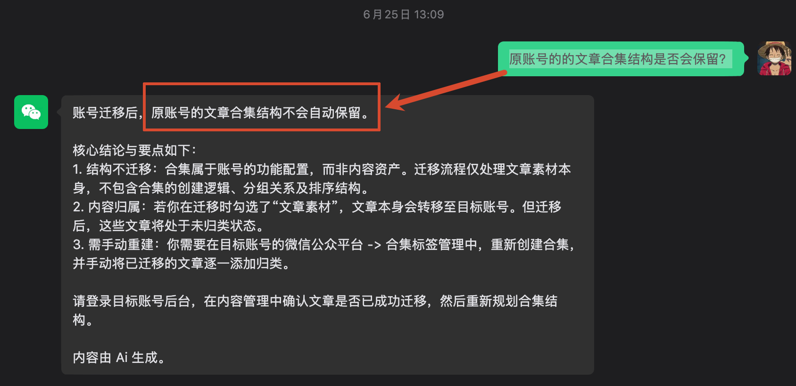


当我继续问它：“原付费合集消失，那原账号中购买了付费合集的用户怎么办？” 

它给我的回答是这样的：


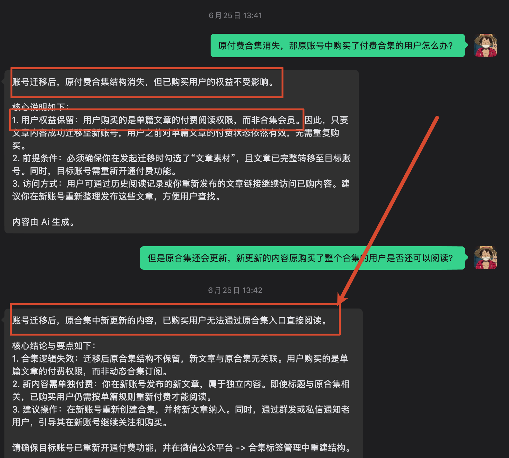


看着回答的多专业呀。

然后，为了避免已购用户的权益收到影响，我只能先给所有购买了这个课程的同学，办理了退款：

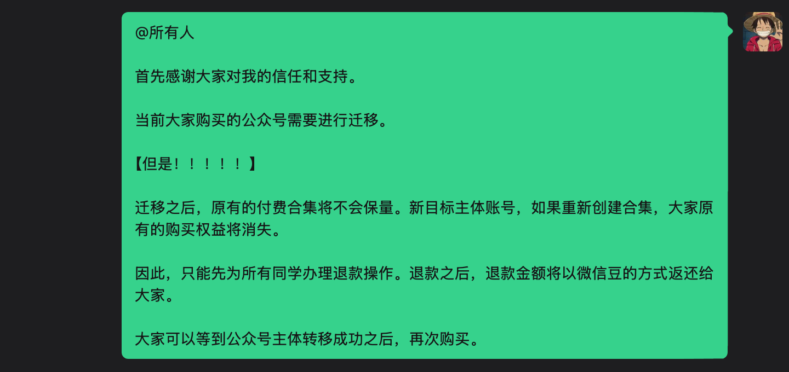


结果。。。。结果。。。。。

微信给我坑了一波大的，，，，

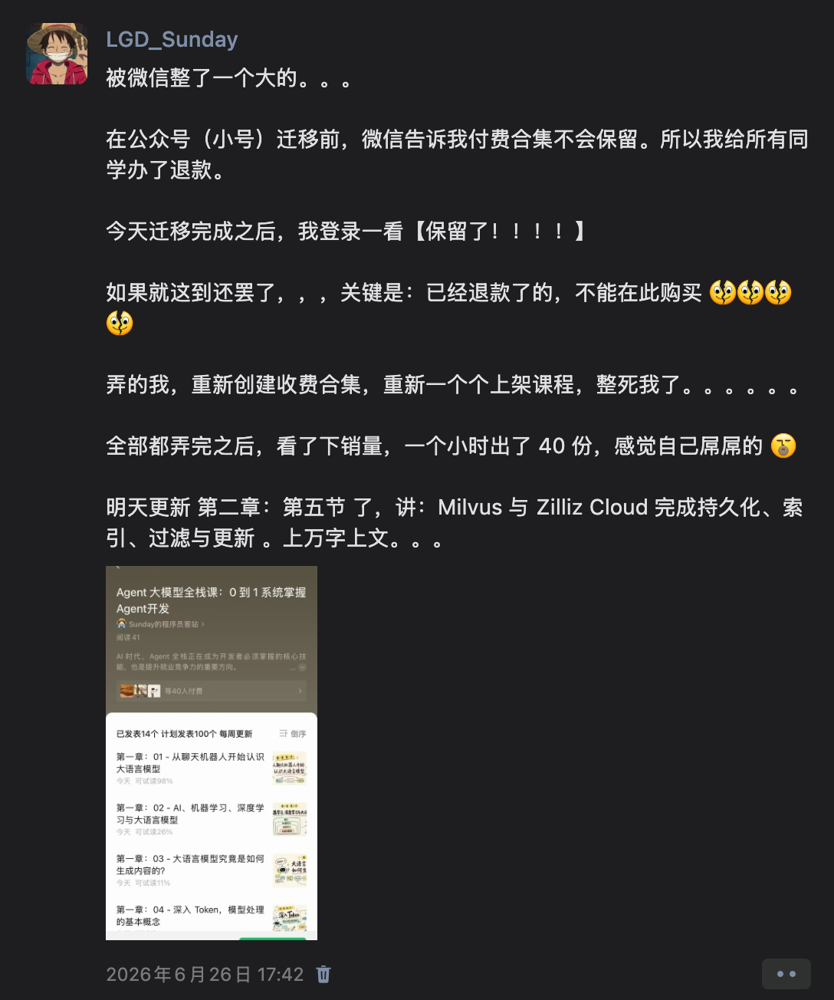


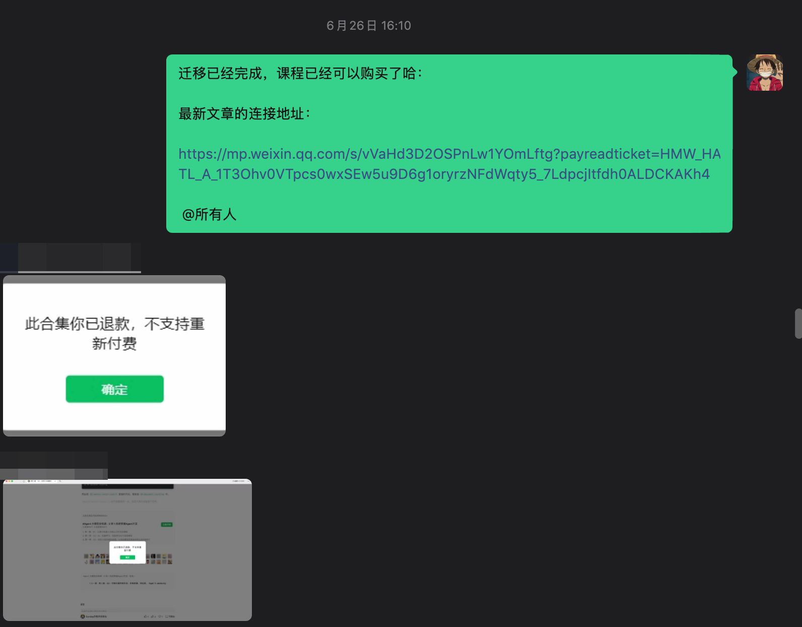

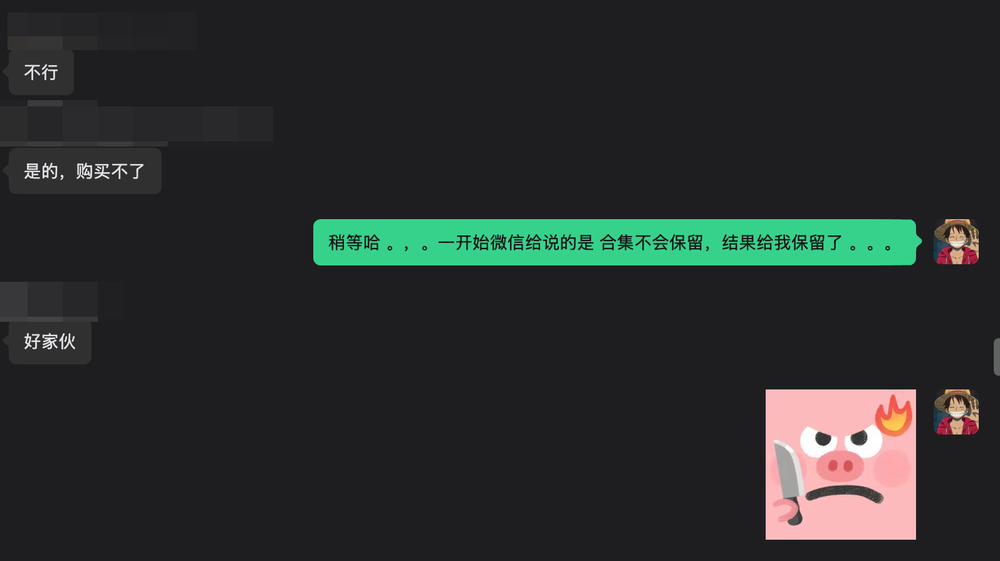


这让我发四，我一定得做这个功能：**当大模型不知道答案的时候，可不能胡编乱造啊。。。。**

---

还是使用刚才的知识库。

这次用户问：“这台咖啡机可以免费保修几年？”

但是，知识库里没有咖啡机保修规则，只有退款到账时间

所以，这时候，大模型应该怎么回答？

正确的做法肯定是 **拒绝回答这个问题**：

```latex
根据当前知识库资料，无法回答这个问题。
```

很多同学可能会有一个疑问。

知识库里没有保修规则，那检索结果肯定会返回一个空数组，那不就证明 **无答案** 了吗？

**不是这样的**

咱们前面已经讲过，向量检索会从知识库中找出和问题最接近的 TopK 个 Chunk。

这里的“最接近”，只是和其他 Chunk 相比更接近，并不代表它真的可以回答问题。

所以，用户问 “咖啡机保修几年” ，检索器仍然可能找回包含“咖啡机”“售后”或者“退款”的资料。

```latex
用户问题：咖啡机可以免费保修几年？

检索结果 1：退款审核通过后，款项会在 3 到 5 个工作日内原路退回。（无用回答）
检索结果 2：咖啡机可保修 XXX 年（可能会直接编出来一个保修年限）
```

所以，拒答需要处理两种情况：

+ 第一种：没有检索到任何 Chunk 时，直接拒答
+ 第二种：检索到了 Chunk 时，让模型判断资料是否足够，并返回明确的拒答状态

因此，第二个案例会把模型输出扩展成下面这样：

```json
{
  "status": "insufficient_evidence",
  "answer": "根据当前知识库资料，无法回答这个问题。",
  "sourceChunkIds": []
}
```

`insufficient_evidence` 表示证据不足。

前端或者后续业务流程看到这个状态，就知道当前没有可靠答案。它可以提示用户补充信息，也可以重新检索或者转给人工处理。

## 代码实现拒答功能
第二个案例在第一个案例的基础上增加拒答能力。

完整代码位于，代码地址在 `10-grounded-answer-citations/02-answer-with-refusal.js`

先准备一个知识库无法回答的问题，以及检索阶段错误召回的 Chunk：

```javascript
const question = '这台咖啡机可以免费保修几年？'
const REFUSAL_ANSWER = '根据当前知识库资料，无法回答这个问题。'

const chunks = [
  {
    id: 'chunk-refund-arrival',
    title: '退款到账时间',
    source: 'knowledge/refund-arrival.md',
    content:
      '退款审核通过后，款项会在 3 到 5 个工作日内原路退回。不同银行的到账时间可能存在差异。'
  }
]
```

注意，这里的 `chunks.length` 是 `1`。

也就是说，检索阶段完全可以召回信息。只不过这份信息和保修年限没有关系。

然后修改 Prompt，让模型先判断现有 Chunk 能不能支持答案：

```javascript
function buildMessages() {
  return [
    {
      role: 'system',
      content: `你是企业知识库问答助手，只能根据用户提供的知识库 Chunk 回答问题。

请先判断 Chunk 是否能够直接支持问题的答案。

返回要求：
1. 能够直接支持答案时，status 返回 answered，answer 返回最终答案，sourceChunkIds 返回直接支持答案的 Chunk ID。
2. 无法直接支持答案时，不得使用自己的知识补充或猜测。status 返回 insufficient_evidence，answer 固定返回“${REFUSAL_ANSWER}”，sourceChunkIds 返回空数组。
3. 只返回下面结构的 JSON，不要返回其他内容：
{"status":"answered 或 insufficient_evidence","answer":"最终答案或拒答内容","sourceChunkIds":["Chunk ID"]}`
    },
    {
      role: 'user',
      content: `用户问题：${question}\n\n知识库 Chunk：\n${JSON.stringify(
        chunks.map(({ id, title, content }) => ({ id, title, content })),
        null,
        2
      )}`
    }
  ]
}
```

和第一个案例相比，这次多了一个 `status`。

模型认为资料可以支持答案时返回 `answered`。认为资料无法支持答案时，返回 `insufficient_evidence`。

接着准备统一的拒答结果的方法 `createRefusal`：

```javascript
/**
 * 创建统一的拒答结果。
 *
 * 当知识库没有足够依据时，不返回来源，
 * 因为没有任何 Chunk 能直接支持这个答案。
 */
function createRefusal() {
    return {
        status: 'insufficient_evidence',
        answer: REFUSAL_ANSWER,
        sources: []
    }
}
```

然后校验模型输出：

```javascript
function validateResult(modelResult) {
  ...
  if (modelResult.status === 'insufficient_evidence') {
    if (modelResult.sourceChunkIds.length > 0) {
      throw new Error('拒答结果不应该包含信息来源。')
    }

    return createRefusal()
  }

  if (
    typeof modelResult.answer !== 'string' ||
    !modelResult.answer.trim() ||
    modelResult.sourceChunkIds.length === 0
  ) {
    throw new Error('正常回答必须包含 answer 和 sourceChunkIds。')
  }

  ...

  return {
    status: 'answered',
    answer: modelResult.answer.trim(),
    sources
  }
}
```

拒答时，代码不直接使用模型生成的文案，而是调用 `createRefusal()` 返回统一结果。

咱们执行：

```bash
node --env-file=.env 02-answer-with-refusal.js
```

应该可以看到类似下面的结果：

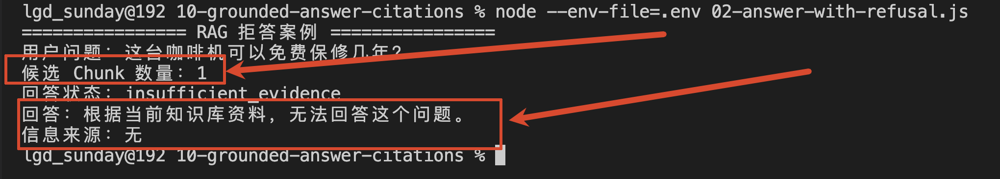


重点看 `候选 Chunk 数量`。它的值是 `1`，说明检索器是有返回内容的。

但是，模型判断这份资料无法支持保修年限，所以返回了 `insufficient_evidence`。

咱们识别到这个状态以后，输出统一的拒答内容，并且不展示任何信息来源。

这就是咱们这一节要实现的第二个能力：**不是“检索到内容就必须回答”，而是“现有内容真的能够支持答案时才回答”。**

## 总结
这一小节，咱们完成了 RAG 答案生成阶段的两个重要能力。

### 第一个是给出信息来源
来源不是让模型现场生成一个标题或者地址，而是来自 Chunk 本身保存的 Metadata。

模型只返回自己使用过的 Chunk ID，然后咱们再根据 ID 找回标题、文件地址和原文，最后展示给用户。

### 第二个是拒绝回答知识库里没有的信息
检索结果为空时，可以直接通过代码拒答。

检索到了资料但无法支持答案时，让模型返回 `insufficient_evidence`，再由 agent 系统进入统一的拒答流程。

现在，这套 RAG 不仅可以找到资料并生成回答，还可以告诉用户答案来自哪里，并在没有可靠依据时直接拒答了

> 更新：2026-07-03 15:30 · 原文：<https://www.yuque.com/lgdsunday/ab1dy3/lmboo00ia6pgkgi4>
