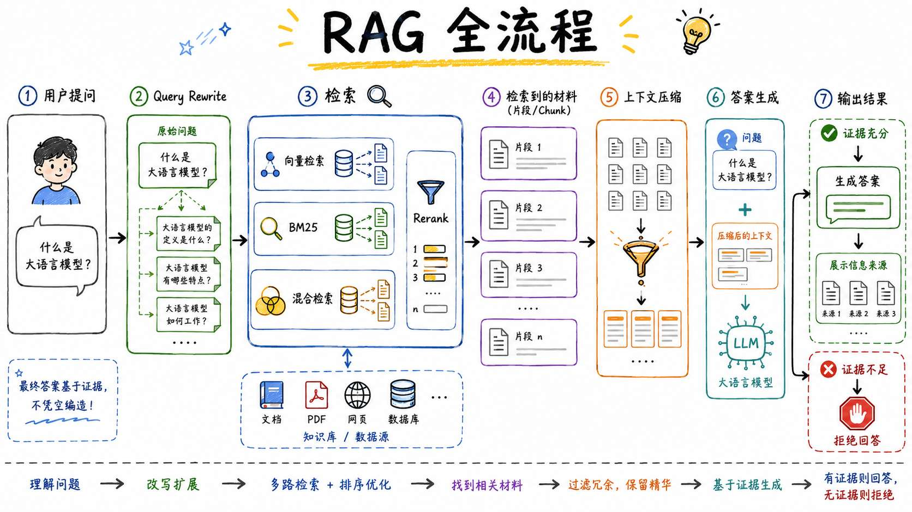
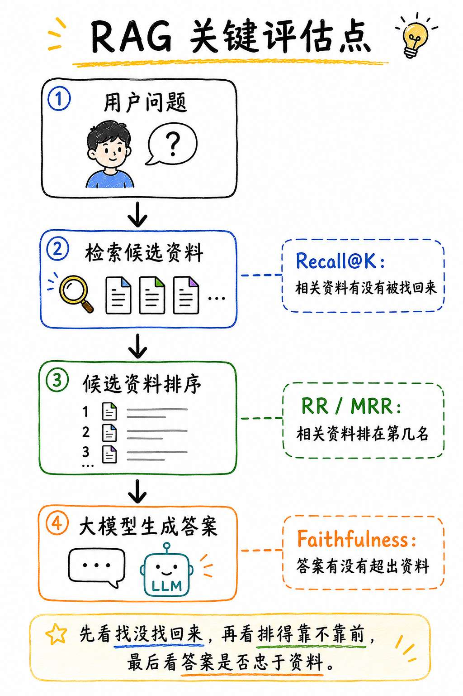
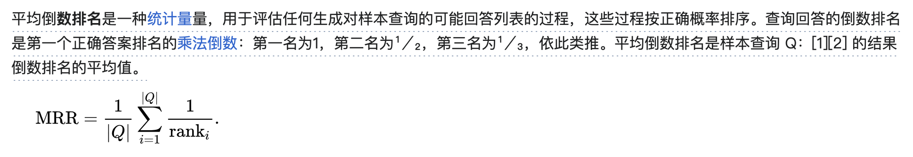
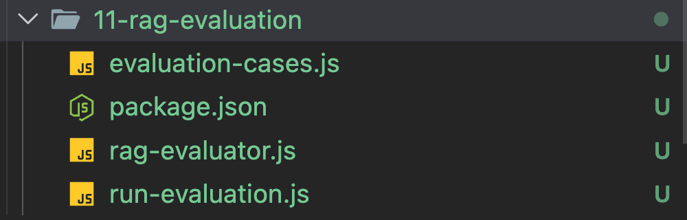
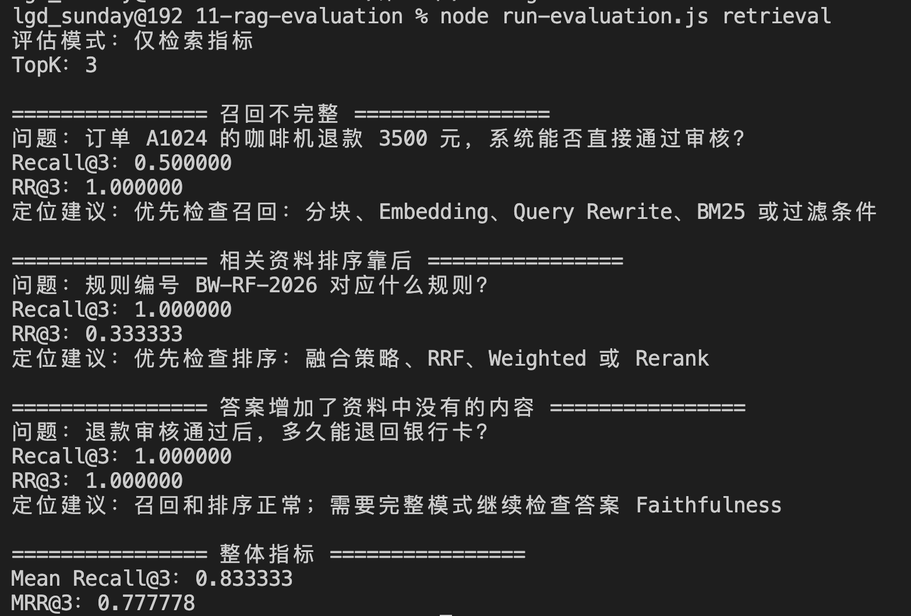
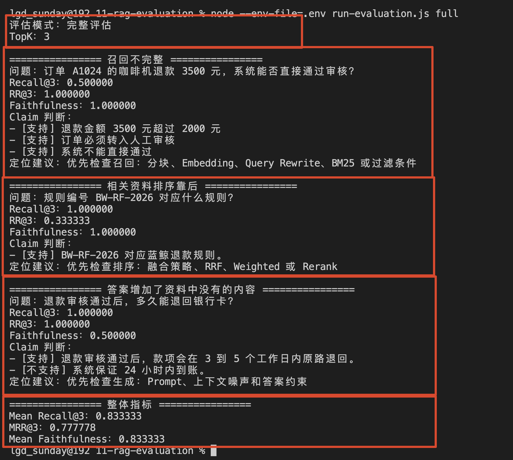
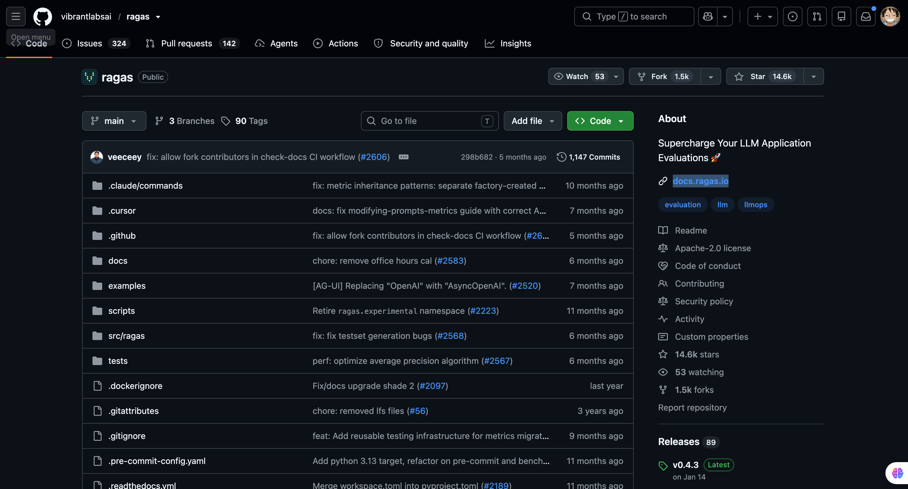
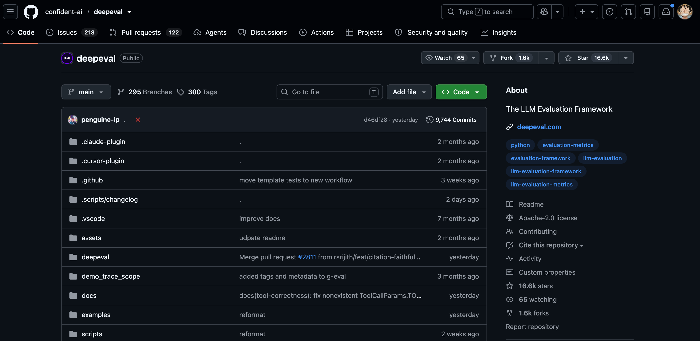

# 11 - RAG 质量评估体系！详解：Recall@K、MRR、 Faithfulness

现在，当用户提出问题的时候，已经可以通过  Query Rewrite，再进入向量检索、BM25、混合检索和 Rerank，资料找到以后，系统还可以压缩上下文、生成答案、展示信息来源，并在证据不足时拒绝回答。



这样的话，基本上 RAG 的流程就完全 OK 了。

但是如果要在企业项目里面用，还差最后一块，那就是 **评测**

企业项目里的东西，啥都得评测。

传统的前后端项目里面，得评测：性能指标，压测数据 等等的。

在 Agent 项目里面，也得有对应的评测流程，主打一个：“可量化，可追溯。。。”

那么在咱们本章的 RAG 系统里面，这里涉及到的指标核心就有三个：

+ `Recall@K - 召回率`：该找回来的资料，有没有进入 TopK
+ `MRR - 平均倒数排名`：第一份相关资料，排得够不够靠前
+ `Faithfulness` - 忠实度：答案中的内容，能不能被检索资料支持

三个指标对应 RAG 的关键流程位置如下图所示：




## Recall@K - 召回率：该找的资料有没有找回来
>  假设，用户的问题是：“订单 A1024 的咖啡机退款 3500 元，系统能否直接通过审核？”
>
> 那么标准答案的召回结果是这样：
>

```javascript
title：退款金额审核规则
content：退款金额超过 2000 元时，订单必须转入人工审核，系统不得直接通过。

title：自动审核规则
content：自动审核仅适用于退款金额不超过 2000 元且未触发风控的订单。
```

假如，用户开始提问，系统的检索结果如下：

+ `Top1：` 退款金额审核规则（命中的资料）
+ `Top2：` 订单 A1024 发票记录
+ `Top3：` 订单审核系统说明

大家对比这里的检索结果和上面的标准答案，可以发现，只命中了一个：`退款金额审核规则 `

这个时候，如果我们计算 `Recall@3` 也就是 召回率 的算法就是：

```javascript
Recall@3 = Top3 中命中的相关 Chunk 数量 / 全部相关 Chunk 数量
```

以刚才的例子为例，那就是：

```javascript
Recall@3 = 1 / 2 
```

即：**召回率（Recall@K） = 0.5 **

这里的 `@K` 是动态的值

> 如果最终准备把 Top3 交给大模型，就评估 `Recall@3`。
>
> 如果会先召回 Top20 再交给 Rerank，也可以评估 `Recall@20`。
>

但是，Recall@K 有一个非常明显的特点：**它只关心相关资料有没有进入 TopK，不关心资料排在第几名。**（比如上面的例子，“退款金额审核规则” 如果是在 Top3，那么 Recall 的结果不变）

这就会带来下一个问题。

## MRR - 平均倒数排名：相关资料虽然找到了，但排在第几名
再来看第二个案例。

> 用户问：“规则编号 BW-RF-2026 对应什么规则？”
>
> 这个问题的标准相关资料只有一份：
>

```plain
title：规则编号映射表
内部规则映射：BW-RF-2026 对应蓝鲸退款规则。
```

当前检索结果是：

+ `Top1`：售后规则查询说明  
`Top2`：退款金额审核规则  
`Top3`：规则编号映射表（命中的资料）

所以：`Recall@3 = 1 / 1 = 1` 

如果只看 Recall@3，这次检索是没什么问题的

**但是**

真正能够回答问题的资料，排在了 Top3。

如果系统最后只保留 Top1，那么回答的结果就是不对的。

所以，咱们还需要观察 **第一份相关资料出现的位置**。

这个指标叫做 `Reciprocal Rank`，简称 `RR`。

它的计算方式是：

```latex
第一份相关资料排在第 1 名：RR = 1 / 1 = 1
第一份相关资料排在第 2 名：RR = 1 / 2 = 0.5
第一份相关资料排在第 3 名：RR = 1 / 3 ≈ 0.333333
TopK 中没有相关资料：RR = 0
```

当前案例中，第一份相关资料排在第 3 名，则：

```latex
RR@3 = 1 / 3 ≈ 0.333333
```

这个分数越接近 `1`，就表示用户能越看到相关资料。

不过，单个问题算出来的只能叫 `RR`。

如果咱们有多个评估问题，把每个问题的 RR 加起来再取平均，才叫做 `MRR`，即 **平均倒数排名**：

```latex
MRR = 所有问题的 RR 之和 / 问题数量
```




比如三个问题的 RR 分别是：

```latex
问题一：1
问题二：1 / 3
问题三：1
```

那么：

```latex
MRR = (1 + 1/3 + 1) / 3
    ≈ 0.777778
```

> 一个小的注意点：不要把 MRR 和前面学过的 RRF 搞混了。
>
> + `MRR` 是评估指标，用来衡量第一份相关资料排得够不够靠前。
> + `RRF` 是融合算法，用来把多路检索结果合并成一个新的排序。
>

MRR  只关心 **第一份** 相关资料的位置，不关心第二份、第三份相关资料排在哪里。

所以 Recall@K 和 MRR 需要放在一起看：

+ Recall@K 看有没有漏掉相关资料。
+ MRR 看第一份相关资料是不是排得足够靠前。

## Faithfulness - 忠实度：检索没有问题，答案就一定可靠吗
现在来看第三个案例。

> 用户问："退款审核通过后，多久能退回银行卡？"
>
> 检索返回的第一份资料就是正确内容：
>

```plain
- 退款审核通过后，款项会在 3 到 5 个工作日内原路退回
- 不同银行的到账时间可能存在差异。
```

这个时候：

+ Recall@3 = 1
+ RR@3 = 1

召回和排序都没有问题。

但是，大模型最后给出的回答如下：

```latex
退款审核通过后，款项会在 3 到 5 个工作日内原路退回，
注意这里👉👉 并且系统保证 24 小时内到账。
```

前半句来自知识库，没问题。

后半句 “系统保证 24 小时内到账”，在检索资料里根本不存在。

如果只看 Recall@K 和 MRR，这次 RAG 的分数都很好。

但是答案依然出现了幻觉。

这时就需要 `Faithfulness`。

`Faithfulness` 一般翻译为 **忠实度**。

它关注的是：**答案中的每一个回答，能不能被本次检索上下文支持。**

咱们可以先把刚才的答案拆成两 `Claim`（断言）：

```latex
第一部分：款项会在 3 到 5 个工作日内原路退回。
结果：有上下文支持。

第二部分：系统保证 24 小时内到账。
结果：没有上下文支持。
```

而 Faithfulness   的计算方式是：

```latex
Faithfulness = 有上下文支持的 Claim 数量 / 全部 Claim 数量
```

即：

```plain
Faithfulness = 1 / 2
```

最后的结果是 `Faithfulness = 0.5`

这里需要特别注意一件事。

**Faithfulness 不等于答案一定正确。**

它只能证明答案和本次检索上下文保持一致。

如果知识库原文就是错的，模型完全照着错误原文回答，Faithfulness 仍然可能是 `1`。

同样，Faithfulness 也不负责判断答案有没有真正回答用户的问题。

所以它是一个 **用于检查答案有没有脱离资料的指标**

## 实现一个最小 RAG 评估器
概念已经说清楚了，接下来咱们把它写成代码。

> 源码地址：`https://github.com/lgd8981289/Agent--Code`
>

创建 `11-rag-evaluation` 文件夹，目录结构如下：




其中：

+ `evaluation-cases.js`：保存问题、标准 Chunk ID、检索结果和最终答案
+ `rag-evaluator.js`：计算 Recall@K、RR/MRR 和 Faithfulness
+ `run-evaluation.js`：执行全部案例并输出评估报告

### 先准备评估数据
先创建 `evaluation-cases.js`。

这里一共准备三个案例：

```javascript
export const evaluationCases = [
  {
    id: 'recall-miss',
    name: '召回不完整',
    question: '订单 A1024 的咖啡机退款 3500 元，系统能否直接通过审核？',
    relevantChunkIds: [
      'chunk-refund-threshold',
      'chunk-auto-review'
    ],
    retrievedChunks: [
      // Top3 只包含其中一份相关资料
    ],
    answer: '退款金额 3500 元超过 2000 元，订单必须转入人工审核，系统不能直接通过。'
  },
  {
    id: 'ranking-low',
    name: '相关资料排序靠后',
    // 相关资料排在第三名
  },
  {
    id: 'answer-hallucination',
    name: '答案增加了资料中没有的内容',
    // 检索结果正确，但 answer 增加了“保证 24 小时到账”
  }
]
```

### 实现 Recall@K
然后创建 `rag-evaluator.js`。

先实现 Recall@K：

```javascript
/**
 * 计算单个问题的 Recall@K。
 *
 * Recall@K = TopK 中命中的相关 Chunk 数量 / 全部相关 Chunk 数量
 *
 * 如果一个问题没有任何相关 Chunk，这个指标没有分母，返回 null。
 * 这种问题应该单独评估拒答，而不是强行记成 0 或 1。
 */
export function recallAtK(retrievedChunks, relevantChunkIds, k) {
    ...
    // 取出系统检索结果中的前 K 条。
    // 然后只保留每个 Chunk 的 id。
    //
    // 使用 Set 是为了方便后面判断：
    // 某个相关 Chunk id 是否出现在 TopK 结果中。
    const topKIds = new Set(retrievedChunks.slice(0, k).map((chunk) => chunk.id))

    // 对人工标注的相关 Chunk ID 去重。
    // 避免 relevantChunkIds 中重复出现同一个 id，导致分母被重复计算。
    const uniqueRelevantIds = [...new Set(relevantChunkIds)]

    // 统计 TopK 结果中命中了多少个相关 Chunk。
    //
    // 举例：
    // TopK = ['chunk-a', 'chunk-b', 'chunk-x']
    // Relevant = ['chunk-a', 'chunk-c']
    // 那么只命中了 chunk-a，hitCount = 1。
    const hitCount = uniqueRelevantIds.filter((id) => topKIds.has(id)).length

    // 按公式计算 Recall@K：
    // 命中的相关 Chunk 数量 / 全部相关 Chunk 数量
    return hitCount / uniqueRelevantIds.length
}
```

代码先取出前 K 个检索结果，再统计其中有多少 ID 出现在标准相关资料里。

> PS：再跟大家强调一下，**AI 时代，具体的代码细节不需要关注了，大家只需要关注大致流程即可**
>

### 实现 RR 和 MRR
接着实现单个问题的 RR：

```javascript
/**
 * 计算单个问题的 Reciprocal Rank，也就是 RR。
 *
 * RR 用来评估：第一份相关 Chunk 在检索结果中排得有多靠前。
 *
 * 计算方式： RR = 1 / 第一份相关 Chunk 的排名
 *
 * 举例：
 * - 第一份相关 Chunk 排在第 1 位：RR = 1 / 1 = 1
 * - 第一份相关 Chunk 排在第 2 位：RR = 1 / 2 = 0.5
 * - 第一份相关 Chunk 排在第 3 位：RR = 1 / 3 ≈ 0.333
 * - TopK 内没有任何相关 Chunk：RR = 0
 */
export function reciprocalRank(retrievedChunks, relevantChunkIds, k) { 
 ...

    // 把人工标注的相关 Chunk ID 转成 Set 去重
    const relevantIdSet = new Set(relevantChunkIds)

    // 只取检索结果的前 K 条进行评估。
    //
    // 然后从前往后查找：
    // 第一条出现在 relevantIdSet 中的 Chunk，也就是“第一份相关资料”。
    //
    // findIndex 返回的是数组下标：
    // - 如果第一份相关资料在第 1 位，下标是 0
    // - 如果第一份相关资料在第 2 位，下标是 1
    // - 如果没有找到，返回 -1
    const firstRelevantIndex = retrievedChunks
        .slice(0, k)
        .findIndex((chunk) => relevantIdSet.has(chunk.id))

    // 如果 TopK 里面没有任何相关 Chunk，则 RR = 0。
    if (firstRelevantIndex === -1) {
        return 0
    }

    // firstRelevantIndex 是从 0 开始的数组下标，
    // 但排名是从 1 开始的。
    //
    // 所以需要 + 1。
    //
    // 举例：
    // firstRelevantIndex = 0，说明排第 1，RR = 1 / 1
    // firstRelevantIndex = 1，说明排第 2，RR = 1 / 2
    return 1 / (firstRelevantIndex + 1)
}
```

`findIndex` 的索引从 `0` 开始，所以计算排名时需要加 `1`。

找到第一份相关资料以后，直接返回排名的倒数。

多个问题的 RR 取平均，就是 MRR：

```javascript
/**
 * 计算一组数字的平均值。
 *
 * 平均值的计算方式：mean = 所有数字之和 / 数字个数
 *
 * 举例：
 * values = [1, 2, 3]
 * mean = (1 + 2 + 3) / 3 = 2
 */
export function mean(values) {
    ...
    // reduce 用来累加数组中的每一个数字。
    //
    // total：当前已经累加出来的总和
    // value：当前正在遍历的数字
    // 0：初始总和，从 0 开始累加
    const total = values.reduce((total, value) => total + value, 0)

    // 平均值 = 总和 / 数字个数
    return total / values.length
}

const mrr = mean(
  results.map((result) => result.reciprocalRank)
)
```

### 使用模型判断 Faithfulness
Faithfulness 会稍微麻烦一点。

程序需要先把答案拆成 Claim（断言），再判断每个 Claim（断言） 能不能被上下文支持。

这种就不能通过固定的规则判断了，就得用模型。

这里得让模型完成两件事：

+ 第一：把答案拆成独立 Claim
+ 判断每个 Claim 是否有上下文支持

所以为先创建一个 `buildFaithfulnessMessages` 方法，用来构建模型的 `prompt（提示词）

```javascript
/**
 * 构造 Faithfulness 评估所需的 messages。
 *
 * 评估模型负责两件事：
 * 1. 把答案拆成能够独立判断的 Claim
 * 2. 判断每个 Claim 是否能被检索上下文直接支持
 *
 * 最终分数不交给模型计算，避免模型随意给出一个总分。
 */
export function buildFaithfulnessMessages(evaluationCase) {
  return [
    {
      role: 'system',
      content: `你是 RAG 系统的 Faithfulness 评估器。

请把“待评估答案”拆成能够独立判断真假的 Claim，
再判断每个 Claim 是否能从“检索上下文”中直接推出。

严格遵守以下规则：
1. 只能使用检索上下文，不得使用外部知识。
2. supported 只有在上下文能够直接支持 Claim 时才为 true。
3. supportingChunkIds 只能填写直接支持该 Claim 的 Chunk ID。
4. supported 为 false 时，supportingChunkIds 必须是空数组。
5. 只返回 JSON。`
    },
    {
      role: 'user',
      content: `用户问题：${evaluationCase.question}

检索上下文：
${JSON.stringify(evaluationCase.retrievedChunks, null, 2)}

待评估答案：
${evaluationCase.answer}`
    }
  ]
}
```

然后通过 `evaluateFaithfulness` 进行接口请求：

```javascript
/**
 * 计算单个答案的 Faithfulness，也就是“忠实度”。
 *
 * Faithfulness 用来评估：
 * 大模型生成的答案，是否忠实于检索回来的上下文资料。
 *
 * 在这里，我们把答案拆成多个 Claim，也就是多个“答案断言”。
 *
 * 计算方式：Faithfulness = 有上下文支持的 Claim 数量 / 全部 Claim 数量
 *
 * 举例：
 * 全部 Claim 数量 = 4
 * 有上下文支持的 Claim 数量 = 3
 *
 * Faithfulness = 3 / 4 = 0.75
 */
export async function evaluateFaithfulness(...) {
    ...
    // 调用评估模型，让模型判断答案中的每个 Claim 是否能被检索上下文支持。
    //
    // 这里并不是让模型重新回答用户问题，
    // 而是让模型扮演“评测器”的角色。
    const response = await requester(...)

    // 从模型响应中取出文本内容。
    // 正常情况下，这里应该是一段 JSON 字符串。
    const content = response.choices?.[0]?.message?.content

    // 如果模型没有返回内容，说明这次评估失败。
    if (!content) {
        throw new Error('Faithfulness 评估没有返回可用内容。')
    }

    let parsed

    try {
        // 将模型返回的 JSON 字符串解析成 JavaScript 对象。
        parsed = JSON.parse(content)
    } catch {
        // 即使设置了 response_format，模型也不一定 100% 返回合法 JSON。
        // 所以这里必须做异常处理，避免程序直接崩溃。
        throw new Error(`Faithfulness 评估没有返回合法 JSON：${content}`)
    }

    // 校验模型返回的 Claim 判断结果。
    //
    // validateClaimJudgements 通常需要检查：
    // 1. 返回结果是不是数组
    // 2. 每个 Claim 是否包含必要字段
    // 3. supported 是否是布尔值
    // 4. 引用的 sourceChunkIds 是否真的存在于 retrievedChunks 中
    //
    // 这一步很关键：
    // 因为模型返回的是外部数据，不能直接相信。
    const claims = validateClaimJudgements(parsed, evaluationCase.retrievedChunks)

    // 如果没有拆出任何 Claim，就无法计算 Faithfulness。
    // 这里直接抛错，说明该评测样本或模型返回结果不符合预期。
    if (claims.length === 0) {
        throw new Error('Faithfulness 评估没有生成任何 Claim，无法计算分数。')
    }

    // 统计有多少个 Claim 能被上下文支持。
    //
    // supported = true 表示：
    // 这个 Claim 可以从 retrievedChunks 中找到依据。
    const supportedCount = claims.filter((claim) => claim.supported).length

    // 返回完整评估结果。
    return {
        // Faithfulness 分数：
        // 有上下文支持的 Claim 数量 / 全部 Claim 数量
        score: supportedCount / claims.length,

        // 被上下文支持的 Claim 数量。
        supportedCount,

        // 全部 Claim 数量。
        totalCount: claims.length,

        // 每个 Claim 的详细判断结果。
        //
        // 这里可以用于后续展示：
        // 哪些断言被支持，哪些断言没有依据。
        claims
    }
}
```

## 执行代码
执行 

```plain
node run-evaluation.js retrieval
```

终端会输出：




+ 第一个案例的第一份相关资料虽然排在 Top1，但是两份标准资料只找回了一份，所以 `Recall@3` 只有 `0.5`。
+ 第二个案例没有漏掉相关资料，所以 `Recall@3` 是 `1`。但是相关资料排在第三名，因此 RR 只有 `0.333333`。
+ 第三个案例的 Recall 和 RR 都是 `1`。但是召回结果其实是有问题的

##### Faithfulness
然后咱们来看 `Faithfulness`

Faithfulness 需要调用评估模型，别忘了 `.env` 文件：

```plain
ZHIPU_API_KEY=你的 key
EVALUATOR_MODEL=glm-4.7-flash
```

然后执行：

```bash
node --env-file=.env run-evaluation.js full
```

全部输出结果：




## 总结
这一节重点看三个指标：

### `Recall@K`
看的是：该找回来的资料，有没有进入 TopK。

如果 `Recall@K` 低，说明关键资料在召回阶段就丢了。

这时应该优先检查分块、Embedding、Query Rewrite、BM25、Metadata Filter，而不是改 Prompt。

## `RR / MRR`
看的是：相关资料有没有排得足够靠前。

如果 `Recall@K` 高，但是 `MRR` 低，说明资料已经找到了，只是排序不好。

这时应该优先检查混合检索权重、RRF、Rerank 和 TopK 设置。

### `Faithfulness`
看的是：答案有没有忠实于检索资料。

如果 `Recall@K` 和 `MRR` 都正常，但 `Faithfulness` 低，说明问题更可能出在生成阶段。

比如 Prompt 约束不够、上下文有噪声、答案没有绑定来源，或者缺少拒答校验。

那么除了以上的方式之后，还有一些框架，比如：

`ragas`：围绕 RAG 场景提供成体系的评估指标




`DeepEval` ：面向 LLM 应用的测试框架，支持用类似单元测试的方式评估 RAG、Agent、Prompt、Chatbot 等场景




这些框架级别的东西，咱们放到后面再说，现在主要看原理就行

> 更新：2026-07-04 12:03 · 原文：<https://www.yuque.com/lgdsunday/ab1dy3/wikto6y1ioi4z271>
