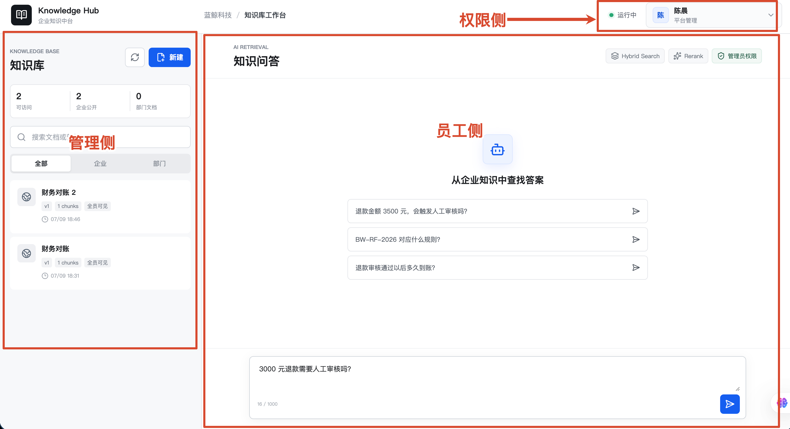
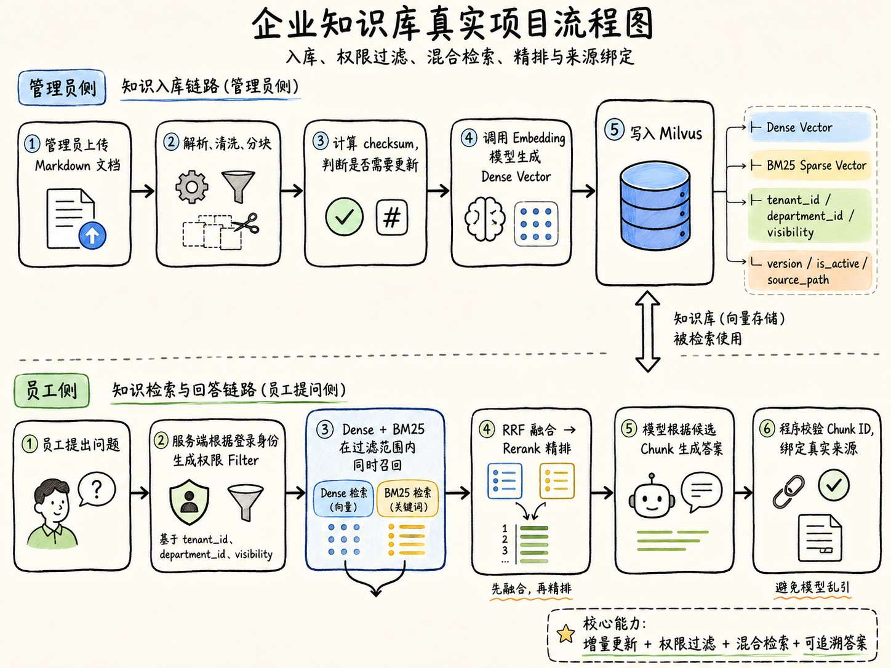
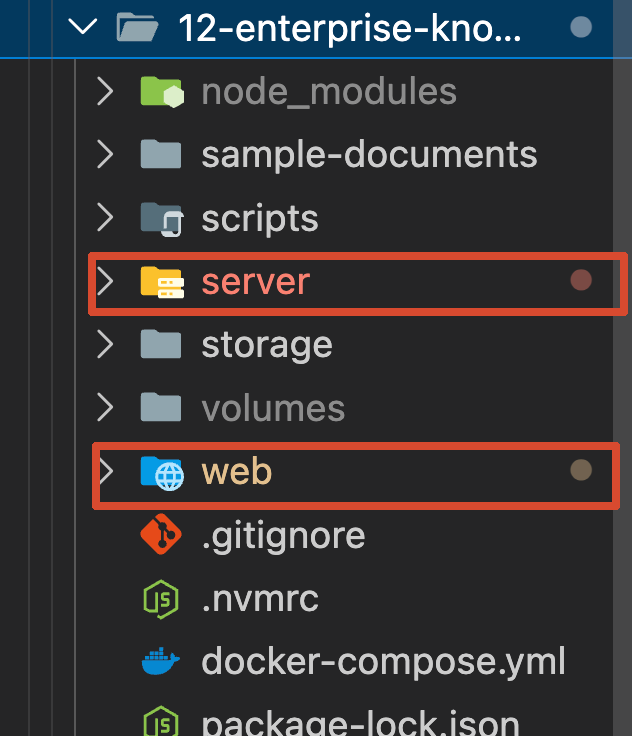
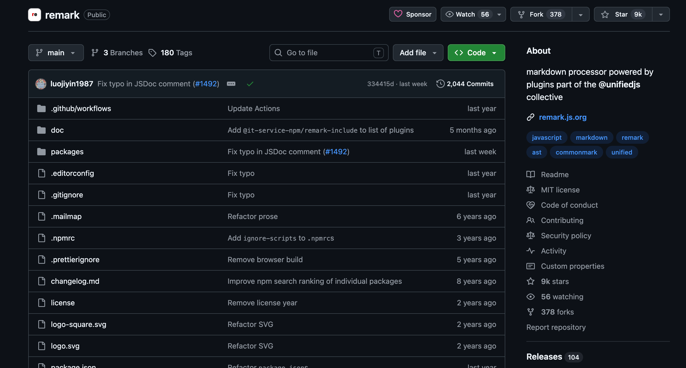
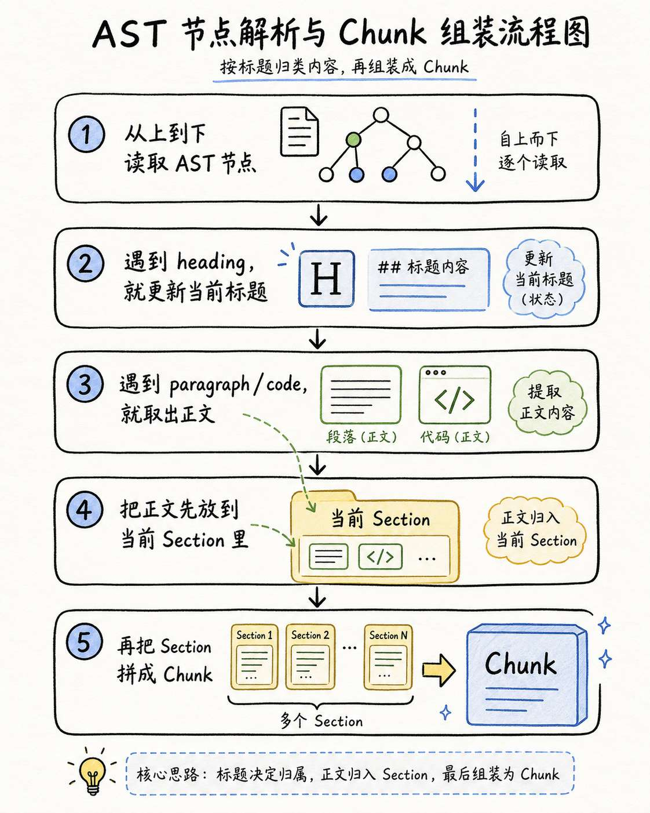
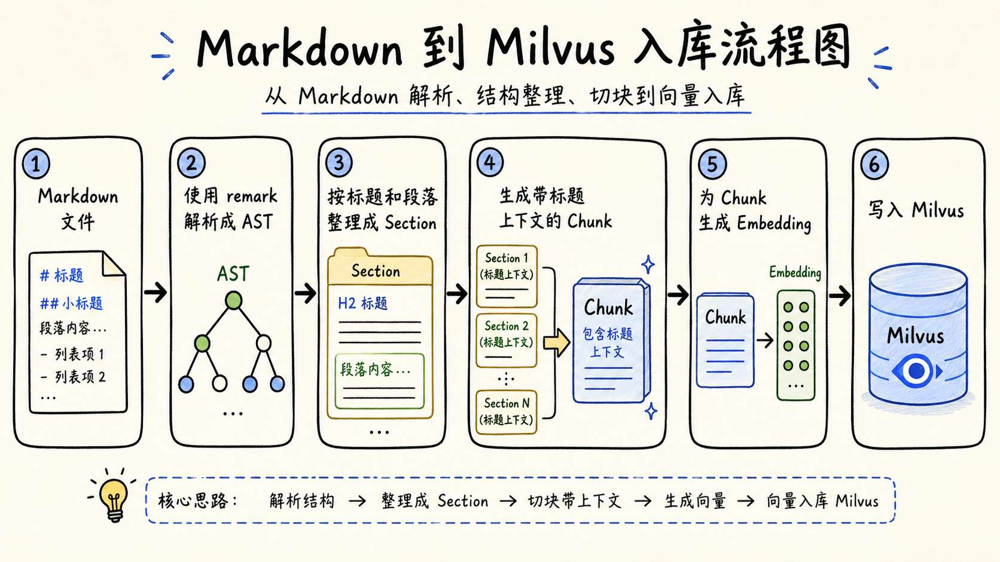
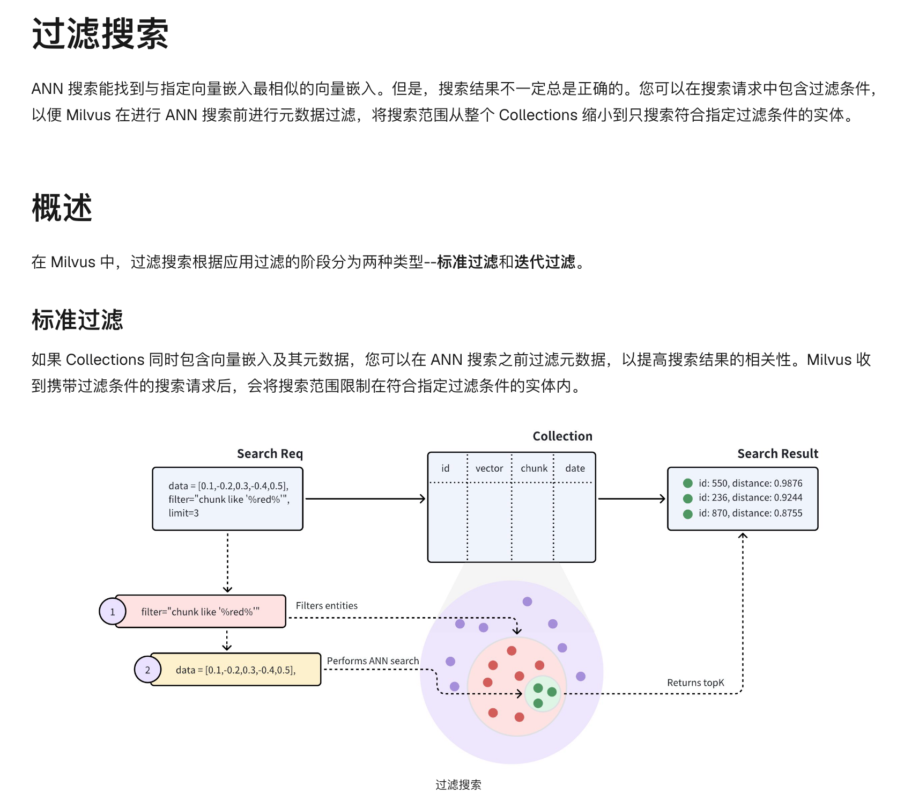
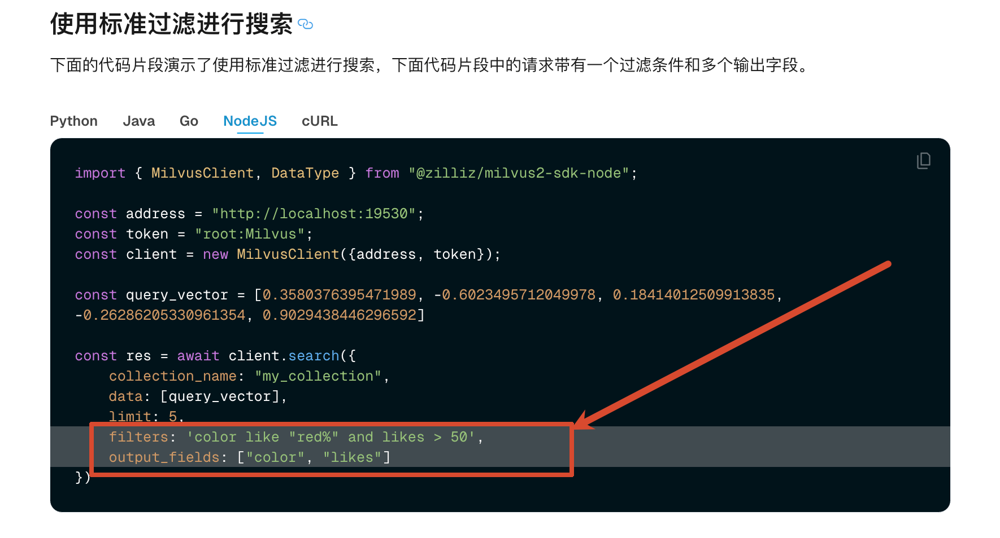

# 12 - 实战：可商用知识库项目。支持：文档上传、更新、删除、权限隔离、混合检索、精排 等能力

第二章写到这里，RAG 中比较重要的东西，咱们其实已经都讲过了。

从最开始的 Embedding、向量相似度和 TopK，到后面的文档分块、Milvus、BM25、混合检索、Query Rewrite、Rerank、来源引用、拒答和质量评估。

但是！

这些东西之前都是一个一个讲的。

还缺少一个最终的实战项目。

所以说，这一小节，咱们就开始这个实战《企业知识库》

这个项目会提供 `Node` 和 `Python` 两个版本

包含以下 6 个能力，采用 **视频 + 文档** 的方式进行讲解：

1. 上传 Markdown 文档以后，自动解析、分块、Embedding 并写入 Milvus。
2. 相同文档重复上传时，通过 checksum 判断内容没有变化，跳过重复向量化。
3. 文档发生变化时生成新版本，旧版本保留，但是不能再被正常检索。
4. 使用租户和部门信息隔离文档，客服看不到财务内部资料，蓝鲸科技也看不到星河零售的资料。
5. 使用 Dense 向量检索和 BM25 同时召回候选 Chunk，再通过 RRF 融合和 Rerank 精排。
6. 模型只能引用系统真实返回的 Chunk。资料不足时，必须拒绝回答。

整个前端部分，大致长成这样：




整个系统主要有三个区域。

+ **管理侧** （左边的 menu 菜单）：管理员可以上传新的 Markdown 文档，也可以给已有文档发布新版本或者删除已导入文档。
+ **员工侧** （右边的对话区域）：用户输入问题以后，咱们的服务端会执行权限过滤、混合检索、Rerank 和答案生成，最终把答案和真正支持答案的 Chunk 一起返回。
+ **权限侧** （header 头切换权限）：咱们准备了蓝鲸科技管理员、客服、财务，以及另一个租户“星河零售”的管理员。

整个项目的工作流程，大致就如下图所示：




整个项目的功能差不多说清楚了。

那接下来咱们就开始看下这个项目。

## 运行与演示
[此处为语雀卡片，点击链接查看](https://www.yuque.com/lgdsunday/ab1dy3/kgd436sat9gritcb#YqlhP)

完整代码在第二章的 `12-enterprise-knowledge-base` 里面。





`server` 是 Agent 服务端，`web` 是 Vue 3 前端

大家想要运行项目，一定要在 `server` 补充 `.env` 文件：

```plain
ZHIPU_API_KEY=你的智谱 API Key
EMBEDDING_MODEL=embedding-3
EMBEDDING_DIMENSIONS=512
RERANK_MODEL=rerank
CHAT_MODEL=glm-4.7-flash

MILVUS_ADDRESS=127.0.0.1:19530
MILVUS_COLLECTION=enterprise_knowledge_chunks
```

本地 Milvus 通过 Docker 启动：

```bash
docker compose up -d --wait --wait-timeout 180
```

然后分别启动 `server` 和 `web` 的项目即可

## 核心功能讲解
### Markdown 文档解析
前端上传的是一份原始 Markdown 文档。

服务端的解析处理的代码在这里：`/server/src/documents/markdown-chunker.ts`

整个代码的内容并不长，但是这里要注意咱们用到了一个  `remark-parse`  的库。




这个库是用来做 **markdown 解析处理的**。

它可以把  **Markdown 解析成 AST，再按照标题和段落组织对应的 Chunk。**

跟大家举个例子，比如，原始的 md 文档是这样的：

```latex
# 蓝鲸科技退款规则

普通商品签收后 7 天内可以申请退款，生鲜商品不支持无理由退款。

退款金额超过 3000 元时，系统不得自动退款，必须进入人工审核流程。审核通过后，退款会在 3 到 5 个工作日内原路退回。

该规则编号为 `BW-RF-2026`，适用于蓝鲸科技全体客服与财务人员。
```

这份文档包含：一个一级标题、三个段落，最后一个段落里还有一个行内代码 `BW-RF-2026`。

那么  `remark-parse` 会把它解析成一个类似于下面这样的 json 文件：

```json
{
  type: 'root',
  children: [
    {
      type: 'heading',
      depth: 1,
      children: [
        {
          type: 'text',
          value: '蓝鲸科技退款规则'
        }
      ]
    },
    {
      type: 'paragraph',
      children: [
        {
          type: 'text',
          value: '普通商品签收后 7 天内可以申请退款，生鲜商品不支持无理由退款。'
        }
      ]
    },
    {
      type: 'paragraph',
      children: [
        {
          type: 'text',
          value: '退款金额超过 3000 元时，系统不得自动退款，必须进入人工审核流程。审核通过后，退款会在 3 到 5 个工作日内原路退回。'
        }
      ]
    },
    {
      type: 'paragraph',
      children: [
        {
          type: 'text',
          value: '该规则编号为 '
        },
        {
          type: 'inlineCode',
          value: 'BW-RF-2026'
        },
        {
          type: 'text',
          value: '，适用于蓝鲸科技全体客服与财务人员。'
        }
      ]
    }
  ]
}
```

> 之前有研究过 Vue 或者 React 源码的同学对这个应该特别熟悉。
>
> 没有研究过的同学，就简单理解为把  md 文档转成了一个 有格式的 json 就行
>

有了这个结构以后，接下来就可以把 AST 整理成 Chunk 了。

大致的流程如下（**注意第 4 步的 **`Section`）：




上图中有一个 Section，这个 Section 可以理解为是一个 “章节”

```typescript
interface Section {
    heading: string
    paragraphs: string[]
}
```

因为 AST 里面的节点太多了，不能直接拿这些节点生成 Chunk。

所以就需要先把  AST 节点整理成更好处理的 `Section`。

还是拿刚才的退款规则来说。

AST 里先读到这个标题节点：

```typescript
{
  type: 'heading',
  depth: 1,
  children: [{ type: 'text', value: '蓝鲸科技退款规则' }]
}
```

代码看到它是 `heading`，就会把当前标题记成：**蓝鲸科技退款规则**

然后继续往下读。

读到段落节点以后，就通过 `toString(node)` 把里面的文字拿出来，放进 `paragraphs`。

最后会先得到这样一个 `Section`：

```typescript
{
    heading: '蓝鲸科技退款规则',
    paragraphs: [
        '普通商品签收后 7 天内可以申请退款，生鲜商品不支持无理由退款。',
        '退款金额超过 3000 元时，系统不得自动退款，必须进入人工审核流程。'
    ]
}
```

到这里，AST 还没有变成 Chunk。

它只是先变成了一个更清楚的结构，叫做 `Section`

接下来才是 Section 变成 Chunk。

比如上面的 `Section`，标题是：

```latex
蓝鲸科技退款规则
```

段落是：

```latex
退款金额超过 3000 元时，系统不得自动退款，必须进入人工审核流程。
```

那么最终生成的 Chunk 就会长这样：

```latex
蓝鲸科技退款规则

退款金额超过 3000 元时，系统不得自动退款，必须进入人工审核流程。
```

这里还有一个小细节。

如果 Markdown 有多级标题，比如：

```latex
# 售后规则
## 退款
### 人工审核
```

代码会把标题路径整理成：`售后规则 / 退款 / 人工审核`

这样生成出来的 Chunk 就知道自己属于哪个章节。

这就是这段分块代码的核心。

所以，完整处理链路就是下面这样的：




### 文档生命周期管理
Markdown 解析完以后，服务端要做的第一件事，就是把一份文档变成可以长期维护的知识数据。

但是这里要注意，**agent 服务不是独立的，它需要配合「业务服务」来做** 

这里的业务主要有两个：

1. 文档会变化。比如：视频中咱们演示的 **文档更新** 功能
2. 权限会变化。比如：不同的用户，不同的权限，看到的内容不同（RBAC）

所以，文档管理部分就不能只是“存一下数据”就完了。

这部分代码在 `server/src/documents/document.controller.ts` 这里。

这里提供了几个接口，分别对应 “增删改查” 的逻辑

```typescript
...
export class DocumentController {
    constructor(private readonly documents: DocumentService) {}

    /** 返回当前身份能够访问的生效文档。 */
    list(...) {
        ...
    }

    /** 返回指定文档的全部版本，供管理员审计和核对更新结果。 */
    versions(...) {
        ...
    }

    /** 接收 Markdown 文件并创建一份新的知识文档。 */
    create(...) {
        ...
    }

    /** 接收 Markdown 文件并为已有文档发布新版本。 */
    update(...) {
        ...
    }

    /** 软删除指定文档，让它从正常检索范围中移除。 */
    delete() {
        。。。
    }

    /**
     * 校验上传文件是否存在，并限制当前案例只处理 Markdown。
     */
    private assertMarkdown(){
        ...
    }
}
```

这里的每一个接口都对应 `service.ts` 里面的一个方法（如果不熟悉 NestJS 的同学，可以看下咱们之前的 [Agent 商业级项目（面试汪） ](https://mp.weixin.qq.com/s/ak625tfAU_JUT6G_MC6n4Q)中的讲解，这里就不多说了）

在这些代码里面，最有价值的是 **新增 && 更新**，对应的核心代码在 `saveVersion` 里面

这段代码有点多，接下来咱们通过视频看一下：

[此处为语雀卡片，点击链接查看](https://www.yuque.com/lgdsunday/ab1dy3/kgd436sat9gritcb#gttT2)


### 权限隔离与文档查询
这个项目里有两类用户：蓝鲸科技 和 星河零售。

同一个用户里面，又分管理员、客服、财务这些身份。（大家理解为 RBAC 的角色分配系统就可以）

那么针对这种场景咱们就得注意了：**不同的用户可访问的 AI 权限也是不一样的。**

假设用户问：

```latex
单笔退款达到 10000 元以后，财务要怎么复核？
```

这个回答就只能是 **财务部** 查看，普通的客服肯定不能看。

那么想要实现这个功能就有两个办法：

1. 先从 Mlivus 里面查出来数据，然后再业务代码里面删了
2. **直接在业务代码里面封死逻辑，不查询**

不用多说，肯定是 **第二种** 方案好，对吧。

那么想要实现第二种方案，就得用到一个叫做 `Milvus Filter` 的功能。

> Milvus Filter 就是在向量检索时，给 Milvus 加一个类似 SQL `WHERE` 的过滤条件，让 Milvus 只在“当前用户有权限访问的文档 Chunk 里”做相似度搜索。
>
> 文档在这里：`https://milvus.io/docs/zh/filtered-search.md`
>




官方给出的示例代码：





看着还挺简单的吧。

咱们实现的稍微复杂了一点（实现了 混合检索 ），代码在 `server/src/milvus/milvus.service.ts` 里面的 `hybridSearch` 方法里面。

这里的代码不多，核心逻辑就是这个代码：

```javascript
// 实现「混合检索」
const result = await this.client.hybridSearch({
    collection_name: this.collectionName,
    data: [
        {
            anns_field: 'dense_vector',
            data: queryVector,
            limit: 12,
            expr: filter
        },
        {
            anns_field: 'sparse_vector',
            data: question,
            limit: 12,
            expr: filter
        }
    ],
    rerank: RRFRanker(60),
    limit,
    output_fields: OUTPUT_FIELDS
}) 
```


### 混合检索与精排
接下来就是检索的逻辑。

这部分代码在 `server/src/knowledge/knowledge.service.ts` 的 `query` 方法里面。

这里的代码不多，主要调用的都是 `智谱的 AI 大模型的能力（前面视频讲到的 AIService）`

```typescript
/**
 * 执行一次完整的企业知识库问答。
 * 流程包括问题向量化、权限内混合检索、Rerank、答案生成和来源绑定。
 */
async query(user: DemoUser, question: string) {
    const startedAt = performance.now()

    // 用户问题的向量用于 Dense 路线，原始文本同时用于 BM25 路线。
    // 用的全部都是 大模型的能力
    // 第一步：生成问题向量
    const [queryVector] = await this.ai.createEmbeddings([question])
    // 第二步：执行 Dense + BM25 混合检索
    const retrieval = await this.milvus.hybridSearch(
        user,
        question,
        queryVector
    )
    // 第三步：对检索结果进行 Rerank 重排
    const reranked = await this.ai.rerank(question, retrieval.chunks, 4)
    // 第四步：生成最终答案
    const groundedAnswer = await this.ai.generateAnswer(question, reranked)

    // 模型只返回 Chunk ID，最终来源信息必须从系统候选集重新绑定。
    const chunkById = new Map(reranked.map((chunk) => [chunk.chunkId, chunk]))
    const sources = groundedAnswer.sourceChunkIds.map((chunkId) => {
        const chunk = chunkById.get(chunkId)
        if (!chunk) throw new Error(`没有找到模型引用的 Chunk：${chunkId}`)

        return {
            chunkId: chunk.chunkId,
            documentId: chunk.documentId,
            title: chunk.title,
            version: chunk.version,
            chunkIndex: chunk.chunkIndex,
            sourcePath: chunk.sourcePath,
            content: chunk.content
        }
    })

    return {
        ...
    }
}
```

大致流程是：

+ 第一步：生成问题向量
+ 第二步：执行 Dense + BM25 混合检索
+ 第三步：对检索结果进行 Rerank 重排
+ 第四步：生成最终答案


## web 端代码
咱们主要学 RAG 的知识。

所以 web 端的代码不做讲解。大家可以直接查看源码内容。

## 总结
到这里基本上整个 RAG 的知识都全部讲完了。

咱们最后也实现了一个 **知识库的企业实战项目**。 

这个项目的功能虽然不多，但是从 RAG 上来看，功能还是蛮全乎的。

那么，下一小节也就是本章的最后一小节，咱们就看看这一章的内容如何在简历上体现，以及面试怎么说～

> 更新：2026-07-09 21:58 · 原文：<https://www.yuque.com/lgdsunday/ab1dy3/kgd436sat9gritcb>
