# 13 - 第二章总结：RAG 学到的内容如何在简历和面试中体现

到这里，第二大章就结束了。

RAG 是目前面试中最常见、最常见的问题，无论是 大厂，还是小厂。

给大家看看最近训练营同学面试遇到的问题：

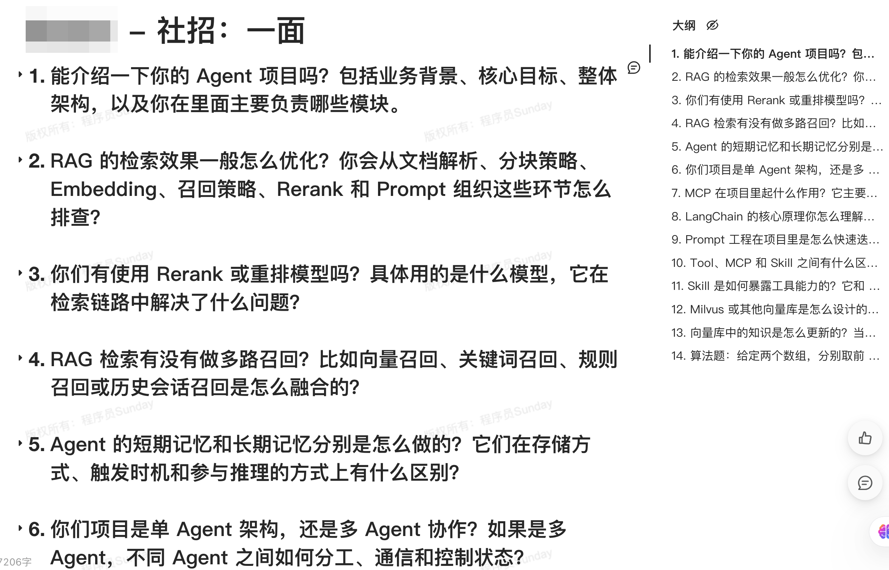


应该可以看出来，RAG 的问题占比达到 30% 左右

 所以这一节，咱们还是按照第一章总结的方式，把第二章学过的内容捋一遍。

看完以后，至少要知道三件事：

+ 第二章到底学了什么
+ 这些能力怎么写进简历
+ 面试官可能会怎么追问

## 第二大章都学了啥
第二章一共 12 个小节，大致讲解了一下的内容：

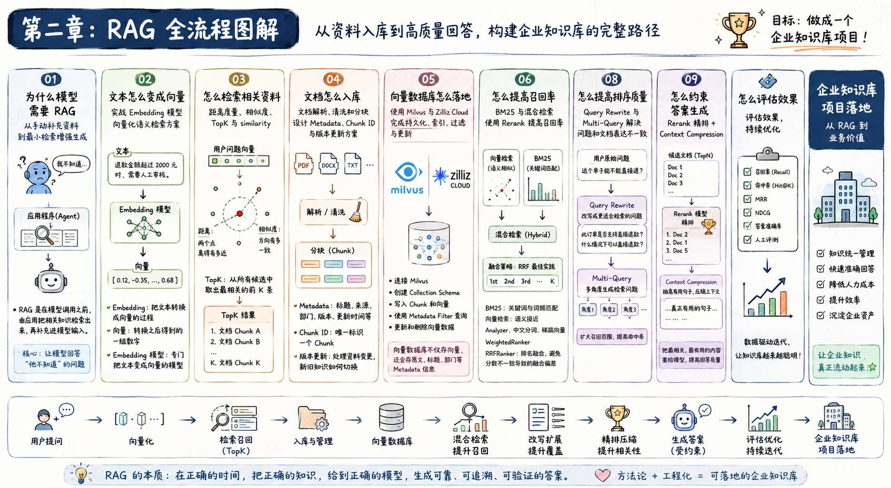


咱们一节一节回顾。

### 01-为什么模型需要 RAG：从手动补充资料到最小检索增强生成
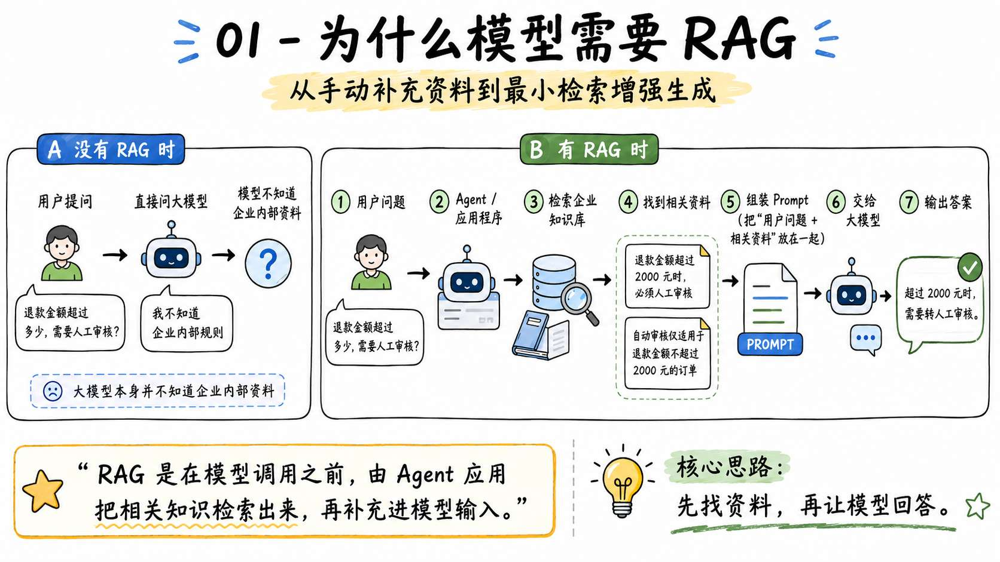


大模型本身并不知道企业内部资料。

所以，如果我们想要让大模型回答 “他不知道” 的问题，那么就需要让：应用程序先根据用户问题找到相关资料，再把资料和问题一起交给模型。

而这种方式，就是 `RAG`

> RAG 是在模型调用之前，由 Agent 应用把相关知识检索出来，再补充进模型输入。
>

### 02-RAG 的关键流程：实战 Embedding 模型向量化语义检索方案
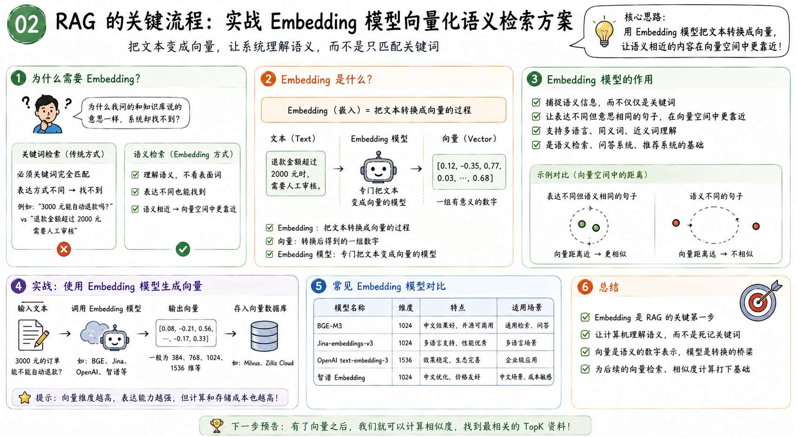


第二节，咱们开始讲 RAG 里面最重要的一个东西：`Embedding`。

如果只靠关键词检索，用户必须问得和知识库写得很像，系统才容易找对资料。

但用户不会这么配合。

知识库里可能写的是：“退款金额超过 2000 元时，需要人工审核。”

用户问的可能是：“3000 元的订单能不能自动退款？”

两句话是一个意思，但是内容有完全不同。

所以就需要 Embedding。

这一节里，咱们主要讲了三个概念：

+ `Embedding` 是把文本转换成向量的过程
+ `向量` 是转换之后得到的一组数字
+ `Embedding 模型` 是专门负责把文本变成向量的模型。

### 03-完整向量检索实现：距离度量、相似度、TopK 与 similarity
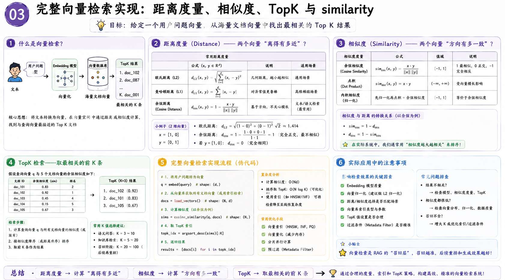


第二节已经把文本变成了向量。

那么接下来的问题就是：

> 给定一个用户问题向量，怎么从一堆文档向量里找出最相关的资料？
>

这一节主要讲了距离、相似度和 TopK。

+ 距离可以理解为 “两个点离得有多近”
+ 相似度可以理解为 “两个向量方向有多一致”
+ TopK 则是从所有候选资料里，取出最相关的前 K 条


### 04-实现文档解析、清洗和分块：设计 Metadata、Chunk ID 与版本更新方案
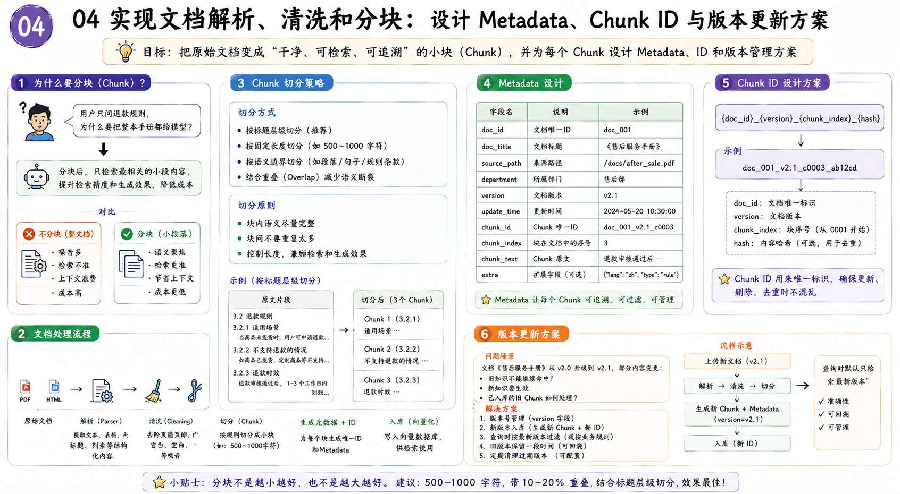


第四节，咱们开始进入 RAG 入库阶段。

很多同学刚开始做 RAG，会直接把整份文档丢给 Embedding 模型。

这是不行的。

因为一份文档里可能同时包含很多信息，比如：退款规则、发货规则、发票规则 等。

用户只问退款，系统应该找到退款那一小段，而不是把整份售后手册都塞给模型。

所以文档必须 **分块**。

这一节咱们重点讲了几个东西：

+ `Chunk` 是适合检索和塞给模型的小段内容
+ `Metadata` 记录文档标题、来源路径、部门、版本、更新时间这些信息
+ `Chunk ID` 用来唯一标识一个 Chunk
+ `版本更新` 用来处理资料发生变化以后，旧知识和新知识如何切换。


### 05-向量数据库选型：使用 Milvus 与 Zilliz Cloud 完成持久化、索引、过滤与更新
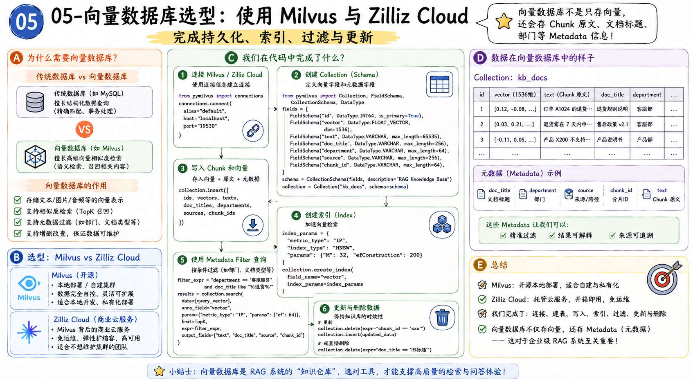


第五节，开始讲向量数据库。

主要是： Milvus 和 Zilliz Cloud

咱们得知道：

+ Milvus 是本地数据库。适合本地开发、自部署。
+ Zilliz Cloud 则是 Milvus 背后的商业云服务，适合不想自己维护集群的团队。

然后，咱们在代码里完成了：

+ 连接 Milvus
+ 创建 Collection Schema
+ 写入 Chunk 和向量
+ 使用 Metadata Filter 查询
+ 更新和删除向量数据

这里大家要记住：**向量数据库不是只存向量。**

它还会存 Chunk 原文、文档标题、部门 等等的信息 （`Metadata`）。


### 06-BM25 与混合检索：使用 Rerank 提高召回率
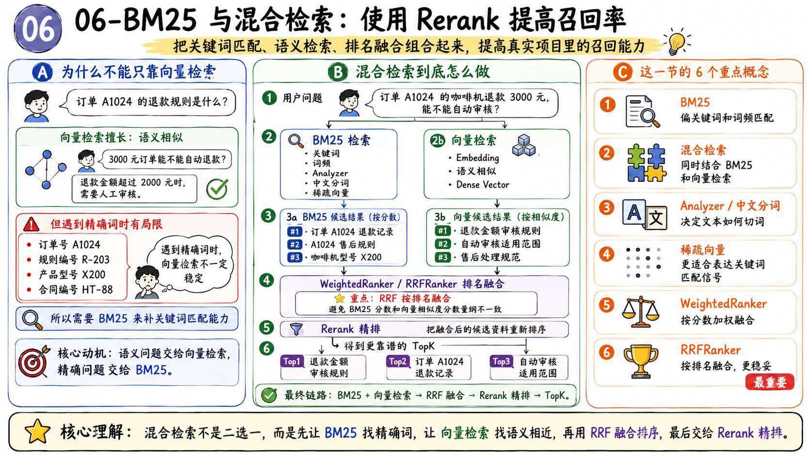


第六节，咱们开始讲 混合检索。

向量检索擅长语义相似。

但是遇到订单号、规则编号、产品型号、合同编号这类精确词时，他不一定能准确的搜索到。

所以这一节引入了 `BM25`。

+ BM25 更偏关键词和词频匹配。
+ 向量检索更偏语义接近。

两者各有优点，所以真实项目里经常会做 **混合检索**。

这一节咱们还讲了 Analyzer、中文分词、稀疏向量、WeightedRanker 和 RRFRanker。

其中最重要的是 `RRF`。

RRF 会根据排名融合结果。

这样就可以避免 BM25 分数和向量相似度分数计算不一致导致最终融合结果不准确的问题。


### 07-实战：使用 Milvus 实现 BM25 与混合检索
第七节是第六节的实战项目

这一节里，咱们使用 Milvus 实现了 BM25 和 Dense 向量的混合检索。


### 08-Query Rewrite 与 Multi-Query：解决问题和文档表达不一致
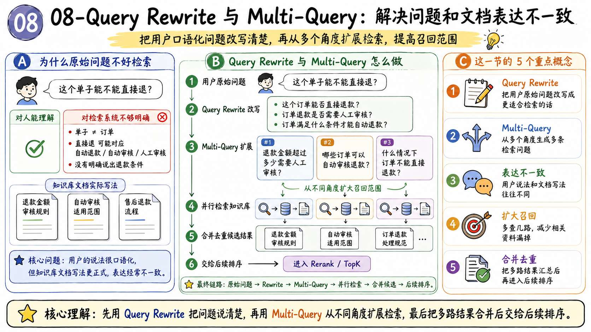


第八节讲的是 用户不会提问 怎么办？

比如用户可能会问：“这个单子能不能直接退？”

这句话对人来说能理解。

但是对检索系统来说，就不好理解了。

所以需要 Query Rewrite 和 Multi-Query。

+ `Query Rewrite` 是把用户原始问题改写成更适合检索的问题。
+ `Multi-Query` 是从多个角度生成多条检索问题，尽量扩大召回范围。


### 09-Rerank 模型深度解析：候选文档精排、TopK 筛选与 Chunk 抽离
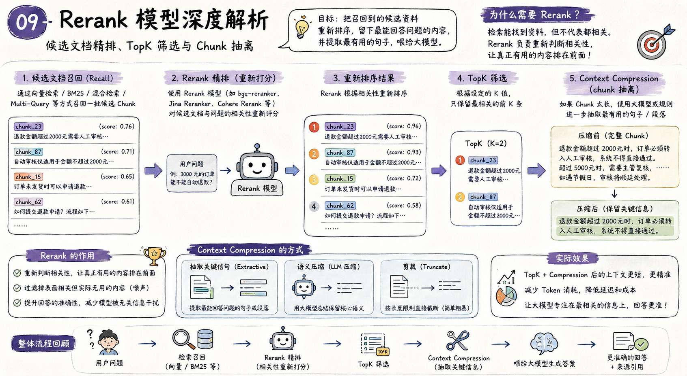


第九节讲 Rerank。

前面通过向量检索、BM25、混合检索和 Multi-Query，系统已经可以召回一批候选资料。

但是，召回到资料，不代表这些资料都应该塞给模型。

这里就需要 `Rerank`。

**Rerank 负责在候选资料里重新判断相关性，把真正更能回答问题的 Chunk 排到前面。**

同时还讲了一个：`Context Compression`。

如果一个 Chunk 太长，但是只有其中几句话真正有用，就可以进一步抽取有用句子。


### 10-答案生成、来源引用与拒答机制
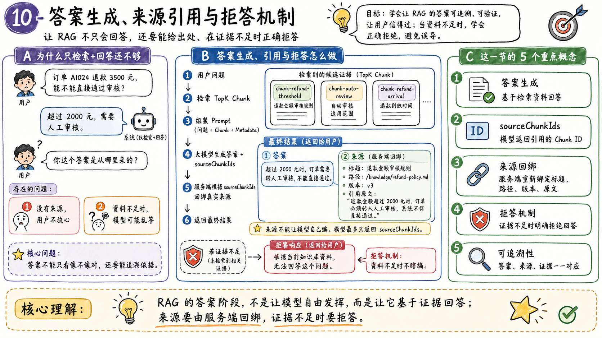


第十节，咱们进入 RAG 的答案生成阶段。

很多人做 RAG，只做到“检索出资料 + 让模型回答”。

还不够～

因为用户会问：“你这个答案是从哪里来的？”

所以这一节咱们实现了两个能力：

+ 一个是让答案带上真实来源
+ 另一个是资料不足时拒绝回答

这里最重要的是：

> 来源不能让模型自己编。模型最多只能返回 Chunk ID，真正的标题、版本、路径和原文内容，必须由服务端从系统数据里重新绑定。
>

这句话可以直接写进简历，也经得住面试追问。

### 11-RAG 质量评估体系：Recall@K、MRR、Faithfulness
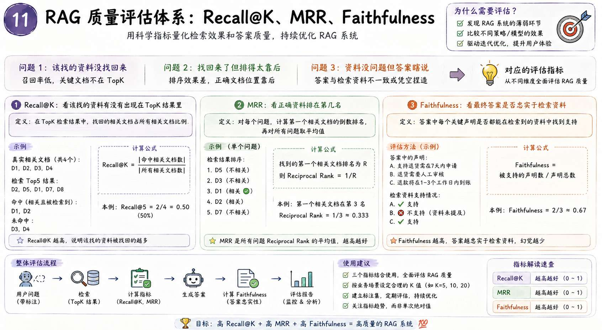


第十一节，咱们开始讲 RAG 效果怎么评估。

RAG 质量问题大致可以拆成三类：

+ 该找的资料没找回来
+ 找回来了但排得太靠后
+ 资料没问题但答案瞎说

对应的评估指标就是：

+ `Recall@K` 看该找的资料有没有出现在 TopK 结果里。
+ `MRR` 看正确资料排在第几名。
+ `Faithfulness` 看最终答案是否忠实于检索资料。

### 12-实战：构建支持文档更新、权限隔离与混合检索的企业知识库
第十二节，是第二章的最终项目。

前面所有东西，在这一节里都串起来了。

项目包含服务端和 Web 页面。

功能蛮多的，这里不多说了。

---

## 怎么把第二章体现到简历上
第二章写到简历上，主要还是两块：

+ 技能特长
+ 项目经历

### 先说技能特长
技能特长要表达的是：你理解 RAG 的工程链路，而且能解决真实开发里的问题。

可以参考下面这版：

```latex
技能特长

• 熟悉 RAG 应用开发全链路，理解 Embedding、向量检索、TopK、Chunk、Metadata、Milvus/Zilliz、BM25、Hybrid Search、Rerank、来源引用、拒答和 RAG 评估等核心机制。

• 能够基于 Node.js / NestJS 构建企业知识库服务，完成 Markdown 文档解析、清洗分块、向量化入库、版本更新、权限过滤、混合检索和答案生成闭环。

• 具备 RAG 效果优化与评估意识，能够使用 Recall@K、MRR、Faithfulness 分析召回、排序和答案忠实度问题，并通过 Query Rewrite、Multi-Query、Rerank 等方式优化检索质量。
```

不要一上来就写十几条，这三条已经够用了。

### 然后是项目部分
项目部分就可以直接包装成第二章最终实战项目。

可以参考下面这版：

```latex
项目名称：企业级 AI 知识库问答平台

技术栈： Vue 3、TypeScript、NestJS、Milvus / Zilliz Cloud、GLM Embedding、BM25、RRF、Rerank

项目介绍： 面向客服、财务、运营等岗位的企业知识问答平台，集中管理售后规则、产品说明和内部制度，支持文档维护、自然语言查询和答案来源追溯，帮助员工快速获取权限范围内的业务资料。

主要职责：
- 负责知识管理与问答工作台开发，覆盖文档上传、更新、删除、历史会话和来源查看，支持业务人员自主维护知识并核对 AI 回答依据。
- 基于 Markdown AST 按章节拆分长文档，保留标题上下文并关联原文，减少规则条件与结论被拆散的问题，为检索和答案生成提供完整依据。
- 使用 GLM Embedding 生成文本向量，通过 Milvus / Zilliz Cloud 完成持久化与 TopK 检索，使员工使用不同于文档原文的表达，也能查找相关业务资料。
- 为兼顾口语化问题和精确关键词，实现向量检索与 BM25 混合召回，通过 RRF 融合排名、Rerank 精排，减少仅主题相关、无法回答当前问题的资料进入模型上下文。
- 设计租户、部门和文档可见范围的权限模型，将过滤条件加入 Milvus 查询，实现企业知识的数据隔离，确保员工只能查询授权资料，避免跨部门、跨租户的信息泄露。
- 文档更新采用 checksum 检测内容变化，跳过重复向量化。通过 version 和 is_active 切换生效版本，减少重复调用开销，避免新旧制度同时参与检索。
- 构建答案来源追溯能力，校验模型返回的 Chunk ID 并绑定真实文档、版本和原文，让业务人员能够核实回答，定位所依据的具体条款。
- 对知识库未覆盖的问题增加资料不足判定与拒答处理，明确提示当前资料无法解答，降低模型编造企业规则并误导业务操作的风险。
- 使用 Recall@K、MRR 和 Faithfulness 分别评估召回、排序与答案忠实度，定位漏检、排序偏差和无依据生成问题，为检索参数与分块策略调整提供依据。
```

大家再写的时候注意不要照抄。

挑你熟悉的，能讲清楚的写。

## 面试可能会问什么
这里给大家列了一些面试题，让大家作为参考。

注意：以下内容仅作参考即可

### RAG 到底解决什么问题？
RAG 解决的核心矛盾，是大模型很会生成内容，但它不一定掌握当前、私有且可核验的业务事实。

模型参数里的知识存在三个限制：可能已经过时，通常不了解企业内部资料，而且回答时很难提供可靠出处。RAG，也就是检索增强生成，会先从外部知识库寻找证据，再让模型基于证据回答。因此它主要解决知识更新、私有知识接入和答案可追溯这三个问题。

比如用户问“3000 元的咖啡机能不能自动退款”，知识库里的原文可能是“退款金额超过 2000 元需要人工审核”。RAG 可以通过语义检索找到这条规则，再交给模型组织答案，而不是要求模型凭参数记住所有企业规则。

但是要注意：**RAG 也不能保证不产生幻觉。**

文档过期、分块不合理、召回失败或者把无关内容塞进上下文，都会导致错误。

### Embedding 和向量检索是什么关系？
Embedding 解决的是“怎么表示语义”，向量检索解决的是“怎么利用这种表示找到资料”。严格来说，Embedding 是把文本转换成固定长度向量的过程，向量才是转换后的结果。

比如知识库写的是“退款金额超过 2000 元需要人工审核”，用户问的是“3000 元的咖啡机能自动退款吗”。两句话用词不同，但 Embedding 模型会把它们映射到同一个语义空间，含义越接近，向量通常也越接近。

到了向量检索阶段，离线入库时会把每个文档 Chunk 转成向量，并保存 `chunk_id`、原文、向量和 Metadata；用户提问后，再把问题转成向量。

向量数据库通过余弦相似度或者距离，比较问题向量和文档向量，过滤掉低于 `minSimilarity` 的结果，再按相关性排序并返回 TopK。相似度通常是越大越相关，距离则是越小越相关。

### 为什么 RAG 需要分块？直接把整份文档做 Embedding 不行吗？
整份文档当然可以做 Embedding，但多数 RAG 场景不应该这么做，因为检索单位会粗到无法准确命中用户真正需要的那部分内容。

比如一份售后手册同时包含退款、发货、发票和保修规则。整篇只生成一个向量，相当于把多个主题压缩成一个语义表示。用户只问“3000 元退款是否需要人工审核”时，退款信号可能被其他内容稀释；即使命中了，系统返回的也是整份手册，不但浪费上下文和 token，还可能让无关规则干扰模型回答。

分块之后，真正参与检索的是 Chunk，也就是一段能够相对独立表达完整意思的内容。

查询时先召回退款相关 Chunk，再根据需要补充相邻 Chunk，而不是把整篇文档直接塞给模型。

这样来源引用、权限隔离和局部更新也会更精确：一条退款规则变化，只需要重新处理受影响的 Chunk。

不过，Chunk 也不是越小越好。

太大会混入无关信息，降低召回精度；太小又可能把“适用条件”和“处理结论”切开，导致模型只看到半句话。

实现时我会优先按标题、段落和语义边界切分；对于长制度类文档，可以先用 500 到 1000 字、10% 到 20% 的重叠作为实验起点。

### 向量检索和 BM25 有什么区别？
本质区别在于匹配信号：向量检索比较语义空间里的距离，BM25 统计查询词和文档词的匹配强度。简单说，前者擅长“意思相近”，后者擅长“字词命中”。

向量检索会先通过 Embedding 模型，把问题和文档 Chunk 转成稠密向量，也就是大部分维度都有数值的语义表示，再计算余弦相似度或者向量距离。比如用户说“咖啡机不想要了”，文档写的是“商品签收后七天内可以退款”，两边没有太多相同词，但语义接近，向量检索通常能找出来。

BM25 属于关键词相关性算法。它主要看查询词是否出现、出现次数、这个词在整个知识库里是否稀有，以及文档长度。像规则编号 `BW-RF-2026`、产品型号、错误码、人名这类内容，BM25 往往更稳，因为它能直接命中原词；向量模型可能理解“售后规则”的含义，却不一定重视那串编号。反过来，如果用户换一种说法，BM25 没有命中关键词，结果就可能漏掉。


### 为什么混合检索不能简单把两组结果拼起来？
因为向量检索和 BM25 不是用同一把尺子打分的，直接拼接既无法得到可信的统一顺序，还会产生重复结果和固定的路线偏差。

向量检索返回的可能是余弦相似度，比如 `0.82`，数值越大越相关；也可能返回向量距离，数值越小越相关。BM25 的分数则来自词频、词的稀有程度和文档长度，可能是 `8.6`、`15.2`，没有统一上限。

直接按原始分数排序，BM25 可能因为数字更大而天然占优；直接把列表前后拼接，又会导致放在前面的检索路线长期霸占最终 TopK。

融合通常有两种做法。如果业务明确知道哪一路更重要，可以先校准分数，再做加权融合，比如口语化客服问题提高向量检索权重，规则编号场景提高 BM25 权重。

如果初期还没有可靠的权重，我更倾向使用 RRF，也就是不直接比较两边的原始分数，而是根据候选在各自排行榜中的名次进行融合；一条资料在两路里都排得靠前，融合分数就会更高。融合之后，还可以用 Rerank 模型重新判断问题与候选内容的相关性，再选最终 TopK。

最后会对比简单拼接、加权融合和 RRF 的 `Recall@K` 与 MRR：前者看正确资料有没有进入前 K 条，后者看它排得是否靠前，同时观察重复率、检索延迟和 token 成本。

### Query Rewrite 和 Multi-Query 解决什么问题？
它们都在优化检索入口，但解决的不是同一个问题：Query Rewrite 把不完整的问题改成可以独立检索的标准问法，Multi-Query 则从多个角度扩大召回范围。

Query Rewrite 主要处理口语化表达、指代和上下文缺失。比如前面聊到“这个订单是 3000 元”，用户接着问“那它要转人工吗”，直接拿这句话检索，“它”指什么并不清楚。结合会话上下文后，可以改写成“3000 元订单申请退款时是否需要人工审核”。这样即使脱离聊天记录，检索服务也能理解完整意图。

Multi-Query 解决的是单次查询视角有限的问题。同一个需求在知识库里可能写成“高金额退款审核规则”“退款金额阈值”或者“自动退款转人工条件”。系统可以生成几条关注角度不同的查询，并行执行向量检索和 BM25，从而降低用户表达与文档表达不一致造成的漏召回。

### RAG 效果怎么评估？
判断一套 RAG 好不好，我会先问四件事：正确证据找到了吗、排到前面了吗、答案有没有超出证据，以及线上代价能不能接受。

首先要准备一套固定评估集。每条样本至少包含 `case_id`、真实 Query、会话上下文、人工标注的 `gold_chunk_ids`、参考答案和 `answerable`。`answerable` 表示知识库是否真的能够回答，用它可以测试系统遇到无证据问题时会不会乱编。样本还要覆盖口语化表达、规则编号、多轮指代、文档过期和权限隔离场景。

检索阶段看 `Recall@K`，也就是正确资料有多少进入了前 K 条。Recall 低，优先检查分块、Embedding、Query Rewrite、混合检索和权限过滤，因为生成模型没拿到证据，再好的 Prompt 也补不回来。

排序阶段看 MRR。它衡量第一条正确资料排得有多靠前。如果 Recall 高但 MRR 低，说明资料找到了，只是排序不理想，这时再调整向量与 BM25 的融合权重、RRF、Rerank 和 TopK。

生成阶段会看答案正确性、引用准确率、拒答准确率和 Faithfulness。Faithfulness 就是把答案拆成事实陈述，检查每个陈述能不能被检索内容支持。如果检索和排序都正常，但 Faithfulness 低，问题通常在上下文噪声、Prompt 约束、来源绑定或者模型本身。大模型评委可以批量跑，但必须固定评委模型和提示词，并用人工抽检校准。

为了定位问题，每次请求都要保留 Trace，包括 `trace_id`、改写前后的 Query、召回的 `chunk_id` 和分数、Rerank 前后排名、知识库版本、最终引用、模型版本、耗时和 token 数。这样线上出现错答后，可以直接回放，而不是靠猜。

### 企业知识库里的权限隔离应该放在哪里做？
权限隔离必须发生在检索之前，而且过滤条件要由服务端根据登录身份生成；不能靠 Prompt，也不能先召回再到应用层删除。

因为只要无权限 Chunk 进入候选集，后面的 Rerank、生成模型、缓存或者 Trace 就可能已经看到敏感内容，泄漏实际上已经发生了。另外，召回后再过滤还会破坏 TopK：假设前十条里有九条无权限内容，过滤后只剩一条，但真正相关的有权限资料可能排在第十一条，系统就会误以为没有答案。

用户请求进来后，认证服务先从 Token 得到可信的 `user_id`，再由授权服务计算用户所属的租户、部门和权限组。客户端传来的 `tenant_id` 或角色不能直接信任。

检索服务根据这些信息构造 Metadata Filter，并下推到向量数据库。

向量检索和 BM25 都只能在授权范围内召回，然后候选资料才可以进入融合、Rerank 和生成链路。引用链接和原文下载接口还要再次鉴权，不能因为某个 `document_id` 曾经被检索出来，就永久认为用户有权限。

对于隔离要求特别高的大客户，可以使用独立 Collection、Namespace 甚至独立数据库；租户数量很多、资料规模较小时，可以共用 Collection，通过 `tenant_id` 和 ACL 字段过滤。但无论采用哪种存储方式，授权决策都应该由后端控制。

## 总结：下一章开始学习 MCP
第二章到这里就结束了。

这一章学完以后，大家至少应该具备一条完整的 RAG 工程认知了。

下一章，咱们会进入 MCP。

RAG 解决的是 Agent 怎么获得企业知识。

MCP 要解决的是： **Agent 怎么以标准化的方式连接工具、系统和外部能力。**

这两个东西都非常重要。

> 更新：2026-09-10 12:01 · 原文：<https://www.yuque.com/lgdsunday/ab1dy3/bkw9qydm7m4s7u5d>
