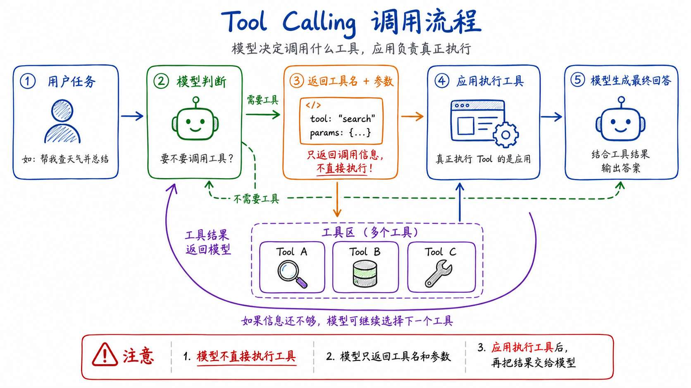
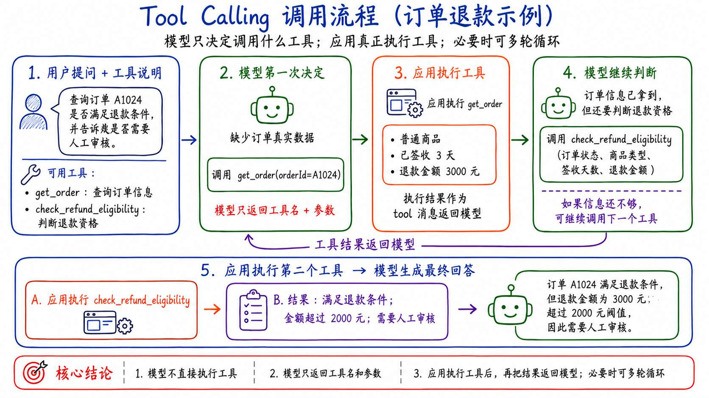
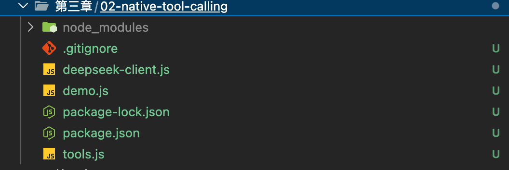
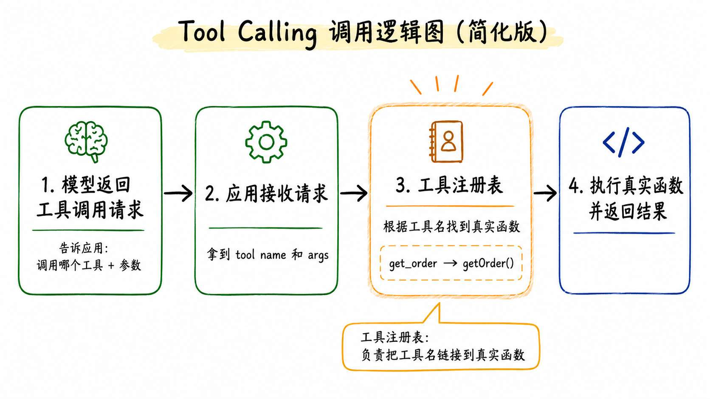
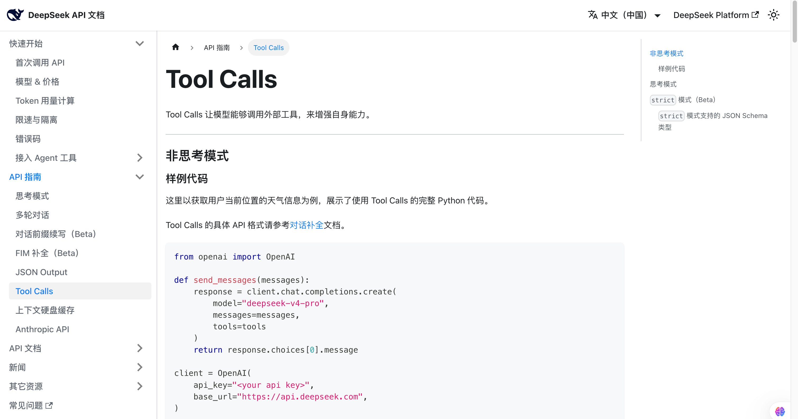
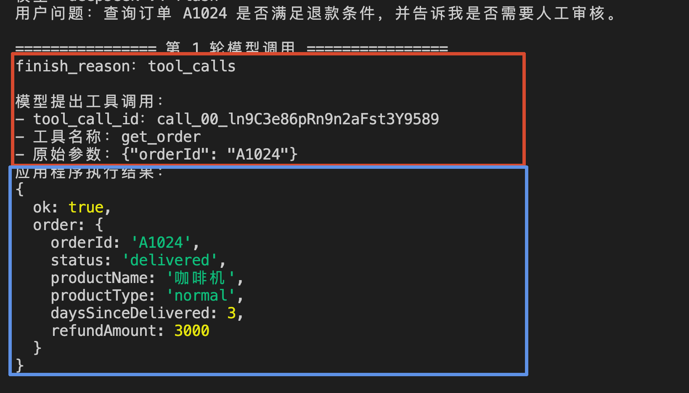
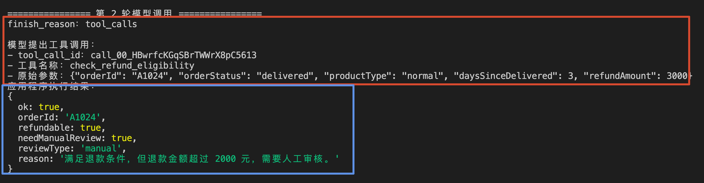
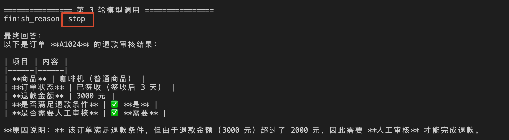
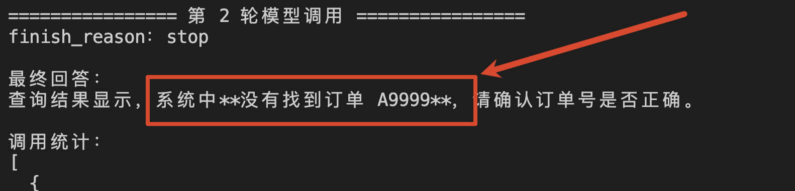

# 02 - 手写一条完整的 Tool Calling 循环调用链

上一节，咱们说第三章要解决一个问题：**怎样让模型连接并使用真实的业务能力。**

而想要解决这个问题，最简单的方式就是使用  `Tool Calling` 

跟大家举个例子，假设用户问：

> 查询订单 A1024 是否满足退款条件，并告诉我是否需要人工审核。
>

大家可以想一下，如果按照咱们之前实现的 RAG ，那么模型会怎么处理呢？

模型的处理方式肯定是：

> 查询知识库是否有这条信息，如果有就进行融合检索。
>
> 然后把检索到的信息和用户的问题一起发给大模型。
>

但是，大家想想，这样的话，检索的信息是不是就是完全固定的了。

因为大模型并 **不能知道 A1024 订单具体是什么商品，也不知道这个商品具体是多少钱。**

所以，这一小节咱们就要利用  `Tool Calling`  完成两个事情：

+ 根据订单号查询到具体的订单信息
+ 根据订单信息判断是否满足退款条件

## Tool Calling 到底是什么
`Tool Calling` 大家可以理解为：**应用把可以使用的工具（Tool 函数）的调用方式交给模型，模型根据用户任务决定是否调用对应的工具（Tool 函数）。**

但是这里 **注意：**

> 真正的 工具（Tool 函数） 调用并不是模型调用的，模型只会返回工具名和参数，最后的调用是应用本身完成的。
>
> 应用完成 工具（Tool 函数）调用之后，再把响应的结果给模型。
>
> 最终让模型生成回答。
>

这里给大家生成了一个流程图，大家可以作为参考：




这样的一套流程，有的人会叫做 `Function Calling`，有的会叫做 `Tool Calling`。

但是本质上都是一个意思。

明白了什么是 `Tool Calling`  之后，接下来咱们来看下 `Tool Calling`  的执行原理。

想要理解 Tool Calling 的执行原理，咱们必须得先明确一件事，那就是：**模型和咱们写的 Agent 程序，是绝对的两个独立的东西。**

> 假设，咱们有一个 `Tool 函数（工具）` 叫做 `getOrder` ，那么这样的一个函数是 **Agent 应用的函数（Node 或者 Python 的一个函数（方法））**
>
> 而模型（GPT、Claude、GLM） 都是在对应大模型厂商的服务器上的。
>
> 模型一定是不知道  `getOrder` 这样的函数，也不能直接调用函数。
>

所以，Tool Calling 并不是把函数交给模型运行，而是在模型和应用之间 **约定了一套调用流程** （请先记住这个词，后面的小节会详细讲）。

还是回到前面的订单问题：

> 查询订单 A1024 是否满足退款条件，并告诉我是否需要人工审核。
>

这句话最终会经过下面几个步骤。

### 第一步：把用户问题和工具说明交给模型
假设现在有两个工具函数：

```plain
工具函数一：get_order
作用：根据订单号查询订单信息
需要的参数：orderId

工具函数二：check_refund_eligibility
作用：判断订单是否满足退款条件
需要的参数：订单状态、商品类型、签收天数和退款金额
```

那么 Agent 应用就会先调用大模型，同时告诉模型：当前有两个工具可以使用。

### 第二步：模型提出工具调用请求
模型看到用户要查询订单 A1024，就会发现自己缺少这笔订单的真实数据。

所以，它会先返回一个工具调用请求，类似于下面这样：

```latex
我要调用：get_order
调用参数：orderId = A1024
```

注意，这一步没有查询订单。

模型只是完成了两个判断：**应该使用哪个工具函数，以及调用工具函数需要提供什么参数。**

至于这个工具是不是真的存在，参数格式对不对，模型都不会管。

### 第三步：应用执行真正的工具
应用收到模型提出的调用请求以后，会根据工具的名字找到真正的 `getOrder` 函数。

然后根据模型给的请求参数，调用该函数，得到对应的返回值。

假设订单系统返回：

```latex
订单号：A1024
商品：咖啡机
商品类型：普通商品
订单状态：已签收
签收天数：3 天
退款金额：3000 元
```

那么，到这里，模型的 **第一次调用** 已经结束了。

**但是**，咱们一定得知道，到目前整个任务并没有完成。

咱们还得把  `get_order`  返回的信息交给模型才可以。

### 第四步：应用把工具函数返回值交回模型
应用会把刚才的订单查询结果追加到当前对话中，然后 **再次调用** 模型。

大家可以把第二次发送给模型的内容简化理解为：

```latex
用户：查询订单 A1024 是否满足退款条件。

模型：我需要调用 get_order，参数是 A1024。

工具：订单 A1024 是普通商品，已经签收 3 天，退款金额为 3000 元。
```

> 这里的 “工具” 就是一种新的消息角色，也就是后面代码中会看到的 `role: 'tool'`。
>

它的作用是告诉模型：**这不是用户补充的信息，而是刚才那次工具调用返回的结果。**

### 第五步：模型继续处理任务
模型拿到订单信息以后，会继续判断当前任务是否已经完成。

在这个案例里，用户不只想查询订单，还想知道能不能退款。

所以，模型会继续提出第二个工具调用请求：

```latex
我要调用：check_refund_eligibility
调用参数：订单 A1024 的真实订单信息
```

应用再执行退款规则，得到类似下面的结果：

```latex
满足退款条件
退款金额超过 2000 元
需要人工审核
```

应用把这个结果再次交回模型。

这一次，模型已经拿到了回答问题所需要的全部信息，所以不会再提出工具调用，而是生成最终回答。

> PS：
>
> 那么这里我问大家一个问题：**模型被调用了几次呢？**
>
> 大家可以思考一下。。。
>

给大家把整个过程画出来：





有次也可知，在上面整个过程中，模型一共被调用了 **3 次**（2、4、5-C）

因此，Tool Calling 的执行原理可以总结成一句话：

> **模型负责决定“调用什么”和“传什么参数”**
>
> **应用程序负责真正执行工具，并把结果交回模型。**
>
> **模型再根据结果决定下一步。**
>

同时，大家还需要注意，Tool Calling 通常 **不是一次模型请求就可以完成的**。

每执行完一次工具，应用都要把工具结果加入上下文，再次调用模型。

直到模型不再返回工具调用请求，这次任务才算结束。

那么，明白这套执行原理以后，接下来咱们就来实现一个 Tool Calling 的案例

## 实现一个订单退款 Tool Calling 案例
> 课程源码：`https://github.com/lgd8981289/Agent--Code`
>
> 本小节完整代码位于：`Code/Node/第三章/02-native-tool-calling`
>

### 创建项目
创建目录并安装依赖：

```bash
mkdir 02-native-tool-calling
cd 02-native-tool-calling

npm init -y
npm install zod
```

然后创建 `.env` （这里咱们用的 DeepSeek 的 API 比较便宜。第一章也用过，直接复用第一章的就可以）：

```plain
DEEPSEEK_API_KEY=你的 DeepSeek API Key
DEEPSEEK_MODEL=deepseek-v4-flash
```

最终目录如下：





### 先定义工具
创建 `tools.js`。

先准备两条模拟订单：

```javascript
const orders = new Map([
    [
        'A1024',
        {
            orderId: 'A1024',
            status: 'delivered',
            productName: '咖啡机',
            productType: 'normal',
            daysSinceDelivered: 3,
            refundAmount: 3000
        }
    ],
    [
        'A2048',
        {
            orderId: 'A2048',
            status: 'delivered',
            productName: '新鲜草莓',
            productType: 'fresh',
            daysSinceDelivered: 1,
            refundAmount: 99
        }
    ]
])
```

接着使用 Zod 定义两个工具的参数，学过 [面试汪 - Agent 商业项目课 ](https://mp.weixin.qq.com/s/ak625tfAU_JUT6G_MC6n4Q)的同学都知道 `Zod` ，这是一个用来验证数据格式的库。

因为大模型返回的数据格式并不是百分百正确的，所以我们可以通过 `Zod` 做一个验证：

```javascript
const getOrderSchema = z.object({
    orderId: z
        .string()
        .regex(/^A\d{4}$/, '订单号格式必须类似 A1024')
        .describe('订单号，例如 A1024')
})

const refundCheckSchema = z.object({
    orderId: z.string().regex(/^A\d{4}$/).describe('订单号'),
    orderStatus: z
        .enum(['pending', 'delivered', 'cancelled'])
        .describe('订单当前状态'),
    productType: z
        .enum(['normal', 'fresh'])
        .describe('商品类型，normal 表示普通商品，fresh 表示生鲜'),
    daysSinceDelivered: z.number().int().nonnegative().describe('签收后经过的天数'),
    refundAmount: z.number().nonnegative().describe('本次退款金额，单位为元')
})
```

然后定义真正发送给模型的 `tools`：

```javascript
/**
 * 提供给大模型的工具说明。
 *
 * 模型只能看到：
 * - 工具名称
 * - 工具描述
 * - 参数结构
 *
 * 模型看不到 toolRegistry 中的真实执行函数，
 * 也不能直接访问订单数据。
 */
const tools = [
    {
        type: 'function',
        function: {
            name: 'get_order',
            description:
                '根据订单号查询订单实时信息。判断退款条件之前必须先调用这个工具，不能猜测订单状态。',
            parameters: toToolParameters(getOrderSchema)
        }
    },
    {
        type: 'function',
        function: {
            name: 'check_refund_eligibility',
            description:
                '根据 get_order 返回的真实订单字段判断是否允许退款，以及是否需要人工审核。',
            parameters: toToolParameters(refundCheckSchema)
        }
    }
]
```

模型只能看到的这两份工具说明。

到现在，咱们已经有了两个工具说明了。

**当模型告诉应用要调用哪个函数的时候，应用就得根据不同的工具找到对应的函数**

那么这个时候就需要有一个 **工具注册表** ，通过这个注册表来链接真实函数。




所以，接下来咱们定义 `toolRegistry` 作为工具注册表：

```javascript
/**
 * 应用程序内部的工具注册表。
 *
 * 它负责将模型返回的工具名称映射到：
 * - schema：参数校验规则
 * - execute：真实工具执行函数
 *
 * 这部分不会发送给大模型。
 */
const toolRegistry = {
    /**
     * 查询订单真实信息。
     */
    get_order: {
    // 参数校验规则
        schema: getOrderSchema,
    // 这是执行函数
        execute: async ({ orderId }) => {
            // 这里放具体的执行代码。。。
        }
    },

    /**
     * 根据真实订单信息判断退款资格。
     */
    check_refund_eligibility: {
    // 参数校验规则
        schema: refundCheckSchema,
    // 这是执行函数
        execute: async ({
            orderId,
            orderStatus,
            productType,
            daysSinceDelivered,
            refundAmount
        }) => {
            // 这里放具体的执行代码。。。
        }
    }
}
```

整个代码结构把具体的执行代码都隐藏了（想要看具体代码可以到源码中看），大家应该可以看懂才对。

通过这样的 工具注册表，应用就可以知道不同的工具对应哪一个具体函数了

那么现在，有了 **工具** + **工具注册表** 了，接下来就可以根据模型返回的工具名称，从注册表中找到真实工具调用，并获取返回结果给模型了。

这个代码逻辑在 `executeToolCall` 里面，给大家保留关键逻辑看一下：

```javascript
/**
 * 执行模型返回的单次工具调用。
 *
 * 完整流程：
 *
 * 1. 根据工具名称查找注册的工具
 * 2. 解析模型生成的 JSON 参数
 * 3. 使用 Zod 校验参数
 * 4. 调用应用程序中的真实工具函数
 * 5. 捕获异常并返回结构化错误
 */
async function executeToolCall(toolCall) {
    // 1. 根据工具名称查找注册的工具
    const registeredTool = toolRegistry[toolCall.function.name]
  
  // 2. 解析模型生成的 JSON 参数
    let rawArguments = JSON.parse(toolCall.function.arguments)
  
  // 3. 使用 Zod 校验参数
    const parsedArguments = registeredTool.schema.safeParse(rawArguments)

    // 4. 调用应用程序中的真实工具函数，并返回
  return await registeredTool.execute(parsedArguments.data)
    
  // 注意：以上代码去掉了 异常处理等逻辑，完整代码请参考源码
}
```

那么到这里，整个的 `Tools` 就已经全部完成了，核心点是三个：

1. 工具 -->>  `tools`
2. 工具注册表 -->> `toolRegistry`
3. 执行工具调用  -->>  `executeToolCall`

### 调用 DeepSeek
创建 `deepseek-client.js`：

```javascript
/**
 * 调用 DeepSeek 模型。
 *
 * messages：
 * 当前对话消息，包括用户问题、模型消息和工具执行结果。
 *
 * tools：
 * 提供给模型的工具定义。模型会根据工具说明判断是否发起工具调用。
 *
 * 返回：
 * - message：模型本轮返回的完整消息
 * - finishReason：本轮停止原因
 * - latencyMs：本次接口调用耗时
 * - usage：Token 使用统计
 */
async function callDeepSeek({ messages, tools }) {
    ...
    const response = await fetch(API_URL, {
        method: 'POST',
        headers: {
            Authorization: `Bearer ${process.env.DEEPSEEK_API_KEY}`,
            'Content-Type': 'application/json'
        },
        body: JSON.stringify({
            model: MODEL,

            // 当前完整对话上下文。
            messages,

            // 将可用工具说明发送给模型。
            tools,

            /**
             * 由模型自动决定：
             * - 直接生成文本回答
             * - 调用某个工具
             */
            tool_choice: 'auto',

           ...
        })
    })
  ...
}
```

这段代码本质上还是一次普通的大模型 API 调用。

不过，这个请求体里面有两个和 Tool Calling 相关的属性需要重点关注：`tools` 和 `tool_choice`。

+ `tools`：把当前应用支持的工具名称、功能说明和参数结构提供给模型。
+ `tool_choice`：控制模型是否调用工具，以及如何选择工具。

因此，这两个属性表示：**本次请求为模型提供了 Tool Calling 能力。**

但是，这并不代表模型一定会调用工具。因为这里设置的是：

```javascript
tool_choice: 'auto'  // 由模型自动决定是否调用工具
```

模型可以根据用户问题，自行决定直接生成回答，还是返回一个或多个工具调用请求。

其他更多关于 DeepSeek 的 Tool Calls 文档大家可以看这里：`https://api-docs.deepseek.com/zh-cn/guides/tool_calls/`





### 开始调用
创建 `demo.js` ，课程中还是只体现核心代码：

```javascript
/**
 * 执行完整的 Tool Calling 调用链。
 *
 * 整体流程：
 *
 * 1. 将用户问题和工具说明发送给模型
 * 2. 模型判断是否需要调用工具
 * 3. 应用程序执行模型指定的真实工具
 * 4. 将工具执行结果追加到 messages
 * 5. 再次调用模型，让模型继续判断或生成最终答案
 *
 * 为避免模型不断调用工具，整个流程受到最大轮次限制。
 */
async function runToolCalling(question) {
    /**
     * 保存完整对话上下文。
     */
    const messages = [
        {
            role: 'system',
            content:
                '你是星河零售的售后助手。订单信息必须通过 get_order 查询，不能猜测。判断退款时，必须先取得订单真实字段，再调用 check_refund_eligibility。请根据工具结果给出简洁结论。'
        },
        {
            role: 'user',
            content: question
        }
    ]
  ...

    /**
     * Tool Calling 本质上是一个循环。
     *
     * 每一轮都调用一次模型，直到：
     * - 模型不再请求调用工具，返回最终回答
     * - 或达到最大调用轮次
     */
    for (let round = 1; round <= MAX_TOOL_ROUNDS; round += 1) {
        console.log(`\n================ 第 ${round} 轮模型调用 ================`)

        // 将当前完整消息上下文和可用工具发送给模型。
        const result = await callDeepSeek({
            messages,
            tools
        })

        /**
         * 模型可能返回一个或多个工具调用请求。
         *
         * 如果没有 tool_calls，通常表示模型已经准备好输出最终回答。
         */
        const toolCalls = result.message.tool_calls || []

        。。。

        /**
         * 没有工具调用请求，说明 Tool Calling 流程结束。
         *
         * 此时 message.content 就是模型基于前面工具结果
         * 生成的最终回答。
         */
        if (toolCalls.length === 0) {
            console.log('\n最终回答：')
            console.log(result.message.content)

            console.log('\n调用统计：')
            console.dir(callStats, { depth: null })

            return
        }

        /**
         * 将模型返回的 assistant 消息追加到对话上下文。
         *
         * 这条消息中包含 tool_calls，
         * 后续的 tool 消息必须与这里的工具调用一一对应。
         */
        messages.push({
            role: 'assistant',
            content: result.message.content ?? null,
            tool_calls: toolCalls
        })

        /**
         * 模型一次可能提出多个工具调用请求，
         * 应用程序需要逐个执行。
         */
        for (const toolCall of toolCalls) {
            console.log('\n模型提出工具调用：')
            console.log(`- tool_call_id：${toolCall.id}`)
            console.log(`- 工具名称：${toolCall.function.name}`)
            console.log(`- 原始参数：${toolCall.function.arguments}`)

            /**
             * 根据工具名称从工具注册表中找到真实函数，
             * 然后完成参数解析、Zod 校验和函数执行。
             */
            const toolResult = await executeToolCall(toolCall)

            console.log('应用程序执行结果：')
            console.dir(toolResult, { depth: null })

            /**
             * 将工具执行结果以 role: tool 的消息追加到 messages。
             *
             * 下一轮模型调用时，模型就可以读取这条工具结果，
             * 决定继续调用其他工具，还是生成最终答案。
             *
             * tool_call_id 用于告诉模型：
             * 当前结果对应前面哪一个工具调用请求。
             */
            messages.push({
                role: 'tool',
                tool_call_id: toolCall.id,
                content: JSON.stringify(toolResult)
            })
        }
    }

    /**
     * 达到最大轮次后主动终止。
     */
    throw new Error(
        `已经达到最大工具调用轮次 ${MAX_TOOL_ROUNDS}，程序主动停止，避免无限调用。`
    )
}
```

代码挺长的，但是关键的内容不算多

其中，最关键的代码是两次 `messages.push`。

第一次，把模型返回的完整 `assistant` 消息放回上下文：

```javascript
/**
 * 将模型返回的 assistant 消息追加到对话上下文。
 *
 * 这条消息中包含 tool_calls，
 * 后续的 tool 消息必须与这里的工具调用一一对应。
 */
messages.push({
    role: 'assistant',
    content: result.message.content ?? null,
    tool_calls: toolCalls
})
```

第二次，把应用程序执行工具后得到的结果放回上下文：

```javascript
/**
 * 将工具执行结果以 role: tool 的消息追加到 messages。
 *
 * 下一轮模型调用时，模型就可以读取这条工具结果，
 * 决定继续调用其他工具，还是生成最终答案。
 *
 * tool_call_id 用于告诉模型：
 * 当前结果对应前面哪一个工具调用请求。
 */
messages.push({
    role: 'tool',
    tool_call_id: toolCall.id,
    content: JSON.stringify(toolResult)
})
```

两条消息必须同时存在，而且 `tool_call_id` 必须对应。

否则模型只看到一个凭空出现的工具结果，不知道它属于哪次调用，接口也可能直接拒绝这组消息。

循环最多执行四轮。

这不是说 Agent 最多只能调用四次工具。

因为如果模型不断重复调用同一个工具，程序会主动停止，避免无限请求和 Token 消耗。

另外，每一轮请求都会把当前 `messages` 和工具说明再次发送给模型。

因此，调用轮数越多，累计的 Token、延迟和费用通常也会继续增加。

## 运行代码
执行：

```bash
node --env-file=.env demo.js
```

**第一次模型调用**，返回的是：





先看 **红色部分**。这时还没有最终答案，模型只是判断出：要回答这个问题，得先查询订单。

然后是 **蓝色部分**。应用执行  `get_order` 以后得到相应的数据

程序把这份结果放进 Tool Message，再进行 **第二轮调用**。





还是先看 **红色部分**。这一次，模型已经知道订单的真实状态，于是继续提出工具调用

然后是 **蓝色部分**。应用先核对订单信息，再执行退款规则，返回对应内容

程序再次把结果交给模型，开始 **第三次调用**

第三轮的 `finish_reason` 变成了 `stop`，模型不再申请工具，而是生成最终回答：





咱们也可以换一个不存在的订单号：

```bash
node --env-file=.env demo.js "查询订单 A9999 是否满足退款条件"
```

模型仍然会先调用 `get_order`。

但是在第二次调用的时候，会返回 **没有找到**





## 总结
这一节, 咱们已经完成了一条原生 Tool Calling 调用链。

`Tool Calling` 并不是模型自己执行代码，而是模型根据工具说明返回 `tool_calls`，提出工具名称和参数。

应用程序负责验证工具是否存在、解析参数、执行函数，再把结果作为 Tool Message 回传给模型。

工具定义和真实函数也不是一回事。

+ 工具定义发送给模型，帮助模型理解“有什么能力、什么时候使用、参数长什么样”
+ 真实函数在应用程序里，负责查询订单和执行退款规则

最后，工具调用通常不是一次模型请求就结束了。

咱们这次经历了 “模型提出调用、应用执行工具、结果回传、模型继续处理” 三轮请求，才得到最终答案。

> 更新：2026-07-13 17:41 · 原文：<https://www.yuque.com/lgdsunday/ab1dy3/vvz9nc0a6t93y7db>
