# 03 - 从 Tool Calling 到 MCP：理解并实现 Host、Client、Server

上一节，咱们手写了一条完整的 Tool Calling 调用链。

模型可以根据用户的问题返回 `tool_calls`，Agent 应用拿到工具名和参数以后，执行 `get_order` 查询订单，再把结果交回模型。

但是，大家仔细去看咱们的代码，会发现很多问题。

比如：咱们所有的工具定义 和 工具注册表 都是直接写在 `tools.js` 里面的


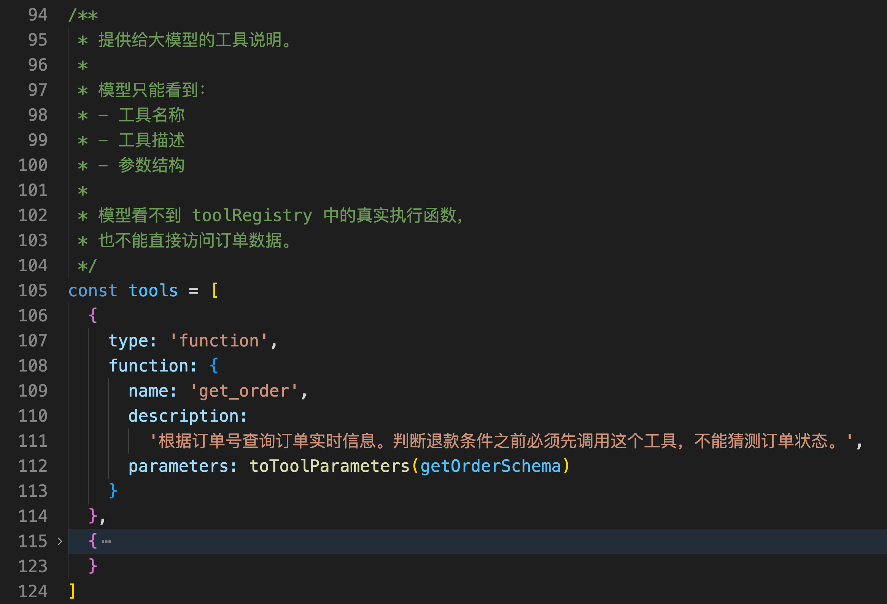


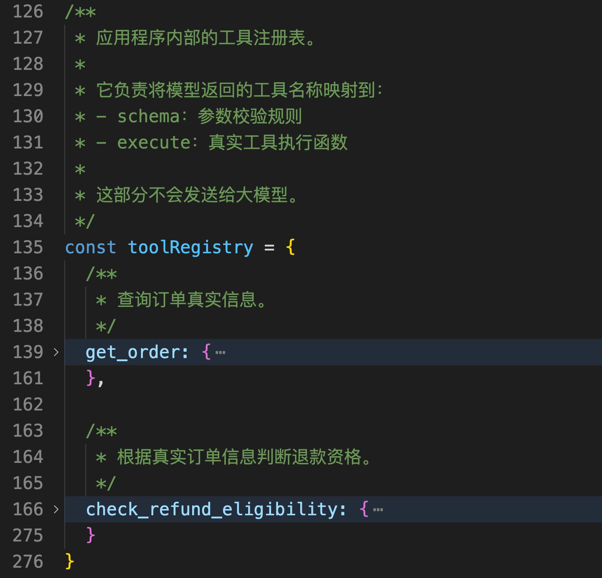


那么这就意味着，当我们想要在实现每一个 `Tool Calling` 的时候，都必须得知道：

1. 有哪些工具函数，分别对应什么参数
2. 工具注册表怎么写，怎样连接对应的业务系统

如果 tool 比较少肯定没问题，但是在实际项目中，这种 Tool 都是非常多的。

实际的企业项目中可能会有多个 `Agent 系统`。比如：订单查询 Agent、知识库 Agent、售后处理 Agent 

甚至可能还会存在 **需要调用远程工具接口的 Agent**

因此，在实际企业项目开发中，就不可以单纯使用 `Tool Calling` 的这种形式了。

也就是说，纯的 Tool Calling 目前还缺少一个核心能力，那就是：

> **当工具来自其他项目、进程或者远程服务时，Agent 应该使用什么样的统一方式发现和调用它？**
>

这就是 MCP 要解决的问题。

## MCP 到底是什么
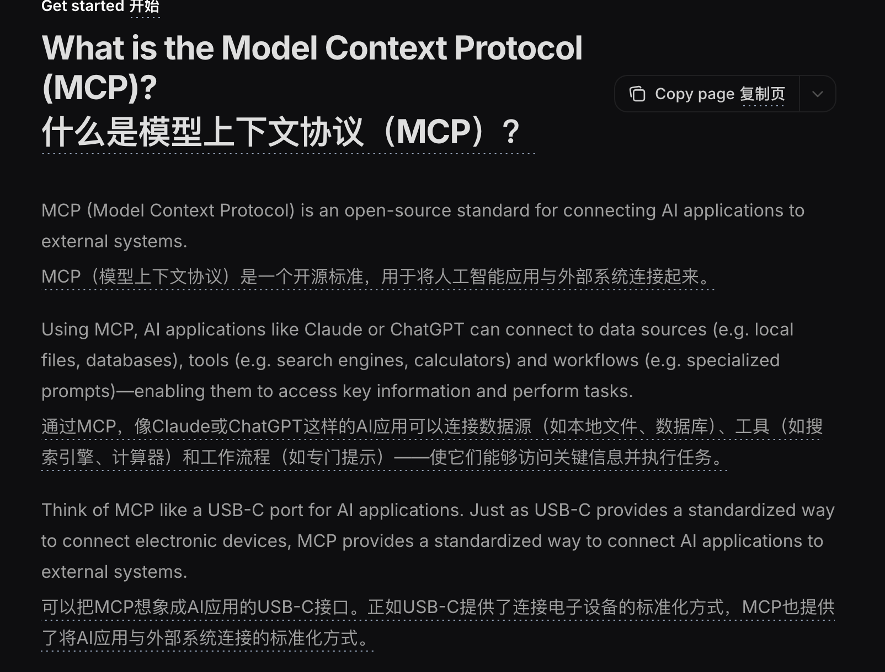


MCP 的完整名称是 `Model Context Protocol`，中文通常翻译成 **模型上下文协议**。

按照官方文档的定义：**MCP 是一套用于连接 AI 应用和外部系统的开放标准。**

网上有很多资料会把 `MCP` 理解为 `USB` 接口，寓意就是：**通过同样的一套协议方案，来完成不同工具的调用**


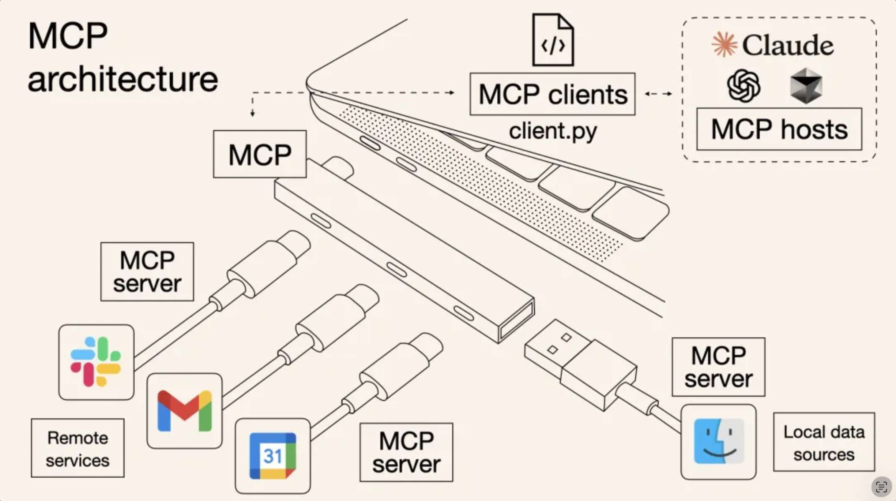


在这样的概念里，最重要的有两点：**连接** 和 **标准**

没有 MCP 时，Agent 和外部能力之间通常是私有连接：

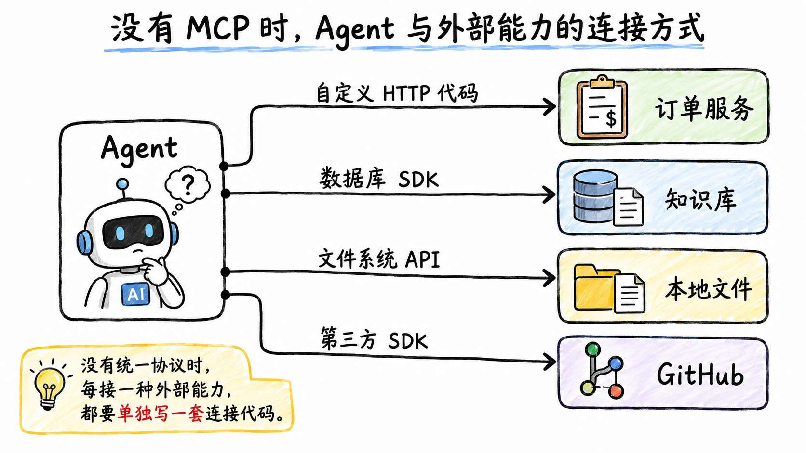


即：**每一种不同的能力，都使用不同的方式完成连接**

而 MCP 就是 AI 应用和外部系统之间的一层标准协议，有了 MCP 之后，连接就变成这样了：

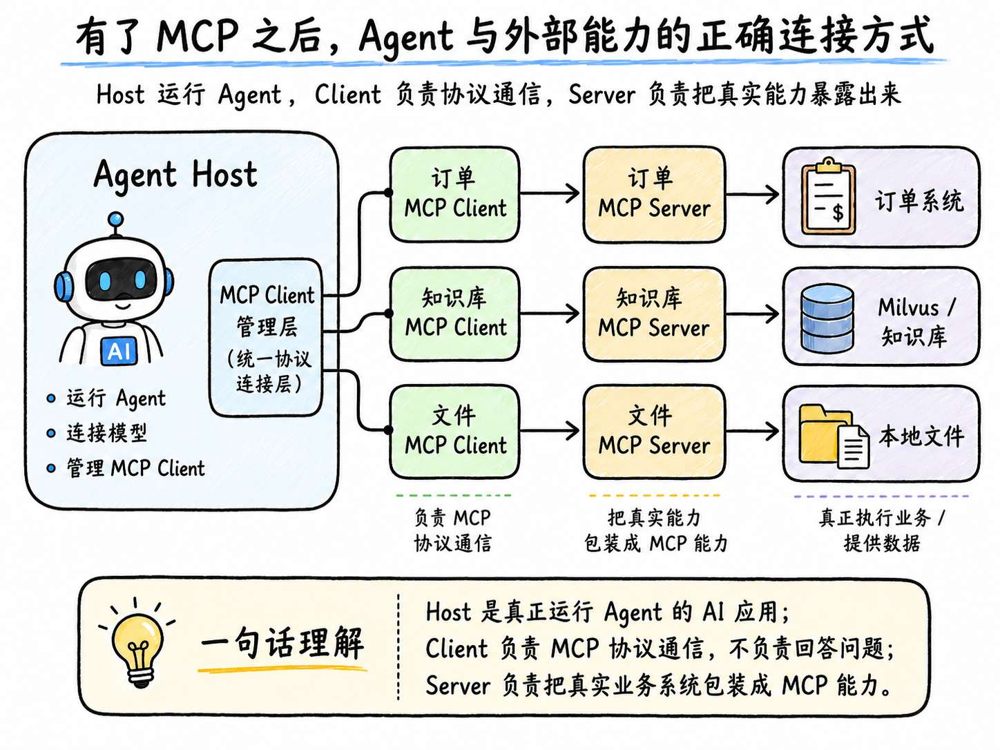


即：可通过 MCP 统一协议来完成不同外部能力的调用

## Host、Client 和 Server 分别是什么
MCP 中有三个比较重要的概念，分别是：`Host`、`Client` 和 `Server`。

咱们一个一个来看

### Host：组织者
`Host` 可以理解为 **真正运行 Agent 的 AI 应用**。

比如上一节咱们写的 退款的 Agent ，如果接入 MCP，它就是一个最小的 Host。

Host 分成两边：

+ 一边连接模型
+ 一边管理 MCP Client。

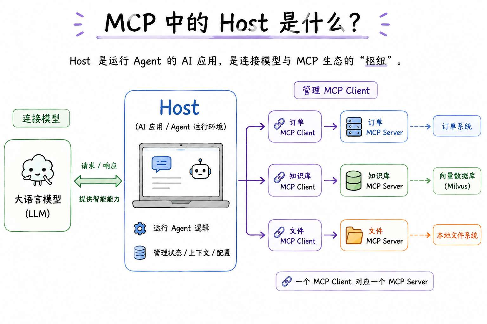


用户提出问题以后，谁负责整理 `messages`、调用大模型、保存工具执行记录，再决定是否继续下一轮模型调用？

是 Host。

谁决定当前用户可以使用哪些 MCP Server，哪些工具可以交给模型，执行高风险工具前是否需要用户确认？

还是 Host。

所以，Host 才是整条 Agent 调用链的组织者。

### Client：Host 里面的一条 MCP 连接
Host 想连接一个 MCP Server 时，需要在内部创建一个 `MCP Client`。

Client 不负责回答用户问题，也不负责决定模型下一步应该做什么。

它负责的是 **MCP 协议通信**。

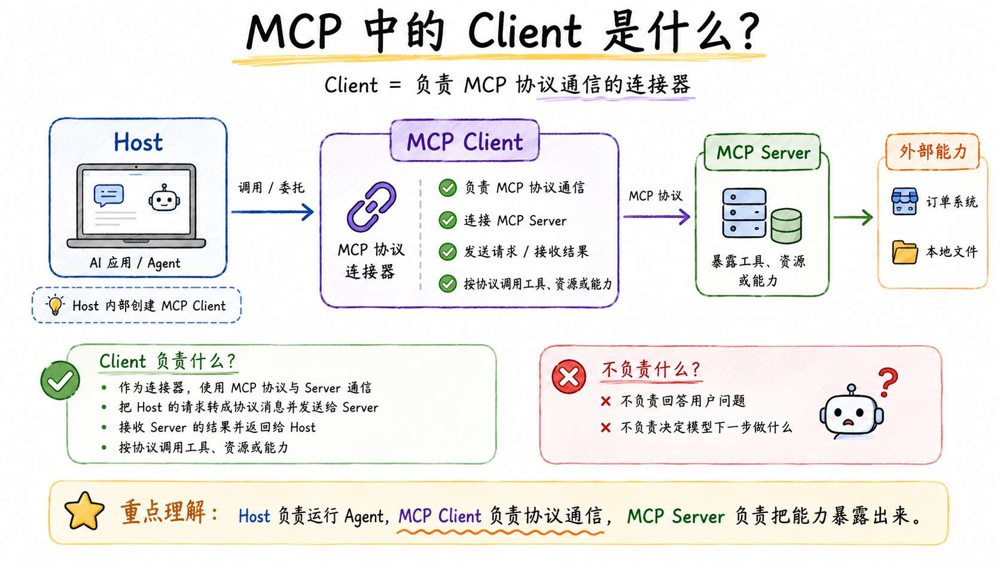


比如连接订单 MCP Server 时，Client 会处理：建立并维护连接 + 向 Server 查询能力列表 + 发送工具调用或者资源读取请求 等等的

按照 MCP 官方架构，一个 MCP Client 对应一个 MCP Server 连接。

假设咱们的售后 Agent 同时需要订单和知识库能力，Host 通常会创建两个 Client，就和下面的图一样：

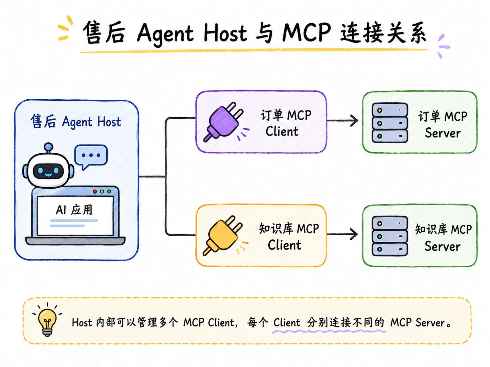


### Server：MCP 适配层
`Server`，也就是 `MCP Server`，负责把真实业务系统中的能力，通过 MCP 协议提供给 Client。

例如，订单 MCP Server 可以暴露下面这两个接口信息：

```plain
get_order：查询订单信息
check_refund_eligibility：判断订单是否满足退款条件
```

当 Client 调用这些工具时，订单 MCP Server 会接收调用参数，再通过 HTTP、RPC、数据库 SDK 等方式访问真实的订单系统，最后把执行结果返回给 Client。

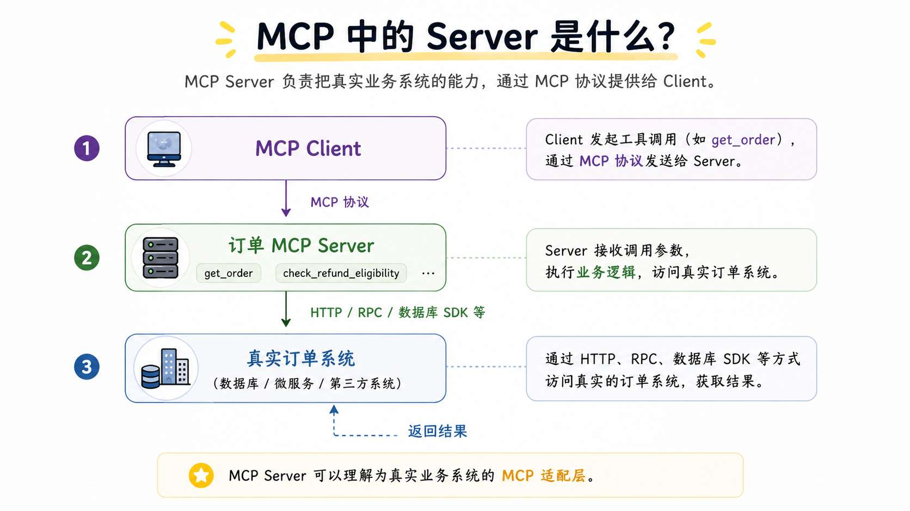


所以，MCP Server 可以理解为真实业务系统的 **MCP 适配层**：

+ 对外，按照 MCP 协议暴露能力；
+ 对内，连接并调用真实业务系统；
+ 中间，完成参数转换、权限校验、结果封装和异常处理。

这三个单纯看概念可能会有点抽象，接下来咱们就通过代码来看一下

## 实现一个最小的订单 MCP 案例
这个案例先不接入大模型。

咱们要做的就是一个最小案例，通过这个案例来把 `Host`、`Client` 和 `Server` 三个角色讲清楚。

整个项目只有三个文件：

```latex
03-why-mcp/
├── host.js
├── order-mcp-server.js
└── order-system.js
```

+ `host.js` 表示售后 Agent，也就是 Host。它会在内部创建 MCP Client
+ `order-mcp-server.js` 是独立运行的订单 MCP Server，负责注册和执行 `get_order` 工具
+ `order-system.js` 则用来模拟企业原本就存在的订单系统

> 项目源码：`https://github.com/lgd8981289/Agent--Code`
>

代码地址在：`/Code/Node/第三章/03-why-mcp`

这里咱们需要用到一个依赖库 `@modelcontextprotocol/sdk`

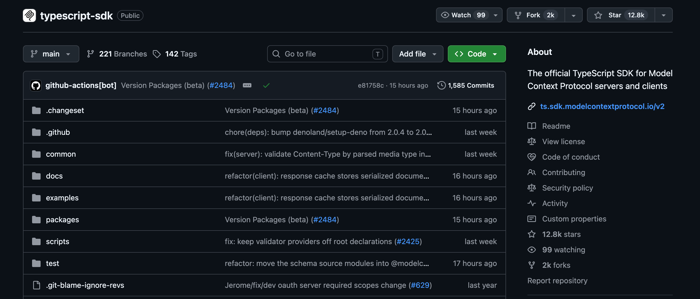


这个库是 MCP 官方提供的 TypeScript/JavaScript 开发工具包，用来快速编写 **MCP Server 或 MCP Client** 的。

目前这个库有 `V1` 和 `V2` 两个版本。

**但是！** 

现在 V2 版本还是 `beta` 的，一点都不稳定

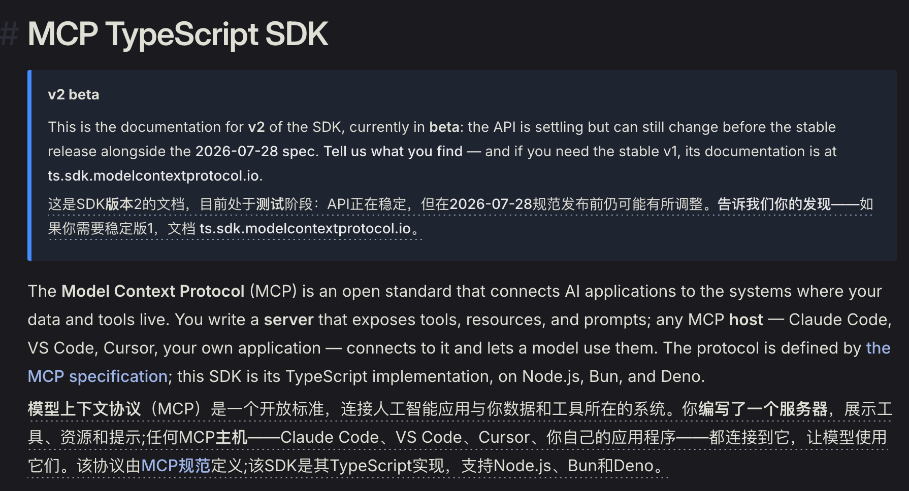


所以，咱们还是使用 `V1` 的版本，具体的版本号是 `"@modelcontextprotocol/sdk": "1.29.0"`

 接下来咱们来看代码。

### 模拟企业订单系统
先来看 `order-system.js`：

```javascript
// 使用 Map 模拟企业内部的订单数据存储。
// key 为订单号，value 为订单的详细信息。
const orders = new Map([
    [
        'A1024',
        {
            orderId: 'A1024',
            status: 'delivered',
            productName: '咖啡机',
            refundAmount: 3000
        }
    ]
])

/**
 * 根据订单号查询订单信息。
 *
 * 这里用内存中的 Map 模拟真实企业订单系统；
 * 实际项目中通常会调用数据库、HTTP 接口或 RPC 服务。
 */
export async function getOrderById(orderId) {
    // 根据订单号查询对应的订单数据。
    const order = orders.get(orderId)

    // 没有查询到订单时，返回统一的失败结果。
    if (!order) {
        return {
            ok: false,
            error: {
                code: 'ORDER_NOT_FOUND',
                message: `没有找到订单 ${orderId}`
            }
        }
    }

    // 查询成功后返回订单信息。
    // 使用展开运算符复制一份对象，避免外部代码直接修改原始数据。
    return {
        ok: true,
        order: { ...order }
    }
}
```

这就是一个普通的业务模块，和 MCP 没有关系。

简单来说就是用 Map 模拟了一个订单数据

### 实现订单 MCP Server
接着创建 `order-mcp-server.js`：

```javascript
/**
 * 第一件事：
 * 创建订单 MCP Server。
 *
 * name：Server 的唯一名称，Client 可以通过它识别当前 Server。
 * version：当前 Server 的版本号。
 */
const server = new McpServer({
    name: 'order-mcp-server',
    version: '1.0.0'
})

/**
 * 注册一个名为 get_order 的 MCP Tool。
 *
 * 当 MCP Client 查询当前 Server 提供的工具时，
 * 可以发现该工具的名称、说明和参数结构。
 */
server.registerTool(
    'get_order',
    【工具说明】,
  【工具执行函数】
    }
)

console.error('[Server] 订单 MCP Server 已启动，等待 Client 连接')

/**
 * 第二件事：
 * 创建 stdio 传输层。
 *
 * Client 会启动当前 Server 进程，并通过：
 * - stdin 向 Server 发送 MCP 消息；
 * - stdout 接收 Server 返回的 MCP 消息。
 */
const transport = new StdioServerTransport()

// 将 MCP Server 与 stdio 传输层连接，开始监听 Client 的请求。
await server.connect(transport)
```

这段代码量其实也不大，核心就做了两件事。

+ **第一件事**：创建一个 MCP Server，并注册 `get_order` 工具。这里用到了 `server.registerTool` 函数，这个函数接受三个参数 `server.registerTool('get_order', 工具说明, 工具执行函数)` 工具说明告诉 Client 这个工具叫什么、有什么作用、需要哪些参数。工具执行函数则负责真正查询订单。
+ **第二件事**：让这个 Server 通过 `stdio` 等待 Client 连接：

```javascript
const transport = new StdioServerTransport()
await server.connect(transport)
```

这里的 `stdio` 就是标准输入和标准输出。

Client 会向这个进程的标准输入写入 MCP 请求，Server 再通过标准输出返回 MCP 响应。

### 实现 Host 和 MCP Client
最后来看 `host.js`。

这个文件会创建一个 Client，让它连接刚刚写好的订单 MCP Server：

```javascript
...
/**
 * 创建 MCP Client 实例。
 *
 * 这个 Client 是 Host 内部负责执行 MCP 协议通信的组件，
 * 它将与订单 MCP Server 建立一条独立连接。
 */
const client = new Client({
    name: 'after-sales-agent-client',
    version: '1.0.0'
})

/**
 * 创建 stdio Client 传输层。
 *
 * process.execPath：当前运行程序所使用的 Node.js 可执行文件；
 * args：传给 Node.js 的启动参数，这里是 Server 入口文件；
 * stderr: 'inherit'：将 Server 的错误输出直接显示在当前终端中。
 *
 * 连接时相当于执行：
 *
 * node order-mcp-server.js
 */
const transport = new StdioClientTransport({
    command: process.execPath,
    args: [serverPath],
    stderr: 'inherit'
})

try {
    ...

    /**
     * 启动订单 MCP Server 子进程，
     * 并通过 stdio 完成 MCP 初始化和连接握手。
     */
    await client.connect(transport)

    ...

    // 向 Server 查询当前可以使用的 MCP Tools。
    const { tools } = await client.listTools()

    ...

    // 调用 Server 暴露的 get_order 工具，并传入订单号。
    const result = await client.callTool({
        name: 'get_order',
        arguments: {
            orderId: 'A1024'
        }
    })

    ...

    // 从 MCP Tool 返回的 content 数组中找到文本类型的结果。
    const textContent = result.content.find((item) => item.type === 'text')

    // Server 返回的是 JSON 字符串，这里将其解析为 JavaScript 对象。
    const orderResult = textContent ? JSON.parse(textContent.text) : null

    ...
} finally {
    /**
     * 无论工具调用成功还是失败，都关闭 Client。
     *
     * Client 关闭后，stdio 连接以及由传输层启动的
     * Server 子进程也会随之结束。
     */
    await client.close()
}
```

`host.js` 负责启动任务、创建 Client、决定调用哪个工具并处理最终结果，所以 **Host 就可以理解为整个 host.js 文件**

文件中有这样的代码，这个代码就是创建 MCP Client：

```javascript
const client = new Client({
    name: 'after-sales-agent-client',
    version: '1.0.0'
})
```

Client 没有查询订单的业务代码。

它只负责连接 Server、获取 Server 提供的工具，再把工具调用请求发送过去。

### 运行代码
执行：`npm run demo`

最终会看到下面这样的结果：

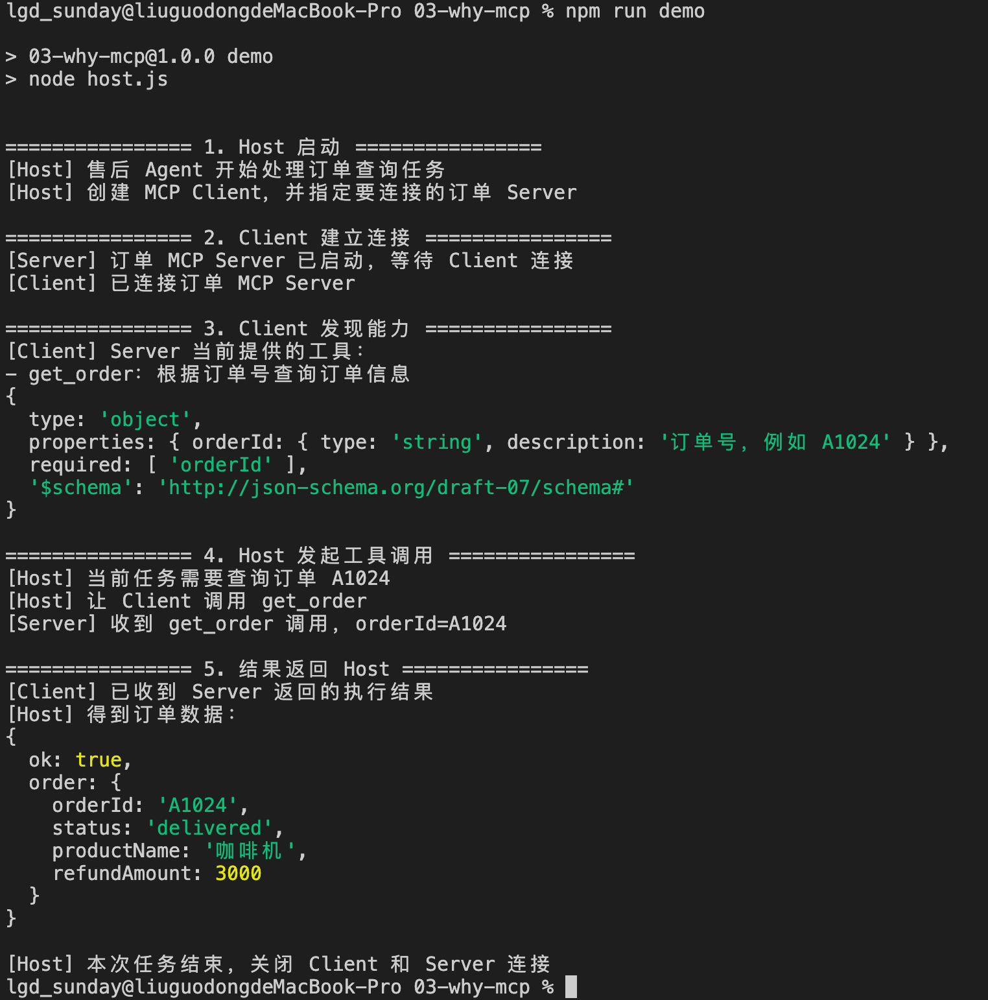


现在，咱们再回头看 Host、Client 和 Server。

+ Host 是整个 `host.js`。它知道当前任务是查询订单 A1024，也负责创建和关闭 Client。
+ Client 是 Host 里面的 `client` 对象。它连接订单 Server，发现 `get_order`，再把调用请求发送过去。
+ Server 是另一个正在运行的 Node.js 进程，也就是 `order-mcp-server.js`。它注册并执行 `get_order`，然后通过 `order-system.js` 取得订单数据。

所以，这三个角色放到代码里以后，就是：

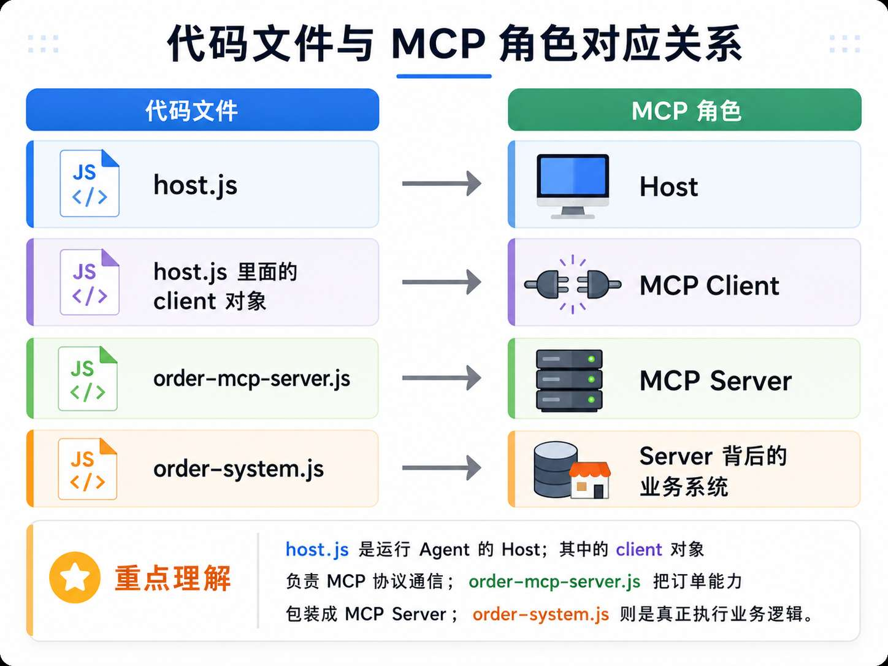


## MCP 怎样发现 Server 提供了哪些能力
刚才运行案例时，第三步打印出了 `get_order`。

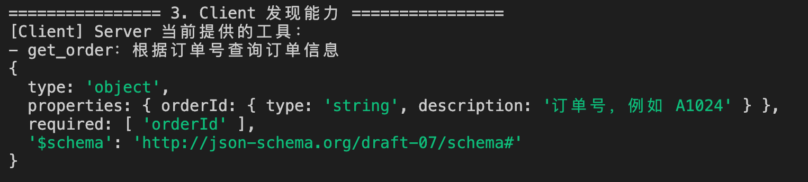


但是，咱们并没有在 `host.js` 里重新写一遍这个工具的名称、说明和参数（就像上一小节的代码一行）。

那么问题就来了：**MCP 怎样发现 Server 提供了哪些能力的呢？**

其实，这些信息来自于这行代码：

```javascript
const { tools } = await client.listTools()
```

Client 会主动询问 Server：“你现在提供了哪些工具？”

这就是 MCP 的能力。

SDK 在底层会把 `listTools()` 转换成 MCP 的 `tools/list` 请求。

Server 收到请求以后，把自己注册的工具名称、说明和 `inputSchema` 返回给 Client。

所以咱们在运行结果中看到了上述的打印结果了。

也就不再需要像上一小节一样，自己创建一个数组进行维护了。

## 总结
这一节是从 Tool Calling 走向 MCP 的过渡。

纯 Tool Calling 已经解决了模型怎样提出工具调用，但是工具列表、执行逻辑和外部系统连接仍然写在 Host 项目里。

MCP 继续作为能力连接协议，就需要提供统一的对接接口

MCP 里有三个核心概念：

+ Host 是整个 AI 应用的组织者，负责模型、上下文、权限和 Agent 流程
+ MCP Client 运行在 Host 内部，负责维护与某一个 Server 的协议连接
+ MCP Server 则负责暴露并执行具体能力

Client 和 Server 在正式工作前会完成初始化与能力协商。随后，Host 可以通过 `tools/list` 发现工具，再通过 `tools/call` 请求 Server 执行。

下一节，咱们会在这个最小 Server 的基础上继续增加能力，分别实现 `Tools`、`Resources` 和 `Prompts`，再使用 MCP Inspector 查看 Server 真正暴露出来的协议内容。

> 更新：2026-07-14 18:34 · 原文：<https://www.yuque.com/lgdsunday/ab1dy3/ii76srrhdno1lrtu>
