# 04 - MCP Server 能力建模：Tools、Resources、Prompts 与 Inspector 验证

上一节，咱们已经写了一个最小 MCP 案例。

在那个案例里，`host.js` 会创建 MCP Client，然后连接 `order-mcp-server.js`，最后调用 `get_order` 查询订单。

跑通这条链路以后，很多同学可能会自然产生一个问题，那就是：

**MCP Server 到底能暴露什么能力？**

如果 MCP Server 只是把几个函数注册成工具，那它和上一节的 Tool Calling 好像也没啥本质区别。

所以，这一节咱们继续往下看。

咱们来看  `MCP Server` 里面最常用的三类能力：

+ **Tools -- 执行动作**：让模型调用一个函数去查天气、发邮件或操作数据库
+ **Resources -- 读取资料**：让模型获取文档、图片或结构化数据
+ **Prompts -- 可复用任务模板**：说直白点就是固定的提示词方案

那么下面咱们就一个个来看。

## Tools：可以执行的动作
先看第一个：`Tools`。

这个大家应该最好理解。

上一节的 `get_order` 就是一个 Tool。

Tool 表示 MCP Server 暴露出来的一个 **可执行动作**。

比如在售后系统里面，下面这些东西都是 `Tool`：

+ 订单查询接口： `get_order` 
+ 判断是否满足退款条件接口：`check_refund_eligibility`  
+ 创建售后工单接口：`create_ticket`

这些东西都有一个共同特点：

**Client 调用它以后，Server 会真正执行一段逻辑。**

这个逻辑可以查数据库、调接口都行，就是一个正常的函数方法。

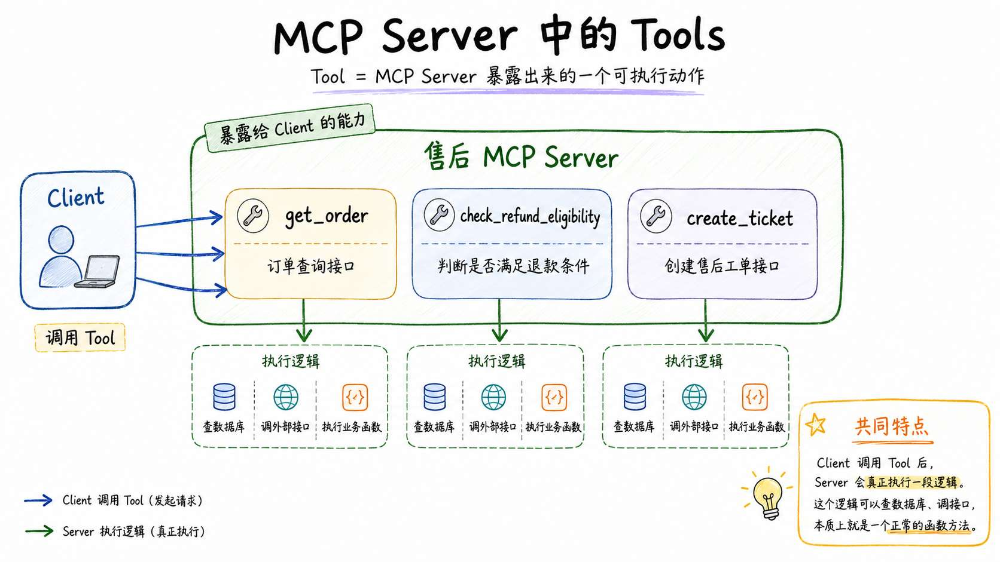


## Resources：可以读取的资料
然后再来看 `Resources`。

Resource  直译过来叫做 **资源**

在 MCP 里面，Resource 表示为 Server 暴露出来的一份 **可读取的资料**。

比如 这个 URI ：`refund-policy://default`

这个 URI 对应的可能就是当前售后系统默认的退款规则。

Client 可以通过 MCP 协议读取这份资料。

但是大家要注意，Resource 不是直接把资料塞到大模型的上下文里面（那就成 `RAG` 了）

Resource 只是告诉 Host：**我这里有一份资料，你可以按标准协议读取。**

读不读、什么时候读、读完以后要不要交给模型，这些还是 Host 决定。

所以 Resource 的重点不是“执行动作”，而是 **提供可读取内容**。


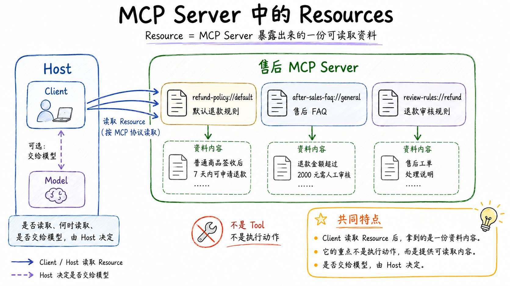

## Prompts：可复用的任务模板
最后一个是 `Prompts`。

如果按照标准方案来说，Prompt 在 MCP Server 里面的作用应该是 **提供给 Host 的一套可复用任务模板**

但是说白了，其实就是提示词

比如售后场景里，很多回答都要遵守同一套要求，类似于这样的提示词：

> 你是企业售后客服 Agent。  
请根据订单查询结果、退款预检结果和售后规则回答用户。  
如果资料不足，不要编造。
>

这类内容如果每个 Host 都自己写一份，那肯定不合适；

所以，MCP Server 可以把这种标准模板注册成 Prompt。

Host 需要时，可以通过 MCP 协议获取这份模板，再结合当前用户问题去调用模型。

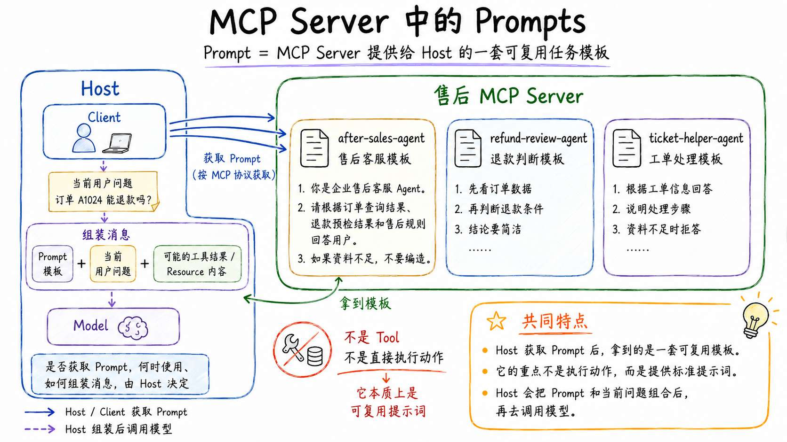


概念说完了，接下来，咱们就写个项目看看。

## 做个订单系统
> 源码地址：`https://github.com/lgd8981289/Agent--Code`
>
> 本节代码地址：`/Code/Node/第三章/04-mcp-server-capabilities`
>

目录结构如下：

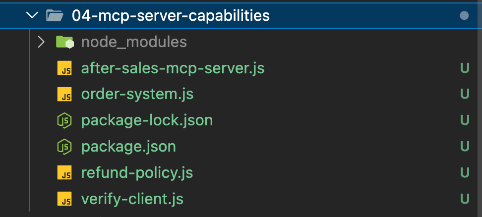


在这个项目里面，一共包含了：

+ 2 个 Tools
+ 1 个 Resource
+ 1 个 Prompt

还得继续用这两个依赖库：

```json
{
  "@modelcontextprotocol/sdk": "1.29.0",
  "zod": "^4.0.0"
}
```

> PS：注意 @modelcontextprotocol/sdk 的版本 `1.29.0`
>

### 准备订单系统
先看 `order-system.js`。

这个文件继续模拟企业已有的订单系统。

```javascript
const orders = new Map([
    [
        'A1024',
        {
            orderId: 'A1024',
            status: 'delivered',
            productName: '咖啡机',
            category: 'normal',
            signedDays: 3,
            refundAmount: 3000
        }
    ],
    [
        'B2048',
        {
            orderId: 'B2048',
            status: 'delivered',
            productName: '冷鲜牛排',
            category: 'fresh',
            signedDays: 1,
            refundAmount: 199
        }
    ]
])
```

这里准备了两个订单。

+ `A1024` 是普通商品，退款金额 3000 元。
+ `B2048` 是生鲜商品。

然后暴露两个业务函数：

```javascript
/**
 * 根据 ID 查询订单详情
 */
export async function getOrderById(orderId) {
    ...
}

/**
 * 根据售后规则做退款预检。
 *
 * 方法中是一些确定性的规则逻辑
 */
export async function checkRefundEligibility(orderId) {
    ...
}
```

+ 第一个：getOrderById 。作用是 根据 ID 查询订单详情
+ 第二个：checkRefundEligibility。作用是 一些确定性的退款规则。比如：

```javascript
if (order.category === 'fresh') {
    return {
        ok: true,
        eligible: false,
        manualReview: false,
        reason: '生鲜商品不支持无理由退款。'
    }
}
```

这两部分都是确定的普通业务代码，这里不去多说了。

MCP Server 要做的事情就是：**把这些业务能力按照 MCP 协议暴露出去。**

### 注册 MCP Server
然后来看 `after-sales-mcp-server.js`。

先创建 MCP Server：

```javascript
/**
 * 创建 MCP Server。
 *
 * name 和 version 用于标识当前 Server，
 * MCP Client 建立连接后可以读取这些基础信息。
 */
const server = new McpServer({
    name: 'after-sales-capabilities-server',
    version: '1.0.0'
})
```

接下来咱们需要利用 `server` 来注册对应的 Tool、Resource、Prompt

提供的对应方法如下：

+ server.registerTool(工具名称, 工具配置, 工具执行函数)
+ server.registerResource(资源名称, 资源 URI, 资源配置, 资源读取函数)
+ server.registerPrompt(Prompt 名称, Prompt 配置, Prompt 生成函数)

然后咱们就一个个来看。

### 注册 Tools
首先是第一个 查询订单 ID 的 `Tool` 

```javascript
// server.registerTool(工具名称, 工具配置, 工具执行函数)
server.registerTool(
  // 工具名称
    'get_order',
  // 工具配置
    {
        title: '查询订单',
        description: '根据订单号查询订单详情',
        inputSchema: {
            orderId: z.string().describe('订单号，例如 A1024')
        }
    },
  // 工具执行函数
    async ({ orderId }) => {
        console.error(`[Server] get_order orderId=${orderId}`)

        const result = await getOrderById(orderId)

        return {
            content: [
                {
                    type: 'text',
                    text: JSON.stringify(result, null, 2)
                }
            ]
        }
    }
)
```

这里有三个东西需要看懂。

+ `get_order` 是工具名。
+ 第二个参数是 **工具配置**。 工具配置里面的 `description` 和 `inputSchema` 会被 Client 发现。后面 Host 如果要把这个 Tool 交给模型使用，也会依赖这些描述和参数结构。
+ 第三个是 **回调函数**，这是真正执行订单查询的方法

然后注册第二个 Tool：

```javascript
server.registerTool(
  // 工具名
    'check_refund_eligibility',
  // 工具配置
    {
        title: '退款预检',
        description: '根据订单信息判断是否满足退款条件，以及是否需要人工审核',
        inputSchema: {
            orderId: z.string().describe('订单号，例如 A1024')
        }
    },
  // 会掉函数
    async ({ orderId }) => {
        ...
    }
)
```

Tool 都是这样的结构，不去多说了。

### 注册 Resource
接下来注册 Resource，记住下面的调用结构

```javascript
server.registerResource(资源名称, 资源 URI, 资源配置, 资源读取函数)
```

先看 `refund-policy.js` 文件，这个文件表示为对应的资源：

```javascript
export const refundPolicyUri = 'refund-policy://default'

export const refundPolicyText = `# 售后退款规则

1. 普通商品签收后 7 天内可以申请退款。
2. 生鲜商品不支持无理由退款。
3. 退款金额超过 2000 元时，需要进入人工审核流程。
4. 客服回复用户时，必须说明判断依据，不能编造系统没有返回的信息。
`
```

看，它就是一份资料。

然后在 MCP Server 里注册：

```javascript
// server.registerResource(资源名称, 资源 URI, 资源配置, 资源读取函数)

server.registerResource(
  // 资源名称
    'refund-policy',
  // 资源 URI
    refundPolicyUri,
  // 资源配置
    {
        title: '售后退款规则',
        description: '客服和售后 Agent 需要遵守的退款规则',
        mimeType: 'text/markdown'
    },
  // 资源读取函数
    async (uri) => {
        return {
            contents: [
                {
                    uri: uri.href,
                    mimeType: 'text/markdown',
                    text: refundPolicyText
                }
            ]
        }
    }
)
```

这里的关键是 `refund-policy://default`。

它是这份 Resource 的 URI。

Client 读取 Resource 的时候，会直接读取这个 URI 对应的内容。

### 注册 Prompt
最后注册 Prompt：

```javascript
// server.registerPrompt(Prompt 名称, Prompt 配置, Prompt 生成函数)
server.registerPrompt(
  // Prompt 名称
    'refund-review',
  // Prompt 配置
    {
        title: '退款审核回复模板',
        description: '根据订单信息、退款预检结果和售后政策生成客服回复',
        argsSchema: {
            orderId: z.string().describe('订单号'),
            customerQuestion: z.string().describe('用户原始问题')
        }
    },
  // Prompt 生成函数
    ({ orderId, customerQuestion }) => {

        return {
            description: '退款审核回复模板',
            messages: [
                {
                    role: 'user',
                    content: {
                        type: 'text',
                        text: [
                            '你是企业售后客服 Agent。',
                            '请根据订单查询结果、退款预检结果和售后规则回答用户。',
                            '如果资料不足，不要编造。',
                            `订单号：${orderId}`,
                            `用户问题：${customerQuestion}`
                        ].join('\n')
                    }
                }
            ]
        }
    }
)
```

这个 Prompt 做的事情是：**返回一组 **`messages`** 模板。**

也就是说，Prompt 负责的是把一个标准任务模板（提示词）提供给 Host。

后面 Host 可以把这个模板、订单查询结果、退款预检结果和用户问题组合起来，再去调用模型。

## 使用验证 Client 查看能力
为了不让大家只看代码，咱们再写一个 `verify-client.js`。

这个 Client 只负责验证 MCP Server 暴露了什么。

核心代码是下面这样：

```javascript
const { tools } = await client.listTools()
const { resources } = await client.listResources()
const { prompts } = await client.listPrompts()
```

这三行分别验证：

+ Server 暴露了哪些 Tools
+ Server 暴露了哪些 Resources
+ Server 暴露了哪些 Prompts

然后调用退款预检 Tool：

```javascript
const refundResult = await client.callTool({
    name: 'check_refund_eligibility',
    arguments: {
        orderId: 'A1024'
    }
})
```

读取 Resource：

```javascript
const policy = await client.readResource({
    uri: 'refund-policy://default'
})
```

获取 Prompt：

```javascript
const prompt = await client.getPrompt({
    name: 'refund-review',
    arguments: {
        orderId: 'A1024',
        customerQuestion: '3000 元的咖啡机退款，需要人工审核吗？'
    }
})
```

这里其实就是把 MCP Server 暴露的三类能力全部跑一遍。

运行：

```bash
npm run verify
```

先是 Server 能力：

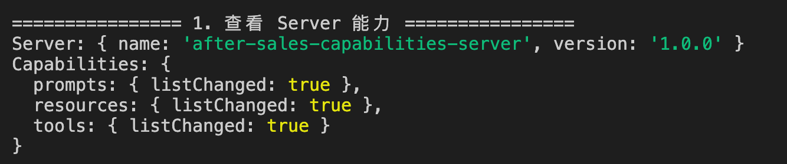


这说明当前 Server 同时支持 `prompts`、`resources` 和 `tools`。

然后是 Tools：

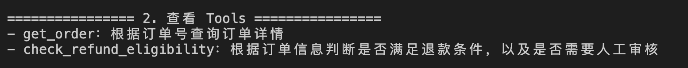


退款预检结果：

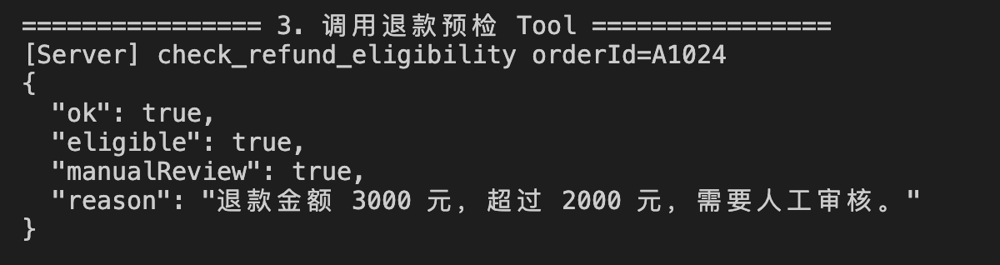


这里说明 Tool 确实执行了业务逻辑。

再往下看 Resource：

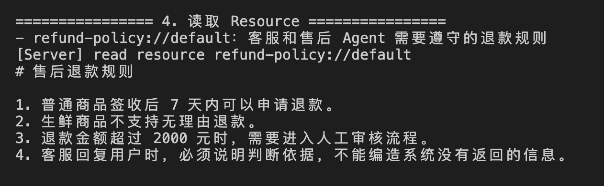


读取后能看到退款规则原文。

最后是 Prompt：

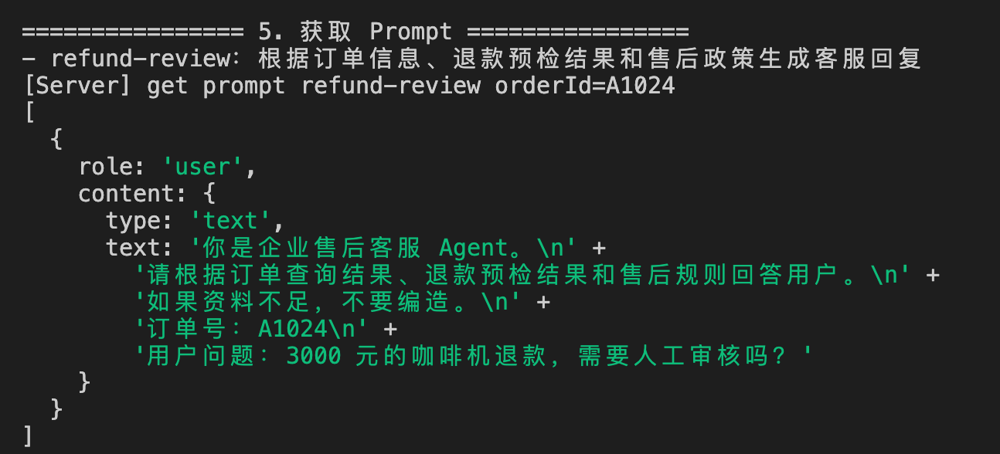


获取 Prompt 后，会得到一组消息模板：

这样一看，三个东西的区别就比较明显了。

+ Tool 是执行出来的结果
+ Resource 是读取出来的资料
+ Prompt 是生成出来的消息模板

## 使用 MCP Inspector 查看 Server
除了写验证 Client 之外，还可以使用 MCP Inspector。

在项目目录执行：

```bash
npm run inspector
```

或者直接执行：

```bash
npx @modelcontextprotocol/inspector node after-sales-mcp-server.js
```

启动以后，Inspector 会打开一个本地调试页面。

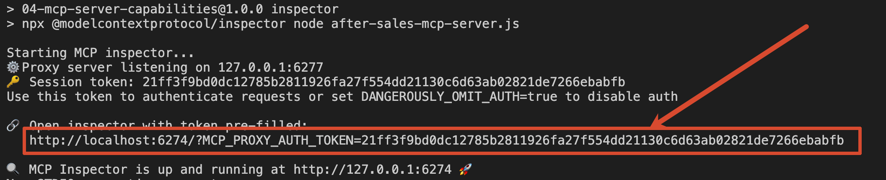


在里面可以看到当前 Server 暴露的 Tools、Resources 和 Prompts。

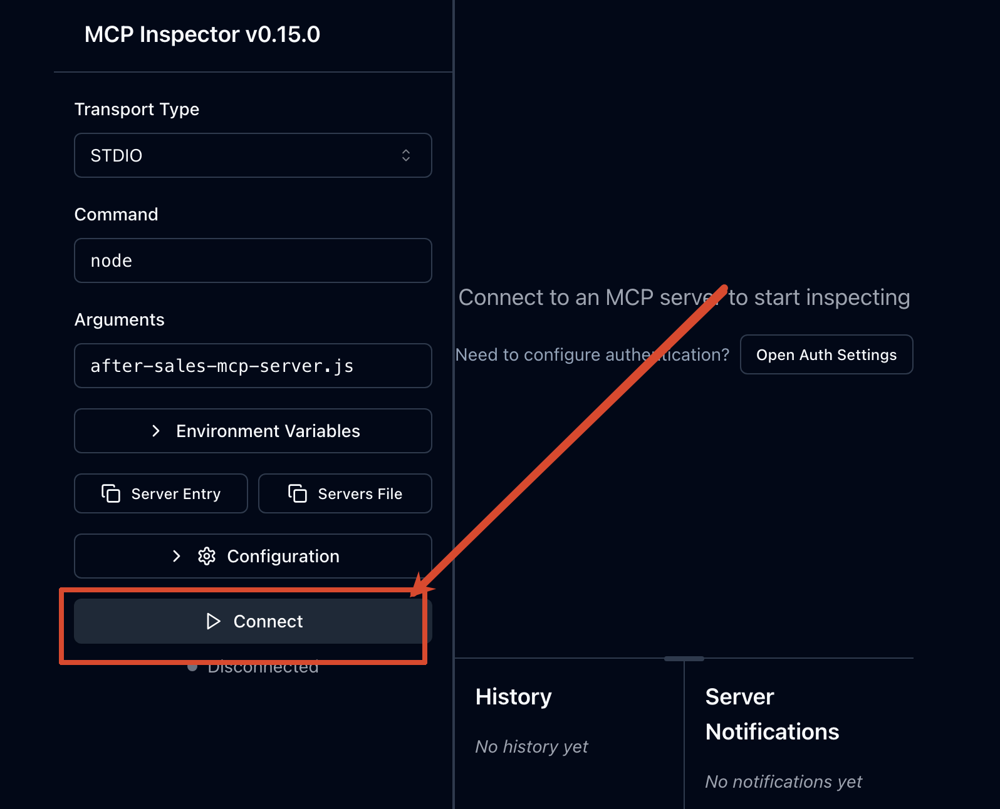


应该可以看到如下页面

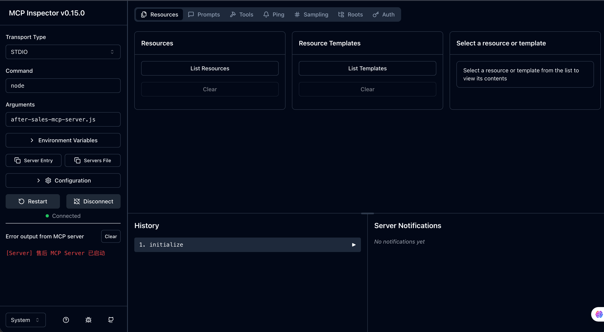


如果失败，可以确定下面这几个关键位置的信息是否正确

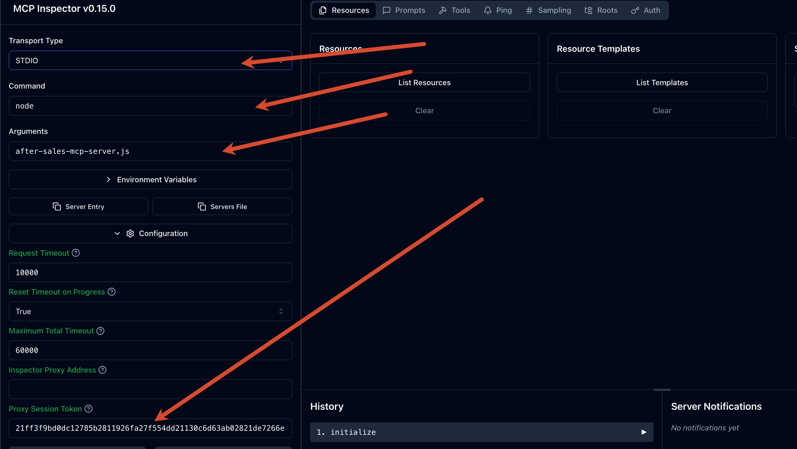


页面打开之后，咱们先看 Tools 列表，确认 `get_order` 和 `check_refund_eligibility` 是否存在。

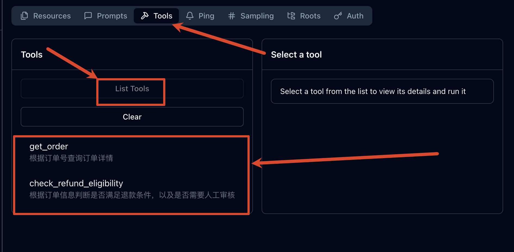


然后调用 `check_refund_eligibility`，传入：

```json
{
  "orderId": "A1024"
}
```

观察它是否返回 `manualReview: true`。

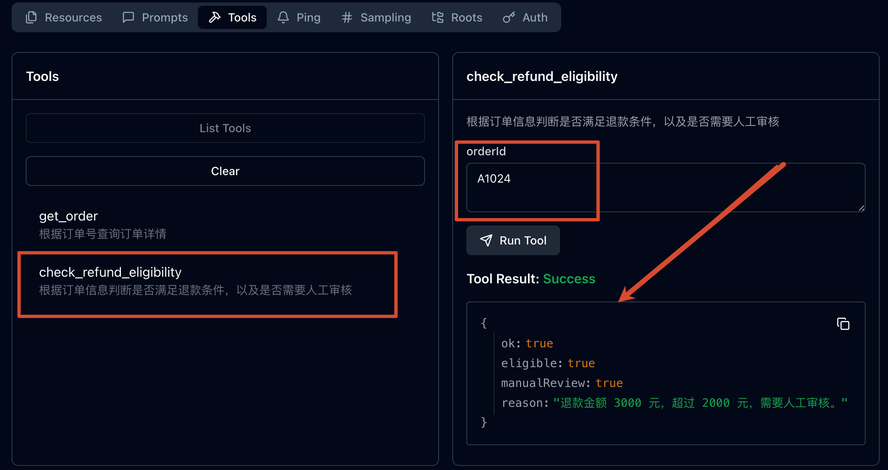


接着切到 Resources，读取 refund-policy：

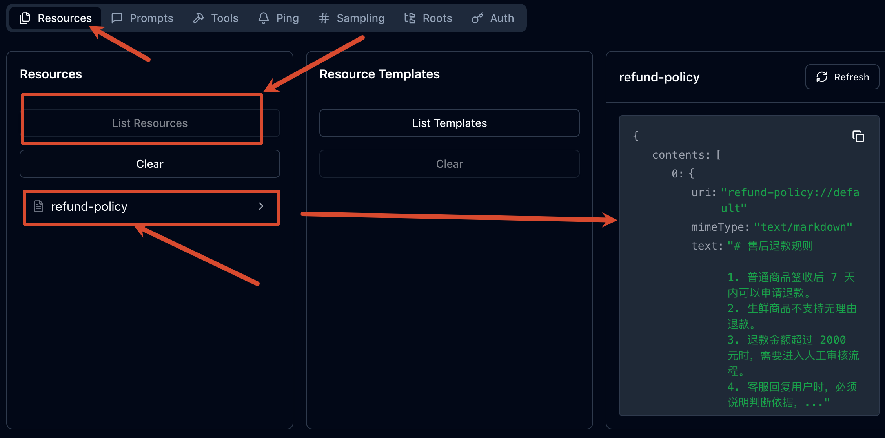


最后再看 Prompts，执行 `refund-review`，传入订单号和用户问题。


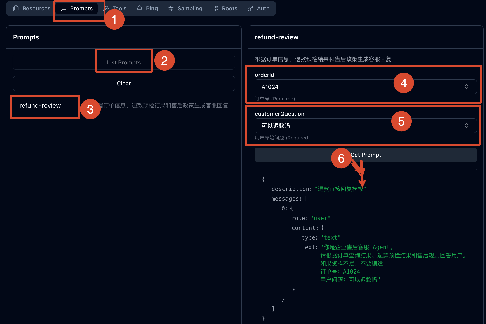


## 总结
这一节，咱们在已经跑通 MCP 链路的基础上，继续把 MCP Server 的能力设计拆开讲了一遍。

咱们需要知道：

+ `Tools` 代表可执行动作，适合封装订单查询、退款预检这类业务能力。
+ `Resources` 代表可读取资料，适合暴露售后规则、业务说明这类内容。
+ `Prompts` 代表可复用任务模板，适合沉淀企业内部统一的 Agent 任务提示。

最后，咱们用验证 Client 和 MCP Inspector 分别确认了这三类能力确实可以被发现、读取和调用。

到这里，MCP Server 的能力组织方式就基本清楚了。

下一节，咱们继续看 Host 。

也就是：Host 怎样创建 MCP Client，怎样发现 Server 能力，怎样把 MCP Tool 转成模型可以使用的工具定义，并把工具执行结果重新交回模型的

> 更新：2026-07-15 10:43 · 原文：<https://www.yuque.com/lgdsunday/ab1dy3/lgk05hhdww5beqym>
