# 05 - 构建 MCP Host 协议适配层：能力协商、Tool Schema 映射、调用路由与多轮结果回注

上一节，咱们已经把售后 MCP Server 做出来了。

这个 Server 里面包含两个 Tools、一个 Resource 和一个 Prompt。

最后还通过验证 Client 和 MCP Inspector

但是，大家仔细看上一节的 `verify-client.js`，会发现这个工具调用是咱们手动指定的：

```javascript
const refundResult = await client.callTool({
    name: 'check_refund_eligibility',
    arguments: {
        orderId: 'A1024'
    }
})
```

也就是说，程序在运行以前就已经知道要调用 `check_refund_eligibility`。

整个过程根本没有大模型参与。

所以，上一节的代码只能说明：**Client 可以发现并调用 MCP Server 的能力。**

但是，很明显，这还不是咱们真正想要的 Agent。

真正的 Agent 应该接收一句自然语言：

> 订单 A1024 是否满足退款条件？如果可以退款，是否需要人工审核？
>

然后由模型判断需要哪个工具、生成调用参数。Host 再把这次调用交给 MCP Client，最后把执行结果重新送回模型。

这一节，咱们就把这块功能完成。

## 从验证 Client 到真正的 Host
先回忆一下第三节讲过的角色关系。

`MCP Client` 负责和 MCP Server 通信。

它可以建立连接、查询能力列表、调用 Tool、读取 Resource，也可以获取 Prompt。

但是 Client 不负责调用大模型，也不会根据用户问题决定该使用哪个工具。

这些事情是 `Host` 负责的。

整个流程就长成下面这样：

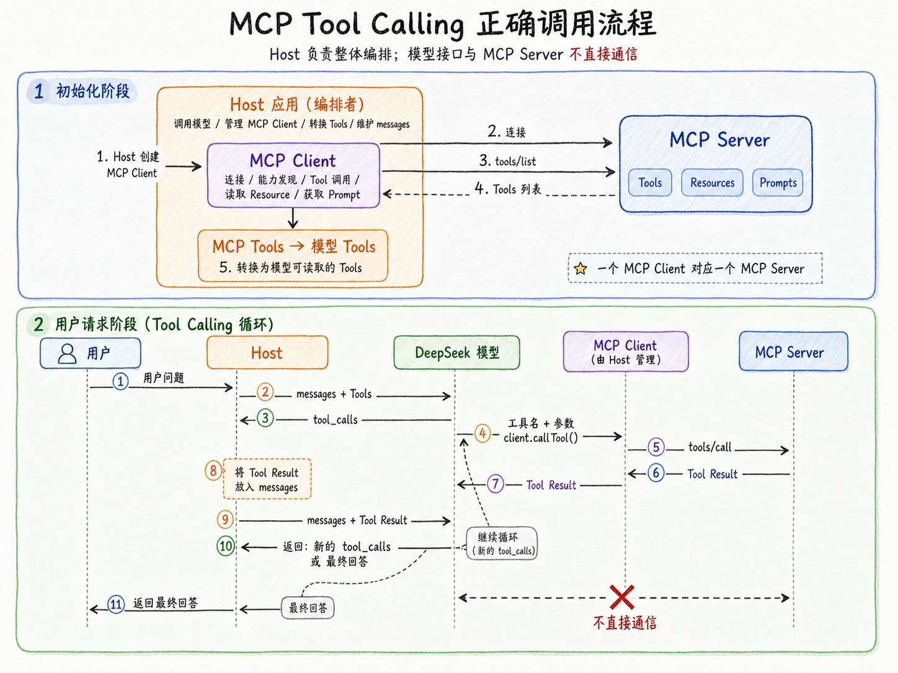


这里最容易混淆的是：**模型接口和 MCP Server 之间并不会直接通信。**

模型本身并不认识 `client.callTool()`，MCP Server 也不知道什么是模型的 `tool_calls`。

是 Host 站在中间，把两边的数据结构转换并串联起来。

## 实现一个可以调用 MCP Tool 的最小 Host
> 课程源码：`https://github.com/lgd8981289/Agent--Code`
>
> 本小节完整代码位于：`Code/Node/第三章/05-mcp-client-host`
>

这个项目继续使用上一节的售后 MCP Server。

目录结构如下：

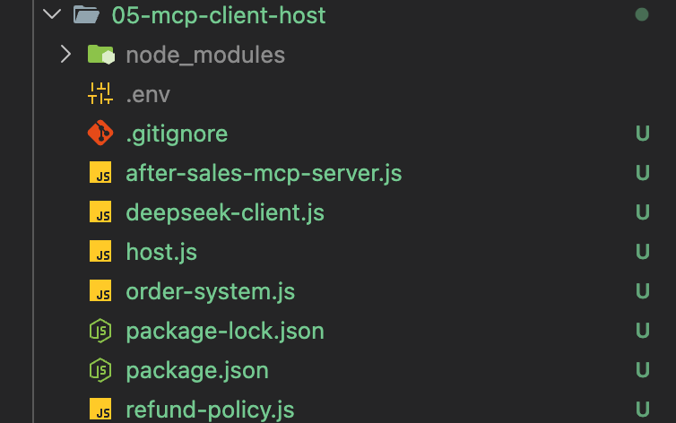


`after-sales-mcp-server.js`、`order-system.js` 和 `refund-policy.js` 都已经在上一节讲过了，代码直接复制过来就可以了。

这一节真正新增的是两个文件：

+ `deepseek-client.js`：负责调用 DeepSeek
+ `host.js`：负责连接模型和 MCP Server，运行完整调用链

项目继续使用 MCP 官方 SDK 的 V1 版本：

```bash
npm install @modelcontextprotocol/sdk@1.29.0 zod
```

然后是 `.env` 文件：

```plain
DEEPSEEK_API_KEY=你的 DeepSeek API Key
DEEPSEEK_MODEL=deepseek-v4-flash
```

### 创建 MCP Client 并连接 Server
先来看 `host.js` ，这里面代码有点多，大家最好是下载下来源码之后，然后跟着课程的代码一点点看

这里给大家录了一个视频，大家可以看下：

[此处为语雀卡片，点击链接查看](https://www.yuque.com/lgdsunday/ab1dy3/cz9w186gphrkluuq#kI7tf)

第一步还是创建 MCP Client （在 `runHost` 方法里面）：

```javascript
/**
 * 创建 MCP Client。
 *
 * Client 是 Host 内部的协议通信组件，只负责与当前 MCP Server 通信，
 * 不调用大模型，也不负责判断应该使用哪个工具。
 */
const client = new Client({
    name: 'after-sales-minimal-host-client',
    version: '1.0.0'
})
```

这个 `client` 不只是 Host 内部专门负责 MCP 通信的组件。

接着创建 `StdioClientTransport`：

```javascript
/**
 * 创建 stdio 传输层。
 *
 * StdioClientTransport 会执行：
 *
 * node after-sales-mcp-server.js
 *
 * 启动 MCP Server 子进程，并通过标准输入和标准输出传输 MCP 协议消息。
 *
 * stderr: 'inherit' 表示 Server 写入 stderr 的调试日志
 * 会直接显示在当前终端中。
 */
const transport = new StdioClientTransport({
    command: process.execPath,
    args: [serverPath],
    stderr: 'inherit'
})
```

这段代码表示：使用当前 Node.js 启动 `after-sales-mcp-server.js`，再通过标准输入和标准输出通信。

最后建立连接：

```javascript
/**
 * 建立 MCP Client 与 MCP Server 之间的连接。
 *
 * 连接过程中双方会完成初始化和能力协商。
 */
await client.connect(transport)
```

连接建立时，Client 和 Server 还会完成 MCP 初始化。双方会交换协议版本、基础信息和支持的能力类别。

连接成功以后，Host 可以读取 Server 返回的信息：

```javascript
const serverInfo = client.getServerVersion()
const capabilities = client.getServerCapabilities()
```

咱们运行时会看到：

```latex
Server：after-sales-capabilities-server v1.0.0
能力类别：prompts、resources、tools
```

这里表示：当前 Server 支持 Tools、Resources 和 Prompts。

但是，它没有告诉 Host 具体有哪些 Tool。

想要获得真正的能力明细，还要继续请求：

```javascript
const { tools } = await client.listTools()
const { resources } = await client.listResources()
const { prompts } = await client.listPrompts()
```

这三行代码在 MCP 协议里分别对应：

```latex
tools/list
resources/list
prompts/list
```

这就是 MCP 的能力。

Server 后面增加了一个 Tool，只要 Host 再次查询能力列表，就有机会发现它，不需要重新在 Host 里手写一份工具注册表。

### Tools、Resources 和 Prompts 都会交给模型吗？
说到这里，有一个问题必须先说明白。

Client 已经发现了三类能力，是不是应该把它们全部发送给 模型？

**不是！**

`Tools` 可以转换成模型的 Tool Calling 定义，让模型根据用户问题选择调用。

但 `Resources` 和 `Prompts` 不会因为被 Client 发现，就自动进入模型上下文。

如果 Host 想使用 Resource，需要主动执行：

```javascript
await client.readResource({
    uri: 'refund-policy://default'
})
```

读取出来以后，再由 Host 决定是否把资料加入 `messages`。

Prompt 也是一样。

Host 需要通过 `client.getPrompt()` 取得消息模板，再决定怎样和当前任务、用户问题以及其他上下文组合。

所以，咱们在上面的打印（`Server：after-sales-capabilities-server v1.0.0`）里面，虽然会打印出 Resources 和 Prompts，但完整调用链只使用 Tools。

### 把 MCP Tools 转成模型可以读取的 Tools
Client 执行 `listTools()` 以后，得到的其中一条数据大概是这样的：

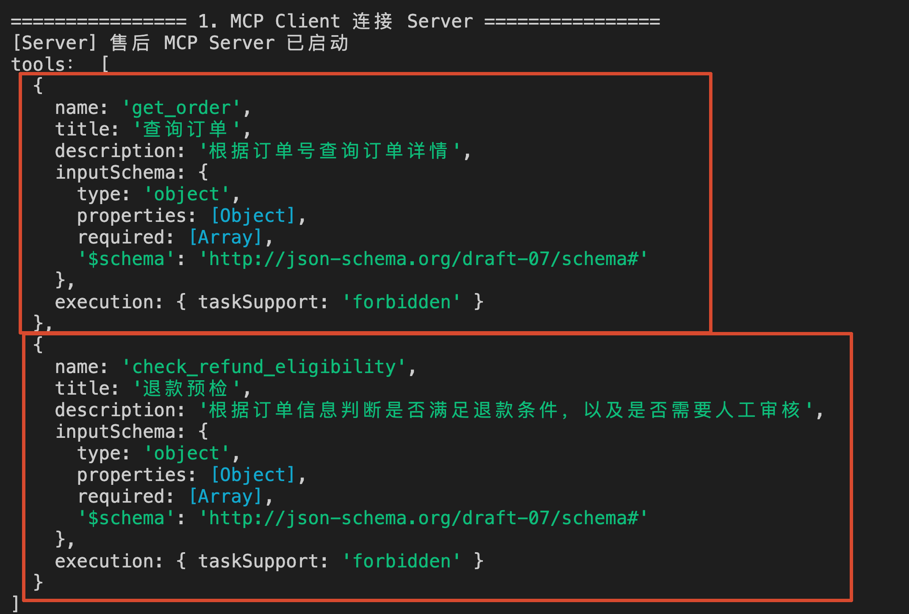


这是一份 MCP Tool 定义。

而 DeepSeek 的 Tool Calling 接口需要的是：

```javascript
{
    type: 'function',
    function: {
        name: 'check_refund_eligibility',
        description: '根据订单号判断是否满足退款条件，以及是否需要人工审核',
        parameters: {
            type: 'object',
            properties: {
                orderId: {
                    type: 'string',
                    description: '订单号，例如 A1024'
                }
            },
            required: ['orderId']
        }
    }
}
```

大家仔细对比一下，会发现工具名、描述和参数结构基本都没有变化。

真正变化的只有一个字段，那就是：

```latex
MCP Tool 的 inputSchema
          ↓ ↓ ↓
模型 Function Tool 的 parameters
```

因此，Host 需要做一次转换：

```javascript
function toModelTools(mcpTools) {
    return mcpTools.map((tool) => {
        const { $schema, ...parameters } = tool.inputSchema

        return {
            type: 'function',
            function: {
                name: tool.name,
                description: tool.description || '',
                parameters
            }
        }
    })
}
```

这里的流程我录制了一个视频，大家可以看下：

[此处为语雀卡片，点击链接查看](https://www.yuque.com/lgdsunday/ab1dy3/cz9w186gphrkluuq#lTpKS)

这段转换代码看着不复杂，但它解决了一个非常重要的问题：

**Host 不需要再维护一份独立的模型工具定义。工具名、描述和参数结构都来自 MCP Server。**

这也是 MCP 和 Tool Calling 之间真正的关系。

MCP 没有取代 Tool Calling。

模型仍然通过 Tool Calling 表达“我要调用哪个工具”。MCP 负责让 Host 用统一方式发现并调用外部能力。

### 调用模型，让模型选择 MCP Tool
模型调用放在 `deepseek-client.js` 里面。

核心请求和第二节的请求代码基本一致：

```javascript
// 调用 DeepSeek API
const response = await fetch(
    'https://api.deepseek.com/chat/completions',
    {
        method: 'POST',
        headers: {
            Authorization: `Bearer ${process.env.DEEPSEEK_API_KEY}`,
            'Content-Type': 'application/json'
        },
        body: JSON.stringify({
            model: 'deepseek-v4-flash',
            messages,
            tools,
            tool_choice: 'auto',
            thinking: {
                type: 'disabled'
            },
            temperature: 0.1
        })
    }
)
```

这里发送的 `tools`，是刚才的转换之后的数据：

```javascript
const { tools: mcpTools } = await client.listTools()
/**
 * MCP Server 返回的 Tool 结构不能直接提交给 DeepSeek，
 * Host 需要先转换成模型 Tool Calling 接口要求的格式。
 */
const modelTools = toModelTools(mcpTools)

/**
 * Host 将当前完整 messages 和可用工具定义交给模型。
 *
 * 模型只能提出工具调用请求，不会直接执行 MCP Tool。
 */
const modelResult = await callDeepSeek({
    messages,
    tools: modelTools
})
```

到这里，模型才真正 “看见”  MCP Server 暴露的工具。

> 注意，这里的 “看见” 是加了引号的。
>

因为模型看到的仍然只是工具名、描述和参数结构。它并没有连接 MCP Server，也没有拿到工具的执行函数。

如果模型认为需要查询退款条件，会返回类似下面的 `tool_calls`：

```javascript
{
    id: 'call_xxx',
    type: 'function',
    function: {
        name: 'check_refund_eligibility',
        arguments: '{"orderId":"A1024"}'
    }
}
```

接下来，才轮到 Host 把这次模型请求转成 MCP 调用。

### 把模型的 tool_calls 交给 MCP Client
第二节实现原生 Tool Calling 时，咱们写过一个 `toolRegistry` （所谓的：**工具注册表**）。

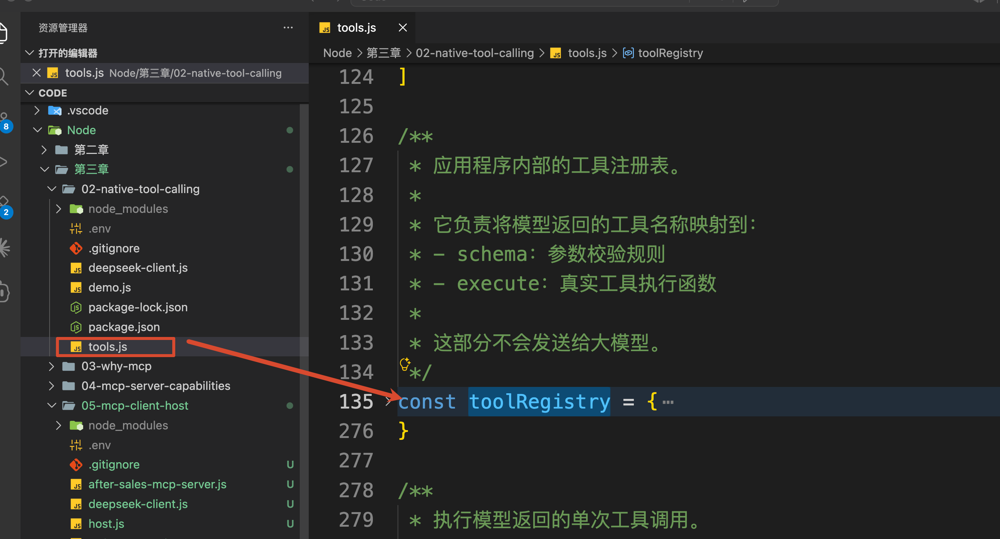


在上面的代码结构里面，模型返回工具名以后，Host 要从注册表（`toolRegistry`）里找到本地函数：

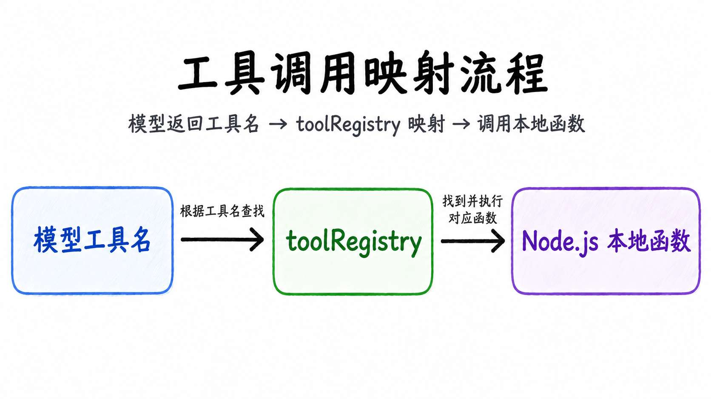


接入 MCP 以后，这个本地工具注册表就不再负责业务工具执行了。

Host 可以把模型返回的工具名和参数交给 MCP Client：

```javascript
/**
 * Client 通过 MCP 协议把工具调用发送给 MCP Server。
 *
 * 真正的参数 Schema 校验和业务逻辑执行都在 Server 中完成，
 * Host 不需要重复实现业务校验。
 */
const result = await client.callTool({
    name: toolName,
    arguments: toolArguments
})
```

数据流变成了：

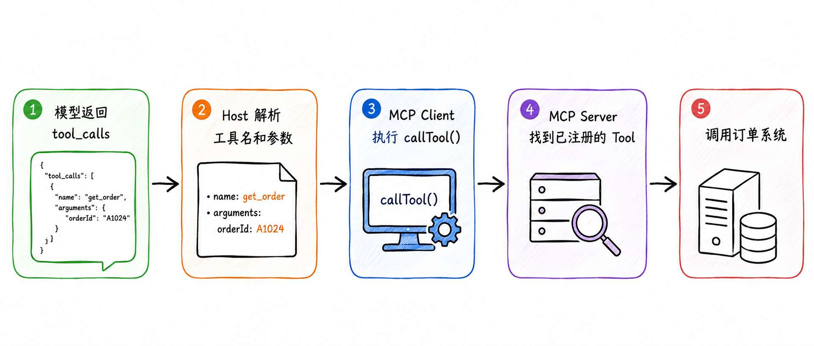


### 把 MCP 返回值变成 Tool Message
MCP Tool 执行完成以后，返回结果通常长成这样：

```javascript
{
    content: [
        {
            type: 'text',
            text: '{"eligible":true,"manualReview":true}'
        }
    ]
}
```

这里还会出现了一次数据结构差异。

MCP 使用 `content` 数组，是因为 Tool 可以返回文本、图片、音频等不同内容块。

而 DeepSeek 的 Tool Message 需要的是字符串。

所以，Host 还得把 MCP 返回值整理一下：

```javascript
/**
 * 把 MCP Tool 的执行结果转换成模型 Tool Message 使用的字符串。
 *
 * MCP Tool 返回的是 content blocks：
 *
 * {
 *   content: [
 *     { type: 'text', text: '...' }
 *   ]
 * }
 *
 * 模型的 role=tool 消息要求 content 是字符串，因此 Host 需要在这里
 * 将 MCP 返回结果标准化并序列化。
 *
 * MCP 允许返回文本、图片等多种类型的内容块。当前售后示例主要返回文本；
 * 如果出现非文本结果，也会保留原始 content，避免 Host 静默丢失信息。
 *
 * @param {object} result MCP Client 调用 Tool 后得到的结果
 * @returns {string} 可以放入模型 tool 消息的字符串
 */
function toModelToolResult(result) {
    const text = result.content
        ?.filter((item) => item.type === 'text')
        .map((item) => item.text)
        .join('\n')

    let normalizedResult = text

    if (text) {
        try {
            normalizedResult = JSON.parse(text)
        } catch {
            // 普通文本直接保留
        }
    }

    return JSON.stringify({
        toolExecutionSucceeded: !result.isError,
        result: normalizedResult
    })
}
```


## 把整个 Host 调用链串起来
前面的代码都准备好以后，最后还是要回到 Tool Calling 循环。

核心代码如下：

```javascript
/**
 * 开始执行 Tool Calling 循环。
 *
 * 每一轮都会调用一次模型：
 *
 * - 模型返回 tool_calls：执行工具并进入下一轮；
 * - 模型不返回 tool_calls：说明已经生成最终回答，结束循环。
 */
for (let round = 1; round <= MAX_TOOL_ROUNDS; round += 1) {
    console.log(`\n--- 第 ${round} 轮模型调用 ---`)

    /**
     * Host 将当前完整 messages 和可用工具定义交给模型。
     *
     * 模型只能提出工具调用请求，不会直接执行 MCP Tool。
     */
    const modelResult = await callDeepSeek({
        messages,
        tools: modelTools
    })

    const toolCalls = modelResult.message.tool_calls || []

    /**
     * 模型没有返回 tool_calls，表示当前已经不需要继续使用工具，
     * message.content 就是最终回答。
     */
    if (toolCalls.length === 0) {
        console.log('\n最终回答：')
        console.log(modelResult.message.content)
        return
    }

    /**
     * 先把模型返回的 assistant 消息完整加入上下文。
     *
     * tool_calls 必须保留下来，因为后续的 role=tool 消息
     * 需要通过 tool_call_id 与这次调用建立对应关系。
     */
    messages.push({
        role: 'assistant',
        content: modelResult.message.content ?? null,
        tool_calls: toolCalls
    })

    /**
     * 一次模型响应可能同时包含多个 tool_call，
     * Host 依次执行每一个工具调用。
     */
    for (const toolCall of toolCalls) {
        console.log('\n模型提出工具调用：')
        console.log(`- 工具：${toolCall.function.name}`)
        console.log(`- 参数：${toolCall.function.arguments}`)

        /**
         * Host 把模型生成的工具名和参数交给 MCP Client。
         *
         * MCP Client 再通过 MCP 协议请求 MCP Server 执行工具。
         */
        const toolResult = await executeMcpTool(
            client,
            availableToolNames,
            toolCall
        )

        console.log('MCP Tool 返回：')
        console.log(toolResult)

        /**
         * 把工具执行结果作为 role=tool 消息追加到上下文。
         *
         * 下一轮调用模型时，模型就可以读取这次真实工具结果，
         * 判断是否还需要继续调用其他工具，或者生成最终答案。
         */
        messages.push({
            role: 'tool',
            tool_call_id: toolCall.id,
            content: toolResult
        })
    }
}
```

这段循环和第二节的原生 Tool Calling 非常像。

模型仍然负责提出工具调用，Host 仍然负责执行并回传结果。

## 运行代码
咱们分两步验证。

先 **不调用模型**，只检查 MCP 连接、能力发现和 Tool Schema 转换，执行：

```bash
npm run discover
```

正常情况下，可以看到当前 Server 的能力：

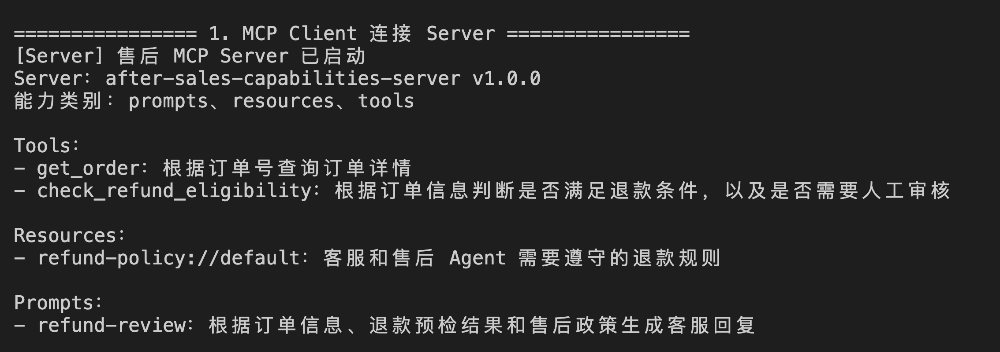


后面还会打印转换后的模型工具参数：

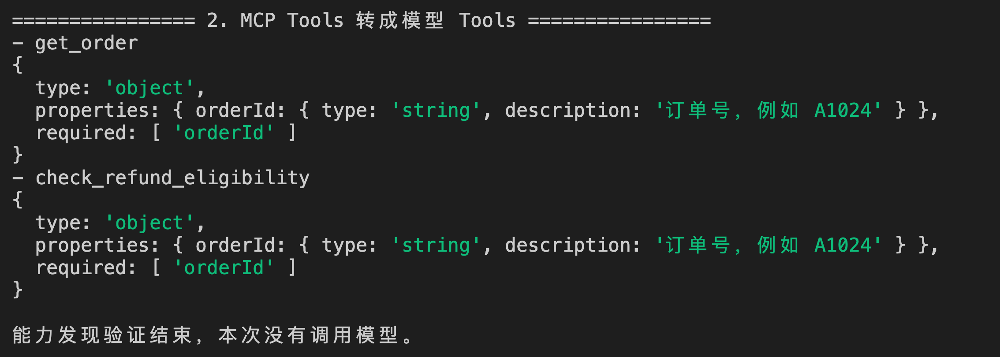


如果这一步可以正常运行，说明 MCP Server、Client 和 Schema 转换都没有问题。

接下来执行完整 Host：

```bash
npm run demo
```

这里前面两步都一样，咱们从第三步开始看：

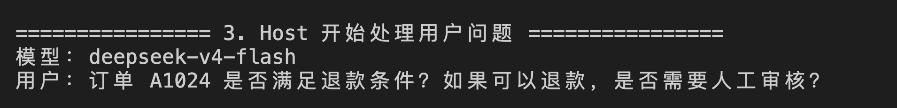


案例默认会提出这个问题：

```latex
订单 A1024 是否满足退款条件？如果可以退款，是否需要人工审核？
```

然后会进行最多 4 轮（host.js 中的 `MAX_TOOL_ROUNDS`）的模型调用

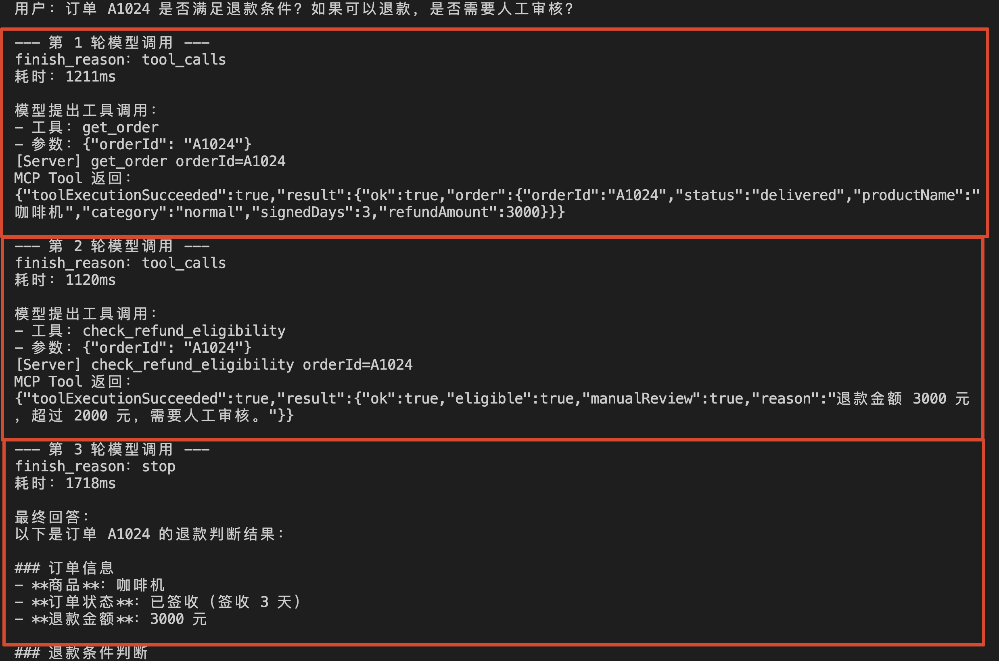


咱们一点点来看。

在 第一轮 和 第二轮 请求中：模型先返回了两个工具调用：

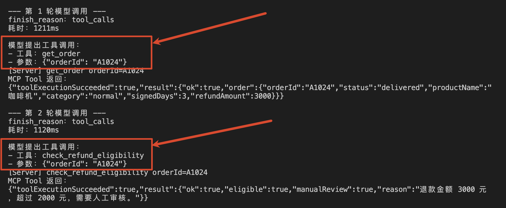


根据这两次工具调用的结果，最终生成完整回答：

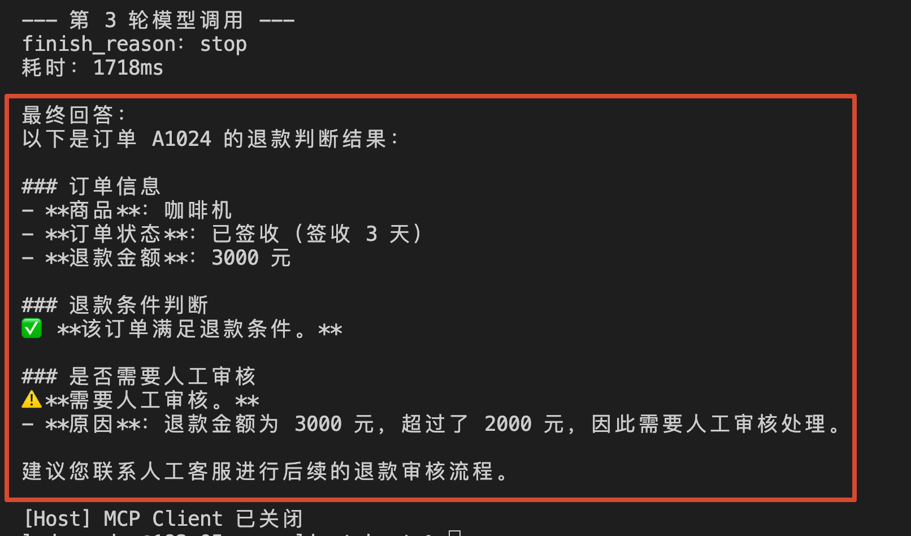


还可以换一个不存在的订单：

```bash
npm run demo -- "查询订单 A9999 是否满足退款条件"
```

这次 MCP 调用本身仍然可以成功，但订单系统会返回 `ORDER_NOT_FOUND`。

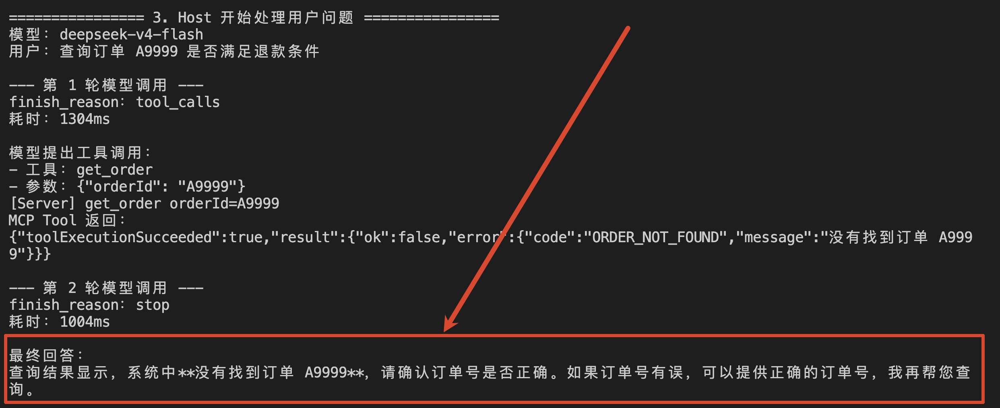


## 总结
上一节的验证 Client 可以直接调用 MCP Server，但它不知道用户在问什么，也不会自己调用模型。

这一节实现的最小 Host，把模型调用和 MCP Client 真正接到了一起。

Host 先通过 MCP Client 完成初始化和能力发现，再把 MCP Tool 的 `inputSchema` 转成模型 Tool Calling 使用的 `parameters`。

模型返回 `tool_calls` 以后，Host 解析工具名和参数，通过 `client.callTool()` 请求 MCP Server 执行业务能力。

MCP 返回的是内容块，Host 还要把它转换成模型可以接收的 Tool Message，并使用对应的 `tool_call_id` 放回 `messages`。

模型拿到真实结果以后，才能继续调用其他工具或者生成最终回答。

到这里，第三章前面的内容就完整串起来了：

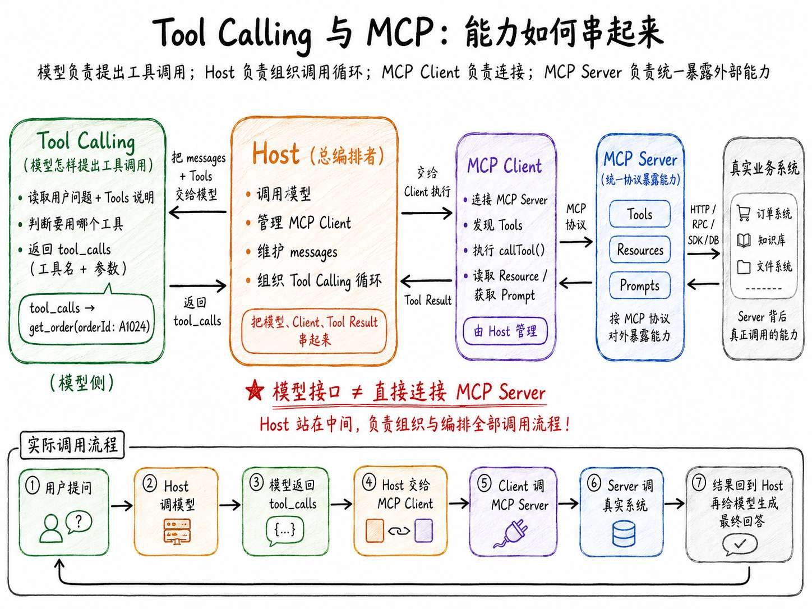

> 更新：2026-07-17 19:14 · 原文：<https://www.yuque.com/lgdsunday/ab1dy3/cz9w186gphrkluuq>
