# 06 - 完成远程 MCP 调用，深入 stdio、Streamable HTTP 连接方案

上一节，咱们实现了一个最小 Host。

Host 先创建 MCP Client，再通过下面这段代码连接售后 MCP Server：

```javascript
const transport = new StdioClientTransport({
    command: process.execPath,
    args: [serverPath]
})

await client.connect(transport)
```

运行代码以后，`StdioClientTransport` 会在当前电脑上执行：

```bash
node after-sales-mcp-server.js
```

也就是说：

> Host 和 MCP Server 虽然运行在两个不同的进程中
>
> **但是：**它们都位于当前这一台电脑上。
>
> MCP Client 则由 Host 创建，负责通过 `stdio` 与这个本地 MCP Server 通信。
>

这在本地开发的时候是没有问题的。

**但是！** 

如果把这种方式放到真实的企业项目里面，就不太行了。

> 跟大家举个例子：
>
> 假设企业有 1000 位员工都要使用售后 Agent，上面这种方式就意味着每位员工都得安装并运行 `node after-sales-mcp-server.js` 
>
> 如果知识库、代码仓库、订单系统分别对应不同的 MCP Server，那么每位员工的电脑上可能还要安装和维护多套 MCP Server 
>

这会带来一系列问题，比如：

+ MCP Server 代码更新以后，每个人都得同步代码
+ 本地程序需要配置企业接口地址、身份凭证和访问权限
+ 某些 MCP Server 还可能依赖数据库、向量数据库或内部运行环境

毕竟，不是每个人都是程序员的，对不对。

所以说在真实企业项目里面，更常见的调用情况应该是这样的 **通过网络连接企业 MCP Server**：


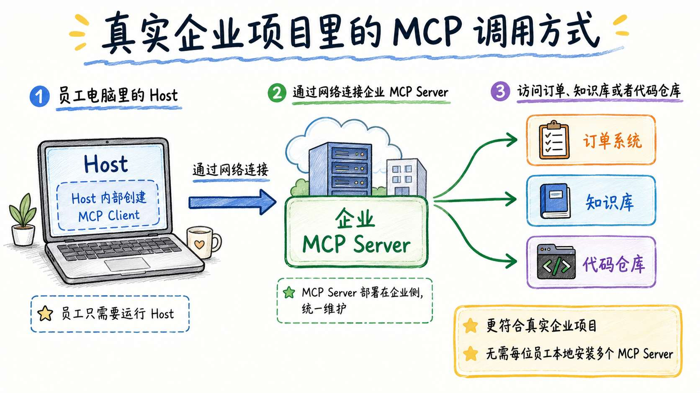


所以，在这种企业共享场景中，MCP Server 还需要提供 **远程连接方式**。

那么想要做到这一点，首先要解决的问题就是 **Client 和 Server 到底应该怎样通信**。

## Client 和 Server 到底应该怎样通信
无论 MCP Server 运行在本地还是远程，Client 和 Server 之间都需要传递 MCP 消息。

但是，这些消息总得通过某种方式，从 Client 发送到 Server，再把执行结果传回来，对不对。

这个负责传输 MCP 消息的部分，就叫做 `Transport`，也就是 **传输层**。

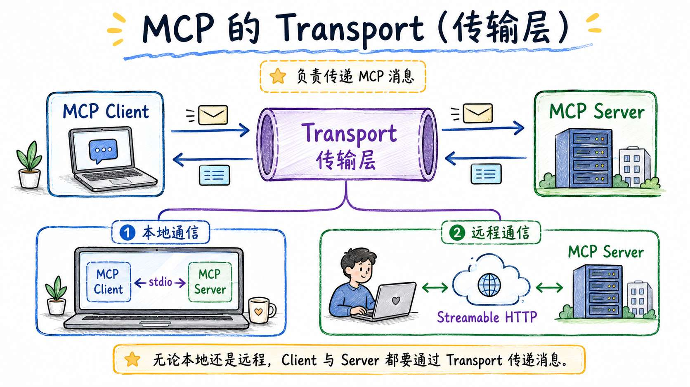


目前，MCP 主要提供两种标准的通信方式：

+ 本地通信：stdio
+ 远程通信：Streamable HTTP

咱们一个个来看。

### 本地通信：stdio
咱们文章开头的 `new StdioClientTransport` 就是一个典型的实现了 MCP 的 stdio 传输方式。

很多同学第一次看到它时，可能会觉得比较抽象。

其实，`stdio` 并不是 MCP 独有的概念，它是操作系统提供的一种非常基础的进程通信方式。

`stdio` 是 `standard input / standard output` 的缩写，也就是 **标准输入和标准输出**。

那么这玩意到底是什么意思呢？

咱们先暂时不管 MCP，先看一个普通的 Node.js 程序。

假设有下面这样一个文件：

```javascript
// hello.js
console.log('你好')
```

然后在终端中运行：

```bash
node hello.js
```

程序会在终端中输出：

```latex
你好
```

这里的“你好”，就是程序通过自己的标准输出，也就是 `stdout`，发送出来的内容。

除了标准输出，一个程序通常还有标准输入，也就是 `stdin`。

比如，我们可以用 `readline(Node 中一个可以在终端让用户输入的库)` 这种直接让用户输入，代码有点多，给大家放个截图：

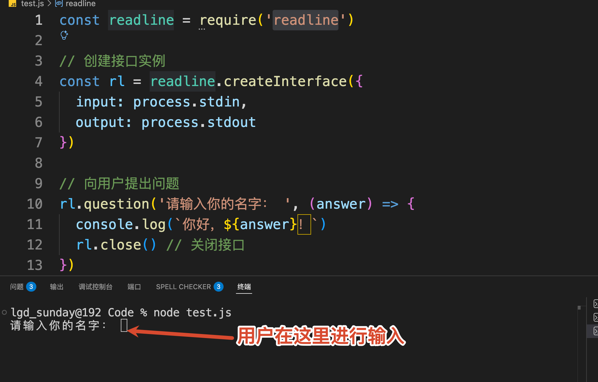


所以，`stdio` 指程序的标准输入和标准输出机制。其中：

+ `stdin` 用来接收输入
+ `stdout` 用来发送输出

在上一节的代码中，Host 就是启动了一个 Server 子进程，然后通过两条管道传输 MCP 消息：

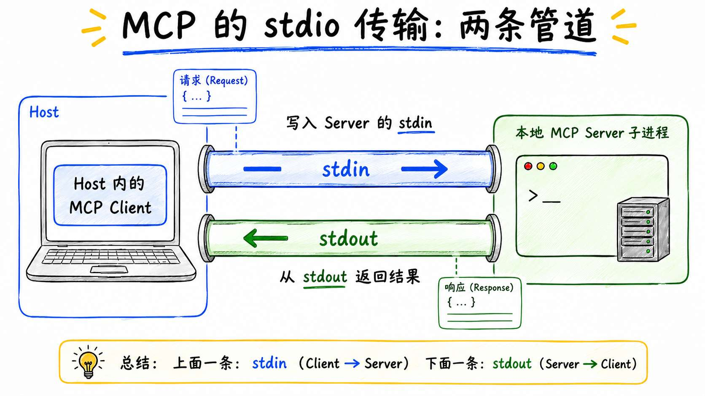


即：**Host 中的 MCP Client 向 Server 的 **`stdin`** 写入 MCP 请求，Server 再通过自己的 **`stdout`** 返回 MCP 响应。**

但是，`stdio` 只能完成本地进程之间的 `stdin` 和 `stdout` ，无法跨电脑通信。

如果想要实现远程通信，就需要用到 `Streamable HTTP` 了

### 远程通信：Streamable HTTP
MCP 为远程通信提供的标准传输方式，叫做 `Streamable HTTP`。

上面咱们说到，在 `stdio` 里面，Host 会启动一个本地 MCP Server 进程。MCP Client 向 Server 的 `stdin` 写入请求，再从 Server 的 `stdout` 读取响应。但是现在，MCP Server 已经不在当前电脑上了，Client 没办法继续向远程进程的 `stdin` 写入内容。

所以，传输方式就需要从 `stdio` 换成 `Streamable HTTP`。

对应到代码中，就是把上一节的：

```javascript
const transport = new StdioClientTransport({
    command: process.execPath,
    args: [serverPath]
})
```

换成：

```javascript
const transport = new StreamableHTTPClientTransport(
    new URL('https://www.sunday.com/mcp')
)
```

此时，Client 和 Server 的关系就变成了：

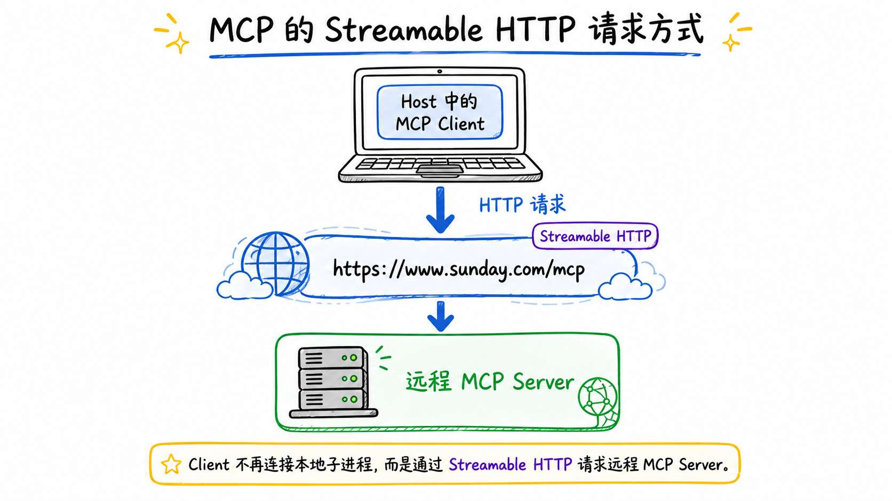


那么，MCP 消息到底是怎么传过去的呢？

很简单，**post 请求。。。**

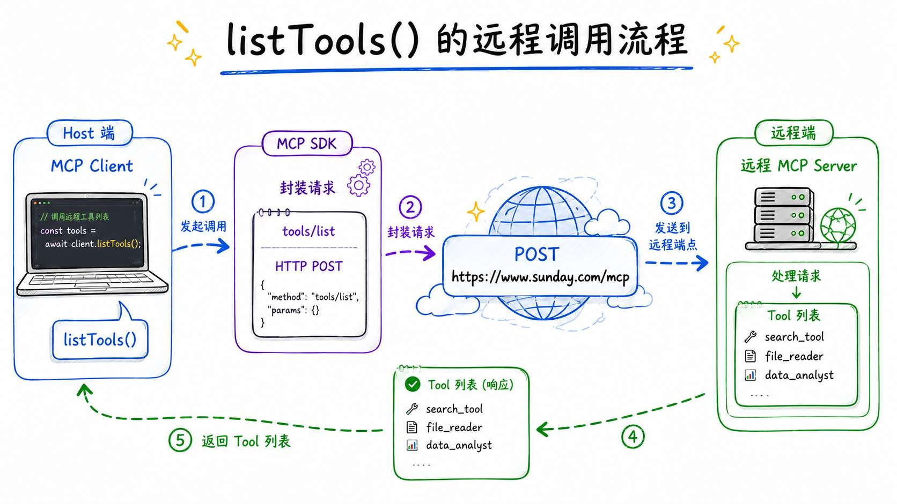


MCP SDK 会把对应的 `tools/list`、`tools/call` 等协议消息放进 HTTP 请求，再发送到远程 MCP Server。

这就是 `Streamable HTTP` 和 `stdio` 最核心的区别：

> stdio 通过本地进程的 stdin 和 stdout 传输 MCP 消息
>
> **Streamable HTTP 通过 HTTP 请求和响应传输 MCP 消息。**
>

在这样的一个请求完成之后， Server 可以使用两种方式返回结果：

1. 普通的 JSON 数据相应，就和咱们平时请求后端接口一样
2. `SSE` 的相应。这个也常见，不去多说了

如果 Server 支持，Client 还可以对同一个 MCP 地址发起 GET 请求，建立可选的 SSE 通道，用来接收 Server 主动发送的消息。

这些 POST、GET 和 SSE 的处理，都会由一个叫做 `StreamableHTTPClientTransport` 的东西来完成。

## 连接一个真正的远程 MCP Server
只讲概念没啥意思，咱们直接连一个现在可以使用的远程 MCP Server。

这一节选择的是 **高德地图官方 MCP Server**。地址在这里：`https://lbs.amap.com/api/mcp-server/gettingstarted`

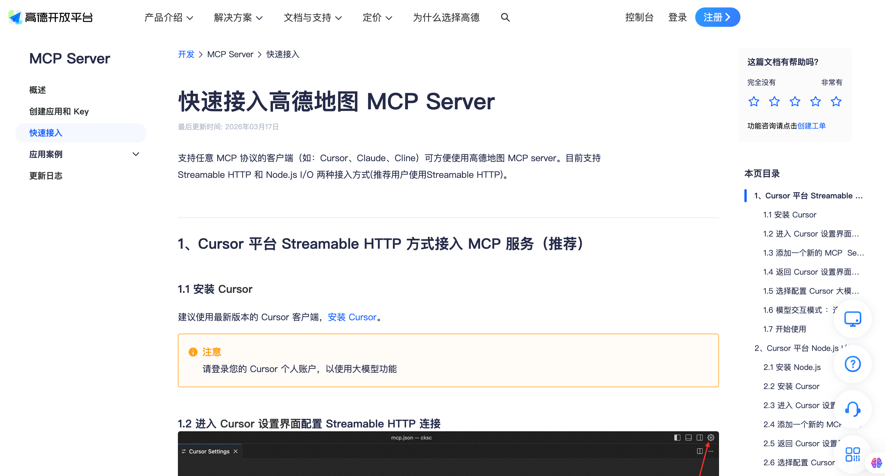


高德目前提供了两种 MCP 接入方式：

+ 通过 Node.js 在本地启动，也就是前面讲过的 `stdio`
+ 直接连接高德提供的远程地址，也就是这一节要用的 `Streamable HTTP`

想要使用高德地图的 API ，那么需要先注册账号，注册账号的过程我就不说了，大家自己注册就可以。

账号注册完成之后，大家需要先去「控制台」注册应用，同时申请 Key。

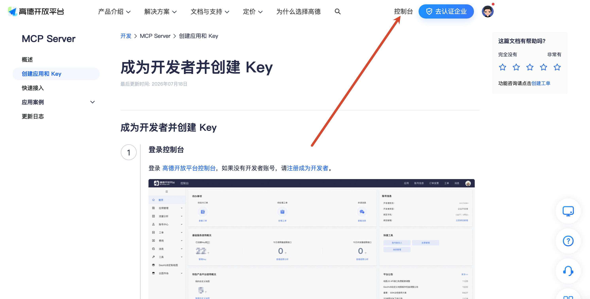


这部分高德有提供文档，地址在这里：`https://lbs.amap.com/api/mcp-server/create-project-and-key`

注册 Key 的时候要注意，**一定要选择 web 服务**

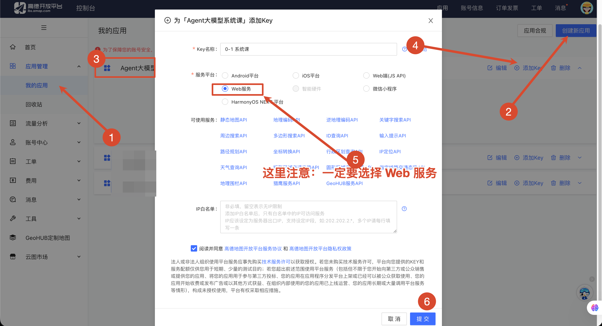


> PS：本文编写时已经验证 `https://mcp.amap.com/mcp` 可以在正常访问。
>
> 不过高德后续可能会升级远程服务接口。
>
> 所以，如果服务调不通那么请以 [高德官方 MCP 文档](https://lbs.amap.com/api/mcp-server/gettingstarted) 为准。
>
> 官方提供的远程地址是：`https://mcp.amap.com/mcp?key=你的高德Key`
>

申请到的 Key，写到项目的 `.env` 文件里：

```plain
AMAP_MAPS_API_KEY=你的高德Web服务Key
# AMAP_TEST_CITY 只是咱们等会测试天气查询时使用的城市，不配置也没关系，代码默认查询北京。
AMAP_TEST_CITY=北京
```

课程源码位于：`Code/Node/第三章/06-remote-mcp-client`

先安装依赖：

```bash
npm install
```

核心代码位于 `remote-mcp-client.js`。

这里的代码量不大，咱们来看下这里的代码。

整个代码分为两大部分：

1. `createAmapMcpUrl`
2. 远程 Tool 的查询

### 创建 Streamable HTTP Transport
整个代码从 `main` 函数开始执行，在 `main` 函数中会先调用 `createAmapMcpUrl`

```javascript
/**
 * 连接高德地图远程 MCP Server，完成能力发现并查询城市天气。
 */
async function main() {
    let client
    // 1. 读取高德 Key 并创建远程 MCP 地址
    const serverUrl = createAmapMcpUrl()
  // 2. 创建远程 MCP 客户端
  const transport = new StreamableHTTPClientTransport(serverUrl)
  // 3. 创建 MCP Client 实例
  client = new Client({
    name: 'agent-course-amap-mcp-client',
    version: '1.0.0'
  })
  // 4. 连接远程 MCP Server
  await client.connect(transport)
  ...
}

await main()
```

`createAmapMcpUrl` 代码首先会读取刚才配置的高德 Key：

```javascript
/**
 * 使用学生自己的高德 Key 生成远程 MCP 地址。
 * Key 只在运行时读取，不写入源码，也不打印到终端。
 */
function createAmapMcpUrl() {
    const apiKey = process.env.AMAP_MAPS_API_KEY?.trim()

    const url = new URL(AMAP_MCP_URL)
    url.searchParams.set('key', apiKey)

    return url
}
```

最终在 `main` 方法中得到的 `serverUrl` 地址大概是：

```latex
https://mcp.amap.com/mcp?key=你的高德Key
```

然后使用这个地址创建 `StreamableHTTPClientTransport`：

```javascript
// 2. 创建远程 MCP 客户端
const transport = new StreamableHTTPClientTransport(serverUrl)
```

`transport` 里面保存的是高德的远程地址。后续的初始化请求、`tools/list` 和 `tools/call`，都会发送到高德 MCP Server。

接着创建 Client 并建立连接：

```javascript
// 3. 创建 MCP Client 实例
const client = new Client({
    name: 'agent-course-amap-mcp-client',
    version: '1.0.0'
})
// 4. 连接远程 MCP Server
await client.connect(transport)
```

> 上一节的 `connect()` 会启动本地进程，再通过 stdin 和 stdout 完成初始化。这一节的 `connect()` 会向远程 MCP 地址发送初始化请求，双方协商协议版本和支持的能力。
>

连接成功以后，能力发现的代码完全不用改：

```javascript
const { tools } = await client.listTools()
```

目前，高德 MCP 一共提供了 15 个 Tool，我整理了一个 表格，大家可以作为参考：

| Tool | 一句话作用 |
| --- | --- |
| `maps_regeocode` | 经纬度转地址 |
| `maps_geo` | 地址或地点名称转经纬度 |
| `maps_ip_location` | 根据 IP 判断所在区域 |
| `maps_weather` | 查询城市天气 |
| `maps_search_detail` | 根据 POI ID 查询地点详情 |
| `maps_bicycling` | 规划骑行路线 |
| `maps_direction_walking` | 规划步行路线 |
| `maps_direction_driving` | 规划驾车路线 |
| `maps_direction_transit_integrated` | 规划公交、地铁等公共交通路线 |
| `maps_distance` | 计算两个或多个坐标间的距离 |
| `maps_text_search` | 根据关键词搜索地点 |
| `maps_around_search` | 搜索某个坐标周边的地点 |


这些 Tool 都是 Client 连接高德 MCP Server 以后，通过 `tools/list` 动态发现的。

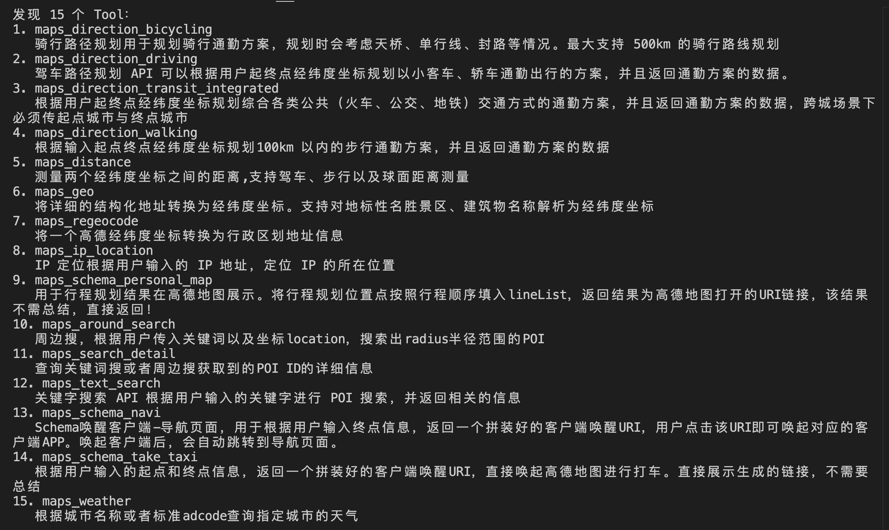


每个 Tool 的详细调用方式，大家可以这里：`https://policylayer.com/tools/sugarforever-amap-mcp-server`

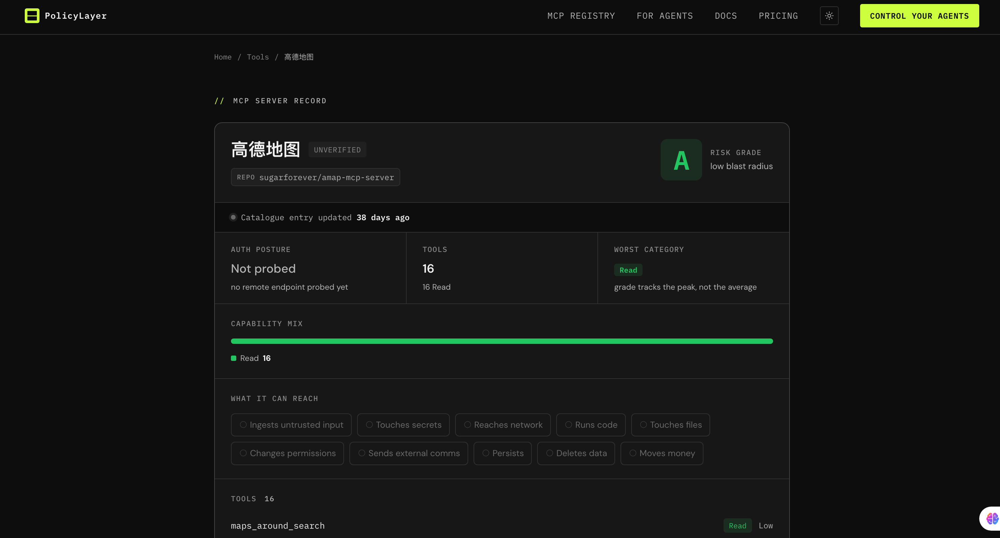


### 调用远程 Tool
接下来，咱们从 Tool 列表中找到天气查询能力：

```javascript
// 查找 maps_weather Tool 并调用
const weatherTool = tools.find((tool) => tool.name === 'maps_weather')
```

`maps_weather` 接收一个 `city` 参数，用来查询指定城市的天气。

代码从环境变量读取测试城市，然后调用这个远程 Tool：

```javascript
const city = process.env.AMAP_TEST_CITY?.trim() || '北京'
// 调用远程 MCP Tool
const result = await client.callTool({
    name: weatherTool.name,
    arguments: { city }
})
```

这段代码执行以后，MCP SDK 会把调用转换成 `tools/call` 请求，再通过 Streamable HTTP 发送给高德。

高德 MCP Server 收到请求以后调用自己的天气服务，最后再把结果通过 MCP 响应返回给 Client。

完整链路是：

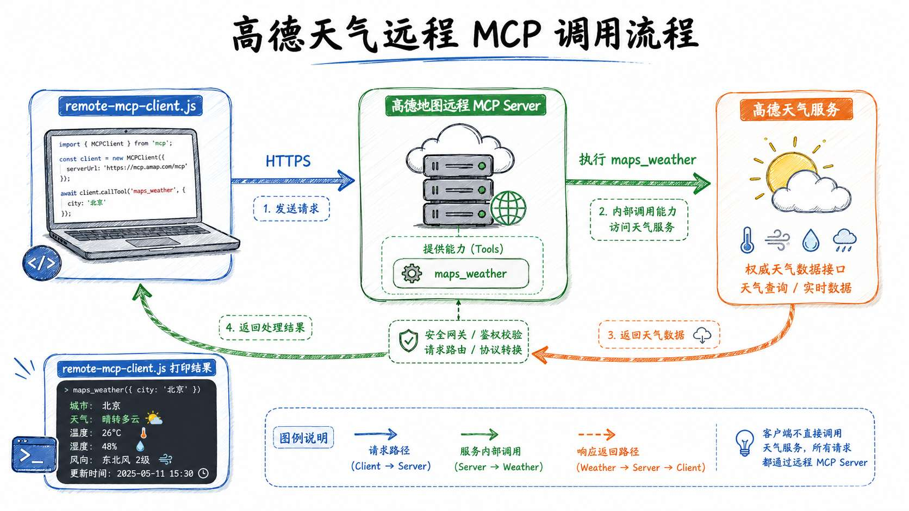


运行代码：

```bash
npm run demo
```

可以看到类似下面的结果：

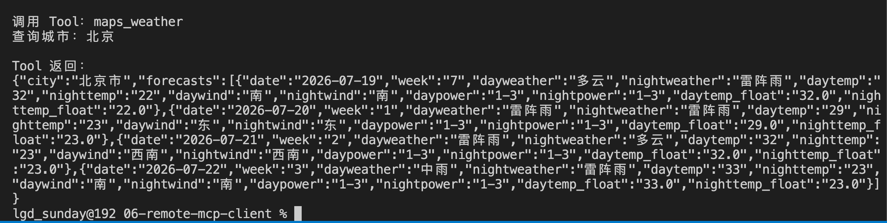


走到这里，咱们已经完成了一次真正的远程 MCP 调用。

Client 只需要知道一个远程 MCP 地址。连接成功以后，它先通过能力发现获取 Tool 定义，再通过 `tools/call` 调用高德提供的真实能力。

这才是远程 MCP 最有价值的地方：**能力可以统一部署和更新，Host 只负责连接与使用。**

## 总结
这一节，咱们把 MCP 从本地进程带到了远程网络。

+ `stdio` 让 Host 启动本地 MCP Server，再通过标准输入和标准输出传输协议消息。它适合本地工具、桌面应用和开发调试。
+ `Streamable HTTP` 则让 Client 通过一个 HTTP 地址连接远程 MCP Server。双方仍然执行初始化、能力发现和 Tool 调用，改变的只是 MCP 消息的传输方式。

在案例中，咱们连接了高德地图官方 MCP Server，通过 `tools/list` 发现地图能力，再使用 `maps_weather` 查询城市天气。

这个案例说明，Host 不需要拥有 MCP Server 的源码，也不需要在本地重新实现天气接口。只要知道远程地址并提供有效的高德 Key，就可以使用 Server 暴露的能力。

远程 MCP 还会多出两个新的的问题。

+ 一个是会话。会话只表示当前内容，不能拿来代替用户登录状态和 Agent 对话记忆。
+ 另一个是授权。高德使用 API Key 识别开发者应用，企业 MCP 则通常还需要使用 Bearer Token 或 OAuth 识别具体用户，并在 Server 端校验每一次 Tool 调用的权限。

也就是说，只要接连到了网络，那么 安全 和 权限  问题 都需要进行处理了。

> 更新：2026-07-19 17:15 · 原文：<https://www.yuque.com/lgdsunday/ab1dy3/qcxfpb3cxrx6wxse>
