# 07 - 实现一个退款系统，完整讲解：Human-in-the-Loop、长任务与 MCP Apps

前面几节，咱们已经把 MCP 最重要的调用流程跑通了。

Host 可以连接本地或者远程 MCP Server，发现 Server 提供的 Tool，再把模型提出的调用请求交给 MCP Client 执行。

之前的订单查询、退款判断和天气查询都有一个共同特点：**Tool 被调用以后，100% 能返回最终结果。**

流程大概是这样的：


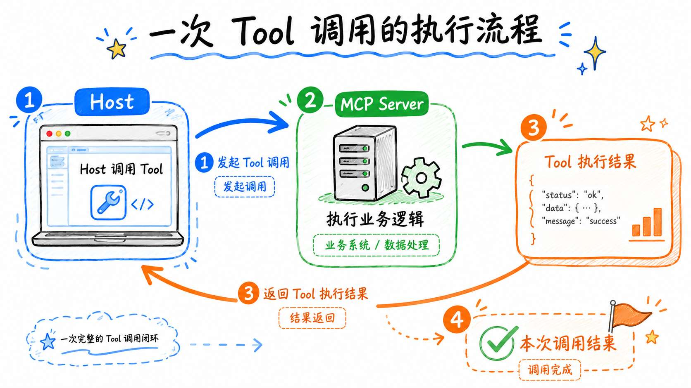


但是！真实的企业任务不一定能这么顺利呀。。

比如说，咱们现在要做一次批量退款审核。

这个时候，MCP Server 收到三笔订单，那么就可能会遇到下面这些情况：

+ 第一：其中包含高风险退款，必须先让用户确认是否继续
+ 第二：审核任务需要处理几千笔订单，短时间内处理不完
+ 第三：审核结束以后得到一份复杂报告信息

这个时候，一次普通的 Tool 调用就不太够用了。

所以，从业务上看，咱们至少要完成以下三种能力：

1. `Human-in-the-Loop`： 高风险操作执行以前，需要让人参与确认
2. `Tasks`：任务短时间内无法完成，需要支持异步执行和进度查询
3. `MCP Apps`：复杂结果不适合只返回文字，需要通过交互界面展示

咱们一个个来看

## Human-in-the-Loop
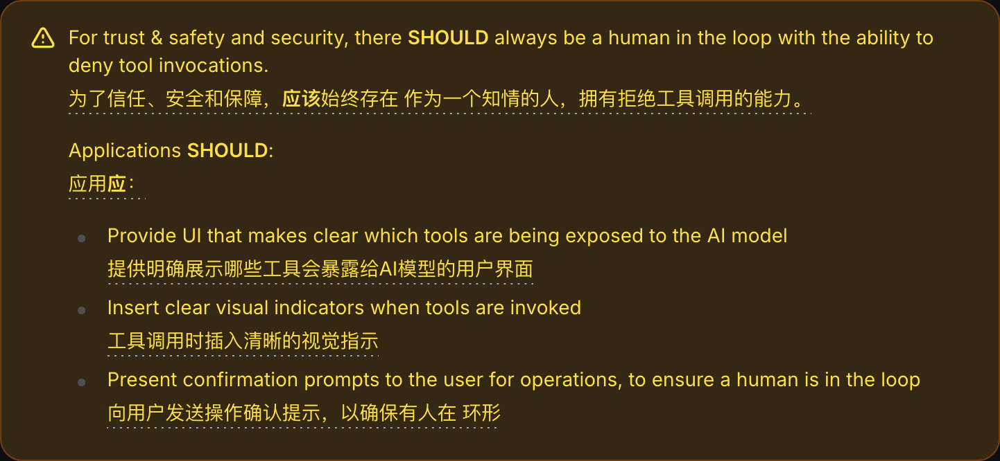


`Human-in-the-Loop` 翻译过来叫作 **人在回路**。

这玩意听起来挺抽象的，但是意思并不复杂。他指的是：

> **Agent 执行到某个关键步骤时先暂停下来，把信息交给人检查。只有人明确同意以后，Agent 才能继续执行。**
>

为什么必须这样做呢？

因为模型给出的 Tool 调用，最终还是一次概率判断。

模型可能选错 Tool，也可能生成错误的参数。

就算模型判断没有问题，用户本身也可能临时改变主意。

如果调用的只是天气查询、订单查询这种只读 Tool，偶尔判断错一次，通常还好，问题不大。

但是，如果是 删除知识库、批量退款 这种操作，就不一样了

这些操作一旦执行错误了，那么就会产生很大的影响

所以，一个企业级别的 Agent 一定需要知道：**哪些步骤可以自动执行，哪些步骤必须停下来交给人决定。**

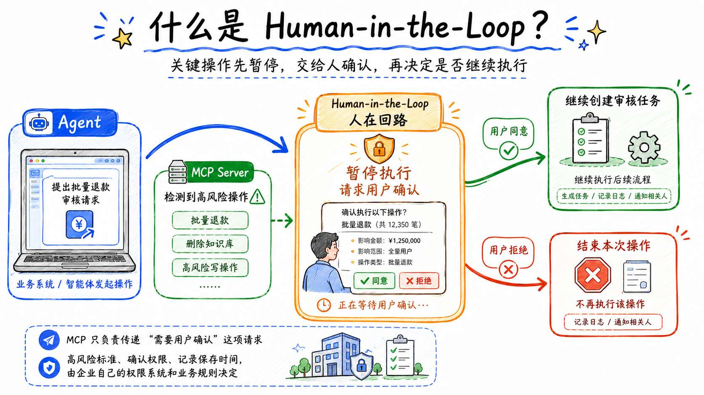


那么问题来了。

MCP Server 发现需要用户确认以后，应该怎样把这个问题交给用户呢？

有同学可能会说：“弹个框不就行了吗？”

**不行的**

因为，MCP Server 可能运行在企业服务器上，它根本不知道用户使用的是网页、桌面客户端还是命令行。

所以，Server 只能告诉 Host：**“我现在还不能继续执行，需要你帮我向用户收集一项信息。”**

Host 收到请求以后，再决定使用网页弹窗、桌面表单还是终端输入来询问用户。

MCP 把这种 **“Server 请求 Client 帮忙收集输入”** 的行为叫作 `Elicitation`。

整个流程长成下面这样：

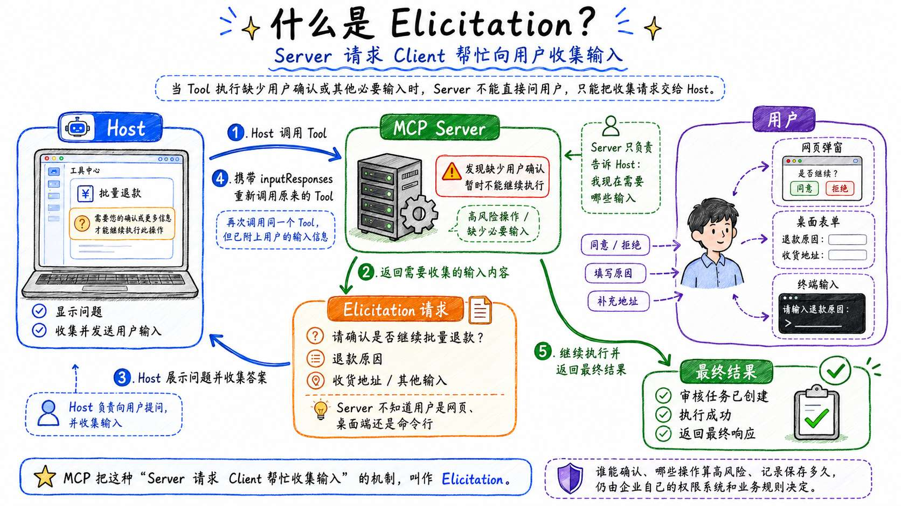


比如，Server 可以返回下面这样的内容：

```json
{
  // 表示当前请求还没有执行完成。MCP Server 在继续处理之前，还需要 Host 补充一些用户输入。
  "resultType": "input_required",
  //  Server 需要 Host 收集哪些信息
  "inputRequests": {
    "confirm": {
      // 指定本次输入请求使用 MCP Elicitation 机制。
      "method": "elicitation/create",
      // elicitation/create 请求所携带的参数。
      "params": {
        "message": "即将审核 3 笔退款订单，是否继续？",
        // 描述 Server 希望 Host 收集的数据结构。
        "requestedSchema": {
          "type": "object",
          "properties": {
            "confirm": {
              "type": "boolean"
            }
          },
          // 表示 confirm 是必填字段。
          "required": ["confirm"]
        }
      }
    }
  }
}
```

Host 收集到用户选择以后，会生成对应的 `inputResponses`：

```json
{
  "confirm": {
    // 表示用户接受了这次 Elicitation 请求，
    // 并同意把下面填写的 content 提交给 MCP Server。
    "action": "accept",
    //  content 的结构必须符合前面的声明 requestedSchema
    "content": {
      "confirm": true
    }
  }
}
```

然后，Host 携带这份内容重新调用原来的 Tool。

Server 第二次进入 Tool 处理函数时，就可以读取用户确认结果，继续完成后面的业务操作。

### Multi Round-Trip Requests：一个新特性
然后还有一个新特性，我觉得需要给大家说一下，那就是 `MRTR（Multi Round-Trip Requests）`

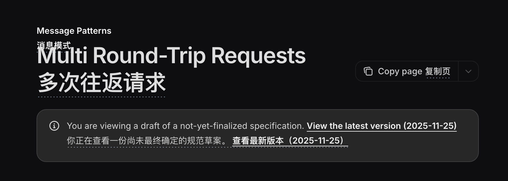


这里给大家补充一个概念，那就是 `MRTR（Multi Round-Trip Requests）`  

翻译过来就是：**多轮往返请求**。

这个东西会在 7-28 号进入到 MCP 协议，没几天了哈，就顺道跟大家讲了，文档在这里：`https://blog.modelcontextprotocol.io/posts/2026-07-28-release-candidate/`


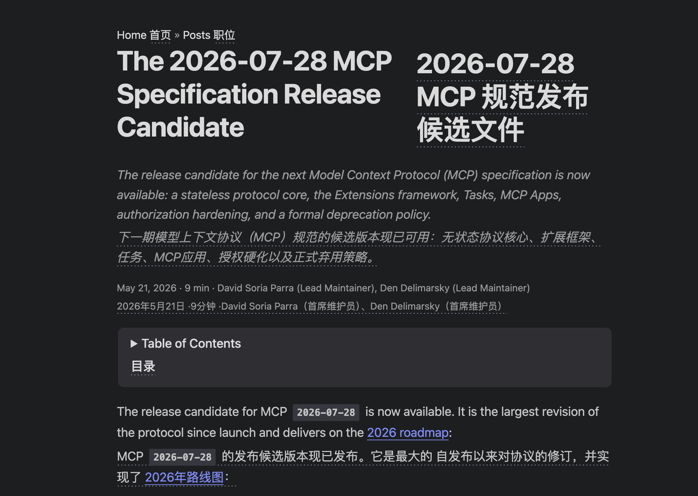


这个新特性解决的问题，正好和前面讲的 `Elicitation` 有关系。

前面咱们已经知道，MCP Server 可以通过 Elicitation 告诉 Host：**“我还需要向用户确认一个问题。”**

但是，这个问题怎么传给 Host？Host 收集到用户答案以后，又怎么把答案交回 Server 呢？

旧版 MCP 的做法，是让 Server 在处理 Tool 调用的时候，保持一条 `SSE` 连接。Server 通过这条连接向 Host 发起 Elicitation 请求，然后停在那里等待用户回答。

流程大概是这样的：

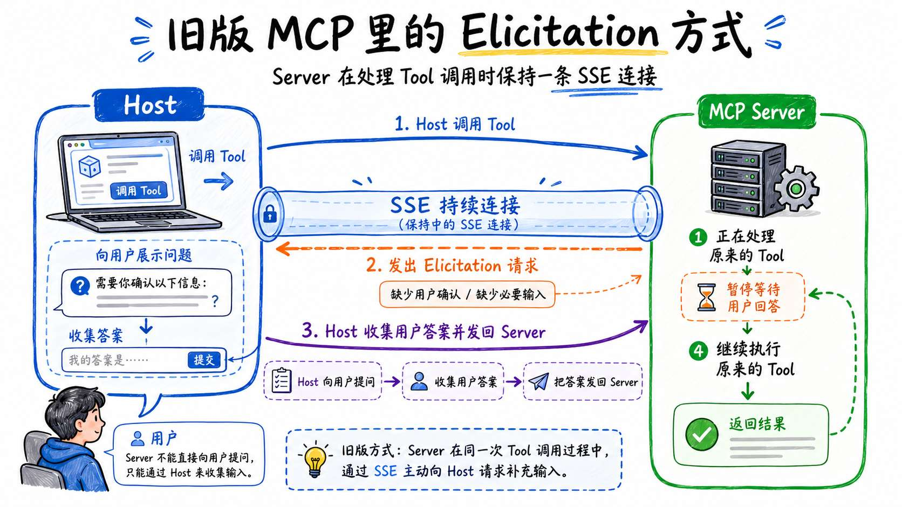


这个流程看起来没啥问题，对吧。

但是，如果把这个流程放到企业的远程 MCP Server 中就麻烦了。

因为，企业服务通常不会只部署一台 Server。

> 第一次 Tool 调用可能被负载均衡转发到 `Server A`，用户提交答案时，请求却可能被转发到 `Server B`。
>
> 但是，真正停在那里等待答案的却是 `Server A`。
>
> 为了让 Server A 拿到这份答案，服务端就得额外使用共享存储保存状态，或者要求负载均衡把两次请求固定转发到同一个 Server。
>
> 而且，用户不一定会马上回答。Server 总不能为了等用户点一下“确认”，一直保持着那条 SSE 连接吧。
>

所以，MRTR 换了一种处理方式：**Server 不再停在那里等待答案，而是先把问题返回给 Host，直接结束当前请求。**

Host 收集到答案以后，再重新调用一次原来的 Tool。

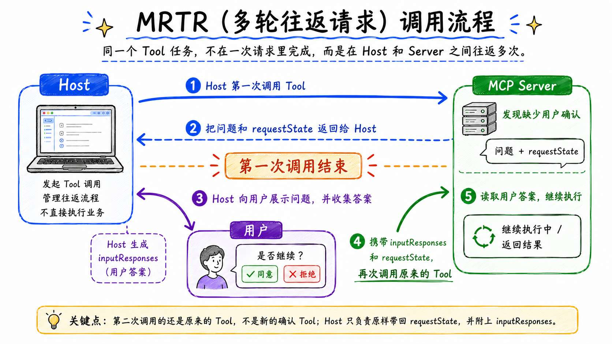


注意，这里不是调用一个新的“确认 Tool”。

Host 第二次调用的，还是原来的 Tool。只不过这一次除了原有参数，还会把用户答案放进 `inputResponses`，把 Server 返回的 `requestState` 原样带回来。

`requestState` 可以理解为 Server 留给下一次请求的“状态信息”。Host 不需要理解里面是什么，只负责原样保存、原样传回。

继续回到刚才的退款案例。

Host 第一次调用批量退款 Tool，Server 发现这三笔订单需要用户确认，于是把“是否继续审核”这个问题返回来，本次调用到这里就结束了。

用户点击“确认”以后，Host 带着这份答案重新调用批量退款 Tool。Server 看到用户已经同意，这才继续执行后面的退款审核。

因为继续执行需要的信息都放在了第二次请求里，所以这次请求无论被转发到 Server A 还是 Server B，都可以继续处理。

这就是“多轮往返”这四个字的意思：**同一个 Tool 任务没有在一次请求中完成，而是在 Server 和 Host 之间往返了多次。**

说到这里，Elicitation 和 MRTR 的关系就比较清楚了：

> **Elicitation 负责说明“需要向用户问什么”**
>
> **MRTR 负责把这个问题交给 Host，再把 Host 收集到的答案带回 Server。**
>

在现在的场景里面，Elicitation + MRTR 共同实现了 Human-in-the-Loop

## Tasks
然后，再来看 `Tasks`。

这个东西怎么说呢？**有点像咱们之前开发时候的 异步状态获取。**

比如说：

+ 前端调用某个接口，来启动某个后端业务
+ 这个接口会先放回给前端一个 id（表示当前这次请求直接结束了），后端再去启动对应的业务
+ 前端通过这个 id 来查询后端任务的启动情况（成功了、失败了）

这样应该就比较好理解了吧。

咱们换到 MCP 的例子里面：

> 假设企业现在要审核十万笔退款订单。
>
> 这个过程是个 **异步的**，所以 Host（前端）不能一直等着 Tool（后端）的返回
>

那么就需要让Server 先创建任务，再把任务标识返回给 Client。

大致流程就是这样的：

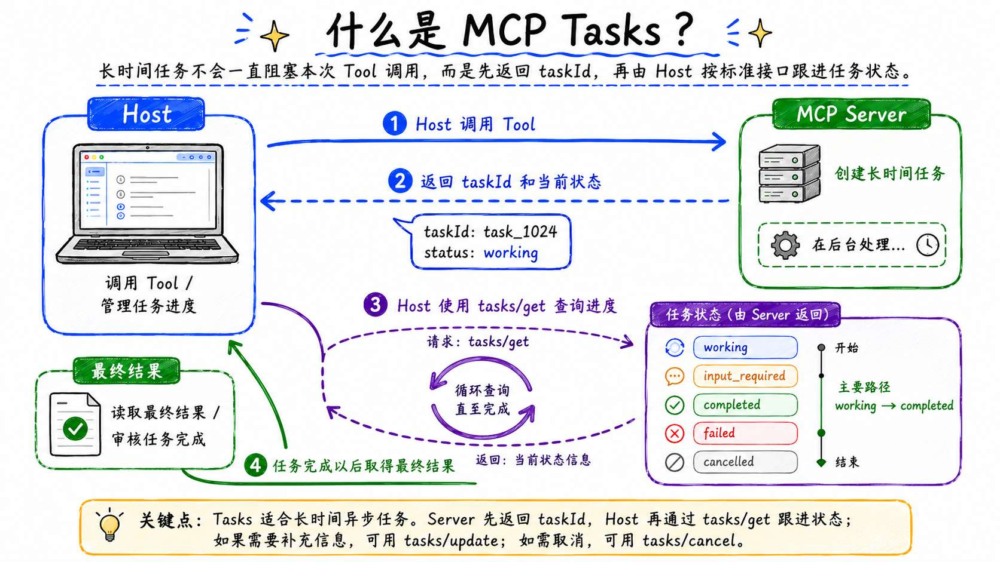


MCP Tasks 就是这套流程进行了标准化。

一项 Task 通常会有下面几种状态：

| 状态 | 表示什么 |
| --- | --- |
| `working` | 任务正在执行 |
| `input_required` | 执行过程中还需要一项输入或人工确认 |
| `completed` | 任务已经完成，可以读取最终结果 |
| `failed` | 任务执行失败 |
| `cancelled` | 任务已经取消 |


Client 可以通过 `tasks/get` 查询状态，通过 `tasks/update` 补充任务执行过程中需要的信息，也可以通过 `tasks/cancel` 请求取消。


## MCP Apps：Tool 的结果不一定只能是文字
Human-in-the-Loop 和 Tasks 解决的是执行流程问题。

但是，任务执行完以后，还可能遇到另一个问题：**结果应该怎样展示？**

假设批量审核返回下面这份数据：

```json
{
  "total": 1000,
  "autoApproved": 820,
  "manualReview": 160,
  "rejected": 20
}
```

那肯定需要一个类似于前端的页面进行展示。

`MCP Apps` 就是为这类场景准备的。

Server 可以提前为某个 Tool 声明一个 UI Resource，很简单就是一个 `JSON`：

```javascript
{
    name: 'get_refund_review_report',
    _meta: {
        ui: {
      //  Server 提供的界面资源
            resourceUri: 'ui://refund-review/report.html'
        }
    }
}
```

这里的 `resourceUri` 指向 Server 提供的界面资源。

支持 MCP Apps 的 Host 发现这个 Tool 时，可以提前读取并检查对应的 HTML。Tool 执行完成以后，Host 再 **把界面放进受限制的 **`iframe`** 中渲染。**

流程大概是这样的：

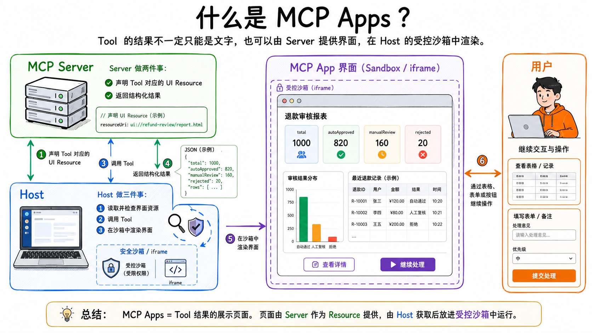


所以说，如果给 MCP Apps 一个完整的定义，那就是：

> MCP Apps 作为任务执行结果的展示页面。
>
> 这个页面由 MCP Server 作为 Resource 提供，由 Host 获取并放进受控的沙箱中运行，同时通过 MCP Apps 协议与 Host、Tool 和当前对话完成交互。
>

## 实现一个 Human-in-the-Loop 退款审核案例
概念说完以后，咱们还是写个代码。

咱们要实现一个 ` Human-in-the-Loop 退款审核案例` 

代码量不算大，但是流程比较复杂。所以，先给大家把流程画一下：

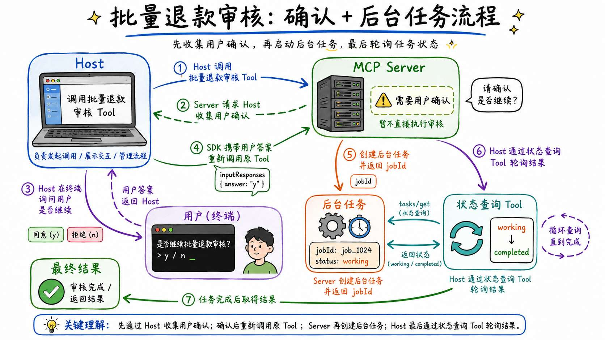


完整代码位于：

```latex
Code/Node/第三章/07-mcp-extensions
```

项目目录如下：

```latex
07-mcp-extensions
├── host.js
├── refund-review-mcp-server.js
├── package.json
└── package-lock.json
```

这一项目至少需要 `Node.js 20`。

安装依赖：

```bash
npm install
```

这里咱们得用两个库 `@modelcontextprotocol/client 和 @modelcontextprotocol/server` ，但是这里有一点大家得：

> **注意：**
>
> 咱们前面说过 MRTR 是新的能力，所以，得用 `V2 beta` 版本的依赖库
>
> 大家写到这里的时候，可能已经是正版的 V2 了，到时候 API 可能会有点不一样（不过应该不会变了）。
>
> 大家到时候具体情况具体参考就行
>

```json
{
  "dependencies": {
    "@modelcontextprotocol/client": "2.0.0-beta.4",
    "@modelcontextprotocol/server": "2.0.0-beta.4",
    "zod": "4.4.3"
  }
}
```

然后咱们来看代码。

代码就两个文件：

+ `refund-review-mcp-server.js`：这就是一个 MCP Server
+ `host.js`：这就是 host 的核心类

### 先看 MCP Server
打开 `refund-review-mcp-server.js`。

这里有两个核心方法：

+ 第一个：`createServer`：这里创建 Server，并且暴露两个 Tool
+ 第二个：`getJobSnapshot`：用来模拟后台审核进度的

整个代码从 

```javascript
await serveStdio(createServer)
```

开始，在这里触发 `createServer`

`createServer` 就做了三件事：

```typescript
/**
 * 创建演示用 MCP Server
 */
function createServer() {
  // 第一件事：创建 McpServer
    const server = new McpServer(
        {
            // MCP Server 的名称和版本
            name: 'refund-review-extension-server',
            version: '1.0.0'
        },
        {
            capabilities: {
                // 声明当前 Server 支持 Tools 能力
                tools: {}
            }
        }
    )

    /**
     * 第二件事：注册启动批量退款审核的 Tool。
     *
     * 这个 Tool 使用 Multi Round-Trip Requests，会被调用两次
     *
     * 第一次调用：
     * Server 没有拿到用户确认结果，返回 input_required。
     *
     * 第二次调用：
     * Host 收集用户答案后，携带 inputResponses
     * 重新调用这个 Tool。
     */
    server.registerTool(
        'start_batch_refund_review',
        {
            ...
        },
        async ({ orderIds }, context) => {
            ...
        }
    )

    /**
     * 第三件事：注册查询批量退款审核状态的 Tool。
     *
     * Host 获取 jobId 后，可以重复调用该 Tool，
     * 直到任务状态变成 completed。
     */
    server.registerTool(
        'get_refund_review_status',
        {
            ...
        },
        async ({ jobId }) => {
            ...
        }
    )

    return server
}
```

先看第一个 Tool ：`start_batch_refund_review`

它接收一组订单号，然后会执行两次：

```javascript
server.registerTool(
    'start_batch_refund_review',
    {
        description: '经用户确认后，创建一项批量退款审核任务',
        inputSchema: z.object({
            orderIds: z.array(z.string()).min(1)
        })
    },
    async ({ orderIds }, context) => {
        // 后面继续处理
    }
)
```

Tool 第一次执行时，`context.mcpReq.inputResponses` 里面还没有用户确认结果。

所以代码会返回 `inputRequired() ` ，**等待用户确认**：

```javascript
if (!confirmation?.confirm) {
    return inputRequired({
        inputRequests: {
            confirm: inputRequired.elicit({
                message: `即将审核 ${orderIds.length} 笔退款订单，是否继续？`,
                requestedSchema: confirmationSchema
            })
        }
    })
}
```

第二次调用已经携带 `inputResponses`，`confirmation.confirm` 就会变成 `true`，代码继续向下执行。

### Host 收集用户确认
然后打开 `host.js`。

这里面就一个核心的 `main` 方法。

这个方法里面首先就输创建 `Client`，在创建 Client 时声明自己支持表单类型的 Elicitation：

```javascript
const client = new Client(
    {
        name: 'refund-review-extension-host',
        version: '1.0.0'
    },
    {
        versionNegotiation: {
            mode: 'auto'
        },
    /**
     * 声明 Client 支持 Elicitation 表单能力。
     *
     * 这表示：
     * 当 Server 需要补充用户输入时，
     * Client / Host 有能力根据 requestedSchema
     * 收集结构化表单数据。
     */
        capabilities: {
            elicitation: {
                form: {}
            }
        }
    }
)
```

接下来，Host 注册用户输入处理函数：

```javascript
/**
 * 注册 Elicitation 请求处理器。
 *
 * 当 Server 请求收集用户输入时，
 * Client 会把 elicitation/create 请求交给这个处理函数。
 *
 * 具体使用终端、网页弹窗还是桌面表单，
 * 是 Host 的职责，MCP Server 不关心界面如何实现。
 */
client.setRequestHandler('elicitation/create', async (request) => {
  // 等待用户输入 y 或 n
    const answer = await terminal.question(
        `${request.params.message}（y/n）：`
    )
  // 如果输入的是 y，在执行后续的操作
    const confirmed = answer.trim().toLowerCase() === 'y'
    /**
   * 把用户的选择转换成 Elicitation 响应。
   *
   * 用户确认时返回：
   *
   * {
   *   action: 'accept',
   *   content: {
   *     confirm: true
   *   }
   * }
   *
   * 其中：
   *
   * action: 'accept'
   * 表示用户接受并提交了本次输入请求。
   *
   * content.confirm: true
   * 表示用户在具体业务上同意启动批量退款审核。
   */
    return confirmed
        ? {
            action: 'accept',
            content: {
                confirm: true
            }
        }
        : {
            action: 'decline'
        }
})
```

V2 SDK 会读取返回结果中嵌入的 Elicitation 请求，把它交给这个处理函数，再携带用户答案自动重试原来的 `tools/call`。

因此，下面这次调用从 Host 代码看只写了一次：

```javascript
const startResult = await client.callTool({
    name: 'start_batch_refund_review',
    arguments: {
        orderIds: ['A1024', 'A1025', 'A1026']
    }
})
```

但是，协议内部实际经历了多轮往返。

这就是 `Multi Round-Trip Requests`。

### 使用 jobId 查询任务状态
用户确认以后，Server （refund-review-mcp-server.js）创建一项内存任务，并返回业务系统自己定义的 `jobId`：

```javascript
// 为后台任务生成唯一 ID
const jobId = randomUUID()

jobs.set(jobId, {
    orderIds,
    createdAt: Date.now()
})

return {
    content: [
        {
            type: 'text',
            text: JSON.stringify({
                jobId,
                status: 'working',
                message: '批量退款审核任务已经创建'
            })
        }
    ]
}
```

第二个 Tool `get_refund_review_status` 根据 `jobId` 返回执行进度。

Host 每隔一段时间调用一次：

```javascript
const statusResult = await client.callTool({
    name: 'get_refund_review_status',
    arguments: {
        jobId: task.jobId
    }
})
```

直到状态变成 `completed`。

### 运行代码
执行：

```bash
npm run demo
```

终端会先询问：

```latex
即将审核 3 笔退款订单，是否继续？（y/n）：
```

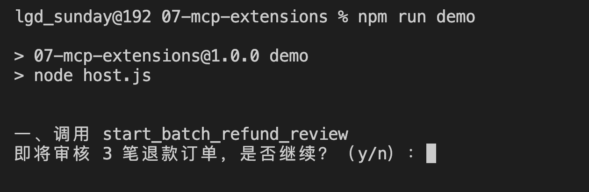


输入 `y`，可以看到：

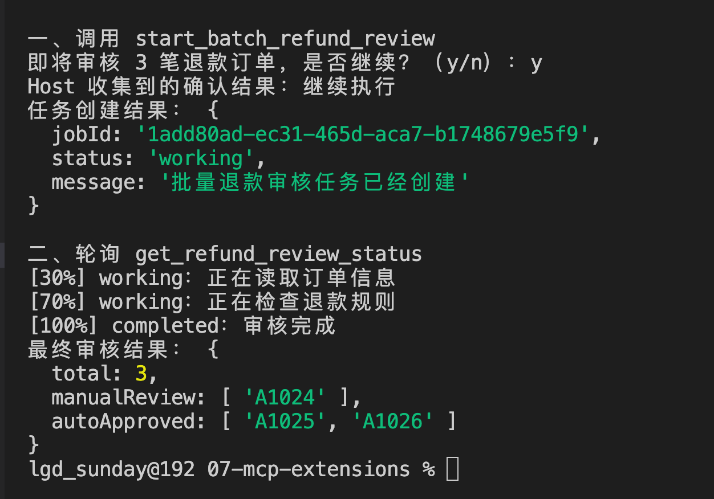


## Sampling 和 Roots 还要不要学
很多旧版 MCP 文章里，还会讲到 `Sampling` 和 `Roots`。

但是这俩东西目前都已经弃用了，连接：

+ `https://modelcontextprotocol.io/specification/draft/client/sampling?utm_source=chatgpt.com`
+ `https://modelcontextprotocol.io/seps/2577-deprecate-roots-sampling-and-logging?utm_source=chatgpt.com#roots`

所以咱们新课程就不学了哈。

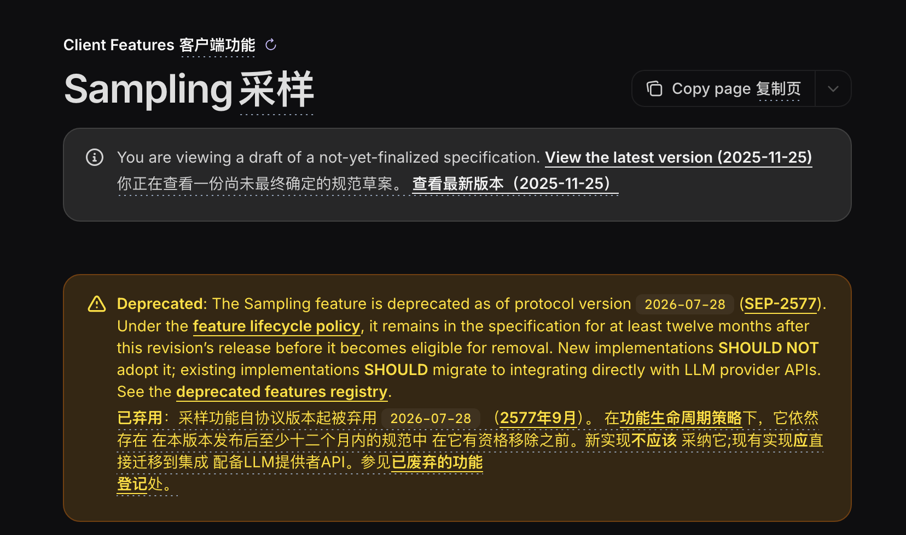


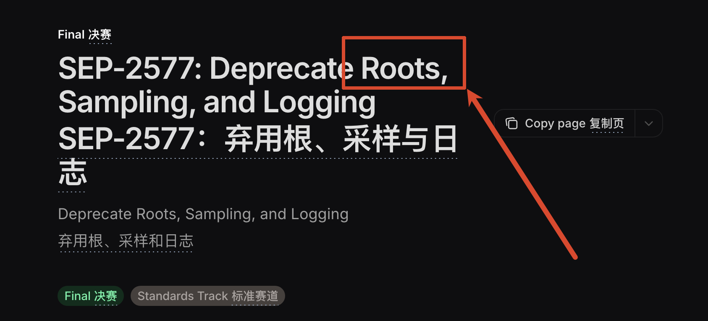


## 总结
学到这里，咱们已经接触了 MCP 的核心能力、传输方式和扩展机制。

MCP 解决的是：**Host 怎样使用统一协议发现和调用外部能力，以及调用双方怎样传递输入、状态和结果。**

其中：

+ `Human-in-the-Loop` ：让 Agent 在高风险步骤暂停执行，把最终决定权交还给人。MCP 可以通过 Elicitation 请求 Host 收集用户输入，再使用多轮往返请求继续原来的 Tool 调用。
+ `Tasks` 用来表示长时间执行的任务。Server 返回稳定的任务标识，Client 后续查询进度、补充信息或者取消任务。
+ `MCP Apps` 让 Tool 可以配套提供交互式界面。Server 提供 UI Resource

到这里，第三章的 MCP 理论主线差不多就讲完了。

下一小节，咱们就写个可以完整的放到简历中的项目。

> 更新：2026-07-20 21:40 · 原文：<https://www.yuque.com/lgdsunday/ab1dy3/qfqg151txznl1ptz>
