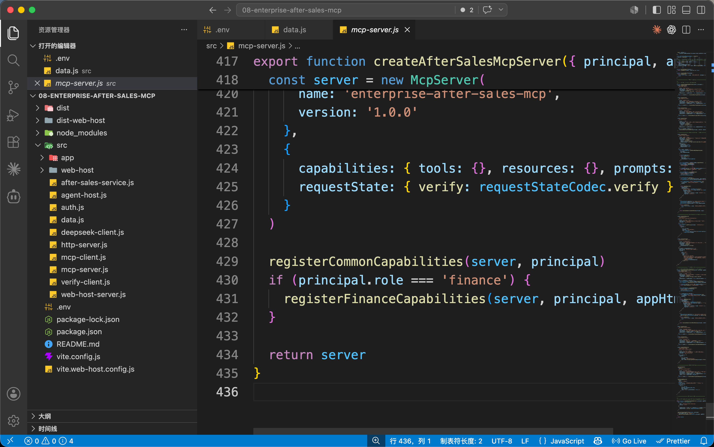
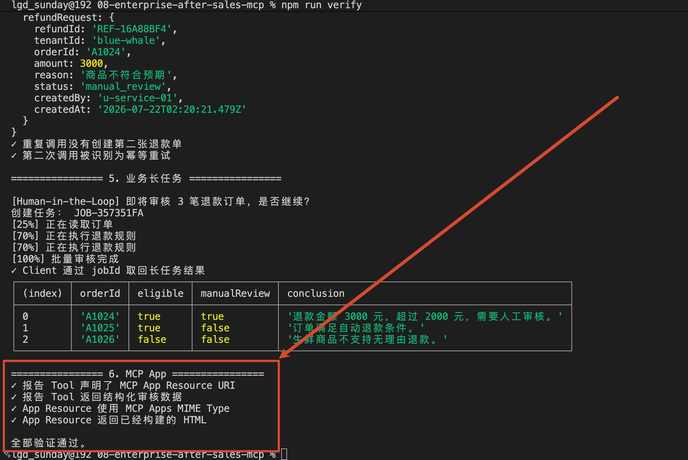
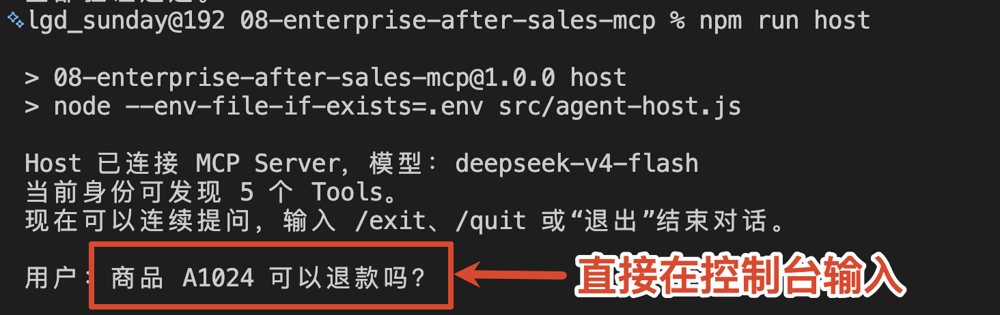

# 08 - 实战（上）：企业售后 MCP 项目演示与结构拆解

第三章写到这里，Tool Calling、MCP Server、Client、Host、Streamable HTTP、Human-in-the-Loop、长任务和 MCP Apps，咱们基本都接触过了。

那么这一小节，咱们就做一个综合性的项目。

这个项目内容挺多的，大家看看这个项目结构：




代码比较多，结构也比较复杂。

所以，咱们这次的实战会分成上、中、下三篇来讲：

+ 上篇：看效果、运行项目、划分结构、明确调用链
+ 中篇：主讲 MCP Server
+ 下篇：主讲 Client 和 Host

明确好了大方向之后，咱们就先看项目的最终效果

## 最终效果
[此处为语雀卡片，点击链接查看](https://www.yuque.com/lgdsunday/ab1dy3/gex6db0nvqze3mxb#xkBH3)


## 项目运行方式
[此处为语雀卡片，点击链接查看](https://www.yuque.com/lgdsunday/ab1dy3/gex6db0nvqze3mxb#UKLQM)

完整代码位于：

```latex
Code/Node/第三章/08-enterprise-after-sales-mcp
```

想要运行代码，不要忘了 `.env`：

```plain
DEEPSEEK_API_KEY=你的_DeepSeek_API_Key
DEEPSEEK_MODEL=deepseek-v4-flash
# token-blue-service   蓝鲸科技客服
# token-blue-finance   蓝鲸科技财务
# token-star-service   星河零售客服
MCP_TOKEN=token-blue-service
```

进入项目目录，安装依赖：

```bash
npm install
```

### 启动服务
先构建 MCP App 和浏览器 Host：

```bash
npm run build
npm run build:app
npm run build:web-host
```

其中：

+ `build:app` 会把 `src/app` 构建成 MCP Server 返回的 UI Resource
+ `build:web-host` 会构建浏览器对话页面和 Sandbox

然后启动 MCP Server：

```bash
npm run server
```

终端会出现：

```latex
企业售后 MCP Server：http://127.0.0.1:3100/mcp
健康检查：http://127.0.0.1:3100/health
```

只要出现了这个，那么就说明 MCP Server 已经启动了

这里要注意，**一定要再打开一个终端（因为原本的终端启动着 server 呢）**

```bash
npm run web-host
```

然后访问：

```latex
http://127.0.0.1:3200
```

就可以了。

这里一共会有是哪个地址：：

| 地址 | 作用 | 谁来访问 |
| --- | --- | --- |
| `http://127.0.0.1:3100/mcp` | MCP Streamable HTTP 端点 | MCP Client |
| `http://127.0.0.1:3200` | 浏览器 Web Host | 用户 |
| `http://127.0.0.1:3201` | MCP App Sandbox | Web Host 中的 iframe |


> 我估摸着这里可能会有同学对 `Sandbox` 有疑惑，这个咱们等到后面再讲。
>
> 这里大家就只需要 **Sandbox 是 Host 专门给 MCP App 准备的一块隔离运行环境。** 就行了
>

### 运行自动验证与模型 Host
Server 保持运行，执行：

```bash
npm run verify
```

这条命令会直接验证角色权限、租户隔离、Tools、Resources、Prompts、人工确认、幂等、长任务和 MCP App。最后看到“全部验证通过”，才说明 Server 核心链路正常。




除了咱们上面页面演示的效果之后外，咱们还提供了一种 **控制台交互** 的方式。

直接执行 ：

```bash
npm run host
```

Host 会保持运行并持续等待输入。使用 `/exit`、`/quit` 或“退出”结束对话。




接下来系统会返回对应的相应信息，用户可以继续进行后续的输入：


## 项目大致结构
[此处为语雀卡片，点击链接查看](https://www.yuque.com/lgdsunday/ab1dy3/gex6db0nvqze3mxb#Qy3Is)

完整结构如下：

```latex
08-enterprise-after-sales-mcp
├── src
│   ├── data.js                 # 演示身份、订单、物流和规则
│   ├── auth.js                 # Bearer Token 身份校验
│   ├── after-sales-service.js  # 售后业务、幂等和任务状态
│   ├── mcp-server.js           # Tools、Resources、Prompts 与 MCP App
│   ├── http-server.js          # MCP Streamable HTTP 服务入口
│   ├── mcp-client.js           # MCP Client 公共连接逻辑
│   ├── verify-client.js        # 自动验证 Client
│   ├── deepseek-client.js      # DeepSeek API 调用
│   ├── agent-host.js           # 命令行连续对话 Host
│   ├── web-host-server.js      # Web Host 与 Sandbox 服务
│   ├── app                     # 批量退款审核 MCP App
│   └── web-host                # 浏览器 Host 页面
├── package.json
├── vite.config.js
└── vite.web-host.config.js
```

这些文件可以归纳成四层：

| 层级 | 文件 | 职责 |
| --- | --- | --- |
| 数据与业务 | `data.js`、`after-sales-service.js` | 订单、规则、退款、任务和审计 |
| MCP Server | `auth.js`、`mcp-server.js`、`http-server.js` | 鉴权、能力注册和 HTTP 入口 |
| Client 与 Host | `mcp-client.js`、`verify-client.js`、`deepseek-client.js`、`agent-host.js`、`web-host-server.js` | 连接、验证、模型循环和浏览器代理 |
| 页面与构建 | `src/app`、`src/web-host`、两个 Vite 配置 | MCP App、Web Host 与 Sandbox |


代码顶部已经标记了文件作用和章节定位。

## 总结
这一节没啥太大的难度，先把这个项目的功能、结构了解下。大家也可以先拉下来看看这个项目。

下一篇，咱们就开始讲代码了。

> 更新：2026-07-22 10:29 · 原文：<https://www.yuque.com/lgdsunday/ab1dy3/gex6db0nvqze3mxb>
