# 08-实战（中）：企业级 MCP 落地方案：身份上下文、能力级授权、多租户隔离、MRTR 确认与幂等写入

上篇，咱们已经把整个项目运行起来了，也大概看了一下项目结构。

所以，现在的问题就是，这个项目咋学。。。

说实话，这个项目比第二章的大项目要复杂的多。

目前项目里有 `agent-host.js`、`mcp-client.js`、`http-server.js`、`mcp-server.js` 和 `after-sales-service.js` 这些关键文件。如果按照文件顺序，一个一个往下讲，谁都看不懂。

所以，如果想要把这个项目看明白，那么就必须要从 **一个关键功能的入口开始，顺着这个入口的调用一点点来分析核心逻辑**

> 有学过我 Vue 源码课程 的同学，应该很熟悉这种方案。 
>

那咱们开始～～

## 从 `npm run host` 进入项目
上一小节咱们提到过，除了 `npm run web-host` 之外，还有一个叫做  `npm run  host` 的指令

这个指令可以让直接启动一个控制台的输入，通过这种输入方式来和 Server 进行交互：

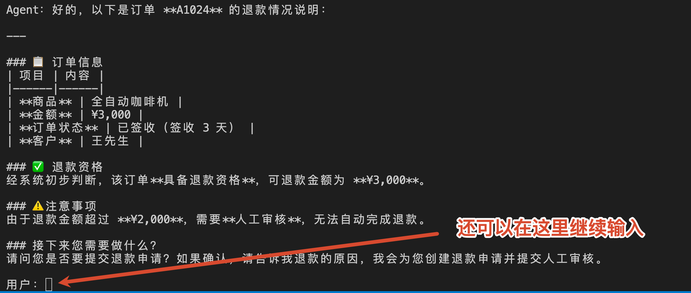


那么大家现在请想一想，当我们执行   `npm run  host` 的时候，程序会怎么执行呢？

保持上一篇启动的 MCP Server 别关，然后重新打开一个终端，进入项目目录：

```bash
cd Code/Node/第三章/08-enterprise-after-sales-mcp
```

执行：

```bash
npm run host
```

终端会出现类似下面的内容：

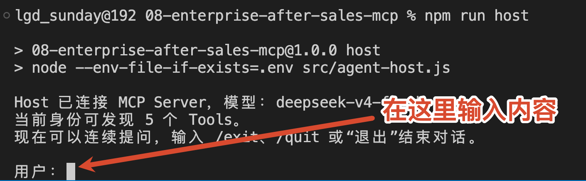


程序现在已经启动了，但是大家先别着急输入问题。

咱们先看看刚才执行的 `npm run host`，到底运行了哪段代码。

`package.json` 里面的配置是：

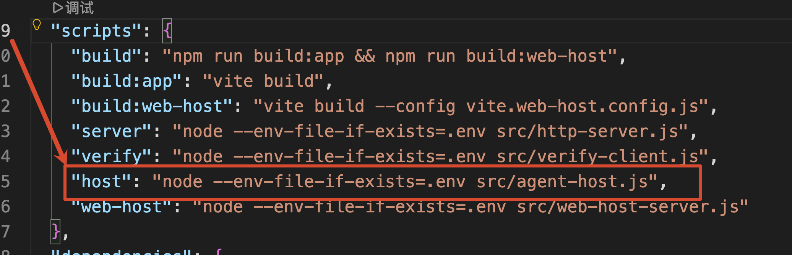


所以，真正的入口是 `src/agent-host.js`。

咱们打开这个文件。

这个文件里面有一个入口函数：`main 函数`

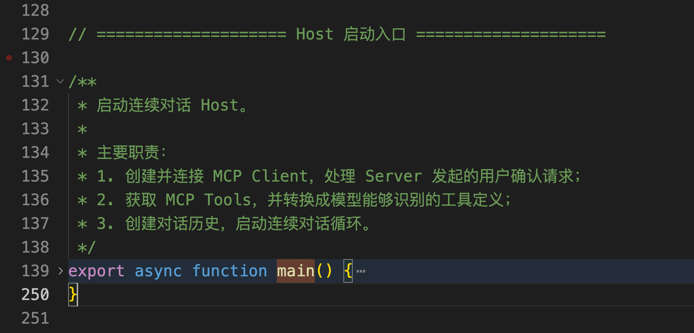


这个文件中的 `main()`，启动时主要做了三件事：

```javascript
// 第一件事：创建并连接 MCP Client。
client = await createAfterSalesClient({
    token,
    autoConfirm: false,
    name: 'enterprise-after-sales-agent-host'
})

// 第二件事：发现 MCP Server 暴露的 Tools。
const { tools: mcpTools } = await client.listTools()

// 第三件事：创建并维护连续对话上下文。
const messages = createConversationMessages()
await runConversation({
    messages,
    tools,
    client,
    terminal
})
```

咱们先看这里做的第一件事。

### Host 是怎么带着用户身份连接 Server 的
在这个项目中，我们知道 **权限隔离** 是非常重要的一个功能。

那么 **Host 是怎么实现权限隔离的呢？**

咱们先来看这一趴～

根据上面的代码我们知道，在 main 函数中，第一件事会触发 `createAfterSalesClient` 方法：

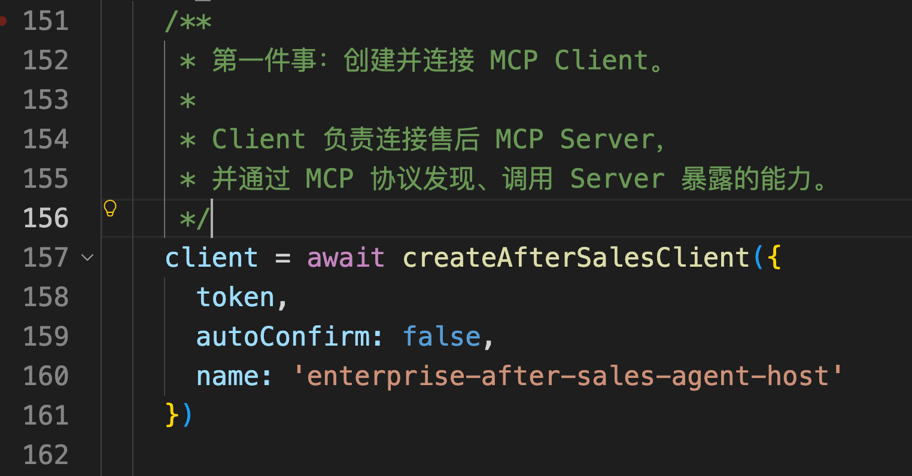


这个方法接受 3 个参数，比较关键的就是第一个参数：`token`

这个 token 表示 **当前用户的角色**

在 main 方法的开头：`agent-host.js` 会先读取 `.env` 中的 `MCP_TOKEN`

```javascript
const token =
    process.env.MCP_TOKEN ?? 'token-blue-service'
```

这里的 MCP_TOKEN 对应三个不同的权限，咱们写到了 `.env` 文件里面


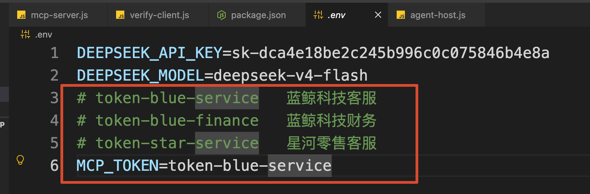

然后咱们进入到 `createAfterSalesClient` 方法里面。

这个方法的实现在  `mcp-client.js`  里面

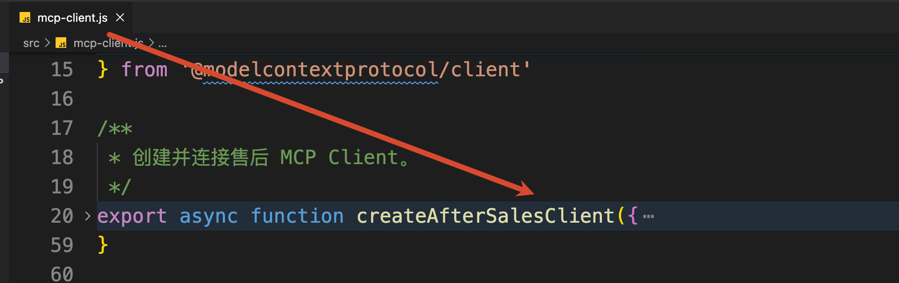


在 `mcp-client.js` 方法中，我们会创建 Streamable HTTP Transport：

```javascript
// 创建 Streamable HTTP 传输层，并携带身份认证 Token。
const transport = new StreamableHTTPClientTransport(
    new URL(process.env.MCP_SERVER_URL ?? 'http://127.0.0.1:3100/mcp'),
  // 这里传入了 token 
    { authProvider: { token: async () => token } }
)

// 连接 MCP Server，并返回可直接使用的 Client。
await client.connect(transport)
```

`authProvider` 提供的 Token，会被 Transport 放进发往 MCP Server 的 HTTP Header，类似于下面这样：

```http
Authorization: Bearer token-blue-service
```

这就是 Host 和 Server 第一次发生联系的地方。

请求到达 `http-server.js` 以后，不会直接执行 Tool，而是先验证这个 Token：


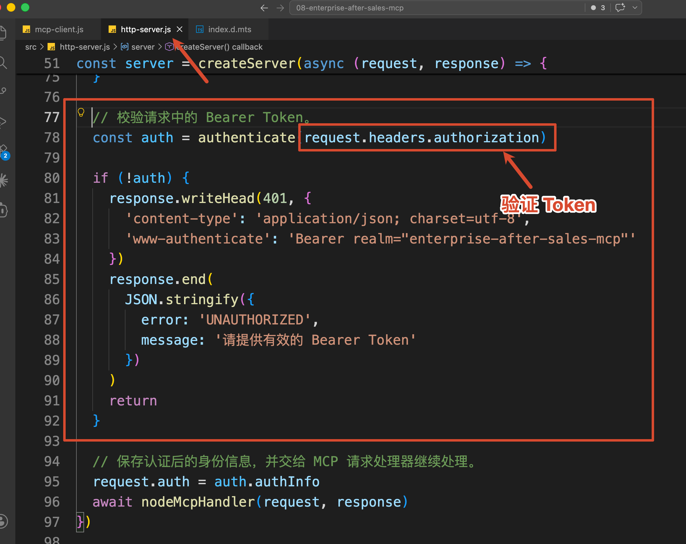


如果 Token 不存在或者不正确，请求到这里就结束了，后面的 MCP Server 和业务代码 **根本不会执行。**

在这里，代码会执行 `auth.js` 中的 `authenticate` 方法。这个方法会根据 Token 找到两份信息：

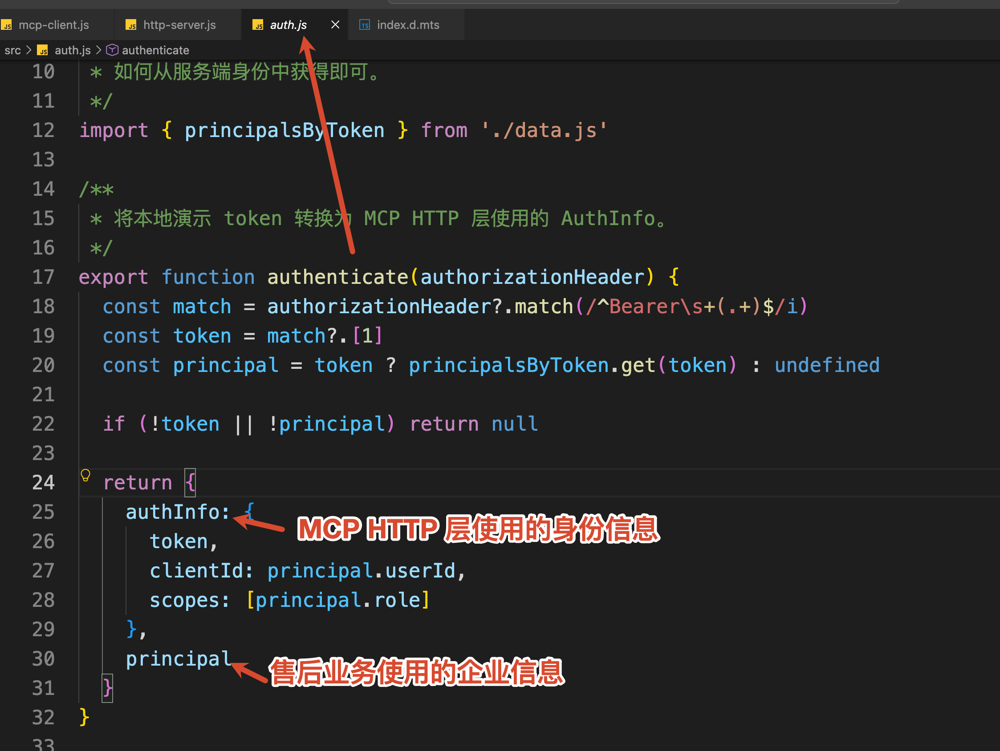


其中，后面真正做权限判断和数据查询的，是 `principal`：

```javascript
{
    userId: 'u-service-01',
    name: '蓝鲸客服小周',
    tenantId: 'blue-whale',
    role: 'customer_service'
}
```

说到这里，第一个关键问题大家应该就可以理解了

> MCP Server 中，用户身份的判断是：**来自 Host 连接 Server 时携带的 Bearer Token，并且会在进入 MCP Handler 以前完成验证。**
>

### 为什么客服只能发现 5 个 Tools
身份验证完成以后，咱们就来看第二件事：

```javascript
/**
 * 第二件事：发现 MCP Server 暴露的 Tools。
 */
const { tools: mcpTools } = await client.listTools()
```

这也就是 `npm run host` 启动以后，会打印下面这句话的原因：

```latex
当前身份可发现 5 个 Tools。
```

这里的 5 个 Tool 并不是 Host 自己写死的，而是 MCP Server 根据当前身份返回的。

咱们看 `mcp-server.js` 最后创建 Server 的地方：


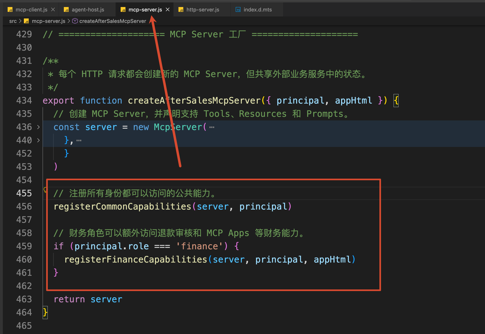


客服和财务都会注册公共售后能力

如果当前角色是财务，Server 还会继续注册批量退款审核、任务状态查询、任务取消和审核报告等能力。

所以，使用客服 Token 启动 Host 时，可以发现 5 个 Tools。

退出当前 Host，然后临时使用财务 Token 再启动一次：

```bash
MCP_TOKEN=token-blue-finance npm run host
```

这次会看到：

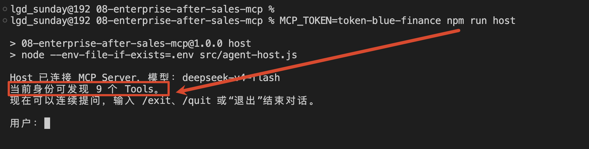


客服连接 Server 时，财务 Tool 根本不会出现在 `tools/list` 的结果里。Host 拿不到这些 Tool，后面的 DeepSeek 自然也看不到它们的名称、描述和参数结构。

不过，能力隐藏并不能代替真正的权限校验。

项目里的财务业务方法仍然会检查：

```javascript
if (principal.role !== 'finance') {
    return businessError(
        'FORBIDDEN',
        '只有财务角色可以启动批量退款审核'
    )
}
```

前面一层让不该出现的能力不进入模型上下文，后面一层保证即使有人绕过能力发现直接发请求，业务操作仍然无法执行。

### 查询订单时，Server 怎么隔离企业数据
重新使用蓝鲸科技客服身份启动 Host：

```bash
MCP_TOKEN=token-blue-service npm run host
```

在终端中输入：

```latex
查询订单 A1024 的商品、金额和签收状态
```

模型的具体回答可能略有不同，但是终端里应该能够看到一次 Tool 调用：

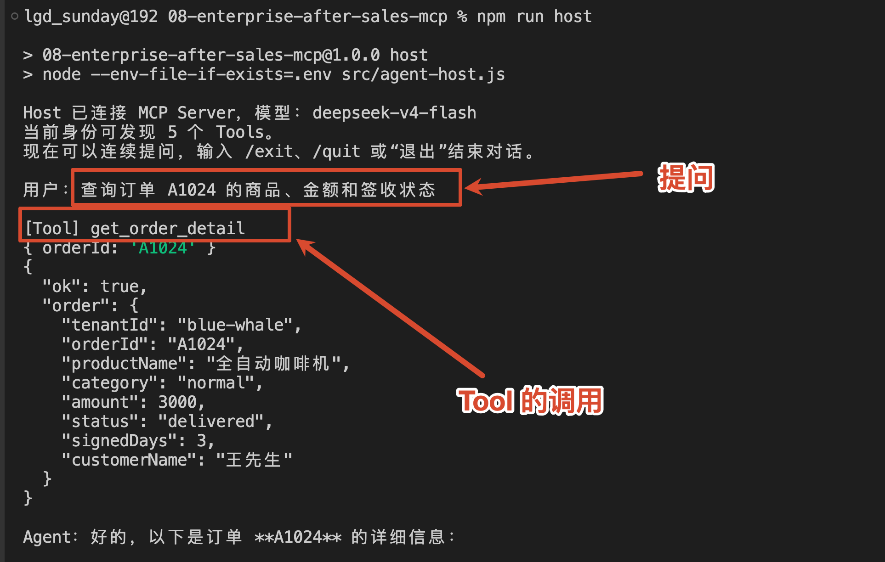


后面还会打印这次 Tool 返回的订单数据，其中包括：

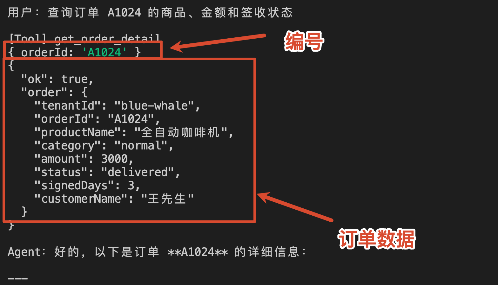

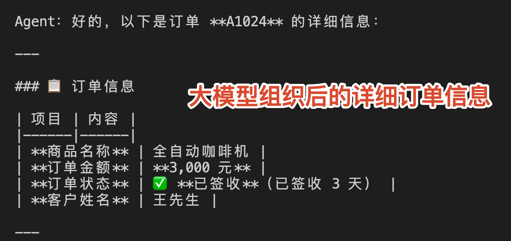


这次操作在代码中的执行过程是：


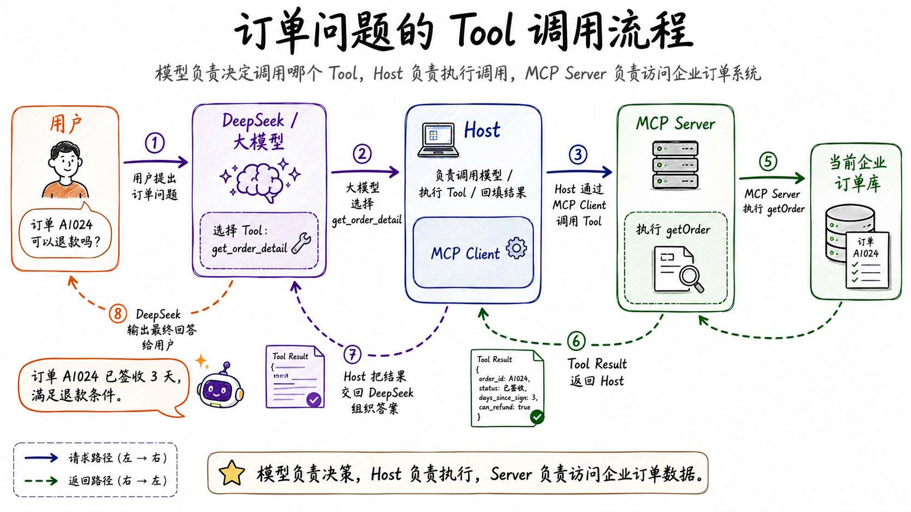


Host 调用 Tool 时，模型只提供了一个 `orderId`：


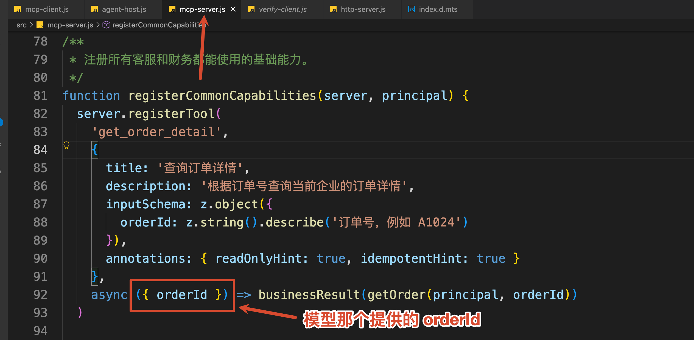


这里没有让模型传入 `tenantId`。

真正查询订单时，业务层会把模型提供的订单号和 Server 已经验证过的企业身份放在一起：

```javascript
/**
 * 根据当前登录人的租户身份查询订单。
 *
 * tenantId 只能从 principal 中读取，
 * 调用方不能跨租户查询其他企业的订单。
 *
 * @param {object} principal 当前登录人的身份信息
 * @param {string} orderId 订单编号
 */
export function getOrder(principal, orderId) {
    // 同时匹配租户和订单编号，保证订单数据按租户隔离。
    const order = orders.find(
        (item) => item.tenantId === principal.tenantId && item.orderId === orderId
    )

    return order
        ? { ok: true, order: { ...order } }
        : businessError('ORDER_NOT_FOUND', `没有找到订单 ${orderId}`)
}
```

课程数据里，蓝鲸科技和星河零售都有一笔 `A1024`。

现在退出 Host，再换成星河零售客服：

```bash
MCP_TOKEN=token-star-service npm run host
```

继续问相同的问题

```plain
查询订单 A1024 的商品、金额和签收状态
```

查询到的会变成：

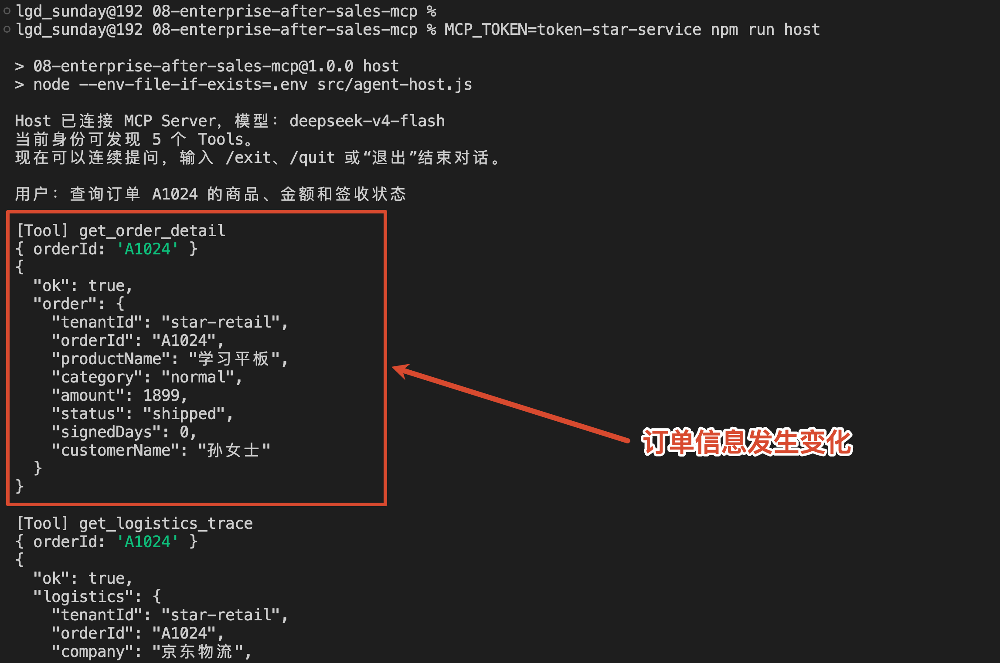


两个 Host 调用的是同一个 Tool，传入的也是同一个订单号，但是结果并不相同。

原因就在 `principal.tenantId` 里面

如果让模型自己传入 `tenantId`，那它只要把参数改成另一家企业，就有可能读取不属于当前用户的数据。

所以在企业 MCP Server 里，租户、用户和角色不能被当成普通 Tool 参数。它们必须来自服务端已经验证过的身份。

### 模型提出退款，业务代码决定能不能退
接下来重新回到蓝鲸科技客服 Host ：

```plain
npm run host     
```

输入：

```latex
订单 A1024 的商品不符合预期，可以退款吗？
```


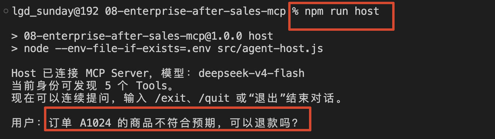


模型可能会先查询订单，也可能继续检索售后规则，但是 **最终会调用退款预检 Tool：**

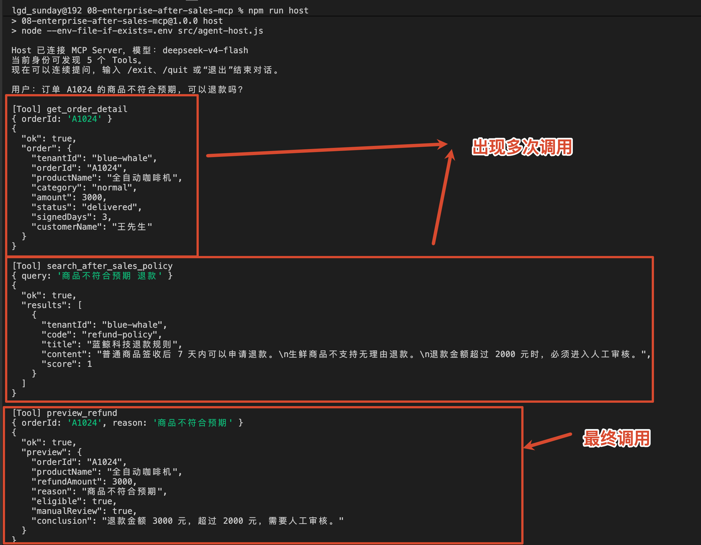


Tool Result 中会出现：

```latex
eligible：true
manualReview：true
conclusion：退款金额 3000 元，超过 2000 元，需要人工审核。
```

那么大家想一想：**为什么模型没有直接给出 “可以退款” 的结论？而是先进行了一大堆的查询呢？**

因为退款资格不是语言生成问题，而是 **企业业务规则。**

`preview_refund` 只负责接收模型已经识别出来的订单号和退款原因：

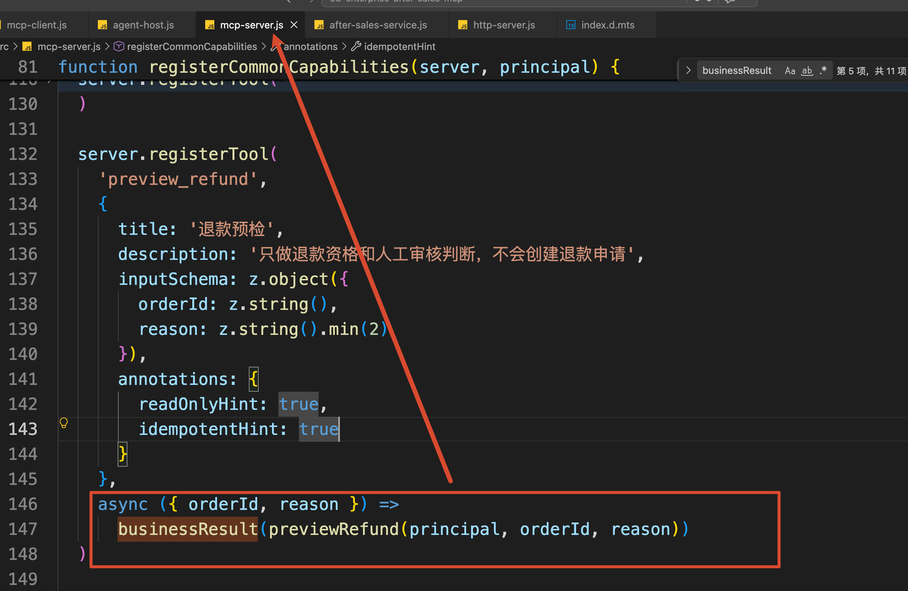


真正的判断放在 `after-sales-service.js`：


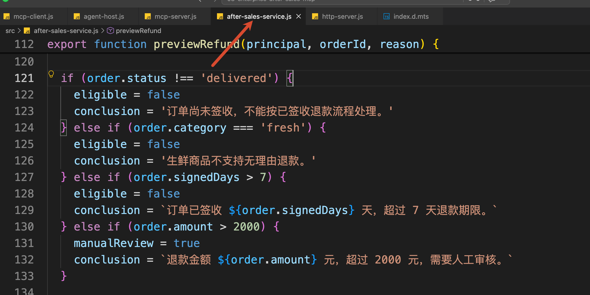


订单是否签收、商品是不是生鲜、有没有超过 7 天、退款金额是否超过人工审核线，全部由确定性代码根据真实订单判断。

模型只负责两件事：

+ 理解用户正在询问退款
+ 把订单号和退款原因整理成 Tool 参数

项目还给 `preview_refund` 标记了：

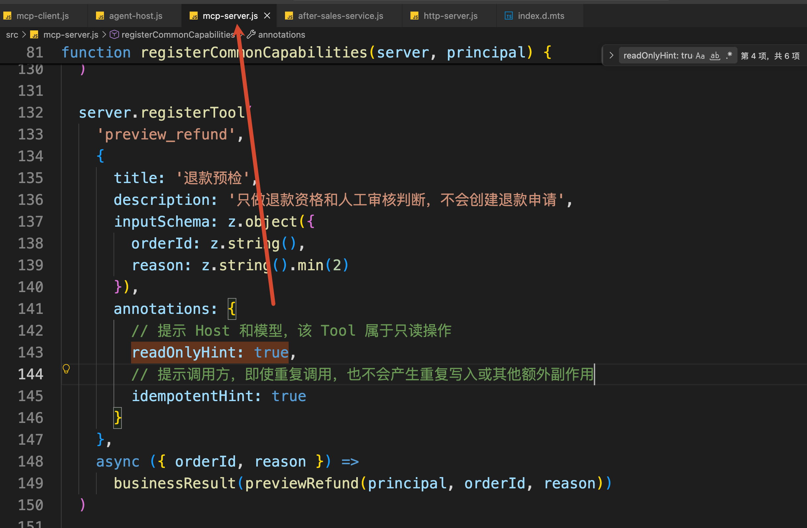


### 真正提交退款为什么还要再确认一次
退款预检完成以后，继续在同一段对话中输入：

```latex
确认提交退款，原因还是商品不符合预期
```

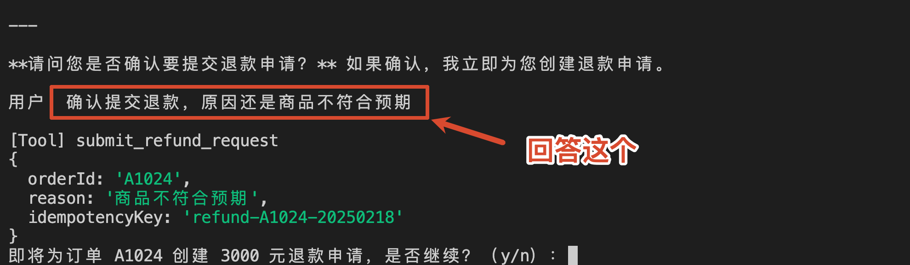


模型会提出调用：

```latex
submit_refund_request
```

但是，退款单不会立刻创建。

终端会先出现：

```latex
即将为订单 A1024 创建 3000 元退款申请，是否继续？（y/n）：
```

**只有输入 **`y`**，后面的提交才会继续。**

这里很多同学可能会有一个疑问。

模型已经根据用户那句“确认提交退款”调用了 Tool，为什么 Server 还要再询问一次？

**因为模型理解到的“确认”，不等于系统已经获得了一次可信的操作授权。**

用户输入可能被理解错，用户也可能写错，Prompt 可能被注入，模型也可能选择错 Tool。真正会修改订单和资金状态的操作，不能只根据模型的一次判断直接执行。

所以，`submit_refund_request` 第一次被调用时，只会完成退款预检，然后返回 `inputRequired`：

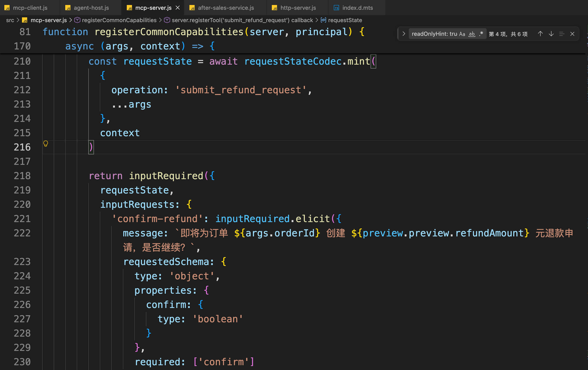


Server 只负责说明“需要用户确认什么”。

怎么询问用户，是 Host 的事情。

命令行 Host 把这次 Elicitation 转成了终端里的 `y/n`：

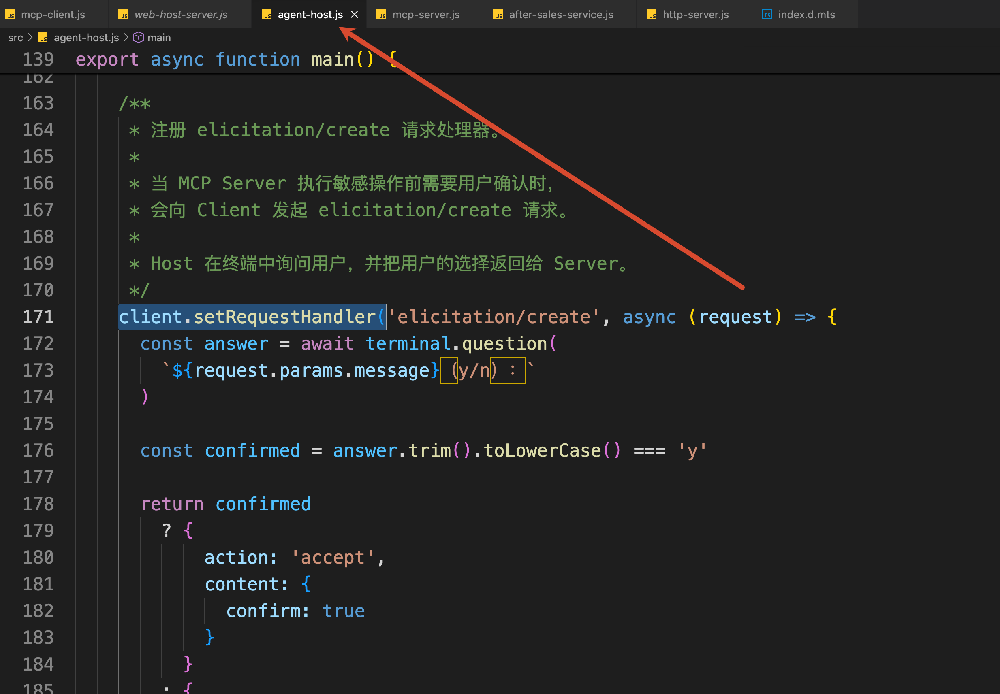


用户输入 `y` 以后，MCP Client 会把确认结果和 `requestState` 带回 Server。

从 Host 代码看，只有一次 `client.callTool()`；但是在 MCP 的多轮请求处理中，底层实际完成了两轮通信，大致流程是这样的：


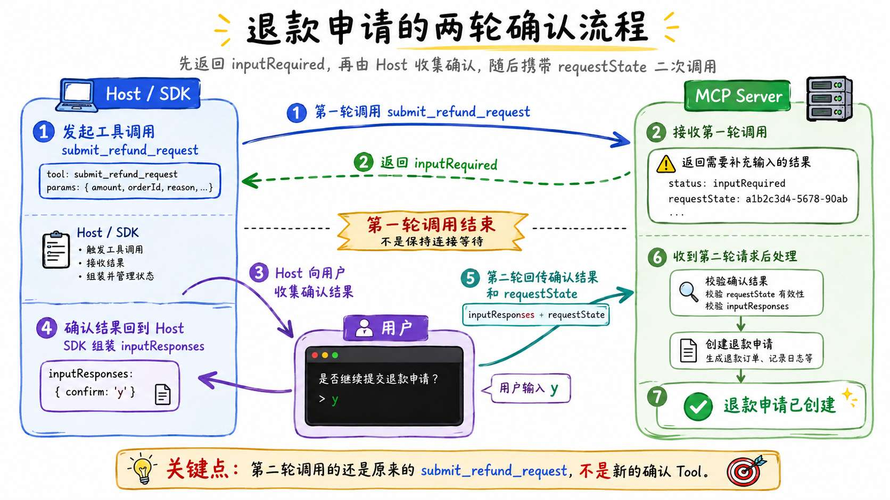


这就是 Human-in-the-Loop 在当前项目中的实际落地。

### 为什么还需要 requestState
在上面的流程图中，第二轮有一个 **回传确认结果 和 requestState **

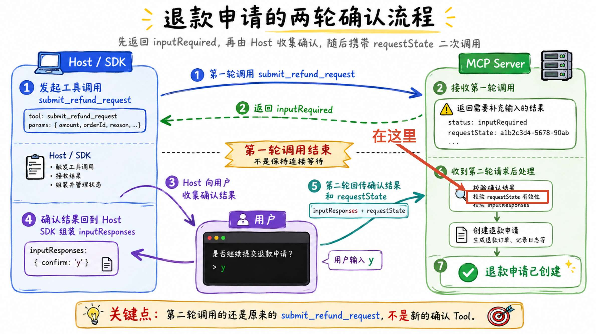


用户第一轮确认的是订单 `A1024`。

如果第二轮请求把订单号替换成了 `A1025`，这个确认还能继续使用吗？

**肯定不能。**

所以 Server 会把第一轮操作写入 `requestState`，并使用密钥签名：


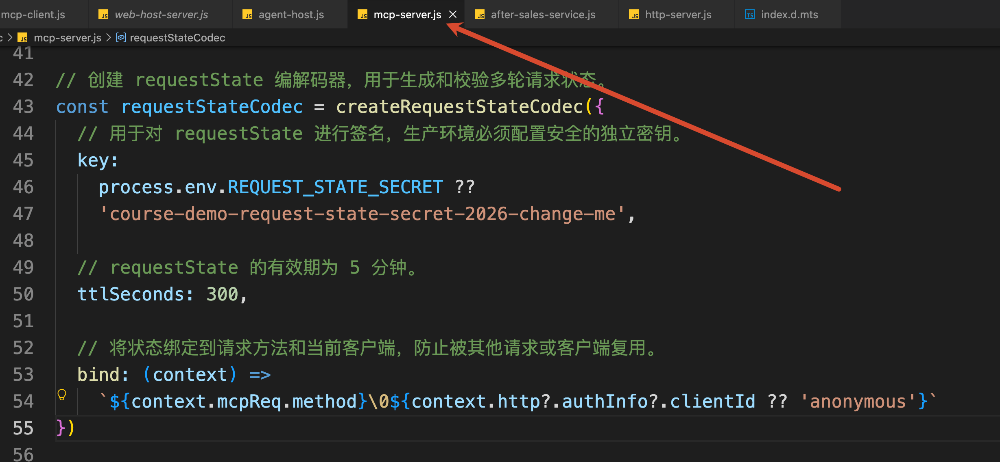


这段状态只有 5 分钟有效，而且会绑定当前请求方法和用户。

第二轮请求到达以后，Server 还会检查订单号和幂等键是否与第一轮相同。只要确认内容和当前请求对不上，就不会执行退款。

需要注意，签名只能证明内容没有被修改，并不等于加密。因此，`requestState` 里不能存放密码、API Key 这类敏感数据。

### 为什么最后还需要幂等键
用户确认以后，网络请求仍然有可能重复。

例如页面重复点击、Client 超时重试，或者消息被重复投递，都可能让同一笔退款到达 Server 两次。

所以业务层不会直接创建退款单，而是先根据下面这组数据查找已有结果：

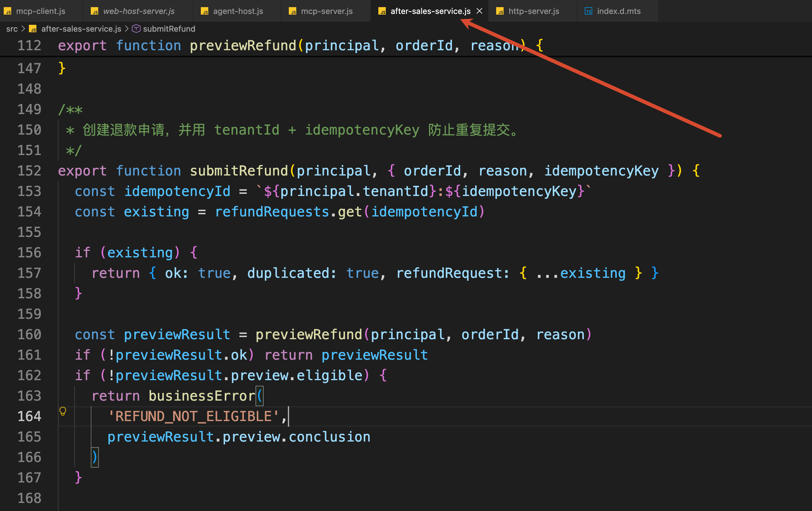


同一个企业、同一个幂等键再次提交时，Server 会返回第一次创建的退款单，不会重复写入。

所以，这次安全退款实际经过了三层保护：

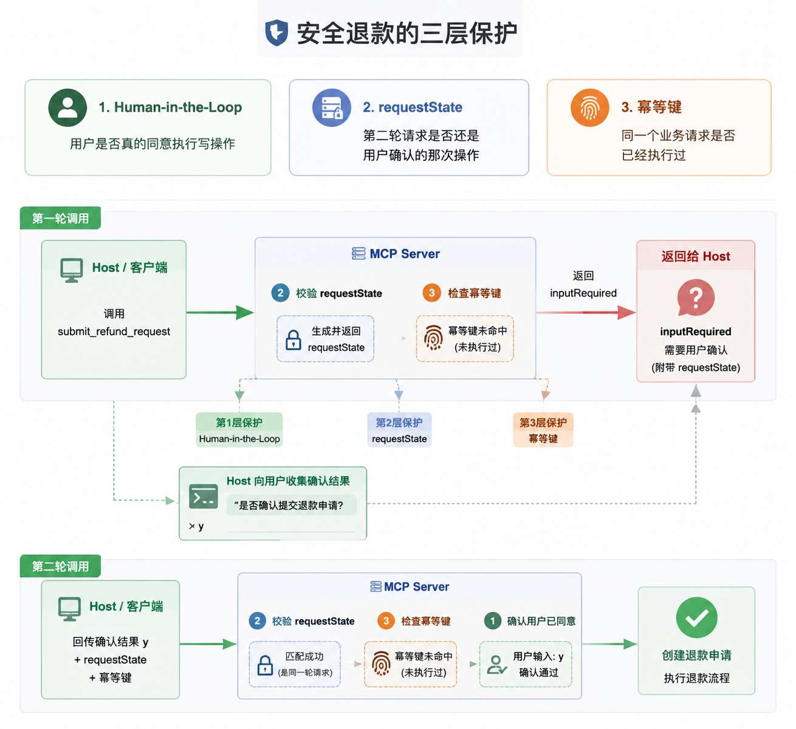


## 总结
这一篇，咱们是从 `npm run host` 进入项目的。

Host 启动以后，先带着 Bearer Token 连接 MCP Server。Server 验证 Token，并把它转换成包含 `tenantId` 和 `role` 的企业身份。随后，Host 通过 `tools/list` 获取当前角色能够发现的能力。

用户查询订单时，模型只负责提供 `orderId`，租户范围来自 Server 已经验证过的 `principal`。用户询问退款时，模型只负责识别意图，真正的退款资格由企业业务代码判断。

遇到提交退款这种高风险操作，Server 还会通过 Human-in-the-Loop 获取用户确认，使用 `requestState` 保护两轮请求，再通过幂等键避免重复创建退款单。

到这里，MCP Server 这一侧的主线就已经跑通了：

不过，这一篇只是借助 Host 触发了这些能力，还没有深入它内部的 Agent Loop。

下一篇，咱们会继续讲 Client 和 Host：模型如何拿到 MCP Tools、Tool Result 如何写回消息历史、长任务如何轮询、MCP App 如何在 Sandbox 中展示，以及命令行 Host 和浏览器 Host 怎么形成完整闭环。

> 更新：2026-07-23 12:44 · 原文：<https://www.yuque.com/lgdsunday/ab1dy3/pbr95m6s9ts8zo5h>
