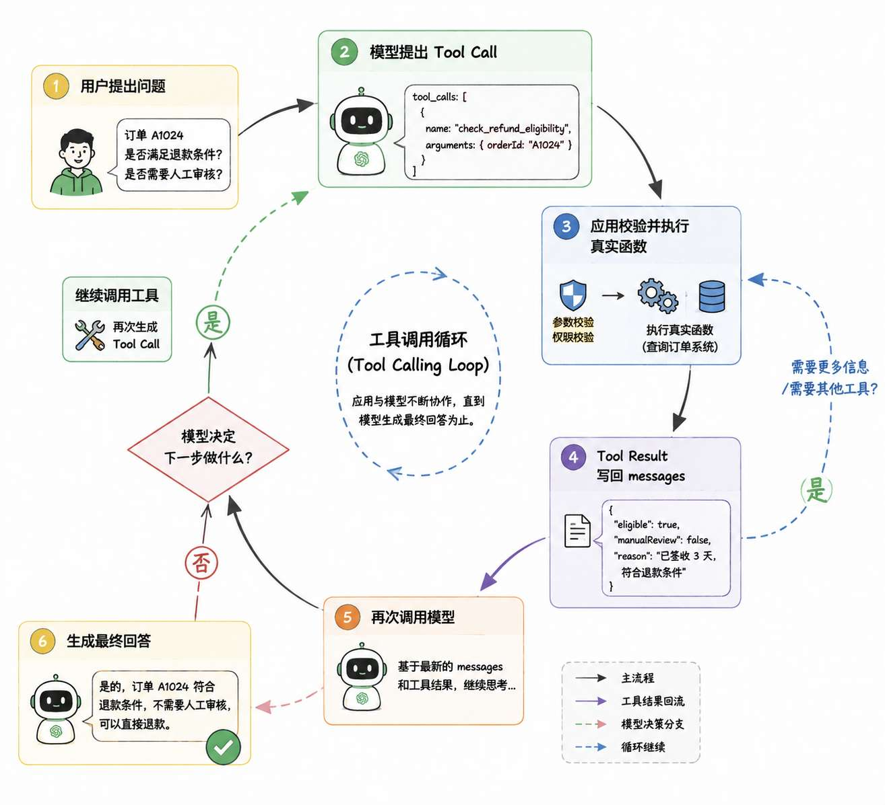
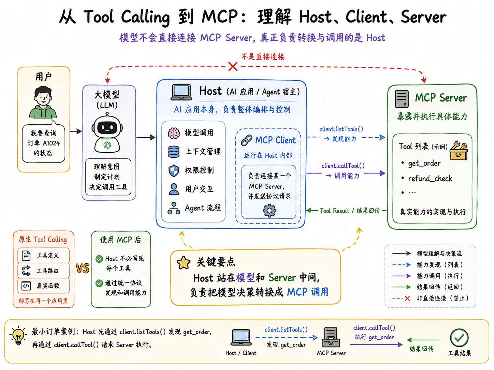
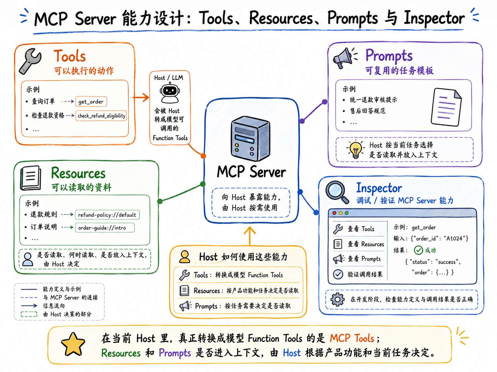
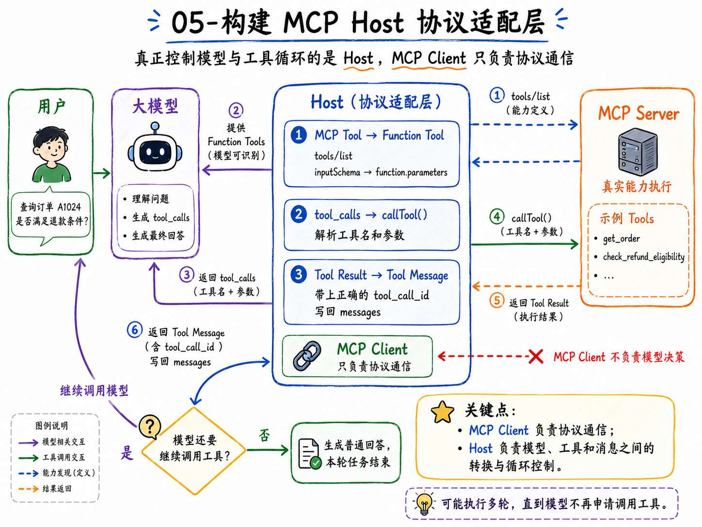
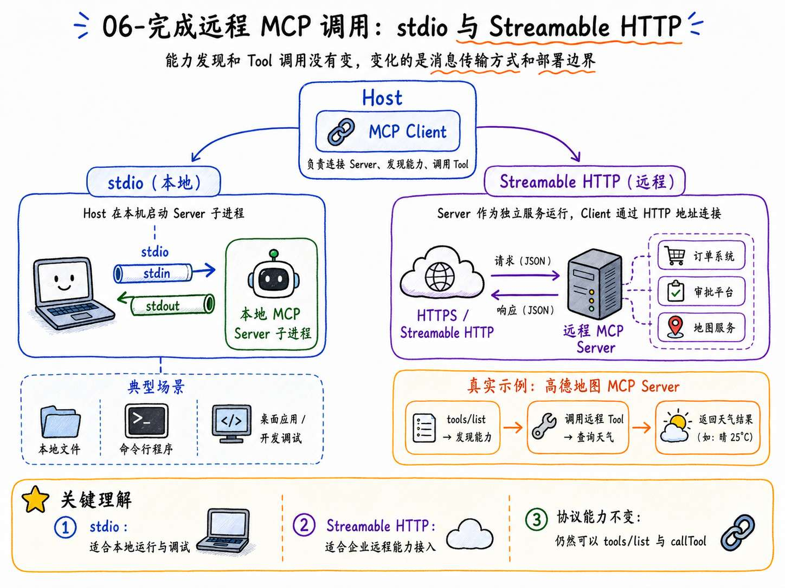
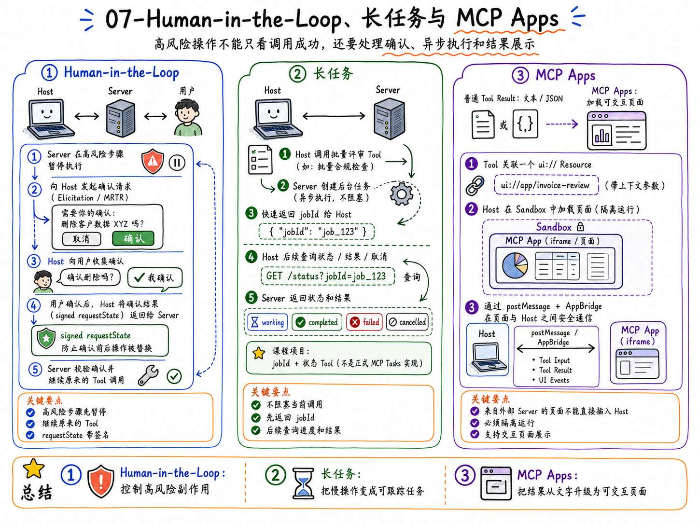

# 09 - 第三章总结：MCP 学到的内容如何在简历和面试中体现

到这里，第三大章就结束了。

这一章的内容其实挺多的。

咱们从最基础的 Tool Calling 开始，一直写到了 MCP Server、MCP Client、Agent Host、Streamable HTTP、Human-in-the-Loop、长任务和 MCP Apps。

最后，还实现了一套完整的企业售后 MCP 项目。

这一小节，咱们就把整个第三章总结一遍。

## 第三大章都学了啥
第三章的主线是从 `01` 到 `08`。

其中，`08` 是本章最终项目，又分成了上、中、下三篇。

咱们一节一节回顾。

### 01-第三章介绍与讲解思路
第二章的 RAG，解决的是模型怎么获得企业知识。

但知识库只能提供资料，不能替用户执行操作。

用户说“查询订单 A1024，如果满足条件就申请退款”时，模型即使听懂了，也不能直接访问订单系统，更不能自己执行退款接口。

所以第三章开始解决的是另一个问题：

> **怎样把订单、物流、退款和企业内部系统，变成 Agent 可以发现和使用的能力。**
>

这也是 Tool Calling 和 MCP 的概念

### 02-手写一条完整的 Tool Calling 循环调用链
这一节模型原生的 Tool Calling 开始。

模型调用时，应用程序会把工具名称、说明和参数 Schema 一起发给模型。

模型会返回一个 `tool_calls`，告诉应用程序：“我想调用什么工具，准备传入什么参数。”

真正查询订单、判断退款资格的，是 Agent 代码逻辑

应用执行完成以后，还要把结果作为 Tool Message 写回 `messages`，再次调用模型。

所以，一条完整的 Tool Calling 链路是：





这里最重要的是：**模型负责提出调用方法，应用程序负责执行动作。**

### 03-从 Tool Calling 到 MCP：理解 Host、Client、Server



原生 Tool Calling 可以跑通工具调用，但是工具定义、工具路由和真实函数都写在同一个应用里。

接入能力越来越多以后，每个 Agent 项目都要重新维护一套工具代码。

所以咱们需要使用 MCP。

MCP 是：**Host 和外部能力之间，怎样使用统一协议完成能力发现、调用和结果回传** 的协议

这一节重点在于讲清楚了三个角色：

+ `Host` 是 AI 应用本身，负责模型、上下文、权限、用户交互和 Agent 流程。
+ `MCP Client` 运行在 Host 内部，负责连接某一个 MCP Server，并发送协议请求。
+ `MCP Server` 负责按照 MCP 协议暴露和执行具体能力。

模型并不会直接连接 MCP Server。

真正站在模型和 Server 中间完成转换与调用的，一直是 Host。

在最小订单案例里，Host 通过 `client.listTools()` 发现 Server 暴露的 `get_order`，再通过 `client.callTool()` 请求 Server 执行。

这样，Host 就不需要提前写死每一个工具的名称和参数。

### 04-MCP Server 能力设计：Tools、Resources、Prompts 与 Inspector



这一节开始深入 MCP Server。

咱们分别实现了三类能力：

+ `Tools` 表示可以执行的动作，比如查询订单、检查退款资格。
+ `Resources` 表示可以读取的资料，比如退款规则和订单说明。
+ `Prompts` 表示可以复用的任务模板，比如统一的退款审核提示。

在咱们实现的 Host 里，真正转换成模型 Function Tools 的是 MCP Tools。Resources 和 Prompts 怎么进入上下文，由 Host 根据产品功能和当前任务决定。


### 05-构建 MCP Host 协议适配层



上一节的验证 Client 可以直接调用 Tool，但它还不是真正的 Agent Host。

因为它不知道用户在问什么，也没有连接大模型。

所以第五节完成了一层非常关键的协议适配：

+ MCP Tool → 转换成模型可以识别的 Function Tool
+ 模型返回 tool_calls → 转换成 MCP Client 的 callTool()
+ MCP Server 返回 Tool Result → 转换成模型可以读取的 Tool Message

Host 先通过 `tools/list` 获取 MCP Tool，再把 `inputSchema` 转换成模型接口里的 `function.parameters`。

模型返回 `tool_calls` 以后，Host 解析工具名和参数，通过 MCP Client 调用 Server。

MCP 返回结果以后，Host 还要使用正确的 `tool_call_id`，把结果写回模型消息。

这个过程可能执行多轮。

只要模型继续申请调用工具，Host 就继续执行；模型返回普通回答以后，本轮任务才结束。

也就是说，MCP Client 只负责协议通信，**真正控制模型和工具之间循环的仍然是 Host。**

### 06-完成远程 MCP 调用：stdio 与 Streamable HTTP



前面的最小案例使用的是 `stdio`。

Host 会在本机启动 MCP Server 子进程，再通过标准输入和标准输出传输 MCP 消息。

这种方式很适合本地文件、命令行程序、桌面应用和开发调试。

但是，企业能力通常不会全部运行在用户电脑上。

订单系统、审批平台和地图服务更可能部署在远程服务器上。

所以这一节继续讲了 `Streamable HTTP`。

Server 作为独立服务运行，Client 通过 HTTP 地址连接。MCP 的能力发现和 Tool 调用没有消失，变化的是消息传输方式和部署边界。

咱们还真正连接了高德地图 MCP Server，通过 `tools/list` 发现能力，再调用远程 Tool 查询天气。


### 07-Human-in-the-Loop、长任务与 MCP Apps



前面的工具大多是查询操作。

但是 Agent 一旦开始执行退款、审批和批量处理，就不能只考虑“调用成功”。

因为这些操作可能产生真实副作用。

所以第七咱们先讲了 `Human-in-the-Loop`。

Server 可以在高风险步骤暂停执行，通过 Elicitation 或 Multi Round-Trip Requests 让 Host 收集用户确认，再继续原来的 Tool 调用。

为了防止确认前后的操作被替换，项目还使用了带签名的 `requestState` 保存上一轮操作信息。

然后是长任务。

批量审核可能运行几十秒甚至更久，不能一直阻塞当前 Tool 调用。因此，Server 可以先创建任务并返回 `jobId`，Client 后续再查询进度、结果或者取消任务。

课程项目使用的是业务层 `jobId + 状态 Tool` 方案，不是 MCP Tasks 的正式实现。

最后是 MCP Apps。

普通 Tool Result 可以返回文字或者结构化数据，MCP App 则允许 Tool 关联一份 `ui://` Resource，由支持该扩展的 Host 在对话中加载交互页面。

不过，这些页面来自外部 MCP Server，不能直接插进 Host。

因此，Host 需要使用 Sandbox 隔离页面，再通过 `postMessage` 和 AppBridge 传递 Tool Input、Tool Result 和界面事件。

### 08-实战：企业售后 MCP Server 与 Agent Host
第八节是第三章的最终项目。

项目同时实现了命令行 Host 和浏览器 Web Host，并把订单查询、物流查询、退款预审、退款提交、批量审核和可视化报告接入了 MCP。

整个内容分成了 上中下 三篇来讲。

+ 上篇主要完成项目运行和目录拆解
+ 中篇从 `npm run host` 进入代码，顺着一次真实退款操作，讲清楚了企业 MCP Server 中的安全边界
+ 下篇则从 `npm run web-host` 进入浏览器 Host

---

## 怎么把第三章体现到简历上
第三章写进简历，还是主要分成两部分：

+ 技能特长
+ 项目经历

### 技能特长怎么写
可以参考下面这版：

```latex
技能特长

• 熟悉大模型 Tool Calling 执行链路，理解工具定义、参数 Schema、tool_calls、Tool Message 和多轮结果回注机制，能够使用 Node.js 实现模型选择工具、应用执行工具和结果回传闭环。

• 熟悉 Model Context Protocol，理解 Host、Client、Server 的职责边界，以及 Tools、Resources、Prompts、能力发现、Schema 映射和调用路由等核心机制，能够实现本地 stdio 与远程 Streamable HTTP MCP 调用。

• 具备企业 MCP 能力接入与安全设计经验，能够处理 Bearer Token 身份认证、角色级能力暴露、多租户数据隔离、Human-in-the-Loop、requestState、幂等写入、业务长任务和 MCP Apps 沙箱渲染。
```

这三条已经可以覆盖本章主线。

### 项目经历怎么写
第三章的最终实战，可以整理成一套企业售后 Agent 与 MCP 能力平台。

可以参考下面这版：

```latex
项目名称：企业售后 Agent 与 MCP 能力平台

技术栈： Node.js、DeepSeek、Model Context Protocol、Streamable HTTP、Zod、MCP Apps、Vite

项目介绍： 面向企业售后业务，将订单、物流、退款和批量审核接入统一的 MCP 能力平台，支持客服通过自然语言查询订单、处理退款，财务批量审核并查看报告。提供命令行和浏览器两种交互入口，实现从业务查询、人工确认到执行结果反馈的完整流程。

主要职责：
- 负责售后 MCP Server 开发，将订单查询、物流查询、退款预审和提交等功能封装为 Tools，通过 Resources 与 Prompts 提供业务资料和任务模板，支持不同 Agent 复用同一套售后能力。
- 实现 Host 与模型之间的协议适配，通过 tools/list 动态发现能力并转换为模型工具定义，完成工具调用和结果回传，使新增售后工具能够接入现有对话流程，减少逐个编写适配代码的工作。
- 基于 Streamable HTTP 提供远程服务，通过 Bearer Token 识别用户、租户与角色，结合能力发现过滤和业务层权限复核，限制客服与财务的操作范围，避免跨企业查询订单或执行越权操作。
- 将退款拆分为预审与正式提交，由业务代码判断退款规则，并在提交前加入人工确认、参数防篡改校验和幂等控制，避免模型误操作、确认后参数被替换及重复创建退款申请。
- 批量审核采用异步任务方式，启动后立即返回 jobId，由 Host 查询进度并获取最终报告，避免一次工具调用持续等待，支持用户跟踪耗时任务的执行状态。
- 基于 MCP Apps 将批量审核结果展示为交互式报告，通过 AppBridge 传递工具结果，方便财务查看审核明细，并使用独立 Origin 与 iframe Sandbox 限制报告页面的访问能力。
- 编写验证 Client，自动检查角色权限、多租户订单隔离、退款幂等、任务状态和报告资源，在协议适配或业务功能调整后验证关键流程，降低权限失效和重复写入等回归风险。
```

## 面试可能会问什么
可以参考下面问题

### Tool Calling 和 MCP 有什么区别？
Tool Calling 是模型接口提供的一种交互能力。

应用把工具名称、描述和参数 Schema 交给模型，模型根据用户问题返回 `tool_calls`，提出想调用的工具和参数。模型不会真正执行工具，仍然需要应用程序解析参数、调用真实函数，再把 Tool Result 交回模型。

MCP 解决的是另一个层面的问题。

它使用统一协议，规范 Host 怎样发现和调用外部能力，以及 Client 和 Server 怎样交换参数、内容和结果。

在咱们课程项目中，Host 先通过 MCP Client 获取 Server 的 Tools，再把这些 Tools 转换成 DeepSeek 可以识别的 Function Tools。模型返回 `tool_calls` 以后，Host 才通过 MCP Client 调用对应 Server。

所以，MCP 没有替代模型 Tool Calling，而是把 Tool Calling 后面的能力接入部分标准化了。

### Host、Client 和 Server 分别负责什么？
Host 是整个 AI 应用的组织者。

它负责连接模型、维护上下文、管理用户交互、决定允许连接哪些 Server，并控制 Tool Loop、预算和最终结果。

MCP Client 运行在 Host 内部。

一个 Client 通常对应一个 MCP Server 连接，负责按照协议发送 `tools/list`、`tools/call`、`resources/read` 等请求，并处理 Server 返回的结果或反向请求。

MCP Server 是能力提供方。

它把订单查询、文件读取、数据库操作或者第三方 API 封装成 MCP Tools、Resources 和 Prompts，并在 Server 侧完成参数验证、授权和业务调用。

### 一次 MCP Tool 调用的完整流程是什么？
Host 启动以后会先创建 MCP Client，并连接目标 Server。

随后，Host 使用 `listTools()` 获取当前身份能够发现的 Tool 名称、描述和 `inputSchema`。

这些 MCP Tools 会被转换成模型可以识别的 Function Tools，再和当前 `messages` 一起发送给模型。

如果模型返回 `tool_calls`，Host 会解析 Tool 名称与参数，然后执行：

```javascript
client.callTool({
    name,
    arguments: args
})
```

MCP Server 收到调用以后，先验证参数和权限，再调用真实业务服务。

执行结果会作为 MCP Tool Result 返回给 Client。

Host 还需要把结果转换成模型接口能够读取的 Tool Message，并使用原来的 `tool_call_id` 写回 `messages`。

模型拿到真实结果以后，可以继续调用其他 Tool，也可以生成最终回答。

### Tools、Resources 和 Prompts 有什么区别？
Tools 表示可以执行的能力。

比如查询订单、提交退款、创建审核任务。它通常包含参数 Schema，调用以后返回 Tool Result。

Resources 表示可以读取的内容。

比如退款规则、数据库 Schema、项目文件或者审计记录。Host 可以根据 URI 读取，至于是否把内容加入模型上下文，由 Host 决定。

Prompts 是 Server 提供的可复用任务模板。

比如企业统一的退款审核模板。用户或 Host 可以选择模板并提供参数，Server 返回组织好的消息内容。


### stdio 和 Streamable HTTP 应该怎么选择？
`stdio` 适合本地能力。

Host 启动 MCP Server 子进程，通过标准输入和标准输出传输 JSON-RPC 消息。它不需要额外开放网络端口，适合桌面工具、本地文件系统、开发环境和单用户能力。

`Streamable HTTP` 适合远程服务。

MCP Server 独立部署，通过 HTTP Endpoint 为多个 Client 提供能力。企业订单系统、审批系统和云端服务通常更适合这种方式。

远程 MCP 还要额外考虑 HTTPS、Origin 校验、身份认证、OAuth 或 Bearer Token、限流、超时、审计和多租户隔离。

另外，早期资料中的 HTTP+SSE 已经不是当前默认方案。现在远程连接的主线是 Streamable HTTP。

### 企业 MCP Server 怎么做权限隔离？
权限隔离不能依赖 Prompt

咱们的做法是：Host 连接 Server 时会携带 Bearer Token。HTTP 层先验证 Token，再把它转换成可信的 `principal`：

```javascript
{
    userId: 'u-service-01',
    tenantId: 'blue-whale',
    role: 'customer_service'
}
```

Server 可以根据角色决定注册哪些 Tools，减少模型看到不相关或无权限能力的机会。

但是，Tool 不出现在 `tools/list` 里，不等于完成了权限控制。

攻击者仍然可能绕过能力发现，直接构造 `tools/call`。

所以，业务层还必须再次检查角色，并且把 `principal.tenantId` 加入数据查询条件。


### 为什么高风险 Tool 需要 Human-in-the-Loop、requestState 和幂等键？
这三个机制解决的问题不同。

Human-in-the-Loop 解决的是：**高风险操作执行以前，必须把最终决定权交给用户。**

例如模型识别到用户想退款，并不代表系统可以立即创建退款单。Server 应该暂停执行，让 Host 展示订单、金额和风险，再收集用户确认。

`requestState` 解决的是：**两轮请求之间的状态绑定。**

用户第一次确认的是订单 A1024，第二轮继续执行时，Server 必须确认订单号、操作类型和其他关键参数没有被替换。

咱们会给 `requestState` 签名并设置有效期。

签名可以检测内容是否被修改，但不等于加密，因此里面不能保存密码、API Key 等敏感数据。

幂等键解决的是：**重复执行。**

即使用户已经确认，页面重复点击、Client 超时重试或者网络重复投递，仍然可能让同一笔退款到达 Server 多次。

所以业务层要根据租户和幂等键查找已有结果，重复请求返回第一次创建的退款单，而不是再次写入。

### 长任务为什么不能一直占着一次 Tool 调用？
批量审核、报表生成和大文件处理可能需要较长时间。

如果 Tool 一直等到全部完成才返回，容易遇到 HTTP 超时、连接中断和重试导致的重复执行。


### MCP App 是怎么显示出来的？为什么需要 Sandbox？
MCP App 允许 Tool 关联一份交互式 UI。

在课程项目中，`get_batch_review_report` 会通过下面的元数据声明页面地址：

```javascript
_meta: {
    ui: {
        resourceUri:
            'ui://after-sales/batch-review-report.html'
    }
}
```

Tool Result 负责返回审核数据，`ui://` Resource 负责返回构建后的 HTML 页面。

Host 发现 `resourceUri` 以后，通过 `resources/read` 获取页面，再使用 AppBridge 把 Tool Input 和 Tool Result 发送给 MCP App。

页面代码来自外部 Server，Host 不能直接信任。

所以 Web Host 会把 MCP App 放进独立 Origin 的 sandboxed iframe。App 无法直接读取 Host 的 DOM、Cookie 和 Local Storage，只能通过 `postMessage` 交换受控消息。

## 总结
第三章到这里就结束了。

这一章解决的是：**模型和 Agent 应用怎样连接真实的外部能力。**

从原生 Tool Calling 到 MCP，咱们已经跑通了能力描述、能力发现、参数映射、工具调用和结果回传。

后面的企业售后项目又继续补上了身份认证、角色权限、多租户隔离、人工确认、幂等写入、长任务和 MCP Apps。

等等的内容～～

> 更新：2026-09-09 20:46 · 原文：<https://www.yuque.com/lgdsunday/ab1dy3/nnb1nap7555dhgkh>
