# 02 - ReAct：Reasoning–Action–Observation 闭环、动态工具决策与执行轨迹

上一节，咱们留下了一个问题。

`payment-service` 从 15:10 开始出现大量支付失败，Agent 到底应该先查什么？

这个问题并没有唯一答案。

因为在真正开始排查以前，Agent 并不知道问题来自代码、数据库、服务器资源，还是某一次发布。

它只能先执行一个动作，拿到一些真实数据，再根据这些数据决定下一步。

比如，Agent 先去查看监控指标，得到下面这个结果：

+ CPU 使用率：43%
+ 内存使用率：58%
+ 数据库连接池使用率：46%
+ 支付接口 5xx 错误率：31.8%

CPU、内存和数据库连接池都没有明显异常。

这个时候，继续检查数据库连接池的意义就不大了。Agent 更应该去看错误日志，确定这些 `5xx` 到底是什么错误。

但是，如果监控返回的是另一份结果：

+ CPU 使用率：39%
+ 内存使用率：61%
+ 数据库连接池使用率：100%
+ 支付接口 5xx 错误率：26.4%

排查方向就变了。

数据库连接池已经达到 `100%`，Agent 接下来就应该检查活跃连接、等待请求和长时间运行的 SQL。

大家看，同样的用户目标、同样一组工具，只是监控数据发生了变化，下一步就可能完全不同。

这就是这一节要讲的 `ReAct`。

## ReAct 到底是什么
`ReAct` 不是一个框架，也不是一个需要安装的 npm 包。

它来自 2022 年发布的论文《ReAct: Synergizing Reasoning and Acting in Language Models》，后来发表于 ICLR 2023。原文地址在这里：`https://react-lm.github.io/`

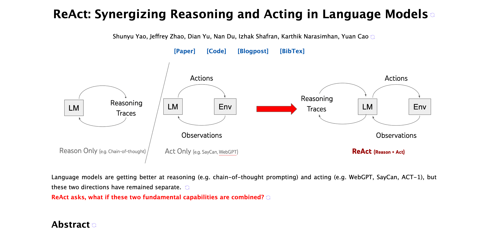

这个名字由两个单词组合而来：`Reasoning + Acting = ReAct`

原始论文想解决的问题是：模型不能只坐在那里推理，也不能只会机械执行动作。

它需要 **一边判断当前情况，一边与外部环境交互。环境返回新的信息以后，模型再更新判断，继续执行。**

整个过程可以先理解成下面这样：

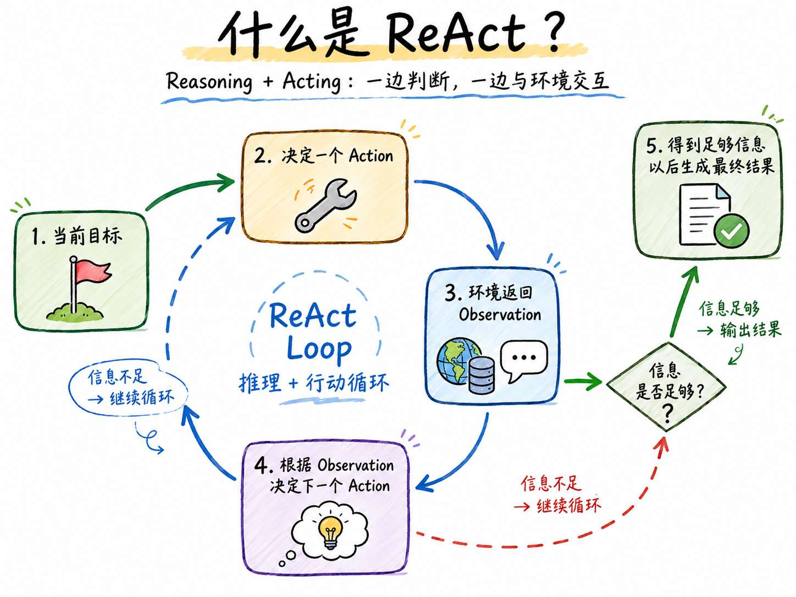


这里出现了两个新的单词：`Action` 和 `Observation` 

+ `Action` 表示 Agent 当前决定执行的动作。在故障排查的时候，下面这些都可以算作 Action：

```latex
查询服务状态
查询监控指标
查询错误日志
查询最近发布记录
检查数据库连接池
```

+ `Observation` 表示 Action 执行以后，外部环境返回的真实结果。比如：

```latex
Action：查询 payment-service 的监控指标

Observation：数据库连接池使用率 100%，当前有大量请求等待连接
```

Agent 看完这份 Observation，才决定下一步去检查数据库连接池。

所以，`Observation` 的结果应该来自监控平台、日志系统、数据库、浏览器、文件系统或者其他真实工具的检测结果

## 实现一个最小故障排查 Agent
> 课程源码：`https://github.com/lgd8981289/Agent--Code`
>
> 本小节完整代码位于：`Code/Node/第四章/02-react-incident-agent`
>

这个案例会准备两套不同的故障数据。

+ 第一套是新版本发布引起的代码错误
+ 第二套是数据库连接池耗尽的错误场景

Agent 收到的用户目标完全相同，可用工具也完全相同。咱们要观察的是：**工具返回不同的 Observation 以后，Agent 会不会进入不同的排查路线。**

### 创建项目
进入第四章代码目录，创建项目：

```bash
mkdir 02-react-incident-agent
cd 02-react-incident-agent
node -v
npm init -y
```

这里得安装 `zod` 做依赖库：`"zod": "^4.4.3"`

对应 `package.json` 的内容：

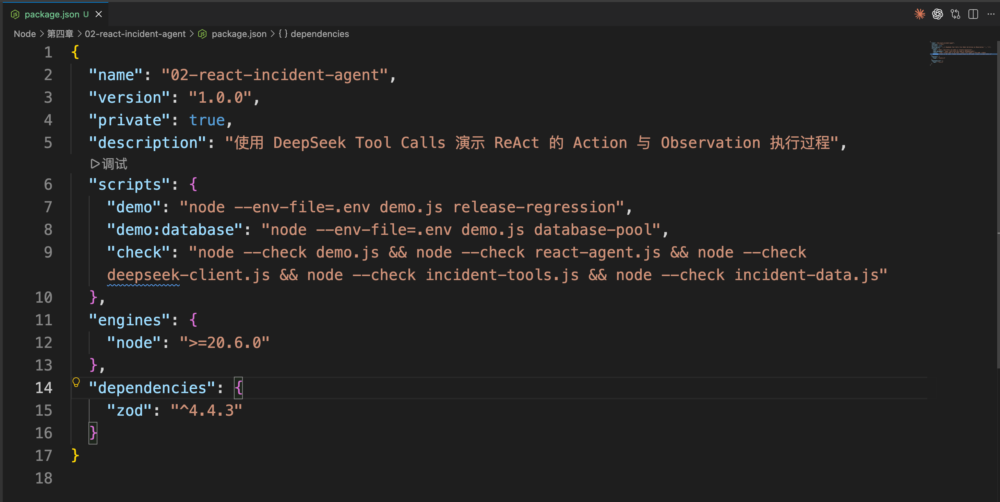


### 配置 DeepSeek
在项目根目录创建 `.env`：

```plain
DEEPSEEK_API_KEY=你的_DeepSeek_API_Key
DEEPSEEK_MODEL=deepseek-v4-flash
```

### 准备本地故障数据
真实企业里的服务状态、监控和日志，可能分别来自 Kubernetes、Prometheus、Grafana、ELK 或云平台。

但是，这一节的重点不是教大家安装这些基础设施。

所以，项目中的 `incident-data.js` 会在内存中准备两套固定数据：

```javascript
// 课程源码里的数据会更完整，这里只保留最容易观察的字段。
const incidentScenarios = {
    'release-regression': {
        label: '新版本发布导致支付接口异常',
        serviceName: 'payment-service',
        health: {
            status: 'degraded',
            processUp: true,
            http5xxRate: 31.8
        },
        metrics: {
            cpuUsagePercent: 43,
            memoryUsagePercent: 58,
            databasePoolUsagePercent: 46
        },
        logs: {
            topErrors: [
                {
                    code: 'PAYMENT_CURRENCY_UNDEFINED',
                    version: 'v2.4.1'
                }
            ]
        }
    },

    'database-pool': {
        label: '数据库连接池耗尽导致支付接口异常',
        serviceName: 'payment-service',
        metrics: {
            cpuUsagePercent: 39,
            memoryUsagePercent: 61,
            databasePoolUsagePercent: 100
        },
        logs: {
            topErrors: [
                {
                    code: 'DB_POOL_ACQUIRE_TIMEOUT',
                    version: 'v2.3.8'
                }
            ]
        }
    }
}
```

这个文件的作用是模拟外部系统。只有 Agent 调用对应工具以后，当前那部分数据才会作为 Observation 返回。

### 定义故障排查工具
创建 `incident-tools.js`。

这节课一共提供五个只读工具：

```javascript
const tools = [
    {
        type: 'function',
        function: {
            name: 'get_service_health',
            description:
                '查询服务是否存活、实例健康数量和当前 5xx 错误率。开始排查线上服务异常时使用。',
            parameters: toToolParameters(serviceSchema)
        }
    },
    {
        type: 'function',
        function: {
            name: 'query_metrics',
            description:
                '查询故障时间段内的错误率、延迟、CPU、内存和数据库连接池使用率，用来确定异常从什么时候开始以及哪些指标同时变化。',
            parameters: toToolParameters(serviceSchema)
        }
    },
    {
        type: 'function',
        function: {
            name: 'query_logs',
            description:
                '查询故障时间段内的主要错误日志、首次出现时间、错误次数和服务版本。',
            parameters: toToolParameters(serviceSchema)
        }
    },
    {
        type: 'function',
        function: {
            name: 'get_recent_deployments',
            description:
                '查询服务最近的版本发布时间和主要变更。只有指标或日志显示异常可能与版本变化有关时使用。',
            parameters: toToolParameters(serviceSchema)
        }
    },
    {
        type: 'function',
        function: {
            name: 'inspect_database_pool',
            description:
                '检查数据库连接池的活跃连接、等待请求和长时间运行的查询。只有指标或日志出现连接池异常时使用。',
            parameters: toToolParameters(serviceSchema)
        }
    }
]
```

`get_recent_deployments` 和 `inspect_database_pool` 的描述中，专门写清楚了各自应该在什么情况下使用。

如果日志指向代码版本，Agent 应该查询发布记录。

如果日志和指标都指向数据库连接池，Agent 就应该检查连接池。

至于工具描述为什么会影响模型选择，后面的 Tool Engineering 小节还会通过专门的实验继续讲。这里先把工具定义清楚。

工具真正执行的时候，会从当前故障场景中返回对应数据：

```javascript
/**
 * 为当前故障场景创建工具执行器。
 *
 * @param {string} scenarioName 故障场景名称
 * @returns {object} 工具定义、场景信息和执行函数
 */
function createIncidentToolset(scenarioName) {
    const scenario = getIncidentScenario(scenarioName)

    const toolRegistry = {
        get_service_health: () => scenario.health,
        query_metrics: () => scenario.metrics,
        query_logs: () => scenario.logs,
        get_recent_deployments: () => scenario.deployments,
        inspect_database_pool: () => scenario.databasePool
    }

  /**
   * 执行模型提出的一次 Action，并返回 Observation。
   *
   * @param {object} toolCall DeepSeek 返回的 tool_call
   * @returns {Promise<object>} 可回传给模型的 Observation
   */
    async function executeToolCall(toolCall) {
        const toolName = toolCall.function.name
        const execute = toolRegistry[toolName]

        // 解析并校验参数……

        return {
            ok: true,
            source: toolName,
            data: execute()
        }
    }

    return {
        tools,
        scenario,
        executeToolCall
    }
}
```

最终返回给模型的结果，统一长成这样：

```json
{
    "ok": true,
    "source": "query_metrics",
    "data": {
        "databasePoolUsagePercent": 100,
        "summary": "数据库连接池使用率达到 100%，同时出现大量请求等待。"
    }
}
```

这就是当前 Action 对应的 Observation。

### 调用模型
`deepseek-client.js` 和第三章的模型调用代码基本相同：

```javascript
/**
 * 调用 DeepSeek Chat Completions。
 *
 * 当前案例关闭思考模式，只观察模型提出的 Action、
 * 工具返回的 Observation 和最终回答。
 *
 * @param {object} input 模型调用参数
 * @param {Array} input.messages 当前完整消息
 * @param {Array} input.tools 当前可用工具
 * @returns {Promise<object>} 模型消息和调用统计
 */
async function callDeepSeek({ messages, tools }) {
    const response = await fetch(
        'https://api.deepseek.com/chat/completions',
        {
            method: 'POST',
            headers: {
                Authorization: `Bearer ${process.env.DEEPSEEK_API_KEY}`,
                'Content-Type': 'application/json'
            },
            body: JSON.stringify({
                model: process.env.DEEPSEEK_MODEL || 'deepseek-v4-flash',
                messages,
                tools,
                tool_choice: 'auto',
                thinking: {
                    type: 'disabled'
                },
                temperature: 0.1
            })
        }
    )

    // 解析并检查接口结果……
}
```

### 约束 Agent 行为
工具和模型调用都准备好以后，还需要告诉 Agent 这次任务应该遵守什么

`react-agent.js` 中的系统指令如下：

```javascript
const SYSTEM_PROMPT = `你是一个线上故障排查 Agent。

你的任务是根据工具返回的真实数据，找出最可能的故障原因并给出处理建议。

执行规则：
1. 不能猜测监控、日志、数据库或发布信息，所有事实必须来自工具结果。
2. 每一轮只调用一个工具，读取 Observation 后再决定下一步。
3. 在生成最终结论前，至少检查服务状态、监控指标和错误日志。
4. 完成上面三项检查以后，只能根据 Observation 选择一条验证路线：
   - 日志显示错误与服务版本或代码变更有关：查询最近发布记录。
   - 指标或日志显示数据库连接池异常：检查数据库连接池。
5. 完成对应路线的验证以后直接生成最终回答。
6. 不要重复相同调用。
7. 最终回答必须包含：最可能原因、关键证据、建议动作和暂时无法确认的信息。

当前工具都是只读工具。你只能提出处理建议，不能声称已经重启服务或者回滚版本。`
```

这套提示词里面规定了结论必须基于哪些基础证据，以及不同证据应该进入什么验证范围。

至于工具的具体调用顺序，以及最后选择发布记录还是数据库连接池，仍然由模型根据 Observation 决定。

### ReAct 循环
最后来看 `react-agent.js`  的业务代码。

这个文件中的循环和第三章 Tool Calling 循环长得很像，因为底层确实还是同一套接口。

真正需要关注的是，程序现在会把模型的工具调用打印为 `Action`，把工具结果打印为 `Observation`：

```javascript
/**
 * 运行最小 ReAct Agent。
 *
 * 每一步只观察应用程序能够拿到的数据：
 *
 * Action：模型提出的 tool_call
 * Observation：工具执行后返回的真实结果
 */
async function runReactAgent({ goal, tools, executeToolCall }) {
    const messages = [
        {
            role: 'system',
            content: SYSTEM_PROMPT
        },
        {
            role: 'user',
            content: goal
        }
    ]
  
    /**
     * trajectory 只记录可以被应用程序观察的执行过程。
     */
    const trajectory = []

    for (let step = 1; step <= MAX_STEPS; step += 1) {
        const result = await callDeepSeek({
            messages,
            tools
        })

        const toolCalls = result.message.tool_calls || []
        /**
         * 没有 tool_calls，表示模型认为已经可以生成最终回答。
         */
        if (toolCalls.length === 0) {
            return {
                finalAnswer: result.message.content,
                trajectory
            }
        }
        /**
         * 完整保留模型返回的 assistant 消息。
         *
         * 下一条 role=tool 消息需要通过 tool_call_id
         * 与这里的 tool_calls 建立对应关系。
         */
        messages.push({
            role: 'assistant',
            content: result.message.content ?? null,
            tool_calls: toolCalls
        })

        for (const toolCall of toolCalls) {
            const action = {
                toolName: toolCall.function.name,
                arguments: JSON.parse(toolCall.function.arguments)
            }

            const observation = await executeToolCall(toolCall)

            trajectory.push({
                step,
                action,
                observation
            })
      /**
             * 将真实 Observation 放回 messages。
             *
             * 下一轮模型调用时，模型会看到这份结果，
             * 再决定下一个 Action。
             */
      messages.push({
        role: 'tool',
        tool_call_id: toolCall.id,
        content: JSON.stringify(observation)
      })
        }
    }
}
```

`trajectory` 只负责记录外部执行轨迹，比如说：第几步、调用了哪个工具、传入了什么参数 等等的

真正让下一步发生变化的，仍然是这段代码：

```javascript
/**
 * 将真实 Observation 放回 messages。
 *
 * 下一轮模型调用时，模型会看到这份结果，
 * 再决定下一个 Action。
 */
messages.push({
    role: 'tool',
    tool_call_id: toolCall.id,
    content: JSON.stringify(observation)
})
```

Observation 被写入 `messages` 以后，下一轮模型调用才能看到真实结果。

## 实验一：新版本发布引起的故障
执行：

```bash
npm run demo
```

这个命令会加载 `release-regression` 场景。

先给大家看下完整的打印，内容可能有点多：

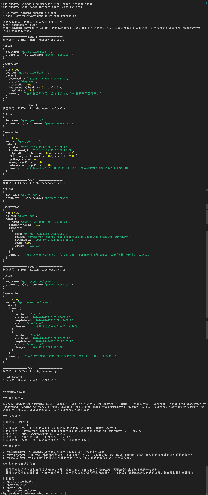


自然语言回答可能会因为模型生成存在一些差异，但正常情况下，大家会看到类似下面的执行路径：

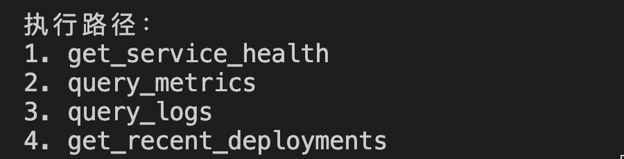


重点看第三步返回的 Observation：

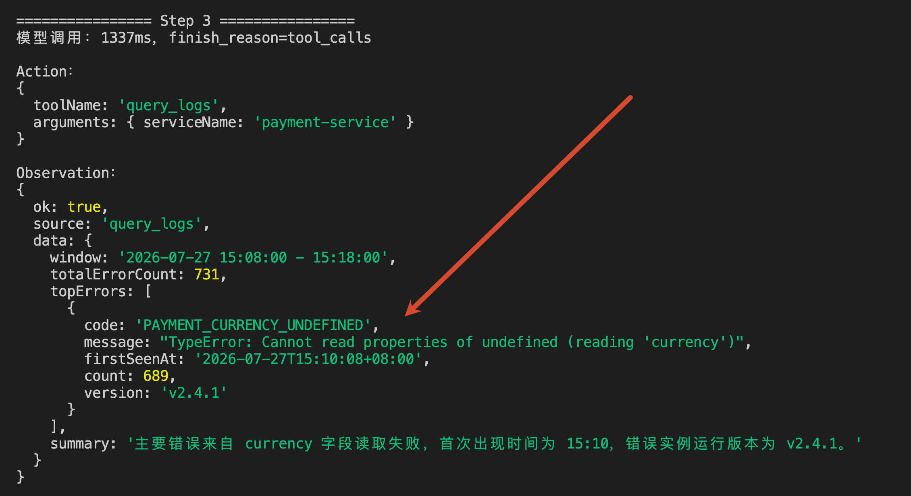


这里同时出现了代码异常和明确的服务版本。

所以，Agent 下一步选择的是：`get_recent_deployments`

发布记录又返回：

```latex
v2.4.1 在 15:09:42 完成发布
这次发布重构了支付请求中的币种归一化逻辑
```

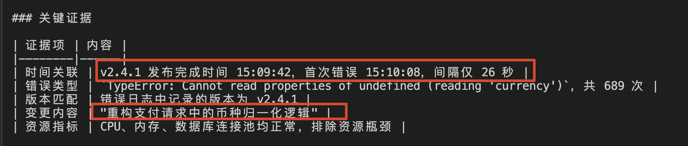


异常在发布完成二十秒左右开始出现，日志报错位置又和本次变更直接相关。

到这里，Agent 才生成最终结论：最可能是 `v2.4.1` 引入了币种字段处理问题，并建议先回滚到稳定版本。

注意，它只能“建议回滚”。

当前项目没有向模型提供回滚工具，所以模型不能声称自己已经完成回滚。

## 实验二：只替换故障数据
接下来，把本地数据切换成数据库连接池场景：

```bash
npm run demo:database
```

还是先看完整的返回：

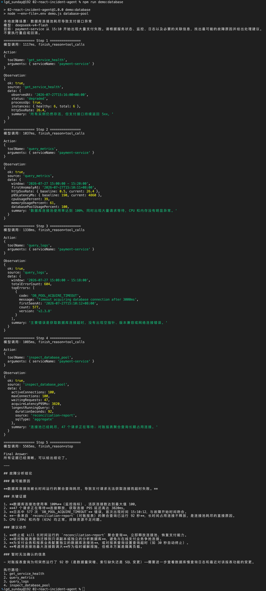


前几步仍然会检查服务、指标和日志。

但是，这次监控返回的是：

```latex
数据库连接池使用率：100%
P95 延迟：4860ms
CPU：39%
内存：61%
```

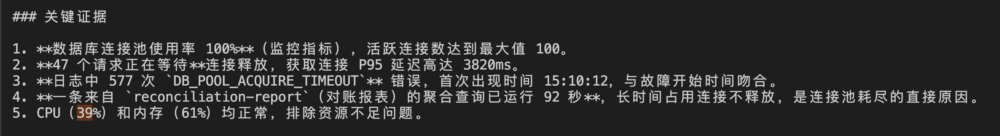

日志中出现的主要错误也变成了：

```latex
DB_POOL_ACQUIRE_TIMEOUT
Timeout acquiring database connection after 3000ms
```

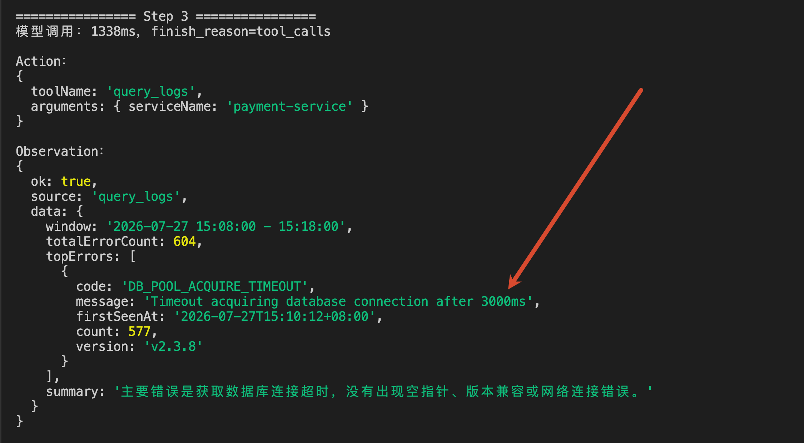


这次没有代码版本错误，因此，Agent 不再查询发布记录，而是选择：

```latex
Action：inspect_database_pool
```

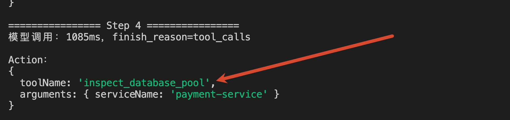


得到的 Observation 是：

```latex
活跃连接：100
最大连接：100
等待请求：47
最长查询：92 秒
查询来源：reconciliation-report
```

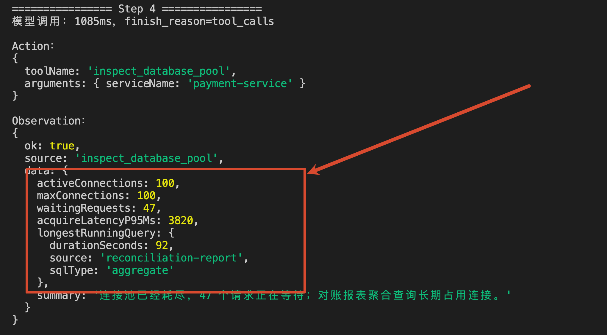


最终执行路径变成：

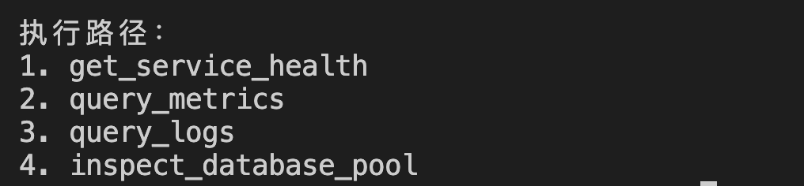


同一个目标、同一个模型、同一套工具，因为 Observation 不一样，第四步选择了不同的 Action。

这就是咱们要观察的结果。

## 总结
细心的同学可能会发现。

系统指令要求 Agent 在生成结论以前，至少要：检查服务状态、监控指标和错误日志。

那大家可能会说：这是不是把流程写死了？

这里确实给了一部分限制。

但是，这不是问题。

真实项目里的 Agent 一般都不是“完全自由”的。应用程序应该把必须遵守的业务流程和安全边界告诉模型，再把无法提前确定的部分交给模型判断。

当前案例中：服务、指标、日志是故障排查的基础证据

所以，Agent 在得出结论以前必须检查。

但是，拿到这些基础证据以后，究竟应该查询发布记录还是数据库连接池，无法在任务开始前确定。

这部分才交给模型根据 Observation 动态决定。 

这一节大家最需要记住的，是下面这条执行关系：

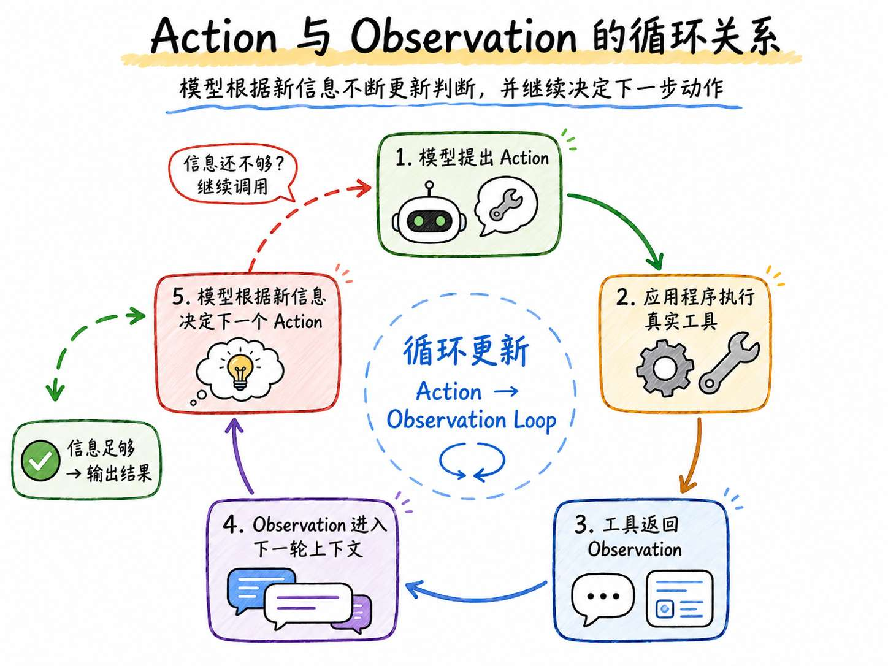


`ReAct` 不是框架，它是一种把判断和行动交替进行的 Agent 执行方式。

Tool Calling 负责表示和执行一次工具调用，ReAct 则利用多次 Action 与 Observation 持续推进任务。

> 更新：2026-07-28 12:17 · 原文：<https://www.yuque.com/lgdsunday/ab1dy3/cowh42rune5vkwza>
