# 03 - 从 ReAct 到 Plan-and-Execute：结构化 Plan State、依赖调度、Completion Criteria 与增量 Replanning

上一节，咱们实现了一个最小 ReAct Agent。

它会执行一个 Action，读取工具返回的 Observation，再根据这份结果决定下一个 Action。

任务结束以后，程序还会打印完整的 `trajectory`，就是这玩意

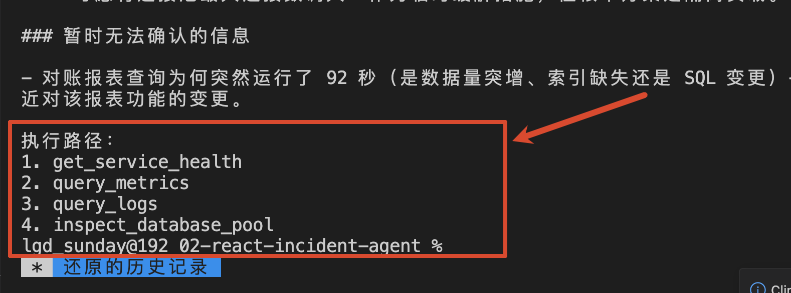


通过这份执行轨迹，咱们可以知道 Agent 已经调用过哪些工具。

但是，我现在问大家一个问题：

> 只看这份 trajectory，你知道 Agent 还有多少事情 **没做吗？**
>

不知道。

因为 `trajectory` 记录的是已经发生的事情。

对于上一节只有四次工具调用的案例，这个问题还不明显。

如果 Agent 需要连续运行几十分钟，中间涉及多个数据源和前后依赖，问题就会出来了。

如果我们想要在前端展示：当前执行到第几步了，任务中断以后还想继续执行 ，那么就不行了。

所以，这一节咱们就要解决这个问题，来做一个 可以被应用程序读取、检查和修改的： **任务计划**，即：`Plan`

## 思考一个问题：任务计划会变吗？
咱们先思考一个问题，那就是：**Agent 最先定义好的步骤，是不是可以一直按原样执行下去？**

还是上一节的故障任务：

> payment-service 从 15:10 开始出现大量支付失败。
>
> 告警中出现过 DB_POOL_ACQUIRE_TIMEOUT。
>
> 请找出最可能的故障原因。
>

`DB_POOL_ACQUIRE_TIMEOUT` 表示某次请求等待数据库连接时发生了超时。

所以，Agent 一开始会怀疑数据库连接池有问题，并安排两个步骤：

1. 先查询监控指标
2. 如果监控也指向数据库，再检查数据库连接池

这就是第一版 **任务计划（Plan）**。

但是要注意，这里的第二步不是马上执行的。

Agent 要先执行第一步，看看真实监控是否支持“数据库连接池异常”这个判断。

假设，现在监控工具返回：

+ 支付接口 5xx 错误率：31.8%
+ 数据库连接池使用率：46%

那就说明，支付接口确实出故障了。

但是，数据库连接池只使用了 `46%`，并没有耗尽。

这意味着最开始的数据库判断不成立，原计划里的第二步也就没有继续执行的必要了。

所以，计划需要改成：

> 查询监控指标           →       已完成  
>
> **检查数据库连接池    →       取消**
>
> 查询错误日志           →       接下来执行
>

这里就是第一次 **计划变化。**

没有意义的数据库检查被取消，然后增加一个更符合当前情况的新步骤：查询错误日志。

日志工具继续返回：

```latex
主要错误：PAYMENT_CURRENCY_UNDEFINED
错误版本：v2.4.1
```

现在，Agent 知道支付失败和 `v2.4.1` 中的 `currency` 字段错误有关。

但是，只看日志还不能确定这个错误是不是新版本发布引起的。

所以，任务计划再增加一步：

> 查询监控指标             →        已完成  
检查数据库连接池      →        已取消  
查询错误日志             →        已完成  
**查询最近发布记录      →        接下来执行**
>

发布记录最终是：

```latex
v2.4.1 在故障出现前 24 秒完成发布

本次发布修改了币种归一化逻辑
```

到这里，Agent 才有足够的信息生成故障结论。

那么，回顾整个过程，其实咱们可以发现：任务计划是一直在变的。

这就是这一节最先要理解的事情：

> **任务计划不是提前写死的执行流程。Agent 每得到一份新的工具结果，都可能需要取消原来的步骤，或者增加新的步骤。**
>


## 把刚才的过程换成 Agent 术语
看完上面的过程之后，再看专业概念就容易多了。

这里涉及到的东西还挺多的，我总结了一下有 3 个 Agent 概念：

+ `Task Planning`：把复杂目标变成可执行计划
+ ``Plan-and-Execute` ：生成计划 + 可执行步骤
+ `Replanning`：重新规划
+ `Plan State`：计划相关状态

咱们一个个来看

### Task Planning：把复杂目标变成可执行计划
`Task Planning` 也就是任务规划。

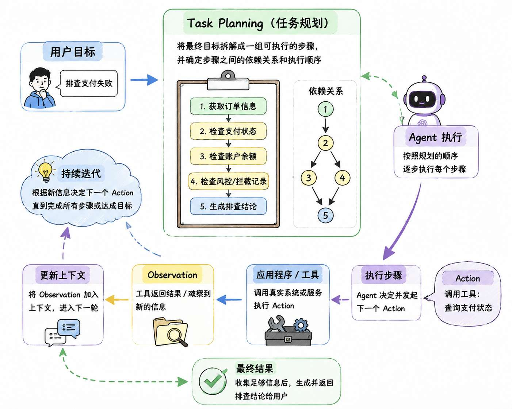


它要解决的问题是：**用户只给了一个最终目标，Agent 应该按照什么顺序完成这个目标？**

> 比如 “排查支付失败” 只是一个目标
>
> Agent 需要先把这个目标拆成一组可以执行的步骤，并确定步骤之间的依赖关系。这部分能力就是 `Task Planning`。
>

### Plan-and-Execute：生成计划 + 可执行步骤
有了任务计划以后，接下来就要真正执行了。

一种常见的做法，是把规划和执行交给两个不同的角色：

+ 第一个角色：Planner -> 生成任务计划
+ 第二个角色：Executor -> 找到当前可执行步骤

这种结构通常叫作 `Plan-and-Execute`。

之前 [在 LangChain 发表的文章](https://www.langchain.com/blog/planning-agents) 中也提到过这个概念：

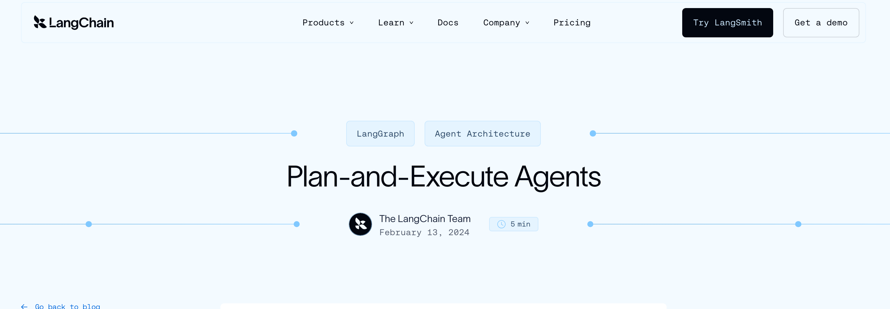


即：先生成计划、再按照计划完成子任务的思路。LangGraph 官方仓库也提供过一个 [Plan-and-Execute 示例](https://github.com/langchain-ai/langgraphjs/blob/main/examples/plan-and-execute/plan-and-execute.ipynb)。

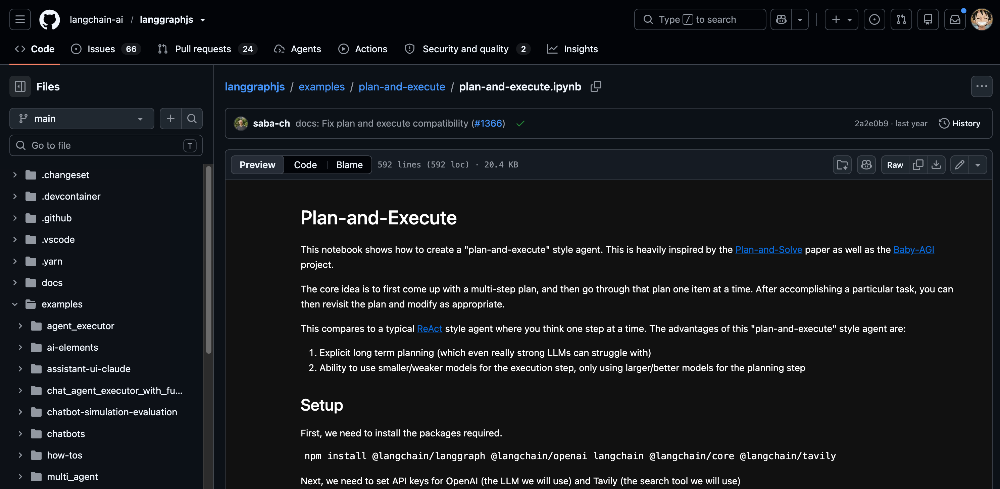


### Replanning：重新规划
初始计划只能根据任务开始时掌握的信息生成。

但是，工具返回的结果可能会推翻原来的判断。

刚才的案例就是这样。

Agent 最开始准备检查数据库连接池，但是监控结果显示连接池使用率只有 `46%`，原来的排查方向已经没有继续执行的必要。

这时，Agent 就要根据新的 Observation 调整后续计划。

这个过程叫作 `Replanning`，也就是重新规划。


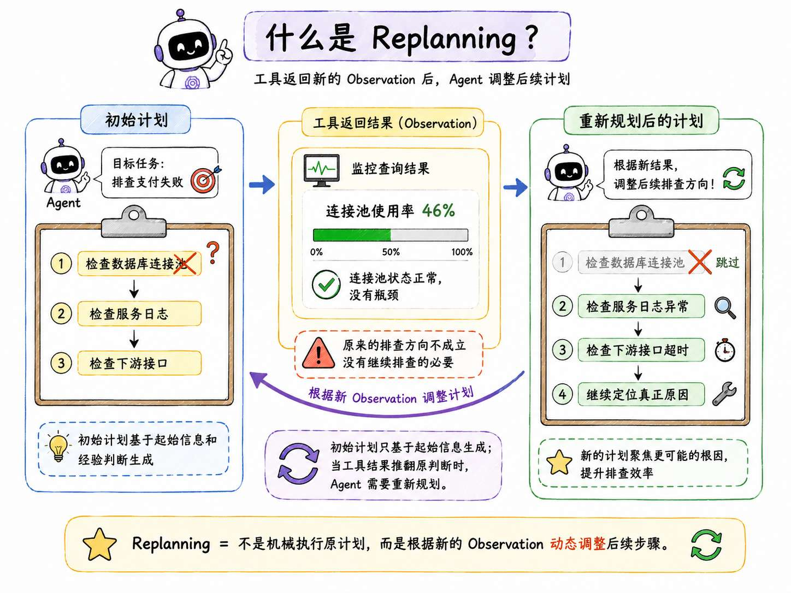


需要注意的是，重新规划不代表把之前做过的事情全部清空。

已经执行完成的步骤和 Observation 仍然保留。Agent 只需要取消已经没有意义的步骤，再补充当前真正需要的新步骤。

所以，刚才的计划才会不断发生变化

### Plan State：计划相关状态
Planner 返回的计划不能只放在一段自然语言里。

否则，应用程序很难准确知道哪个步骤已经完成、哪个步骤被取消，以及下一步到底应该执行什么。

因此，当前项目会把任务目标、完成条件、计划版本、步骤状态和 Observation 保存成一份结构化数据。

咱们把这份数据叫作 `Plan State` ，比如下面这样：

```json
{
    "goal": "排查 payment-service 支付失败",
    "version": 2,
    "status": "active",
    "completionCriteria": [
        "确认故障现象和异常时间",
        "找到直接故障表现",
        "使用独立数据验证故障原因"
    ],
    "steps": [
        {
            "id": "step-1",
            "toolName": "query_metrics",
            "dependsOn": [],
            "status": "completed",
            "observation": "数据库连接池使用率 46%"
        },
        {
            "id": "step-2",
            "toolName": "inspect_database_pool",
            "dependsOn": ["step-1"],
            "status": "cancelled",
            "observation": null
        }
    ]
}
```

## 实现任务规划 Agent
> 课程源码：`https://github.com/lgd8981289/Agent--Code`
>
> 本小节完整代码位于：`Code/Node/第四章/03-plan-replan-agent`
>

概念已经说清楚以后，接下来咱们来看代码。

进入第四章代码目录，别忘了安装 zod：

```bash
mkdir 03-plan-replan-agent
cd 03-plan-replan-agent
npm init -y
npm install zod
```

在根目录创建 `.env`：

```plain
DEEPSEEK_API_KEY=你的_DeepSeek_API_Key
DEEPSEEK_MODEL=deepseek-v4-flash
```

这个项目里面的文件有点多，但是整体难度并不大：

```latex
demo.js               任务入口和完成条件
planner.js            Planner 与 Replanner
plan-schema.js        校验模型返回的计划结构
plan-state.js         保存并更新 Plan State
plan-agent.js         调度完整执行循环
incident-tools.js     故障排查工具
incident-data.js      本地模拟数据
deepseek-client.js    DeepSeek 模型调用
```

然后咱们一点点来看：

### 第一步：先确定任务完成条件
打开 `demo.js`。

在这里咱们定义了 任务目标 和 完成条件

```javascript
/**
 * 任务目标
 */
const goal =
    '排查 payment-service 从 15:10 开始出现的大量支付失败，找出最可能原因并给出处理建议。不要执行重启或回滚。'

/**
 * 完成条件
 */
const completionCriteria = [
    '通过监控数据确认故障现象和异常时间',
    '通过错误日志找到直接故障表现',
    '使用另一份独立系统数据验证最可能的故障原因'
]
```

然后定义了一个 `main` 函数，作为启动整个项目的核心函数

```javascript
/**
 * 启动故障排查 Agent。
 *
 * runPlanAgent 会完成以下工作：
 * 1. 根据 goal 和 completionCriteria 生成初始排查计划；
 * 2. 从 toolCatalog 中选择合适的工具；
 * 3. 通过 executeTool 执行工具；
 * 4. 根据工具返回的 Observation 调整后续计划；
 * 5. 满足完成标准后，输出故障原因和处理建议。
 */
async function main() {
    await runPlanAgent({
        // Agent 最终需要完成的任务。
        goal,

        // 当前事故的告警上下文，为 Agent 提供初始故障信息。
        alertContext: incident.alertContext,

        // 判断任务是否完成的验收条件。
        completionCriteria,

        // Agent 可以发现和选择的工具定义。
        toolCatalog,

        // 工具的统一执行入口。
        executeTool
    })
}
```

`main()` 函数中会触发 `runPlanAgent` ，作为整个逻辑的开始

### 第二步：Planner 生成初始计划
进入 `runPlanAgent` 函数，这个函数中首先会触发 `createInitialPlan` 函数

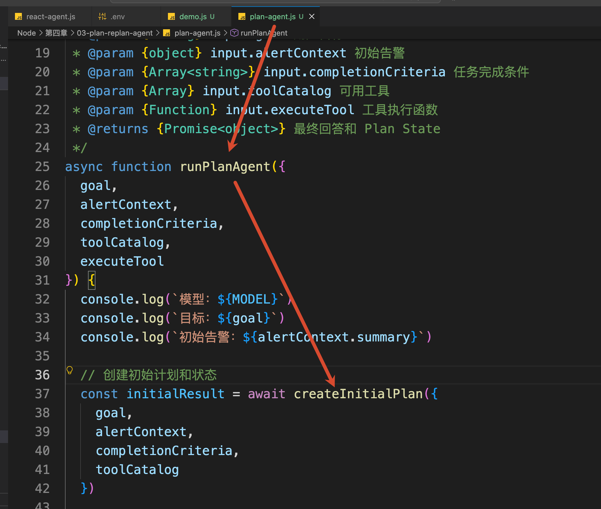


打开 planner.js ，咱们来看 `createInitialPlan` 。

这个函数会收到 4 个参数：

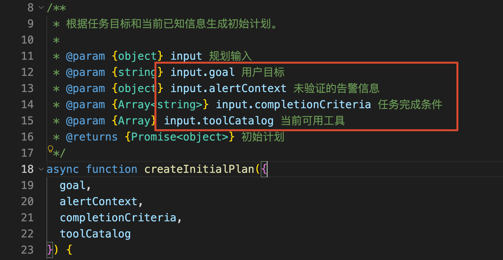


然后，通过 DeepSeek JSON Output 返回结构化计划：

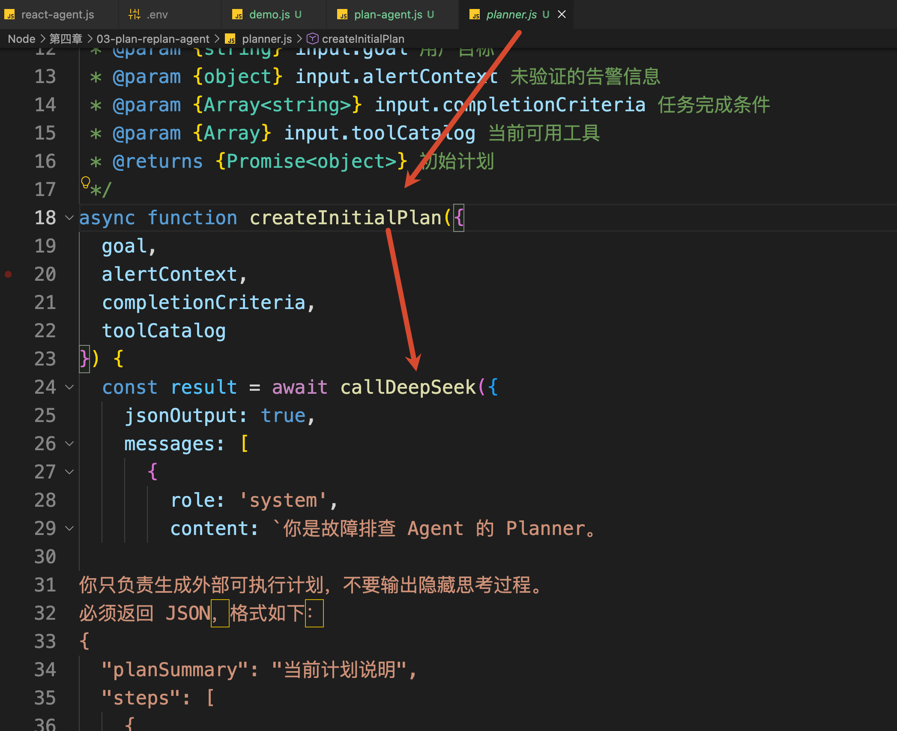


DeepSeek 的请求中使用了：

```javascript
response_format: {
    type: 'json_object'
}
```

它可以让模型返回合法 JSON，官方文档地址 [在这里](`https://api-docs.deepseek.com/guides/json_mode`)

**但是**

合法 JSON 不代表它就是一份合法计划。

模型仍然可能返回不存在的工具、重复步骤或者错误依赖。

所以，`plan-schema.js` 会继续使用 Zod 检查字段：

```javascript
const planStepSchema = z.object({
    id: z.string().regex(/^step-\d+$/),
    title: z.string().min(1),
    toolName: z.string().min(1),
    arguments: z.object({
        serviceName: z.string().min(1)
    }),
    dependsOn: z.array(z.string()).default([])
})
```

`plan-state.js` 还会检查工具是否真实存在、步骤 ID 是否重复，以及依赖的步骤能不能找到。

### 第三步：把计划保存成 Plan State
`createInitialPlan` 执行完成以后，咱们继续回到 `runPlanAgent`。

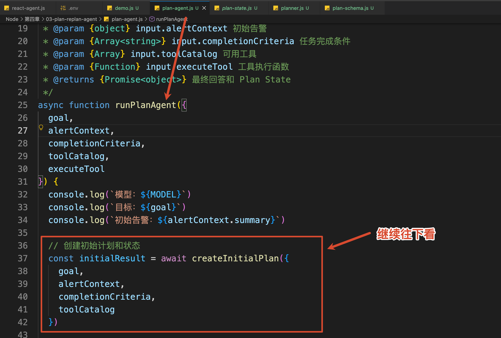


此时，`initialResult.plan` 里面已经有了模型生成并且通过校验的初始计划。

接下来执行的是：

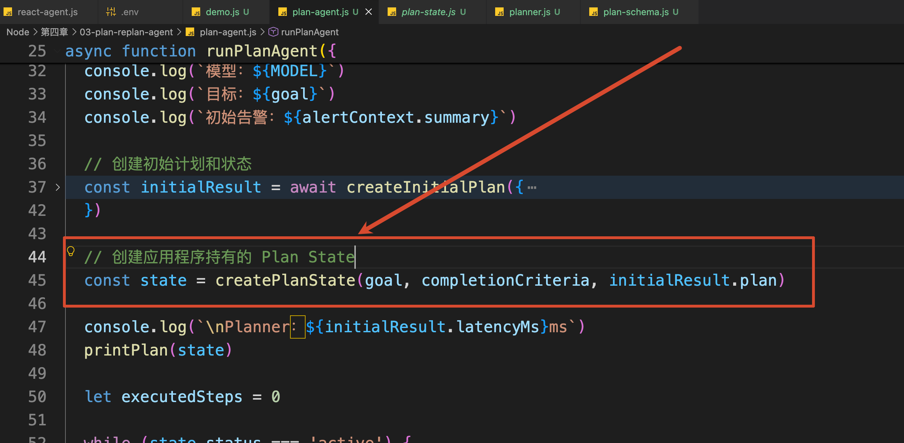


这里为什么不直接拿着 `initialResult.plan` 往下执行呢？

因为 Planner 返回的内容只描述了“准备执行哪些步骤”，里面还没有步骤的执行状态，也没有地方保存后面拿到的 Observation。

所以，程序会把初始计划交给 `createPlanState`，转换成应用程序真正管理的 `Plan State`。

打开 `plan-state.js`，找到 `createPlanState`：

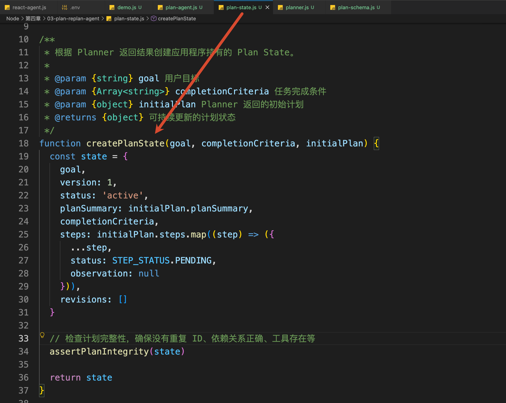


这里的 `state` 主要补充了几类运行时数据

后续运行过程中，步骤状态会在下面四种值之间变化：

+ pending    等待执行
+ running    正在执行
+ completed  执行完成，并且已经保存 Observation
+ cancelled  计划发生变化，这一步不再执行

`createPlanState` 最后还会调用 `assertPlanIntegrity`，检查计划中的工具和依赖关系是否真实存在。

检查通过以后，Plan State 会返回给 `runPlanAgent`，再通过 `printPlan(state)` 打印出第一版计划：

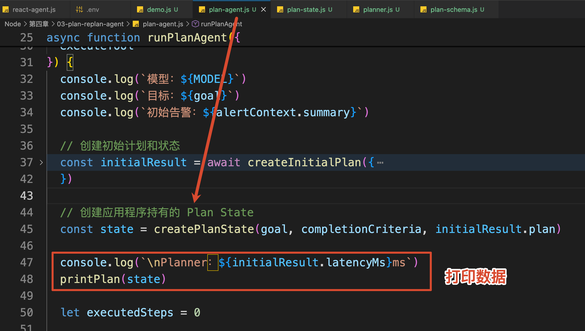


打印内容如下：

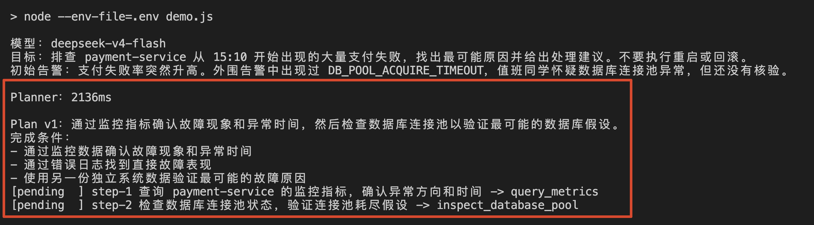


到这里，模型生成的自然语言计划，才真正变成应用程序可以控制的任务状态。

### 第四步：从 Plan State 中取出下一步并执行
继续沿着 `runPlanAgent` 往下走，代码到这里

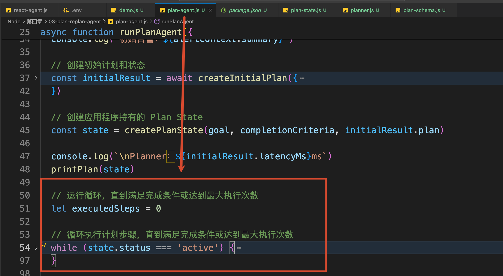


只要 Plan State 仍然是 `active`，程序就会不断执行这个循环。

循环里面首先要解决的问题是：**当前应该执行哪一步？**

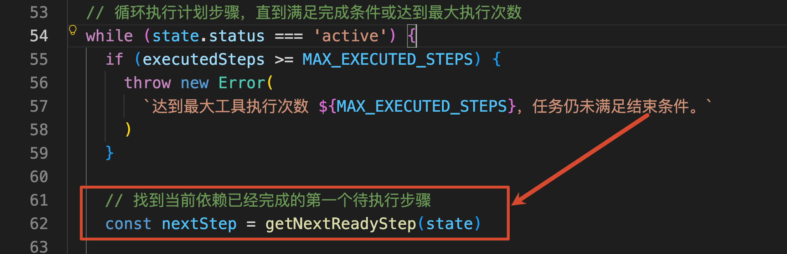


`getNextReadyStep` 会从 Plan State 中查找第一个满足下面两个条件的步骤：

+ 步骤状态必须是 pending
+ 它依赖的步骤必须全部 completed

> 例如，`step-2` 依赖 `step-1`。
>
> 那么在 `step-1` 完成之前，程序不会提前执行 `step-2`。
>

找到 `nextStep` 以后，程序会把它标记成 `running`，再调用 `main` 传进来的 `executeTool`：

```javascript
// 把计划步骤标记为执行中
startStep(state, nextStep.id)

// 执行工具，获取 Observation
const observation = await executeTool(
    nextStep.toolName,
    nextStep.arguments
)

// 把计划步骤标记为已完成，并记录 Observation
completeStep(state, nextStep.id, observation)
```

这里可以看到，Planner 并没有直接执行工具。

它只是提前把 `toolName` 和 `arguments` 写进计划。真正执行的时候，`executeTool` 才会根据工具名称找到对应函数，并获得工具结果。

工具执行完成以后，`completeStep` 会做两件事：

+ 把当前步骤从 running 修改成 completed
+ 把工具返回值保存到当前步骤的 observation

所以，此时 Plan State 中的 `step-1` 会从：

```latex
[pending] step-1 查询监控指标
```

变成：

```latex
[completed] step-1 查询监控指标
Observation：数据库连接池使用率 46%
```

到这里，本轮工具执行已经结束。

### 第五步：根据 Observation 调整后续计划
继续看 `runPlanAgent` 中 `completeStep` 后面的代码：

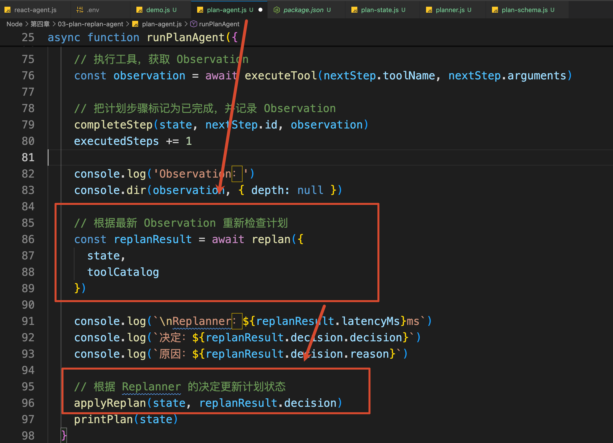


程序会把包含最新 Observation 的 Plan State 交给 `replan`。

打开 `planner.js`，这里会再次调用 DeepSeek。

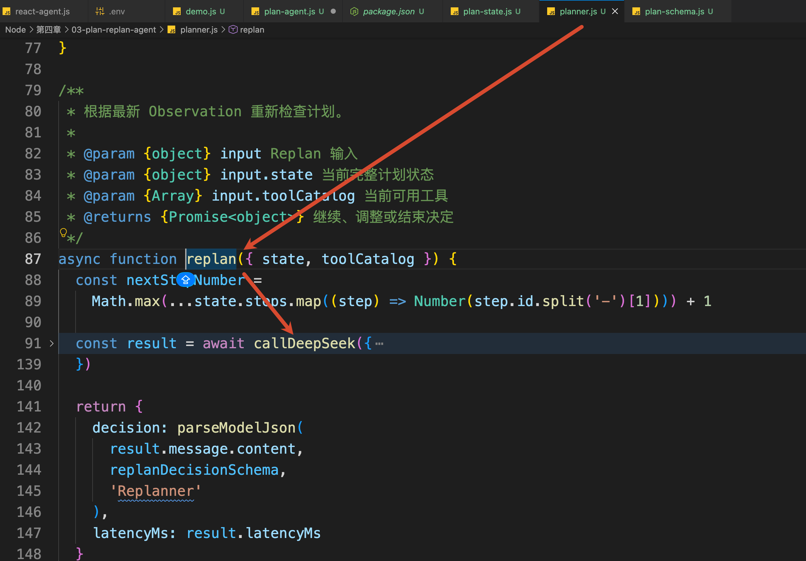


不过，这次模型的身份不再是生成初始计划的 Planner，而是检查当前计划的 Replanner。

然后，它只返回“后续计划应该怎样变化”，不需要重新生成整份计划。

比如，监控结果显示数据库连接池使用率只有 `46%`，Replanner 就可以返回：

```json
{
    "decision": "continue",
    "reason": "数据库连接池正常，原假设已经被推翻。",
    "planSummary": "转向日志查询，定位直接错误。",
    "cancelStepIds": ["step-2"],
    "newSteps": [
        {
            "id": "step-3",
            "title": "查询错误日志",
            "toolName": "query_logs",
            "arguments": {
                "serviceName": "payment-service"
            },
            "dependsOn": ["step-1"]
        }
    ]
}
```

`replan` 返回以后，调用链又回到 `runPlanAgent`。

接下来，`applyReplan` 会把这份修改合并进当前 Plan State：

```javascript
// 根据 Replanner 的决定更新计划状态
applyReplan(state, replanResult.decision)
```

到这里整个 `while` 循环才算结束，整个逻辑有点复杂，大家最好是结合源码来看

### 第六步：使用已完成步骤生成最终结论
`while` 循环结束以后，调用链仍然没有结束。

继续看 `runPlanAgent` 后面的代码：

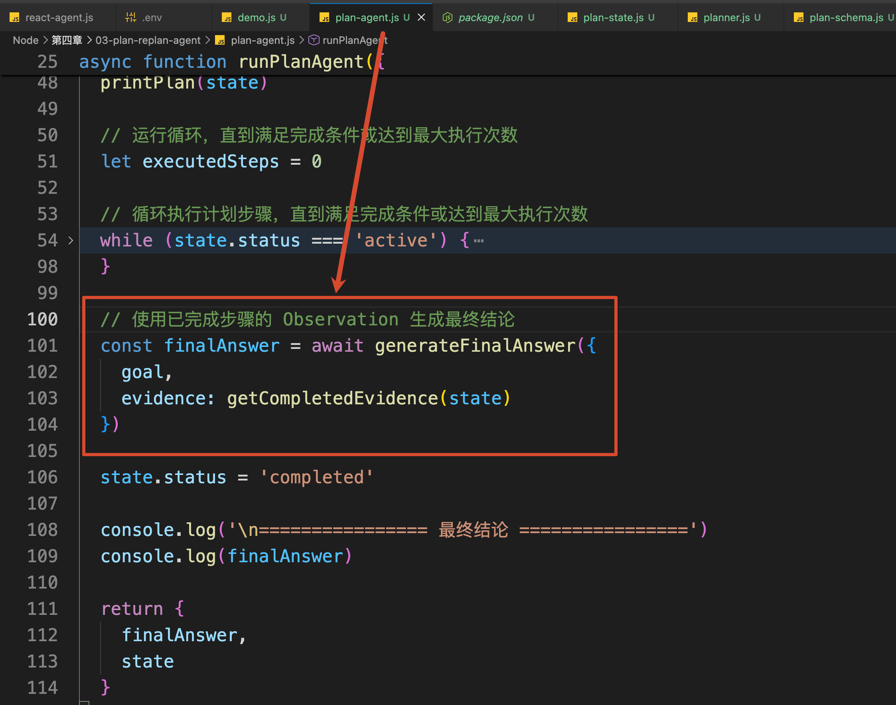


`getCompletedEvidence` 会从 Plan State 中筛选出所有 `completed` 步骤：

```javascript
function getCompletedEvidence(state) {
    return state.steps
        .filter((step) => step.status === 'completed')
        .map((step) => ({
            id: step.id,
            title: step.title,
            toolName: step.toolName,
            observation: step.observation
        }))
}
```

这里不会读取被取消的 `cancelled` 步骤。

因为一个步骤被取消，只能证明“程序没有继续执行它”，不能把它当成已经验证过的事实。

最后，`generateFinalAnswer` 会把用户目标和已完成步骤形成的证据交给 DeepSeek，生成最终的故障结论。

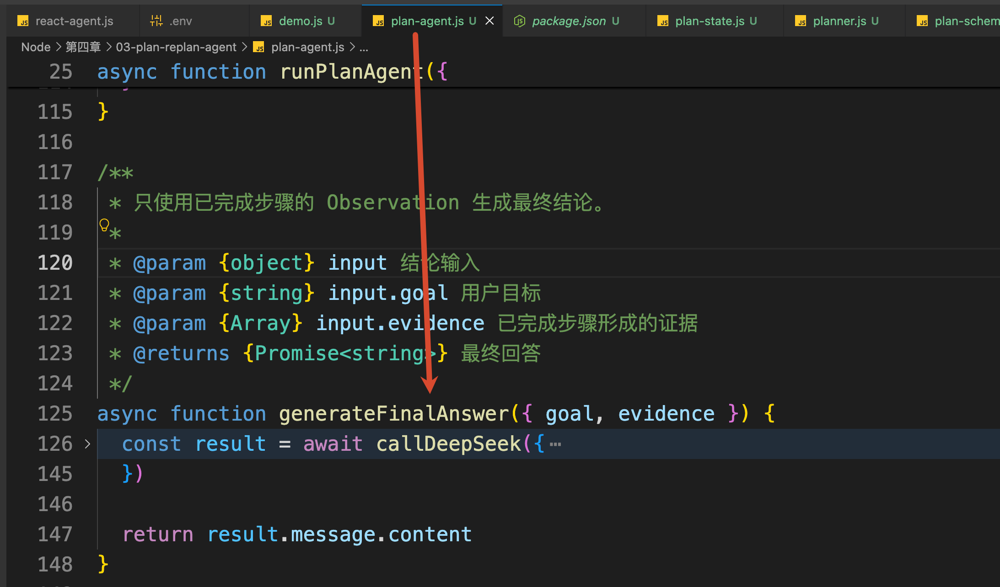


所以，从 `main()` 开始，整个项目真正走过的调用链就是下面这样的：

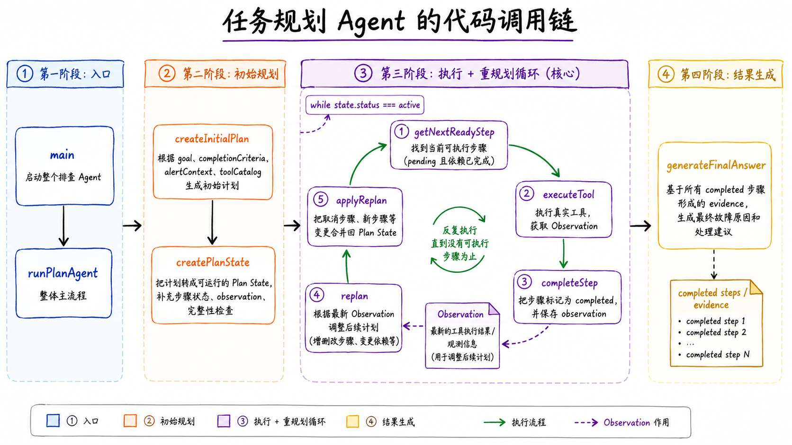


接下来，咱们运行一次项目，看看这条调用链怎样把 `Plan v1` 一步步变成最终计划。

## 运行案例，观察 Plan v1 到 v4
执行：

```bash
npm run demo
```

完整的打印结果很长，下面会一步步详细解释，这里先把长图贴上，看不懂可以先不用看，看下面的解释就行：

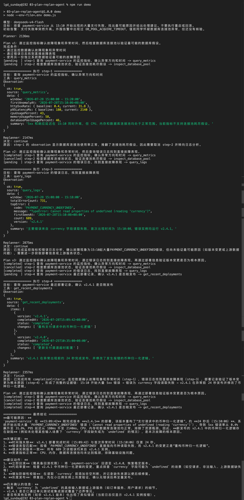


整个打印的部分有点长，咱们一点点看：

---

程序首先打印：

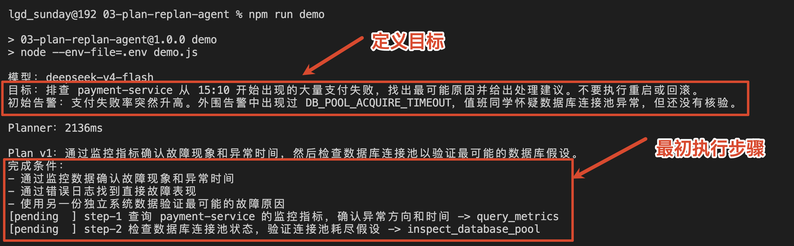


执行 `step-1` 以后，监控数据证明数据库连接池正常。

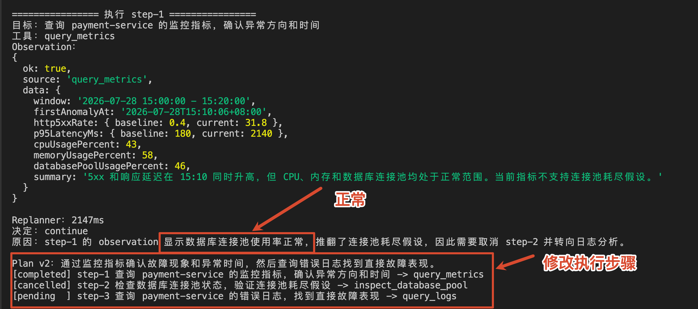


接下来根据新的计划继续执行

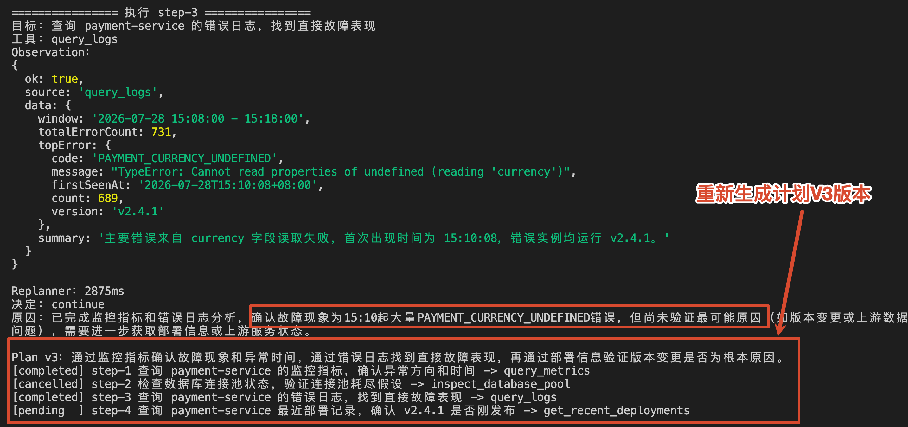


循环往复（后面的 V4 就不说了，最终得到结论和原因）

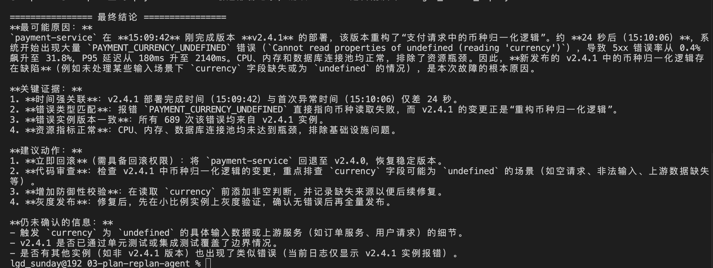


## 总结
问大家一个问题？

> Agent 怎么知道任务还差哪些步骤呢？
>

现在大家应该可以有个基本的回答方案了吧

> **Agent 通过 Plan State 中的步骤状态知道还差什么，通过 Completion Criteria 判断是否真的完成，再通过 Replanning 让后续计划跟着真实结果变化。**
>

那么，任务计划（Plan） 在 Agent 执行过程中会变吗？

答案肯定也是 **会变的**

> 更新：2026-07-29 12:05 · 原文：<https://www.yuque.com/lgdsunday/ab1dy3/vumoemsteoy297pb>
