# 04 - Agent Runtime：运行状态、执行预算与终止条件

上一节，咱们实现了一个可以规划任务的 Agent。

它先生成 `Plan`，再把计划保存成 `Plan State`。每执行完一个步骤，程序都会记录 Observation，再让 Replanner 判断后面的计划要不要调整。

为了防止代码一直循环，上一节还写了一个最大执行次数：

```javascript
const MAX_EXECUTED_STEPS = 6

if (executedSteps >= MAX_EXECUTED_STEPS) {
    throw new Error(
        `达到最大工具执行次数 ${MAX_EXECUTED_STEPS}，任务仍未满足结束条件。`
    )
}
```

这个限制的目的是为了防止 **Agent 一直循环下去**

但是，这样的一个解决方式还是比较糙的。

那比如说：

+ 如果模型连续好几次调用同一个工具咋办呢？
+ 如果工具名称和参数每次都不一样，但是拿回来的始终是同一份资料呢？

还有，模型已经调用了多少次、消耗了多少 Token、整个任务运行了多长时间，这些数据又应该放在哪里？

只靠一个 `MAX_EXECUTED_STEPS = 6` ，肯定是不行的。

所以，这一节咱们需要在 Agent Loop 外面，再增加一层由应用程序控制的运行环境。

这个运行环境就是本节要实现的 `Agent Runtime`。

## Agent Runtime 到底是什么
这一节所说的 Agent Runtime，指的是：

> **负责驱动 Agent Loop、保存整次运行状态、统计资源消耗，并根据确定性规则决定任务是否继续的一层应用程序代码。**
>

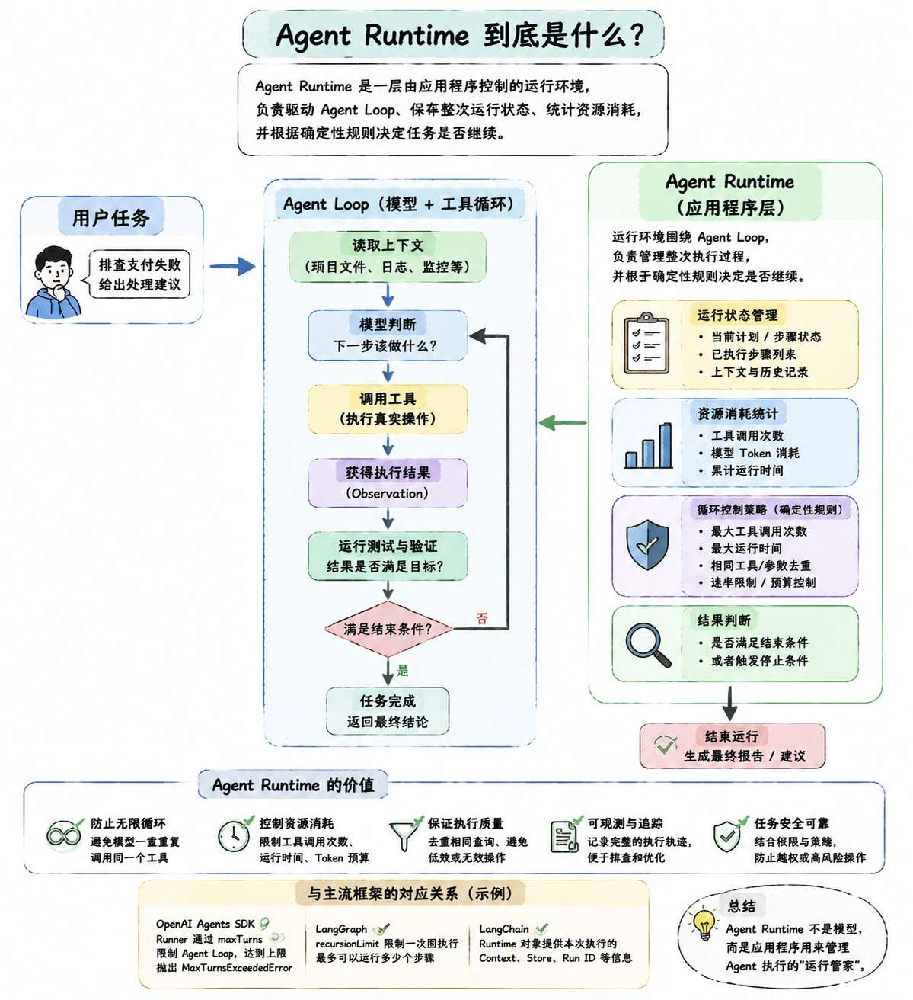


也就是说：模型负责具体的操作，但是当前还剩多少工具调用次数、任务有没有超时、相同查询已经执行过几次，这些都应该由程序判断。

现在主流 Agent 框架里面，也能看到类似设计。

比如说，在 [OpenAI 的 Agents SDK 文档 ](https://openai.github.io/openai-agents-js/zh/guides/running-agents/)里面，提到了 `Runner` 的概念


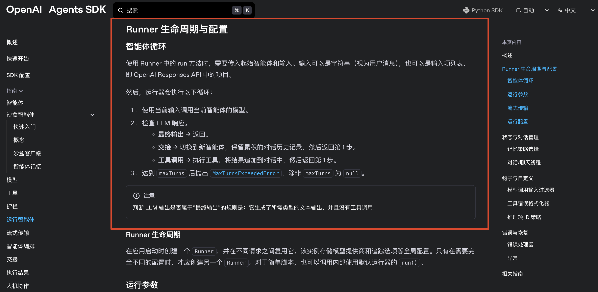


他提到 Runner 会通过 `maxTurns` 限制 Agent Loop。达到最大轮次以后，默认会抛出 `MaxTurnsExceededError`：

LangChain 和 LangGraph 也提供了对应的 `Runtime` 的概念，[点这里直达](https://docs.langchain.com/oss/javascript/langchain/runtime)

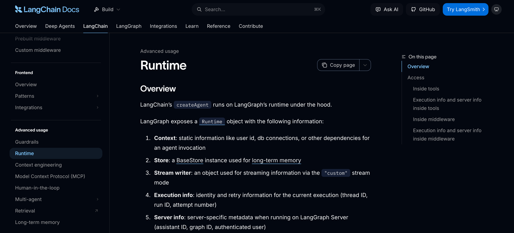


虽然每个框架的实现方式不一样，但是殊途同归嘛，理念是一样的

即：**Agent 不能只靠一个 **`while`** 循环一直跑，应用程序必须管理这次运行。**

## Agent Runtime 到底需要管理什么
对于一次完整的 Agent 任务，Runtime 至少要做好两件事：

+ 第一：保存整次任务的运行状态
+ 第二：限制整次任务可以消耗的资源

### 第一：保存整次任务的运行状态
上一节，咱们讲了 `messages` 和 `Plan State`。

但是，这两份数据都不能完整表示一次 Agent 运行。

`messages` 保存的是模型当前能够看到的上下文。里面可能包含用户问题、模型回答、Tool Call 和 Tool Message。

不过，随着对话越来越长，历史消息可能会被删除、压缩或者替换成摘要。

`Plan State` 保存的是任务计划。

比如哪个步骤已经完成、哪个步骤被取消、后面的步骤依赖什么条件。

但是，Plan State 也不会记录：

+ 模型已经调用了多少次？
+ 工具已经执行了多少次？
+ 当前一共消耗了多少 Token？

这样的数据

所以，Runtime 还需要维护一份范围更大的状态。

这份状态就叫作 `Agent Run State`。

> `Agent Run State **是 Runtime 在一次 Agent 运行期间维护的全局状态，用于统一记录消息上下文、任务计划、执行进度、调用次数、Token 消耗等运行信息。**
>

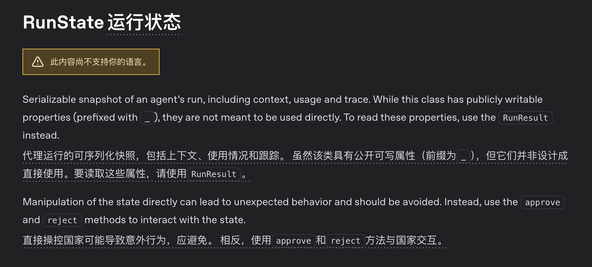


看着挺高级的对吧。

但是，体现在代码里面，其实并不复杂，就是一段 `JSON 格式数据`。

比如，咱们这一节会把 Agent Run State 设计成下面这样：

```javascript
{
    runId: '本次运行的唯一 ID',
    goal: '用户目标',
    status: 'running',
    stopReason: null,
    startedAt: 1785299400000,
    endedAt: null,
    
  // 注意看这里：plan state
    planState: {
        version: 1,
        status: 'active',
        steps: []
    },

    limits: {
        maxSteps: 8,
        maxModelCalls: 8,
        maxToolCalls: 6,
        maxDurationMs: 10000,
        maxTotalTokens: 12000,
        maxSameAction: 2,
        maxNoProgress: 2
    },

    usage: {
        steps: 0,
        modelCalls: 0,
        toolCalls: 0,
        totalTokens: 0
    },

    actions: [],
    trace: []
}
```

 `Plan State`  放进了 Agent Run State 里面，继续负责管理任务计划。

Agent Run State 则在它外面，继续记录模型调用、工具调用、Action、Observation 和停止原因。

现在，Runtime 已经有地方保存运行数据了。

但是，只记录“用了多少”还不够。应用程序还需要规定“最多允许用多少”。

### 第二：限制整次任务可以消耗的资源
第一章讲 Context Window 时，咱们 [实现过 ](https://www.yuque.com/lgdsunday/ab1dy3/gmk3nrat8d1780mt)`[Context Budget](https://www.yuque.com/lgdsunday/ab1dy3/gmk3nrat8d1780mt)`[。](https://www.yuque.com/lgdsunday/ab1dy3/gmk3nrat8d1780mt)

它控制的是 **一次模型调用** 可以携带多少上下文。

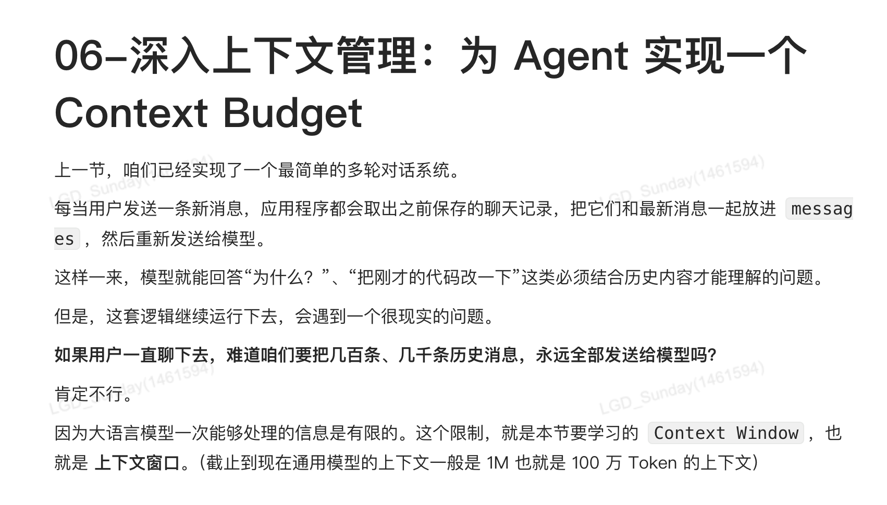


但是，Agent 并不是只调用一次模型。

假设每次模型调用都消耗 3000 Token，并且没有超过 Context Budget。可 Agent 连续调用了 10 次以后，整次任务仍然会消耗 30000 Token。

单次请求没有超出限制，不代表整次任务可以无限执行。

所以，Agent Runtime 还需要一份 `Execution Budget`，也就是整次运行的执行预算：

+ Context Budget：限制一次模型调用携带多少上下文
+ Execution Budget：限制整次 Agent Run 最多可以消耗多少资源

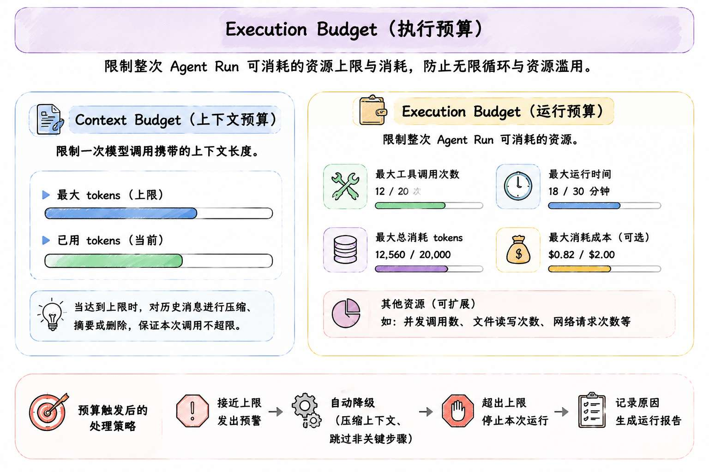


这里所说的资源不只是 Token。

模型调用次数、工具调用次数、执行轮数和运行时间，都应该有明确的上限。

对应到前面的 Agent Run State，就是 `limits` 里的这些字段：

```javascript
{
    maxSteps: 8, // 最多执行 8 个步骤
    maxModelCalls: 8, // 最多调用模型 8 次
    maxToolCalls: 6, // 最多调用工具 6 次
    maxDurationMs: 10000, // 最长运行 10 秒
    maxTotalTokens: 12000 // 最多消耗 12000 个 Token
}
```

运行过程中，Runtime 会持续把实际用量记录到 `usage`。

只要某项用量达到 `limits` 规定的上限，Runtime 就会停止 Agent Loop，并把具体原因写入 `stopReason`。

到这里，Agent Runtime 要做的事情就清楚了：

+ 先      使用 Agent Run State 保存运行数据
+ 然后   使用 Execution Budget 限制资源消耗
+ 最后   根据完成条件和限制条件决定 Agent 是否继续

## 实现一个受 Runtime 控制的 Agent
> 课程源码：`https://github.com/lgd8981289/Agent--Code`
>
> 本小节完整代码位于：`Code/Node/第四章/04-agent-runtime`
>

这一节继续使用前面的 `payment-service` 故障排查场景。

不过，这次咱们 **不会调用 DeepSeek。**

原因是因为：

>  咱们需要稳定复现  **重复调用 + 连续没有进展  + 预算耗尽 ** 的场景。
>
>  真实模型每次生成的 Action 都可能不一样，如果一直等待模型刚好犯错，所有同学看到的运行结果就无法保持一致。
>

所以，案例会把模型调用抽象成一个 `decideNextAction`：

```javascript
const decision = await decideNextAction({ state })
```

这个 `decideNextAction` 最终会走 `createDecisionProvider` 方法，根据传入的参数来生成对应的实验数据

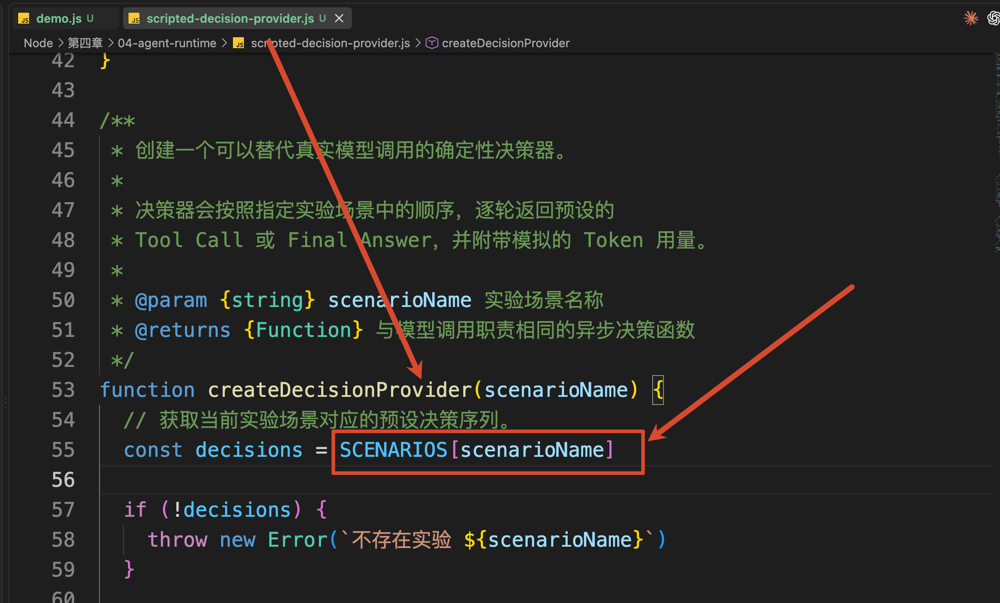


其中 `SCENARIOS` 的数据如下：

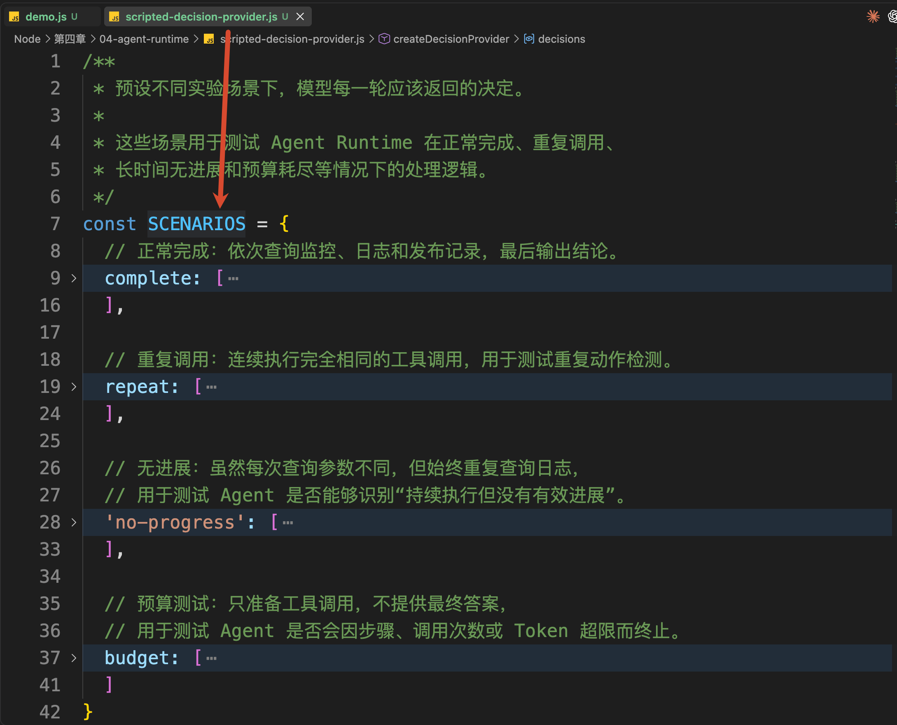


换成真实 Agent 时，只需要让 `decideNextAction` 内部调用 DeepSeek，再返回相同结构即可。Runtime 的代码不用跟着变化。

接下来，咱们就来看代码

进入第四章代码目录，创建项目：

```bash
mkdir 04-agent-runtime
cd 04-agent-runtime
npm init -y
```

代码目录如下：

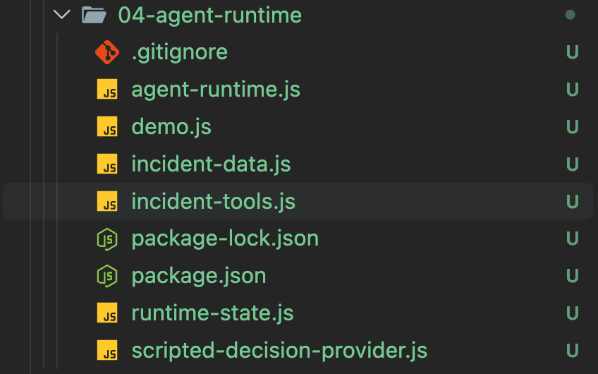


打开 `demo.js`。

这个文件仍然是整个项目的入口。

```javascript
/**
 * 程序入口。
 *
 * 不传入命令行参数时，按照 SCENARIOS 中定义的顺序运行全部实验；
 * 传入实验名称时，只运行指定的实验。
 */
async function main() {
    // 读取第三个命令行参数作为本次需要运行的实验名称。
    // 例如：node index.js complete
    const selectedScenario = process.argv[2]

    // 如果指定了实验名称，就只运行这一组；
    // 否则运行 SCENARIOS 中定义的全部实验。
    const scenarios = selectedScenario ? [selectedScenario] : SCENARIOS

    // 依次执行本次选中的实验。
    for (const scenarioName of scenarios) {
        // 等待当前实验执行完成，再继续运行下一组实验。
        await runScenario(scenarioName)
    }
}
```

不传参数时，代码会依次运行四组实验。

也可以在命令后面指定实验名称，只运行其中一组。

接下来，咱们先沿着 `runScenario` 往下看。

### 创建 Agent Run State
`runScenario` 里面首先调用：

```javascript
// 创建本次实验对应的 Agent Run State。
const state = createRunState({
    // 设置本次 Agent 需要完成的目标。
    goal: GOAL,

    // 创建并写入初始任务计划状态。
    planState: createPlanState(),

    // 为不同实验配置对应的执行预算。
    limits:
        scenarioName === 'budget'
            ? {
                    // budget 场景最多只允许调用两次工具，
                    // 用于验证工具调用预算耗尽后的终止逻辑。
                    maxToolCalls: 2
                }
            : {}
})
```

这里传入了三个东西。

+ `goal` 是本次任务要完成的目标。
+ `planState` 是上一节已经学过的任务计划。
+ `limits` 则是本次运行采用的执行预算。只有预算实验把最大工具调用次数改成了 2，其他实验使用默认值。

打开 `runtime-state.js`，找到 `createRunState`：

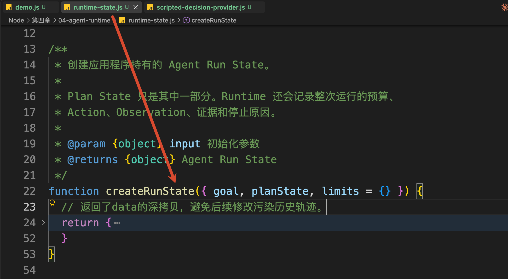


这里 return 的时候涉及到了特别多的数据，不给大家全放到这里了，太多了。大家可以通过源码来看。

这里面有两个比较重要的数据，单独给大家说一下。

+ 第一个是：`runId` ，他是用来区分每一次独立运行。

同一个用户连续提交两次故障排查任务，也应该得到两个不同的 runId。后面记录日志、查询执行轨迹或者恢复中断任务时，都需要先知道操作的是哪一次 Run。

+ 第二个是：`status` 表示整次运行当前处于什么状态。

这个案例只使用三种状态：

+ running：仍然可以继续执行
+ completed：已经满足完成条件并生成结果
+ stopped：因预算、重复 Action、无进展或错误而停止

### Runtime 怎么控制 Agent Loop
状态准备完成以后，`runScenario` 会进入 `runAgent`** 函数**：

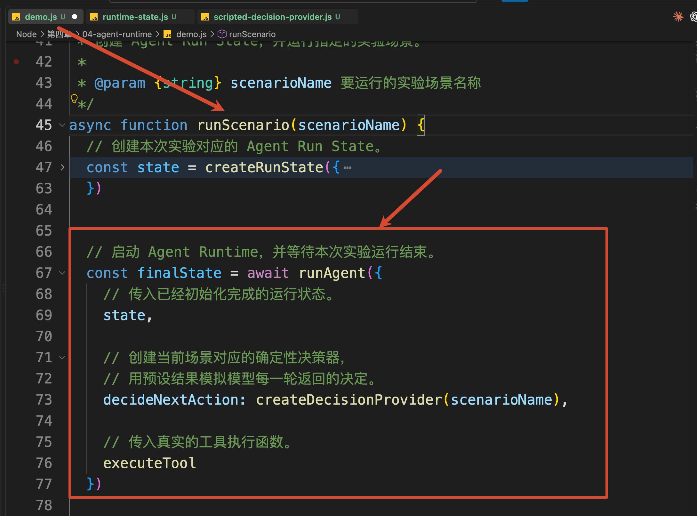


打开 `agent-runtime.js`。

`runAgent` 就是这一节 **最核心** 的 **循环**，代码在 `agent-runtime.js` 里：

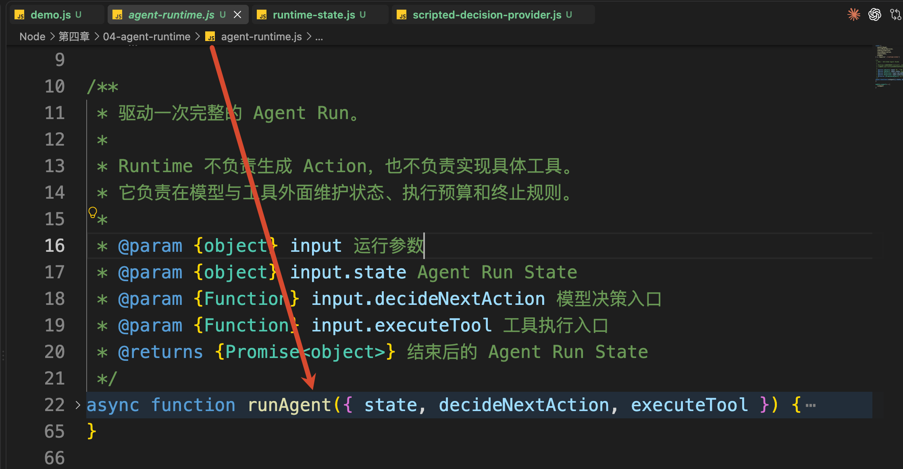


里面的代码有点小多，咱们来看看

```javascript
/**
 * 驱动一次完整的 Agent Run。
 *
 * Runtime 不负责生成 Action，也不负责实现具体工具。
 * 它负责在模型和工具之外维护运行状态、执行预算与终止规则。
 *
 * @param {object} input 运行参数
 * @param {object} input.state Agent Run State
 * @param {Function} input.decideNextAction 模型决策入口
 * @param {Function} input.executeTool 工具执行入口
 * @returns {Promise<object>} 运行结束后的 Agent Run State
 */
async function runAgent({ state, decideNextAction, executeTool }) {
    // 只要运行状态仍然是 running，就继续执行 Agent 循环。
    while (state.status === 'running') {
        // 在调用模型前检查模型调用次数、Token、运行时长等预算。
        // 如果已经达到限制，检查函数会负责终止运行。
        if (!canCallModel(state)) {
            break
        }

        try {
            // 调用模型决策入口，让模型根据当前状态决定下一步：
            // 返回工具调用 Action，或者直接返回最终答案。
            const decision = await decideNextAction({ state })

            // 记录本轮模型调用、Token 消耗、步骤数和决策结果。
            recordModelDecision(state, decision)

            // 记录模型决策时，Runtime 可能因为 Token 超限等原因停止运行。
            if (state.status !== 'running') {
                break
            }

            // 如果模型认为任务已经完成，就保存最终答案并结束运行。
            if (decision.type === 'final') {
                console.log(`\n第 ${state.usage.steps} 轮：模型准备结束任务`)
                completeRun(state, decision.content)
                break
            }

            // 在执行工具前检查工具调用预算、重复动作等终止规则。
            // 如果当前 Action 不允许继续执行，则直接退出循环。
            if (!canExecuteAction(state, decision.action)) {
                break
            }

            // 执行模型选择的工具，并获得工具返回的 Observation。
            const observation = await executeTool(decision.action)

            // 将工具结果写入运行状态，并判断本轮是否获得了新的有效证据。
            const hasNewEvidence = recordObservation(state, observation)
        } catch (error) {
            ....
        }
    }

    // 返回终止后的完整 Agent Run State。
    return state
}
```

这个循环和前面的 Agent Loop 看起来很像。

但是，模型调用和工具调用的前后都增加了 Runtime 检查。

完整顺序变成了：

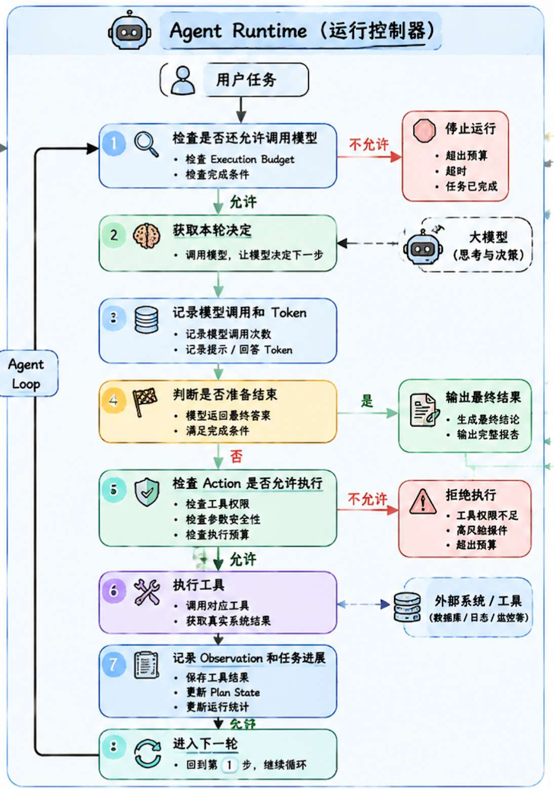


同时，这里有一个很重要的变化。

> 以前是模型返回 Action，程序就执行工具。
>
> 现在模型返回 Action 以后，Runtime 仍然可以拒绝执行。
>

### 模型调用以前先检查预算
每次准备调用模型以前，代码都会执行：

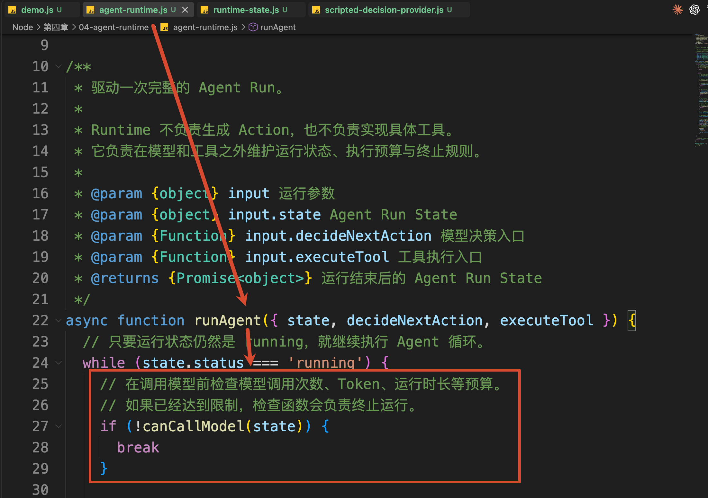


`canCallModel` 会先检查运行时间：

```javascript
// 检查本次 Agent Run 的实际运行时间是否达到最大时长。
if (Date.now() - state.startedAt >= state.limits.maxDurationMs) {
    // 将运行标记为预算耗尽，并记录触发的具体限制。
    stopRun(state, 'budget_exceeded', '达到最长执行时间。', {
        limit: 'maxDurationMs'
    })
    return false
}
```

然后继续检查当前执行轮数、模型调用次数和总 Token：

```javascript
// 整理需要统一检查的计数型预算。
// 每一项分别包含限制名称和当前已经使用的数量。
const checks = [
  ['maxSteps', state.usage.steps],
  ['maxModelCalls', state.usage.modelCalls],
  ['maxTotalTokens', state.usage.totalTokens]
]
```

在当前这个最小案例里，一轮只调用一次模型，所以 `steps` 和 `modelCalls` 通常会一起增加。

>  真实项目不一定这样
>
>  一个步骤中可能先调用 Planner，再调用执行模型，最后再调用 Evaluator。这个时候，执行一步任务就可能产生多次模型调用，因此这两个数字最好分开记录。
>

模型返回以后，`recordModelDecision` 会把本轮 Token 继续累加：

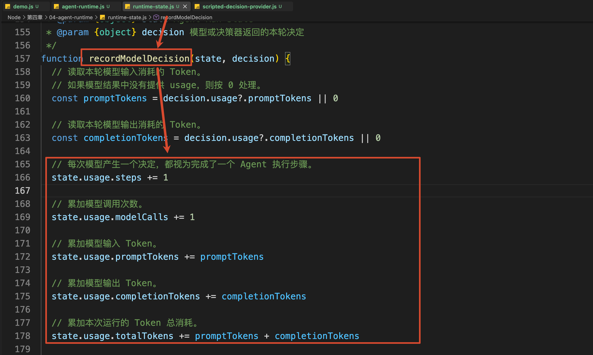


### 模型返回结果以后，Runtime 怎么处理
记录完用量以后，程序会回到 `runAgent` 继续往下执行：

```javascript
// 记录本轮模型调用、Token 消耗、步骤数和决策结果。
recordModelDecision(state, decision)

// 记录模型决策时，Runtime 可能因为 Token 超限等原因停止运行。
if (state.status !== 'running') {
    break
}

// 如果模型认为任务已经完成，就保存最终答案并结束运行。
if (decision.type === 'final') {
    console.log(`\n第 ${state.usage.steps} 轮：模型准备结束任务`)
    completeRun(state, decision.content)
    break
}

// 输出模型本轮准备执行的工具调用。
console.log(`\n第 ${state.usage.steps} 轮 Action：`)
console.dir(decision.action, { depth: null })

// 在执行工具前检查工具调用预算、重复动作等终止规则。
// 如果当前 Action 不允许继续执行，则直接退出循环。
if (!canExecuteAction(state, decision.action)) {
    break
}

// 执行模型选择的工具，并获得工具返回的 Observation。
const observation = await executeTool(decision.action)

// 将工具结果写入运行状态，并判断本轮是否获得了新的有效证据。
const hasNewEvidence = recordObservation(state, observation)
```

第一个 `if` 检查的是本轮模型调用有没有用完预算。

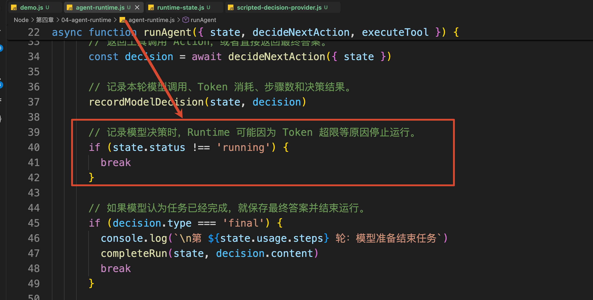


因为 Token 用量要等模型返回以后才能精确得到。如果 `recordModelDecision` 发现总 Token 已经超过限制，它会把 `state.status` 改成 `stopped`，这里也就不会继续执行了。

如果运行状态正常，Runtime 再根据 `decision.type` 处理模型的决定。

这个案例里只有两种可能：

+ final：模型准备结束任务
+ tool_call：模型准备调用工具

#### 第一种：模型准备结束任务
当 `decision.type` 等于 `final` 时，程序会进入：

```javascript
// 如果模型认为任务已经完成，就保存最终答案并结束运行。
if (decision.type === 'final') {
    console.log(`\n第 ${state.usage.steps} 轮：模型准备结束任务`)
    completeRun(state, decision.content)
    break
}
```

这里先调用 `completeRun`。

那么，`completeRun` 检查的 Plan State 是从哪里来的呢？

回到 `demo.js` 的 `runScenario`，创建 Agent Run State 时传入了三个参数，**其中第二个就是  **`planState`**：**

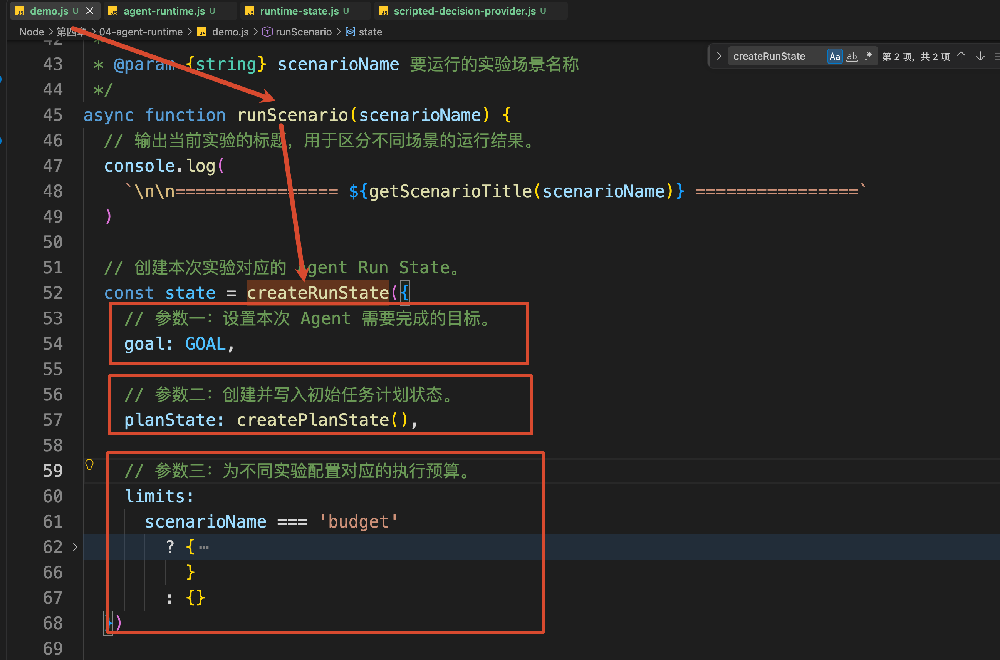


继续找到 `createPlanState`，才能看到这三个步骤的定义：

```javascript
/**
 * 创建一份初始的 Plan State。
 *
 * 该计划把故障排查目标拆分为三个步骤，
 * 每个步骤都要求从指定工具中获得对应证据。
 *
 * @returns {object} 初始化后的 Plan State
 */
function createPlanState() {
    return {
        // 当前计划的版本号，重新规划时可以递增。
        version: 1,

        // 当前计划的整体状态。
        status: 'active',

        // 本次任务需要依次完成的计划步骤。
        steps: [
            {
                // 当前步骤的唯一标识。
                id: 'step-1',

                // 当前步骤需要完成的任务。
                title: '确认故障现象',

                // 完成该步骤所需证据的来源。
                // 只有 query_metrics 返回有效证据后，该步骤才能完成。
                requiredEvidenceSource: 'query_metrics',

                // 当前步骤尚未执行完成。
                status: 'pending'
            },
            {
                // 当前步骤的唯一标识。
                id: 'step-2',

                // 通过日志找到故障的直接错误表现。
                title: '找到直接错误',

                // 该步骤要求从日志查询工具中获得证据。
                requiredEvidenceSource: 'query_logs',

                // 当前步骤尚未执行完成。
                status: 'pending'
            },
            {
                // 当前步骤的唯一标识。
                id: 'step-3',

                // 使用独立系统数据验证最可能的故障原因。
                title: '验证故障原因',

                // 该步骤要求从最近发布记录中获得证据。
                requiredEvidenceSource: 'get_recent_deployments',

                // 当前步骤尚未执行完成。
                status: 'pending'
            }
        ]
    }
}
```

每个步骤刚创建时都是 `pending` 的状态

`requiredEvidenceSource` （steps 中第三个属性）则规定了这个步骤需要哪一类工具证据才能完成。

后面执行工具时，`recordObservation` 会根据 Observation 的 `source` 把对应步骤改成 `completed`。

```javascript
if (hasNewEvidence) {
    markPlanStepCompleted(state.planState, observation.source)
}
```

`markPlanStepCompleted` 会使用 `source` 查找对应的步骤：

```javascript
/**
 * 根据证据来源，将对应的计划步骤标记为已完成。
 *
 * @param {object} planState 当前任务的 Plan State
 * @param {string} evidenceSource 本次获得证据的来源
 */
function markPlanStepCompleted(planState, evidenceSource) {
    // 查找证据来源匹配，并且尚未完成的计划步骤。
    const step = planState.steps.find(
        (item) =>
            item.requiredEvidenceSource === evidenceSource &&
            item.status !== 'completed'
    )

    // 如果找到对应步骤，就将其状态更新为 completed。
    if (step) {
        step.status = 'completed'
    }
}
```

比如，`query_metrics` 返回的 Observation 中，`source` 就是 `query_metrics`。

它会命中 `step-1` 的 `requiredEvidenceSource`，于是 `step-1.status` 从 `pending` 变成 `completed`。

所以，`completeRun` 并不知道什么是“确认故障现象”。

它只会调用 `hasCompletedPlan`，检查 Plan State 里的所有步骤是否都已经完成：

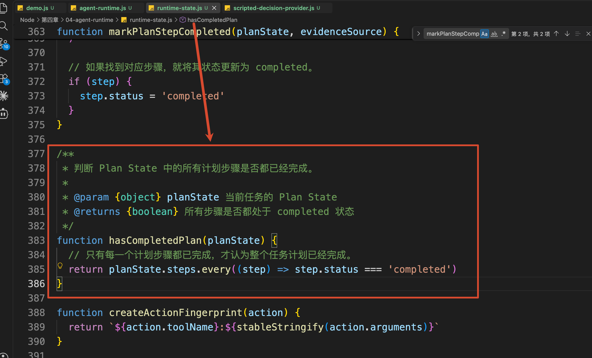


这个方法返回 `true` 以后，`completeRun` 才会接受模型的最终答案：

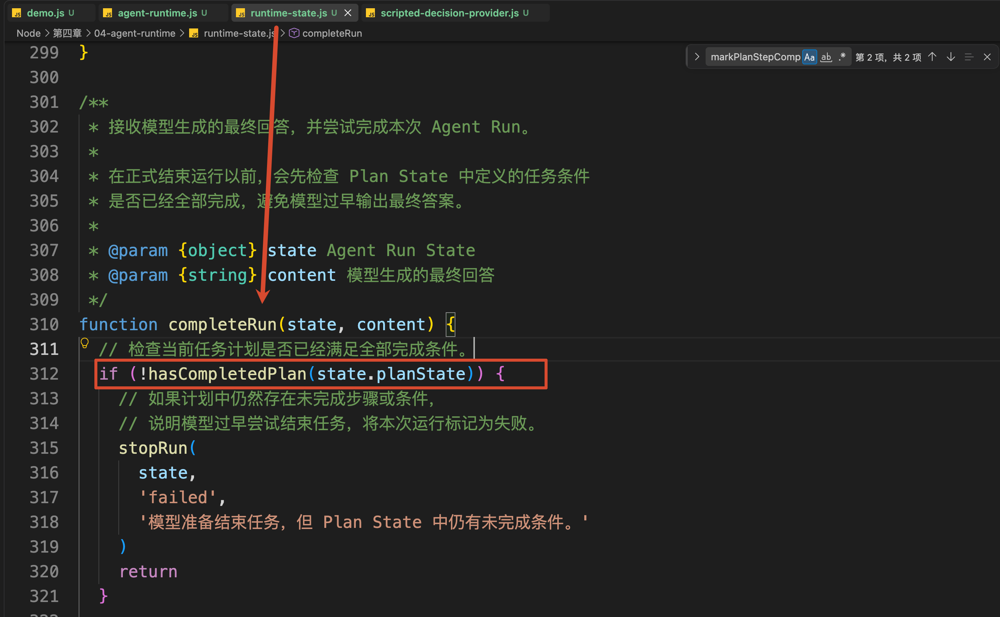


只有 Plan State 中的步骤全部完成，Runtime 才会保存 `finalAnswer`，并把运行状态改成 `completed`。

如果还有步骤没完成，即使模型已经生成了一段最终答案，Runtime 也不会接受。


#### 第二种：模型准备调用工具
回到 `agent-runtime.js 中的` 的 `runAgent` 方法

如果模型返回的是 `tool_call`，程序会继续走到：

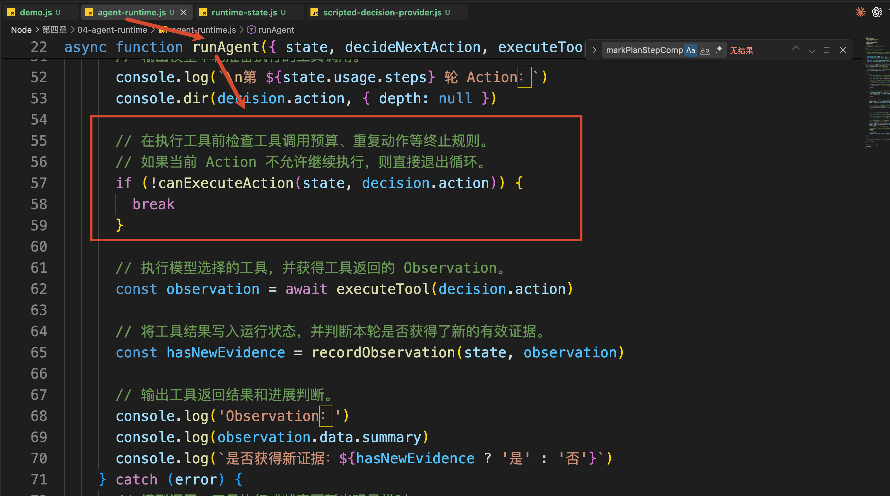


`canExecuteAction` 可以理解为工具执行前的一道检查。

`canExecuteAction` 会先检查本次 Agent Run 是否还有工具调用预算：

```javascript
// 检查当前工具调用次数是否已经达到最大预算。
if (state.usage.toolCalls >= state.limits.maxToolCalls) {
    // 将本次运行标记为预算耗尽，并记录触发的限制项。
    stopRun(state, 'budget_exceeded', '达到最大工具调用次数。', {
        limit: 'maxToolCalls'
    })
    return false
}
```

##### `canExecuteAction` 还会检查重复 Action
工具调用次数没有超出以后，`canExecuteAction` 还会检查当前 Action 是否已经执行过多次。

**这里要注意：** 只比较工具名称是不行的

下面两个 Action 虽然使用相同 Tool，但是参数不同：

```javascript
query_logs({ serviceName: 'payment-service' })
query_logs({ serviceName: 'order-service' })
```

所以，Runtime 会使用工具名称和参数共同生成 `fingerprint`：

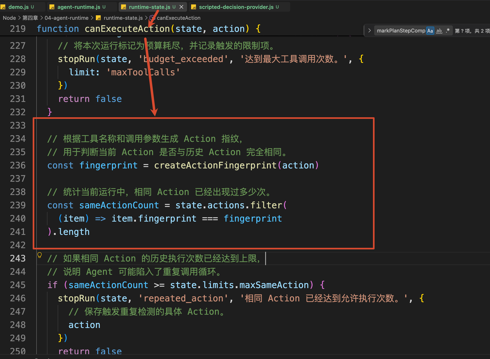


`createActionFingerprint` 的代码如下：

```javascript
/**
 * 为 Action 生成稳定且可比较的唯一指纹。
 *
 * 指纹由工具名称和经过稳定序列化的调用参数组成，
 * 用于判断两次 Action 是否完全相同。
 *
 * @param {object} action 当前 Action
 * @returns {string} Action 对应的指纹
 */
function createActionFingerprint(action) {
    // 将工具名称与参数序列化结果组合起来。
    // stableStringify 可以保证对象属性顺序不同时仍然生成相同字符串。
    return `${action.toolName}:${stableStringify(action.arguments)}`
}
```

`stableStringify` 会先对对象字段排序。

这样，即使模型只是改变了 JSON 字段顺序，程序也不会把同一个 Action 误认为两次不同调用。

当前默认配置为：

```javascript
maxSameAction: 2
```

同一个 Action 已经执行两次以后，第三次会在进入 Tool Handler 以前被拒绝：

```javascript
stopRun(state, 'repeated_action', '相同 Action 已经达到允许执行次数。')
```

这里阻止的是“工具和参数完全相同”的重复调用。

但是，还有一种情况更隐蔽。

那就是：

#### 工具返回 Observation 以后，再判断任务有没有进展
只有工具预算和重复 Action 检查都通过，`canExecuteAction` 才会返回 `true`。

这个时候，`runAgent` 才会真正执行工具：

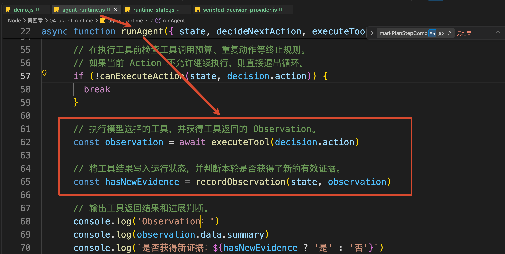


工具返回的 Observation 会交给 `recordObservation`。

这里要判断：**这次工具调用有没有让任务取得新进展。**

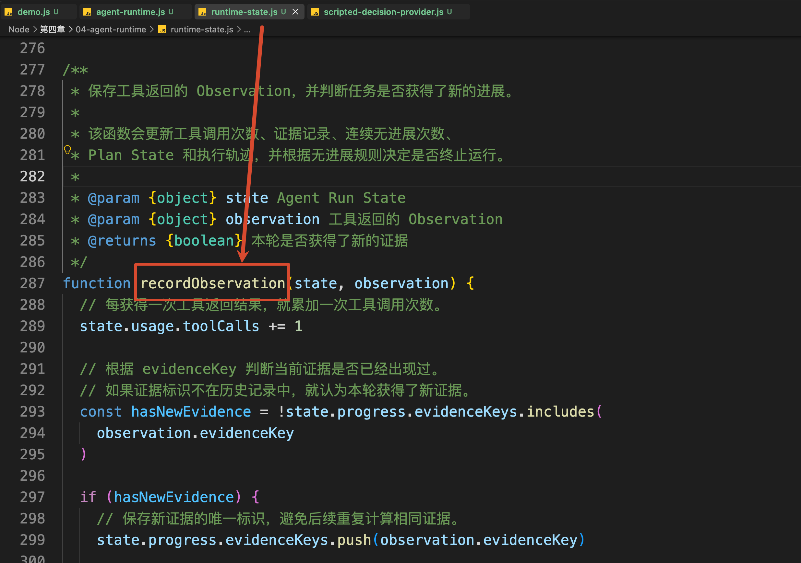


 会检查这个证据以前是否已经出现过：

```javascript
    // 根据 evidenceKey 判断当前证据是否已经出现过。
    // 如果证据标识不在历史记录中，就认为本轮获得了新证据。
    const hasNewEvidence = !state.progress.evidenceKeys.includes(
        observation.evidenceKey
    )

    if (hasNewEvidence) {
        // 保存新证据的唯一标识，避免后续重复计算相同证据。
        state.progress.evidenceKeys.push(observation.evidenceKey)

        // 记录证据来源，例如监控、日志或发布记录。
        state.progress.evidenceSources.push(observation.source)

        // 本轮获得了新进展，因此清空连续无进展计数。
        state.progress.consecutiveNoProgress = 0

        // 根据证据来源，将对应的计划步骤标记为已完成。
        markPlanStepCompleted(state.planState, observation.source)
    } else {
        // 没有获得新证据时，累加连续无进展次数。
        state.progress.consecutiveNoProgress += 1
    }
```

连续两次没有得到新证据以后，Runtime 会停止：

```javascript
stopRun(
    state,
    'no_progress',
    '连续多次工具调用没有获得新的证据。'
)
```

如果本轮得到了新证据，`recordObservation` 还会把对应的 Plan Step 标记为 `completed`。

只要 Runtime 没有触发终止条件，`while` 就会回到开头，让模型基于新的 Observation 做下一轮决定。

整个后半段的执行顺序就是：

```latex
记录模型用量
→ 检查运行状态
→ final：验证 Plan State 后结束
→ tool_call：检查工具预算和重复 Action
→ 执行工具
→ 记录 Observation 并判断是否取得新进展
→ 继续下一轮 Agent Loop
```


## 运行四组实验
先运行正常完成实验：

```bash
npm run demo:complete
```

程序会依次获得监控、日志和发布记录，最后输出：

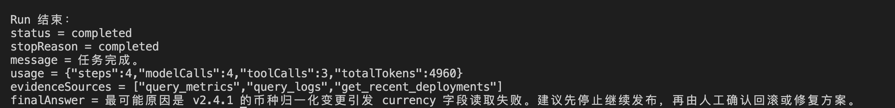


这里一共发生了四次模型触发。

前三次返回 Action，第四次返回最终答案，所以模型调用次数是 4，工具调用次数是 3。

咱们可以看下长截图

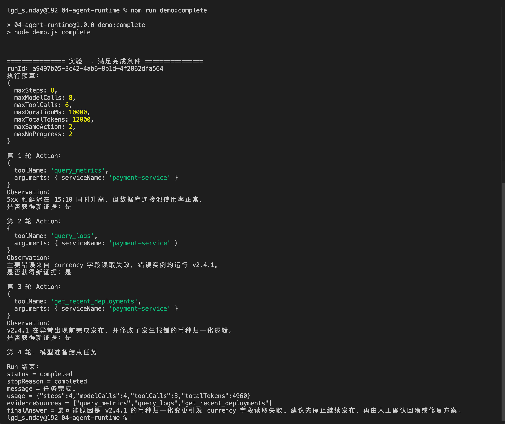


接着运行重复 Action：

```bash
npm run demo:repeat
```

第三次提出相同的日志查询时，程序不会继续执行：

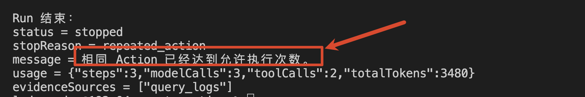


注意，`modelCalls` 是 3。

因为第三次模型调用已经发生了，只是它提出的 Tool Call 被 Runtime 拦了下来，所以 `toolCalls` 仍然是 2。

其他的就不跟大家一个个运行了哈，大家可以自己运行下看看

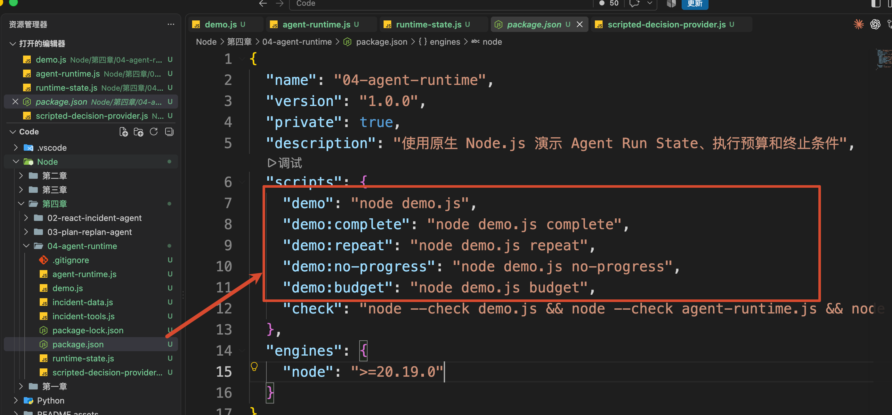


## 总结
这一节开头的问题是：

> Agent 已经有了 Plan State，为什么还需要 Agent Runtime？
>

现在答案应该比较清楚了。

+ Plan State 负责管理任务计划。
+ Agent Runtime 则包在 Agent Loop 外面，管理整次运行的状态和资源。

它会在每次模型调用和工具调用前后更新 Run State，检查执行次数、Token、时间、重复 Action 和任务进展。达到完成条件时，Runtime 以 `completed` 结束；触发限制时，则通过明确的 `stopReason` 停止。

因此，Agent 不再是一个只能不断执行的 `while` 循环。

> 更新：2026-07-31 19:08 · 原文：<https://www.yuque.com/lgdsunday/ab1dy3/rb0vf0wiisy7mczg>
