# 05 - Agent 结果校验：空结果、证据冲突与失败恢复

上一节，咱们给 Agent Loop 加上了 Runtime。

它会限制模型调用次数、工具调用次数和 Token 消耗，也能识别重复 Action 和连续无进展的循环。

工具返回 Observation 以后，`recordObservation` 还会根据 `source` 更新 Plan State。

看起来已经挺完整了吧。

但是！这里还隐藏了一个问题。

假设日志工具返回了下面的 Observation：

```javascript
{
    ok: true,
    source: 'primary_logs',
    evidenceKey: 'primary_logs:payment-service',
    data: {
        records: [],
        summary: '请求成功，但没有查到日志。'
    }
}
```

这次工具调用没有报错，可是 `records` 是空数组，也就是没有查到对应数据。

如果直接把这份 Observation 写进 Agent Run State，对应的 Plan Step 就可能被标记为 `completed`。最后，Agent 拿着一份根本没有内容的“证据”结束了任务。

这肯定是不行的。

所以，这一节咱们要在 `executeTool` 和 `recordObservation` 之间，加上 **结果校验** 与 **失败恢复**，流程类似于下面这样：

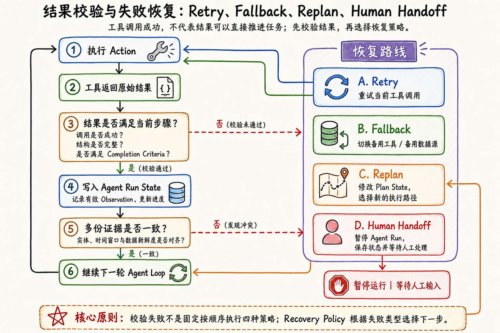


大家仔细看上面的 **恢复路线** 部分，这里面涉及到了 4 个小概念，这四个小概念对应的就是在遇到不同错误场景下的处理方案，大家做个了解就行，不需要专门去记

+ **Retry（重试）**：同一个 Action 因为临时故障执行失败时，在预算范围内使用原来的参数再执行一次。
+ **Fallback（备用路线）**：原来的工具、模型或数据源无法继续使用时，保持任务目标不变，切换到提前准备好的备用方案。
+ **Replan（重新规划）**：当前计划已经无法继续推进任务时，根据已有结果修改 Plan State，取消失效步骤并增加新的执行步骤
+ **Human Handoff（转交人工）**：自动恢复无法安全完成任务时，暂停当前 Agent Run，并把失败原因、运行状态和已有证据交给人工处理。

这几个概念相对比较好理解，咱们就不多说了。

这四个概念对应三种不同的场景，咱们直接通过代码来看

## 实现一个带结果校验的 Agent Runtime
> 课程源码：`https://github.com/lgd8981289/Agent--Code`
>
> 本小节完整代码位于：`Code/Node/第四章/05-result-validation-recovery`
>

这一小节案例的核心目的是，验证是哪个场景，然后针对这三个不同的场景进行处理

+ 场景一：工具返回成功，但是结果为空
+ 场景二：两份结果单独有效，放在一起却发生冲突
+ 场景三：工具直接超时，没有返回 Observation

进入项目目录：

```bash
cd Code/Node/第四章/05-result-validation-recovery
npm install
```

项目结构如下：

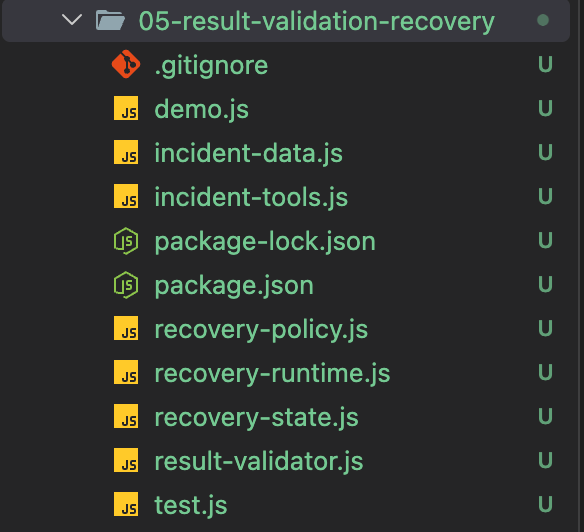


其中：

+ `incident-tools.js` 负责模拟外部工具
+ `result-validator.js` 负责校验工具结果
+ `recovery-policy.js` 负责在校验失败以后选择恢复路线。

整个执行流程都在 `recovery-runtime.js` 中。

### 从入口开始
打开 `demo.js`，可以看到本节准备的三个实验：

```javascript
/**
 * 实验场景列表
 * - replan：工具调用成功，但返回空结果，触发重新规划
 * - handoff：不同数据源返回的有效证据相互冲突，触发人工接管
 * - retry-fallback：工具调用超时，先重试，仍失败则切换备用方案
 */
const SCENARIOS = ['replan', 'handoff', 'retry-fallback']
```

不传参数时，`main` 会依次执行三组实验。

每组实验最终都会调用 `await runRecoveryAgent({ scenarioName })`：

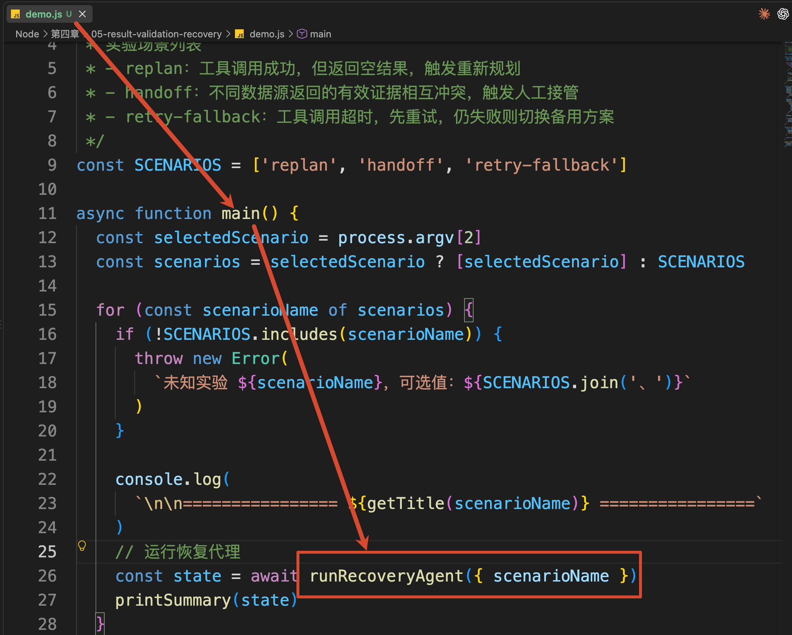


通过 `runRecoveryAgent` 方法就会进入到咱们整个项目的核心  `recovery-runtime.js` 里面

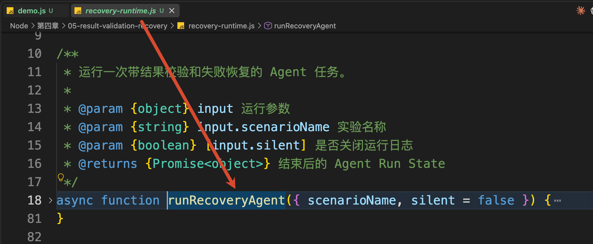


接下来打开 `recovery-runtime.js`，找到 `runRecoveryAgent`。

它会先从 Plan State 中取出一个 `pending` 步骤：

```javascript
// 只要任务仍处于运行状态，就持续调度待执行的计划步骤
while (state.status === 'running') {
  // 当前示例按顺序获取第一个尚未处理的步骤
    const step = state.planState.steps.find(
        (item) => item.status === 'pending'
    )
    // 没有待执行步骤时，检查计划是否满足完成条件并结束运行
    if (!step) {
        completeRun(state)
        break
    }
  // 执行当前 Action，并在内部完成结果校验、重试或备用方案选择
    const result = await executeActionWithRecovery({
        state,
        step,
        executeTool,
        log
    })

    // 根据结果继续更新状态
}
```

这里和上一节最大的区别是，Action 不会直接交给 `executeTool` 然后写入状态。

而是增加了一个 `executeActionWithRecovery`

这个方法就是恢复策略的核心方法

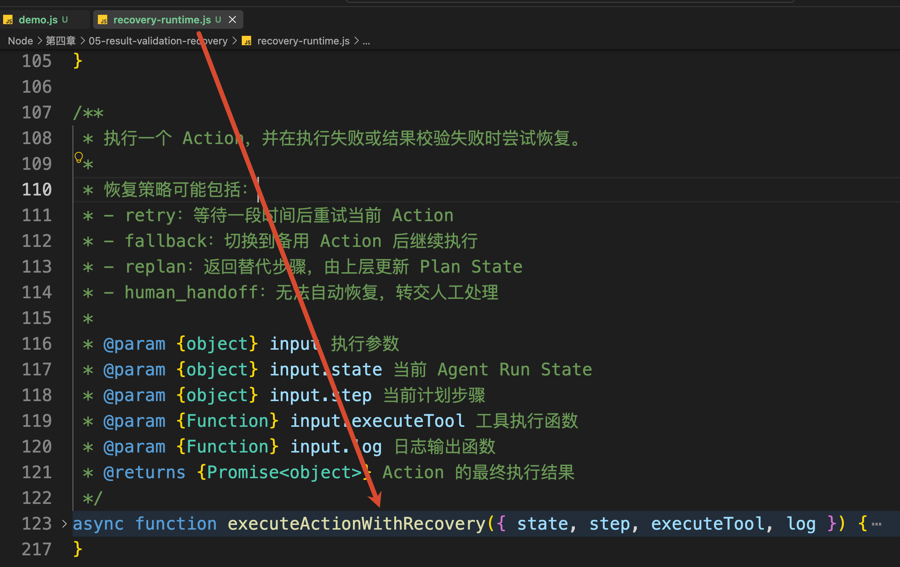


咱们顺着三个场景继续往下看。

### 场景一：接口成功，但返回的是空结果
先执行：

```bash
npm run demo:replan
```

查看输出结果

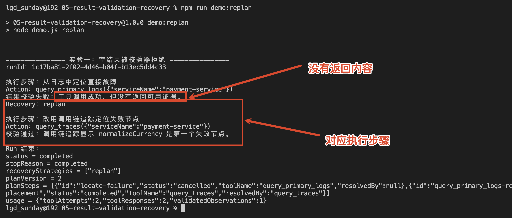


这里大家注意，`query_primary_logs` 并没有抛出 Error。

它正常返回了下面的 Observation：

```javascript
{
    ok: true,
    source: 'primary_logs',
    evidenceKey: 'primary_logs:payment-service',
    data: {
        records: [],
        summary: '请求成功，但没有查到日志。'
    }
}
```

所以，工具返回以后，`executeActionWithRecovery` 不会立刻把结果交给 Plan State，而是先调用：

```javascript
const validation = validateObservation(action, observation)
```

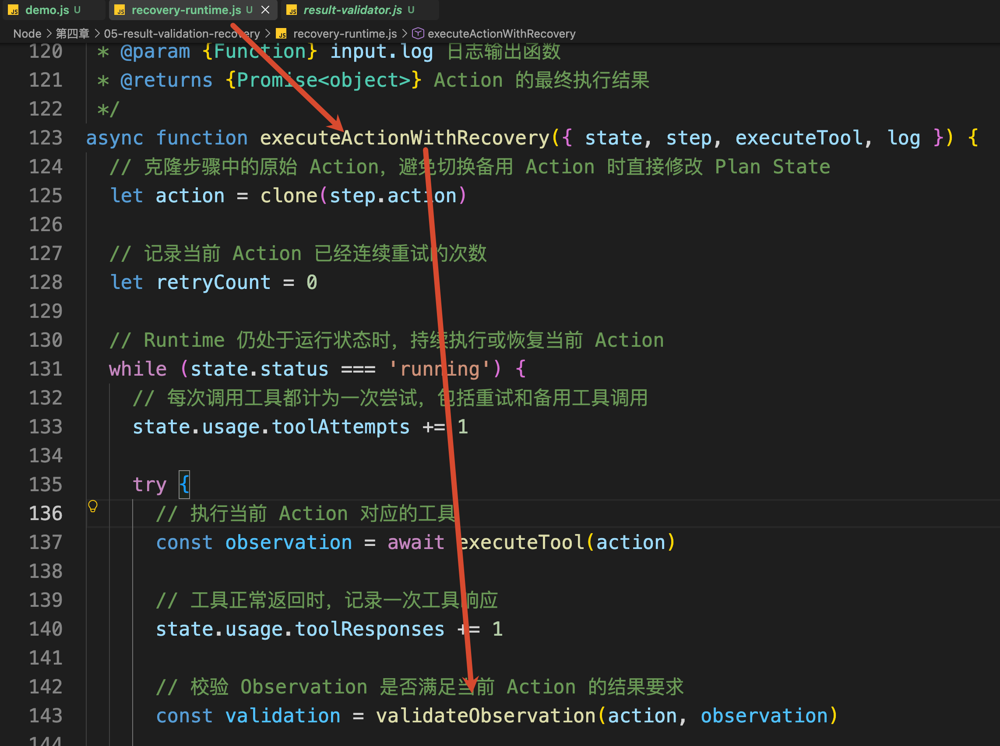


`validateObservation` 在 `result-validator.js` ，咱们来看一下这个代码

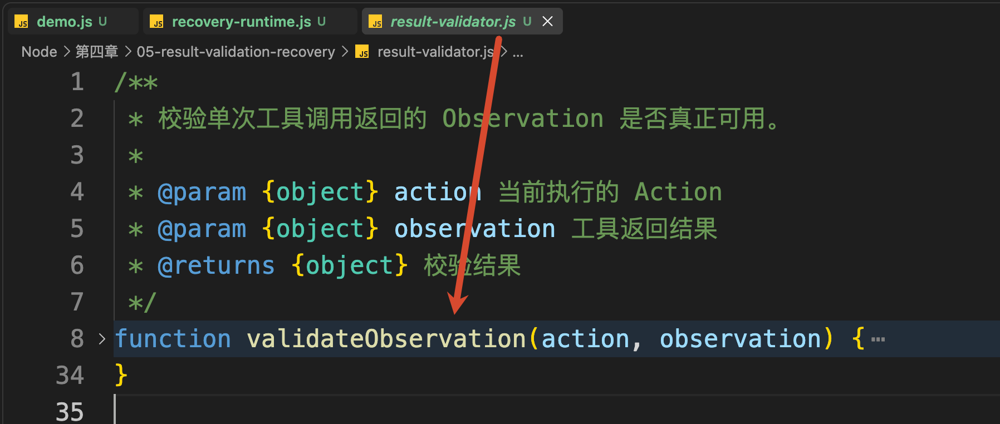


`validateObservation` 会按照顺序检查这次工具返回的结果。

代码打开是这样的，咱们一点点看哈

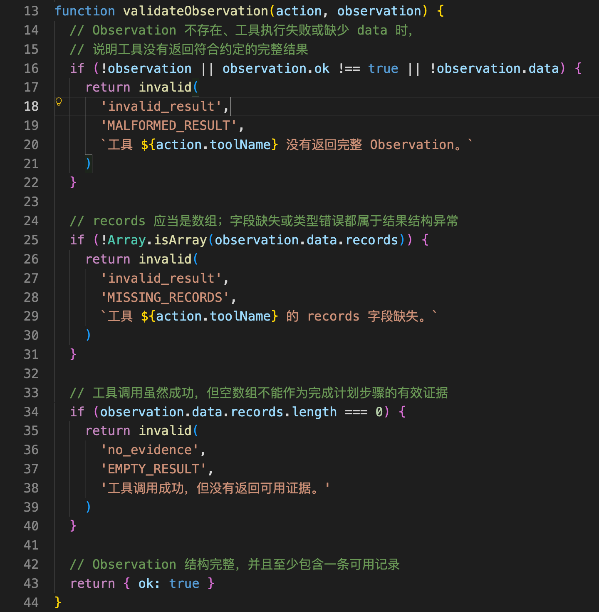


第一步，先确定工具有没有返回一份完整的 Observation：

```javascript
if (!observation || observation.ok !== true || !observation.data) {
    return invalid(
        'invalid_result',
        'MALFORMED_RESULT',
        `工具 ${action.toolName} 没有返回完整 Observation。`
    )
}
```

这里检查了三件事：

+ observation 是否存在
+ observation.ok 是否为 true
+ observation.data 是否存在

只要有一项不满足，就说明返回值不符合当前项目约定的基础结构。在这个最小案例中，程序会统一返回 `MALFORMED_RESULT`。

当前日志工具返回了 Observation，`ok` 是 `true`，`data` 也存在，所以会通过第一步。

第二步，检查业务数据中有没有 `records` 数组：

```javascript
if (!Array.isArray(observation.data.records)) {
    return invalid(
        'invalid_result',
        'MISSING_RECORDS',
        `工具 ${action.toolName} 的 records 字段缺失。`
    )
}
```

当前项目约定，日志、调用链和实例清单工具都使用 `records` 保存查询结果。

如果没有这个字段，或者它不是数组，Runtime 就无法按照约定读取结果，因此返回 `MISSING_RECORDS`。

当前 Observation 中的 `records` 是一个数组，所以第二步也会通过。

但是，数组存在不代表里面真的有数据。

因此，第三步还要检查数组长度：

```javascript
if (observation.data.records.length === 0) {
    return invalid(
        'no_evidence',
        'EMPTY_RESULT',
        '工具调用成功，但没有返回可用证据。'
    )
}
```

当前返回的是：

```javascript
records: []
```

它的结构没有问题，但是里面一条日志都没有。

所以，这份结果最终会被分类为：

```latex
kind = no_evidence
code = EMPTY_RESULT
```

这里的 `no_evidence` 表示：**工具确实执行成功了，但是没有提供能够完成当前 Plan Step 的证据。**

因此，这份 Observation 不会写入 Agent Run State，对应的 Plan Step 也不会被标记为 `completed`。

### 实验二：单条结果正常，多份证据却互相冲突
接着执行：

```bash
npm run demo:handoff
```

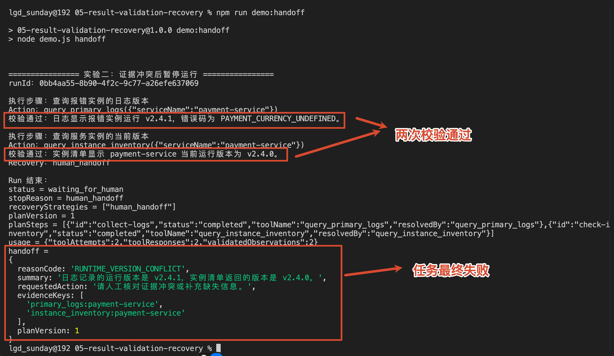


这次两个工具都返回了数据：

```latex
校验通过：日志显示报错实例运行 v2.4.1。
校验通过：实例清单显示当前运行版本为 v2.4.0。

Recovery：human_handoff
```

看起来有点奇怪吧。

既然两次都显示“校验通过”，为什么 Agent 最后没有完成任务？

因为这里的“通过”只是通过了单条 Observation 校验。

日志结果不为空，实例清单的字段也很完整。所以，它们都可以先写入 Agent Run State。

第二份结果写入以后，`runRecoveryAgent` 还会执行一次证据集合校验：

```javascript
// 单条结果有效，并不代表全部证据组合后仍然一致
const evidenceValidation = validateEvidenceSet(state.observations)
```

打开 `result-validator.js`，继续看 `validateEvidenceSet`。

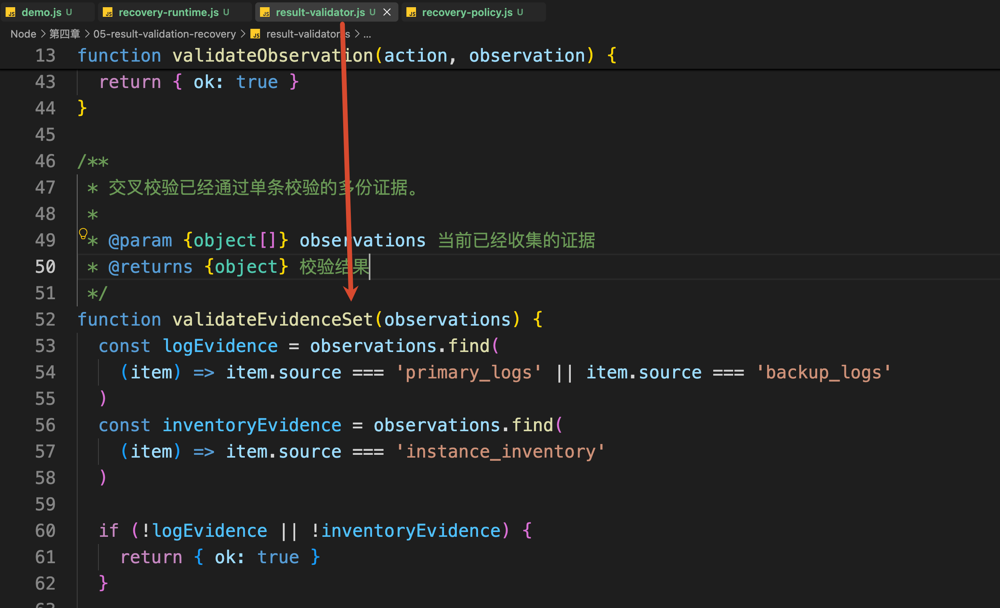


它会分别读取日志记录的版本和实例清单中的当前版本：

```javascript
// 如果日志记录的运行版本与实例清单返回的版本不一致，则说明多份证据发生冲突
const logVersion = logEvidence.data.runtimeVersion
const inventoryVersion = inventoryEvidence.data.activeVersion
```

如果两个版本不一致，就返回 `RUNTIME_VERSION_CONFLICT`：

```javascript
if (logVersion && inventoryVersion && logVersion !== inventoryVersion) {
    return invalid(
        'evidence_conflict',
        'RUNTIME_VERSION_CONFLICT',
        `日志记录的运行版本是 ${logVersion}，` +
            `实例清单返回的版本是 ${inventoryVersion}。`
    )
}
```


### 实验三：工具没有返回结果时怎样恢复
前两个实验中，工具都返回了 Observation。

但是，如果日志工具直接超时，程序连可以交给 `validateObservation` 的结果都没有。

执行：

```bash
npm run demo:retry-fallback
```

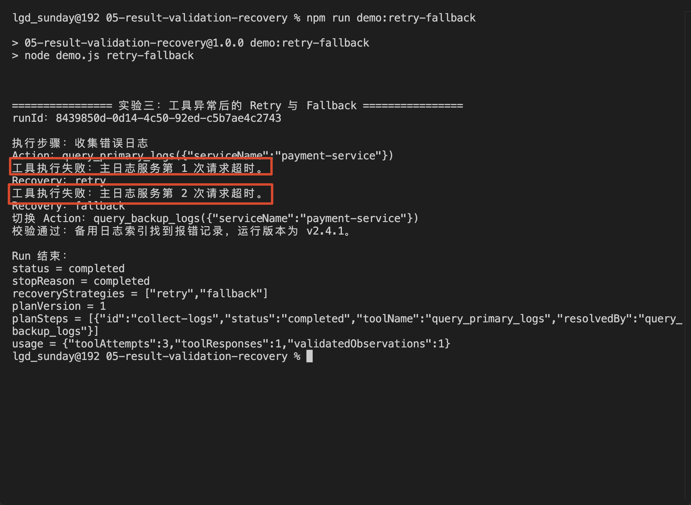


可以看到：

```latex
工具执行失败：主日志服务第 1 次请求超时。
Recovery：retry

工具执行失败：主日志服务第 2 次请求超时。
Recovery：fallback

切换 Action：query_backup_logs({"serviceName":"payment-service"})
校验通过：备用日志索引找到报错记录，运行版本为 v2.4.1。
```

这条路线发生在 `executeActionWithRecovery` 的 `catch` 中：

```javascript
} catch (error) {
  // 将工具抛出的原始异常转换成统一的 Failure 结构
    const failure = classifyToolError(error)
  // 根据异常类型选择重试、备用方案或人工接管
    const decision = selectRecovery({ failure, action, retryCount })

    // 根据 decision 继续 Retry、Fallback 或转人工
}
```

`classifyToolError` 会先把超时识别成 `transient_error`。

`selectRecovery` 发现还有重试预算，就返回 `retry`：

```javascript
if (
    failure.kind === 'transient_error' &&
    retryCount < (recovery.maxRetries || 0)
) {
    return {
        strategy: 'retry',
        delayMs: calculateBackoffMs(
            recovery.retryDelayMs || 20,
            retryCount
        )
    }
}
```

当前案例配置的 `maxRetries` 是 1，表示首次调用失败后最多再执行一次。

第二次仍然超时，重试预算已经耗尽。这时，Runtime 会切换到备用日志工具：

```javascript
if (failure.kind === 'transient_error' && recovery.fallbackAction) {
    return {
        strategy: 'fallback',
        nextAction: clone(recovery.fallbackAction)
    }
}
```

备用工具最终返回 Observation 以后，经过 `validateObservation` 完成最终验证

## 总结
到这里，再把当前项目中的四种恢复路线放到一起看：

+ **Retry（重试）**：同一个 Action 因为临时故障失败时，在预算内使用原参数重新执行。
+ **Fallback（备用路线）**：原工具或数据源不可用时，保持任务目标不变，切换到提前准备好的备用方案。
+ **Replan（重新规划）**：当前计划无法继续取得证据时，修改 Plan State，取消失效步骤并增加新步骤。
+ **Human Handoff（转交人工）**：自动恢复无法安全解决问题时，暂停 Agent Run，并把状态和证据交给人工。

它们不是每次失败后依次执行的固定流程。

结果校验或者异常分类会先说明“发生了什么”，Recovery Policy 再决定“接下来走哪条路线”。

当前项目的判断关系是：

+ 临时超时：走 Retry，重试耗尽后 Fallback
+ 结果为空，没有获得证据：走 Replan
+ 证据发生冲突，程序无法安全判断 ：走 Human Handoff

这一节解决的核心问题，不是工具报错以后再试几次。

到这里，第四章比较核心的概念就已经全看完了，下一小节，咱们就开始做项目了。

这个项目可真不好弄，我周末花了两天设计，希望可以让大家满意吧～~

> 更新：2026-08-03 12:21 · 原文：<https://www.yuque.com/lgdsunday/ab1dy3/gnl85zbo4fpp5751>
