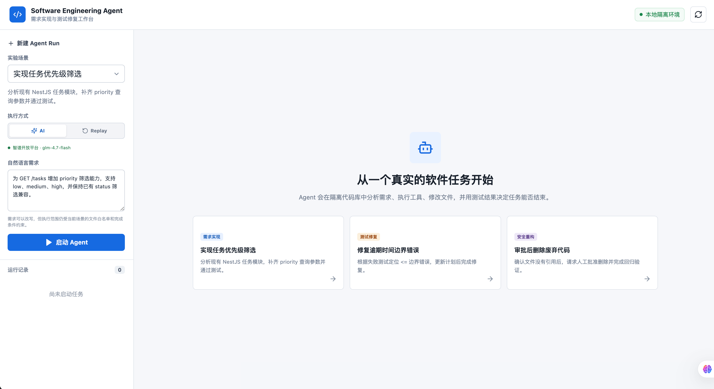
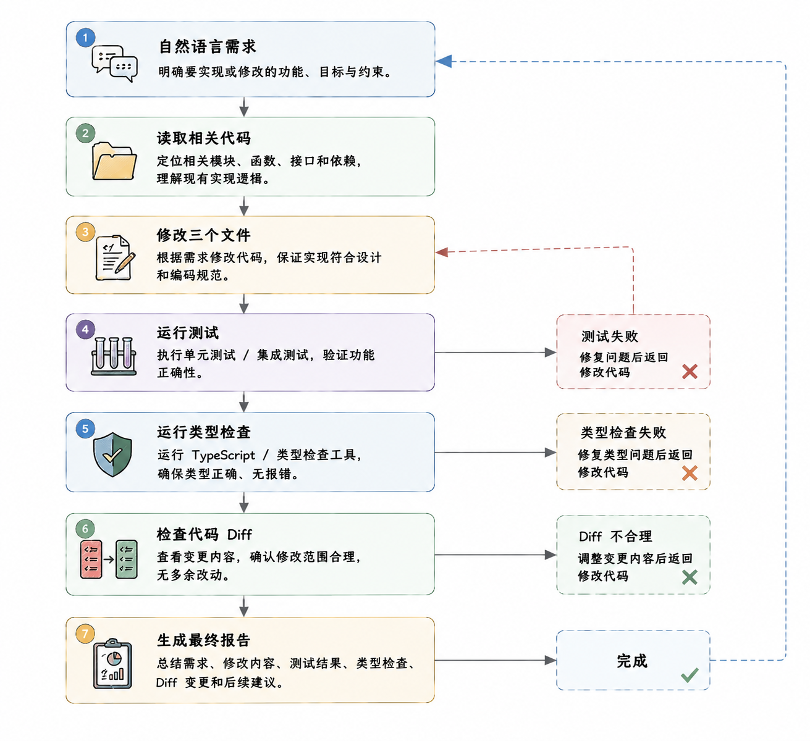
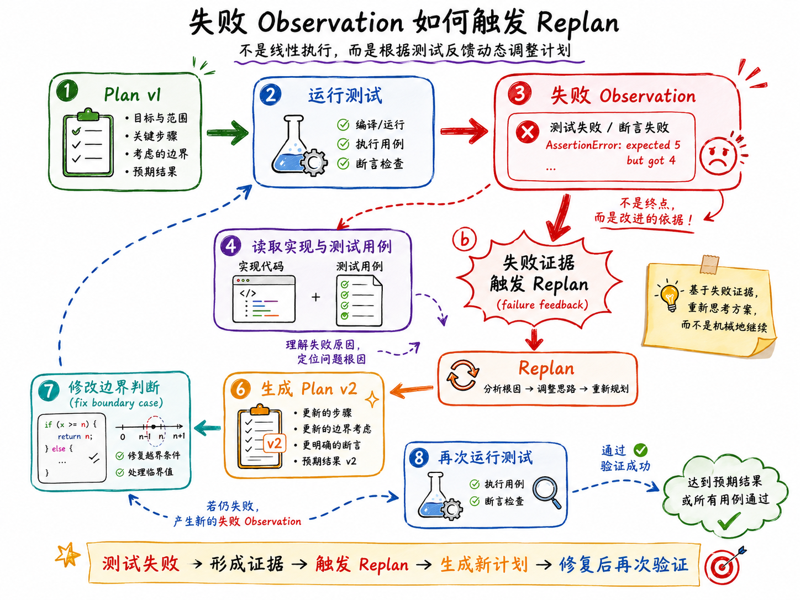
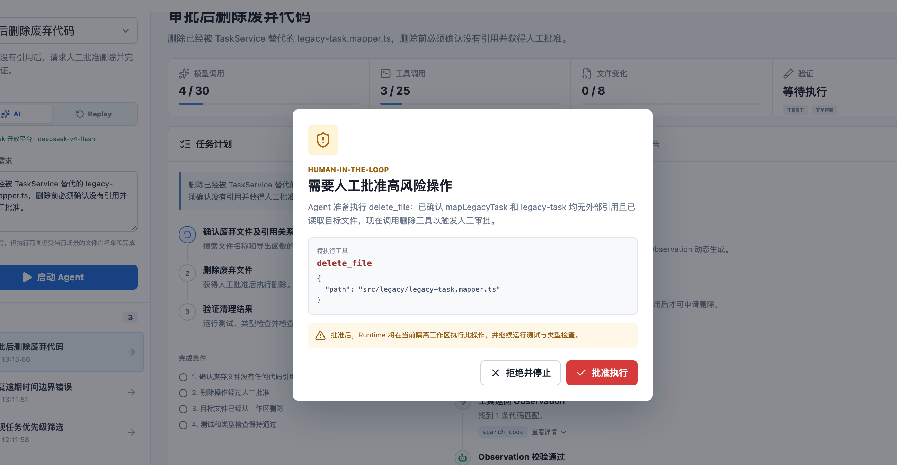
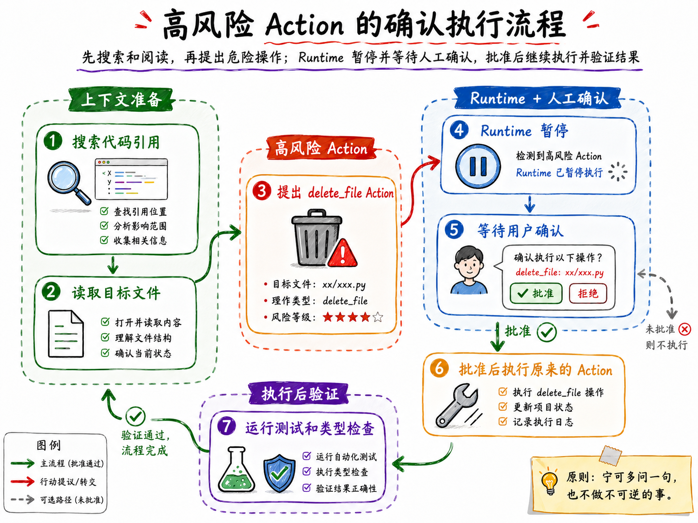
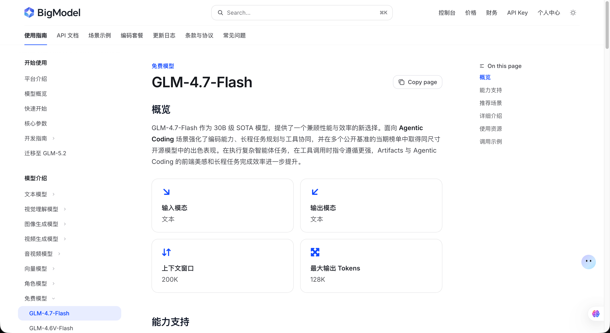
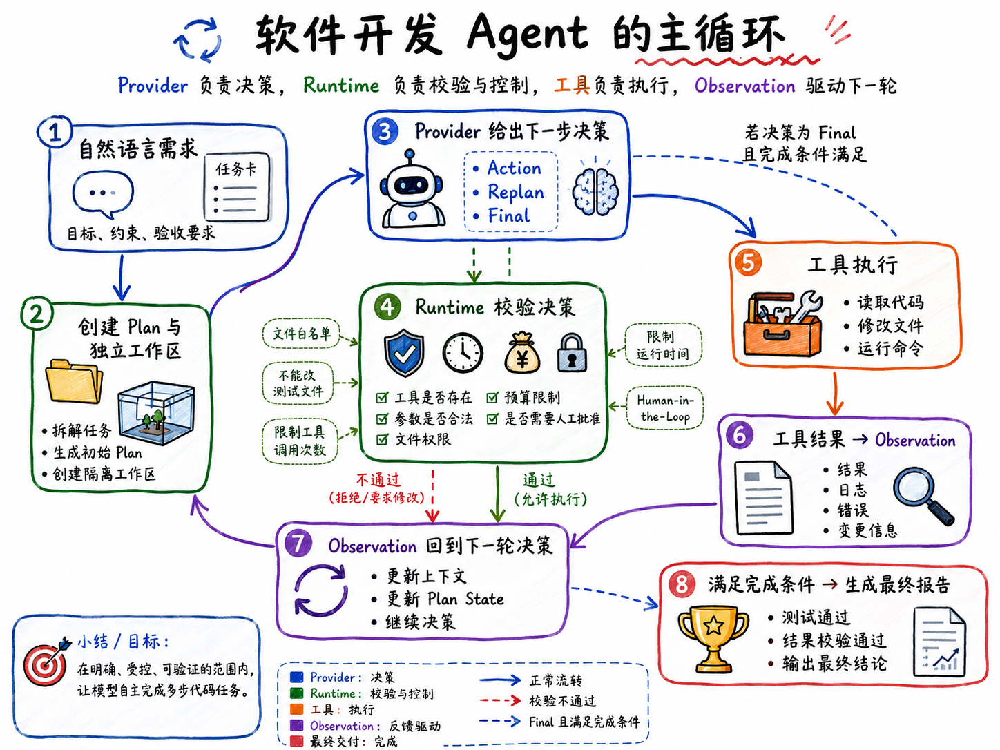

# 06-实战（上）：实现一个 AI 编程 Agent：支持代码编写、跨文件修改、自动测试、失败后重新规划与删除操作人工确认

第四章写到这里，咱们已经分别讲过了 `ReAct`、任务规划、`Replanning`、Agent Runtime、结果校验和失败恢复。

从这一节开始，咱们就把前面学到的内容组装起来，实现一个 **AI 编程 Agent：支持代码编写、跨文件修改、自动测试、失败后重新规划与删除操作人工确认**。



这个项目的代码不少，所以还是和第三章一样，分成上、中、下三篇来讲。

上篇先看项目实现了什么、怎样运行，以及为什么要这样设计。中篇和下篇再从真实的功能入口开始，顺着调用链一点点看代码。

## 功能列表
项目一共准备了三个功能，这里给大家录了一个视频，大家可以看下：

[此处为语雀卡片，点击链接查看](https://www.yuque.com/lgdsunday/ab1dy3/hktieoi0gg64lhoh#UTa7S)

然后，咱们来看这三个功能的文字介绍。

这三个功能分别对应软件开发 Agent 中三种很重要的执行能力：

1. 自然语言驱动的跨文件需求实现：
2. 测试反馈驱动的动态 Replanning
3. 高风险代码操作的 Human-in-the-Loop 控制

咱们一个个来看每个功能

### 自然语言驱动的跨文件需求实现
第一个功能，是让 Agent 根据自然语言完成一个代码需求。

这里咱们有一个写好的需求（当然大家也可以自己改）：

```latex
为 GET /tasks 增加 priority 筛选能力，支持 low、medium、high，并保持已有 status 筛选兼容。
```

想要完成这个需求，只修改一个文件肯定不够。

Agent 需要先读取现有项目，确认 `TaskFilters` 是怎么定义的，`TaskService` 当前怎样完成筛选，`TaskController` 又接收了哪些查询参数。

分析完以后，它会分别修改：

```latex
src/tasks/task.types.ts
src/tasks/task.service.ts
src/tasks/task.controller.ts
```

修改完成还不能算结束。

Agent 还需要运行测试和 TypeScript 类型检查，最后读取代码 Diff，确认这次修改只影响了当前需求。

完整过程大概是这样的：



这就是本项目的第一个核心能力：**模型负责理解需求和决定下一步，Runtime 负责在受控环境中真正完成代码操作。**

### 测试反馈驱动的动态 Replanning
第二个功能，是修复一段存在边界错误的代码。

写好的需求如下：

```latex
修复任务在截止时间刚好相等时被错误标记为逾期的问题，并保证完成任务永远不算逾期。
```

这个功能看起来比前面的需求简单，最终可能只需要修改一个比较符。

但是，这里的重点并不是“让 AI 改一行代码”，而是观察 **失败测试怎样改变 Agent 的任务计划**。

Agent 一开始拿到的是 `Plan v1`。它会先运行测试，尝试复现问题。

测试返回失败以后，这份结果会成为一条新的 Observation。Agent 根据里面的失败用例和错误信息，确认原来的计划缺少一个明确的边界修复步骤，于是生成 `Plan v2`。




### 高风险代码操作的 Human-in-the-Loop 控制
第三个功能，是删除已经废弃的代码文件。

预定的需求是：

```latex
删除已经被 TaskService 替代的 legacy-task.mapper.ts，删除前必须确认没有引用并获得人工批准。
```

Agent 不会拿到需求以后立刻删除文件。

它会先搜索 `mapLegacyTask` 的引用，再读取目标文件，确认搜索结果只剩文件自身的定义，没有其他业务代码继续依赖它。

完成这些检查以后，Agent 才会提出一个 `delete_file` Action。



但是，`delete_file` 在当前项目中属于高风险工具。Runtime 发现这个 Action 以后会暂停执行，页面同时弹出人工确认窗口。



如果用户拒绝，文件不会被删除，本次 Agent Run 也会停止。

如果用户批准，Runtime 才会继续执行刚才已经通过校验的删除 Action。删除完成以后，还要重新运行测试和类型检查，确认这次清理没有破坏现有功能。

这解决的是软件开发 Agent 中一个非常关键的问题：**模型可以提出高风险操作，但最终执行权必须掌握在应用程序和用户手中。**

## 项目如何运行
> 课程源码：`https://github.com/lgd8981289/Agent--Code`
>
> 本项目完整代码位于：`Code/Node/第四章/06-software-engineering-agent`
>

进入项目目录，安装依赖：

```bash
cd Code/Node/第四章/06-software-engineering-agent
npm install
```

然后执行：

```bash
npm run dev
```

这个命令会同时启动 NestJS 服务端和 Vue 3 页面。

启动成功以后，访问：

```latex
http://localhost:5178
```

服务端 API 地址是：

```latex
http://localhost:4300/api
```

大家也可以分开两个终端，分别运行：

```bash
// 启动服务端
npm run dev:server

// 启动前端
npm run dev:web
```

### 关于视频中提到的 GLM 4.7
地址在 [这里](https://docs.bigmodel.cn/cn/guide/models/free/glm-4.7-flash)



这个确实是免费的，但是问题就在于经常失败，所以课程中没有使用

## 项目需求
根据咱们前面的演示视频其实可以分析出：**这些能力不可能只靠一次模型调用完成。**

一个能够真正执行软件开发任务的 Agent，至少需要两部分。

### 第一部分是：Provider。
它负责根据当前任务上下文给出下一步决策。在 `AI` 模式下，这个决策来自 `DeepSeek-V4-Flash`；在 `Replay` 模式下，决策来自项目中准备好的固定轨迹。

无论使用哪一种 Provider，最终返回的都只有三类结果：

+ Action：提出下一次工具调用
+ Replan：根据新证据修改任务计划
+ Final：认为任务已经可以结束

### 第二部分是 Agent Runtime
Runtime 不负责写代码，它负责管理整次 Agent Run。

模型提出 Action 以后，它要判断工具是否存在、参数是否合法、文件能不能修改、预算是否足够，以及当前操作是否需要人工批准。

通过校验以后，Runtime 才会调用真实工具，并把结果重新保存成 Observation。

于是，整个项目的主循环就变成了：



刚才页面中看到的功能，也可以从这条主循环里找到对应的工程需求。

| 页面中看到的现象 | 项目必须提供的能力 |
| --- | --- |
| Agent 能修改三个关联文件 | 独立工作区、文件读取和受控代码修改工具 |
| 测试失败后出现 Plan v2 | Observation、Plan State 和 Replanning |
| 页面持续显示每一步操作 | Agent Run State 与可审计执行轨迹 |
| 测试通过以后任务才结束 | 结果校验与 Completion Criteria |
| 删除文件前弹出确认窗口 | 工具风险分级与 Human-in-the-Loop |
| AI 与 Replay 可以切换 | 可替换的 Agent Provider |


这里还有一个很重要的点：**模型不能拥有无限权限。**

每个功能都有自己的文件白名单。模型不能读取工作区以外的路径，也不能修改测试文件，更不能执行任意 Shell 命令。

项目还限制了最大循环次数、工具调用次数、修改文件数量和运行时间。即使模型一直给不出正确结果，Runtime 也不会让它无限执行下去。

因此，这个项目真正要实现的是：**在一个明确、受控、可以验证的范围内，让模型自主完成多步代码任务。**

## 后续项目会怎样讲解
这个项目涉及的文件比较多。

整个项目的讲解方式和之前一样：**先找到一个真实功能入口，再顺着这次操作产生的调用链往下追。**

第三章的项目也是这么讲的，反馈还不错，所以后面也都这么讲解了～

下一篇，咱们就从“启动 Agent”这个按钮开始，正式进入项目代码。

> 更新：2026-08-04 14:23 · 原文：<https://www.yuque.com/lgdsunday/ab1dy3/hktieoi0gg64lhoh>
