# 06-实战（下）：实现失败恢复、人工确认与执行轨迹

上一篇，咱们已经把 AI 编程 Agent 最核心的执行链路跑通了。

Provider 提出 Action，Runtime 校验并执行，Tool 返回 Observation，然后再根据新的 Observation 决定下一步。

这是上一小节的完整流程图，再给大家贴一下：


但是，凡事都有个但是。。。

这只是第一个场景的流程。

除了这个场景之外，咱们还有两个场景：

+ 修复逾期时间边界错误：在这种场景下，**测试失败以后，Plan v1 怎样变成 Plan v2**
+ 审批后删除废弃代码：delete_file 怎样暂停，用户批准后又怎样继续

两个场景跑完以后，再回头看一下页面中的执行轨迹和最终报告是怎样生成的。

> 代码地址：`Code/Node/第四章/06-software-engineering-agent`
>
> 为了得到和文章一致的执行轨迹，建议先选择 `Replay` 模式。
>

## 场景一：失败测试怎样推动 Plan v2
打开项目页面，选择：

```latex
修复逾期时间边界错误
```

这里咱们的需求是：“修复任务在截止时间刚好相等时被错误标记为逾期的问题，并保证完成任务永远不算逾期。”

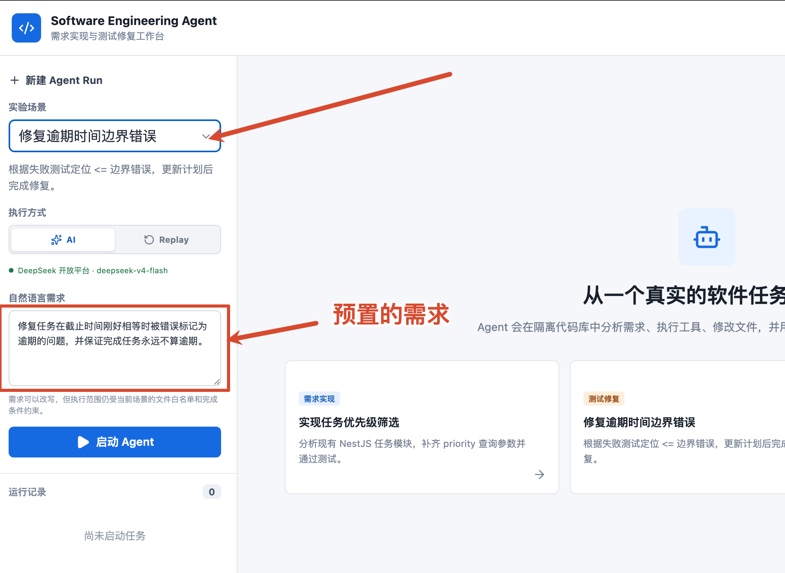

然后选择 `Replay` 模式，点击“启动 Agent”。

这次生成的 Plan v1 是：

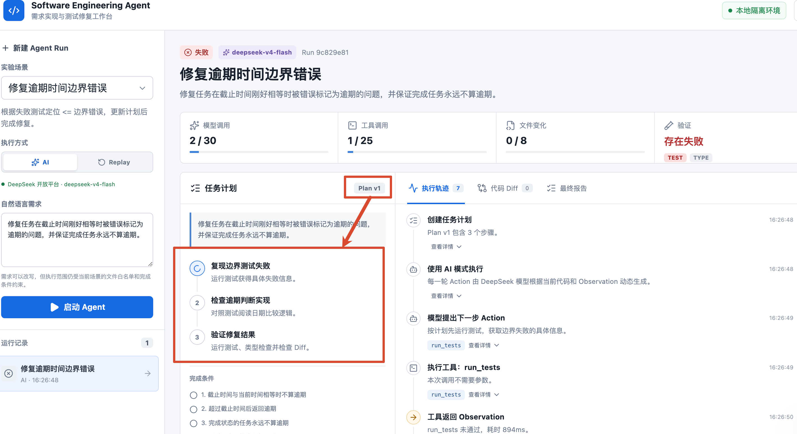

服务端收到请求以后，会继续走中篇讲过的创建流程，最后通过 `schedule()` 启动 `AgentRuntimeService` 中的 `execute()` 方法。

> 对应文件为：`server/src/agent/agent-runtime.service.ts`
>

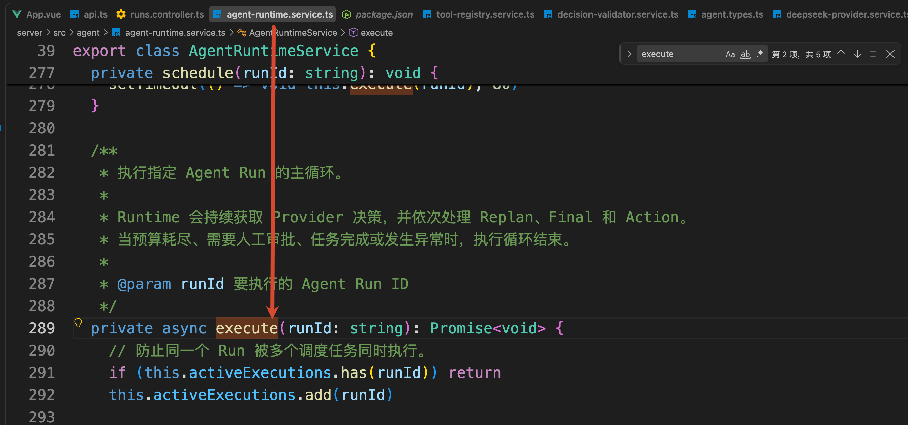

`execute()` 的完整代码咱们上一小节的时候看过，核心逻辑是在一个 `while` 循环里面

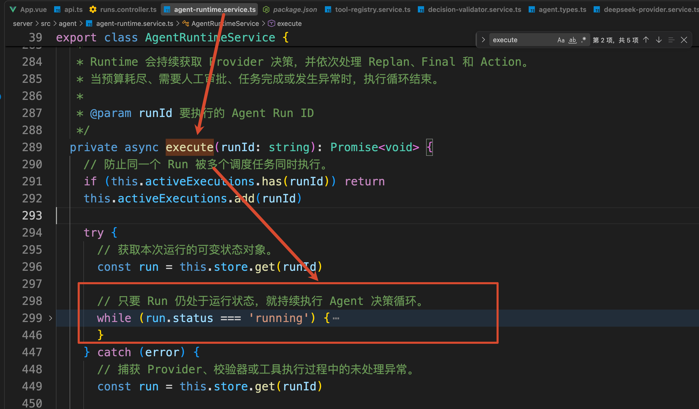

哪怕不看上一节的内容，光看这个行数也知道，这里面的内容比较长

所以，这里给大家压缩了一下，大致就是下面这样：

```typescript
// 只要 Run 仍处于运行状态，就持续执行 Agent 决策循环。
while (run.status === 'running') {
    /**
 * 检查是否存在已经获得人工批准、但尚未真正执行的 Action。
 *
 * 如果存在，则直接恢复该 Action；
 * 否则请求 Provider 根据当前 Run 状态生成下一步决策。
 */
  const providerResult = await this.provider.next(run)
    const decision = providerResult.decision

  // 在执行前校验决策结构、计划依赖和工具调用是否合法。
    this.decisionValidator.validate(run, decision)

  // Replan 表示根据最新 Observation 调整任务计划。
    if (decision.type === 'replan') {
        this.applyReplan(run, decision)
        continue
    }

  // Final 表示 Provider 认为任务已经可以结束。
    if (decision.type === 'final') {
        await this.complete(run, decision.summary)
        break
    }
  // 执行已经通过校验和审批的工具调用，并记录 Observation。
    await this.executeAction(run, decision.action, providerResult.source)
}
```

这里最需要先看懂的是：**Runtime 不会一次性执行完整份 Plan。**

每一轮，它只会把当前 Run State 交给 Provider，让 Provider 返回一个下一步决策。这个决策有三种可能：

+ Action：调用一个工具
+ Replan：修改当前计划
+ Final：申请结束任务

因此，一轮完整执行大致就是下面这样：

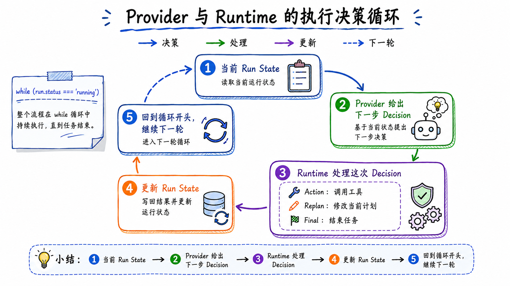

后面的操作，其实都在重复这套流程。

### 第一轮：运行测试验证初始怀疑
在循环中会不断的执行 `await this.provider.next(run)` 方法

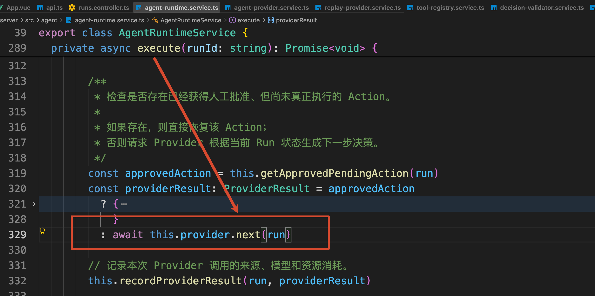

该方法最终会执行到 `replay-provider.service.ts` 的 `next` 的函数：

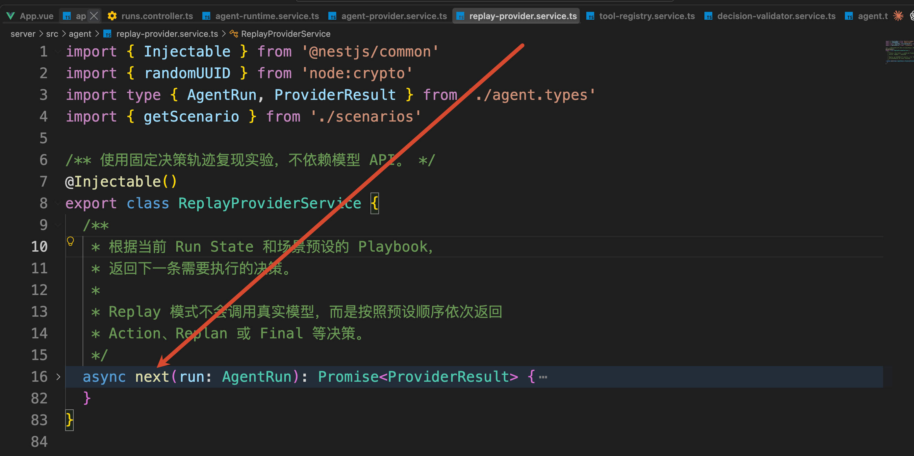

Replay 模式会根据 `playbookCursor` 读取当前应该执行的决策：

```typescript
// 根据游标读取本轮需要执行的预设决策。
const template = scenario.playbook[run.playbookCursor]
```

当前游标（`playbookCursor`）是 `0`，所以返回的第一个 Decision 是这样的：

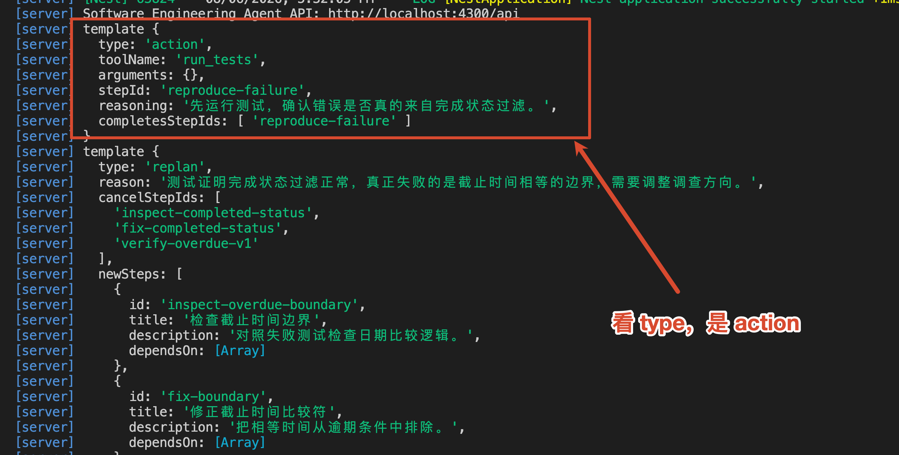

Runtime 发现这是一个 `Action`，于是把它交给 `executeAction()`：

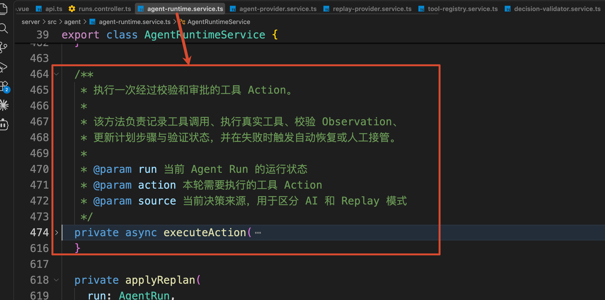

 `executeAction()` 的代码咱们上一小节也看过了，大致捋一下流程：

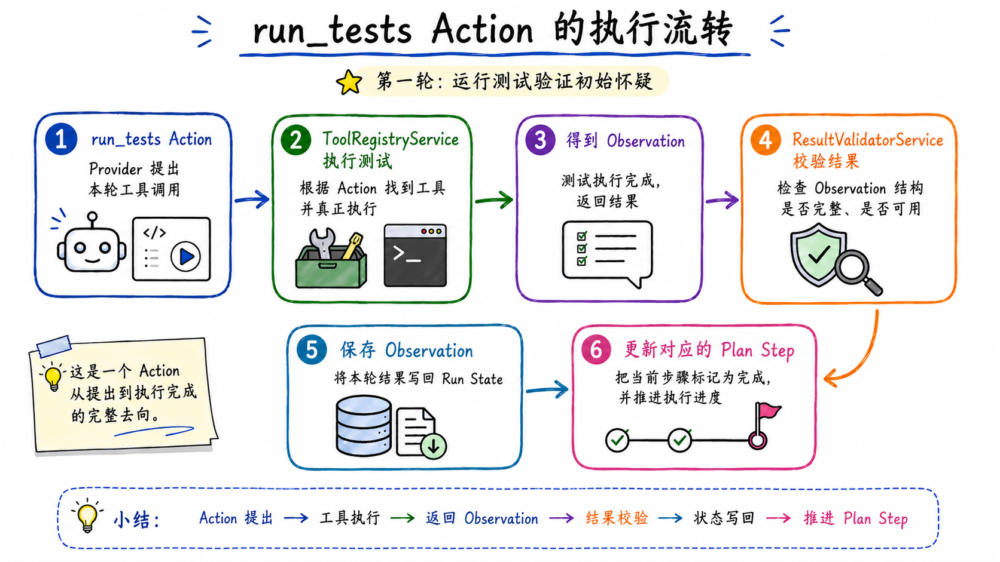

测试最终会出现了三个结果：

+ 完成状态的任务：测试通过
+ 超过截止时间的任务：测试通过
+ **截止时间刚好相等：测试失败，预期 false，实际得到 true**

那么到这里就能确定，最开始的 Panl V1 是错的了。

完成状态过滤没有问题。真正出错的是 **截止时间刚好相等** 这个边界。

保存状态以后，`execute()` 会回到 `while` 开头，开始下一轮。

### 第二轮：失败证据推动 Plan v2
第二轮开始时，Provider 能看到刚才保存的失败 Observation。

不过，在看 Replan 以前，咱们得先把刚才保存的 Observation 再看一眼。

`ToolRegistryService` 在包装工具结果时，会为每一份 Observation 生成唯一 ID：

```typescript
return {
    id: randomUUID(),
    actionId: action.id,
    toolName: action.toolName,
    data
}
```

所以，失败测试保存到 `run.observations` 以后，大致是这样的：

```json
{
  "id": "7a3c...",
  "toolName": "run_tests",
  "data": {
    "passed": false
  }
}
```

现在 Provider 想要修改计划，就必须告诉 Runtime：**我是根据哪一份结果作出的调整。**

当前项目把这些证据的 ID 放在 `evidenceIds` 中：

```latex
evidenceIds = 本次 Replan 所依据的 Observation ID 或 Failure ID 列表
```

在 Replay 模式中，场景文件只保存固定的 Replan 模板。`ReplayProviderService` 读取模板以后，会找到最近一次 `passed: false` 的 Observation，再把它的 ID 补进去：

```typescript
// 从后向前查找最近一次校验未通过的 Observation。
const latestFailure = [...run.observations]
    .reverse()
    .find((item) => item.data.passed === false)

return {
    decision: {
    // 拷贝 Replan 模板，避免修改原始场景配置。
        ...template,
    // 优先使用模板指定的证据，否则自动关联最近一次失败记录。
        evidenceIds:
            template.evidenceIds ??
            (latestFailure ? [latestFailure.id] : [])
    }
}
```

因此，下面截图中看到的是还没有补充 `evidenceIds` 的 Replan 模板：

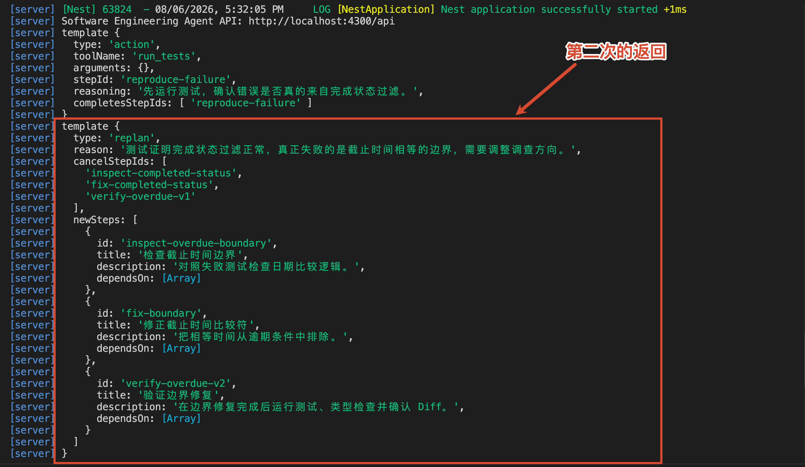

Provider 最终交给 Runtime 的 Replan Decision 中，则会同时包含计划变化和 `evidenceIds`。

这次 Plan v2 会取消已经被测试推翻的“完成状态”调查路线，再把后续任务改成“检查时间边界、修复比较逻辑、重新验证”。

`DecisionValidatorService` 会先确认这份证据是否真的存在于当前 Run 中：

```typescript
// 校验每个证据 ID 是否真实存在于当前运行记录中。
for (const id of evidenceIds) {
    const observation = run.observations.find((item) => item.id === id)
    const failure = run.failures.find((item) => item.id === id)

    if (!observation && !failure) {
        throw new Error(`Replan 引用了不存在的证据：${id}`)
    }
}
```

这样可以避免 Provider 没有任何依据就随意改计划。

Replan 通过校验以后，就会通过 `AgentRuntimeService` 的 `applyReplan()` 方法更新 Plan State  ：

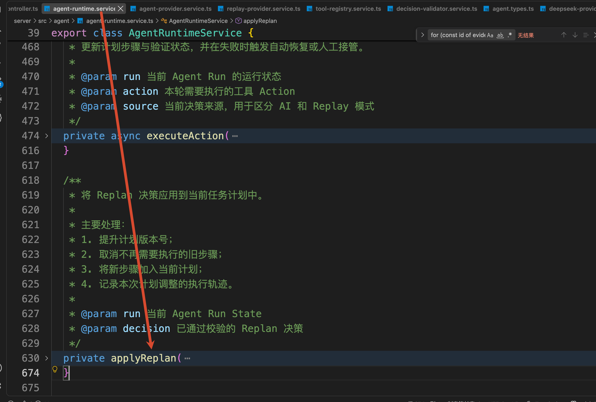

展开 `applyReplan` 核心代码如下

```typescript
// 每次重新规划都会生成一个新的计划版本。
run.plan.version += 1

// 将 Replan 指定的旧步骤标记为已取消。
for (const id of decision.cancelStepIds ?? []) {
    const step = run.plan.steps.find((item) => item.id === id)
  // 已完成的步骤保留完成状态，不能被后续 Replan 撤销。
    if (step && step.status !== 'completed') {
        step.status = 'cancelled'
    }
}

// 将新增步骤追加到当前计划中。
run.plan.steps.push(
    ...decision.newSteps.map((step) => ({
        ...step,
        status: 'pending',
        createdInVersion: run.plan.version
    }))
)
```

新计划会把版本从 `1` 改成 `2`，取消错误的调查路线，再加入三个新的步骤。

页面上看到的 Plan v2 就变成了：

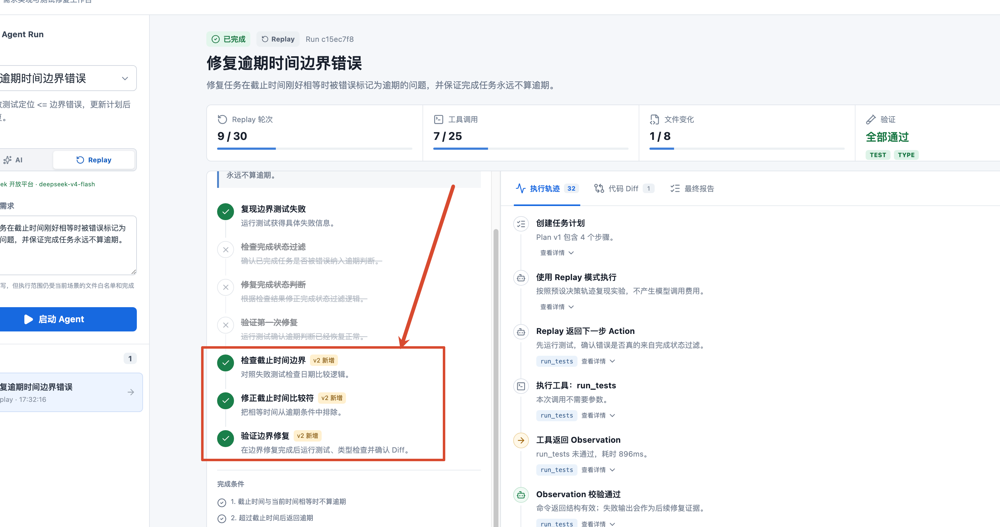

到这里，失败测试就真正改变了 Agent 后续要做的事情。

## 场景二：删除代码为什么会暂停
接下来，选择第三个场景：

```latex
审批后删除废弃代码
```

需求是：“删除已经被 TaskService 替代的 legacy-task.mapper.ts，删除前必须确认没有引用并获得人工批准。”

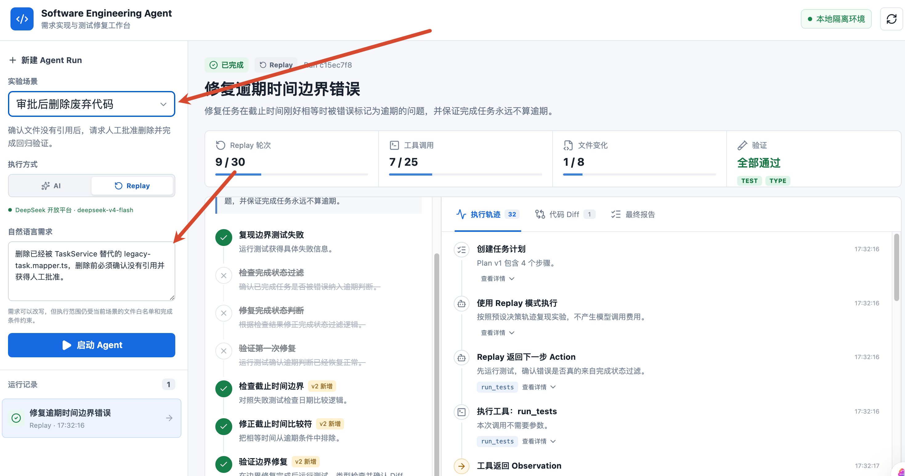

选择 `Replay` 模式，点击“启动 Agent”。

服务端创建完独立工作区以后，会生成这次任务的 Plan v1：

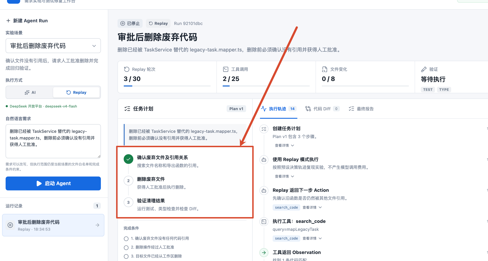

根据这个任务咱们也可以看到：Agent 得先检查文件是否还被其他代码使用，才能申请删除。

删除完成以后，还要通过测试和类型检查确认没有破坏项目。

Plan 创建完成以后，`schedule()` 会再次启动 `AgentRuntimeService.execute()`。

没错，还是它。。。

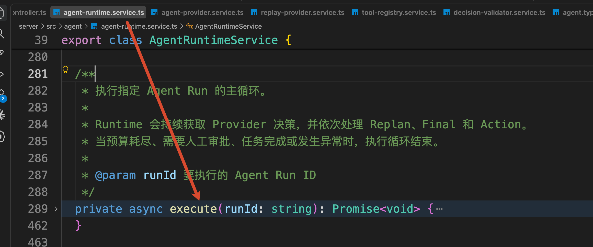

同样的 Runtime 循环。每一轮只获取一个 Decision，处理完成以后，再带着最新 Run State 进入下一轮。

### 第一轮：搜索旧函数的引用
第一轮，通过 `ReplayProvider` 的 `next` 方法，返回  `search_code` Action

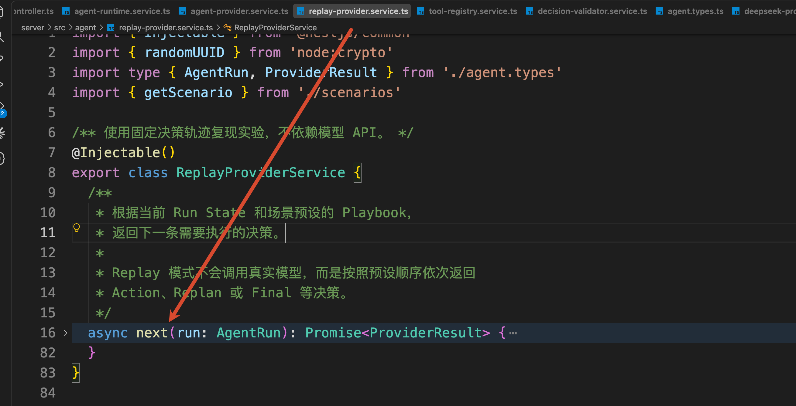

大致长下面这样：

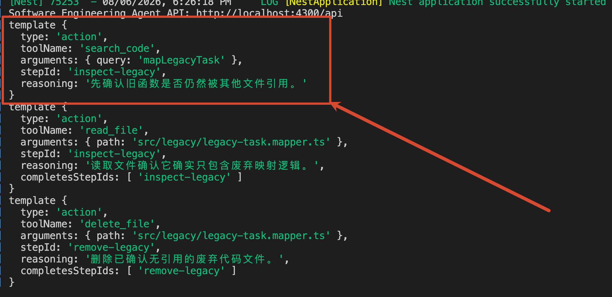

Runtime 将它交给 `executeAction()`

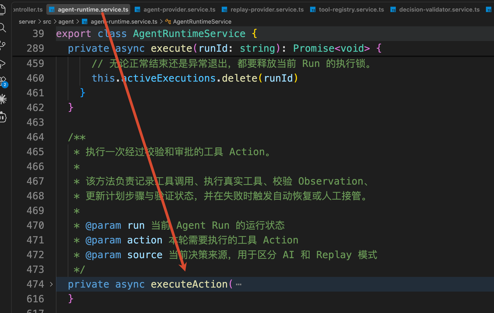

最终由 `WorkspaceService.search()` 在当前 Run 的独立工作区里搜索代码。

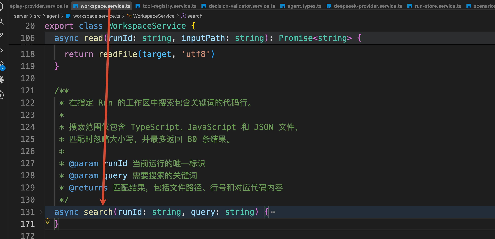

`executeAction()` 保存这次搜索产生的 Observation，然后回到 `while` 循环，进入下一轮。

### 第二轮：读取准备删除的文件
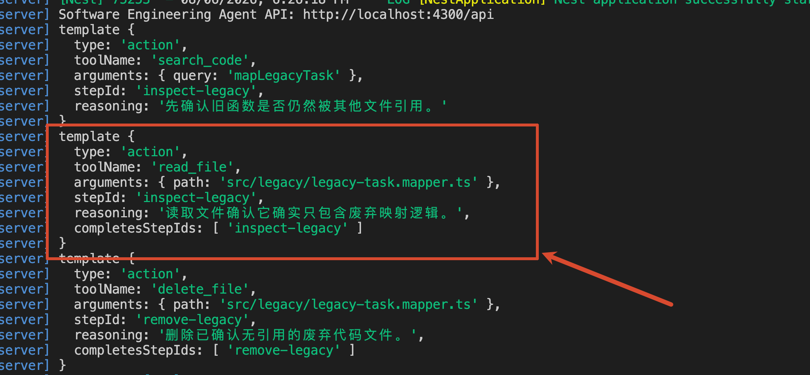

第二轮，Provider 返回 `read_file` Action，读取：

```latex
src/legacy/legacy-task.mapper.ts
```

文件中只保留了一段已经被 `TaskService` 替代的旧映射逻辑，没有其他职责。

这次 `read_file` 执行完成以后，`inspect-legacy` 对应的 Plan Step 才会被标记为 `completed`。

到这里，Runtime 中已经保存了两份真实 Observation：一份记录代码搜索结果，另一份记录目标文件的实际内容。

随后，`execute()` 再次回到循环开头，开始第三轮决策。

### 第三轮：Provider 申请删除文件
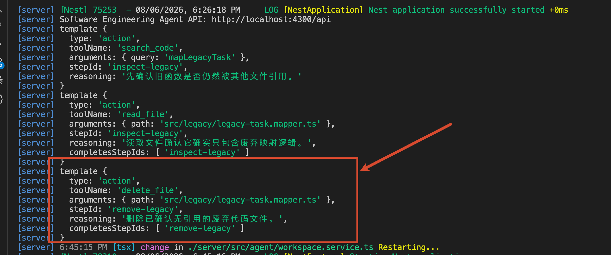

前置检查已经完成，所以这一次 Provider 才会提出 `delete_file` Action：

```json
{
  "type": "action",
  "action": {
    "toolName": "delete_file",
    "arguments": {
      "path": "src/legacy/legacy-task.mapper.ts"
    },
    "stepId": "remove-legacy",
    "reasoning": "删除已确认无引用的废弃代码文件。"
  }
}
```

如果这是一个普通工具，接下来就应该进入 `executeAction()`，再由 `ToolRegistryService` 完成实际操作。

但是，`delete_file` 没有被立刻执行。

页面会弹出一个 `Human-in-the-Loop` 确认窗口，Run 状态也会变成：`waiting_approval`

这说明 Action 已经生成了，但是在真正执行以前被 Runtime 暂停了。

接下来，咱们就顺着 `execute()` 继续看它为什么会停在这里。

### Runtime 是怎么知道 `delete_file` 有风险的？
先打开：

```latex
server/src/agent/tool-registry.service.ts
```

项目在注册工具时，会为每个工具标记风险级别（红框圈出来的就是这次会用到的）：

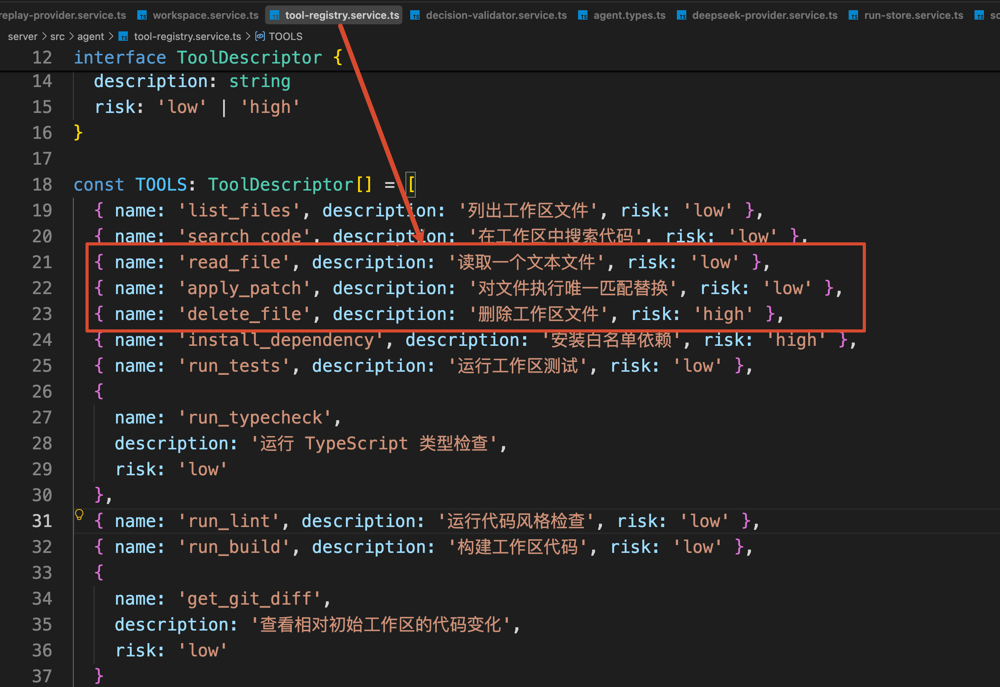

Runtime 可以通过 `requiresApproval()` 判断这个 Action 是否需要审批：

```typescript
/**
 * 判断指定工具是否属于高风险操作，需要人工审批后才能执行。
 *
 * @param toolName 工具名称
 * @returns 工具风险等级为 high 时返回 true，否则返回 false
 */
requiresApproval(toolName: ToolName): boolean {
    // 根据工具名称查找对应配置，并判断其风险等级是否为 high。
    return TOOLS.find((item) => item.name === toolName)?.risk === 'high'
}
```

不过，风险级别并不是唯一检查。

`DecisionValidatorService.validateAction 方法里面` 还会先确认当前场景是否允许删除这个文件：

```typescript
// 只能删除当前场景明确允许删除的文件。
if (!scenario.workspacePolicy.deletablePaths.includes(path)) {
    throw new Error(`当前场景不允许删除文件：${path}`)
}
```

所以，这里有两道控制：

+ 第一道：这个文件是否在允许删除的路径中
+ 第二道：这次高风险操作是否得到用户批准

文件不在 `deletablePaths` 中，Action 会被直接拒绝。

文件可以删，也不代表可以马上删，还要等用户确认。

### 进入 waiting_approval 以后发生了什么
回到 `AgentRuntimeService.execute()`。

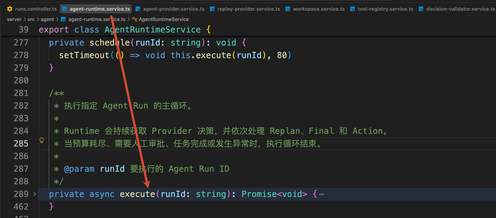

当 Runtime 发现当前工具需要审批，并且这个 Action 还没有被批准时，会执行：

```typescript
run.pendingApproval = {
    action,
    risk: 'high',
    title: '需要人工批准高风险操作',
    description: `Agent 准备执行 ${action.toolName}：${action.reasoning}`,
    requestedAt: new Date().toISOString()
}

run.status = 'waiting_approval'
await this.store.save(run)
break
```

这里最重要的是 `pendingApproval.action` 属性

它保存的就是当前还没有执行的 `delete_file` Action，包括文件路径、所属 Plan Step 和操作原因。

状态保存完成以后，`break` 会结束当前 Agent Loop。

### 点击“批准执行”以后，任务继续
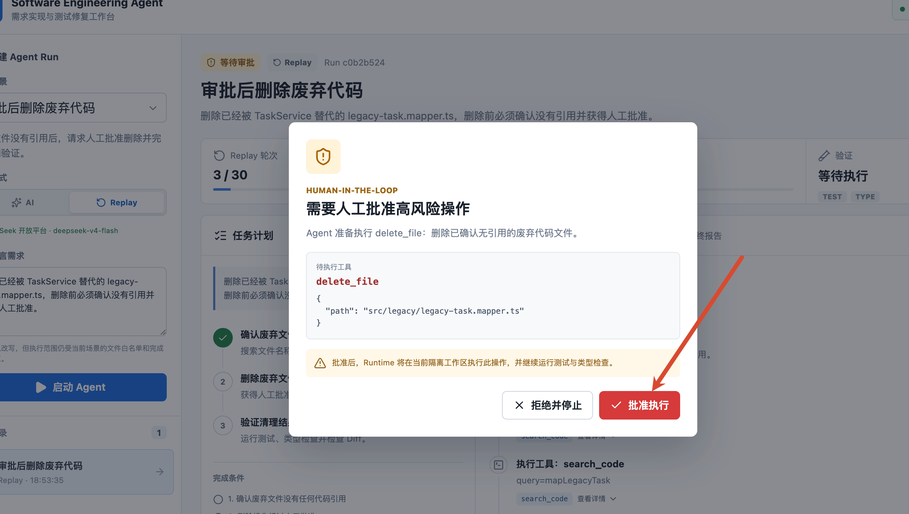

页面中的确认按钮会调用 `web/src/App.vue` 里面的 `approval `方法：

```typescript
/**
 * 处理当前 Run 的人工审批结果。
 *
 * @param approved 是否批准当前待执行操作
 */
async function approval(approved: boolean) {
  // 将审批结果提交给后端，并获取更新后的 Run State。
    const run = await api.approve(selectedRun.value.id, approved)
  // 使用后端返回的最新数据，替换本地列表中的对应 Run。
    runs.value = runs.value.map((item) =>
        item.id === run.id ? run : item
    )
}
```

它最终发送的请求是：

```http
POST /api/runs/{runId}/approval
Content-Type: application/json
```

```json
{
  "approved": true
}
```

请求进入 `RunsController`

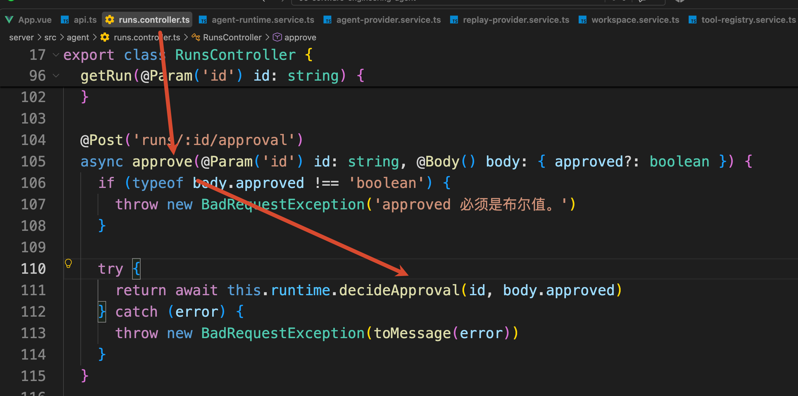

然后调用：

```typescript
this.runtime.decideApproval(id, body.approved)
```

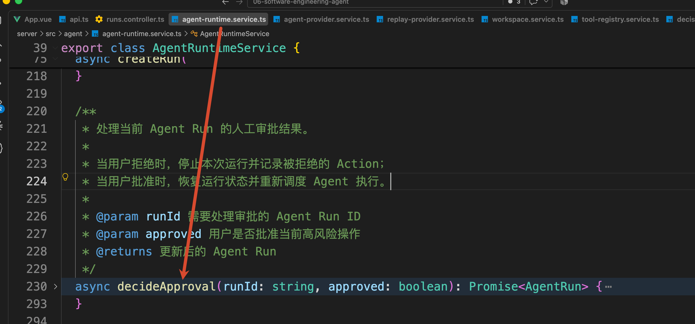

用户批准以后，`decideApproval()` 会做三件事：

```typescript
// 记录已获得用户批准的 Action，避免重复请求审批。
run.approvedActionIds.push(pending.action.id)
// 将运行状态恢复为 running，允许 Agent 继续执行。
run.status = 'running'

// 先保存审批后的状态，再继续调度后续执行。
await this.store.save(run)
this.schedule(runId)
```

把当前 Action ID 记录为已批准，把 Run 恢复为 `running`，再重新启动 `execute()`。

那么，新一轮 `execute()` 启动以后，会不会再让 Provider 生成一次删除 Action 呢？

**不会。**

进入每轮循环以后，Runtime 会先查找已经批准、但还没执行的 Action：

```typescript
/**
 * 检查是否存在已经获得人工批准、但尚未真正执行的 Action。
 *
 * 如果存在，则直接恢复该 Action；
 * 否则请求 Provider 根据当前 Run 状态生成下一步决策。
 */
const approvedAction = this.getApprovedPendingAction(run)

const providerResult = approvedAction
    ? {
            decision: { type: 'action', action: approvedAction },
            source: run.mode,
            model: run.model
        }
    : await this.provider.next(run)
```

如果找到，Runtime 会直接恢复 `pendingApproval` 中保存的原 Action，不再请求模型。

### 如果用户拒绝呢
可以再运行一次第三个场景，这次选择“拒绝并停止”。

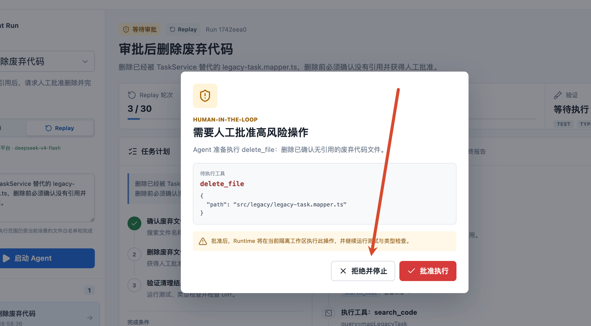

Runtime 会执行：

```typescript
run.pendingApproval = null
run.rejectedActionIds.push(pending.action.id)
this.finish(run, 'stopped', '用户拒绝了高风险操作。')
```

这时，目标文件不会被删除，任务也不会继续运行后面的测试。

## 最后一个：页面中的执行轨迹从哪里来
现在再回到页面。

无论是 Plan v2，还是等待审批，刚才经过的每一步都可以在“执行轨迹”中找到。

这些内容不是模型在任务结束后重新编出来的。

每当 Runtime 发生一个关键动作，都会调用 `addTrace()` 保存一条 Trace Event：

```typescript
private addTrace(
    run: AgentRun,
    event: Omit<TraceEvent, 'id' | 'createdAt'>
): void {
    run.trace.push({
        ...event,
        id: randomUUID(),
        createdAt: new Date().toISOString()
    })
}
```

例如，Runtime 准备执行工具时，会记录一条 `action`；工具返回以后，会记录 `observation`；计划发生变化时，会记录 `plan`。

测试失败时，项目实际会记录两条 Trace。第一条保存工具的原始结果：

```json
{
  "type": "observation",
  "title": "工具返回 Observation",
  "summary": "run_tests 未通过，耗时 887ms。",
  "status": "warning",
  "stepId": "reproduce-failure",
  "toolName": "run_tests"
}
```

第二条再记录校验结果：

```json
{
  "type": "validation",
  "title": "Observation 校验通过",
  "summary": "命令返回结构有效；失败输出会作为后续修复证据。",
  "status": "success",
  "stepId": "reproduce-failure",
  "toolName": "run_tests"
}
```

前端在 Run 处于 `planning`、`running` 或者 `waiting_approval` 时，会每隔 `650ms` 获取一次最新 Run：

```typescript
refreshTimer = window.setInterval(() => void refresh(), 650)
```

然后直接遍历 `selectedRun.trace`，把这些真实 Event 按时间顺序渲染出来。

所以，Trace 页面实际上是 Runtime 执行过程的可视化。

## 总结
到这里，AI 编程 Agent 的三个场景就全部跑完了。

+ 第一个场景跑通了正常的 ReAct 执行链路。
+ 第二个场景说明：测试失败可以是一份有效 Observation，并且继续推动 Replanning。
+ 第三个场景则说明：模型即使提出了高风险 Action，Runtime 也可以在真正执行前暂停，并且只恢复用户真正批准的那一次操作。
+ 最后，Trace 和 Report 把整个过程保留下来，让 Agent 不再是一个只能看到最终回答的黑盒。

如果只记住这个项目最重要的一件事，那就是：

> **模型负责提出下一步，Runtime 负责让整个过程可执行、可暂停、可恢复，也可以追溯。**
>

> 更新：2026-08-06 19:07 · 原文：<https://www.yuque.com/lgdsunday/ab1dy3/bnick2cs8zumi6lr>
