# 06-实战（中）：实现 ReAct、任务计划与执行控制

上一篇，咱们已经把整个 AI 编程 Agent 跑起来了。

这一小节就开始看代码了。

和之前一样，咱们从 「启动 Agent」这个按钮的触发事件开始，来看整个业务的处理逻辑

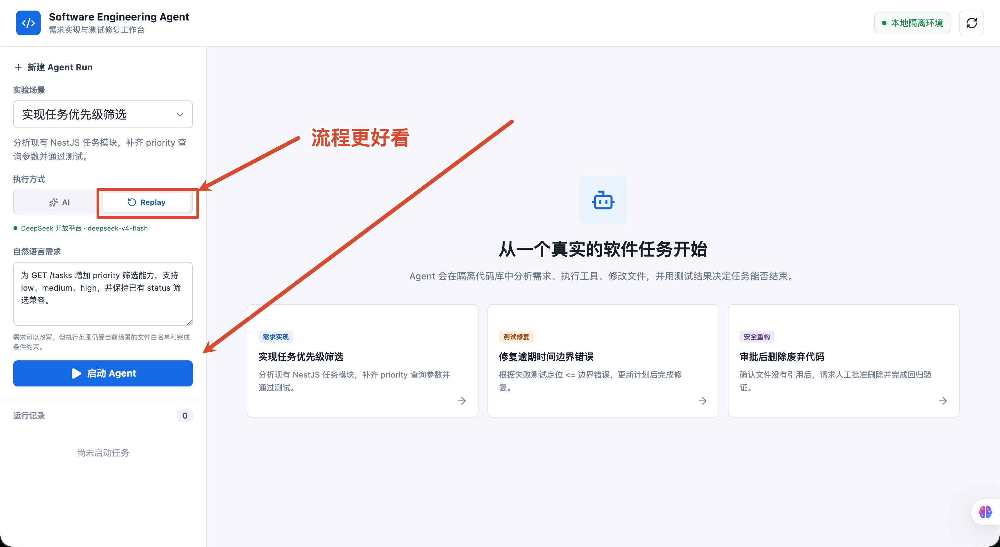

come on～

> 本项目代码位于：`Code/Node/第四章/06-software-engineering-agent`
>
> 阅读这一篇时，可以继续保持上一篇启动的 `npm run dev`。为了得到和文章一致的执行轨迹，建议先选择 `Replay` 模式运行。Replay 不会请求模型，但是会经过和 AI 模式完全相同的 Runtime、Tool 和状态管理流程。
>

## 从“启动 Agent”按钮进入项目
咱们先选择第一个场景：**实现任务优先级筛选**

页面入口位于：`web/src/App.vue`

点击「启动 Agent」按钮以后，会调用 `createRun()`：

```typescript
/**
 * 根据场景创建一次新的 Agent Run，并自动切换到运行轨迹页面。
 *
 * @param {string} scenarioId 要运行的场景 ID，默认使用当前选中的场景
 */
async function createRun(scenarioId = selectedScenarioId.value) {
    ...
    try {
        // 调用接口创建新的 Agent Run。
        const run = await api.createRun({
            scenarioId,
            requirement: nextRequirement,
            mode: mode.value
        })

        ....
    } 
}
```

这个方法收集了三个信息：

+ scenarioId ：当前选择的实验场景
+ requirement：用户输入的自然语言需求
+ mode：AI 或 Replay 的状态

然后，通过 `api.createRun()` 发送给服务端。

`api.createRun()`  代码位于 `web/src/api.ts`

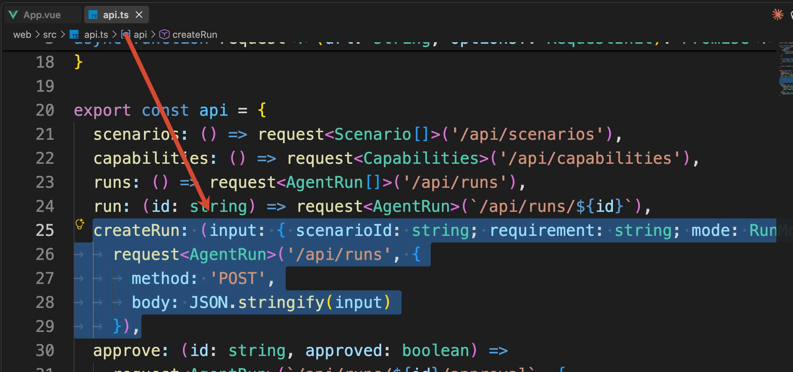

所以，点击按钮以后，浏览器真正发送的是一个这样的请求：

```http
POST /api/runs
Content-Type: application/json
```

```json
{
  "scenarioId": "priority-filter",
  "requirement": "为 GET /tasks 增加 priority 筛选能力，支持 low、medium、high，并保持已有 status 筛选兼容。",
  "mode": "replay"
}
```

这个请求会进入 NestJS 的 `RunsController`：

```latex
server/src/agent/runs.controller.ts
```

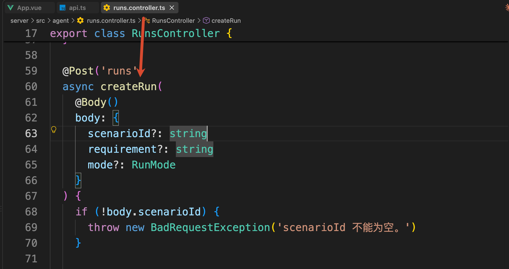

`createRun` 作为一个 `controller` 肯定不会做太多的事情，所以他的核心是调用了 `this.runtime.createRun`

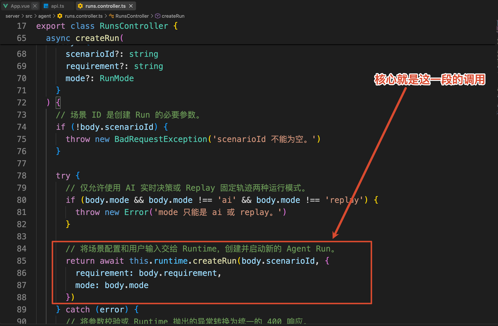

于是，调用链就从页面进入了 `AgentRuntimeService` ，这个调用流程应该比较简单，用 GPT-Image-2 花了个流程图：

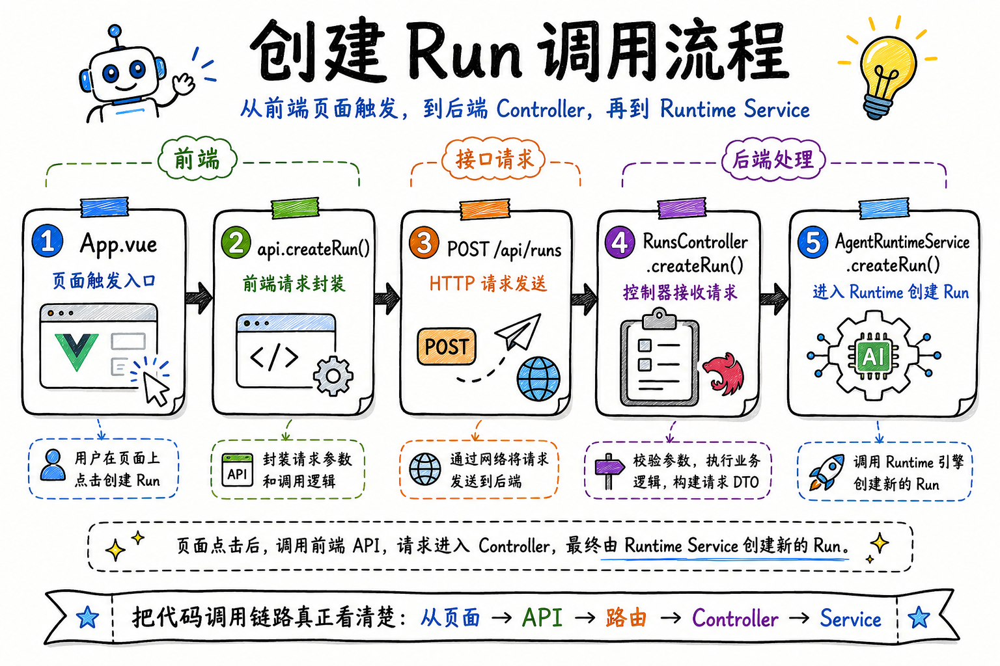

接下来，咱们继续进入 `AgentRuntimeService.createRun()`。

## 创建一个 Agent Run 时，项目做了什么
代码位于：

```latex
server/src/agent/agent-runtime.service.ts
```

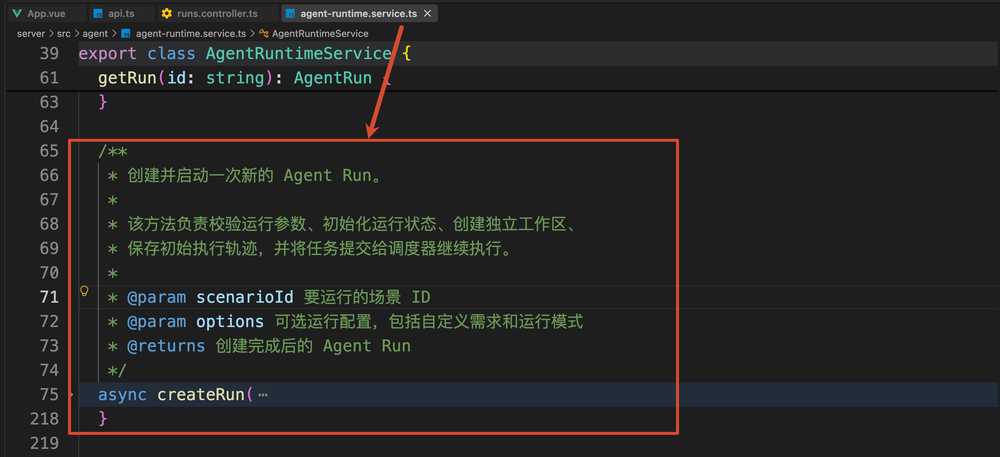

这个方法比较长，但是做的事情可以先归成四步：

1. 读取场景配置
2. 创建 Agent Run State
3. 创建独立代码工作区
4. 保存状态并启动 Agent Loop

咱们顺着代码看。

### 读取场景配置
`createRun()` 最开始会根据 `scenarioId` 找到当前场景：

```typescript
// 根据场景 ID 获取预设场景，场景不存在时由 getScenario 抛出异常。
const scenario = getScenario(scenarioId)

// 默认使用 Replay 模式，避免未明确指定时直接产生模型调用。
const mode = options.mode ?? 'replay'

// 优先使用用户输入的需求，否则使用场景预设需求。
const requirement = (options.requirement ?? scenario.requirement).trim()
...

// 确认当前 Provider 支持并且能够使用指定的运行模式。
this.provider.assertAvailable(mode)
```

如果选择 AI 模式，Provider 还会检查项目有没有配置 DeepSeek API Key。

那么，`scenario` 里面有什么？

打开：

```latex
server/src/agent/scenarios.ts
```

这里面的代码逻辑很简单，咱们来看下：

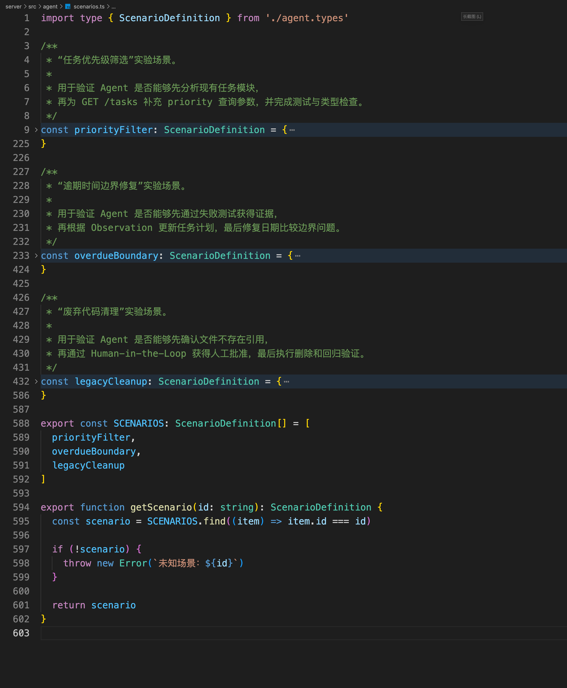

瞎看最后的 `getScenario` 方法，这个方法会根据用户选择的 **三种不同场景** 选择 `SCENARIOS` 中不同的数据

其中 `priorityFilter` 就是用户选择的第一个场景的数据结构

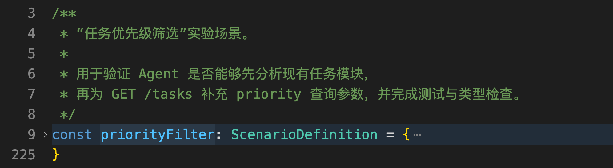

这个数据结构展开之后会特别长，给大家一个简化的样子：

```typescript
const priorityFilter = {
    id: 'priority-filter',
    title: '实现任务优先级筛选',
    requirement: '为 GET /tasks 增加 priority 筛选能力……',

    completionCriteria: [
        'TaskFilters 支持 priority 字段',
        'TaskService 可以同时按 status 和 priority 筛选',
        'TaskController 接收 priority 查询参数',
        '全部测试和类型检查通过'
    ],

    initialSteps: [
        {
            id: 'reproduce-and-inspect',
            title: '复现失败并分析任务模块',
            dependsOn: []
        },
        {
            id: 'implement-filter',
            title: '实现 priority 筛选',
            dependsOn: ['reproduce-and-inspect']
        },
        {
            id: 'verify-change',
            title: '验证代码改动',
            dependsOn: ['implement-filter']
        }
    ],

    workspacePolicy: {
        writablePaths: [
            'src/tasks/task.types.ts',
            'src/tasks/task.service.ts',
            'src/tasks/task.controller.ts'
        ],
        deletablePaths: []
    }
}
```

这里的核心是：**把一次代码任务的边界提前定义出来** 

其中：

+ `completionCriteria` 规定做到什么程度才算完成
+ `initialSteps` 提供第一版任务计划
+ `workspacePolicy` 决定当前任务可以修改哪些文件

这里有一个地方需要特别说明，那就是：**当前项目的 Plan v1 不是模型临时生成的，而是来自 **`scenario.initialSteps`**。**

为什么这么设计？

> 因为咱们这并不是一个通用编程 agent，而是一套用来学习 Agent Runtime 的受控课程项目。
>

如果第一版计划也完全由模型自由生成，那么不同模型、不同时间得到的步骤可能差别很大。大家看到的页面、执行轨迹和后面的代码讲解就很难对应起来。

所以，项目先提供一份稳定的 Plan v1，再让模型根据真实 Observation 决定每一步 Action，并在计划失效时执行 Replanning。

### 创建 Agent Run State
场景确定以后，然后咱们回到  `AgentRuntimeService.createRun()` 方法里面

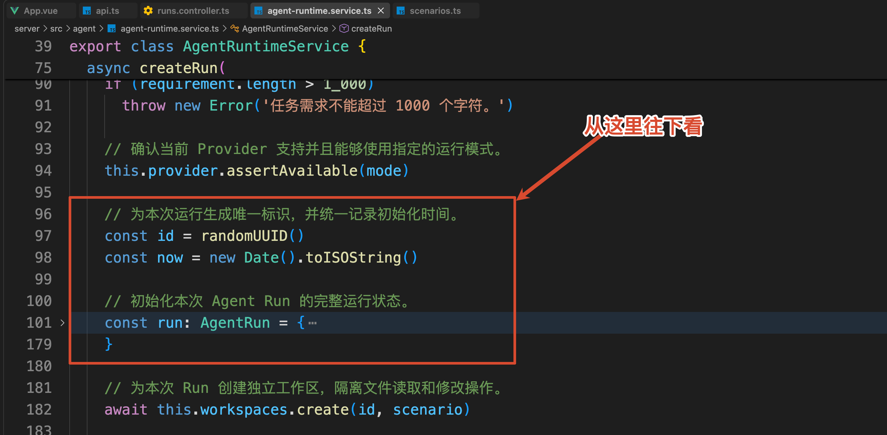

 Runtime 会创建一个唯一的 Run ID，再初始化整次任务的状态：

这就是本项目的 `Agent Run State`。

它是应用程序用来管理整次任务的状态对象，这个对象特别的长，里面会包含很多的属性

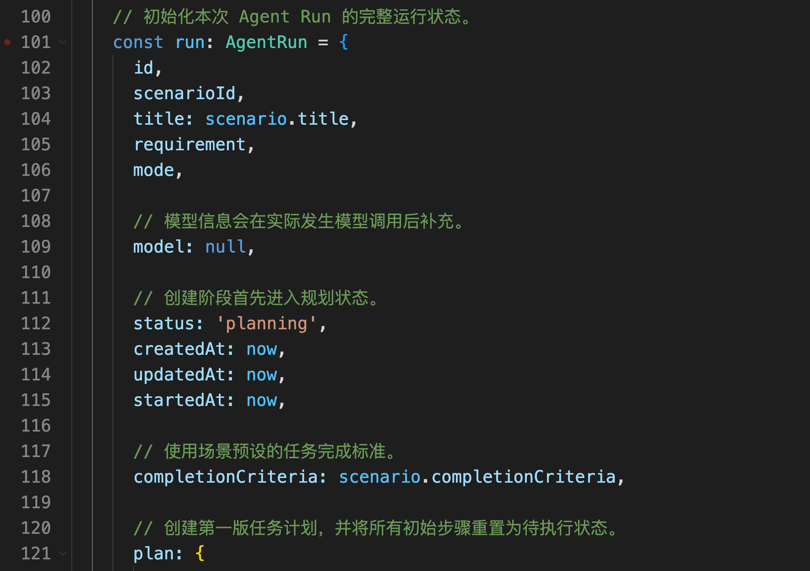

后面的每一次模型决策和工具调用，都会继续更新这个对象。

所以，页面能够实时展示 Plan、工具次数、代码 Diff 和最终报告，不是因为模型每轮重新描述了一遍。

而是因为这些信息一直保存在 Agent Run State 中。

### 创建独立代码工作区
状态对象创建以后，Runtime 会执行：`await this.workspaces.create(id, scenario)`

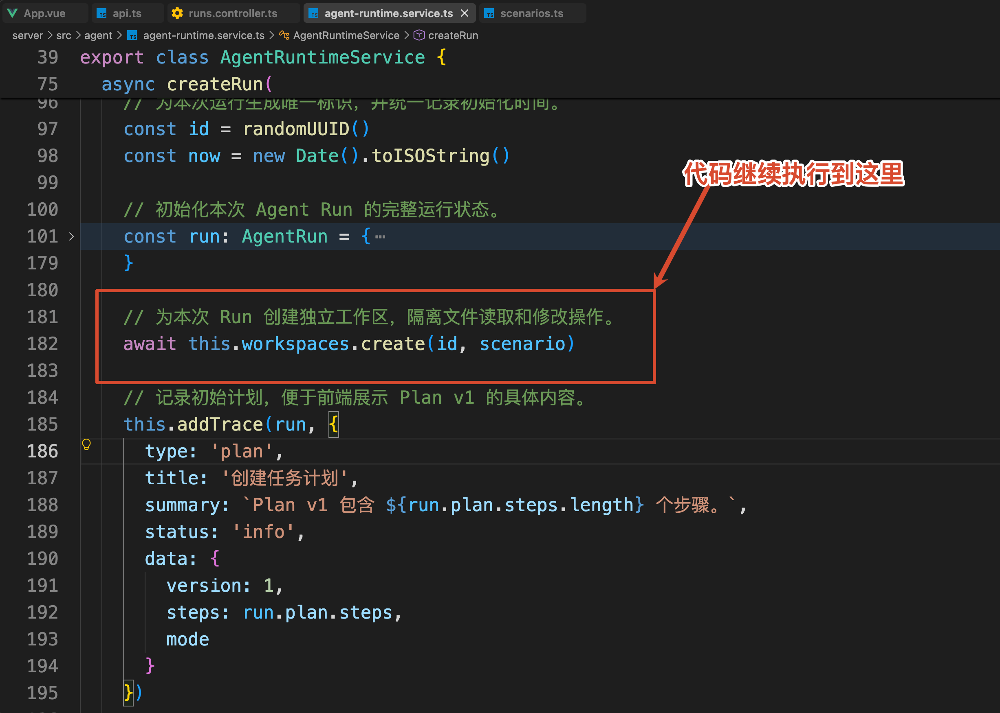

对应代码位于：

```latex
server/src/agent/workspace.service.ts
```

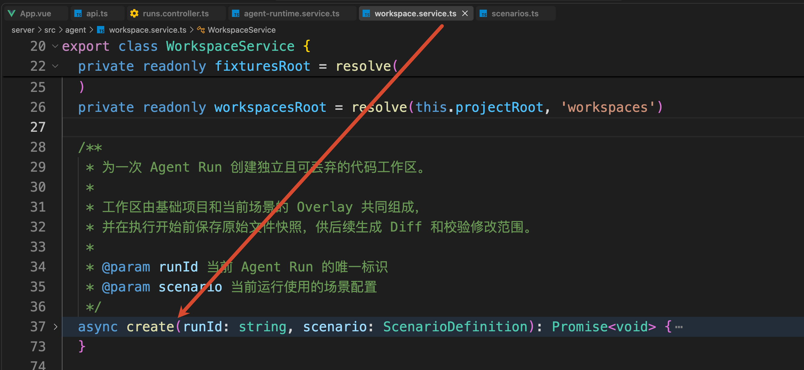

这个方法的核心就是创建代码工作区（即：文件夹），咱们来看看这个代码逻辑：

```javascript
/**
 * 为一次 Agent Run 创建独立且可丢弃的代码工作区。
 *
 * 工作区由基础项目和当前场景的 Overlay 共同组成，
 * 并在执行开始前保存原始文件快照，供后续生成 Diff 和校验修改范围。
 *
 * @param runId 当前 Agent Run 的唯一标识
 * @param scenario 当前运行使用的场景配置
 */
async create(runId: string, scenario: ScenarioDefinition): Promise<void> {
    // ===================================================
    // 第一件，根据 `runId` 创建本次运行专属的工作区
    // ==========================================================
    // 根据 Run ID 计算本次运行对应的独立工作区路径。
    const workspace = this.getWorkspacePath(runId)

    // 清理可能存在的旧工作区，确保每次运行都从干净环境开始。
    await rm(workspace, { recursive: true, force: true })

    // ==================================================
    // 第二件，向工作区复制代码
    // ==========================================================
    // 创建本次 Run 的空工作区目录。
    await mkdir(workspace, { recursive: true })

    // 将所有场景共享的基础项目完整复制到独立工作区。
    await cp(resolve(this.fixturesRoot, 'base'), workspace, {
        recursive: true
    })

    // 如果当前场景配置了 Overlay，则将场景专属文件覆盖到基础项目中。
    if (scenario.overlay) {
        await cp(
            resolve(this.fixturesRoot, 'overlays', scenario.overlay),
            workspace,
            { recursive: true }
        )
    }

    // ==========================================================
    // 第三件，在 Agent 修改代码前，`captureSnapshot()` 会读取工作区的所有文件，把原始内容保存到 `.agent/original.json` 中
    // ==========================================================
    // 在 Agent 修改代码前，记录工作区当前的完整文件快照。
    const snapshot = await this.captureSnapshot(runId)

    // 创建 Agent 内部元数据目录，不参与业务代码修改。
    await mkdir(resolve(workspace, '.agent'), { recursive: true })

    // 保存原始快照，后续可用于计算文件新增、修改和删除情况。
    await writeFile(
        resolve(workspace, '.agent/original.json'),
        JSON.stringify(snapshot, null, 2),
        'utf8'
    )
}
```

这段代码做了三件事。

第一件，根据 `runId` 创建本次运行专属的工作区：

```latex
workspaces/{runId}
```

创建以前会先删除可能存在的同名目录，保证每次都从干净的代码开始。

第二件，向工作区复制代码。这里会连续复制两次：

```latex
base 基础项目
+ 当前场景 Overlay
→ workspaces/{runId}
```

`base` 保存三个场景共用的任务项目。

`Overlay` 则会按照相同的文件路径，覆盖或者补充当前场景需要的文件。例如，`priority-filter` 会覆盖测试文件，加入优先级筛选用例；`overdue-boundary` 会覆盖逾期判断和对应测试，准备好时间边界错误。

第三件，在 Agent 修改代码前，`captureSnapshot()` 会读取工作区的所有文件，把原始内容保存到：

```latex
workspaces/{runId}/.agent/original.json
```

需要注意，`create()` 只负责保存这份快照，并没有在这里计算 Diff。

后面执行 `get_git_diff` 时，`getChanges()` 才会读取原始快照，再和 Agent 修改后的当前文件进行比较，最终算出文件的新增、修改和删除。所以，这个工作区本身并不需要是 Git 仓库。

这也解释了上一篇留下的一个问题。

Agent 修改的 `src/tasks/task.controller.ts`，并不在课程项目根目录中，而是在当前 Run 的隔离工作区里：

```latex
workspaces/{runId}/src/tasks/task.controller.ts
```

而 `fixtures` 只是用来创建工作区的原始模板，不会被 Agent 直接修改。每次运行都有自己的目录，前一次实验也就不会污染下一次实验。

### 保存状态，启动后台执行
接下来咱们继续往下看：

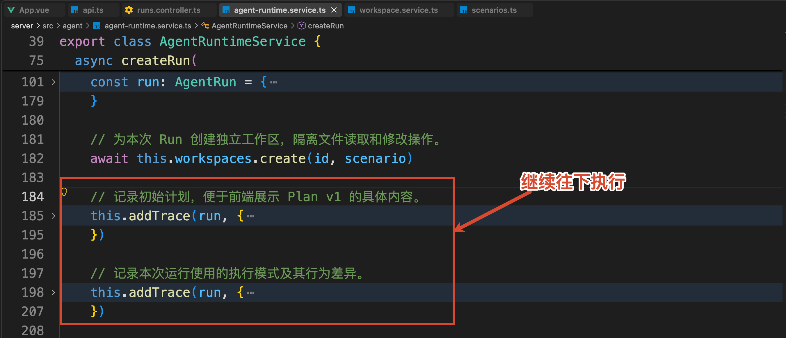

工作区准备完成以后，Runtime 会增加两条 Trace：

```typescript
// 记录初始计划，便于前端展示 Plan v1 的具体内容。
this.addTrace(run, {
    type: 'plan',
    title: '创建任务计划',
    summary: `Plan v1 包含 ${run.plan.steps.length} 个步骤。`,
    status: 'info',
    data: {
        version: 1,
        steps: run.plan.steps,
        mode
    }
})

// 记录本次运行使用的执行模式及其行为差异。
this.addTrace(run, {
    type: 'run',
    title: mode === 'ai' ? '使用 AI 模式执行' : '使用 Replay 模式执行',
    summary:
        mode === 'ai'
            ? '每一轮 Action 由 DeepSeek 模型根据当前代码和 Observation 动态生成。'
            : '按照预设决策轨迹复现实验，不产生模型调用费用。',
    status: 'info',
    data: { requirement }
})
```

然后把状态改成 `running`：

```typescript
// 初始化工作完成后，将 Run 切换为运行状态并持久化。
run.status = 'running'
await this.store.save(run)

// 将任务加入调度队列，由 Runtime 在后续执行循环中继续处理。
this.schedule(id)

// 返回存储层中的最新 Run，确保结果与持久化状态一致。
return this.getRun(id)
```

`RunStoreService.save()` 会把 Run 保存在当前 Node.js 进程的 Map 中

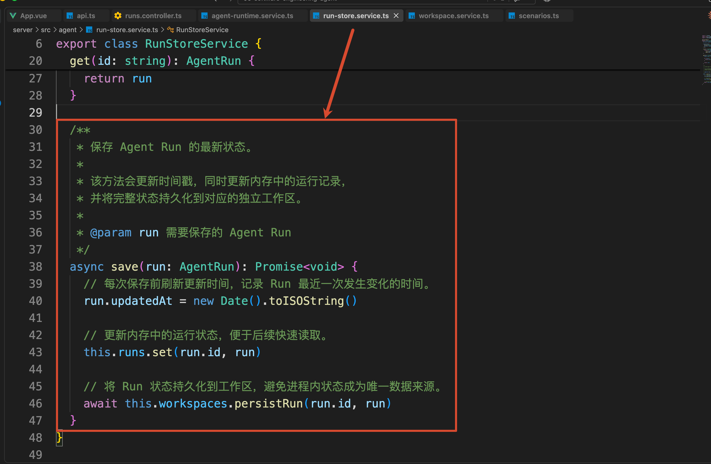

同时写入：

```latex
workspaces/{runId}/.agent/run.json
```

Map 用于当前服务进程中的快速查询，`run.json` 用于保留实验状态和排查记录。

不过，当前课程项目没有实现服务重启后的自动恢复。Node.js 进程重新启动以后，不会主动扫描这些 JSON 并恢复未完成任务。**这部分会在后面学习持久运行时继续处理。**

最后，`schedule()` 使用一个很短的异步调度启动 Agent：

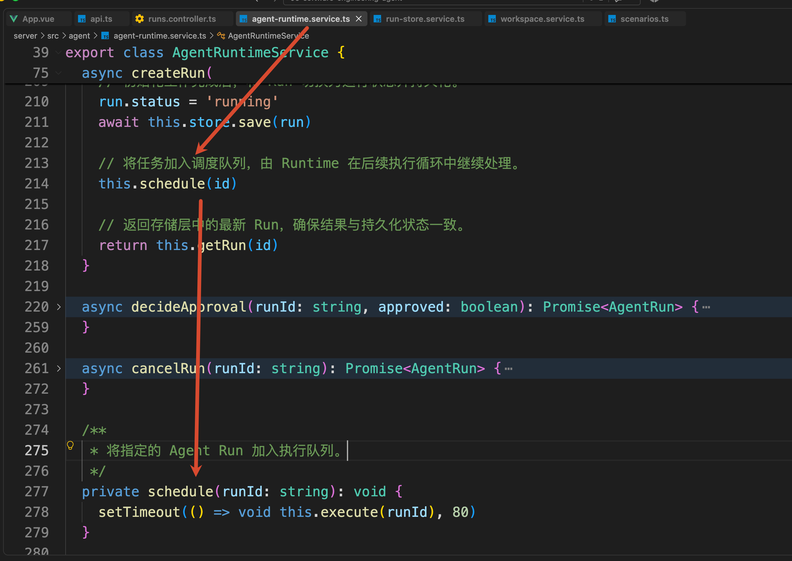

到这里，一次 Agent Run 已经创建完成。

下面正式进入整个项目的核心：`execute()`。

## Runtime 怎样让 Agent 一轮一轮执行
`execute()`  方法也位于：`server/src/agent/agent-runtime.service.ts` 中

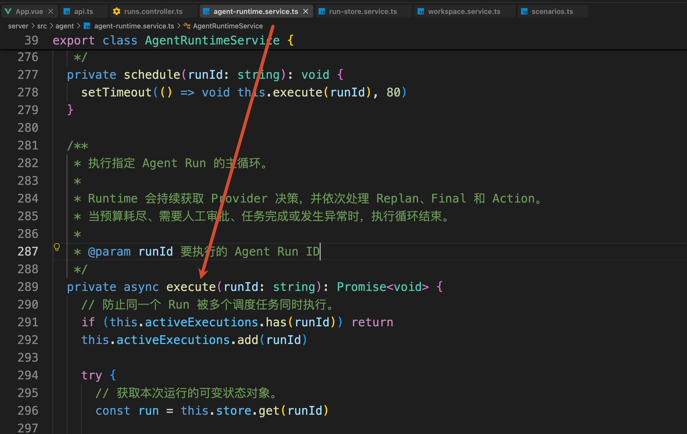

这个方法就是当前项目的 Agent Loop。

代码比较长，咱们先看重点：

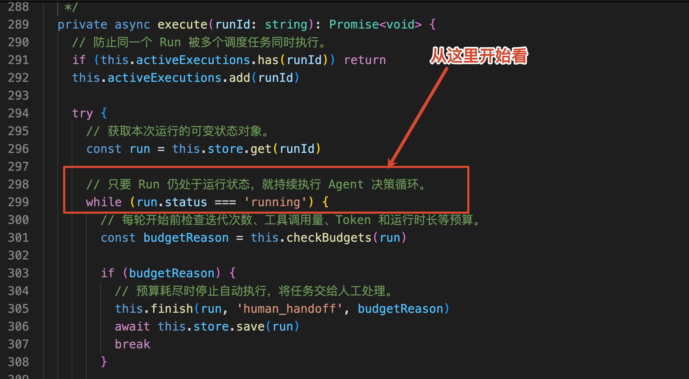

从上面的 `while (run.status === 'running')` 开始看

只要 Run 仍然是 `running`，Runtime 就继续获取下一步决策。

工具返回 Observation 以后，循环不会结束。新的状态会再次交给 Provider，让它继续决定下一步。

这就是 ReAct 在当前项目中的实际落点。

### 每一轮开始以前先检查预算
进入 `while` 以后，Runtime 不会立刻调用模型。

它先执行：

```typescript
// 每轮开始前检查迭代次数、工具调用量、Token 和运行时长等预算。
const budgetReason = this.checkBudgets(run)
```

当前项目会检查：

```typescript
private checkBudgets(run: AgentRun): string | null {
    if (run.usage.iterations >= run.limits.maxIterations) {
        return '达到最大迭代次数。'
    }

    if (run.usage.toolCalls >= run.limits.maxToolCalls) {
        return '达到最大工具调用次数。'
    }

    if (run.usage.filesChanged > run.limits.maxFilesChanged) {
        return '修改文件数量超过预算。'
    }

    const executionDurationMs = run.startedAt
        ? Date.now() - Date.parse(run.startedAt) - run.usage.approvalWaitMs
        : 0

    if (executionDurationMs > run.limits.maxDurationMs) {
        return 'Agent Run 执行时间超过预算。'
    }

    return null
}
```

如果预算耗尽，Runtime 会停止循环，把任务转交人工。

这个判断必须发生在模型调用以前。

否则明明已经超过预算，程序还是会多调用一次模型，再多执行一次工具。

### Provider 怎么给出下一步决策
预算没有问题，Runtime 才会执行：

```typescript
const providerResult = await this.provider.next(run)
```

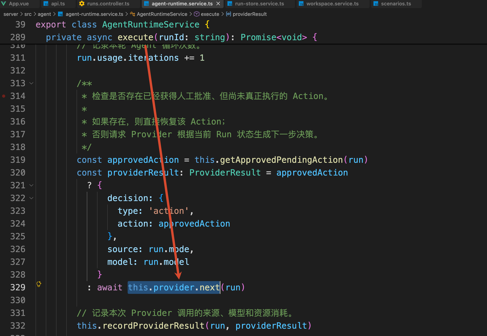

`AgentProviderService` 的代码很短：

```typescript
next(run: AgentRun): Promise<ProviderResult> {
    return run.mode === 'ai'
        ? this.deepseek.next(run)
        : this.replay.next(run)
}
```

AI 模式和 Replay 模式的区别只在这里。

+ `DeepSeekProviderService` 会把当前 Run State 整理成模型上下文，再请求 DeepSeek。
+ `ReplayProviderService` 则从 `scenario.playbook` 中取出下一条预设决策。

两边最终都返回统一的 `ProviderResult`：

```typescript
/**
 * Provider 单次决策调用的返回结果。
 *
 * 除了 Agent 的下一步决策，还包含决策来源、实际使用的模型、
 * 调用耗时以及 Token 消耗等运行统计信息。
 */
export interface ProviderResult {
    // Provider 返回的下一步决策，可能是 Action、Replan 或 Final。
    decision: AgentDecision

    // 当前决策的来源模式，用于区分 AI 动态决策和 Replay 固定轨迹。
    source: RunMode

    // 实际参与本次决策的模型名称；Replay 模式下通常为 null。
    model: string | null

    // Provider 完成本次决策所消耗的时间，单位为毫秒。
    latencyMs?: number

    // 模型调用产生的 Token 使用情况；Replay 模式下通常不存在。
    usage?: {
        // 输入给模型的 Prompt Token 数量。
        promptTokens: number

        // 模型生成决策所消耗的输出 Token 数量。
        completionTokens: number

        // 本次调用消耗的 Token 总数。
        totalTokens: number
    }
}
```

所以，Runtime 不需要知道这条决策来自真实模型还是 Replay。

它只需要处理 `decision`。

这就是 Provider 抽象的作用：**把“谁来产生下一步决策”和“Runtime 怎样执行决策”分开。**

Replay 不是另一套写死的业务逻辑。

它只是用固定数据替换了模型决策，后面的参数校验、工作区操作、测试命令、状态更新和完成检查，仍然走真实代码。

因此，它很适合课程演示和自动化测试。

### 模型每一轮能看到什么
AI 模式下，`DeepSeekProviderService` 不会把整个 `AgentRun` 原封不动地发给模型。

发送以前，会先调用：

```typescript
this.context.build(run)
```

代码位于：

```latex
server/src/agent/agent-context.service.ts
```

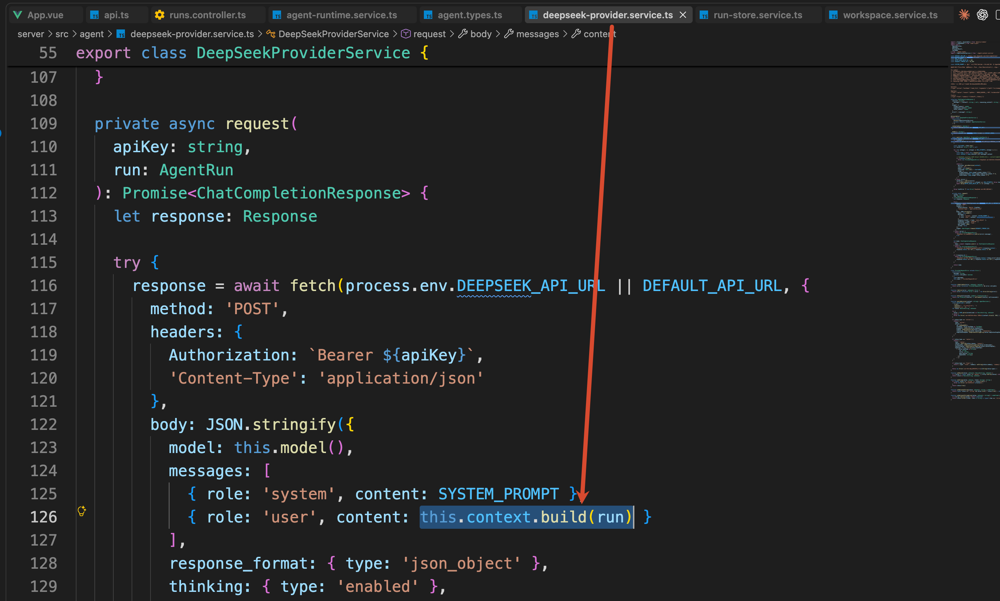

整理后的上下文大概是下面这样：

```json
{
  "task": {
    "title": "实现任务优先级筛选",
    "requirement": "为 GET /tasks 增加 priority 筛选能力……",
    "completionCriteria": ["……"]
  },
  "workspacePolicy": {
    "writablePaths": ["……"],
    "deletablePaths": [],
    "instructions": ["……"]
  },
  "plan": {
    "version": 1,
    "steps": ["……"]
  },
  "budget": {
    "limits": {},
    "usage": {}
  },
  "verification": {},
  "tools": ["……"],
  "observations": ["最近的工具结果"],
  "failures": ["最近的执行失败"],
  "recentActions": ["最近的决策"]
}
```

这里就把前面学过的内容串起来了。

模型要决定下一步，不只需要用户的 requirement。它还要知道当前 Plan、已经获得的 Observation、可使用的工具、文件权限、预算和验证状态。

同时，项目只保留最近 `14` 条 Observation、最近 `5` 条 Failure 和最近 `8` 条决策，过长字符串也会截断。

这不是完整的 Context Compression，但它表达了一个很重要的工程思路：**Provider 应该读取经过整理的 Agent Context，而不是无限累积全部运行数据。**

### 为什么模型返回的是 Action、Replan 和 Final
当前项目请求 DeepSeek 时开启了 JSON Output：

```typescript
body: JSON.stringify({
    model: this.model(),
    messages: [
        { role: 'system', content: SYSTEM_PROMPT },
        { role: 'user', content: this.context.build(run) }
    ],
    response_format: { type: 'json_object' },
    thinking: { type: 'enabled' },
    reasoning_effort: 'high',
    max_tokens: 4096,
    stream: false
})
```

DeepSeek 的 [JSON Output 官方文档](https://api-docs.deepseek.com/guides/json_mode/) 要求请求中设置 `response_format: { type: 'json_object' }`，并在 Prompt 中明确要求模型返回 JSON。

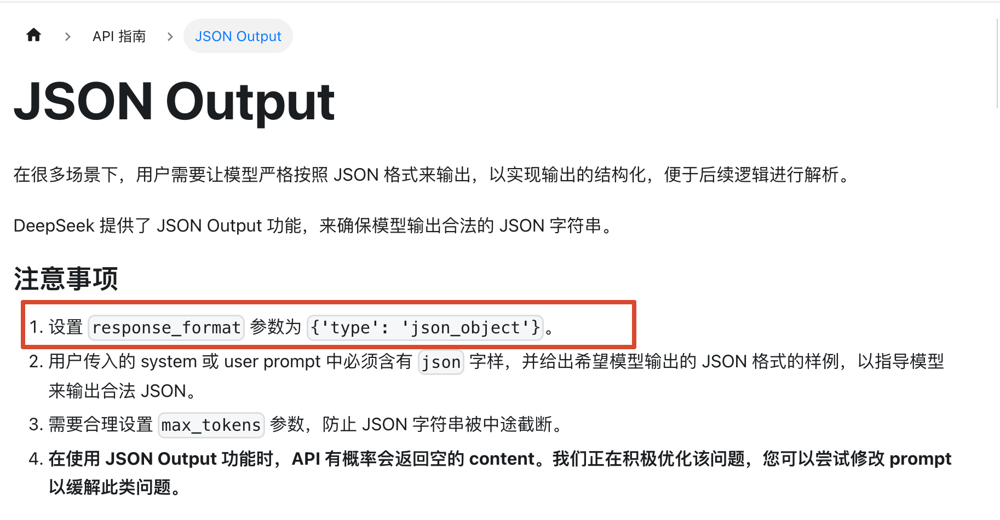

项目的 System Prompt 规定模型只能返回三种结构。

第一种是 `Action`：

```json
{
  "type": "action",
  "toolName": "read_file",
  "arguments": {
    "path": "src/tasks/task.service.ts"
  },
  "stepId": "reproduce-and-inspect",
  "reasoning": "检查任务列表当前如何应用 status 条件",
  "completesStepIds": []
}
```

第二种是 `Replan`：

```json
{
  "type": "replan",
  "reason": "失败测试证明原计划缺少边界修复步骤",
  "evidenceIds": ["Observation ID"],
  "cancelStepIds": [],
  "newSteps": [
    {
      "id": "fix-boundary",
      "title": "修正截止时间比较符",
      "description": "把相等时间从逾期条件中排除",
      "dependsOn": ["inspect-overdue"]
    }
  ]
}
```

第三种是 `Final`：

```json
{
  "type": "final",
  "summary": "priority 筛选已完成，并通过测试和类型检查。"
}
```

这里可能会有同学问：第三章已经学过原生 Tool Calling，为什么这个项目没有直接让模型返回 `tool_calls`？

因为当前项目不只有工具调用。

模型还要提出 `Replan` 和 `Final`。Replay Provider 也需要返回完全相同的决策结构。

所以项目在模型和 Runtime 之间定义了一层统一的 `AgentDecision`，再使用 JSON Output 生成这份决策。

### 模型提出 Action，不等于工具会立刻执行
代码重新回到 `execute` 方法里面

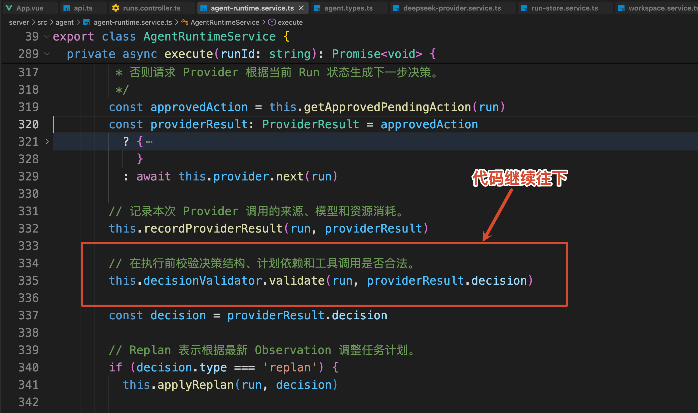

Provider 返回决策以后，Runtime 会先执行：

```typescript
this.decisionValidator.validate(run, providerResult.decision)
```

`DecisionValidatorService` 的 `validate` 主要是检查各种工具的边界，这里检查的还不少

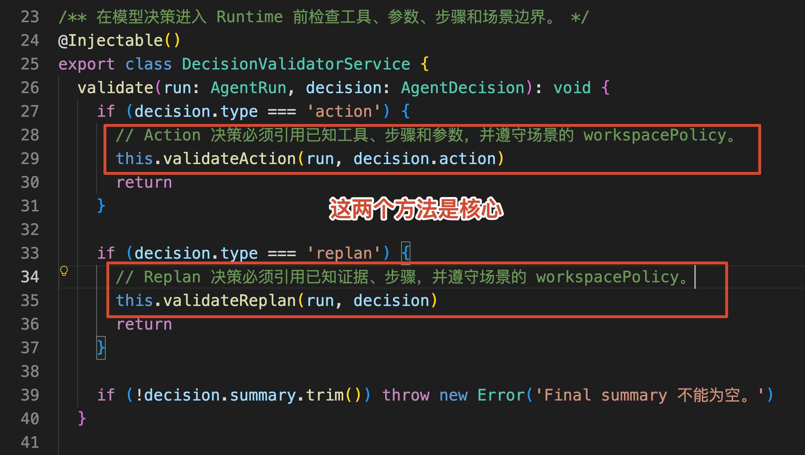

咱们可以简单看下 `validateAction` 方法：

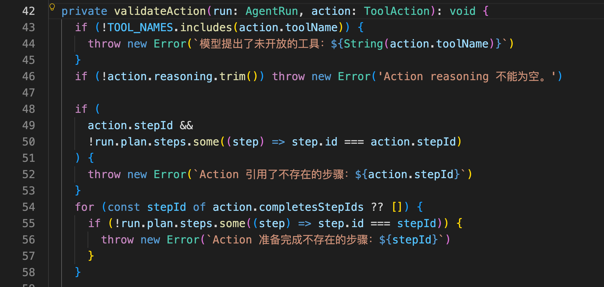

这里简单了解就行，不用太深入了。

### Action 怎样变成 Observation
决策通过校验以后，Runtime 会调用 `executeAction()`。

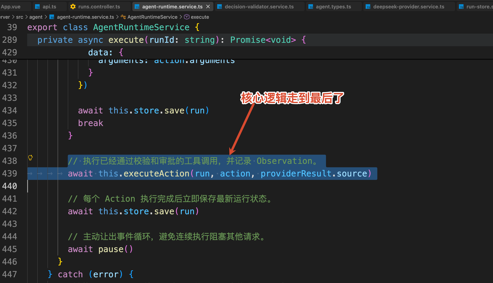

`executeAction` 的代码：

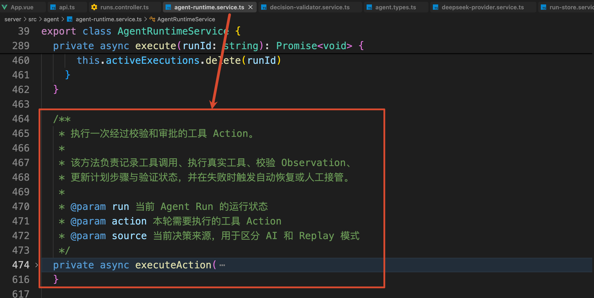

在 `executeAction` 方法中会先记录一次工具调用：

```typescript
// 统计本次工具调用。
run.usage.toolCalls += 1
// 将当前 Action 对应的计划步骤标记为执行中。
this.markStepRunning(run, action.stepId)
// 记录工具即将执行以及本次调用使用的参数。
this.addTrace(run, {
    type: 'action',
    title: `执行工具：${action.toolName}`,
    summary: formatArguments(action.arguments),
    status: 'info',
    stepId: action.stepId,
    toolName: action.toolName
})
```

然后进入 `ToolRegistryService `的 `execute` 方法：

```typescript
// 调用真实工具，并获得标准化的 Observation。
const observation = await this.tools.execute(run, action)
```

这个方法其实只做了两件事：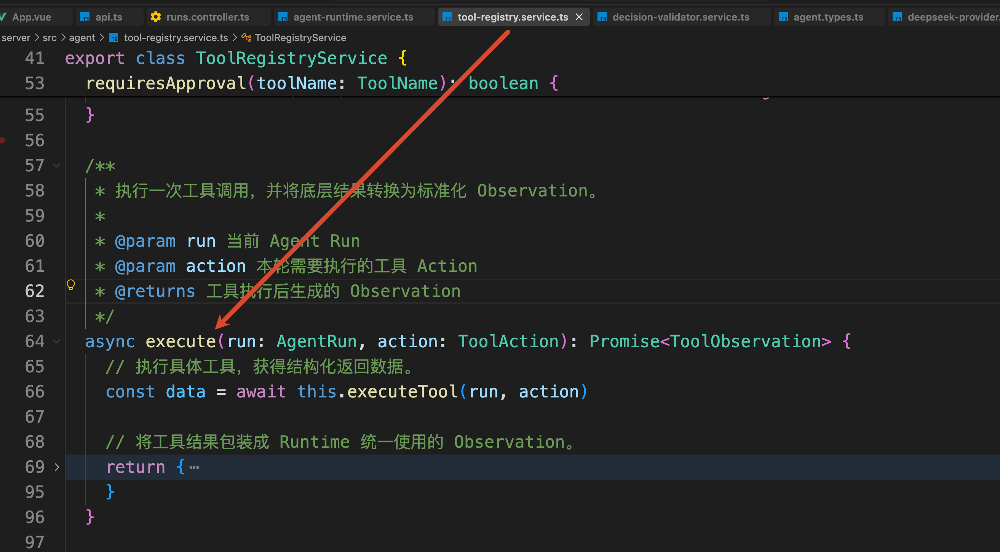

+ 第一：触发 `executeTool` 方法，反馈结构化数据
+ 第二：把 结构化数据包装成 Runtime 统一使用的 Observation

```typescript
// 将工具结果包装成 Runtime 统一使用的 Observation。
return {
    // 当前 Observation 的唯一标识。
    id: randomUUID(),

    // 关联产生该结果的 Action。
    actionId: action.id,

    // 记录本次实际执行的工具名称。
    toolName: action.toolName,

    // executeTool 正常返回，表示工具执行成功。
    ok: true,

    // 根据工具名称和返回数据生成人类可读的结果摘要。
    summary: summarize(action.toolName, data),

    // 保存工具返回的完整结构化数据。
    data,

    // 生成证据标识，用于区分和追踪不同工具调用结果。
    evidenceKey: `${action.toolName}:${stableStringify(
        action.arguments
    )}:${run.usage.toolCalls}`,

    // 记录 Observation 的创建时间。
    createdAt: new Date().toISOString()
}
```

Observation 还要经过 `ResultValidatorService`。

这个校验器为什么存在、命令失败为什么仍然可能是一份有效 Observation，会在下篇详细讲解。这里先知道：**只有结构合法的工具结果，才会进入 Agent Run State。**

校验通过以后，Runtime 才会保存它：

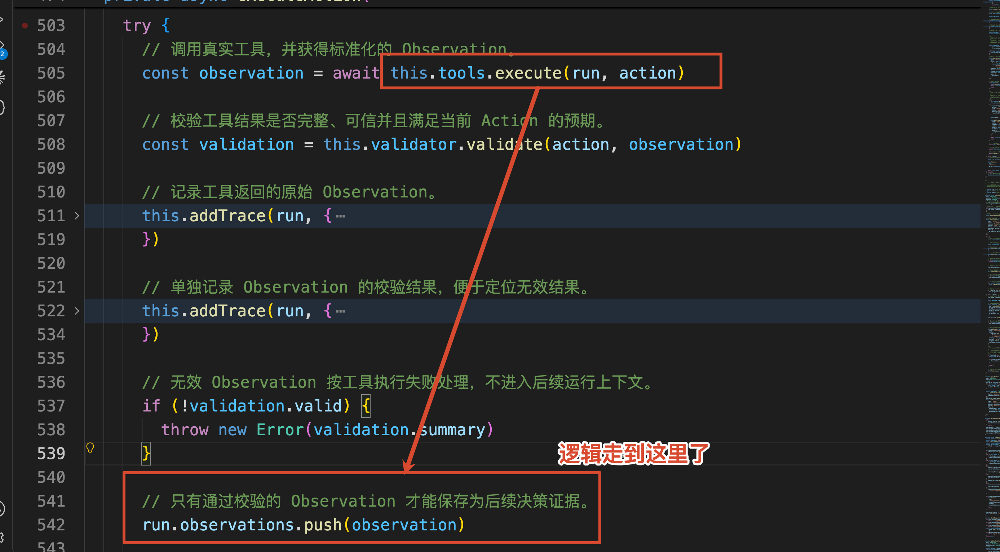

```typescript
// 只有通过校验的 Observation 才能保存为后续决策证据。
run.observations.push(observation)

// 根据测试、类型检查、Diff 等工具结果更新最终验证状态。
this.updateVerification(run, action, observation)

// 将 Action 声明完成的计划步骤更新为已完成。
for (const stepId of action.completesStepIds ?? []) {
    this.completeStep(run, stepId)
}
```

接着，本轮状态会写入 Store，`while` 进入下一轮。

## 总结
到这里，AI 编程 Agent 最核心的执行链路就讲完了。

咱们从页面中的“启动 Agent”按钮开始，一直追到了 Runtime 的完成检查，整个内容，我梳理了一套对应的流程图，大家可以看下：

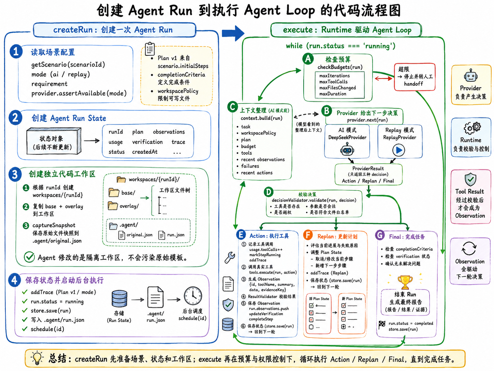

这张图里的代码看着不少，但是核心其实就是一个不断重复的循环：

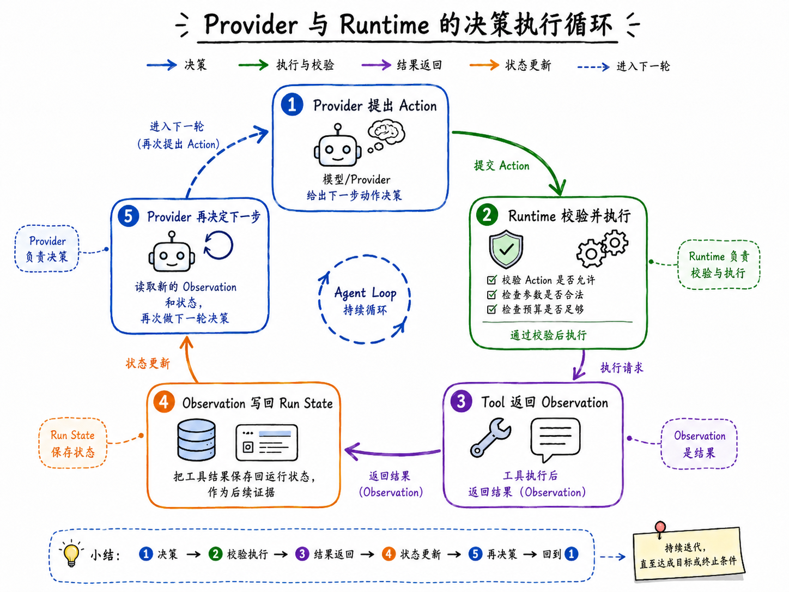

所以，真正修改代码的不是模型。模型负责判断下一步做什么，Runtime 负责控制执行过程，Tool 才负责读取文件、修改代码和运行测试。

当 Plan 中的任务全部完成，并且测试、类型检查和代码修改范围都满足要求以后，这次 Agent Run 才会真正结束。

到这里，咱们就把 AI 编程 Agent 的 ReAct 主循环、任务计划和执行控制串起来了。

下一篇继续看工具结果校验、失败恢复，以及删除代码时的人工确认流程。

> 更新：2026-08-05 17:45 · 原文：<https://www.yuque.com/lgdsunday/ab1dy3/re3znf5yo9omam8h>
