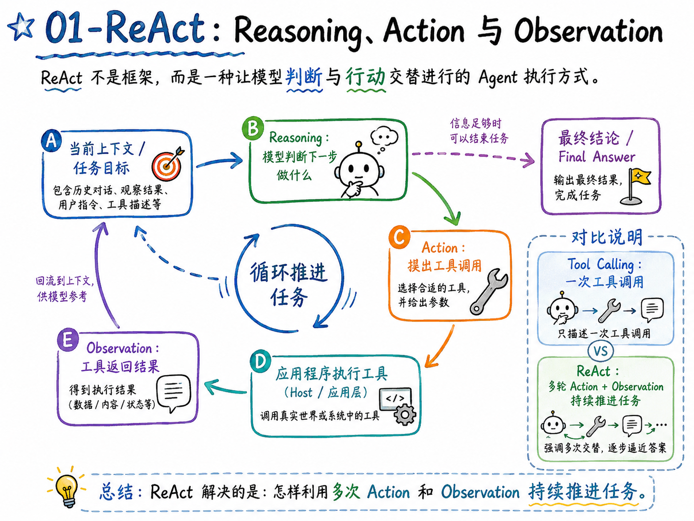
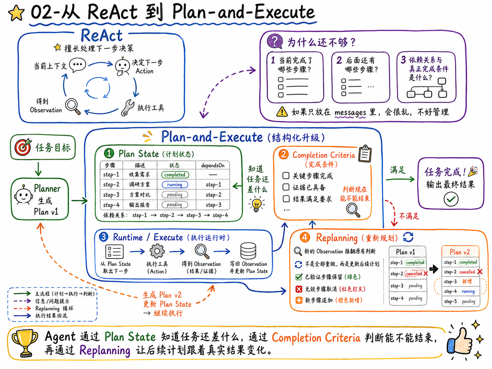
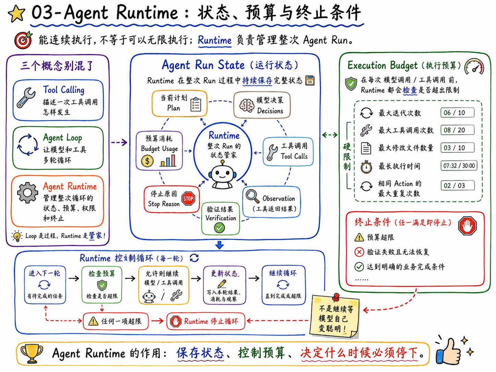
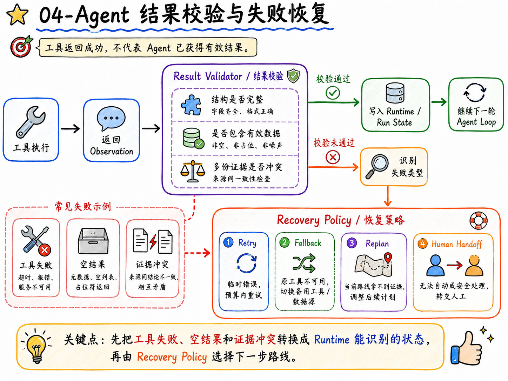
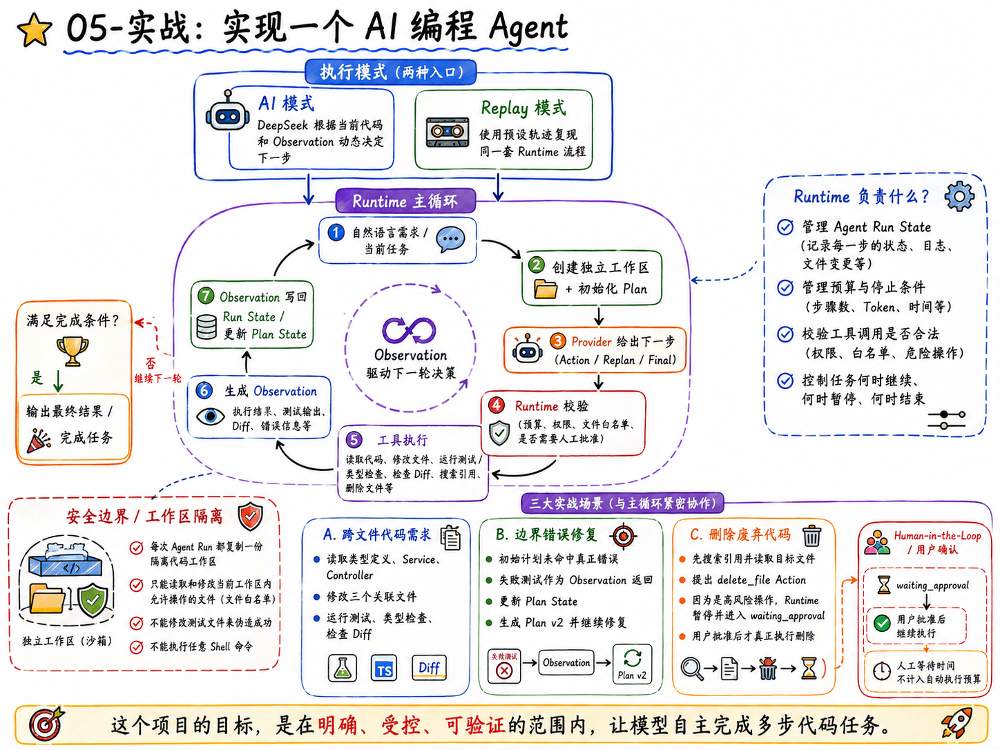

# 07 - 第四章总结：Agent 学到的内容如何在简历和面试中体现

到这里，第四章就结束了。

在本章里面，咱们从一个最小的 ReAct 循环开始，继续加入任务规划、Plan State、Replanning、Agent Runtime、执行预算、结果校验和失败恢复。

最后，又把这些能力组装成了一个 `AI 编程 Agent`。

+ 它能够根据自然语言理解代码需求，读取并修改多个文件，运行测试和类型检查。
+ 测试结果推翻原计划以后，它还会生成 Plan v2。
+ 遇到删除文件这类高风险操作时，Runtime 会暂停执行，等待用户确认。

这一节，咱们就把第四章真正学到的东西梳理一遍，再看看这些内容应该怎样体现在简历和面试中。

## 第四大章都学了啥
> PS：第一小节是前言，就不写了哈。从第二小节的正式内容开始
>

### 01-ReAct：Reasoning、Action 与 Observation


在本章的一开始，咱们就实现了一个最小 ReAct Agent。

这里咱们需要知道：`ReAct` 不是框架，而是一种让模型判断和行动交替进行的 Agent 执行方式。

> 模型先根据当前上下文提出一个 `Action`，应用程序执行工具并得到 `Observation`，然后把 Observation 重新交给模型。
>

模型拿到新结果以后，再决定继续调用工具还是生成最终结论。

Tool Calling 只描述了一次工具调用。

ReAct 解决的是：**怎样利用多次 Action 和 Observation 持续推进任务。**


### 02-从 ReAct 到 Plan-and-Execute


ReAct 可以解决“下一步做什么”，但是任务一长，又会出现新的问题。

那就是：

+ 当前完成了哪些步骤？
+ 后面还有哪些步骤？某一步依赖什么？什么时候才算真正完成？

如果这些信息只放在 `messages` 里，就会很乱，不好管理。

所以这一节继续加入了结构化任务计划。

Planner 会根据任务目标生成第一版计划，Runtime 再把它保存成 `Plan State`。

其中每个步骤都有明确的状态和依赖关系

任务能不能结束，则需要定义了 `Completion Criteria`，让应用程序检查完成任务所需的结果和证据是否已经具备。

然后是 `Replanning`。

当新的 Observation 推翻原有判断时，Agent 不会把整个任务重新做一遍。已经验证过的步骤会被保留，无效步骤会被取消，新的步骤会追加到计划中，最终形成 `Plan v2`。

这一节最核心的内容，可以用一句话概括：

> **Agent 通过 Plan State 知道任务还差什么，通过 Completion Criteria 判断能不能结束，再通过 Replanning 让后续计划跟着真实结果变化。**
>

### 03-Agent Runtime：状态、预算与终止条件


有了 ReAct 和任务计划以后，Agent 已经能够连续执行了。

但是：“能够连续执行” 不等于 “可以无限执行”。

所以第四节开始实现 Agent Runtime。

Runtime 负责保存整次 Agent Run 的状态，包括当前计划、模型决策、工具调用、Observation、预算消耗、验证结果和停止原因。

在每轮模型调用和工具调用以前，它都会检查预算。

当前课程项目真正使用的限制包括：最大迭代次数、最大工具调用次数、最大修改文件数量、最长执行时间和相同 Action 的最大重复次数。

任何一项超出限制，Runtime 都会停止循环，而不是继续等待模型自己变聪明。

除此之外，这一节还区分了三个容易混在一起的东西：

+ Tool Calling：描述一次工具调用怎样发生
+ Agent Loop：让模型和工具多轮循环
+ Agent Runtime：管理整次循环的状态、预算、权限和终止

### 04-Agent 结果校验与失败恢复


这一节继续解决一个很容易被忽略的问题：**工具返回成功，不代表 Agent 获得了有效结果。**

所以，工具返回 Observation 以后，还要经过结果校验。

校验器会检查返回结构是否完整、是否包含有效数据，以及多份证据之间有没有冲突。

确定失败类型以后，Recovery Policy 才决定下一步走哪条路线：

+ 临时错误可以在预算内 `Retry`；
+ 原工具不可用时可以切换 `Fallback`；
+ 当前路线无法继续获得证据时触发 `Replan`；
+ 无法自动、安全处理的问题进入 `Human Handoff`。

这里真正学到的，是把工具失败、空结果和证据冲突转换成 Runtime 能够识别的状态，再使用不同恢复策略处理。

### 05-实战：实现一个 AI 编程 Agent


这一章的最后，咱们把前面的能力组装成了一个完整项目。

项目提供 AI 和 Replay 两种执行方式。

+ AI 模式由 DeepSeek 根据当前代码和 Observation 动态决定下一步
+ Replay 模式使用预设轨迹复现同一套 Runtime 流程，方便课堂演示和自动测试。

项目准备了三个功能。

第一个功能，根据自然语言完成一个跨文件代码需求。

Agent 会读取类型定义、Service 和 Controller，再修改三个关联文件。修改完成以后，还要运行测试、类型检查并检查最终 Diff。

第二个功能，修复截止时间的边界错误。

初始计划并不知道真正的错误位置。失败测试作为 Observation 返回以后，Agent 根据新的证据更新 Plan State，生成 `Plan v2`，再继续修复和验证。

第三个功能，删除已经废弃的代码。

Agent 会先搜索引用并读取目标文件。确认没有其他代码依赖以后，它才会提出 `delete_file` Action。

由于删除文件属于高风险操作，Runtime 会暂停 Agent Run，进入 `waiting_approval` 状态。只有用户批准以后，删除操作才会真正执行。人工等待时间不会被算进 Agent 的自动执行预算。

这个项目还增加了独立工作区和文件白名单。

每一次 Agent Run 都会复制一份隔离代码库。Agent 只能读取和修改当前工作区内允许操作的文件，不能修改测试来伪造成功，也不能执行任意 Shell 命令。


## 简历怎么写？
咱们这个项目挺好的，如果简历上只写“实现了一个 AI 编程 Agent”，其实有点可惜（并且场景也不好找）。

所以，我想着可以把它包装成一个：**对原有 AI 功能进行 Agent 工作流升级。**

更具体点就是：把原来的一次模型调用或者固定 Tool Calling 流程，升级成由 Agent Runtime 管理的多步骤执行系统。

具体可以这样对比：

| 升级以前 | 升级以后 |
| --- | --- |
| 模型一次生成代码或建议 | 基于 Action、Observation 持续推进任务 |
| 后续步骤依赖模型在 messages 中自己记忆 | 使用结构化 Plan State 管理步骤、状态和依赖 |
| 初始计划生成以后不再变化 | 根据失败测试和新证据执行增量 Replanning |
| 模型可以持续请求工具 | Runtime 限制迭代、工具调用、修改文件和执行时间 |
| 命令执行成功就认为任务完成 | 使用测试、类型检查、Diff 和 Completion Criteria 验收 |
| 删除等操作由模型直接触发 | 高风险 Action 进入 Human-in-the-Loop |
| 执行过程像一个黑盒 | 保存计划、Action、Observation、恢复与停止原因 |
| 直接在真实项目上修改代码 | 每个 Agent Run 使用独立工作区和文件权限边界 |


这张表基本就是项目在简历中的技术主线。

即：**把一个只能给出结果的 AI 功能，升级成了一个能够持续执行，并且受到工程规则约束的 Agent 系统。**

这个说法会比单纯罗列 ReAct、Planning、Runtime 更容易让面试官理解项目价值。

咱们还是分成两个位置：技能特长和项目经历  来写

### 技能特长怎么写
可以参考下面这版：

```latex
技能特长

• 熟悉 ReAct 与 Plan-and-Execute 等 Agent 执行方式，能够使用 Node.js 实现 Action、Observation 多轮执行闭环，并通过结构化 Plan State、步骤依赖、Completion Criteria 和增量 Replanning 管理复杂任务。

• 具备 Agent Runtime 设计与实现经验，能够管理 Agent Run State、模型决策、工具调用和执行轨迹，并通过迭代次数、工具调用次数、执行时间、文件变更范围、重复 Action 和终止条件控制运行风险。

• 熟悉 Agent 结果校验与失败恢复方案，能够识别空结果、无效结构和证据冲突，根据失败类型选择 Retry、Fallback、Replan 或 Human Handoff；具备隔离工作区、文件白名单、高风险操作确认和自动化验收经验。
```

这三条分别对应任务执行、Runtime 控制和失败恢复。

> 如果简历空间不够，可以保留前两条，再把安全控制和结果验证放进项目经历。
>

### 项目经历怎么写
第四章的最终项目，就包装成一次 AI 开发能力的 Agent 工作流升级。

参考写法如下：

```latex
项目名称：AI 编程 Agent Harness：研发任务执行与验收平台

技术栈： TypeScript、NestJS、Vue 3、DeepSeek、Agent Runtime、ReAct、Human-in-the-Loop

项目介绍： 面向功能修改、测试修复和废弃代码清理等研发任务，构建可定制的 Coding Agent Harness。接入 DeepSeek 完成代码分析与修改决策，由平台统一管理执行计划、文件权限、人工审批和测试验收，支持从自然语言需求到代码变更报告的完整流程。

主要职责：
- 设计 Provider 与 Runtime 分层架构，将模型输出统一为 Action、Replan 和 Final，支持 DeepSeek 决策与 Replay 演示复用执行流程，便于独立调试模型行为和运行控制逻辑。
- 基于 ReAct 串联代码搜索、文件读取、跨文件修改与自动测试，将工具结果回传为 Observation，使 Agent 能根据实际执行反馈继续修改代码。
- 为不同任务配置初始计划与验收条件，维护步骤状态和依赖关系，在失败测试推翻原有判断时执行 Replanning，保留已完成工作并调整后续步骤。
- 每次运行创建独立代码工作区，通过路径校验、文件白名单和受控命令限定操作范围，减少误改无关文件及修改测试绕过验收的风险。
- 在 Runtime 中设置迭代、工具调用、执行时间和文件变更预算，结合重复 Action 检测及时终止异常运行，避免任务持续循环和资源消耗失控。
- 文件删除等高风险操作接入 Human-in-the-Loop，暂停执行并展示待审批内容，用户批准后继续任务，拒绝后停止，保留人工对关键代码变更的控制权。
- 建立独立于模型回答的验收流程，综合计划完成情况、测试结果、类型检查和最终 Diff 判断任务是否完成，避免模型宣称成功但代码仍未通过验证。
- 基于 NestJS 和 Vue 3 开发执行工作台，展示计划变化、工具结果、代码 Diff、预算与审批状态，方便研发人员核对修改内容并追查失败原因。
```


## 面试可能会问什么
第四章涉及的面试问题，重点不在名词定义。

面试官更可能顺着你的项目问：为什么要这样设计？如果模型出错怎么办？怎样保证 Agent 不会无限执行或者乱改代码？

下面这些问题，建议大家结合最终项目准备。

### Tool Calling、Agent Loop 和 Agent Runtime 有什么区别？
+ Tool Calling 描述一次模型工具调用怎样发生。应用程序把工具说明和参数 Schema 交给模型，模型返回 Tool Call，应用执行真实工具，再把结果作为 Tool Message 或 Observation 返回。
+ Agent Loop 是把这个过程循环起来。只要任务没有完成，模型就可以根据新的 Observation 继续提出 Action。
+ Agent Runtime 管理的是整次循环。它保存状态和执行轨迹，检查权限、预算、结果与停止条件，并决定某个 Action 能不能真正执行。

### ReAct 解决了什么问题？
ReAct 解决的是：**模型怎样利用真实行动结果继续决策。**

模型不会一开始就把完整答案写死，而是先提出 Action。应用程序执行工具以后返回 Observation，模型再根据新信息决定下一步。

例如：AI 编程 Agent 不会凭空修改 Controller。

它会先读取类型、Service 和 Controller。

每次文件内容都是新的 Observation，模型看完以后才决定修改哪个文件、传入什么 replacement，以及后面应该运行什么验证命令。

所以，ReAct 的重点不是输出一段 Thought，而是让 Reasoning、Action 和 Observation 形成可以持续推进任务的闭环。

### 已经有 ReAct 了，为什么还需要 Plan State？
ReAct 更擅长解决“下一步做什么”，但是，它不会自动提供一份应用程序可以稳定管理的任务进度。

如果所有进度都只保存在 messages 中，程序很难准确回答哪些步骤已经完成、哪些步骤被取消、后面还差什么。

Plan State 把这些信息变成结构化状态。

Runtime 可以根据步骤状态和依赖关系选择下一步，也可以在任务结束前检查是否仍有 `pending` 或 `running` 的步骤。

在 AI 编程 Agent 中，任务计划和聊天记录解决的是不同问题：messages 为模型提供上下文，Plan State 为应用程序提供可管理的任务状态。

### Agent Runtime 为什么必须放在模型外面？
因为模型只能提出建议，不能作为系统安全边界。

如果只在 Prompt 中要求“不要调用太多工具”“不要删除重要文件”，模型仍然可能因为上下文变化或者推理错误违反要求。

Runtime 使用确定性代码检查迭代次数、工具调用数量、文件变更范围、执行时间、重复 Action 和高风险操作。

这些规则不依赖模型是否记得，也不会因为换了 Prompt 就消失。

所以，模型负责不确定性决策，Runtime 负责确定性约束。

### Agent 怎样判断任务什么时候结束？
这里不能只看模型是否返回了 Final。

模型可能在任务还没完成时提前生成一段看起来很完整的总结。

项目会同时检查 Plan State 和 Completion Criteria。

对于代码任务，还要检查测试、类型检查和最终 Diff。只有计划步骤已经完成，预期文件发生了正确变化，并且自动化验证通过以后，Runtime 才接受 Final 并把任务标记为 `completed`。

如果还有步骤没完成，即使模型已经准备输出最终答案，Runtime 也不会把它当成成功任务。

### 怎样避免 Agent 无限循环？
需要同时检查**资源消耗**和**任务进展**。

资源侧可以限制最大迭代次数、工具调用次数、执行时间和文件修改数量。

进展侧可以对 Action 做指纹，检测相同工具和相同参数是否反复出现。课程最终项目已经实现了这层重复 Action 检测；更完整的生产系统还可以继续比较 Observation 的证据标识，判断多次调用是否真的带来了新信息。

一旦达到预算上限或者重复行为超过阈值，Runtime 应该停止当前 Run，并记录明确的停止原因。

### AI 编程 Agent 怎样避免乱改代码？
项目没有让模型直接操作源码。

每次运行都会从基础代码复制一份独立工作区。

Tool 只能访问当前工作区内的相对路径，Workspace Service 会拒绝绝对路径和越过目录边界的访问。

不同场景还有自己的文件白名单。测试文件不在允许修改范围内，Shell 命令也不是任意输入，而是由系统提前注册的测试、类型检查和 Diff 命令。

最后再通过测试、类型检查和代码 Diff 做验收。

这几层约束一起使用，才形成完整的代码执行边界。

### Human-in-the-Loop 应该放在哪一层？
应该放在真正执行高风险 Action 以前。

模型可以提出 `delete_file`，但 Tool Executor 不能立刻执行。Runtime 识别到高风险工具以后，会保存待执行 Action，把状态改为 `waiting_approval`，然后暂停 Agent Loop。

用户批准后，Runtime 继续执行原来经过校验的 Action；用户拒绝后，任务停止，目标文件保持不变。

人工等待时间也不应该算进 Agent 的自动执行预算，否则用户思考几分钟，任务就可能在批准以后立刻超时。

### 什么任务应该使用 Agent，什么任务更适合固定 Workflow？
如果步骤稳定、输入明确、业务规则可以完全写成代码，固定 Workflow 通常更简单，也更容易测试。

例如：创建订单以后扣库存、生成支付单和发送通知，这种流程不应该为了使用 Agent 而交给模型自由规划。

如果任务目标明确，但执行路径会根据中间结果变化，需要动态选择工具、补充步骤或者调整计划，Agent 才更有价值。

AI 编程就是一个典型例子。

不同代码库、失败测试和文件内容会产生不同执行路径，很难提前把每一个步骤写死。但是，文件权限、预算、高风险操作和完成条件仍然要由确定性代码控制。

## 总结：下一章开始学习 LangChain
第四章到这里就结束了。

现在再回头看“Agent 工作流升级”这几个字，升级的其实就是任务规划、执行控制、失败恢复、安全边界和结果验收。

不过，第四章的所有代码几乎都没有使用框架

这样做的好处是，大家真正看到了 Agent Loop 和 Runtime 里面发生了什么。

但是缺点也很明显： **模型适配、Tool 封装、Message 转换、状态管理和执行循环都需要自己维护。**

说实话，挺麻烦的。

所以下一章，咱们开始学习 LangChain。

到时候，会先对比 Node.js 中不同的 AI 开发方案，再使用 LangChain 重新实现第四章的 Agent。

更重要的是，咱们还会继续追进 `createAgent` 和 LangGraph Runtime 的核心调用链，看看框架究竟帮咱们封装了什么。

我是 Sunday。咱们下一章再见咯

> 更新：2026-09-09 20:51 · 原文：<https://www.yuque.com/lgdsunday/ab1dy3/zkhvx64s5cax8wke>
