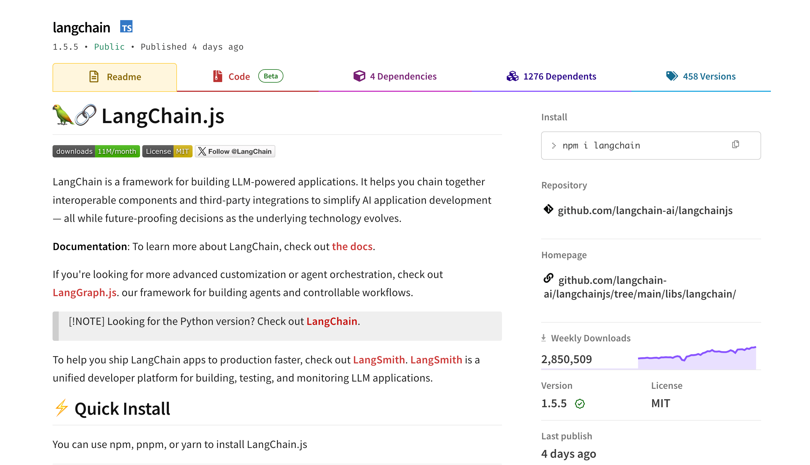
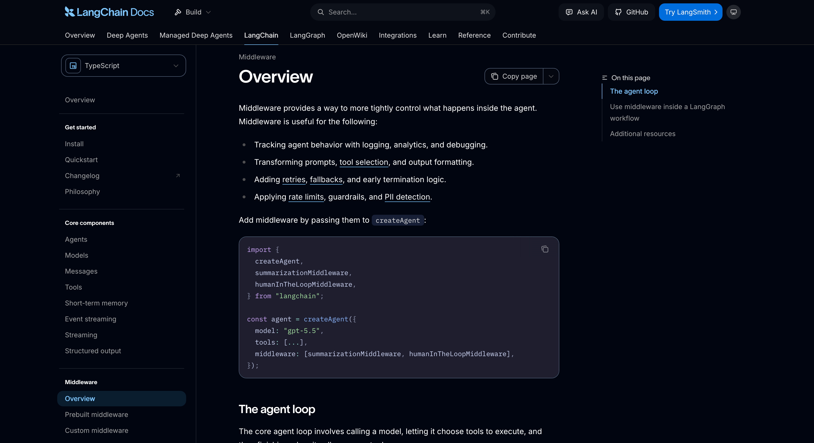

# 01-章介绍：LangChain 生态与源码解析

第四章结束以后，咱们已经可以不依赖任何 Agent 框架，完成了一个 AI 编程 Agent。

用户输入一段自然语言需求，Agent 可以读取代码、修改多个文件、运行测试。如果测试结果推翻了原来的判断，它还会生成新的计划。遇到删除文件这种高风险操作，任务会先暂停，等用户确认以后再继续。

但是，如果大家有去看咱们写的代码的话，就可以发现 **代码是在太多了。。。**

+ 咱们自己定义了 Provider，负责把任务状态交给模型，再把模型输出转换成 `Action`、`Replan` 或者 `Final`。
+ 自己实现了 Agent Runtime，让模型和 Tool 一轮一轮执行。中间还要保存 Message、Plan State、Observation、执行预算和停止原因。
+ 工具返回结果以后，还得继续校验。
+ 模型准备结束任务时，也不能直接结束，必须检查测试、类型和 Completion Criteria 是否真的通过。

当然了，这些代码当然不是白写的。

如果没有第四章，咱们现在直接看到下面这样的代码：

```typescript
const agent = createAgent({
    model,
    tools,
    middleware
})

const result = await agent.invoke({
    messages: [
        {
            role: 'user',
            content: '查询任务 DEV-1024，并判断是否已经逾期'
        }
    ]
})
```

这就很容易产生一种错觉：创建 Agent 好像只需要调用一个 `createAgent()` 就可以了。

至于模型什么时候调用 Tool、Tool 的结果怎样回到模型、Agent 为什么会继续执行，又为什么会在某一轮结束，可能就完全不知道了。

现在不一样了。

第四章已经把这些东西全部拆开做过一遍。接下来再学习框架，咱们就可以看懂框架到底封装了什么。

## LangChain 到底帮咱们封装了什么
LangChainJS（后面所说的 LangChain，指的均是 LangChainJS。 至于 Python 版本的 LangChain 会在后面小节进行解释） 目前最新的版本是 `1.5.5` 



LangChain v1 目前推荐使用 `createAgent` 构建 Agent。

根据 [LangChain v1 官方文档](https://docs.langchain.com/oss/javascript/releases/langchain-v1) 的说明，`createAgent` 内部仍然是一个 Agent Loop，大致的逻辑是：

+ 先调用模型，让模型决定是否使用 Tool
+ Tool 执行完成以后，再把结果交回模型，直到模型不再提出新的 Tool Call

你看，这不就是咱们前面学到的知识嘛。

只不过，是把咱们前面学过的知识通过框架整理成了更统一的结构而已。

下面给大家做了一个表，大家可以对应下：

| 第四章手写的能力 | LangChain 中对应的能力 |
| --- | --- |
| 模型请求与返回结果转换 | Chat Model 与模型 Integration Package |
| 用户消息、模型决策和工具结果 | HumanMessage、AIMessage 与 ToolMessage |
| Tool 定义和参数校验 | `tool()` 与 Zod Schema |
| Agent Loop | `createAgent` |
| 运行时用户、权限和工作区信息 | Runtime Context |
| 模型调用与 Tool 调用前后的控制逻辑 | Middleware |
| Agent 执行过程推送 | Streaming 与事件流 |


同时，LangChain 还提供了 `Middleware` 作为 `createAgent` 的主要扩展机制。它可以在模型调用和 Tool 调用前后加入日志、动态模型选择、失败恢复、安全检查等逻辑。

这里给大家放下对应的 [文档](https://docs.langchain.com/oss/javascript/langchain/middleware/overview)，有兴趣的同学可以看下



除了 LangChain 生态的使用之外，这一章咱们还会学习 LangChain 的源码

> PS：现在已经开始有大厂面试问到源码的知识了，所以得提前开始准备学习了。
>

那么，整个这一章的学习方式，咱们会按照下面的逻辑来：

+ 首先：咱们会先比较原生模型 SDK、AI SDK、OpenAI Agents SDK、Mastra 和 LangChain，看看这些方案分别采用了什么设计路线。中间还会通过一组最小代码，对照 LangChain.js 与 LangChain Python 的核心写法。
+ 然后：再使用一个连续的小案例跑通 `createAgent`，逐步加入 Structured Output、Runtime Context、State 和 Middleware。
+ 之后：等到案例可以完整执行了，再从实际调用入口进入源码，看看 Agent 是怎样被创建、Tool 又是怎样被循环调用的。
+ 最后：还会梳理 LangChain、LangGraph、Deep Agents、LangSmith 和 Integration Packages 之间的关系。

差不多就是这样。

OK ，开始～

> 更新：2026-08-09 23:21 · 原文：<https://www.yuque.com/lgdsunday/ab1dy3/lqbrk7grv3zbw2em>
