# 02-Agent 框架选型：各框架的核心能力 与 设计方案

无论大家之前做的是前端，还是后端，应该都遇到过一种情况，那就是：

> **同一个需求，通常不只有一种技术方案。**
>

以前端为例。

开发同一个 Web 应用，我们既可以选择 Vue，也可以选择 React。虽然两者的设计思路和生态不同，但大部分业务需求都能完成。

Agent 开发也是一样。

现在可以用来开发 Agent 的框架并不少，LangChain 也不是唯一选择，更不一定适合所有项目。

那么问题就来了：

**咱们为什么要专门学习 LangChain？**

难道只是因为 LangChain 的 GitHub Star 多，或者网上的教程多吗？

肯定不是的～

## Agent 框架的价值是什么
先假设现在要实现一个订单查询 Agent。

用户输入：

```latex
查询订单 A1024 当前的处理状态。
```

模型接收到这个指令之后，判断应该调用 `get_order_status`，生成 `orderId` 参数。Tool 返回订单信息以后，模型再把结果整理成用户可以看懂的回答。

如果，咱们只做到这的话，直接使用模型厂商提供的 SDK 就够了。

但是，一个完整的企业级别的 Agent 项目，需要可比这种小 demo 复杂多了。

比如：

+ 模型提出调用 Tool Call 以后，谁负责继续执行下一轮？
+ Tool 参数不合法怎么办？
+ 当前登录用户是谁？
+ 是否需要进行权限隔离？
+ 一次任务最多允许调用几次模型？
+ 执行过程怎样实时推送到页面？

你看，这些问题就很麻烦，如果咱们直接用原生代码写，就很费劲（参考前几章的项目代码量）

所以说，实际企业项目开发中，咱们是必须要使用框架做的。

## 不同框架采用了什么设计路线
就像前面所说的一样，同一类型的框架（或者说 “技术实现方案”）都有很多，这里跟大家理解一些 Agent 常见的技术方案，方便大家面试和应付领导的时候吹一吹。

### 第一：模型 SDK
最基础的方案，就是直接使用 DeepSeek、智谱、OpenAI 或其他模型供应商提供的 SDK。

模型 SDK 通常会帮咱们完成请求鉴权、Message 序列化、流式响应和 Tool Calling 数据转换。

但是，模型返回 `tool_calls` 以后，后面的逻辑咱们都得自己处理了。

第四章写的 AI 编程 Agent，基本就是这种方案。

这种方案最大的好处就是：**简单**。

几乎不需要额外学习什么语法。

### 第二：AI SDK
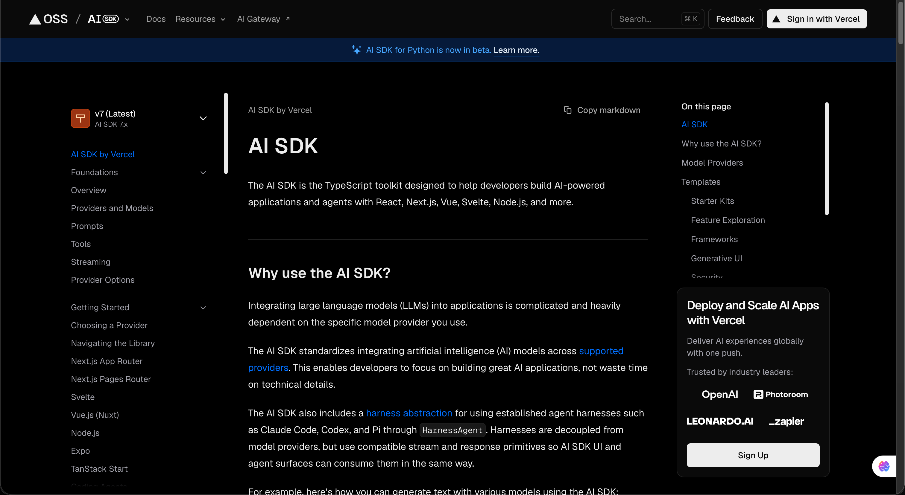

[AI SDK](https://ai-sdk.dev/docs/introduction) 是一套面向 TypeScript 的 AI 开发工具。

它对模型 Provider、文本生成、Tool Calling、结构化输出和 UI Streaming 做了统一封装。

目前也提供了 `[ToolLoopAgent](https://ai-sdk.dev/docs/reference/ai-sdk-core/tool-loop-agent)`，可以自动执行多轮 Tool Loop。

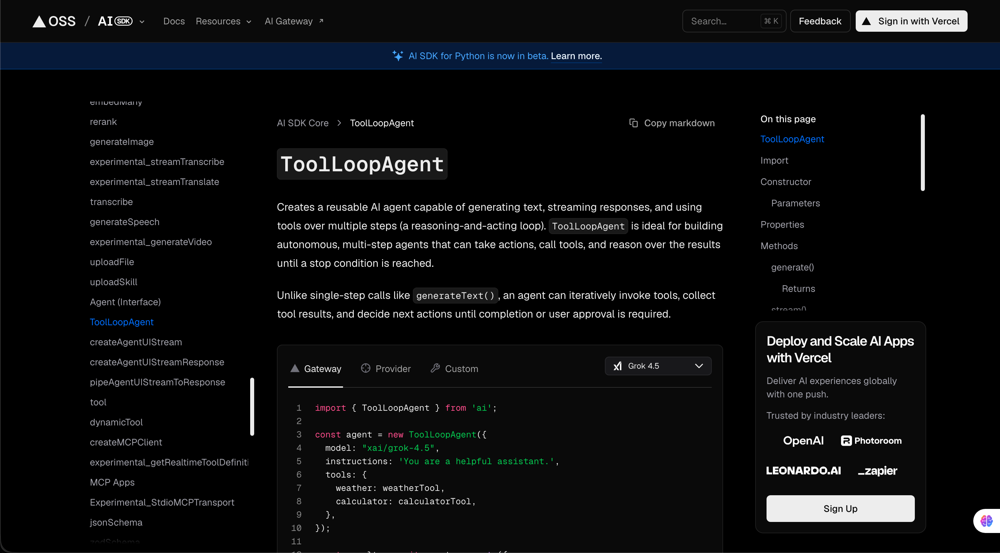

所以，如果项目的重点是 Web AI 产品（比如使用 vue、react  开发的）聊天页面、流式组件、生成式 UI，以及前后端之间的 AI 数据流传输，AI SDK 都能搞定。

不过，它的设计中心更靠近 “AI 应用与 UI 数据流”。

复杂任务状态、持久化工作流和自定义 Runtime 仍然需要结合项目要求继续设计。

### 第三：OpenAI Agents SDK
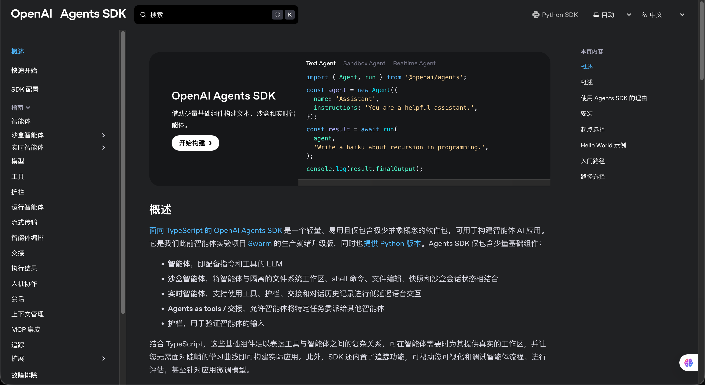

OpenAI（就是 Chat GPT 的母公司）提供的框架

[OpenAI Agents SDK](https://openai.github.io/openai-agents-js/) 同时提供 TypeScript 和 Python 实现。

它的核心结构比较集中：通过 `Agent` 定义指令与工具，再由 `run()` 或 `Runner` 执行 Agent Loop。

除此之外，框架还提供 Handoff、Guardrail、Tracing 和 Human-in-the-Loop 等能力。

比如在 TypeScript 中，最小代码长这样：

```typescript
import { Agent, run } from '@openai/agents'

const agent = new Agent({
    name: 'Order Agent',
    instructions: '负责查询订单状态',
    tools: [getOrderStatus]
})

const result = await run(agent, '查询订单 A1024 当前的处理状态')
```

因为它是 OpenAI 官方提供的 SDK，所以它默认和 OpenAI 的模型以及 Responses API 集成得比较好

模型本身负责推理和 Tool Calling，而 Agents SDK 在此基础上进一步提供了 Agent、Agent Loop、Handoff、Guardrail、Tracing 等 Agent 编排与运行时能力。

### 第四：Mastra
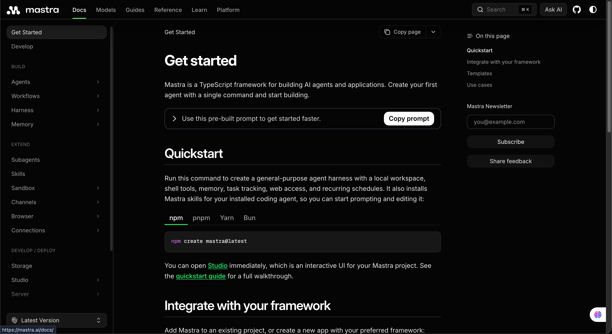

[Mastra](https://mastra.ai/docs) 是一套 TypeScript Agent 框架。

除了 Agent，它还把 Workflow、Memory、RAG、Evals、Observability 和开发调试工具放进了同一个工程体系。

这一点和只提供 Agent Loop 的方案不太一样。

如果项目里既有模型自主决定下一步的 Agent，也有顺序、并行、分支这些确定性流程，Mastra 可以使用 Agent 和 Workflow 分别表达，然后再把它们组合起来。

他的优势是 TypeScript 工程体验比较完整。相应地，项目也需要依赖 Mastra 自己的运行方式和生态设计。

### 第五：LangChain
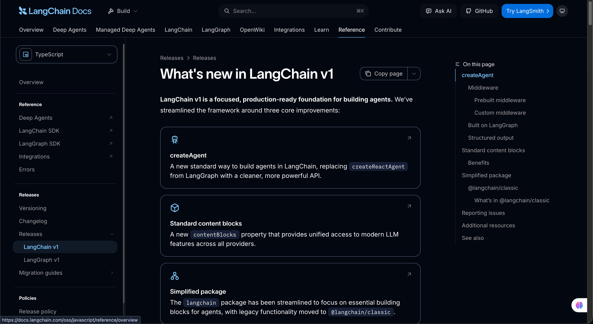

这就是咱们后面主要使用的框架了。

大家可以先把 LangChain 理解成一套 **用来组织模型、Message、Tool 和 Agent Runtime 的开发框架**。

这句话听起来可能还是有点虚。

咱们直接回到第四章写过的 AI 编程 Agent。

在那个项目中，如果想要把 DeepSeek 换成其他模型，咱们得重新处理请求参数和返回数据。如果想要增加一个 Tool，就得自己维护 Tool 描述、参数校验和执行逻辑。

LangChain 首先解决的，就是这些通用代码没有统一结构的问题。

它会把不同模型包装成相对统一的 Chat Model，把用户输入、模型回答和 Tool 结果表示成 Message，再通过统一的 Tool 定义告诉模型可以使用哪些外部能力。

因此，更换模型供应商时，就得重写好多好多的嗲嘛。

而这个就是 LangChain 的第一个优势：**他把模型、Message 和 Tool 这些 Agent 基础组件整理成了一套相对统一的接口。**

但是，只统一这些组件还不够。

如果模型返回了 Tool Call，应用程序仍然需要执行 Tool、把结果交回模型，再判断下一步是继续调用 Tool，还是生成最终回答。

而这样的一个流程，咱们也可以直接通过 `createAgent` 创建这套 Agent Runtime。

这是 LangChain 的第二个优势：**除了提供单独的 Model 和 Tool，它还提供了可以直接运行的标准 Agent Loop。**

然后，还有 `Middleware`。

假设咱们需要在模型调用以前统计预算，在 Tool 执行以前检查权限，在 Tool 返回以后校验结果。

如果是手写 Agent，这些代码通常会直接进入 Agent Runtime 的主循环。逻辑一多，整个 `runAgent()` 就会越来越长。

LangChain 可以通过 Middleware 拦截模型调用和 Tool 调用，把权限、日志、动态工具、失败恢复这些横切逻辑放在 Agent Loop 外面。

这就是他的第三个优势：**不需要修改 **`createAgent`** 内部的循环，也可以继续控制模型和 Tool 的执行过程。**

> PS：这里的三个优势只是我列举的 **部分** ，并不意味着使用框架只有这三个优势哈。。。这个一定要分清楚
>

下面通过一张图，给大家展示下

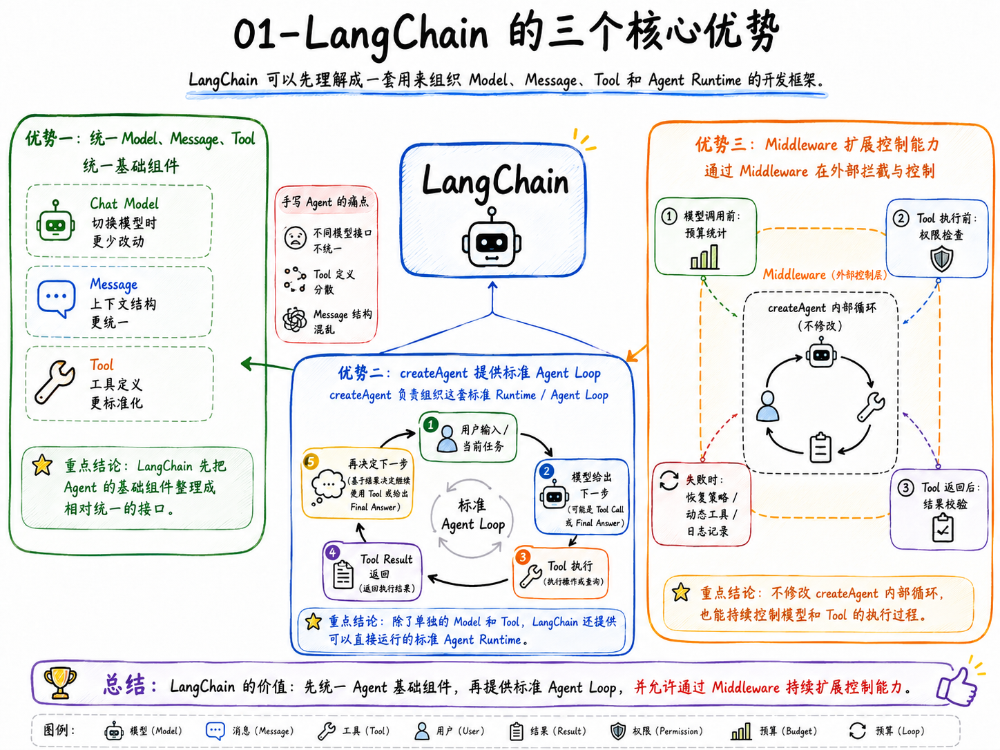

其他的就不多说了，咱们咱们再详细学

### Python 中还有一些不同的路线
除了上面这些方案，Python 生态中还有 [PydanticAI](https://ai.pydantic.dev/agents/)、[LlamaIndex](https://developers.llamaindex.ai/python/framework/module_guides/deploying/agents/) 和 [AgentScope](https://doc.agentscope.io/) 等框架。

 [PydanticAI](https://ai.pydantic.dev/agents/) 更强调 Python 类型模型、依赖注入和结构化结果

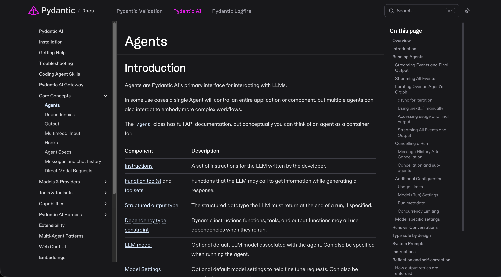

[LlamaIndex](https://developers.llamaindex.ai/python/framework/module_guides/deploying/agents/)  的 Agent 与它的数据、索引和检索生态结合得更紧密

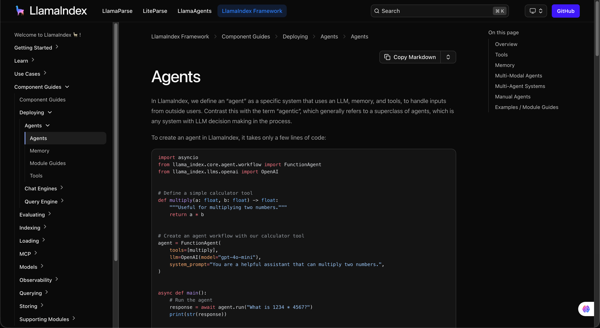

 [AgentScope](https://doc.agentscope.io/)  则提供了 Agent、Message、Memory、Tool 和工作流等一套开发能力。

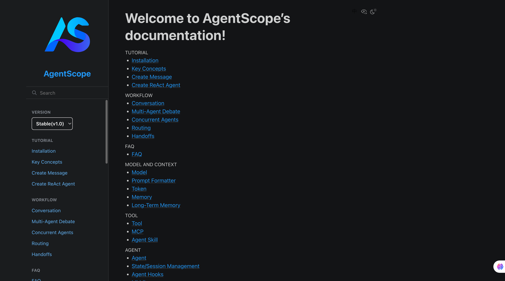

这里咱们只需要知道它们采用了不同的设计路线就行，核心还是看 LangChain 框架

## LangChain.js 与 LangChain Python 的最小代码对照
前面咱们说过，LangChain 有 Node 和 Python 两种语言的版本。

那就会有同学好奇了：**这两种语言的版本代码写出来，区别大吗？**

问到点子上了。

那么下面咱们就直接使用同一个订单查询任务，看看 LangChain.js 和 LangChain Python 的代码差别到底有多少。

> 为了让两份代码的差别集中在框架 API 上，它们都使用 DeepSeek，都只提供一个 `get_order_status` Tool。
>

### LangChain.js 版本
代码结构很简单：

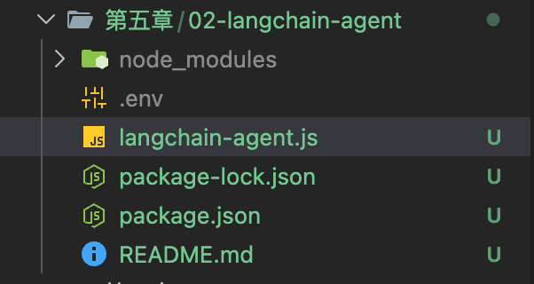

先安装依赖：

```bash
npm install langchain @langchain/core @langchain/deepseek zod
```

创建 `langchain-agent.js`：

```javascript
import { ChatDeepSeek } from '@langchain/deepseek'
import { createAgent, tool } from 'langchain'
import * as z from 'zod'

/**
 * 定义订单状态查询 Tool。
 *
 * Agent 可以根据用户问题自主决定是否调用该工具。
 * schema 用于描述工具参数，帮助模型生成正确的 Tool Call。
 */
const getOrderStatus = tool(
    async ({ orderId }) => {
        // 模拟订单系统返回的查询结果。
        return JSON.stringify({
            orderId,
            status: 'waiting_for_manual_review',
            message: '退款金额超过 2000 元，正在等待人工审核'
        })
    },
    {
        name: 'get_order_status',
        description: '根据订单号查询当前处理状态',
        schema: z.object({
            orderId: z.string().describe('需要查询的订单号')
        })
    }
)

/**
 * 创建 DeepSeek 聊天模型。
 *
 * temperature 设置为 0，尽量减少回答的随机性，
 * 让 Agent 在工具调用场景中的行为更加稳定。
 */
const model = new ChatDeepSeek({
    model: process.env.DEEPSEEK_MODEL ?? 'deepseek-v4-flash',
    temperature: 0
})

/**
 * 创建 Agent，并注册模型和可使用的 Tools。
 *
 * createAgent 会负责 Agent Loop：
 * 模型判断是否调用工具 → 执行工具 → 将结果返回模型 → 生成最终回答。
 */
const agent = createAgent({
    model,
    tools: [getOrderStatus],
    systemPrompt: '你是订单客服，只能根据工具返回的数据回答。'
})

/**
 * 启动一次 Agent Run。
 *
 * Agent 收到用户问题后，会判断需要调用 get_order_status，
 * 获取订单状态，再根据工具返回的数据生成最终回答。
 */
const result = await agent.invoke({
    messages: [
        {
            role: 'user',
            content: '查询订单 A1024 当前的处理状态'
        }
    ]
})

// result.messages 包含本次 Agent Run 的完整消息轨迹，
// 最后一条消息通常就是 Agent 给用户的最终回答。
console.log(result.messages.at(-1)?.content)

```

配置好 `.env` 文件之后，直接通过 `npm run demo` 运行即可：

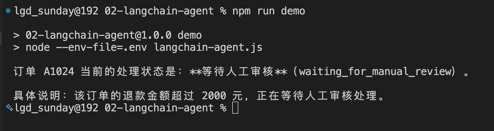

### LangChain Python 版本
Python 版本安装的是另一套包：

```bash
pip install -U langchain langchain-deepseek
```

创建 `langchain_agent.py`：

```python
import json
import os
from pathlib import Path

from dotenv import load_dotenv
from langchain.agents import create_agent
from langchain.tools import tool
from langchain_deepseek import ChatDeepSeek


# 加载当前 Python 文件同目录下的 .env 文件。
# 加载完成后，可以通过 os.getenv() 读取其中的环境变量。
load_dotenv(Path(__file__).with_name(".env"))


@tool
def get_order_status(order_id: str) -> str:
    """根据订单号查询当前处理状态。"""

    # 模拟订单系统返回的查询结果。
    return json.dumps(
        {
            "orderId": order_id,
            "status": "waiting_for_manual_review",
            "message": "退款金额超过 2000 元，正在等待人工审核",
        },
        ensure_ascii=False,
    )


# 创建 DeepSeek 模型。
#
# ChatDeepSeek 会自动从环境变量中读取：
# DEEPSEEK_API_KEY
#
# 模型名称则从 DEEPSEEK_MODEL 中读取，
# 如果没有配置，就默认使用 deepseek-v4-flash。
model = ChatDeepSeek(
    model=os.getenv("DEEPSEEK_MODEL", "deepseek-v4-flash"),
    temperature=0,
)


# 创建 Agent，并注册可以使用的 Tool。
#
# create_agent 会负责 Agent Loop：
# 模型决策 → Tool 调用 → Tool 结果回注 → 模型继续决策 → 最终回答。
agent = create_agent(
    model=model,
    tools=[get_order_status],
    system_prompt="你是订单客服，只能根据工具返回的数据回答。",
)


# 启动一次 Agent Run。
result = agent.invoke(
    {
        "messages": [
            {
                "role": "user",
                "content": "查询订单 A1024 当前的处理状态",
            }
        ]
    }
)


# messages 中保存了本次 Agent Run 的消息轨迹，
# 最后一条消息就是 Agent 最终生成的回答。
print(result["messages"][-1].content)
```

设置相同的 Key，运行即可：

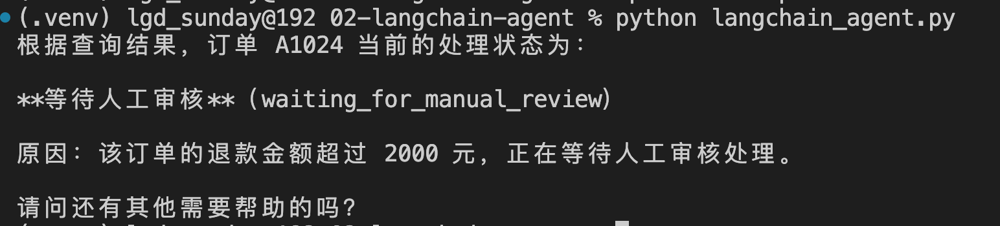

现在咱们把两份代码放在一起看，会发现他们之间是有一些不一样的地方的，比如：

+ JavaScript 使用 Zod 描述 Tool 参数，Python 直接从函数参数类型和 Docstring 生成 Tool 定义  
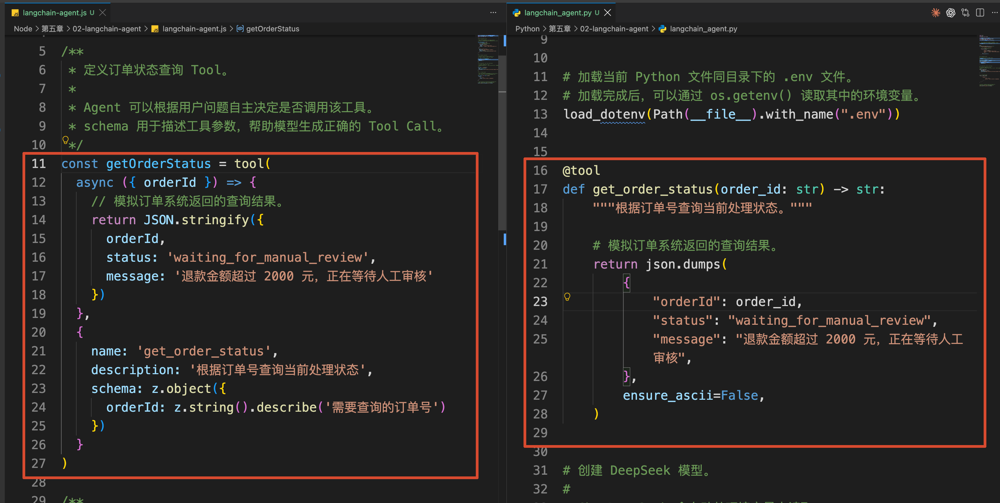
+ JavaScript 的入口叫 `createAgent`，Python 中叫 `create_agent`  
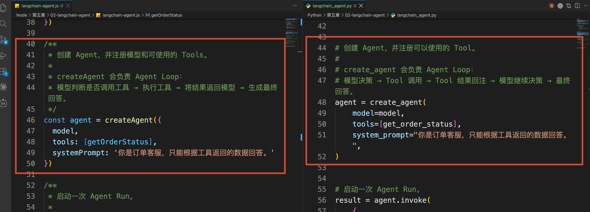


这些属于语言和 API 习惯上的差别。真正的执行结构没有变化。

所以，LangChain.js 和 LangChain Python 的核心逻辑是相同的，知识使用的语言不同而已。

## 总结
那么这一小节，咱们把一些常用的 Agent 库做了一下罗列和普及。

同时对比了下 TS 代码和 Python 代码都使用 LangChain 时的差异性。

咱们需要知道的是：框架只是实现 Agent 的工具，不是 Agent 知识本身。

那么下一小节，咱们就开始逐步了解 LangChain 的使用原理了～

> 更新：2026-08-10 16:15 · 原文：<https://www.yuque.com/lgdsunday/ab1dy3/hoqetuez1ygc2i0n>
