# 03 - LangChain 组件协议与运行时组合：模型适配、消息语义、工具契约、Runnable 数据流与集成边界

上一小节，咱们使用 LangChain.js 实现了一个最小 Agent。

代码不多，大致的逻辑是：

>  定义一个模型，定义一个 Tool，再交给 `createAgent()`，Agent 就可以自己查询订单了。
>

可比咱们之前哼哧哼哧的写 Agent Runtime 简单多了吧。

那么，这么好的框架，到底怎么用呢？

这一小节，就看这个。

## 直接通过代码来学
我给大家准备好了一个代码，在 `/Code/Node/第五章/03-langchain-core-abstractions`

咱们直接通过这个代码来学

整个代码的结构并不复杂，说白了，只有一个代码文件 `core-abstractions.js`

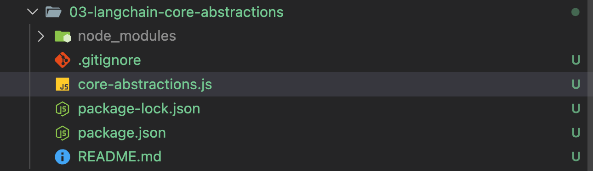

不过再看具体的代码之前，咱们先来看一下项目的依赖，也就是 `package.json` 

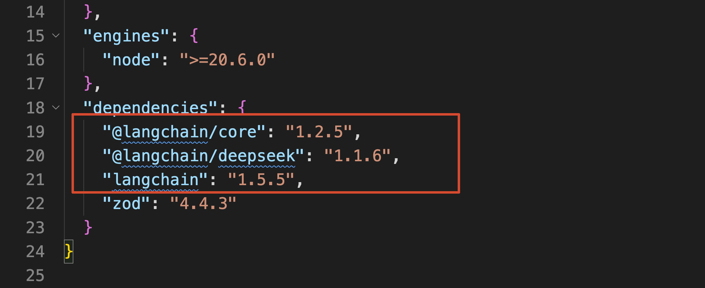

这里面和 `LangChain` 有关的包有三个，用的时候基本上就按照下面的方式来用：

```javascript
import { ChatDeepSeek } from '@langchain/deepseek'
import { RunnableSequence } from '@langchain/core/runnables'
import { HumanMessage, SystemMessage, ToolMessage, tool } from 'langchain'
```

它们都属于 LangChain 生态，然后咱们一个个来看

### 首先是：langchain
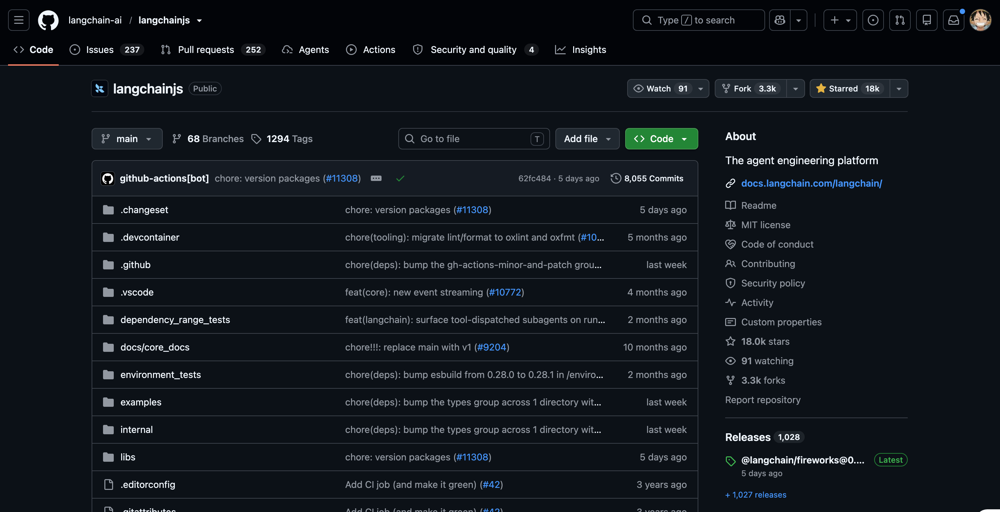

先看咱们最常接触的 `langchain`。

在上一小节中，`createAgent()` 和 `tool()` 都是从这个包中导入的。这一小节使用的 `HumanMessage`、`SystemMessage` 和 `ToolMessage`，也可以直接从这里导入。

所以，`langchain` 可以理解成 **咱们开发 Agent 时主要使用的库**。

它提供了创建 Agent、定义 Tool、管理 Message 和添加 Middleware 等上层开发的入口，负责把模型、Tool 与 Agent Runtime 组织到一起。

如果不使用这个包，咱们也可以使用 `@langchain/core` 自己组合执行流程。

但是，模型返回 Tool Call 以后怎样继续执行、Tool 结果怎样回传、什么时候结束循环，这些逻辑就得自己写了（第四章手写的 AI 编程 Agent，做的就是类似的事情）。

### 其次是：@langchain/core
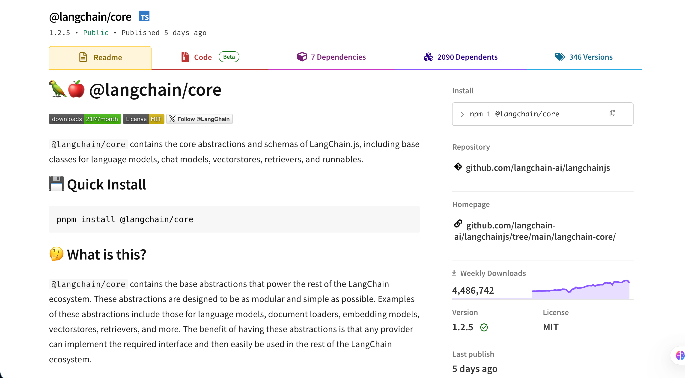

然后是 `[@langchain/core](https://reference.langchain.com/javascript/langchain-core)`。

如果用官方属于来说，这玩意叫做 “底层公共抽象”。好说，就是不好理解。。

咱们可以先看本节代码里的三个调用：

```javascript
// 直接调用大模型，并将当前消息上下文发送给模型生成回复。
model.invoke(messages)

// 直接调用 getTask Tool，查询 DEV-1024 对应的任务详情。
getTask.invoke({ taskId: 'DEV-1024' })

// 直接调用 taskSummary Tool，获取 DEV-2048 对应的任务摘要。
taskSummary.invoke({ taskId: 'DEV-2048' })
```

其中：`model` 是模型，`getTask` 是 Tool，`taskSummary` 是一条组合流程。

它们做的事情完全不同，却都可以使用 `invoke()` 执行。

原因就在于，LangChain 通过 Core 中的 `Runnable` 等公共抽象，规定了这些组件应该怎样接收输入、返回输出以及继续组合。

除此之外，Chat Model、Message、Tool、Prompt、Retriever 和 Vector Store 等组件使用的基础结构，也都来自 `@langchain/core`。

因此，Core 真正的价值是：

> **它为 LangChain 生态定义了一套公共接口，让不同模型、Tool 和上层框架能力可以互相配合。**
>

平时开发普通 Agent 时，如果需要使用 `RunnableSequence`、Prompt Template、Output Parser，或者以后查看 LangChain 源码，就会经常看到 `@langchain/core`。

> LangChain 的不同包会共同依赖 `@langchain/core`。因此，真实项目不要随意把其中某一个包单独升级到不兼容的版本。咱们课程里面会在 `package.json` 中锁定已经验证过的版本。
>

### 最后是：@langchain/deepseek
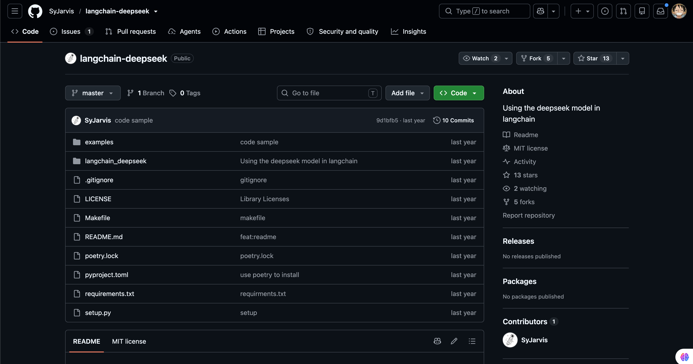

最后一个是 `[@langchain/deepseek](https://docs.langchain.com/oss/javascript/integrations/chat/deepseek)`。

先说 `@langchain/deepseek` 这个包，它提供的是 `ChatDeepSeek`，也就是 DeepSeek 的 `Integration Package`，中文可以理解成 **模型集成包**。

不知道大家还记不记得，在咱们第一章的时候，咱们调用过 DeepSeek API ，当时的：请求地址、鉴权 Header、`messages` JSON 和响应解析都是咱们自己处理的。

但是，使用了 `ChatDeepSeek` 以后，这些与 DeepSeek 有关的差异会被集中放到 Integration Package 中，上层代码只需要使用 `invoke()`、`stream()` 和 `bindTools()` 等 LangChain 接口。

这就是 `@langchain/deepseek` 的价值：**负责连接具体模型供应商，不让供应商特有的请求与响应格式进入 Agent 的主要业务逻辑。**

同时，咱们也得知道 LangChain 支持很多的 LLM 对接，而且，Integration Package 不一定只提供聊天模型。

比如说：

+ `@langchain/openai` 除了提供 `ChatOpenAI`，还提供 `OpenAIEmbeddings``
+ ``@langchain/ollama` 也同时提供 Chat Model 和 Embedding 模型。

而具体包含哪些能力，需要查看对应模型集成包的官方文档。

下面给大家列了一个表，展示了常用的一些集成包，大家可以看下：

| 模型来源 | Integration Package | 常用入口 |
| --- | --- | --- |
| DeepSeek | `@langchain/deepseek` | `ChatDeepSeek` |
| OpenAI | `@langchain/openai` | `ChatOpenAI` |
| Anthropic Claude | `@langchain/anthropic` | `ChatAnthropic` |
| Google Gemini | `@langchain/google` | `ChatGoogle` |
| Ollama 本地模型 | `@langchain/ollama` | `ChatOllama` |
| Mistral | `@langchain/mistralai` | `ChatMistralAI` |


除了上面这些之后，很多国产的大模型也可以直接通过 `@langchain/openai` 对接（比如：GLM 智谱，可以直接查看 [智谱的官网](https://docs.bigmodel.cn/cn/guide/develop/langchain/introduction) ）

---

最后，把咱们上面提到的这三个包放到一起看，关系大概是这样的：

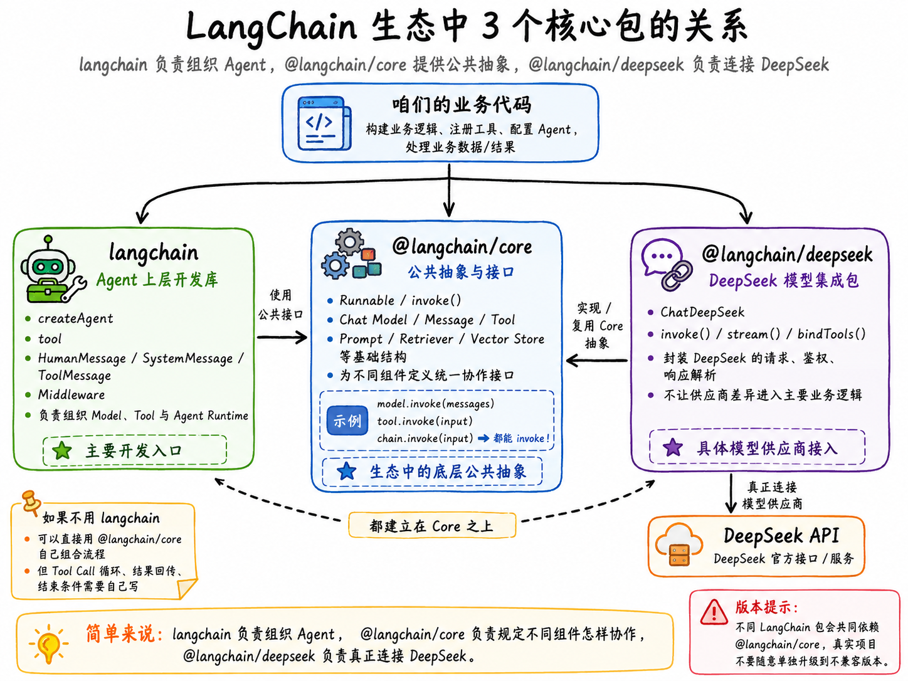

简单来说：

> `langchain` 负责组织 Agent，`@langchain/core` 负责规定不同组件怎样协作，`@langchain/deepseek` 负责真正连接 DeepSeek。
>

行，概念基本上说的差不多了，然后咱们就来看代码。

通过代码来一点点的学习 LangChain 的使用。

## Chat Model：LangChain 怎么统一模型调用
先来看最容易理解的 `Chat Model`。

第一章咱们直接请求 DeepSeek API 时，需要自己准备请求地址和 `messages` JSON，再从响应中的 `choices[0].message` 读取模型输出。（大家可以看 「第一章-05 小节的代码」）

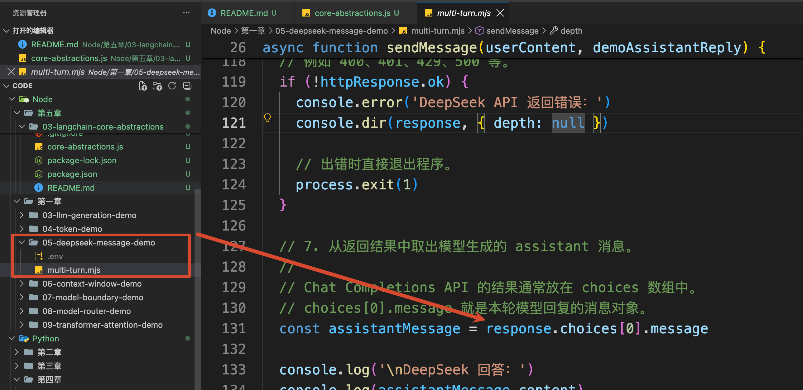

使用 LangChain 以后，这段模型调用被包装成了 `[Chat Model](https://docs.langchain.com/oss/javascript/langchain/models)`。

这里的 Chat Model  是 LangChain 对聊天模型调用能力的一层封装。咱们这一节使用的 `ChatDeepSeek`，内部连接的才是 DeepSeek API。

打开 `core-abstractions.js`，先看 `createModel()`：

```javascript
/**
 * 创建本章统一使用的 DeepSeek Chat Model。
 */
function createModel() {
    return new ChatDeepSeek({
        model: process.env.DEEPSEEK_MODEL ?? 'deepseek-v4-flash',
        temperature: 0,
        maxRetries: 2
    })
}
```

这段代码只是创建了一个模型调用对象，还没有真的向 DeepSeek 发请求。

真正发起调用的是 `invoke()` 函数（学过 [《面试汪【前端转 AI 全栈商业课程】》](https://mp.weixin.qq.com/s/ak625tfAU_JUT6G_MC6n4Q) 的同学，对这个方法应该都已经特别熟悉了）：

```javascript
/**
 * 演示最基础的 Chat Model 调用。
 *
 * 输入是一组 Message，
 * invoke() 返回模型生成的 AIMessage。
 */
async function runModelDemo() {
    const model = createModel()

    const messages = [
        new SystemMessage('你是研发任务助手，回答必须简洁。'),
        new HumanMessage('用一句话说明：为什么测试通过以后还要运行类型检查？')
    ]

    // 将完整消息上下文提交给模型，等待模型一次性生成结果。
    const response = await model.invoke(messages)
  
  // =============下面都是打印了=============
    console.log('输入 Message：')
    console.log(messages.map((message) => message.constructor.name))

    console.log('\n模型返回类型：', response.constructor.name)
    console.log('回答内容：', messageText(response))

    // usage_metadata 中通常包含输入、输出以及总 Token 消耗。
    console.log('Token 统计：', response.usage_metadata)
}
```

执行：

```bash
npm run model
```

可以看到类似下面的结果：

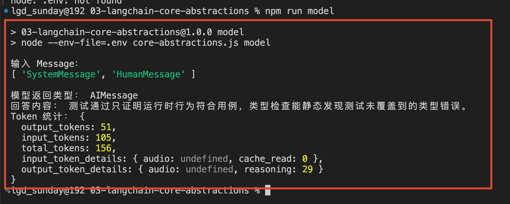

从这里咱们可以看到 输入和返回的内容、以及对应的 Token 消耗统计数据

Chat Model 还提供了一个叫做 `stream() `的方法，这个方法可牛批了，这就是咱们实际开发中最常用到的 **流式输出**

```javascript
/**
 * 演示 Chat Model 的流式输出。
 *
 * 与 invoke() 一次返回完整 AIMessage 不同，
 * stream() 会不断返回 AIMessageChunk。
 */
async function runStreamDemo() {
    const model = createModel()
    // steam 方法
    const stream = await model.stream([
        new SystemMessage('你是研发任务助手，回答必须简洁。'),
        new HumanMessage('用两句话解释单元测试和类型检查的区别。')
    ])

    console.log('开始接收 AIMessageChunk：\n')

    // 持续读取模型返回的消息片段并立即打印。
    for await (const chunk of stream) {
        process.stdout.write(messageText(chunk))
    }

    process.stdout.write('\n')
}
```

运行：

```bash
npm run stream
```

`stream()` 会不断产生 `AIMessageChunk`，咱们可以一块一块读取，再实时推送到页面（流式传输的形式）。

[此处为语雀卡片，点击链接查看](https://www.yuque.com/lgdsunday/ab1dy3/gwgevbrqdtsrtq8g#jpQnx)

所以，`invoke()` 和 `stream()` 的区别可以先这样理解：

+ invoke：等模型生成完成，返回一个完整 AIMessage
+ stream：一边生成边返回多个 AIMessageChunk。即：流式传输

## Message：模型调用过程中的统一数据结构
说完 Chat Model，再回过头看刚才使用的 `SystemMessage` 和 `HumanMessage`。

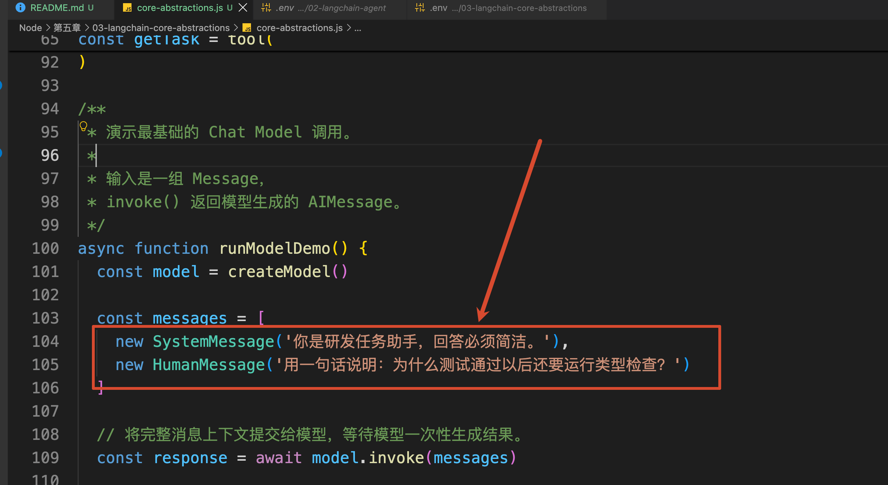

第一章（01-05 小节）的时候咱们讲过：应用程序调用模型时，会通过 Message 区分系统要求、用户输入、模型回答和 Tool 返回结果。

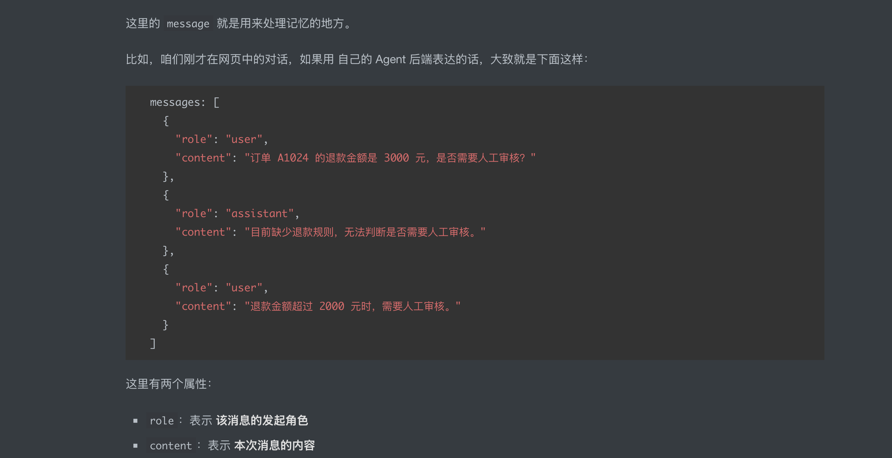

LangChain 也是这样的。

它做的是把不同供应商的 Message 格式，整理成一套框架内部可以统一处理的对象。官方的 [Messages 文档](https://docs.langchain.com/oss/javascript/langchain/messages) 中，最常用的是下面四种：

+ SystemMessage：系统指令
+ HumanMessage：用户输入
+ AIMessage：模型输出
+ ToolMessage：Tool 执行结果

前两个刚才已经见过了。

`AIMessage` 也见过，就是 `model.invoke()` 的返回值。

`ToolMessage` 负责的是：把 Tool 执行结果交回模型。马上进行手动 Tool Calling 时就能看到它。

我用 GPT-Iamge-2 生成了一个图，来表示整个转换过程，大概是这样的：

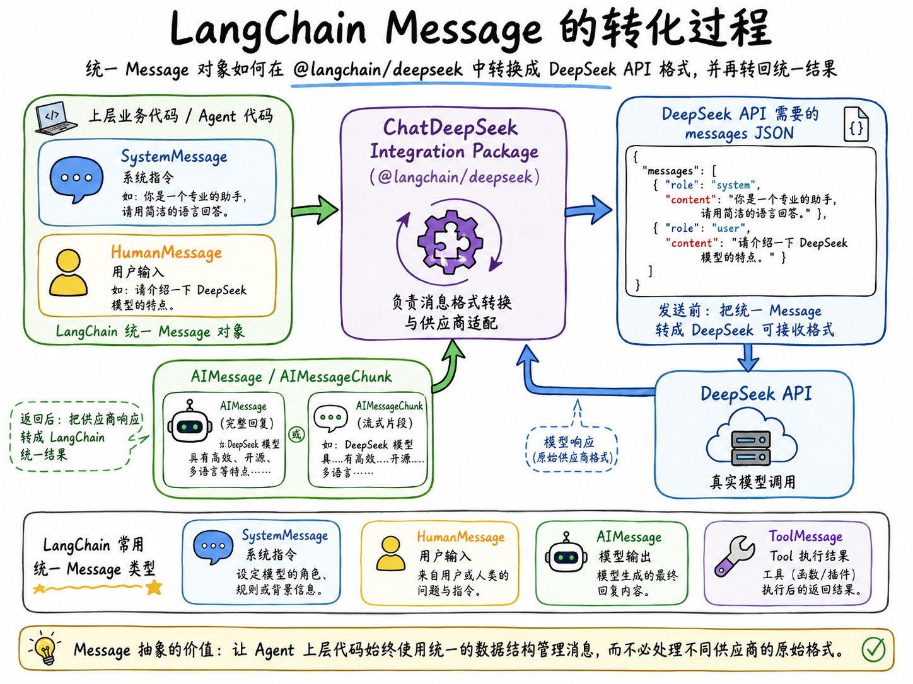

所以，咱们得知道模型这玩意，并不会直接认识 `new HumanMessage()` 这个 JS 的对象（python 对象也一样）。

是 `@langchain/deepseek` 在真正发送请求以前，把它转换成了 DeepSeek 能够接收的数据。模型返回结果以后，再由这个集成包转换成统一的 `AIMessage`。

这就是 Message 抽象真正解决的问题：**让 Agent 上层代码可以使用相同的数据结构管理消息，不需要到处处理不同供应商的原始响应格式。**

## Tool：标准工具函数
接下来，咱们定义一个 `getTask` Tool。

它负责根据任务编号，查询任务的状态、负责人和截止时间：

```javascript
/**
 * 根据任务编号查询研发任务。
 *
 * tool() 会把普通函数包装成 LangChain Tool，
 * description 用于告诉模型这个 Tool 能做什么，
 * schema 用于约束 Tool 的输入参数。
 *
 * Zod Schema 会在真正执行函数以前完成参数校验。
 */
const getTask = tool(
    async ({ taskId }) => {
        const task = TASKS[taskId]

        if (!task) {
            return JSON.stringify({
                found: false,
                taskId,
                message: '没有找到对应的研发任务'
            })
        }

        return JSON.stringify({
            found: true,
            ...task
        })
    },
    {
        name: 'get_task',
        description: '根据研发任务编号查询任务标题、状态、负责人和截止时间',
        schema: z.object({
            taskId: z
                .string()
                .regex(/^DEV-\d+$/, '任务编号必须使用 DEV-数字 的格式')
                .describe('研发任务编号，例如 DEV-1024')
        })
    }
)
```

如果只看最前面的异步函数，它确实就是一段普通业务代码。

但是，经过 LangChain 的 `[tool()](https://docs.langchain.com/oss/javascript/langchain/tools)` 包装以后，它会多出了三个特别重要的属性：

+ `name` 是模型提出 Tool Call 时使用的工具名称。
+ `description` 告诉模型这个 Tool 能做什么，模型会根据它判断当前任务是否应该调用这个 Tool。
+ `schema` 描述 Tool 能够接收哪些参数，同时会在执行以前校验参数是否合法。

所以，一个 LangChain Tool 可以理解成：

> **可以执行的业务函数，加上模型能够理解的名称、功能描述和参数 Schema。**
>

为了先排除模型的不确定性，咱们直接执行 Tool：

```javascript
const result = await getTask.invoke({
    taskId: 'DEV-1024'
})
```

运行：

```bash
npm run tool
```

结果如下：

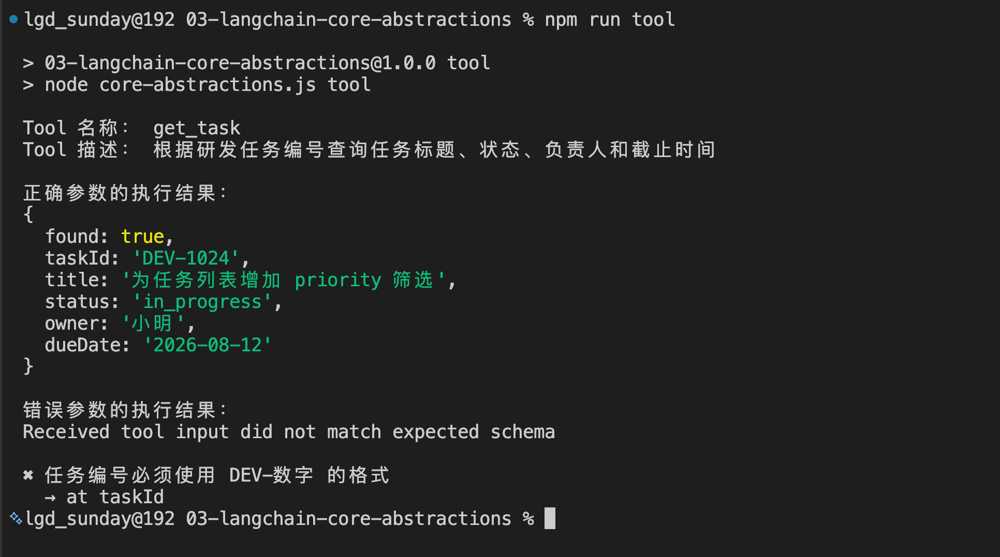

代码还故意传入了一次错误参数：

```javascript
await getTask.invoke({ taskId: '1024' })
```

这次函数不会继续执行，而是直接被 Zod Schema 拦下来：

```latex
Received tool input did not match expected schema

任务编号必须使用 DEV-数字 的格式
→ at taskId
```

这里要分清楚两件事。

定义好 Tool，不代表模型已经决定调用它。刚才的 `getTask.invoke()` 是咱们在代码中直接调用的，整个过程根本没有经过大模型。

只有把 Tool 的定义交给 Chat Model，模型才有机会根据用户问题生成对应的 Tool Call。

## Tool Calling 的执行流程
接下来咱们把整个 Tool Calling 的流程全部过一遍。下面的所有代码，全部都在 `runManualToolCallingDemo` 方法里面

首先，咱们通过 `bindTools()` 把可以使用的 Tool 绑定到 Chat Model：

```javascript
/**
 * 不使用 createAgent，
 * 手动实现一次完整的 Tool Calling 循环。
 *
 * 核心流程：
 *
 * 用户问题
 * → 模型决定调用哪个 Tool
 * → 应用执行 Tool
 * → ToolMessage 回传结果
 * → 模型根据结果生成最终回答
 */
async function runManualToolCallingDemo() {
    /**
     * bindTools() 把 getTask 的名称、描述和 Schema
     * 提供给模型，使模型获得提出 Tool Call 的能力。
     *
     * 注意：
     * bindTools() 并不会自动执行 Tool。
     */
    const modelWithTools = createModel().bindTools([getTask])

    ....
}

```

`bindTools()` 做的是把 Tool 的名称、描述和参数 Schema 提供给模型。

**它并不会在模型返回 Tool Call 以后自动执行 Tool。**

咱们先发起第一次模型调用：

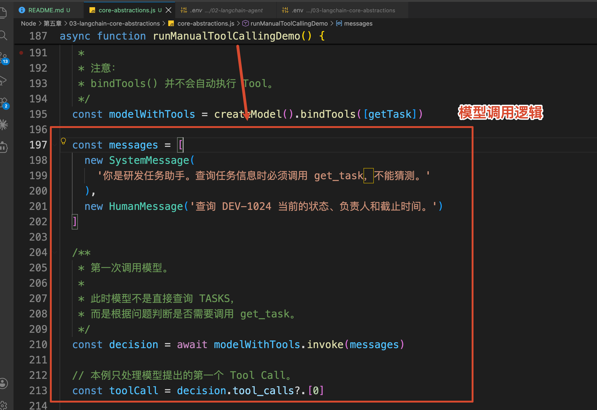

这一次返回的 `decision` 是一个 `AIMessage`。

但是，它不是最终回答。模型只是生成了一次 Tool Call：

```javascript
console.log('模型提出的 Tool Call：')
console.log({
    name: toolCall.name,
    args: toolCall.args,
    id: toolCall.id
})
```

应用程序读取 `name`，找到 `get_task`，再使用 `args` 执行 Tool：

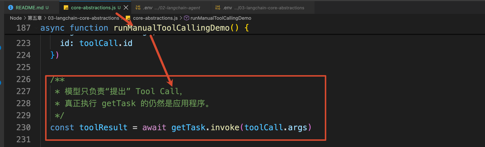

到这里，任务数据已经查到了。

但是模型还不知道 Tool 返回了什么，所以咱们需要创建一条 `ToolMessage`：

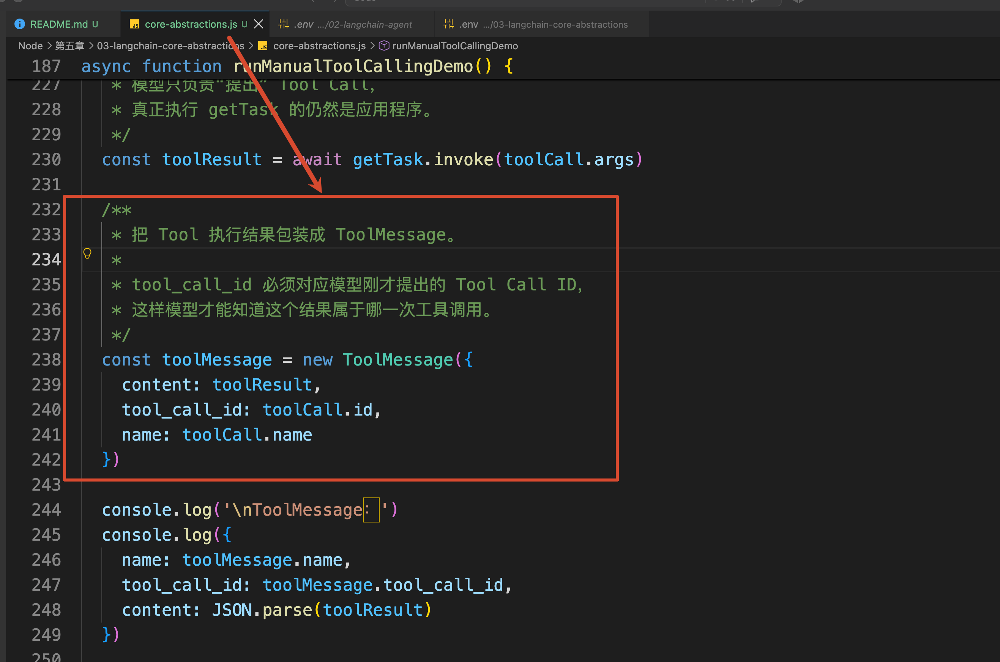

这里最重要的是 `tool_call_id`。

模型第一次提出 Tool Call 时会生成一个 ID，应用程序返回 ToolMessage 时，必须把同一个 ID 带回来。这样模型才能知道：**这条 Tool 结果，回答的是哪一次调用。**

如果模型一次提出多个 Tool Call，这个 ID 就更重要了。它可以避免订单查询结果被错误地关联到另一次工具调用。

最后，把前面的 Message、模型生成的 `AIMessage` 和刚创建的 `ToolMessage` 一起交给模型：


运行完整过程：

```bash
npm run calling
```

咱们就可以看到所有的打印结果了

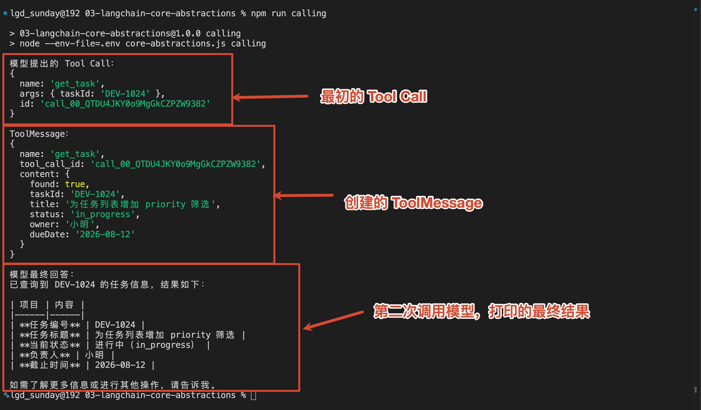

我把整个过程，生成了一个执行的流程图，大家可以作为参考：

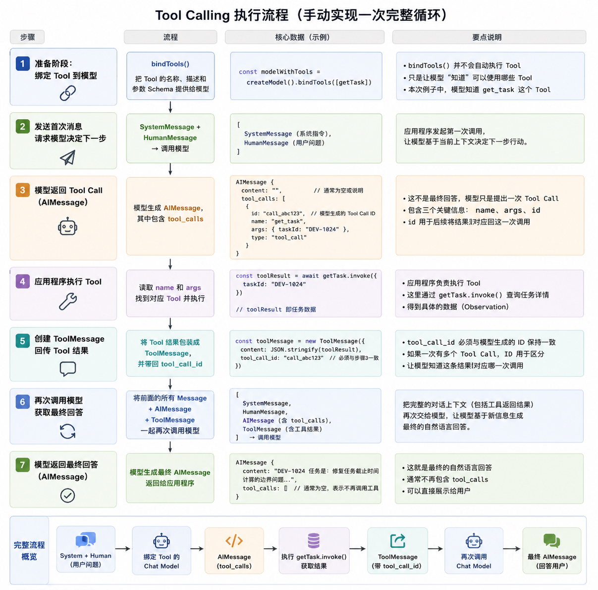

这就是 LangChain 组件完成一次 Tool Calling 的最小闭环。

大家应该也发现了，虽然 LangChain 已经统一了模型、Message 和 Tool，但是这段循环目前还是咱们手动写的。

下一节学习 `createAgent()` 时，它要接管的正是这部分代码。

## Runnable：为什么这些组件都有 invoke()
说到这里，还有最后一个问题。

刚才调用模型时使用的是：

```javascript
model.invoke(messages)
```

直接执行 Tool 时使用的也是：

```javascript
getTask.invoke({ taskId: 'DEV-1024' })
```

为什么两个完全不同的组件，都有 `invoke()`？

因为在 LangChain 中，Chat Model 和 Tool 都遵循 `[Runnable](https://reference.langchain.com/javascript/langchain-core/runnables)` 的执行接口。

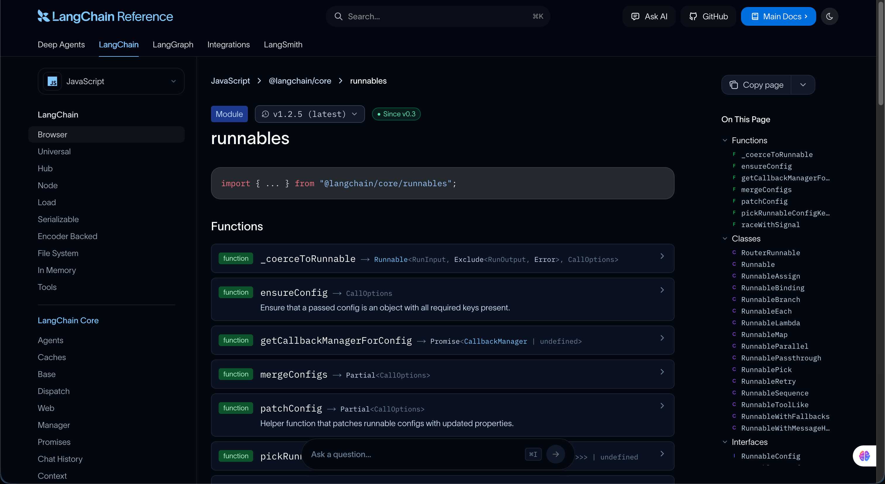

官方对 Runnable 的解释是：**一个可以被调用、批量执行、流式执行或者继续组合的工作单元。**

用大白话说，Runnable 就是在给不同组件约定一套相近的运行方式。

+ invoke(input)  → 处理一份输入，得到一份输出
+ batch(inputs)  → 批量处理多份输入
+ stream(input)  → 以流式方式读取输出

具体组件支持到什么程度，仍然取决于它自己的实现。

有了统一的输入输出接口以后，不同 Runnable 就可以继续组合。

比如，咱们就可以使用 `RunnableSequence` 创建了一条任务摘要流水线：

```javascript
/**
 * 使用 RunnableSequence 组合一条固定执行顺序的流水线。
 *
 * 与 Agent 不同：
 * RunnableSequence 中每一步的执行顺序都是开发者提前定义好的，
 * 模型不会动态决定下一步执行什么。
 */
async function runRunnableDemo() {
    const taskSummary = RunnableSequence.from([
        /**
         * 第一步：
         * 从整个输入中取出 taskId。
         *
         * 输入：
         * { taskId: 'DEV-2048' }
         *
         * 输出：
         * { taskId: 'DEV-2048' }
         */
        ({ taskId }) => ({ taskId }),

        /**
         * 第二步：
         * 调用 getTask Tool 查询任务详情。
         *
         * 上一步的输出会自动成为这一步的输入。
         */
        getTask,

        /**
         * 第三步：
         * 把 Tool 返回的任务 JSON 转换成模型需要的 Message。
         */
        (taskJson) => [
            new SystemMessage(
                '你是研发任务助手。请根据给定数据生成一句任务进度摘要。'
            ),
            new HumanMessage(`任务数据：${taskJson}`)
        ],

        /**
         * 第四步：
         * 把 Message 提交给大模型生成摘要。
         */
        createModel(),

        /**
         * 第五步：
         * 从 AIMessage 中提取最终文本。
         */
        (response) => messageText(response)
    ])

    /**
     * 启动整条 RunnableSequence。
     *
     * 数据会依次经过：
     *
     * taskId
     * → getTask
     * → Message
     * → Chat Model
     * → string
     */
    const result = await taskSummary.invoke({ taskId: 'DEV-2048' })

    console.log('RunnableSequence 执行结果：')
    console.log(result)
}
```

`[RunnableSequence](https://reference.langchain.com/javascript/langchain-core/runnables/RunnableSequence)` 会把上一步的输出，作为下一步的输入。

所以这段代码的执行过程是固定的

执行：

```bash
npm run runnable
```

可以看到对应的执行结果

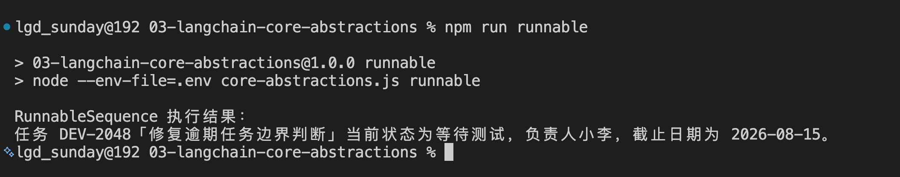

所以，Runnable 和 Agent 的区别大致就是：

> **Runnable 负责用统一接口运行和组合组件；Agent 则会让模型根据当前状态动态决定下一步执行什么。**
>

## 总结
现在，咱们再回头看这一小节标题中的五个概念。

+ `Chat Model` 是模型调用入口。它把不同模型供应商的 API 包装成相近的 `invoke()`、`stream()` 和 `batch()` 调用方式。
+ `Message` 是模型调用过程中的统一数据结构。系统要求、用户输入、模型输出和 Tool 结果，会分别使用不同 Message 类型表达。
+ `Tool` 是可以交给模型选择的外部能力。它不只是一个函数，还包含名称、功能描述和参数 Schema。
+ `Runnable` 是一套统一执行接口。Model 和 Tool 都可以作为 Runnable 运行，也可以继续组合成固定流程。
+ `Integration Package` 负责连接具体供应商。`@langchain/deepseek` 会把 LangChain Message 和 Tool 定义转换成 DeepSeek API 能够识别的请求，再把响应转换回 LangChain 对象。

那么，到现在，咱们应该就已经知道，LangChain 的价值是 **在模型 API 之上增加了一套统一的 Model、Message、Tool 和 Runnable 抽象，并通过 Integration Package 对接具体供应商。**

> 更新：2026-08-11 19:11 · 原文：<https://www.yuque.com/lgdsunday/ab1dy3/gwgevbrqdtsrtq8g>
