# 04 - 深入 createAgent 原理：ReactAgent 图编译、State 路由、Tool Loop 与多通道流式观测

这一小节，咱们要浅尝一下 LangChain 的源码了，就从 `createAgent` 开始。

先回顾下咱们上一小节写的案例，上一小节实现的算是一个简单的 Tool Calling 

模型先生成 `Tool Call`，应用程序执行 `get_task`，再把结果包装成 `ToolMessage` 交回模型。

不过，上一次只有一个 Tool，跑完一次就结束了。

但是咱们知道，实际开发中，不可能只调用一个单独的 Tool。

Tool 和 模型之间的循环，肯定会进行多次的。

而 `createAgent()` 真正接管的，正是这段多轮执行过程。

## 先把案例运行起来
本小节代码在：

```latex
/Code/Node/第五章/04-langchain-create-agent
```

进入项目目录，安装依赖：

```bash
cd /Code/Node/第五章/04-langchain-create-agent
npm install
```

这里必须要跟大家明确一下版本，因为在看源码的时候，不同的版本源码会有所不同

```javascript
"dependencies": {
    "@langchain/core": "1.2.5",
    "@langchain/deepseek": "1.1.6",
    "langchain": "1.5.5",
    "zod": "4.4.3"
}
```

然后，在当前目录创建 `.env`：

```plain
DEEPSEEK_API_KEY=你的 DeepSeek API Key
DEEPSEEK_MODEL=deepseek-v4-flash
```

执行：

```bash
npm run demo
```

最终回答会根据模型生成结果略有变化，但是前面的执行顺序应该是稳定的：

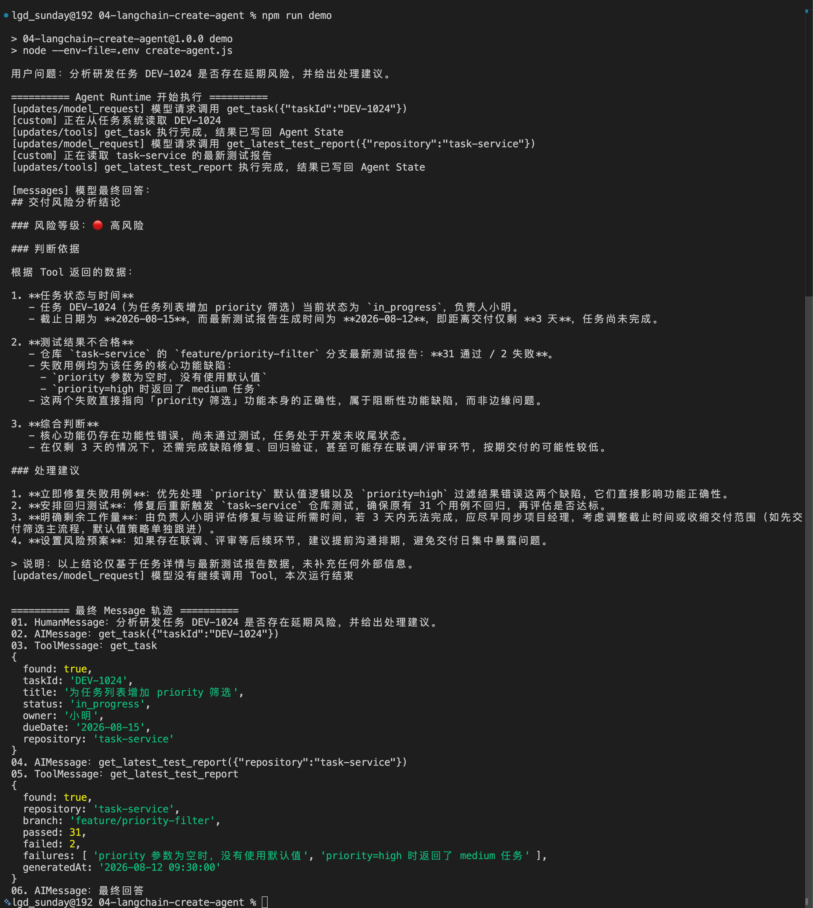

大家先看 Tool 的调用顺序。

第一次调用 `get_task` 时，模型只有任务编号 `DEV-1024`。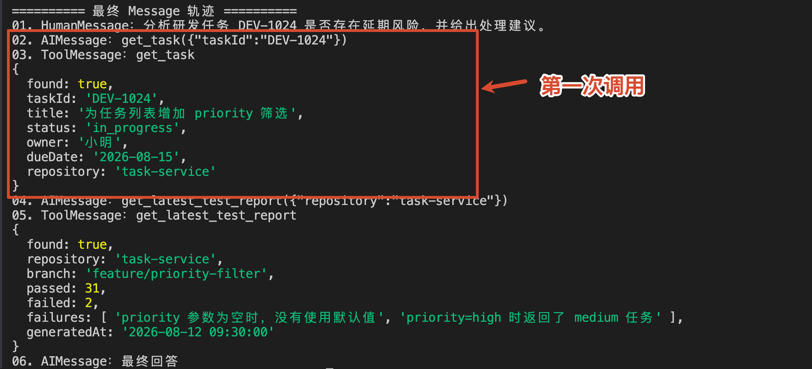

等这个 Tool 返回以后，第二次调用参数才出现：

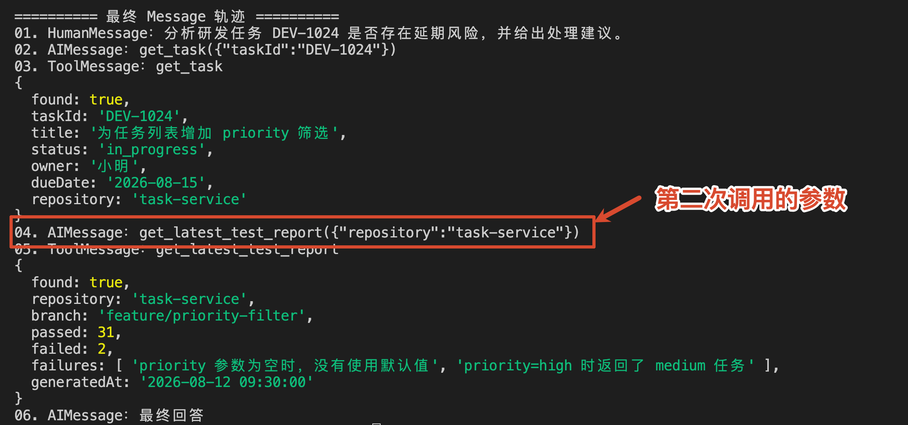

这个 `repository` 是模型从第一次 Tool 返回的结果中拿到的。

而这一整的业务逻辑就是从 `createAgent()` 开始的

## createAgent() 到底创建了什么
打开 `create-agent.js`，可以看到 Agent 的创建代码：

```javascript
/**
 * 创建研发任务交付风险分析 Agent。
 *
 * 本例存在明确的数据依赖：
 *
 * get_task
 *    ↓ repository
 * get_latest_test_report
 *
 * 第二次 Tool 调用所需的 repository，
 * 只有第一次 Tool 执行完成之后才能得到。
 *
 * 因此整个 Agent Run 会经历多轮：
 *
 * Model → Tool → Model → Tool → Model → Final Answer
 */
const agent = createAgent({
    model: createModel(),
    tools: [getTask, getLatestTestReport],
    systemPrompt: `你是研发任务交付风险分析 Agent。

分析任务是否能够按期交付时，必须遵守下面的流程：

1. 先调用 get_task 查询任务状态、截止时间和 repository。
2. 再使用 get_task 返回的 repository 调用 get_latest_test_report。
3. 只有同时拿到任务详情和测试报告，才能给出交付风险结论。
4. 只能根据 Tool 返回的数据回答，不得补充不存在的信息。

最终回答需要包含：风险等级、判断依据和处理建议。`
})
```

这里传入的 `model`、`tools` 和 `systemPrompt`，在上一节都已经学过了。

但是，`createAgent()` 并不是简单把这三个参数保存到一个对象中。

按照 [LangChain Agent 官方文档](https://docs.langchain.com/oss/javascript/langchain/agents) 的解释，Agent 会让模型循环调用 Tool，直到任务完成：

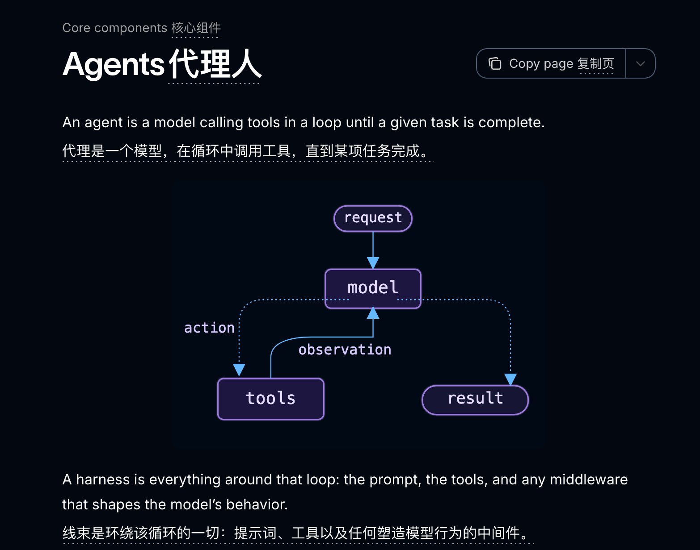

而 `createAgent()` 会创建一套基于 LangGraph 的图运行时（LangGraph 咱们还没学，这里大家就先记住就行）。

咱们甚至可以直接看一下当前版本中 `createAgent()` 打包后的源码（代码位置在 `Node/第五章/04-langchain-create-agent/node_modules/langchain/dist/agents/index.js` 里）：

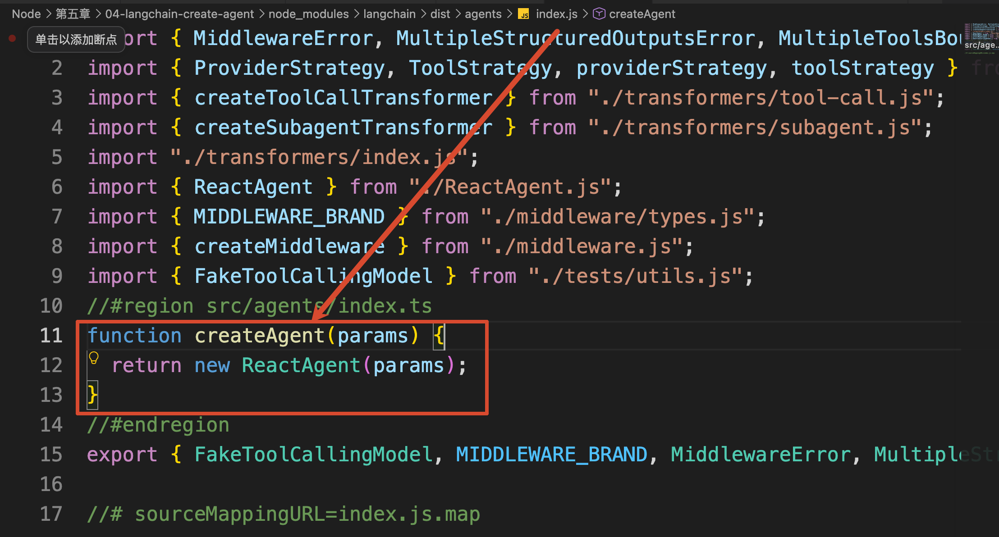

代码就一句，它创建的是一个叫 `ReactAgent` 的对象

> 注意，这里的 `ReactAgent` 和前端的 React 没有关系。
>
> 它指的是按照 `ReAct` 思路运行的 Agent。第四章已经讲过 ReAct，也就是模型根据当前信息决定 Action，读取 Observation 以后再继续判断。
>

然后，咱们就来看看这个  `ReactAgent` 。

还是在这个文件（`node_modules/langchain/dist/agents/index.js`） 里面。

咱们找一下文件最上面的 import，可以找到：`import { ReactAgent } from './ReactAgent.js'`

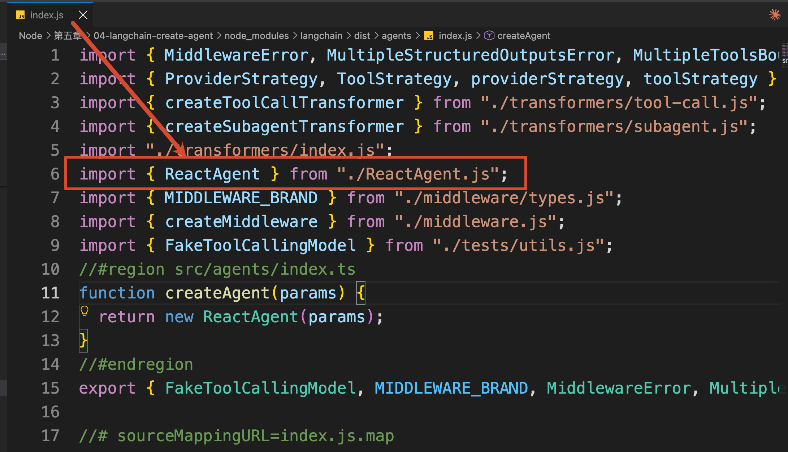

这行代码已经告诉了咱们，`ReactAgent` 来自当前目录中的 `ReactAgent.js`。

然后咱们找到这个 js 文件，对应的路径是 `node_modules/langchain/dist/agents/ReactAgent.js`  

> 如果使用 VS Code，也可以按住 `Command`（Windows 按住 `Ctrl`），然后点击 `new ReactAgent(params)` 里的 `ReactAgent`，编辑器会直接跳到这个文件。
>
> 有时编辑器会先进入 `ReactAgent.d.ts`。
>
> `.d.ts` 是 TypeScript 类型声明文件，不是 Node.js 实际运行的代码。咱们这里要看的是同一目录下的 `ReactAgent.js`。
>

因为咱们现在看的是打包之后的代码，所以说代码的内容特别长，也没有什么模块化的区分，大家打开 `ReactAgent.js` 之后，看到的代码应该是这样

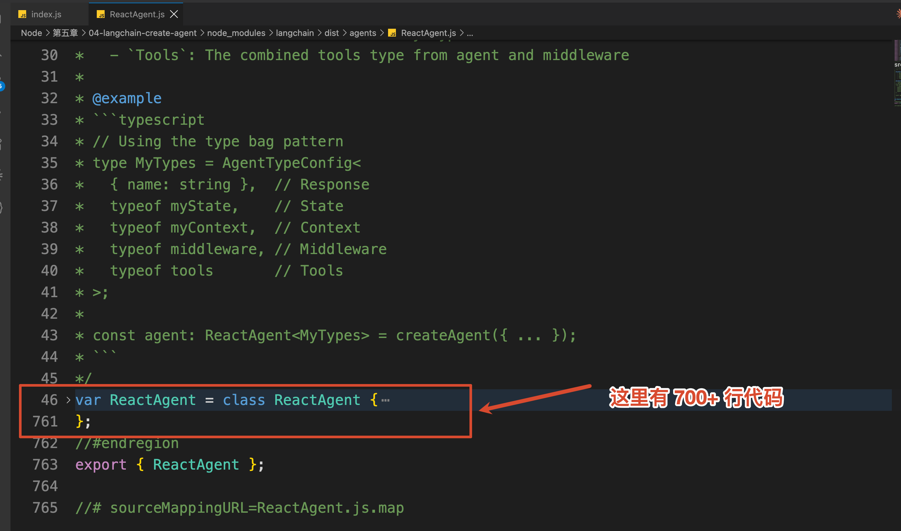

根据前面的内容，我们知道，在 `createAgent()` 执行的是

```javascript
return new ReactAgent(params)
```

所以，咱们直接看这个类的构造函数，也就是 `constructor()` 就可以

因此，打开 `ReactAgent.js` 以后，搜索：`constructor(options, defaultConfig)`

可以找到：

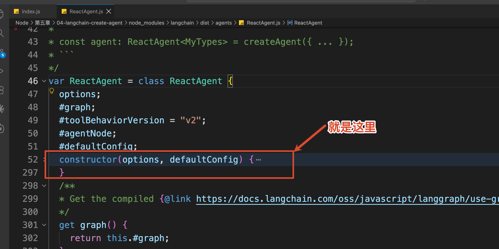

这里传入的 `options` 就是 `createAgent(params)` 收到的 `params`。它会直接通过 `this.options = options` 的方式完成赋值

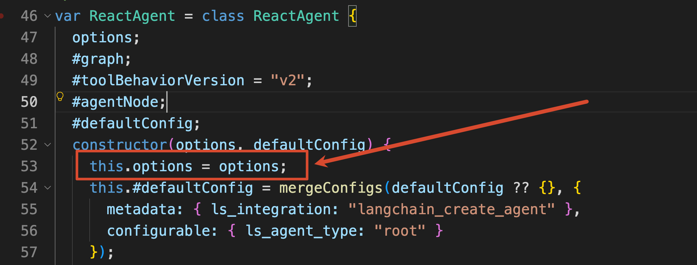

也就是说，咱们在业务代码中传入的 `model`、`tools` 和 `systemPrompt`，现在都进入了 `ReactAgent` 的构造函数。

到这里，调用路径就是：

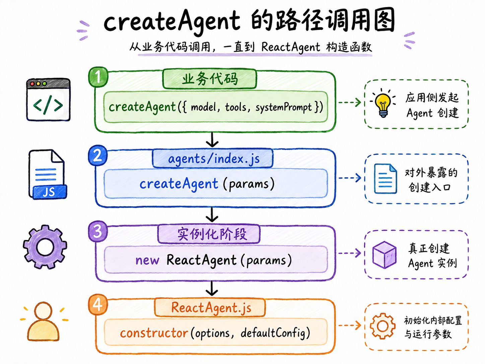

接下来，继续在这个 `constructor()` 中往下找。

在 `ReactAgent.js` 中搜索 `new StateGraph`

可以看到下面这段代码：

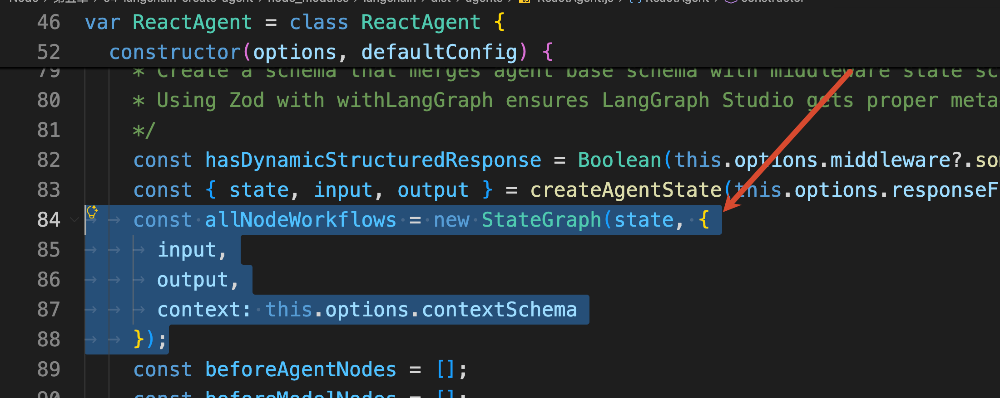

这里涉及到一个类叫做： `StateGraph`   它是： **LangGraph 里用来搭建“有状态执行流程”的核心类**。

咱们可以直接到文件顶部，查看 `StateGraph` 的引用。可以看到他是从 `@langchain/langgraph` 引用来的

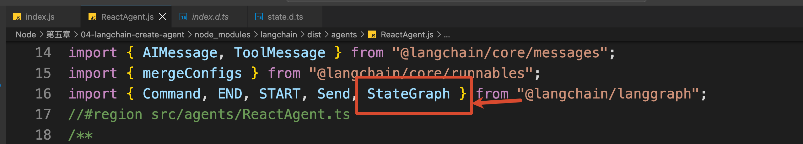

而 `new StateGraph()` 这里的作用，大家可以先理解为 **创建了一张空的流程图**。

参数中的 `state` 用来规定这张图运行时需要保存哪些状态。当前最基础的状态中，就包含咱们前面见过的 `messages`。

不过，这里只是把图创建出来了。

一张空图还不能运行，接下来还要 **向图里添加节点和节点之间的连线。**

继续在 `ReactAgent.js` 中搜索 `addNode` 的方法调用。根据方法名也能看出来，这玩意就是添加 Node 节点的。

整个文件一共调用了 6 次 `addNode`

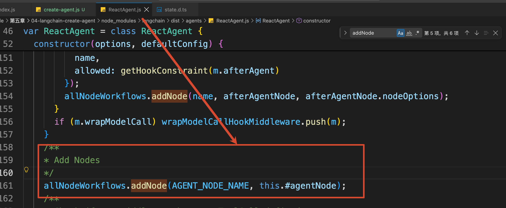

咱们就看第一次调用：

```javascript
allNodeWorkflows.addNode(AGENT_NODE_NAME, this.#agentNode);
```

这里涉及到了一个叫做 `AGENT_NODE_NAME` 的常量。

这个常量来自于 `'./nodes/AgentNode.js'`

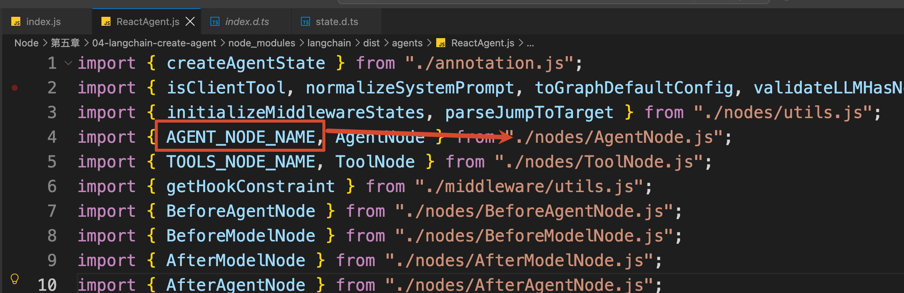

按照这个相对路径，打开 `node_modules/langchain/dist/agents/nodes/AgentNode.js` 

搜索 `AGENT_NODE_NAME`，就能看到：

```javascript
// 状态图中代理节点的名称。
const AGENT_NODE_NAME = 'model_request'
```

所以，刚才添加到图里的节点实际叫作 `model_request`。**它负责读取当前 State，并调用模型生成 Tool Call 或最终回答。**

然后，回到 `ReactAgent.js`，还可以看到第二个节点：

```javascript
const toolNode = new ToolNode(clientTools, {
    signal: this.options.signal,
    wrapToolCall: wrapToolCall(middleware)
})

allNodeWorkflows.addNode(TOOLS_NODE_NAME, toolNode)
```

使用同样的方式打开：`node_modules/langchain/dist/agents/nodes/ToolNode.js`

搜索 `TOOLS_NODE_NAME`：

```javascript
const TOOLS_NODE_NAME = 'tools'
```

所以，当前案例的两个核心节点是：

+ model_request：调用模型，生成 Tool Call 或最终回答
+ tools：执行模型请求调用的 Tool，并生成 ToolMessage

现在，图里已经有节点了。

但是，程序还不知道先运行谁、运行完以后又该去哪里，所以还需要添加连线。

继续在 `ReactAgent.js` 搜索：`addEdge`

可以先找到整个图的入口：

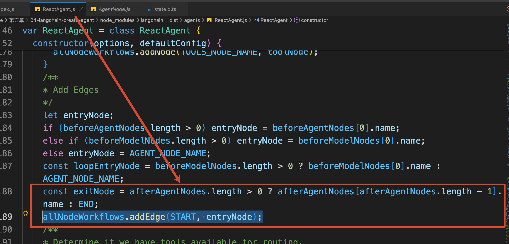

当前案例没有 Middleware（后面再讲），因此 `entryNode` 就是 `model_request`。

意思是 Agent 启动以后，先进入模型节点。

模型执行结束以后，下一步不是固定的，所以源码使用的是 `addConditionalEdges()`：

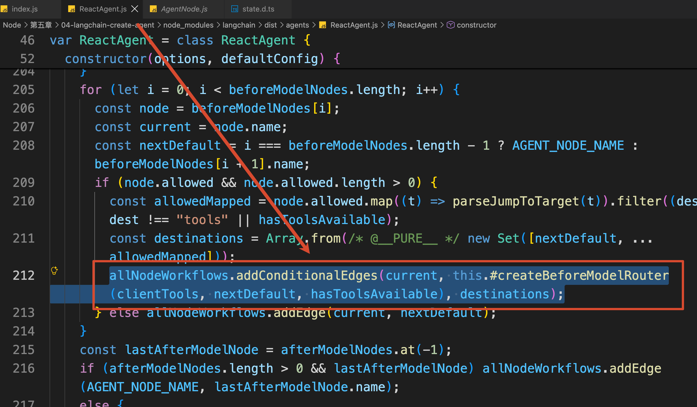

`createModelRouter()` 会检查模型刚刚生成的最后一条 `AIMessage`。

如果里面存在 `tool_calls`，就进入 `tools`；如果不存在，就进入 `END`，结束本次运行。

Tool 执行完成以后，源码中还有一条返回模型节点的边：

```javascript
allNodeWorkflows.addEdge(
    TOOLS_NODE_NAME,
    toolReturnTarget
)
```

当前案例中的 `toolReturnTarget` 仍然是 `model_request`。

这也正好解释了前面案例中的现象，那就是：

> `get_task` 执行完成以后，Runtime 为什么会再次调用模型
>
> `get_latest_test_report` 执行完以后，为什么还会第三次调用模型生成最终回答
>

最后，在 `ReactAgent.js` 中搜索：

```latex
.compile(
```

可以找到：

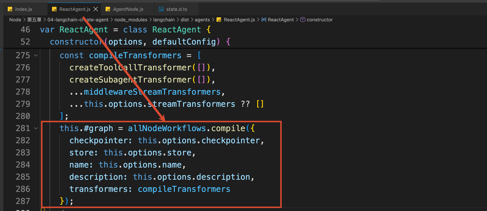

前面的 `new StateGraph()`、`addNode()` 和 `addEdge()` 都是在定义这张图。

调用 `compile()` 以后，它才会变成一张可以通过 `invoke()` 或 `stream()` 执行的图，并保存到 `this.#graph` 中。

以上这些流程，也就证明了咱们前面说过的：**ReactAgent` 使用 LangGraph 创建了一张可执行的图**

大致的流程就是下面这样：

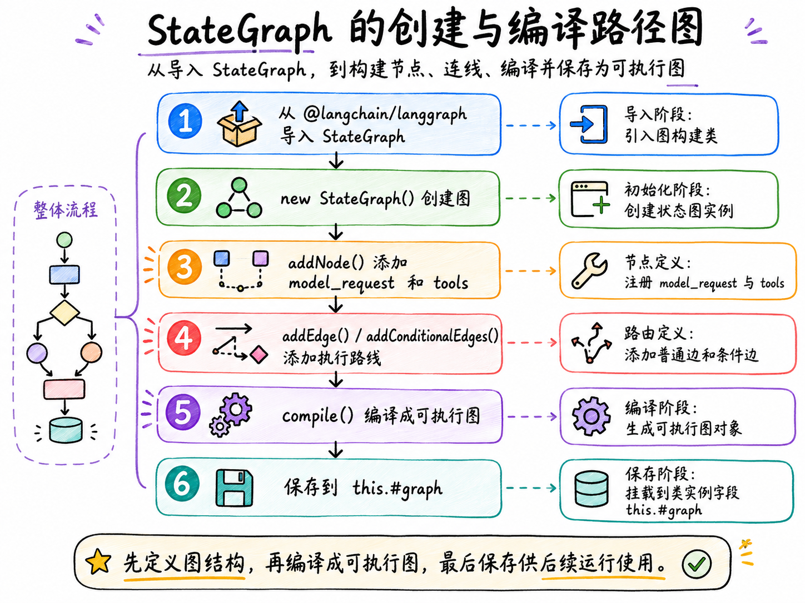

后面第 09、10 小节会继续拆解 `AgentNode`、`ToolNode` 和路由函数内部具体做了什么。

这一小节咱们说到这就足够了。

## 详解 agent.stream() 原理
咱们重新回到咱们自己写的 `create-agent.js` 里面。

来看下这里的 `await agent.stream` 方法

```javascript
const question = '分析研发任务 DEV-1024 是否存在延期风险，并给出处理建议。'

const input = {
    messages: [
        {
            role: 'user',
            content: question
        }
    ]
}

const stream = await agent.stream(input, {
    streamMode: ['updates', 'messages', 'custom']
})
```

上一小节咱们说过，`agent.stream()` 和 `agent.invoke()` 启动的是同一套 Agent Runtime。

区别在于，`invoke()` 会等到任务结束以后再返回结果，`stream()` 则可以在执行过程中不断返回流式数据。

不过，在继续看 Runtime 之前，得先把 `agent.stream()` 接收的两个参数说清楚：

```javascript
agent.stream(input, {
    streamMode: ['updates', 'messages', 'custom']
})
```

+ 第一个参数 `input`，是交给本次 Agent Run 的初始数据，也就是 `State`。
+ 第二个参数是运行配置。这里的 `streamMode` 只是在告诉 Runtime，咱们想观察哪些流式事件，它不会成为模型需要处理的业务数据。

咱们先来看第一个参数： `input`

因为 Agent 不是执行一次函数就结束。

它会在 `model_request` 和 `tools` 之间来回运行。模型节点生成的 Tool Call，需要交给 Tool 节点；Tool 节点返回的结果，又需要交回下一轮模型节点。

这些节点必须有一个共同存放数据的地方。

这个在整个 Agent Run 中不断被读取和更新的数据对象，就叫作 `Agent State`。

所以，`agent.stream()` 收到第一个参数以后，会用它初始化本次运行的 State。

咱们传入的 `input` 是：

```javascript
const input = {
    messages: [
        {
            role: 'user',
            content: question
        }
    ]
}
```

这里明确传入了一个 `messages` 字段，里面只有一条用户消息。

LangChain 会把 `{ role: 'user', content: question }` 这种简写转换成一条 `HumanMessage`。因此，本次运行刚开始时，`messages` 中就是：

```latex
HumanMessage：分析研发任务 DEV-1024 是否存在延期风险……
```

注意，`systemPrompt` 和两个 Tool 的定义不在这条 `messages` 里面。

它们是在前面调用 `createAgent()` 时注册到 `ReactAgent` 中的。等 `model_request` 真正调用模型时，才会把 System Prompt、当前 `messages` 和可用 Tool 定义一起交给模型。

而 `streamMode` 只是运行配置，也不会写入 `messages`。

把这几份数据分开以后，当前过程就是：

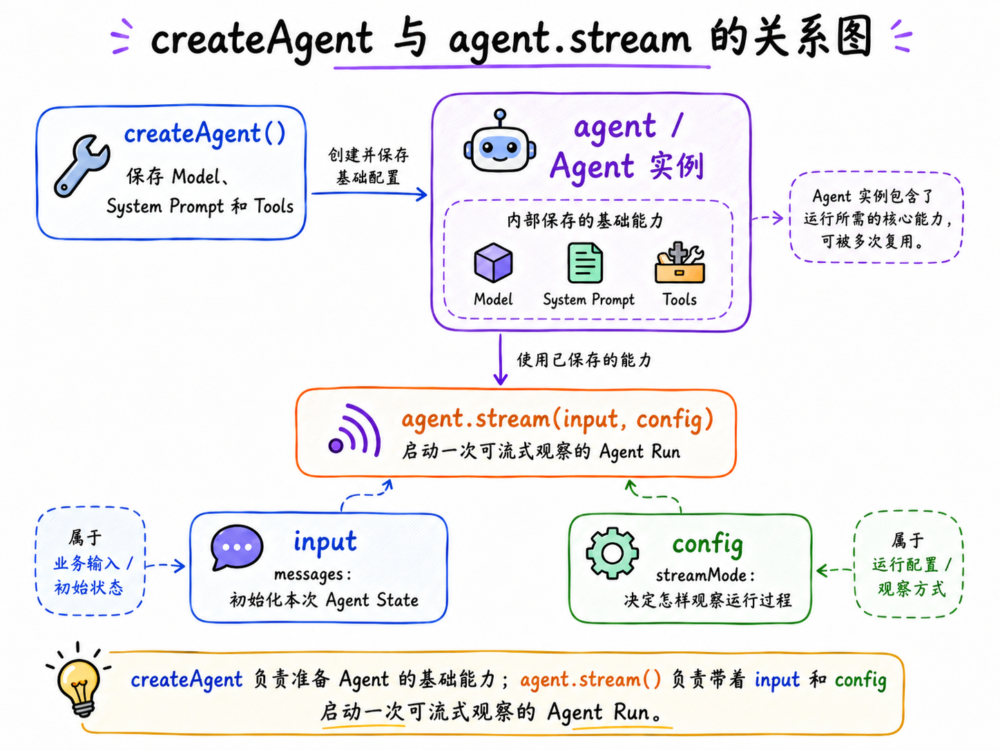

现在，本次运行已经有了第一份 State。

按照前面看到的 `START → model_request` 连线，Runtime 接下来会把当前 State 交给 `model_request`，开始第一轮模型调用。

## 第一轮：模型决定先查询任务
第一次调用模型时，模型能够看到用户问题、System Prompt 和两个 Tool 的定义。

但是，它还没有任务状态、截止时间和仓库名。

所以，这一轮模型不会直接回答，而是生成：

```latex
get_task({ taskId: "DEV-1024" })
```

这次决定会形成一条带有 `tool_calls` 的 `AIMessage`，并追加到 `messages`：

```latex
1. HumanMessage：分析 DEV-1024 的延期风险
2. AIMessage：调用 get_task({ taskId: "DEV-1024" })
```

然后，Runtime 检查最后一条 `AIMessage`。

判断逻辑可以简化成下面这样：

```javascript
if (lastMessage.tool_calls?.length) {
    return 'tools'
}

return 'END'
```

现在存在 `Tool Call`，所以本次运行不会结束，而是从 `model_request` 进入 `tools`。

`tools` 节点找到 `get_task` 并执行。

Tool 返回的内容中有一个非常关键的字段：

```json
{
    "taskId": "DEV-1024",
    "status": "in_progress",
    "dueDate": "2026-08-15",
    "repository": "task-service"
}
```

执行结果会被包装成 `ToolMessage`，继续放进同一个 `messages`：

```latex
1. HumanMessage：分析 DEV-1024 的延期风险
2. AIMessage：调用 get_task
3. ToolMessage：get_task 返回任务详情
```

`tools` 完成以后，并不会直接把结果返回给用户。

Runtime 会重新回到 `model_request`，把更新后的 `messages` 再交给模型。

这就是第一次循环。

## 第二轮：模型使用上一次结果继续调用 Tool
第二次进入 `model_request` 时，模型已经能看到 `get_task` 返回的 `repository`。

于是，它生成第二次 Tool Call：

```latex
get_latest_test_report({ repository: "task-service" })
```

注意这里的数据流。

咱们没有专门写一段代码，把 `get_task.repository` 复制给 `get_latest_test_report`。

是 Runtime 把第一轮产生的 `ToolMessage` 保存在 State 中，模型再次读取当前 State，自己生成了第二次调用参数。

这次执行完成以后，`messages` 又多了两条：

```latex
4. AIMessage：调用 get_latest_test_report
5. ToolMessage：返回 31 条测试通过、2 条测试失败
```

现在，模型同时拿到了任务详情和测试报告。

Runtime 再次回到 `model_request`。

模型根据两份数据生成最终风险结论，这一轮的 `AIMessage` 中已经没有 `tool_calls` 了。

于是路由逻辑选择 `END`，本次 Agent Run 正式结束。

对应的也就是这一整套的 Message 轨迹

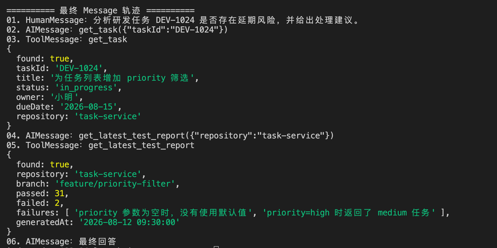

## 总结
这一小节咱们开始初步看了 LangChain 的源码。

不过咱们没有从 Github 上把 LangChain 全部拉下来看，而是直接看打包之后的 `dist` 里面的源码。

主要还是因为这样看比较简单，如果完整的拉下来 `LangChain` 那可就费大劲了。

而 `createAgent()` 的核心是：**它创建了一套基于 LangGraph 的 Agent Runtime，把模型调用、Tool 执行、State 更新、条件路由和循环终止组织成了一条可以持续运行的执行链路。**

至于执行轨迹和流式事件，则是：**让应用程序能够观察这条链路正在做什么。**

> 更新：2026-08-12 18:28 · 原文：<https://www.yuque.com/lgdsunday/ab1dy3/brp6l495dfppboqg>
