# 06 - 深入 LangChain Middleware：Hook 执行模型、请求拦截、结果契约与可靠性控制

上一小节，咱们通过 `Runtime Context` 把当前用户和 `tenantId` 传进了 Agent。

Tool 查询任务时，只会读取当前租户的数据。

这解决的是：**Agent 应该以谁的身份查询数据。**

但是，Agent 真正运行起来以后，执行过程还得有监管才可以。

比如，普通开发者能不能调用包含敏感信息的 Tool？Tool 返回的数据不完整，还能不能继续交给模型？模型反复调用 Tool 时，最多允许执行多少次？

这些事情不能只写进 Prompt，必须由应用程序中的代码真正执行。

可这些控制代码应该写在哪里呢？？

这就得用到这一小节要讲的东西了～～

LangChain 提供了一个专门的扩展机制：[Middleware](https://docs.langchain.com/oss/javascript/langchain/middleware/overview)，也就是 **中间件**。

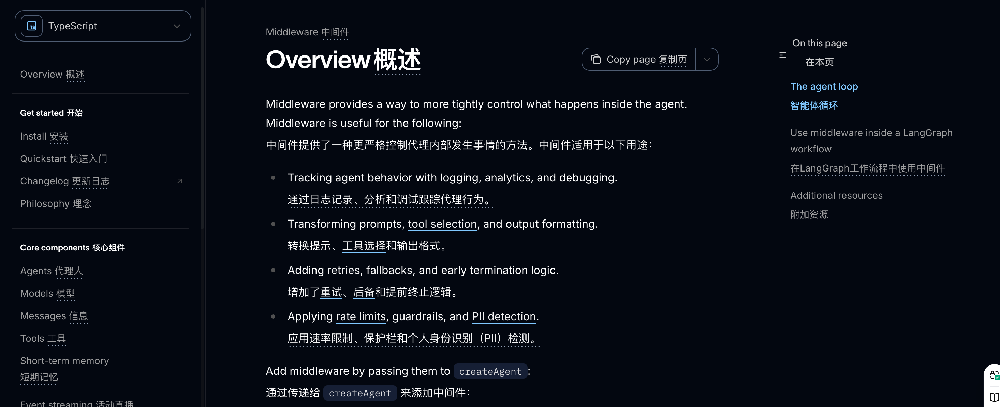

咱们可以先把 Middleware 理解成 Agent 执行过程中的 “中间的检查站”，比如说：

+ 模型调用前，检查调用预算
+ Tool 调用前，检查当前用户的权限
+ Tool 返回后，校验结果是否有效
+ 调用临时失败后，决定是否自动重试

咱们不用修改 `createAgent()` 内部的 Agent Loop，只需要把对应的 Middleware 挂到 Agent 上，就可以在这些关键位置加入控制逻辑。

这一小节，咱们就继续改造上一节的研发任务风险分析 Agent，为它加入权限、预算、结果校验和失败恢复。

## Middleware 到底加在了哪里
本节代码在 `/Code/Node/第五章/06-langchain-middleware`。

项目安装和运行过程就不重复说了，说了好多次了，别忘了 `.env` 文件。

然后，咱们先从 Agent 的创建入口开始看。

打开 `middleware-agent.js`，找到 `createRiskAgent()`：

```javascript
/**
* 创建研发任务交付风险分析 Agent。
*/
function createRiskAgent({ modelRunLimit = 5, toolRunLimit = 4 } = {}) {
  return createAgent({
    ...

    middleware: [
      /**
       * 根据当前 Runtime Context 对 Tool 权限进行过滤或控制。
       *
       * 例如不同用户、角色或租户可能只能看到部分 Tool，
       * Agent 只能调用当前实际可见的能力。
       */
      permissionMiddleware,

      /**
       * 限制单次 Agent Run 中模型调用次数。
       *
       * 超过 modelRunLimit 后直接抛出错误，
       * 防止 Agent 因反复推理而无限消耗模型调用次数。
       */
      modelCallLimitMiddleware({
        runLimit: modelRunLimit,
        exitBehavior: 'error'
      }),

      /**
       * 限制单次 Agent Run 中 Tool 调用次数。
       *
       * 超过 toolRunLimit 后直接终止，
       * 防止 Agent 出现工具调用死循环或无效重复调用。
       */
      toolCallLimitMiddleware({
        runLimit: toolRunLimit,
        exitBehavior: 'error'
      }),

      /**
       * 为指定 Tool 增加失败重试能力。
       *
       * Retry 必须包在 Validation 外层。
       * Validation 抛出的可重试错误，才能回到 Retry 再执行一次 Tool。
       */
      toolRetryMiddleware({
        // 这里只对测试报告查询 Tool 启用重试。
        tools: ['get_latest_test_report'],

        // 首次调用失败后最多额外重试 1 次。
        maxRetries: 1,

        // 当前示例为了方便演示，不等待直接重试。
        initialDelayMs: 0,

        // 不使用指数退避。
        backoffFactor: 0,

        // 不增加随机抖动时间。
        jitter: false,

        /**
         * 判断当前异常是否属于可以重试的 Tool 结果校验错误。
         *
         * 多层 Middleware 会使用 MiddlewareError 包装内部异常，
         * 因此 isInvalidToolResult 需要沿着 cause 找到最初的结果校验错误。
         */
        retryOn: isInvalidToolResult,

        // 重试仍然失败时，将错误继续向外抛出。
        onFailure: 'error'
      }),

      /**
       * 对 Tool 返回的结果进行统一校验。
       *
       * 如果返回结果缺少关键字段、格式不正确或不满足业务要求，
       * Middleware 会抛出校验异常。
       *
       * 当异常属于可重试错误时，
       * 外层的 toolRetryMiddleware 会重新执行对应 Tool。
       */
      resultValidationMiddleware
    ]
  })
}
```

和上一小节相比，`model`、`tools`、`contextSchema` 和 `responseFormat` 都没有变化，就不给大家呈现了，大家可以直接通过源码去看。

咱们直接看新增 `middleware` 数组部分。

这个数组里的每个 Middleware，都会被编译进 `createAgent()` 创建的 LangGraph 中。Agent Loop 还是原来的 Agent Loop，但是模型和 Tool 的执行路径上多了几个可以插入代码的位置。

咱们看数组里面的第一个元素，叫做：`permissionMiddleware`

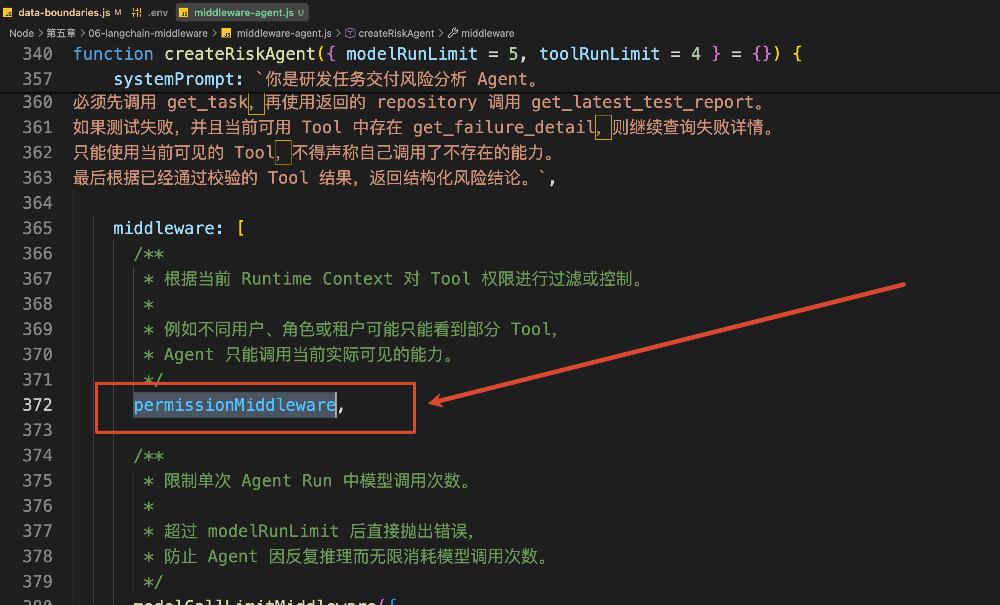

这个对象是通过 `createMiddleware` 方法创建的：

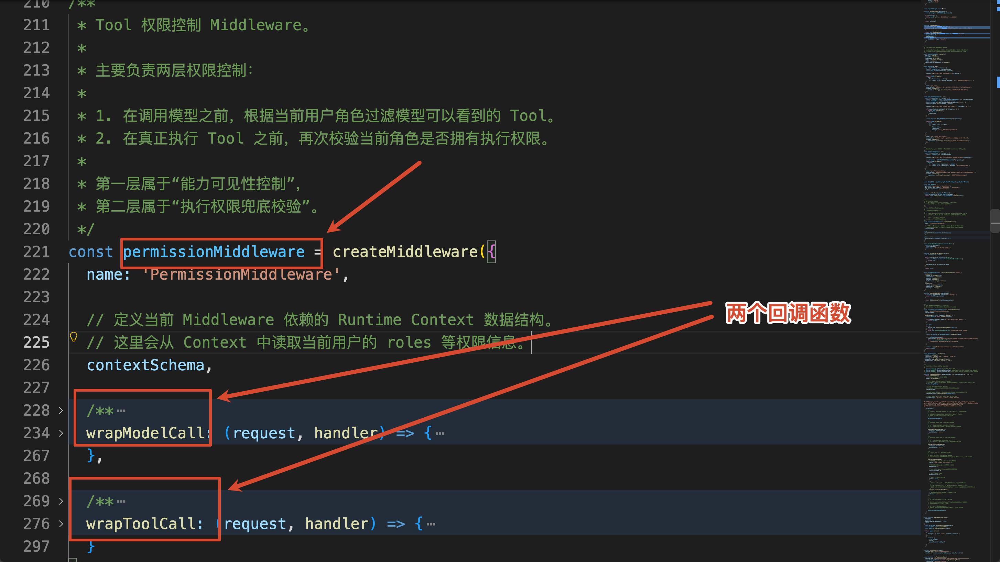

咱们可以看到，在 `createMiddleware` 有两个回调函数：`wrapModelCall` 和 `wrapToolCall`

这些回调函数在 LangChain 中叫作 `Hook`。

不过它和 `React` 里面的 `hook` 不太一样。

> 在 React 中，所有以 `use` 开头的自定义函数，都称为是 hooks。
>
> 但是在 LangChain 大家可以把它理解为：**在某一个固定时机执行的回调方法**
>

常用 Hook 有挺多的，给大家简单的理解几个：

+ `beforeAgent`：整个 Agent 开始以前执行一次
+ `beforeModel` ：每次调用模型以前执行
+ `afterModel`：每次模型返回以后执行
+ `wrapModelCall`：包住一次完整的模型调用
+ `wrapToolCall`：包住一次完整的 Tool 调用
+ `afterAgent`：整个 Agent 结束以后执行一次

> 更多的 Hook 大家可以在 [这里](https://docs.langchain.com/oss/javascript/langchain/middleware/custom#hooks) 查看
>

其中，`beforeModel` 和 `afterModel` 适合在固定位置检查或更新 State。

`wrapModelCall` 和 `wrapToolCall` 则更加灵活。它们会拿到一个 `handler`，由咱们决定什么时候继续执行原来的模型或 Tool。

比如：

```javascript
wrapToolCall: async (request, handler) => {
  // Tool 执行以前
  const result = await handler(request)

  // Tool 执行以后
  return result
}
```

`handler(request)` 就是“继续执行原来的 Tool 调用”。

如果不调用 `handler`，就相当于在这里拦住了这次执行。如果调用两次，则可以实现一次重试。

大家也没必要把所有的 hook 都背下来。现在面试也都不这么问了。

 Middleware 的重点是：**先找到想控制的执行位置，再选择合适的 Hook。**

接下来，就沿着一次 Agent Run 看看这些控制是怎么生效的。

## 模型调用以前，先确定它能看到哪些 Tool
本节一共注册了三个 Tool：

```javascript
/**
 * 当前风险分析 Agent 注册的完整 Tool 集合。
 *
 * - getTask：根据任务 ID 查询研发任务基础信息
 * - getLatestTestReport：根据任务所属仓库查询最新测试报告
 * - getFailureDetail：在测试失败时进一步查询具体失败详情
 *
 * 后续 permissionMiddleware 会根据当前用户角色，
 * 从 ALL_TOOLS 中过滤出本次模型实际可见、可调用的 Tool。
 */
const ALL_TOOLS = [getTask, getLatestTestReport, getFailureDetail]
```

每个 Tool 可以被哪些角色使用，是由应用程序明确规定：

```javascript
/**
 * Tool 与角色之间的权限映射关系。
 *
 * Key 表示 Tool 名称，
 * Value 表示允许使用该 Tool 的角色列表。
 *
 * 当前权限规则：
 * - developer：可以查询任务和最新测试报告
 * - maintainer：除了上述能力外，还可以进一步查询失败详情
 *
 * permissionMiddleware 会通过这份配置判断：
 * 1. 某个 Tool 是否应该对当前模型可见
 * 2. 某个 Tool 在真正执行前是否具有调用权限
 */
const TOOL_ROLES = {
  // developer 和 maintainer 都可以查询研发任务基础信息。
  get_task: ['developer', 'maintainer'],

  // developer 和 maintainer 都可以查询仓库最新测试报告。
  get_latest_test_report: ['developer', 'maintainer'],

  // 失败详情属于权限更高的能力，只允许 maintainer 使用。
  get_failure_detail: ['maintainer']
}
```

这份权限配置具体应该在哪里生效呢？

先回到一次 Tool Calling 的执行流程：

+ 第一步：应用程序把 Tool 列表发送给模型
+ 第二步：模型从中选择一个 Tool，返回 Tool Call
+ 第三步：LangChain 收到 Tool Call
+ 第四步：Agent Runtime 执行真正的 Tool

也就是说，模型只负责**提出要调用哪个 Tool**，真正执行 Tool 的还是应用程序。

因此，权限控制也要对应这两个阶段：

+ 先控制模型可以选择什么
+ 再控制应用程序最终允许执行什么

权限控制使用的就是咱们前面看到的 `Middleware` ：`permissionMiddleware`

```javascript
const permissionMiddleware = createMiddleware({
  name: 'PermissionMiddleware',
  // 定义当前 Middleware 依赖的 Runtime Context 数据结构。
  // 这里会从 Context 中读取当前用户的 roles 等权限信息。
  contextSchema,
  /**
   * 包装模型调用过程。
   *
   * 在请求真正发送给模型之前，
   * 根据当前用户角色过滤本次模型可以看到的 Tool。
   */
  wrapModelCall: (request, handler) => {
    // 从 Agent Runtime Context 中读取当前用户的角色。
    const { roles } = request.runtime.context
    
    /**
     * 从当前已经注册的 Tool 中，
     * 筛选出当前角色有权限使用的 Tool。
     *
     * canUseTool() 负责真正的权限判断逻辑。
     */
    const allowedTools = request.tools.filter((currentTool) =>
      canUseTool(roles, currentTool.name)
    )

    /**
     * 继续执行后续 Middleware / Model Call。
     *
     * 这里不会把原始 request.tools 直接传给模型，
     * 而是替换成经过权限过滤后的 allowedTools。
     *
     * 因此模型只能感知并调用当前角色有权限使用的 Tool。
     */
    return handler({
      ...request,
      tools: allowedTools
    })
  },
  
  wrapToolCall: (request, handler) => {...}
})
```

`createMiddleware()` 是用来创建自定义 Middleware。

这里使用 `wrapModelCall`，是因为咱们要修改 **本次模型调用收到的 Tool 列表**。

代码先从 `request.runtime.context` 中读取当前用户角色：

```javascript
// 从 Agent Runtime Context 中读取当前用户的角色。
const { roles } = request.runtime.context
```

然后，从全部 Tool 中筛选出当前角色可以使用的部分：

```javascript
/**
 * 从当前已经注册的 Tool 中，
 * 筛选出当前角色有权限使用的 Tool。
 *
 * canUseTool() 负责真正的权限判断逻辑。
 */
const allowedTools = request.tools.filter((currentTool) =>
  canUseTool(roles, currentTool.name)
)
```

最后，把修改后的 `request` 交给 `handler`：

```javascript
/**
 * 继续执行后续 Middleware / Model Call。
 *
 * 这里不会把原始 request.tools 直接传给模型，
 * 而是替换成经过权限过滤后的 allowedTools。
 *
 * 因此模型只能感知并调用当前角色有权限使用的 Tool。
 */
return handler({
  ...request,
  tools: allowedTools
})
```

这样，LangChain 真正调用 DeepSeek 时，发送的就不再是 `ALL_TOOLS`，而是 `allowedTools`。

对于 `developer` 来说，模型压根看不到 `get_failure_detail` 的名称、描述和参数 Schema，自然也不会选择它。

不过，只把 Tool 从模型面前隐藏起来，还不能算完整的权限控制。

所以，这个 Middleware 还实现了 `wrapToolCall`：

```javascript
/**
 * 包装 Tool 的实际执行过程。
 *
 * 即使模型已经通过 wrapModelCall 只能看到授权 Tool，
 * 在 Tool 真正执行之前仍然再做一次权限校验，
 * 避免绕过模型可见性控制直接触发未授权 Tool。
 */
wrapToolCall: (request, handler) => {
  // 获取当前用户角色。
    const { roles } = request.runtime.context
  /**
   * 再次检查当前角色是否有权执行该 Tool。
   *
   * 如果没有权限，则直接阻止 Tool 调用，
   * 不会继续进入真正的 Tool Handler。
   */
    const toolName = request.toolCall.name

    if (!canUseTool(roles, toolName)) {
        throw new Error(`当前角色无权执行 Tool：${toolName}`)
    }
    // 权限校验通过，继续执行真正的 Tool。
    return handler(request)
}
```

当 Agent Runtime 准备真正执行 Tool 时，这段代码会再次读取用户角色并检查权限。

现在，把两个 Hook 放回刚才的 Tool Calling 中，整体的流程大致就下面这样：

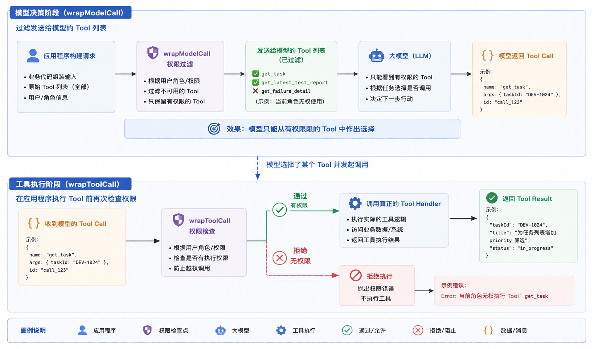

`wrapModelCall` 控制模型能看到什么，`wrapToolCall` 控制应用程序最终允许执行什么。

那么，这两层权限到底有没有生效呢？

咱们运行一下：

```shell
npm run permission
```

程序会使用 `developer` 和 `maintainer` 两种身份，分别运行一次相同的 Agent。

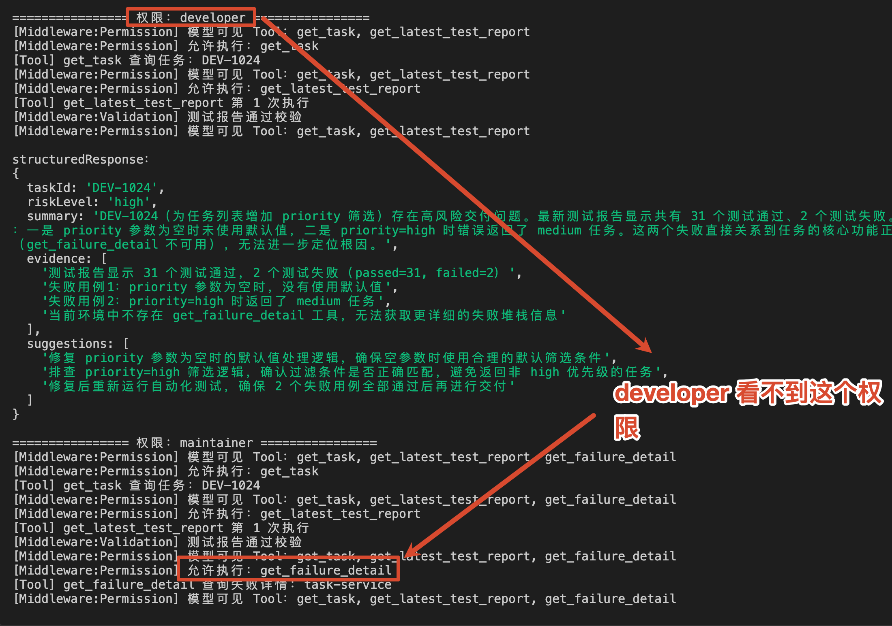

`developer` 根本看不到 `get_failure_detail`，而 `maintainer` 不但能看到它，在发现测试失败以后也确实执行了这个 Tool。

这说明 `permissionMiddleware` 已经生效了。

## Tool 明明返回了 JSON，为什么还会被拒绝？
接下来咱们得执行下代码了。

```shell
npm run retry
```

咱们来看执行次数这里：

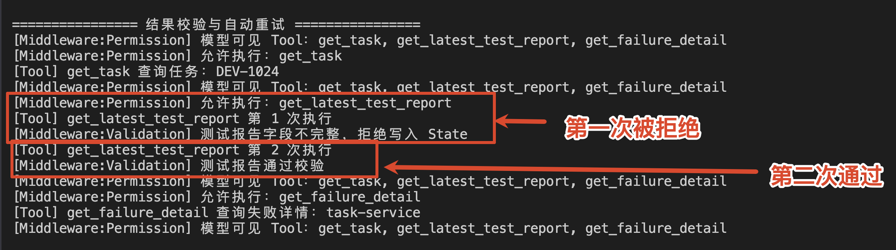

`get_latest_test_report` 第一次没有抛出异常，而且正常返回了 JSON，为什么还是被 Middleware 拒绝了呢？

因为这个 JSON 只是格式正确，里面的数据却不完整。

第一次结果是这样的：

```javascript
{
    "found": true,
    "repository": "task-service"
}
```

这里缺少了 `passed`、`failed` 和 `failures` 的字段

如果直接把它包装成 `ToolMessage` 写入 Agent State，模型就只能拿着一份残缺报告继续分析，很可能生成没有依据的风险结论。

所以，代码使用 Zod 定义了测试报告应该满足的结构：

```javascript
const TestReportResult = z.discriminatedUnion('found', [
    z.object({
        found: z.literal(true),
        repository: z.string(),
        passed: z.number(),
        failed: z.number(),
        failures: z.array(z.string())
    }),
    z.object({
        found: z.literal(false),
        repository: z.string(),
        message: z.string()
    })
])
```

然后，通过另一个自定义 Middleware 校验 Tool 结果：

```javascript
/**
 * Tool 结果校验 Middleware。
 *
 * 当前只对 get_latest_test_report 的返回结果进行严格校验。
 *
 * 主要流程：
 * 1. 先执行真正的 Tool。
 * 2. 如果不是 get_latest_test_report，直接返回结果。
 * 3. 如果是测试报告 Tool，则解析 ToolMessage 中的 JSON。
 * 4. 使用 TestReportResult Schema 校验结果结构。
 * 5. 校验失败时抛出 InvalidToolResultError，
 *    让外层的 Retry Middleware 决定是否重新执行 Tool。
 *
 * 只有通过校验的测试报告，才允许继续进入后续 Agent 流程。
 */
const resultValidationMiddleware = createMiddleware({
    name: 'ResultValidationMiddleware',
  // 定义当前 Middleware 依赖的 Runtime Context 数据结构。
    contextSchema,

  /**
 * 包装 Tool 调用过程，对 Tool 返回结果进行校验。
 */
    wrapToolCall: async (request, handler) => {
    // result 通常是 Tool 执行完成后生成的 ToolMessage。
        const result = await handler(request)

        if (request.toolCall.name !== 'get_latest_test_report') {
            return result
        }

        const data = JSON.parse(toolMessageText(result))
        const validation = TestReportResult.safeParse(data)

        if (!validation.success) {
            throw new InvalidToolResultError(
                '测试报告缺少 passed、failed 或 failures。'
            )
        }

        return result
    }
})
```

这段代码先执行：

```javascript
// result 通常是 Tool 执行完成后生成的 ToolMessage。
const result = await handler(request)
```

所以，它拿到的是 Tool 已经执行完成之后的 `ToolMessage`。

只有 JSON 可以正常解析，并且通过 `TestReportResult` 校验，Middleware 才会 `return result`，让这份结果继续进入 Agent State。

如果结果不完整，就抛出 `InvalidToolResultError`。

这时，当前 Tool 调用没有正常返回，因此残缺结果也不会写入 State。

不过，拒绝结果只是第一步。

测试平台可能只是一次暂时性的响应异常，直接让整个 Agent 失败也有点浪费。

所以，咱们又增加了 LangChain 内置的 `toolRetryMiddleware()` （代码在 `createAgent` 的 `middleware` 数组里面）：

```javascript
/**
 * 为指定 Tool 增加失败重试能力。
 *
 * Retry 必须包在 Validation 外层。
 * Validation 抛出的可重试错误，才能回到 Retry 再执行一次 Tool。
 */
toolRetryMiddleware({
  // 这里只对测试报告查询 Tool 启用重试。
    tools: ['get_latest_test_report'],
  // 首次调用失败后最多额外重试 1 次。
    maxRetries: 1,
  // 当前示例为了方便演示，不等待直接重试。
    initialDelayMs: 0,
  // 不使用指数退避。
    backoffFactor: 0,
  // 不增加随机抖动时间。
    jitter: false,
  /**
   * 判断当前异常是否属于可以重试的 Tool 结果校验错误。
   *
   * 多层 Middleware 会使用 MiddlewareError 包装内部异常，
   * 因此 isInvalidToolResult 需要沿着 cause 找到最初的结果校验错误。
   */
    retryOn: isInvalidToolResult,
  // 重试仍然失败时，将错误继续向外抛出。
    onFailure: 'error'
})
```

这份配置表达的意思是：**只处理 get_latest_test_report，最多额外重试 1 次，只有结果校验错误才重试，重试后仍然失败，就终止 Agent**

所以，实际执行顺序才会变成下面这样：

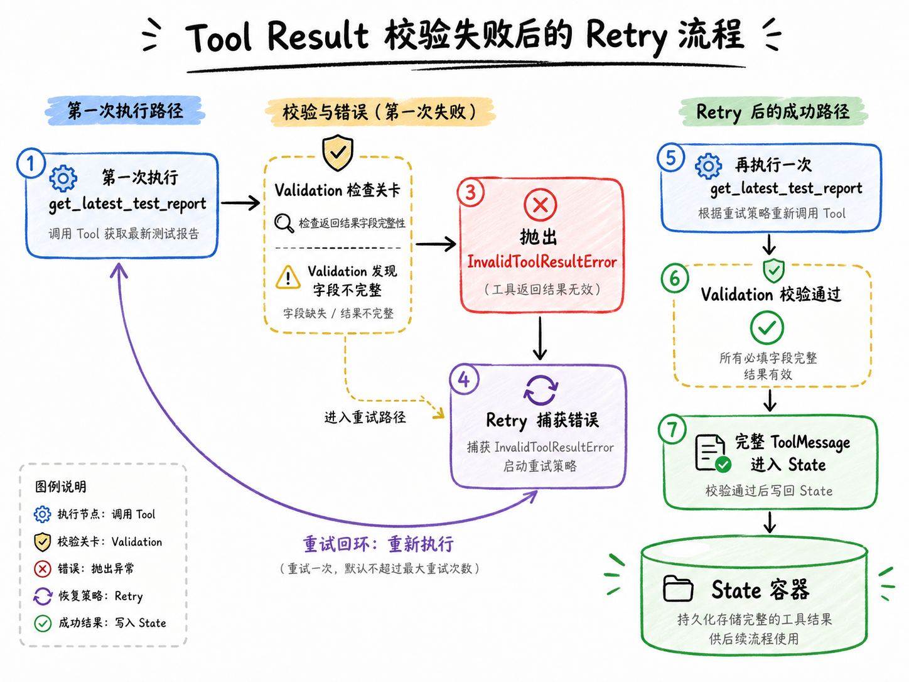

注意，这里不是任何错误都应该重试。

用户没有权限、参数违反业务规则、数据库中确实没有数据，这些问题再执行十次也不会恢复。

真正适合 Retry 的，是超时、临时网络错误、上游限流，或者本例这种可以短暂恢复的异常结果。

## Agent 的停止逻辑
结果恢复以后，最后一个问题就是执行预算。

`createAgent()` 会不断在 Model 和 Tool 之间循环，直到模型不再请求业务 Tool，并生成最终结果。

正常情况下没有问题。

但是，如果模型反复调用同一个 Tool，或者错误结果不断让模型尝试新方案，一次 Agent Run 就可能执行很久，并持续消耗 Token 和外部接口资源。

第四章手写 Agent Runtime 时，咱们自己维护过模型调用次数和 Tool 调用次数。

在 LangChain v1 中，这两项常用控制已经有内置 Middleware：

```javascript
/**
 * 限制单次 Agent Run 中模型调用次数。
 *
 * 超过 modelRunLimit 后直接抛出错误，
 * 防止 Agent 因反复推理而无限消耗模型调用次数。
 */
modelCallLimitMiddleware({
    runLimit: modelRunLimit,
    exitBehavior: 'error'
}),
```

`modelCallLimitMiddleware` 限制一次 Agent Run 最多调用多少次模型。

它会在每次模型返回以后更新计数，并在下一次模型调用以前检查预算。

本节正常流程最多需要四次模型调用：

+ 第一次：决定调用 get_task
+ 第二次：决定调用 get_latest_test_report
+ 第三次：维护者继续调用 get_failure_detail
+ 第四次：生成 Structured Output

因此默认预算设置为 5，给正常流程留出一点空间。

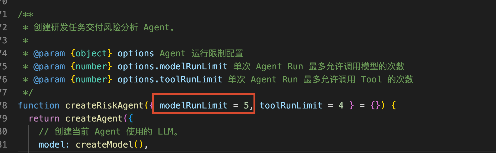

Tool 调用预算使用：

```javascript
/**
 * 限制单次 Agent Run 中 Tool 调用次数。
 *
 * 超过 toolRunLimit 后直接终止，
 * 防止 Agent 出现工具调用死循环或无效重复调用。
 */
toolCallLimitMiddleware({
  runLimit: toolRunLimit,
  exitBehavior: 'error'
}),
```

模型返回 `AIMessage` 以后，Middleware 会读取里面的 Tool Call，并检查这些调用是否会超过本次运行限制。

如果预算已经耗尽，Tool 还没有真正执行，Agent 就会停止。

这里还要注意一个细节。

`toolCallLimitMiddleware` 统计的是模型提出的逻辑 Tool Call。`toolRetryMiddleware` 在同一个 Tool Call 内部重新执行一次，不会再次产生新的模型 Tool Call。

如果生产项目还需要限制底层 HTTP 请求总次数，可以在 Tool 客户端或者自定义 Middleware 中再增加一层尝试次数统计。

## 关于执行顺序的补充
最后，咱们再看一下完整的 `middleware` 数组：

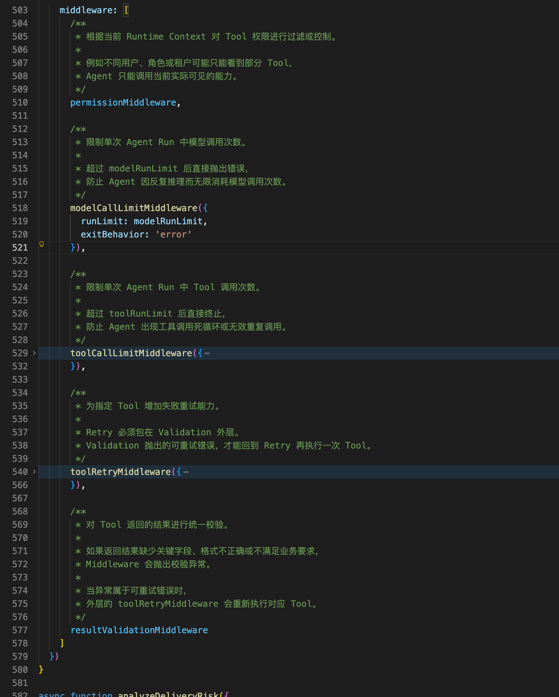

同时，咱们得注意 Middleware 的顺序不是随便写的。

LangChain 对 Middleware 的执行规则是：

+ before 类 Hook：按照数组从前向后执行
+ after 类 Hook：按照数组从后向前执行
+ wrap 类 Hook：像函数一样一层一层嵌套

前两个应该都好理解，第三个不太好理解，咱们详细说下。

咱们以 `wrapToolCall` 的 `handler` 为例：

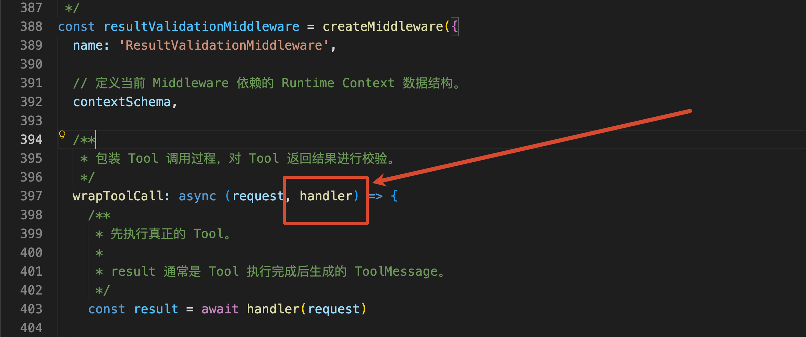

如果只有一个 Middleware，那么它的调用过程是：

```javascript
// handler 指的就是：(request) => executeTool(request)

// wrapToolCall 会先进入执行。
// 当内部调用 handler(request) 时，才会继续进入下一层并最终执行 executeTool(request)。
// executeTool 返回结果后，再回到当前 wrapToolCall 继续执行后续逻辑。
wrapToolCall(request, (request) => executeTool(request))
```

此时，`handler(request)` 指向真正的 Tool。

但是，当多个 Middleware 都实现了 `wrapToolCall` 时，当前 Middleware 拿到的 `handler` 会指向 **下一层 Middleware**，最后一层的 `handler` 才会执行真正的 Tool。

本节的 `middleware` 数组里，只有下面三个 Middleware 实现了 `wrapToolCall`：

+ permissionMiddleware
+ toolRetryMiddleware
+ resultValidationMiddleware

LangChain 会按照它们在数组中的先后顺序进行组合。展开以后，大致相当于下面这段代码：

```javascript
permissionMiddleware(request, (request) =>
  toolRetryMiddleware(request, (request) =>
    resultValidationMiddleware(request, (request) =>
      executeTool(request)
    )
  )
)
```

这就是“一层一层嵌套”的意思

所以，权限 Middleware 放在最外层时，越权请求会直接被拦住，根本不会进入 Retry。

Retry 放在结果校验外层以后，Validation 抛出的 `InvalidToolResultError` 才会回到 Retry，Retry 再次调用自己的 `handler`，也就是重新执行一次“结果校验 + 真正的 Tool”。

如果把 `resultValidationMiddleware` 放到 Retry 外面，校验错误就无法被里面的 Retry 捕获，本节的自动恢复也就不会生效。

这套执行规则咱们可以看 LangChain 的 [Middleware execution order](https://docs.langchain.com/oss/javascript/langchain/middleware/custom#execution-order) 中找到。

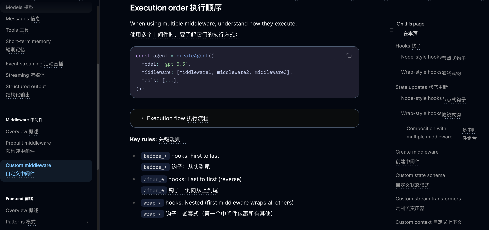

到这里，咱们已经能够使用 LangChain 搭建一个带数据边界和运行控制的 Agent 了

下一小节，咱们就讲LangChain 底层真正依赖的 LangGraph。咱们会把 State、Node、Edge 和 Conditional Edge 拆开，自己搭建一张可执行的状态图。

> 更新：2026-08-14 20:32 · 原文：<https://www.yuque.com/lgdsunday/ab1dy3/su4nxmlrh1pctitt>
