# 07 - LangGraph 状态图执行模型：State Channel、节点调度与条件分支

还记不记得咱们在第 04 小节看 `createAgent()` 源码时，遇到过下面这行代码：

```javascript
new StateGraph(...)
```

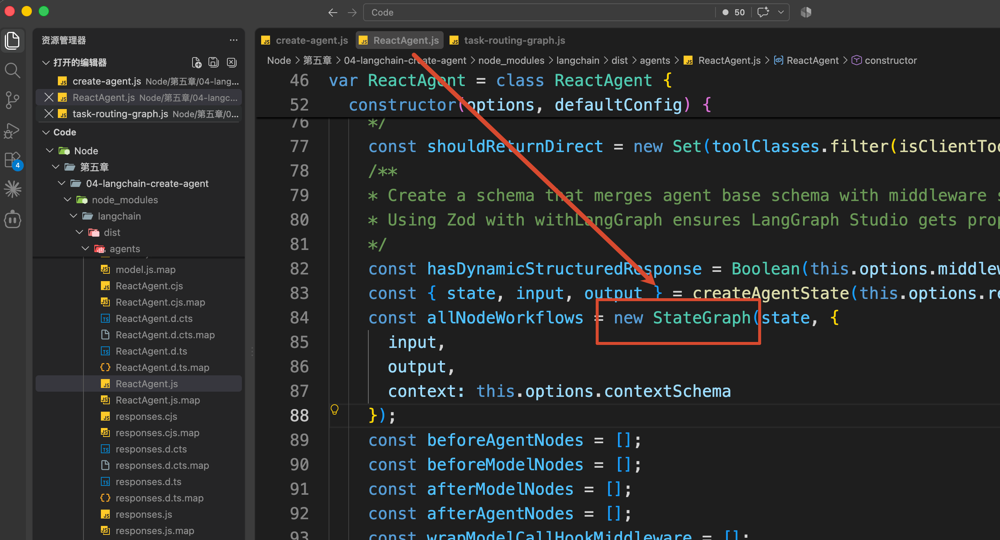

当时咱们只知道，`createAgent()` 会在底层创建一张 LangGraph，然后把 Model Node、Tool Node 和各种 Middleware 编译进去。

但是，`StateGraph` 到底是什么，这张图又是怎么搭出来的，当时并没有展开。

这一小节，咱们就自己搭一张。

不过，这一次先不做 Model 和 Tool 之间的 Agent Loop。

咱们从一个更容易看清控制流程的需求开始：**读取一个研发任务，再根据任务状态进入不同的处理分支。**

大致的流程就是下面这样：

+ 任务正在进行中  ---->>>>  生成后续处理建议
+ 任务已经完成  ---->>>>  不再进入开发流程
+ 任务不存在  ---->>>>  要求用户补充正确的任务编号

这些判断有明确规则，不需要浪费一次模型调用。

这正好可以让咱们先把 LangGraph 里最核心的 `State`、`Node`、`Edge` 和 `Conditional Edge` 搞明白。

## 先看一下最终结果
本节代码在：

```latex
/Code/Node/第五章/07-langgraph-basics
```

这个项目不需要配置模型 API，直接执行：

```bash
npm run demo
```

程序会连续输入三个任务编号。

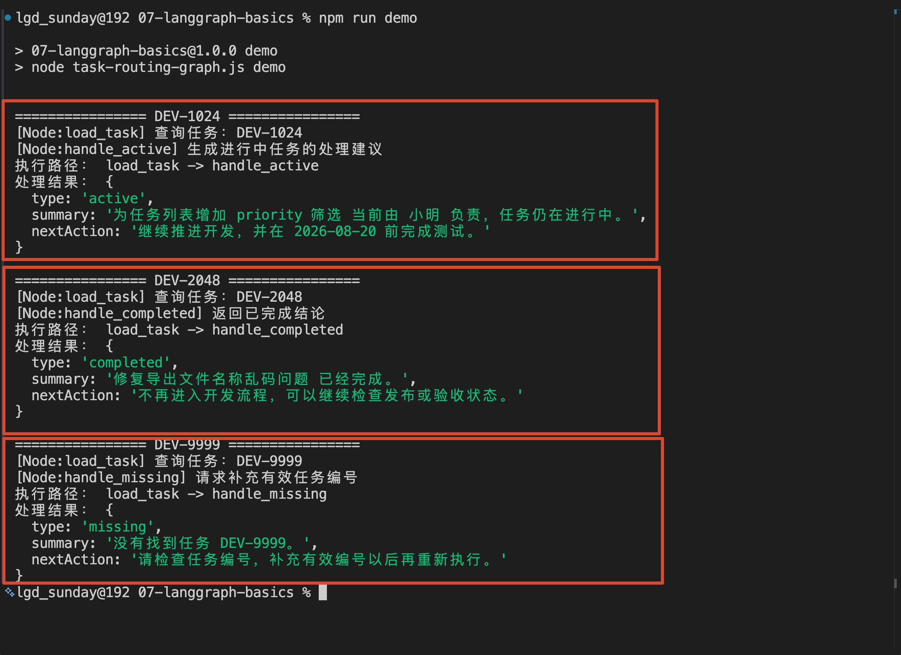

+ 第一个任务是：仍在进行中
+ 第二个任务是：已经完成
+ 第三个任务是：根本不存在

三个任务使用的是同一个程序入口，但是最后的结果却不一样

咱们先把打印出来的三条执行路径单独拿出来：

```latex
DEV-1024：load_task → handle_active
DEV-2048：load_task → handle_completed
DEV-9999：load_task → handle_missing
```

现在应该可以看出规律了。

无论输入哪个任务编号，程序都要先执行 `load_task` 查询任务。任务查完以后，才会根据查询结果选择不同的处理步骤。

在 LangGraph 中，像 `load_task`、`handle_active` 这样真正执行工作的步骤，**叫作 **`Node`**，也就是节点。**

Node 之间的连接关系 **叫作 **`Edge`**，也就是边。**

比如：程序启动以后一定先执行 `load_task`，这就是一条固定的 Edge。

但是，`load_task` 后面具体进入哪个 Node 并不固定，需要根据任务查询结果进行选择。

这种 **满足不同条件，进入不同节点** 的连接关系，就叫作 `Conditional Edge`，也就是 **条件边。**

上面的整个内容，就可以直接通过下面的图来进行表示。

不过，只有 Node 和 Edge 还不够。

`load_task` 查询到的任务信息，必须交给后面的处理 Node；处理 Node 生成的结果，最后也得返回给调用方。

这些在 Node 之间不断传递的数据，就叫作 `State`。

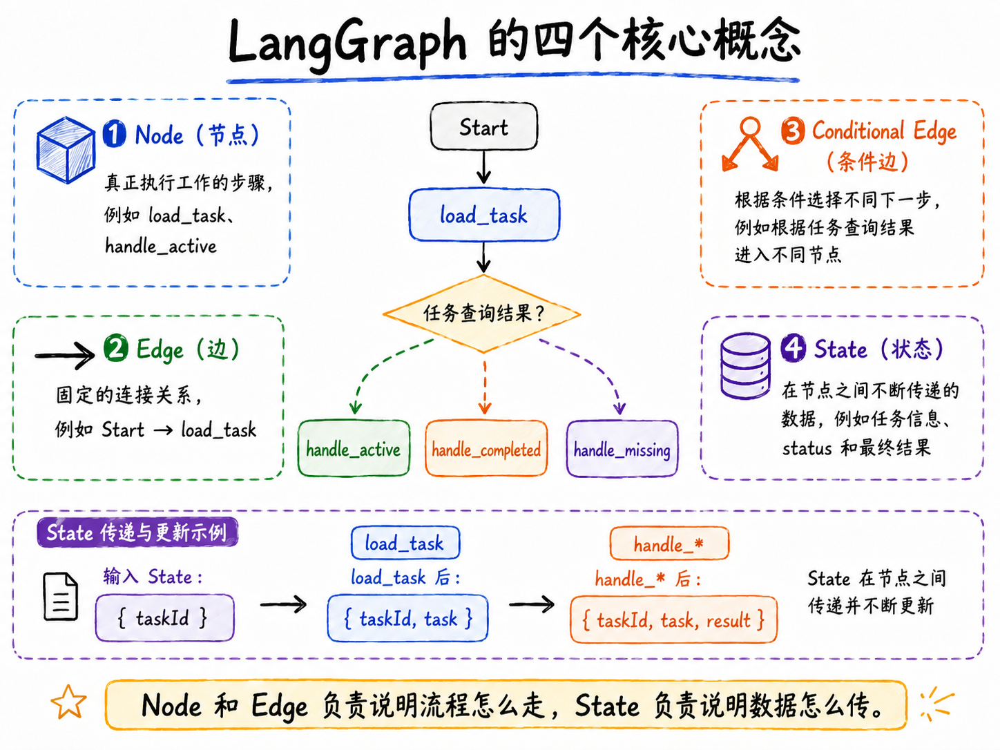

所以，本节的四个概念说白了就是：

+ 程序要保存和传递数据，于是有了 `State`
+ 要把工作拆成步骤，于是有了 `Node`
+ 要规定执行顺序，于是有了 `Edge`
+ 要根据数据选择分支，于是有了 `Conditional Edge`

简单吧。

接下来，咱们就看看这小节的案例

## 从 invoke() 开始看整个 Graph
打开 `task-routing-graph.js`，找到最下面的 `runScenario()`：

```javascript
/**
 * 执行一个完整的 Graph 场景。
 */
async function runScenario(taskId) {
  /**
   * invoke() 启动一次完整 Graph Run。
   *
   * 初始 State：
   *
   * {
   *   taskId
   * }
   *
   * LangGraph 会按照 Edge 和 Conditional Edge
   * 自动执行后续 Node，直到到达 END。
   *
   * result 是 Graph 执行结束后的最终 State。
   */
    const result = await taskRoutingGraph.invoke({ taskId })

    console.log('执行路径：', result.executionPath.join(' -> '))
    console.log('处理结果：', result.result)
}
```

真正启动 Graph 的就是：

```javascript
taskRoutingGraph.invoke({ taskId })
```

这和前面调用 LangChain Agent 时很像。

咱们传入初始数据，等待整张图运行结束，再拿到最终结果。

不过，当前 Graph 一开始只收到了一个 `taskId`：

```javascript
{
    taskId: 'DEV-1024'
}
```

后面的 `task`、`result` 和 `executionPath`，都是不同 Node 在执行过程中逐步写进去的。

这些在整张图中不断流转的数据，就是 LangGraph 的 `State`。

### State：整张图共同使用的数据
按照 [LangGraph Graph API](https://docs.langchain.com/oss/javascript/langgraph/graph-api#state) 的定义，创建一张 StateGraph 以前，首先要定义图的 State。

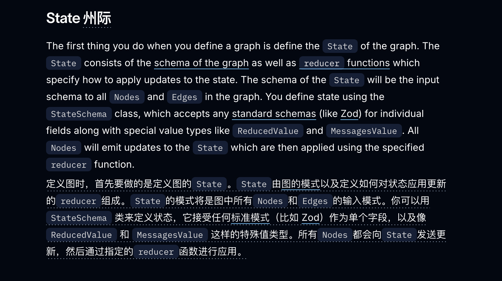

定义 state 直接通过  `new StateSchema` 即可：

```javascript
/**
 * 定义整个 StateGraph 运行期间共享的 State。
 *
 * 可以把 State 理解为：
 *
 *    Graph 中所有 Node 共同读写的一份运行时数据。
 *
 * Node 不需要直接调用其他 Node，
 * 而是通过读取 State、返回 State 更新来完成数据传递。
 */
const TaskRoutingState = new StateSchema({
    /**
     * 第一级：当前需要查询的任务编号。
     *
     * invoke() 启动 Graph 时由外部传入。
     */
    taskId: z.string(),

    /**
     * 第二级：查询得到的任务信息。
     *
     * 初始值为 null，
     * load_task Node 执行后会更新这个字段。
     */
    task: TaskSchema.nullable().default(null),

    /**
     * 第三级：Graph 最终生成的业务处理结果。
     *
     * 初始值为 null，
     * 后续不同分支 Node 会写入对应结果。
     */
    result: ResultSchema.nullable().default(null),

    /**
     * 第四级：记录 Graph 实际经过的 Node。
     *
     * ReducedValue 与普通 State 字段不同：
     *
     * 普通字段：
     *    后一次更新通常覆盖前一次更新。
     *
     * ReducedValue：
     *    每次 Node 返回新值时，会通过 reducer
     *    将新值与旧值合并。
     *
     * 因此 executionPath 可以不断累积：
     *
     *    ['load_task']
     *        ↓
     *    ['load_task', 'handle_active']
     */
    executionPath: new ReducedValue(
        z.array(z.string()).default(() => []),
        {
            /**
             * 每个 Node 更新 executionPath 时，
             * 只需要返回当前 Node 名称即可。
             */
            inputSchema: z.string(),

            /**
             * Reducer 决定：
             * 当前 State 中已有的值和本次新值如何合并。
             */
            reducer: (current, nodeName) => [...current, nodeName]
        }
    )
})
```

这里定义了四份数据。

+ `taskId` 是 Graph 的输入
+ `task` 保存查询到的任务
+ `result` 保存最终处理结果
+ `executionPath` 则记录本次运行经过了哪些 Node。

可以先把 State 理解成：

> **State 是一张 Graph 运行期间，所有 Node 共同读取和更新的结构化数据。**
>

LangGraph 中的 Node 会读取当前 State，然后返回一份 **State Update**。

比如 `load_task` 查询任务以后，只返回：

```javascript
return {
    task,
    executionPath: 'load_task'
}
```

LangGraph 会接收这份更新，再按照 State Schema 中每个字段的规则，生成下一步使用的 State。

而 `task` 和 `result` 都是普通数据字段。

Node 返回新值以后，旧值就会被覆盖：

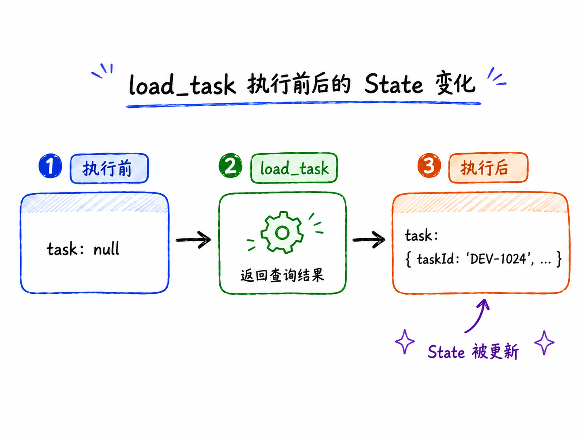

但是，`executionPath` 不能覆盖。

如果每个 Node 都直接返回一个新数组，那么后面的 Node 很容易把前面的轨迹弄丢。

所以，这里使用了 `ReducedValue`，并提供一个 Reducer：

```javascript
/**
 * Reducer 决定：
 * 当前 State 中已有的值和本次新值如何合并。
 */
reducer: (current, nodeName) => [...current, nodeName]
```

每个 Node 只需要返回当前名称：

```javascript
{ executionPath: 'load_task' }
```

LangGraph 会调用 Reducer，把它追加到已有数组里

所以，`StateSchema` 不只是规定“State 里有哪些字段”，它还规定了 **每个字段收到更新以后应该怎样处理。**

### Node：Graph 中真正执行工作的步骤
State 定义好以后，继续看 Graph 的创建代码：

```javascript
/**
 * 创建任务分流 StateGraph。
 *
 * Graph 的整体结构：
 *
 *                  ┌→ handle_active ───────→ END
 *                  │
 * START → load_task ├→ handle_completed ───→ END
 *                  │
 *                  └→ handle_missing ──────→ END
 *
 * 其中：
 *
 * - Node：真正执行处理逻辑
 * - Edge：决定固定的执行顺序
 * - Conditional Edge：根据 State 动态决定下一步
 */
const taskRoutingGraph = new StateGraph(TaskRoutingState)
  /**
   * 注册 Graph 中的 Node。
   *
   * 第一个参数是 Node 名称，
   * 第二个参数是 Node 实际执行的函数。
   */
    .addNode('load_task', loadTask)
    .addNode('handle_active', handleActiveTask)
    .addNode('handle_completed', handleCompletedTask)
    .addNode('handle_missing', handleMissingTask)
    // 后面继续连接 Edge
    .compile()
```

`new StateGraph(TaskRoutingState)` 会先创建一张空图。

`addNode()` 再把一个个步骤注册进去。

它接收两个核心参数：

```javascript
addNode('Node 名称', Node 对应的函数)
```

比如：

```javascript
.addNode('load_task', loadTask)
```

表示这张图里有一个叫作 `load_task` 的 Node，执行这个 Node 时，真正调用的是 `loadTask()`。

打开这个函数：

```javascript
/**
 * Node：读取任务信息。
 *
 * Node 的基本职责通常是：
 *
 *    State
 *      ↓
 *    执行业务逻辑
 *      ↓
 *    返回需要更新的部分 State
 *
 * LangGraph 会把这里返回的数据自动合并回 Graph State。
 */
function loadTask(state) {
    const task = TASKS[state.taskId] ?? null

    console.log(`[Node:load_task] 查询任务：${state.taskId}`)

    return {
    // 更新 task 字段
        task,
    // executionPath 是 ReducedValue，
      // 因此这里返回字符串即可，由 reducer 负责追加。
        executionPath: 'load_task'
    }
}
```

Node 的基本结构很简单：

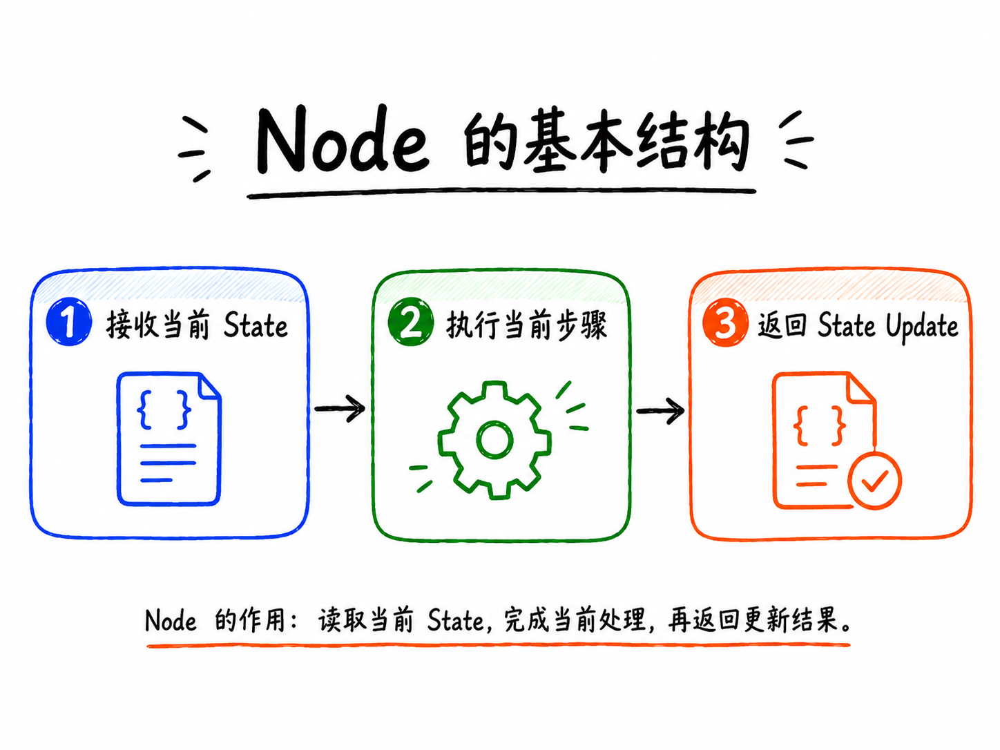

而且，Node 不一定非得调用大模型。

它可以执行普通代码、访问数据库、调用 HTTP 接口，在需要时调用一个 LangChain Agent。

咱们在这次的代码里面故意全部使用普通函数，是因为任务状态分流有明确规则，交给代码判断更加稳定

剩下的三个 Node 分别负责生成不同结果。

比如任务仍在进行中时，会进入 `handleActiveTask()`：

```javascript
/**
 * Node：处理仍在进行中的任务。
 *
 * 当前分支只会在：
 *
 *    routeTask() === 'active'
 *
 * 时执行。
 */
function handleActiveTask(state) {
    return {
        result: {
            type: 'active',
            summary: `${state.task.title} 当前由 ${state.task.owner} 负责，任务仍在进行中。`,
            nextAction: `继续推进开发，并在 ${state.task.dueDate} 前完成测试。`
        },
        executionPath: 'handle_active'
    }
}
```

这个 Node 从 State 里读取 `task`，再返回 `result` 和一条新的执行轨迹。

到这里，Node 都已经有了。

但是，LangGraph 还不知道先执行谁，也不知道执行完以后应该去哪里。

接下来就需要 Edge。

### Edge：规定 Node 之间的固定顺序
`Edge` 就是图中连接 Node 的边。

下面这行代码表示：Graph 启动以后，第一个执行 `load_task`。

```javascript
/**
 * 固定 Edge：
 *
 * Graph 启动以后，首先进入 load_task。
 *
 * START 是 LangGraph 提供的特殊起点节点。
 */
.addEdge(START, 'load_task')
```

`START` 是 LangGraph 提供的虚拟起点，并不是咱们自己编写的业务 Node。

同样，`END` 表示本次 Graph 到这里结束：

```javascript
.addEdge('handle_active', END)
.addEdge('handle_completed', END)
.addEdge('handle_missing', END)
```

这些都属于普通 Edge。

只要前面的 Node 执行完成，就会沿着已经写死的边进入下一个位置。

比如：

```javascript
// 执行的逻辑：START → load_task
.addEdge(START, 'load_task')
// 执行的逻辑：handle_active → END
.addEdge('handle_active', END)
```

但是，`load_task` 后面不能只连接一个固定 Node。

因为任务查完以后，程序需要根据查询结果选择三条不同分支。

这就要用到 Conditional Edge。

### Conditional Edge：根据 State 选择下一步
`Conditional Edge` 就是 **带条件的边**。

咱们看看下面的路由函数：

```javascript
/**
 * Conditional Edge 使用的路由函数。
 *
 * 它本身不是一个业务处理 Node，
 * 主要负责根据当前 State 判断下一步应该走哪个分支。
 *
 * 返回值会与 addConditionalEdges() 中定义的映射关系对应。
 */
function routeTask(state) {
    if (!state.task) {
        return 'missing'
    }

    if (state.task.status === 'completed') {
        return 'completed'
    }

    return 'active'
}
```

这个函数会读取 `load_task` 更新后的 State，再返回一个分支名称。

它只负责回答一件事：**下一步应该走哪条边？**

然后，通过 `addConditionalEdges()` 把分支名称和真正的 Node 对应起来：

```javascript
/**
 * Conditional Edge：
 *
 * load_task 执行完成后，
 * 调用 routeTask(state) 判断下一步应该进入哪个 Node。
 *
 * routeTask 返回：
 *
 * active
 * completed
 * missing
 *
 * 再通过下面的映射找到真正需要执行的 Node。
 */
.addConditionalEdges('load_task', routeTask, {
    active: 'handle_active',
    completed: 'handle_completed',
    missing: 'handle_missing'
})
```

把这段代码翻译一下，就是：

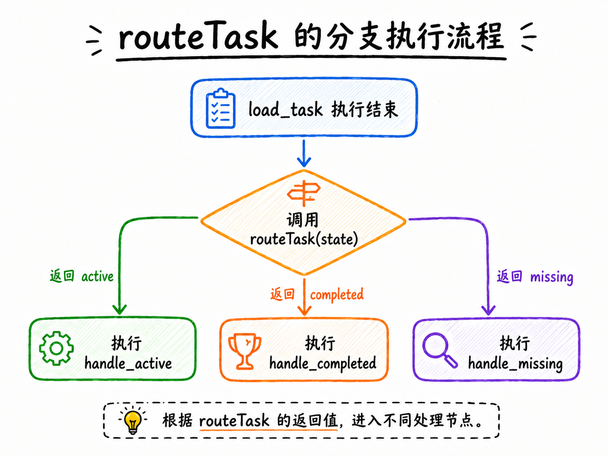

这就是三个任务编号最终走出不同路径的原因。

而且，Conditional Edge 不等于 “让模型做决策”。

路由条件可以像本例一样由普通代码判断，也可以根据模型结果、Tool 结果或者人工审批状态选择下一步。

具体由谁判断，要看这条业务规则是不是确定的。

### compile()：把图结构变成可执行程序
Node 和 Edge 都添加完成以后，最后调用：

```javascript
.compile()
```

在 `compile()` 以前，`StateGraph` 只是一个 Graph Builder。

它记录了 State Schema、Node 和 Edge，但是还不能直接执行。

`compile()` 会检查图结构，再生成一个可以使用 `invoke()`、`stream()` 等 Runnable 方法执行的 `CompiledStateGraph`。

到这里整个的定义 State Schema 的流程基本上就说的差不多了哈，我从不同的角度生成了一遍这个图，咱们在看下

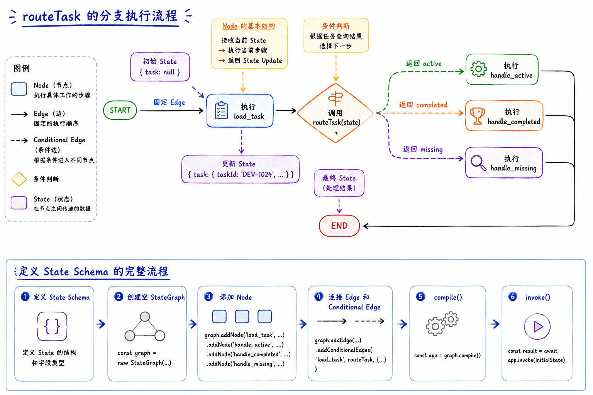

> PS：这个图生成的有一个小问题，那就是：`taskId`** 是 State Schema 中的必填字段，初始状态不能为 null，得有个数据才行**
>
> 但是，让 GPT-image-2 连续生成了好几次图片，都不如这个结构好，所以就不换了。一个小点，大家知道就行
>

这套顺序也解释了文章开头的调用为什么可以运行：

```javascript
await taskRoutingGraph.invoke({ taskId })
```

`invoke()` 返回的是 Graph 运行结束时的最终 State。

因此，咱们才能从中读取 `result.executionPath` 和 `result.result`

## 怎么观察每个 Node 更新了什么
只看最终 State，有时还不够。

如果 Graph 的分支越来越多，咱们通常还需要知道每个 Node 分别更新了哪些字段。

执行：

```bash
npm run stream
```

打印结果如下：

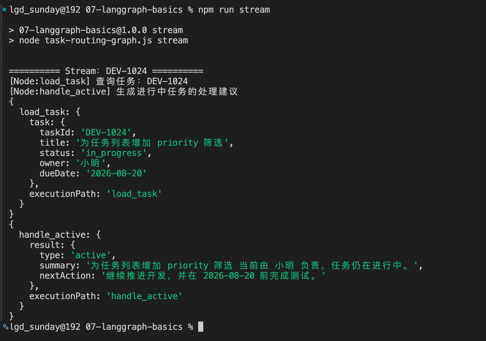

当前案例使用 `streamMode: 'updates'`：

```javascript
const stream = await taskRoutingGraph.stream(
    { taskId: 'DEV-1024' },
    { streamMode: 'updates' }
)

for await (const update of stream) {
    console.dir(update, { depth: null })
}
```

输出中会出现两次更新。

第一次来自 `load_task`：

```javascript
{
    load_task: {
        task: {
            taskId: 'DEV-1024',
            status: 'in_progress',
            // ...
        },
        executionPath: 'load_task'
    }
}
```

第二次来自 `handle_active`：

```javascript
{
    handle_active: {
        result: {
            type: 'active',
            // ...
        },
        executionPath: 'handle_active'
    }
}
```

这里看到的不是每一步完整 State，而是每个 Node 返回的 State Update。

也就是说，`streamMode: 'updates'` 特别适合：”刚才是哪个 Node 执行了，它到底修改了什么？“ 的问题

更多流式模式大家可以参考 [LangGraph Streaming 官方文档](https://docs.langchain.com/oss/javascript/langgraph/streaming)。

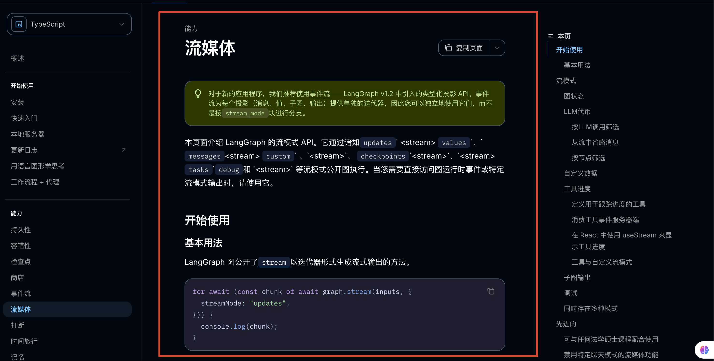

## 把 Graph 画出来
LangGraph 还可以直接导出 Mermaid 图结构。

代码只有一行：

```javascript
taskRoutingGraph.getGraph().drawMermaid()
```

执行：

```bash
npm run mermaid
```

咱们可以看到这样的输出：

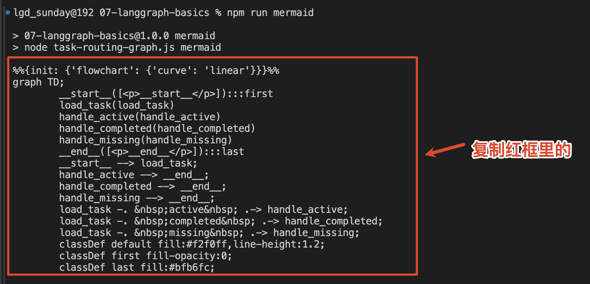

这个输出是 [Mermaid](https://mermaid.live) 流程图的源代码。

咱们可以直接把这个输出复制，然后放到 [mermaid 的 Edit](https://mermaid.live/edit) 页面里面，就可以直接看到渲染图

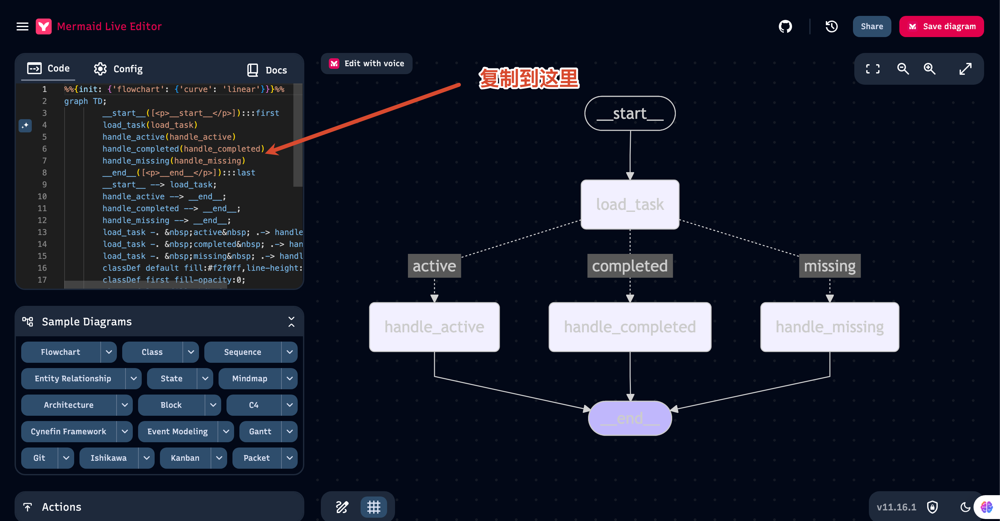

从当前图中咱们就可以看到，当前展示了 **这张 Graph 所有可能的路径。**

关于图的可视化，官方还提供了 PNG 等方式，可以参考 [Visualize your graph](https://docs.langchain.com/oss/javascript/langgraph/use-graph-api#visualize-your-graph)。

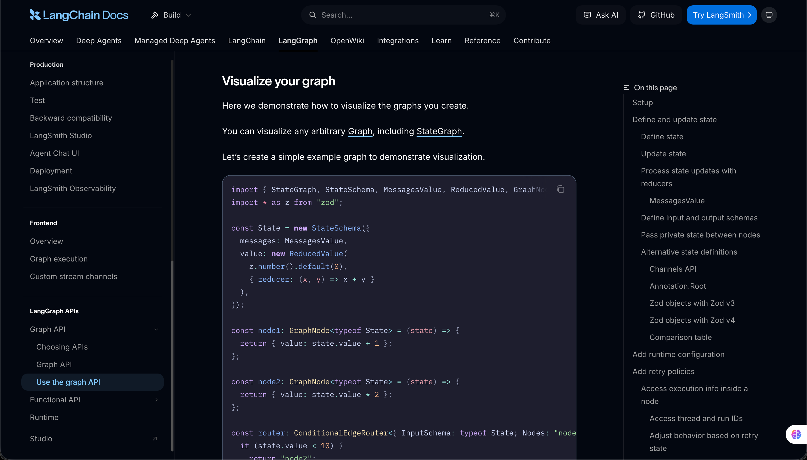

## 总结
再捋一遍所有的内容哈。

Graph 从 `START` 沿着固定 Edge 进入 `load_task`。

这个 Node 读取 `taskId`，查询任务，再把结果作为 State Update 交回 LangGraph。

Conditional Edge 随后读取更新后的 State：

+ 任务不存在就进入 `handle_missing`
+ 任务完成就进入 `handle_completed`
+ 否则进入 `handle_active`

分支 Node 生成最终 `result` 以后，再沿着普通 Edge 到达 `END`。

所以，`State` 保存运行数据，`Node` 执行具体步骤，`Edge` 规定固定顺序，`Conditional Edge` 根据 State 选择分支。

最后调用 `compile()`，这些定义才会变成可以通过 `invoke()` 和 `stream()` 执行的 Graph。

> 更新：2026-08-15 17:34 · 原文：<https://www.yuque.com/lgdsunday/ab1dy3/gabugvvh63hnbzr6>
