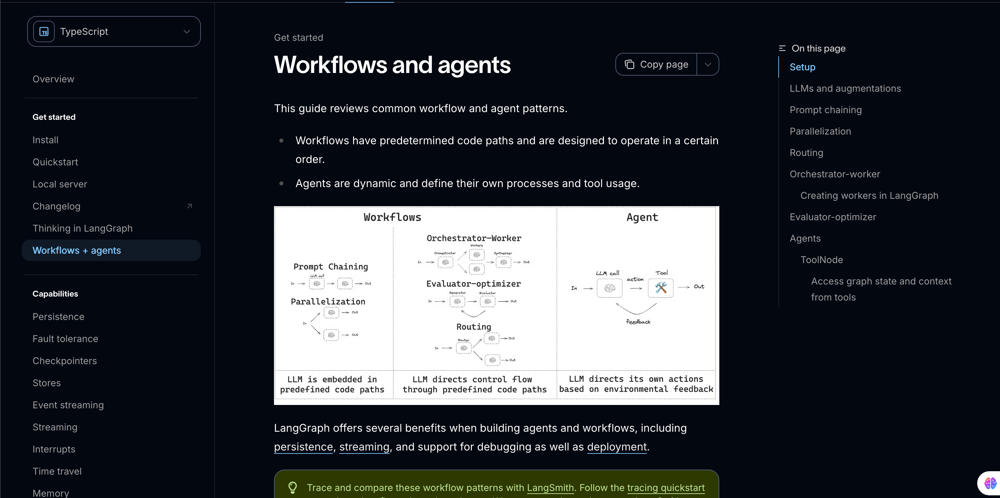
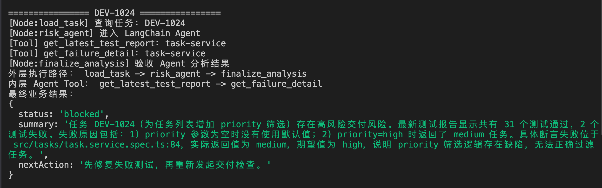
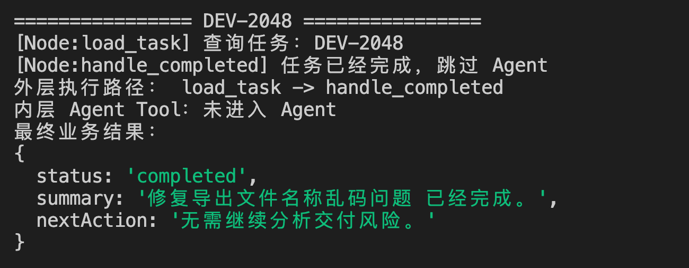
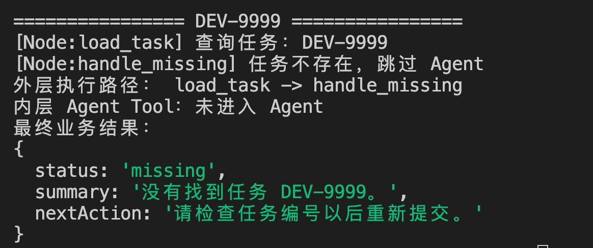
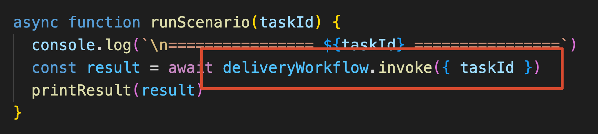
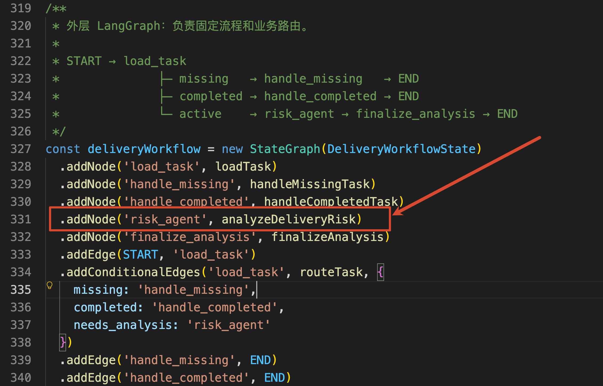
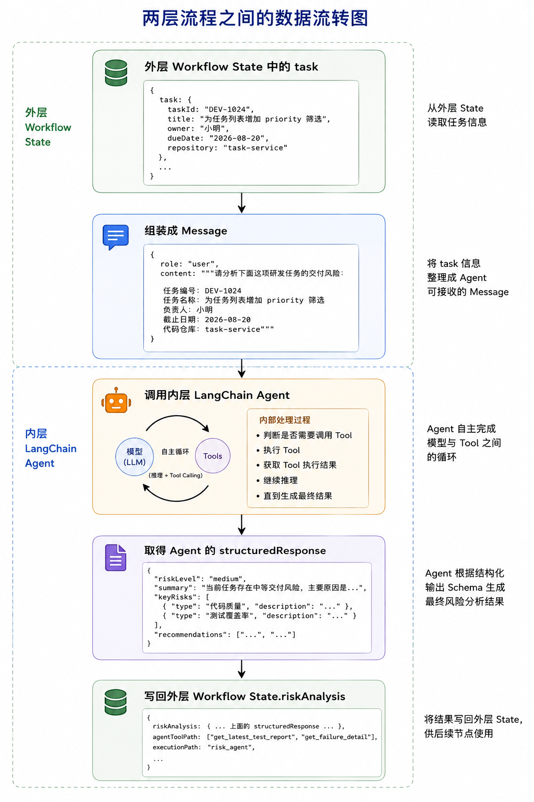
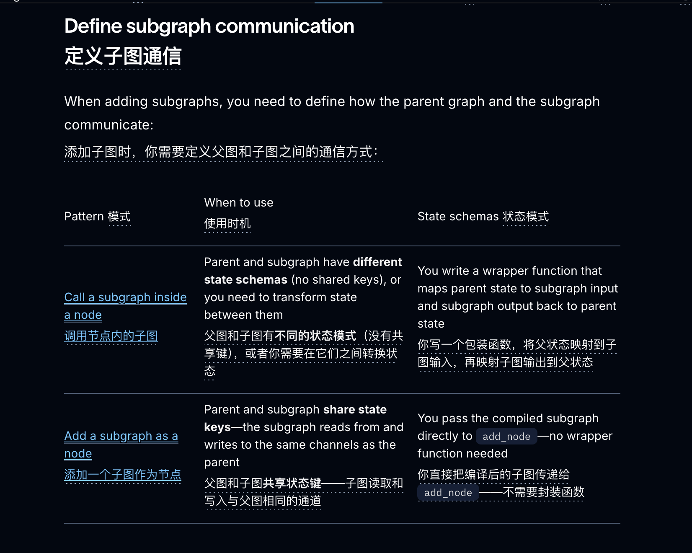
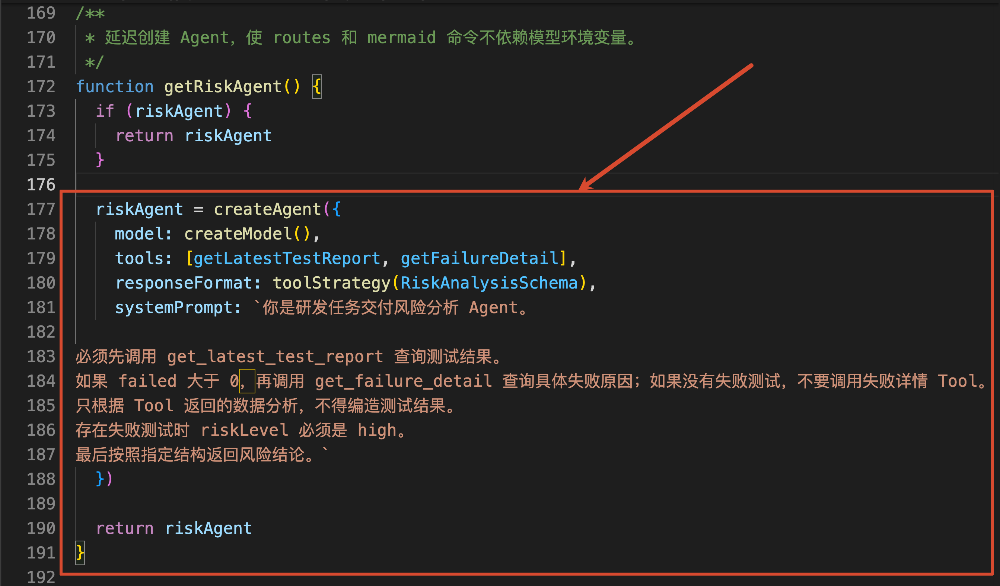
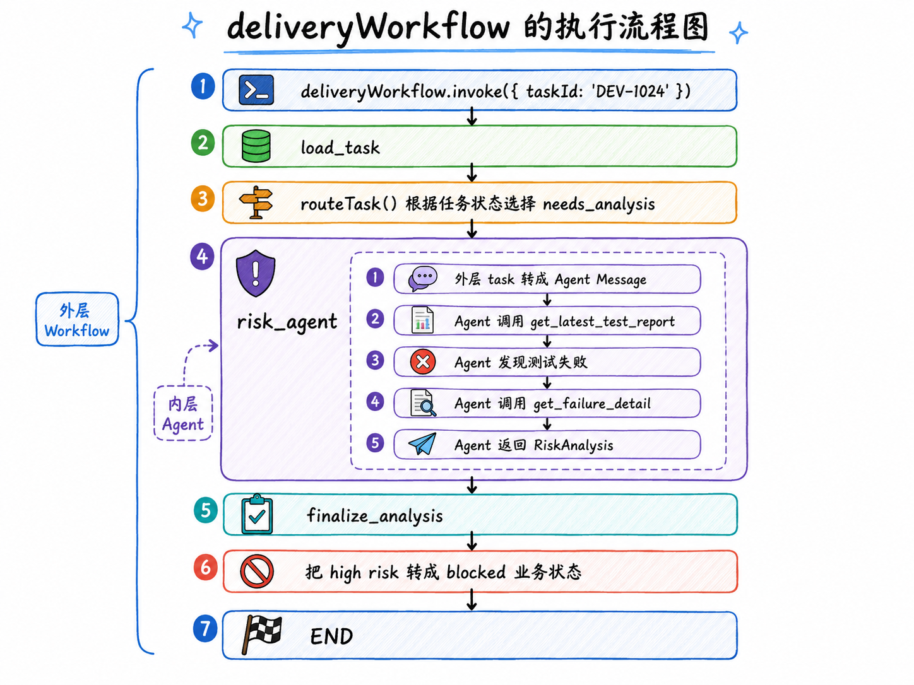

# 08 - LangChain × LangGraph 分层编排：组合确定性流程与自主 Agent

上一小节，咱们使用 LangGraph 实现了一套研发任务分流流程。

这套流程有三个功能：

+ 任务不存在，就要求用户补充任务编号
+ 任务已经完成，就直接结束
+ 任务仍在进行中，才进入后续处理

这套流程还是蛮稳定，因为每条路径都已经由代码提前写好了。

但是，如果进行中的任务还需要继续分析交付风险，问题就没有这么固定了。

Agent 得先查询测试报告。

如果测试已经全部通过，就不需要再查失败详情。

但是，如果测试失败了，还得继续查询失败位置、断言内容和实际值，最后再生成风险结论。

**这里面既有确定的流程，也有不确定的决策。**

因此，这样的需求，如果全部交给 LangGraph ，咱们得把每一种 Tool 调用顺序都提前写出来。

而如果全部交给 `createAgent()`，模型又可能拿一个已经完成或者根本不存在的任务继续分析，白白消耗模型调用。

所以，这一小节要解决的问题就是：

> **使用 LangGraph 控制确定的业务流程，再把真正需要模型判断的部分交给 LangChain Agent。**
>

也就是 LangChain 和 LangGraph 配合使用，来把 组合确定性流程 与 自主 Agent 进行组合。

如果用个专业的名字表示，那就是 `Workflows and agents`

其中：

+ [Workflow](https://docs.langchain.com/oss/javascript/langgraph/workflows-agents) 拥有预先确定的代码路径
+ Agent 则会动态决定自己的处理过程和 Tool 使用方式



## 先看一下最终结果
本节代码在：

```latex
/Code/Node/第五章/08-langchain-langgraph-workflow
```

模型环境变量和前几节保持一致，直接执行：

```bash
npm run demo
```

代码运行之后，程序会依次处理三个任务：`DEV-1024`、`DEV-2048`、`DEV-9999`

先看正在进行中的 `DEV-1024`：



这里同时出现了两条执行路径。

+ 外层的 `LangGraph` 执行路径：`load_task → risk_agent → finalize_analysis` 
+ 内层的   Agent 自己决定的 Tool 调用路径：`get_latest_test_report → get_failure_detail`

接着再看已经完成的 `DEV-2048`：



任务已经完成，普通代码直接给出了处理结果，模型根本没有被调用。

不存在的 `DEV-9999` 也是一样：



这三次执行已经把 LangChain 和 LangGraph 的分工展示出来了。

+ LangGraph 负责：确定的任务查询、状态判断和结果验收
+ LangChain Agent 负责：测试报告应该查到什么程度、下一步调用哪个 Tool

接下来，咱们就从项目入口开始，看这两层流程是怎么接到一起的。

## 从 workflow.invoke() 开始看
整个项目的代码只有一个  `workflow-agent.js` 文件，打开它，找到 `runScenario()`：

```javascript
async function runScenario(taskId) {
    console.log(`\n================ ${taskId} ================`)
    const result = await deliveryWorkflow.invoke({ taskId })
    printResult(result)
}
```

真正启动整个流程的仍然是上一节见过的 `invoke()`：



注意，这里启动的是外层 `deliveryWorkflow`，并不是直接调用 Agent。

外层 Graph 的结构是：

```latex
load_task
  ├─ 任务不存在 --→ handle_missing --→ END
  ├─ 任务已完成 --→ handle_completed --→ END
  └─ 任务进行中 --→ risk_agent --→ finalize_analysis --→ END
```

对应的代码如下：

```javascript
/**
 * 外层 LangGraph：负责固定流程和业务路由。
 *
 * START → load_task
 *              ├─ missing   → handle_missing   → END
 *              ├─ completed → handle_completed → END
 *              └─ active    → risk_agent → finalize_analysis → END
 */
const deliveryWorkflow = new StateGraph(DeliveryWorkflowState)
    .addNode('load_task', loadTask)
    .addNode('handle_missing', handleMissingTask)
    .addNode('handle_completed', handleCompletedTask)
    .addNode('risk_agent', analyzeDeliveryRisk)
    .addNode('finalize_analysis', finalizeAnalysis)
    .addEdge(START, 'load_task')
    .addConditionalEdges('load_task', routeTask, {
        missing: 'handle_missing',
        completed: 'handle_completed',
        needs_analysis: 'risk_agent'
    })
    .addEdge('handle_missing', END)
    .addEdge('handle_completed', END)
    .addEdge('risk_agent', 'finalize_analysis')
    .addEdge('finalize_analysis', END)
    .compile()
```

这些 `StateGraph`、`Node` 和 `Conditional Edge` 的用法，上一节已经讲过了，这里就不再重新解释一遍。

咱们只看这次新增的关键路径：

```latex
load_task → risk_agent → finalize_analysis
```

Graph 启动以后，会先执行 `loadTask()`：

```javascript
/**
 * Node：查询任务。
 */
function loadTask(state) {
    console.log(`[Node:load_task] 查询任务：${state.taskId}`)

    return {
        task: TASKS[state.taskId] ?? null,
        executionPath: 'load_task'
    }
}
```

任务查询完成以后，`routeTask()` 根据明确的业务规则选择下一步：

```javascript
/**
 * Conditional Edge：使用明确的业务规则选择下一条流程。
 */
function routeTask(state) {
    if (!state.task) {
        return 'missing'
    }

    if (state.task.status === 'completed') {
        return 'completed'
    }

    return 'needs_analysis'
}
```

这段判断根本不需要模型参与。

任务有没有查到、状态是不是 `completed`，都是程序已经拿到的确定数据。所以，用普通 `if` 判断会更快。

只有 `routeTask()` 返回 `needs_analysis` 时，Conditional Edge 才会进入：`risk_agent`

这就是组合两种能力时的第一条注意点：

> **能够用业务规则直接判断的事情，不要为了“更像 Agent”而强行交给模型。**
>

`risk_agent` 在外层 Graph 中只是一个 Node：



所以，执行到这个 Node 时，真正调用的是 `analyzeDeliveryRisk()`。

打开这个函数，先看最核心的部分：

```javascript
/**
 * Node：把外层 Workflow State 转换成 Agent 输入，再把 Agent 输出写回 State。
 *
 * 外层 Workflow 关心 task、riskAnalysis 和 result；
 * 内层 Agent 则使用 messages、Tool Call 和 ToolMessage 完成自主循环。
 */
async function analyzeDeliveryRisk(state) {
    console.log('[Node:risk_agent] 进入 LangChain Agent')

    // 获取已经配置好的风险分析 Agent。
    // Agent 内部负责模型调用、Tool Calling、Middleware 和结构化结果生成。
    const agent = getRiskAgent()

    /**
     * 将外层 Workflow State 中的任务信息转换成 Agent 的 messages 输入。
     *
     * 从这里开始，控制权进入 Agent：
     * Agent 会根据任务信息自主判断是否以及按什么顺序调用 Tool，
     * 并在 Tool 执行结果基础上继续推理，直到生成最终风险分析结果。
     */
    const agentResult = await agent.invoke({
        messages: [
            {
                role: 'user',
                content: `请分析下面这项研发任务的交付风险：

任务编号：${state.task.taskId}
任务名称：${state.task.title}
负责人：${state.task.owner}
截止日期：${state.task.dueDate}
代码仓库：${state.task.repository}`
            }
        ]
    })

    /**
     * 定义需要记录到外层 Workflow 执行轨迹中的业务 Tool。
     *
     * 这里只关心与风险分析直接相关的 Tool，
     * 避免把其他内部或辅助 Tool 记录到 agentToolPath 中。
     */
    const businessToolNames = new Set([
        'get_latest_test_report',
        'get_failure_detail'
    ])

    /**
     * 从 Agent 的消息历史中提取实际发生过的业务 Tool Call。
     *
     * Agent 执行过程中，AIMessage 的 tool_calls 会记录模型发起的工具调用。
     * 这里按照消息产生顺序遍历 tool_calls，因此最终得到的数组
     * 可以反映本次 Agent Run 实际经过的业务 Tool 调用路径。
     *
     * 例如：
     * [
     *   'get_latest_test_report',
     *   'get_failure_detail'
     * ]
     */
    const agentToolPath = agentResult.messages.flatMap((message) =>
        (message.tool_calls ?? [])
            // 提取每一次 Tool Call 对应的 Tool 名称。
            .map((toolCall) => toolCall.name)

            // 只保留需要暴露给外层 Workflow 的业务 Tool。
            .filter((toolName) => businessToolNames.has(toolName))
    )

    /**
     * 将 Agent 的执行结果重新转换成外层 Workflow State 所需要的数据。
     *
     * LangGraph Node 返回的对象会用于更新当前 State。
     */
    return {
        // Agent 根据预定义 Structured Output Schema
        // 生成的最终风险分析结果。
        riskAnalysis: agentResult.structuredResponse,

        // 本次 Agent 实际经过的业务 Tool 调用路径。
        agentToolPath,

        // 标记当前分析结果来自 risk_agent 节点，
        // 供后续节点记录或展示整体 Workflow 执行路径。
        executionPath: 'risk_agent'
    }
}
```

这里一共做了三件事。

+ 第一：先从外层 State 读取 `task`，把任务信息整理成 Agent 能够接收的 Message
+ 第二：调用 `agent.invoke()`，等待内层 Agent 完成模型和 Tool 之间的循环
+ 最后取出 `structuredResponse`，写入外层 State 的 `riskAnalysis`。代码还会从 Message 中整理出本次实际调用的业务 Tool，保存到 `agentToolPath`，方便以后观察内层 Agent 的执行路径。

大致的数据转换就是：



这个 `analyzeDeliveryRisk()` 就是两层流程之间的连接器。

然后，在这里还有一点，给大家补充一下。

不知道大家还记不记得。咱们在第 04 小节看过，`createAgent()` 创建出来的 Agent，底层本身就是一张编译后的 LangGraph。

所以，当前代码的执行逻辑应该是：

+ 外层 deliveryWorkflow Graph
+ 执行 risk_agent Node
+ 调用 createAgent() 创建的内层 Agent Graph

也就是说，`risk_agent` 并不是简单地调用了一次大模型，而是在外层 Graph 的一个 Node 中，又启动了另一张负责 Agent Loop 的 Graph。

这种“Graph 里面继续使用另一张 Graph”的结构，在 LangGraph 中叫作 `Subgraph`，也就是 **子图**。

这一块，咱们可以看  LangGraph 官方的 [Subgraphs 文档](https://docs.langchain.com/oss/javascript/langgraph/use-subgraphs#define-subgraph-communication)，



如果外层 Graph 和内层 Graph 使用的 State 结构不同，就可以像咱们现在这样，通过一个 Node 函数完成两边的数据转换

## Agent 进入系统以后做了什么
接着来看 `getRiskAgent()`：



这个 Agent 只有两个 Tool。

+ `get_latest_test_report` 用来查询最新测试报告
+ `get_failure_detail` 用来继续查询失败位置和断言差异

Agent 第一次调用模型时，只知道任务和代码仓库，还不知道测试情况。

所以，它会先调用：`get_latest_test_report`

Tool 返回：

```json
{
  "repository": "task-service",
  "passed": 31,
  "failed": 2,
  "failures": [
    "priority 参数为空时，没有使用默认值",
    "priority=high 时返回了 medium 任务"
  ]
}
```

模型看到 `failed: 2` 以后，发现只靠测试报告还不能确定失败位置，于是继续调用：

```latex
get_failure_detail
```

第二个 Tool 再返回：

```json
{
  "errorType": "AssertionError",
  "location": "src/tasks/task.service.spec.ts:84",
  "actual": "medium",
  "expected": "high"
}
```

现在证据已经足够，Agent 不再调用 Tool，而是按照 `RiskAnalysisSchema` 返回结构化结果。

所以，外层 Graph 只知道自己执行了一个 `risk_agent` Node。

但是在这个 Node 内部，`createAgent()` 实际又完成了：`get_latest_test_report`、`get_failure_detail` 等等的调用

这正是 Agent 应该负责的部分。

外层代码规定“进行中的任务需要做风险分析”。Agent 会根据刚刚拿到的 Observation 决定下一步。

## 总结一下
现在，咱们再回头看 `DEV-1024` 的完整执行过程：



这里最重要的是 **咱们把一条复杂流程拆成了两个控制层。**

+ LangGraph 控制业务上的步骤和路径
+ LangChain Agent 只在某个明确范围内自主决策

外层 `deliveryWorkflow` 先查询任务，再通过 Conditional Edge 过滤掉已经完成和不存在的任务。

只有真正需要分析的任务才进入 `risk_agent`。

把外层 State 中的任务数据转成 Message，调用 `createAgent()`，再把 Agent 的结构化结果写回外层 State。

Agent 在内部根据测试报告决定是否继续查询失败详情，解决的是不确定的 Tool 调用过程。

Agent 返回以后，`finalize_analysis` 再使用普通代码完成结果验收和业务状态转换。

所以，LangChain 和 LangGraph 配合的核心可以归结成一句话：

> **LangGraph 决定整个业务流程必须怎么走，LangChain Agent 决定某个自主处理节点里面下一步做什么。**
>

> 更新：2026-08-21 16:34 · 原文：<https://www.yuque.com/lgdsunday/ab1dy3/nd0i9avt5o2rnha1>
