# 09 - 解剖 createAgent 构建链路（上）：类型重载、ReactAgent 初始化与 State/Input/Output Schema 合成

其实在之前的 04 小节里面，咱们已经看过一些 LangChain 源码了，只不过看的比较糙。

当时是通过  `node_modules/langchain/dist` 来看的  `createAgent()`。

看了：

+ 创建 ReactAgent
+ ReactAgent 内部使用 LangGraph 构建执行图

大致是这么两部分。

但是，`dist` 目录里的代码是 **打包以后真正交给 Node.js 执行的 JavaScript**。

咱们可以通过它来看一下大致的执行路径，但是不太适合用来系统阅读源码

所以，咱们正式学习源码的时候，必须得换一种方式才可以。

> 从 Github 上下载制定版本的 LangChain 源码，然后再从业务代码里的 `createAgent()` 开始，一点点去看。
>

咱们在前面课程中使用的一直是  `1.5.5` 的版本，这个版本对应的是 `[langchain@1.5.5](https://github.com/langchain-ai/langchainjs/tree/langchain%401.5.5)`[ Tag](https://github.com/langchain-ai/langchainjs/tree/langchain%401.5.5)。

这个 Tag 最终指向的 Git Commit 是：

```latex
62fc484b2a0d1ec5b8bebff4a8a0efe6300ada72
```

因此，想要直接拉取源码，可以直接通过下面的命令进行拉取：

```bash
git clone \
  --depth 1 \
  --branch "langchain@1.5.5" \
  --single-branch \
  https://github.com/langchain-ai/langchainjs.git \
  langchainjs-1.5.5
```

这里的 `--branch` 指定了要下载的 Tag，`--depth 1` 则表示只拿当前版本需要的提交

> PS：当前代码已拉取完成，存放在课程源码库 `https://github.com/lgd8981289/Agent--Code` 的 `Node/第五章/langchainjs-1.5.5` 路径下
>

下载完成以后，进入源码目录：

```bash
cd langchainjs-1.5.5
```

然后执行：

```bash
git tag --points-at HEAD --list 'langchain@1.5.5'
```

正常情况下会看到：

```latex
langchain@1.5.5
```

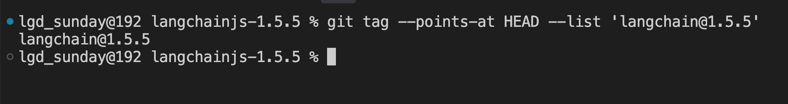

这样就没啥问题

> 有些同学可能网络不太好。
>
> 如果通过指令下载失败的话，那么可以直接打开这个  `[langchain@1.5.5](https://github.com/langchain-ai/langchainjs/tree/langchain%401.5.5)`[ Tag](https://github.com/langchain-ai/langchainjs/tree/langchain%401.5.5)   ，直接下载 ZIP。
>
> 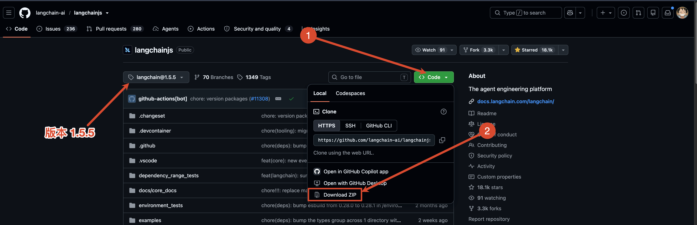
>
> 这样也是一种简单的方式，完全足够咱们用
>

## 分析源码结构
打开刚刚下载的 `langchainjs-1.5.5`，会看到很多目录。

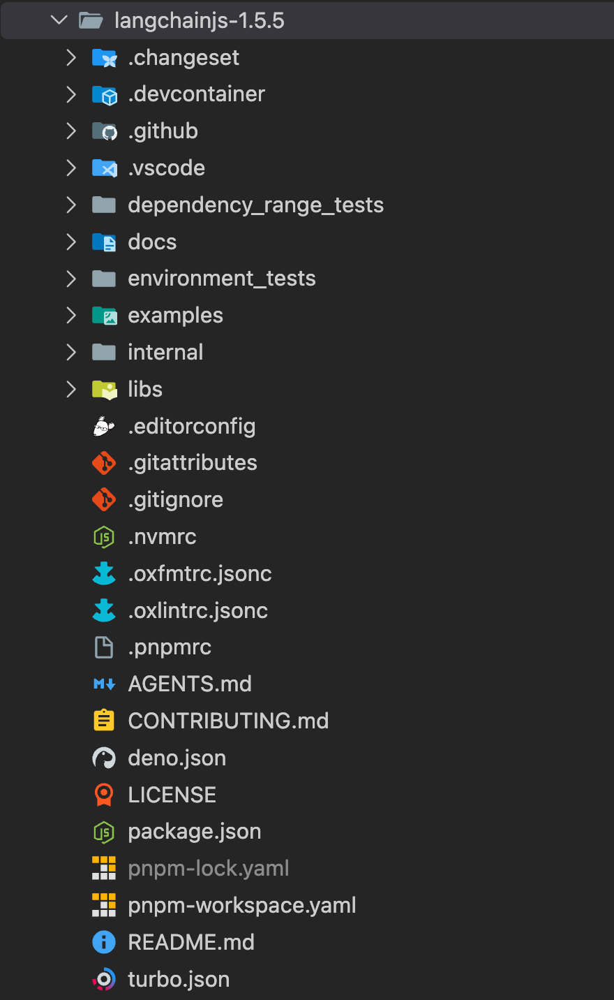

这是因为 LangChain.js 使用的是 `Monorepo`，也就是把多个相互关联的 Package 放在同一个仓库里维护。

而对咱们来说，只需要关注两个文件夹就行：

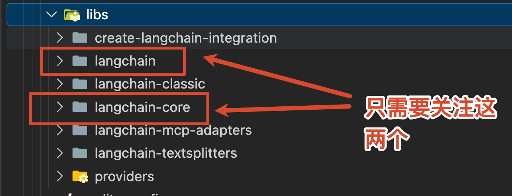

+ `libs/langchain` 对应咱们安装的 `langchain` 包，`createAgent()`、`ReactAgent` 和 Agent Middleware 的上层实现都在这里。
+ `libs/langchain-core` 放的是模型、Message、Tool、Runnable 等公共抽象。第 03 小节已经讲过他俩的职责，这里先不往 `core` 里面继续看了。

## 从业务代码进入 createAgent()
源码已经准备好，接下来咱们从自己最熟悉的代码开始。

前面的项目中，Agent 是这样创建的：

```javascript
import { createAgent } from 'langchain'

const agent = createAgent({
    model,
    tools,
    systemPrompt,
    stateSchema,
    contextSchema,
    responseFormat,
    middleware
})
```

这里的 `createAgent` 是从 `langchain` 包根入口导入的。

所以，咱们想要阅读源码，就先从这里开始

打开：

```latex
libs/langchain/src/index.ts
```

在文件中搜索 `agents`，可以找到：

```typescript
export * from "./agents/index.js";
```

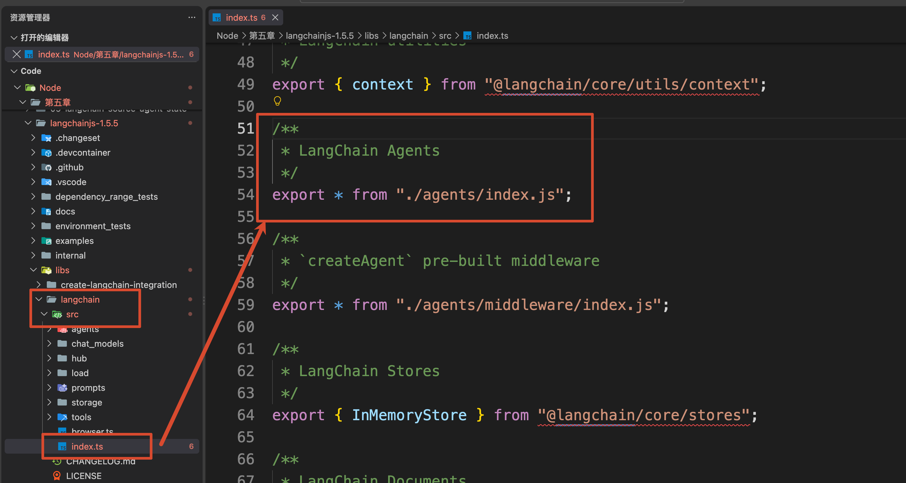

这部分使用的是 `ESM` 的模块化方案，意思是：`langchain` 根入口把 `agents/index.ts` 中公开的内容继续导出了。

按照这个相对路径，继续打开：

```latex
libs/langchain/src/agents/index.ts
```

这个文件很长，有 700 多行

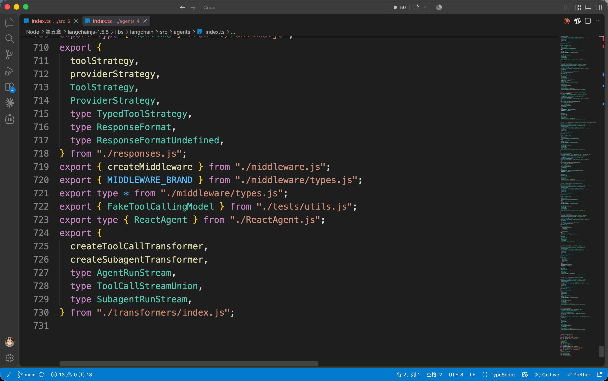

咱们往下翻这个代码，可以发现整个代码中定义了好多的  `createAgent()` 

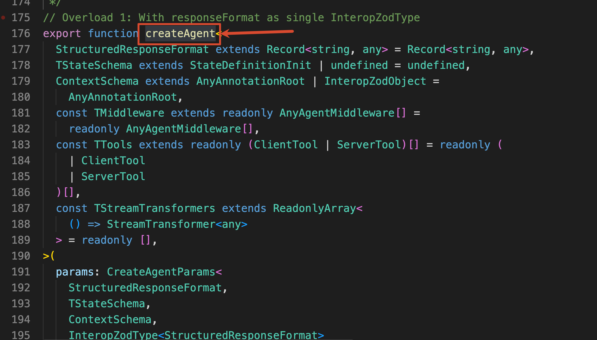

对 TS 或者 强类型 语言不熟悉的同学，可能看到这里就懵了，可能会说：“怎么定义了十几个 `createAgent()`？”

其实这一大段的 `createAgent()` 都是 TypeScript 的函数重载，用来根据 `responseFormat`、`stateSchema`、`middleware` 和 `tools` 推导不同的输入输出类型。

但是真正运行的实现只有一个。

直接在文件中搜索：

```latex
// Implementation
```

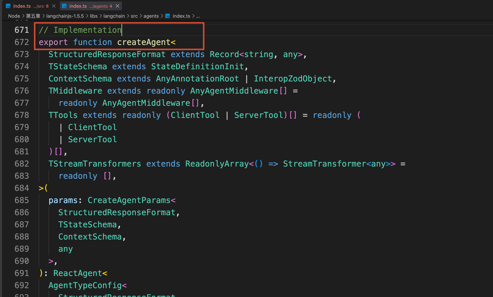

这个就是真正的实现

不过这个真正的实现代码也有点长，咱们把一些无用的东西省略之后，核心代码其实就一行：

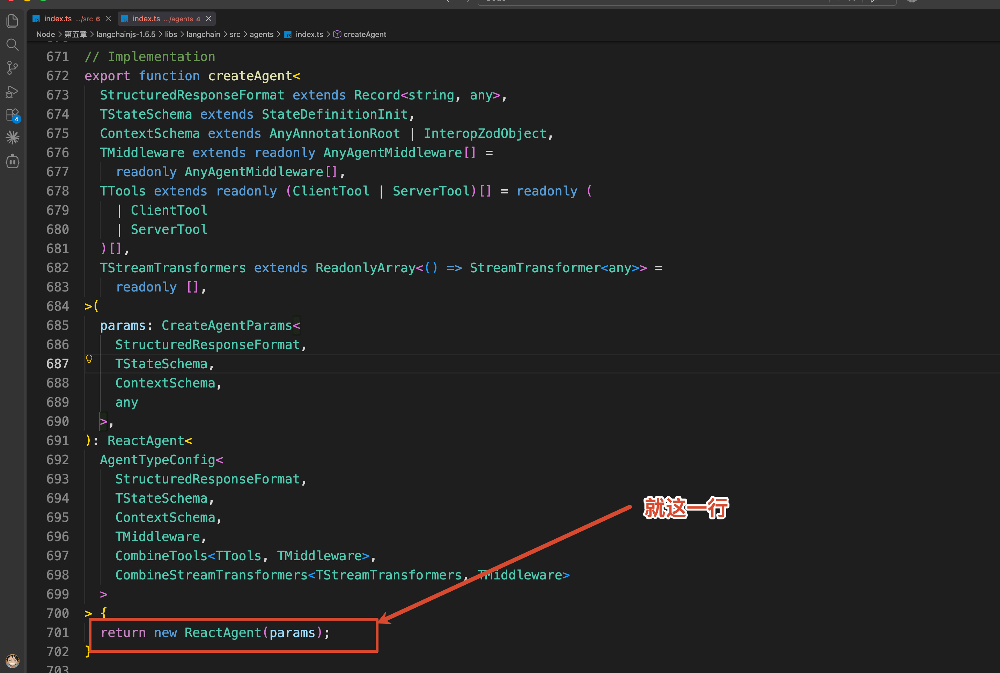

简化之后，代码就这样：

```typescript
// Implementation
export function createAgent(params) {
    return new ReactAgent(params);
}
```

那么到这里，咱们的第一段调用逻辑就已经捋出来了，跟大家画了个图，大家看下

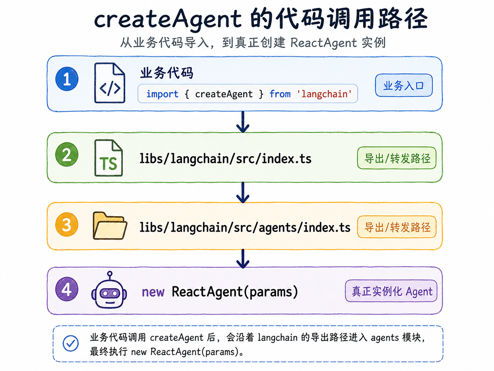

咱们在业务代码中传给 `createAgent()` 的配置，并没有在这个函数里被处理。

他只是被原样交给了 `ReactAgent`。

## 进入 ReactAgent 构造函数
回到 `libs/langchain/src/agents/index.ts` 的顶部，可以看到：

```typescript
import { ReactAgent } from "./ReactAgent.js";
```

因此，下一步打开：

```latex
libs/langchain/src/agents/ReactAgent.ts
```

搜索：

```latex
constructor(
```

就能找到 `ReactAgent` 的构造函数。

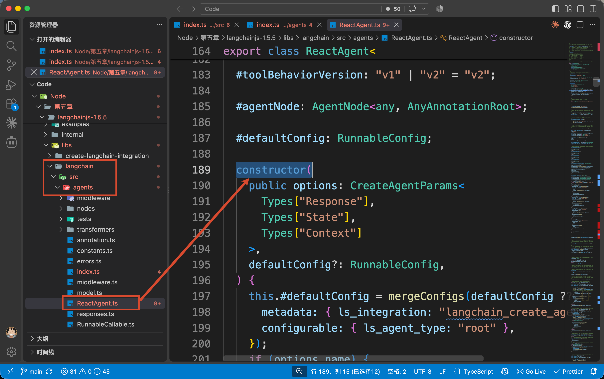

这里同样先省略泛型参数：

```typescript
constructor(
    public options: CreateAgentParams,
    defaultConfig?: RunnableConfig
) {
    // ...
}
```

这里的 `public options` 是 TypeScript 的参数属性写法。

你可以把他理解成构造函数在内部完成了下面这次代码：

```typescript
this.options = options
```

因此，业务代码传进来的 `model`、`tools`、`systemPrompt`、`stateSchema`、`contextSchema`、`responseFormat` 和 `middleware`，现在都进入了 `ReactAgent`。

不过，构造函数并不会马上调用模型。

此时 Agent 还没有开始运行，他只是在 **准备运行时需要的结构**。

构造函数先检查 `model` 是否存在，并确认传入的模型没有提前绑定 Tool。

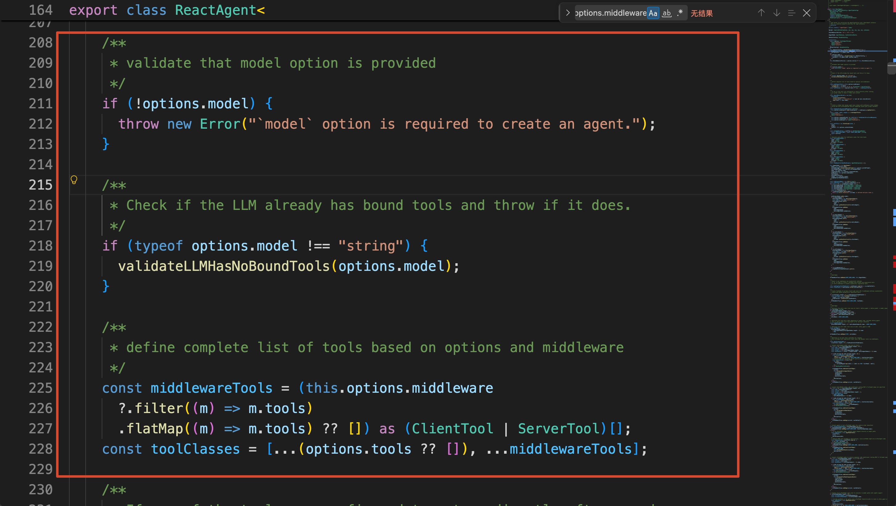

接着，他会把业务代码注册的 Tool 和 Middleware 自己提供的 Tool 合并起来：

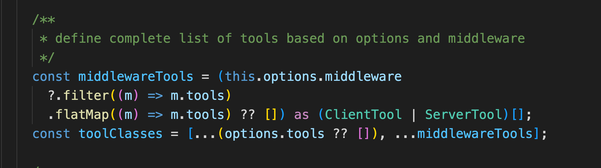

那么不少同学可能看到这里就有疑惑了：“为什么 Middleware 的 Tool 也要放进来？”

这是因为模型后面能够看到和调用的不能只有 `createAgent({ tools })` 中直接传入的 Tool。像 TodoList 这类 Middleware，也可能给 Agent 增加新的能力。

源码还会提前收集开启了 `returnDirect` 的 Tool 名称。

这种 Tool 执行完成以后，可以直接结束当前 Agent Loop，不再回到模型生成一次总结。

因此，他会影响后面 Graph 的条件路由。

这样 Graph 就可以在构建阶段完成 Tool 的整理。那么至于怎么变成 `ToolNode`、怎么选择下一条 Edge，咱们后面再说。

## 创建 Agent State
继续在 `ReactAgent` 构造函数中往下看，可以找到 `createAgentState` 的创建逻辑

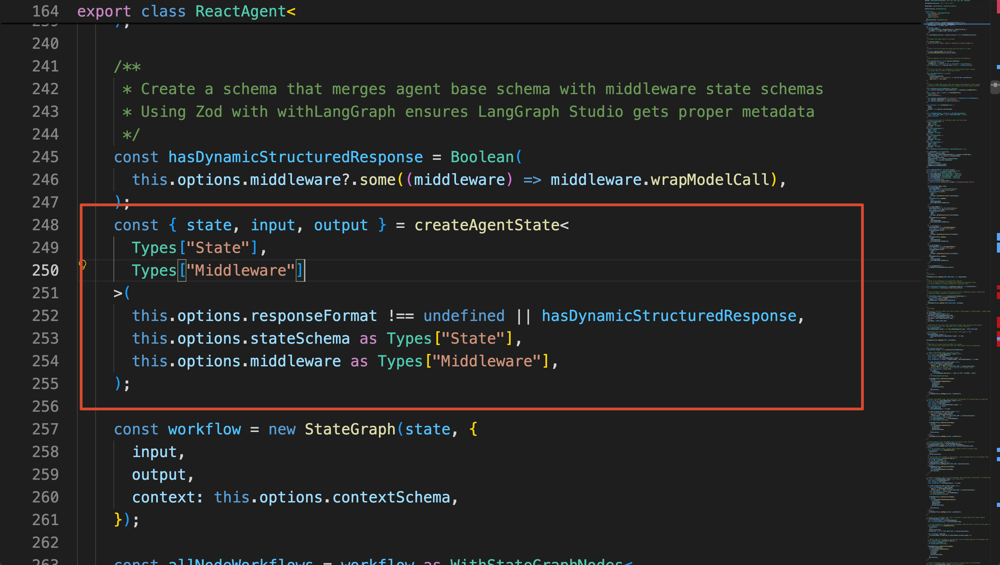

 把泛型去掉之后，代码就很简单，一共就三个参数：

```typescript
const { state, input, output } = createAgentState(
  // 是否需要在 Agent State 中支持 structuredResponse。
    this.options.responseFormat !== undefined || hasDynamicStructuredResponse,
  // 用户通过 createAgent 配置的自定义 State Schema。
    this.options.stateSchema,
  // Middleware 也可能扩展 State，因此需要一起参与最终 Schema 的构建。
    this.options.middleware
);
```

这三个参数，对应 `createAgentState()` 收到了三类信息：

+ 是否可能生成 structuredResponse
+ 业务代码传入的 stateSchema
+ 所有 Middleware

然后，他会生成三份 Schema：

+ `state`  ：Graph 运行期间内部维护哪些数据
+ `input`  ： 外部调用 agent.invoke() 时允许传入哪些数据
+ `output` ： Agent 结束以后允许返回哪些数据

注意，这三份 Schema 有联系，但是 **不完全一样**。

按照 `ReactAgent.ts` 顶部的 import，可以看到 `createAgentState` 来自：

```latex
./annotation.js
```

因此，对应的 TypeScript 源码是：

```latex
libs/langchain/src/agents/annotation.ts
```

打开 `annotation.ts`，找到 `createAgentState()`。

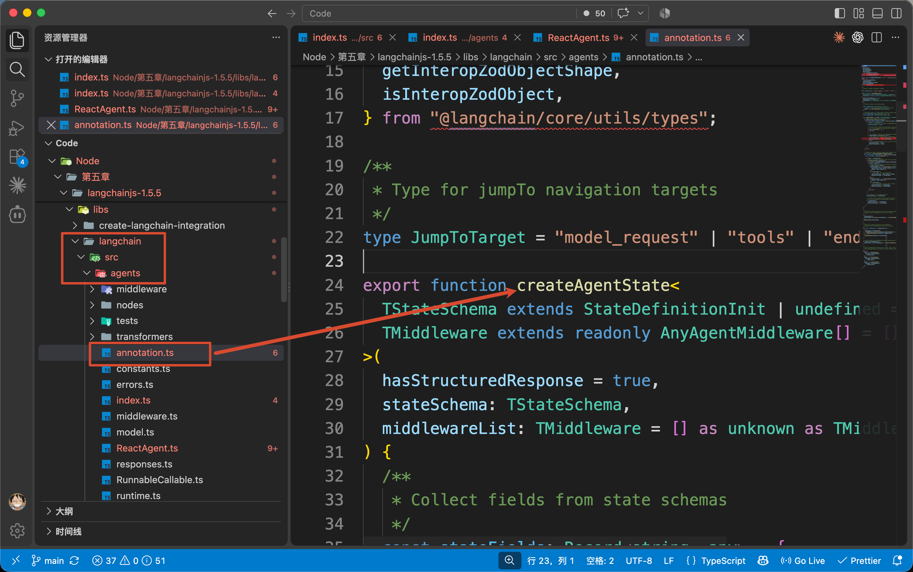

函数一开始先准备了三个字段集合：

+ stateFields
+ inputFields
+ outputFields

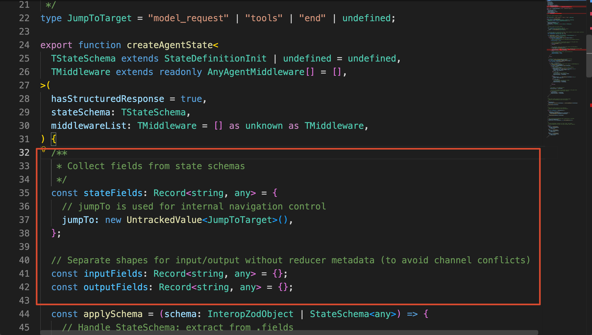

跟大家把这三个字段的注释再详细写一遍，注释略长，但是代码并不复杂，结合上面学过的，难度应该不大才对：

```javascript
/**
 * 根据 Agent 的配置构建三套 State Schema：
 *
 * - state：Agent 内部运行时使用的完整状态
 * - input：Agent 对外接收的输入状态
 * - output：Agent 最终对外暴露的输出状态
 *
 * 构建过程中会综合：
 * 1. Agent 默认状态字段
 * 2. structured response 相关字段
 * 3. 用户自定义 stateSchema
 * 4. Middleware 声明的状态字段
 */
export function createAgentState(
  // 当前 Agent 是否需要支持 structuredResponse。
  // 为 true 时，后续会把结构化响应相关字段加入 State。
  hasStructuredResponse = true,

  // 用户通过 createAgent 等配置传入的自定义 State Schema。
  stateSchema: TStateSchema,

  // Agent 使用的 Middleware 列表。
  // Middleware 也可以扩展 Agent State，因此这里需要参与最终 Schema 的构建。
  middlewareList: TMiddleware = [] as unknown as TMiddleware,
) {
  /**
   * 收集 Agent 内部完整 State 所包含的字段。
   *
   * 后续会把默认字段、自定义 stateSchema 字段、
   * Middleware State 字段等逐步合并到这里。
   */
  const stateFields = {
    /**
     * Agent 内部流程跳转控制字段。
     *
     * jumpTo 用于告诉 Agent Graph：
     * 当前执行完成后，接下来应该跳转到哪个目标节点。
     *
     * 它属于 Agent 内部的流程控制状态，而不是业务状态，
     * 因此使用 UntrackedValue：
     * 不作为普通 State Channel 的持久状态参与跟踪和聚合。
     */
    jumpTo: new UntrackedValue<JumpToTarget>(),
  };

  /**
   * 单独收集 Agent 的输入字段。
   *
   * inputFields 描述调用 Agent 时允许从外部传入哪些状态，
   * 最终会用于创建 Agent 的 Input Schema。
   *
   * 这里没有直接复用 stateFields，是因为完整 State 中的某些字段
   * 可能带有 Reducer / Channel 等内部状态元数据。
   *
   * Input Schema 只需要描述“外部可以输入什么”，
   * 不应该重复携带这些内部 Channel 定义，
   * 否则可能造成 Channel 配置冲突。
   */
  const inputFields = {};

  /**
   * 单独收集 Agent 的输出字段。
   *
   * outputFields 描述 Agent 执行完成以后，
   * 哪些状态字段可以作为最终结果返回给调用方。
   *
   * 与 inputFields 类似，这里只保留输出字段本身的定义，
   * 不直接复用完整 State 中的 Reducer / Channel 元数据，
   * 从而避免重复注册 Channel 导致冲突。
   */
  const outputFields = {};
}
```

继续来看代码

先看 `stateFields`  ，它会先加入一个框架内部字段：

```typescript
jumpTo: new UntrackedValue()
```

`jumpTo` 用来让 Middleware 改变后续执行位置，比如：跳到模型节点、Tool 节点或者直接结束。

他是 Graph 内部的控制数据，不应该让调用方随便传入，也不需要作为最终业务结果返回。

所以：**jumpTo 会进入 State，但不会进入 Input 和 Output**

函数最后还会给三份 Schema 都加入 `messages`：

```typescript
return {
    state: new StateSchema({ messages: MessagesValue, ...stateFields }),
    input: new StateSchema({ messages: MessagesValue, ...inputFields }),
    output: new StateSchema({ messages: MessagesValue, ...outputFields })
};
```

`MessagesValue` 不只规定这里存放的是 Message。

他还自带消息合并规则。模型产生新的 `AIMessage`、Tool 返回新的 `ToolMessage` 时，LangGraph 会把新消息追加到原有消息后面，而不是把前面的对话全部覆盖掉。

这就解释了最基础的 Agent State 从哪里来：

+ 基础 State  = messages + jumpTo
+ 基础 Input  = messages
+ 基础 Output = messages

如果业务代码传入了 `stateSchema`，`createAgentState()` 会读取其中的字段，并同时加入 `stateFields`、`inputFields` 和 `outputFields`。

源码还约定了一个例外：**以下划线开头的字段属于 Graph 私有状态，只保留在内部 State，不会暴露成 Input 和 Output。** （不过咱们这一节的没有使用私有字段，知道这条边界就够了。）

随后，源码还会遍历每一个 Middleware：

```typescript
for (const middleware of middlewareList) {
    if (middleware.stateSchema) {
        applySchema(middleware.stateSchema);
    }
}
```

也就是说，Middleware 不只是提供 Hook 和 Tool，他还可以声明自己运行期间需要维护的 State。

比如审计 Middleware 增加了：

```javascript
stateSchema: z.object({
    auditCount: z.number().default(0)
})
```

最终的 State 里就会继续出现 `auditCount`。

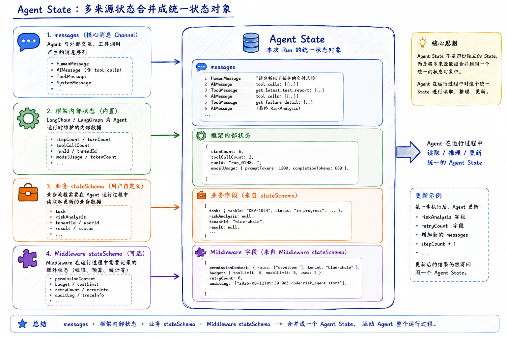

这也是前面第 06 小节中，Middleware 可以跨多个 Hook 共享计数和校验结果的原因。

如果 `createAgent()` 配置了 `responseFormat`，源码会给 `outputFields` 增加：`structuredResponse`

这个字段保存的是 Agent 最终生成并通过 Schema 校验的结构化结果。

他不是调用方一开始传入的数据，所以不会出现在 Input 中。

这里说“只出现在 Output”，指的是 `createAgentState()` 返回的三份 Schema 定义。

`StateGraph` 编译时会把 Output 字段注册成运行通道，因此后面的模型节点仍然可以写入 `structuredResponse`，并在 Agent 结束时把他返回给业务代码。

如果 `wrapModelCall` 动态调整了本轮模型请求的 Response Format，源码同样会提前保留这条输出通道。

这就是前面代码中的 `hasDynamicStructuredResponse`。

到这里，三份 Schema 的差别就比较清楚了：

+ State：messages、框架内部字段、业务 State、Middleware State
+ Input：调用方可以提交的 messages、业务 State、Middleware State
+ Output：messages、业务 State、Middleware State、structuredResponse

## Runtime Context 为什么没有合并进 State
`createAgentState()` 返回以后，回到 `ReactAgent.ts`。

下一段代码是：

```typescript
const workflow = new StateGraph(state, {
    input,
    output,
    context: this.options.contextSchema
});
```

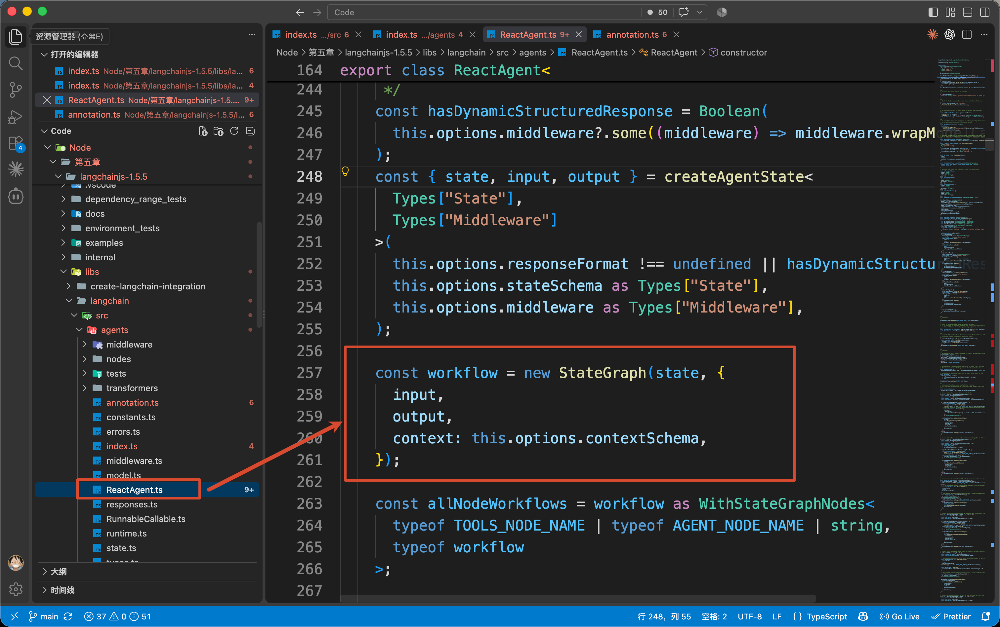

这里可以看到，`contextSchema` 并没有交给 `createAgentState()` 合并。

他被单独传给了 `StateGraph` 的 `context`。

这正好从源码层面证明了第 05 小节讲过的区别：

+ `State` 表示的是：一次 Agent Run 中会被 Node 和 Middleware 持续更新的数据
+ `Runtime Context` 表示的是：调用开始时由应用程序提供，运行期间只读的依赖和可信信息

比如 `taskId`、已经收集到的 `evidence` 会随着任务推进而变化，适合放进 State。

`tenantId` 来自服务端认证结果，Agent 运行期间不应该自己改，适合放进 Runtime Context。

这两种数据都会影响 Agent，但生命周期和权限边界完全不同，所以源码没有把他们塞进同一个对象。

## 写个案例验证 Schema
只看源码还不够。

咱们写一个很小的验证程序，直接观察 `createAgent()` 最终交给 LangGraph 的 Schema。（看过我 vue3 源码课的同学，对这个操作应该都比较熟悉了：通过最小案例，验证源码执行逻辑。）

代码位置在：

```latex
/Code/Node/第五章/09-langchain-source-agent-state
```

代码使用 `FakeToolCallingModel` 满足 `createAgent()` 对 `model` 的要求，但不会执行 `agent.invoke()`。

咱们只在 Agent 构建完成以后，读取 Graph Builder 中的 Schema。

> 运行以前先执行 `node -v`，确保当前终端使用的是 Node.js 20 或更高版本。`langchain@1.5.5` 已经不支持 Node.js 16；如果这里仍然使用旧版本，后面可能直接出现 `ReadableStream is not defined`。
>

打开 `inspect-agent-state.js`，核心代码是：

```javascript
/**
 * 打印 createAgent() 最终交给 LangGraph 的四类 Schema。
 *
 * builder 及下划线开头的属性属于框架内部结构，
 * 这里只用于源码学习，不应该在业务代码中依赖它们。
 */
function printAgentSchemas(title, agent) {
    const builder = agent.builder

    console.log(`\n${title}`)
    console.dir({
        state: Object.keys(builder._schemaRuntimeDefinition?.fields ?? {}),
        input: Object.keys(builder._inputRuntimeDefinition?.fields ?? {}),
        output: Object.keys(builder._outputRuntimeDefinition?.fields ?? {}),
        context: Object.keys(builder._configRuntimeSchema?.shape ?? {})
    })
}
```

这里使用的 `builder` 和下划线开头的属性都属于框架内部结构。

> **注意：**
>
> **这段代码只用来验证刚刚阅读的源码，不要在真实业务中依赖这些内部属性。** LangChain 升级以后，内部字段可以发生变化，而且不需要保证向后兼容。
>

程序先创建一个基础 Agent：

```javascript
const basicAgent = createAgent({
    model,
    tools: []
})
```

接着再创建一个扩展 Agent，同时加入自定义 State、Middleware State、Runtime Context 和 Structured Output：

```javascript
const extendedAgent = createAgent({
    model,
    tools: [],
    stateSchema: DeliveryRiskState,
    contextSchema: RuntimeContext,
    responseFormat: DeliveryRiskResult,
    middleware: [auditMiddleware]
})
```

进入项目目录，安装依赖并运行：

```bash
cd /Code/Node/第五章/09-langchain-source-agent-state
npm install
npm run inspect
```

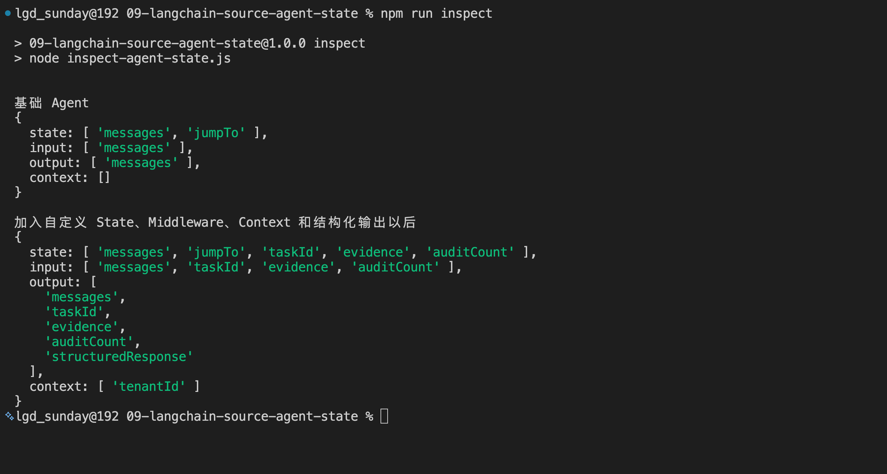

基础 Agent 会打印：

```latex
基础 Agent
{
  state: [ 'messages', 'jumpTo' ],
  input: [ 'messages' ],
  output: [ 'messages' ],
  context: []
}
```

这个结果和刚才看的 `annotation.ts` 完全一致。

`messages` 同时存在于三份 Schema 中，`jumpTo` 只存在于内部 State。

扩展 Agent 会打印：

```latex
加入自定义 State、Middleware、Context 和结构化输出以后
{
  state: [ 'messages', 'jumpTo', 'taskId', 'evidence', 'auditCount' ],
  input: [ 'messages', 'taskId', 'evidence', 'auditCount' ],
  output: [
    'messages',
    'taskId',
    'evidence',
    'auditCount',
    'structuredResponse'
  ],
  context: [ 'tenantId' ]
}
```

现在，再看前面的源码就不是干读了。

`taskId` 和 `evidence` 来自业务 `stateSchema`，`auditCount` 来自 Middleware，`structuredResponse` 来自 `responseFormat`，`tenantId` 则始终待在单独的 Runtime Context 中。

## 总结
咱们把这一篇涉及到的所有路径再梳理一下：

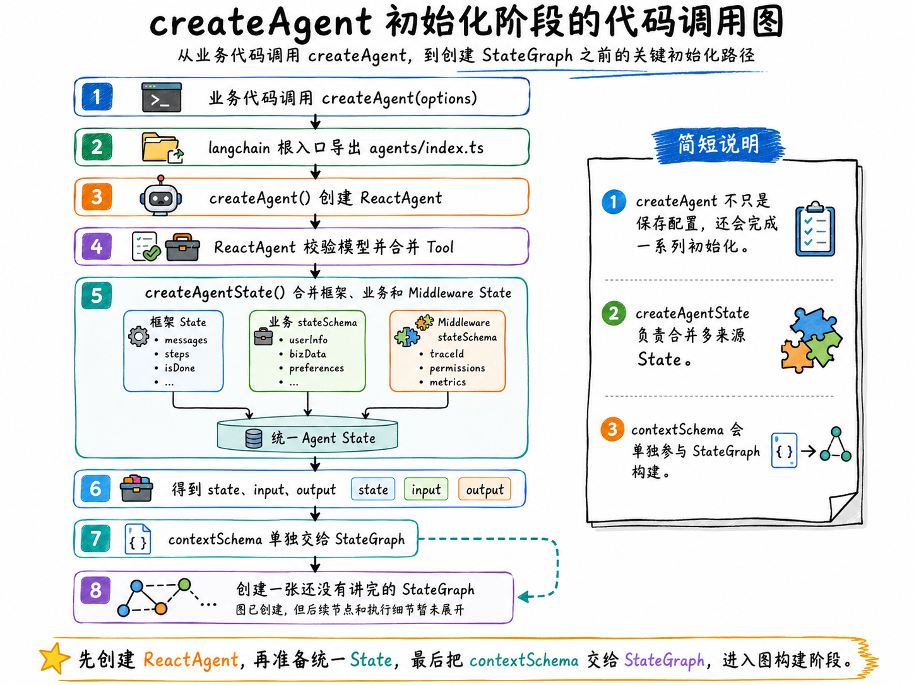

同时大家需要知道，这一小节最重要的不是记住某个源码文件名，而是掌握一套可以复用的源码阅读方式。

先从项目依赖确认版本，再下载对应 Tag；从业务代码的公开入口进入，顺着 `export` 和 `import` 找到真实实现；最后**使用一个最小实验验证刚刚读到的结论**。

沿着这条路径，咱们已经知道 `createAgent()` 会创建 `ReactAgent`，而 `ReactAgent` 会在构建阶段合并框架字段、业务 State 和 Middleware State，再分别生成 Input、Output，并把 Runtime Context 单独交给 LangGraph。

所以，Agent 最终拿到的不只是一个 `messages` 数组。

他拿到的是一套由业务配置决定的数据契约。后面的模型节点、Tool 节点和 Middleware 节点，都必须在这套契约之上运行。

> 更新：2026-08-22 15:41 · 原文：<https://www.yuque.com/lgdsunday/ab1dy3/ot2pgvd9aa9nmh7n>
