# 10 - 解剖 createAgent 控制流（中）：Middleware 节点化、Agent Loop 动态路由与 CompiledStateGraph 生成

上一小节最后，咱们顺着 `createAgent()` 一直追到了 `ReactAgent`，并且看到了下面这段代码：

```typescript
const workflow = new StateGraph(state, {
    input,
    output,
    context: this.options.contextSchema
})
```

`state`、`input`、`output` 和 `context` 分别负责什么，前面已经讲过了。

但是！

代码执行到这里以后，Agent 其实还不能运行。

因为 `new StateGraph()` 只是创建了一个 **Graph Builder**。他更像是先准备好一张空白的流程图，并且规定这张图里的数据应该长什么样。

至于流程图里有哪些 Node、Node 之间怎么连接、模型什么时候调用 Tool、Tool 执行完以后又回到哪里，现在都还没有确定。

所以，`ReactAgent` 构造函数接下来还需要完成三件事：

+ 把模型、Tool 和 Middleware 加入 Graph
+ 为这些 Node 连接 Edge 和 Conditional Edge
+ 调用 compile()，把 Graph Builder 编译成可执行 Graph

这一小节，咱们就继续沿着 `ReactAgent.ts` 往下看，把这三件事捋清楚。

## 先看看最终要构建出什么
暂时先不看源码，咱们想一下一个最基础的 Agent 应该怎样运行。

模型收到用户问题以后，可能直接给出最终回答，也可能返回 Tool Call。

如果返回 Tool Call，应用程序就执行 Tool，再把 Tool Result 交还给模型。模型拿到结果以后继续判断，直到不再调用 Tool 为止。

因此，最基础的 Graph 其实就长这样：

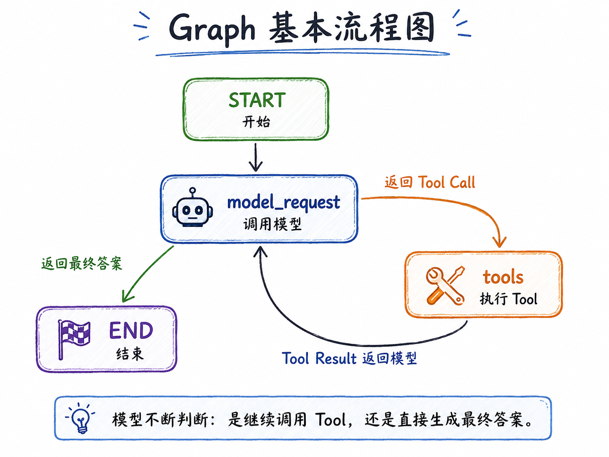

这里的 `model_request` 负责调用模型，`tools` 负责执行 Tool。

从 `model_request` 出发有两个方向，所以这里不能写死一条普通 Edge，而是需要根据模型返回的结果动态选择路径。

这个地方用到的，就是第 07 小节讲过的 `Conditional Edge`。

不过，真实 Agent 里还可能加入 Middleware。

例如咱们第 06 小节使用过下面这些 Hook：

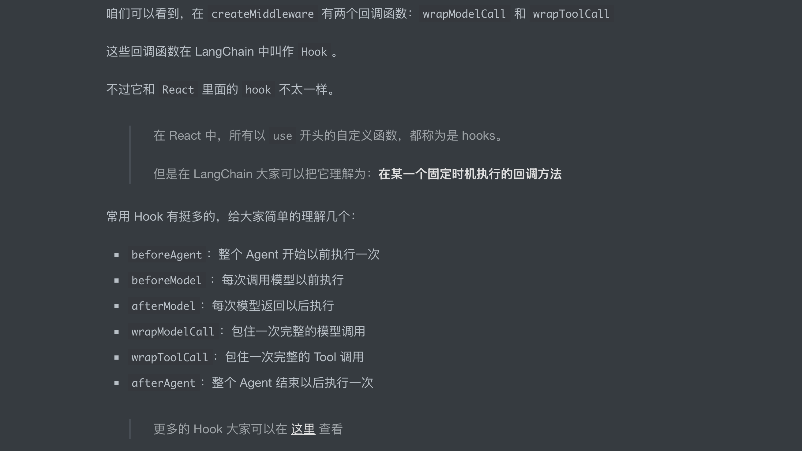

这些 Hook 加进来以后，Graph 还是不是刚才那张图？

答案是：**不一定。**

有些 Middleware Hook 会直接变成 Graph Node，有些则只是包住模型或者 Tool 的调用过程，根本不会出现在 Graph 里。

这就是接下来阅读源码时，最需要弄明白的第一件事。

## Middleware 是怎么进入 Graph 的
继续打开上一小节已经定位到的文件：`libs/langchain/src/agents/ReactAgent.ts`

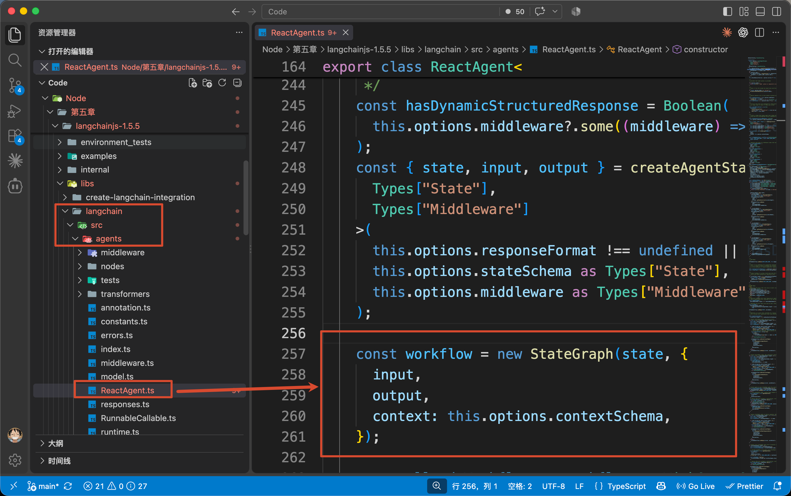

找到刚才的 `new StateGraph()`，然后继续往下看。

紧接着会看到几个数组：

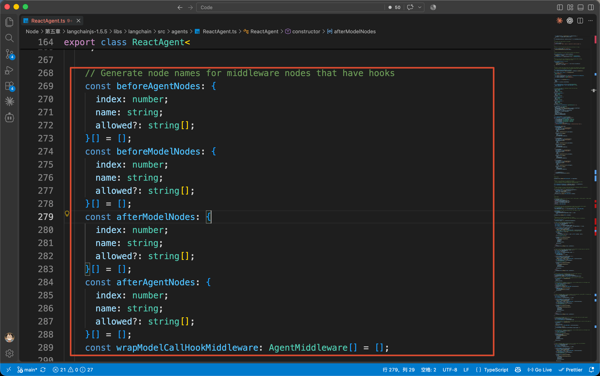

这里先不要管源码里的泛型，只看变量名就可以了。

简化之后的代码，大概就是这样：

```javascript
// 为有钩子的中间件节点生成节点名
const beforeAgentNodes = []
const beforeModelNodes = []
const afterModelNodes = []
const afterAgentNodes = []

const wrapModelCallHookMiddleware = []
```

前四个数组负责记录生命周期 Hook 对应的 Graph Node，最后一个数组则专门保存实现了 `wrapModelCall` 的 Middleware。

然后，源码会遍历咱们传给 `createAgent()` 的全部 Middleware：

```typescript
const middleware = this.options.middleware ?? []

for (let i = 0; i < middleware.length; i++) {
    const m = middleware[i]

    if (m.beforeAgent) {
        const node = new BeforeAgentNode(m)
        const name = `${m.name}.before_agent`

        beforeAgentNodes.push({ index: i, name })
        allNodeWorkflows.addNode(name, node, node.nodeOptions)
    }

    if (m.beforeModel) {
        // 创建 BeforeModelNode，并加入 Graph
    }

    if (m.afterModel) {
        // 创建 AfterModelNode，并加入 Graph
    }

    if (m.afterAgent) {
        // 创建 AfterAgentNode，并加入 Graph
    }

    if (m.wrapModelCall) {
        wrapModelCallHookMiddleware.push(m)
    }
}
```

这段代码已经把 Middleware 分成了两类：

+ 第一类：生命周期 Hook
+ 第二类：Wrap Hook

### 生命周期 Hook
**生命周期 Hook 会变成 Graph Node**

如果 Middleware 定义了 `beforeAgent`，源码就创建一个 `BeforeAgentNode`，再通过 `addNode()` 把他加入 Graph。

其他三个生命周期 Hook 也是同样的处理方式，对应的 Node 变化大概就是下面这样：

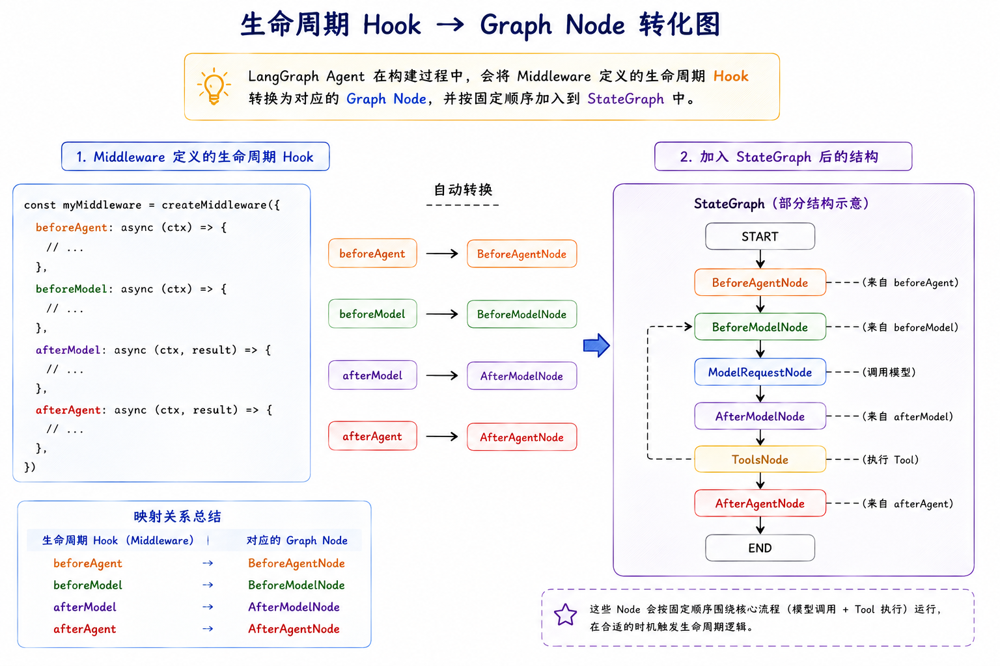

这四个 Node 的源码分别位于：

```latex
libs/langchain/src/agents/nodes/BeforeAgentNode.ts
libs/langchain/src/agents/nodes/BeforeModelNode.ts
libs/langchain/src/agents/nodes/AfterModelNode.ts
libs/langchain/src/agents/nodes/AfterAgentNode.ts
```

以 `BeforeAgentNode` 为例，他最核心的工作就是在 Graph 执行到当前 Node 时，调用 Middleware 提供的 `beforeAgent` Hook。

所以，咱们可以先得出一个结论：

> **生命周期 Hook 是 Agent 执行流程中的一个明确阶段，因此会被编译成独立的 Graph Node。**
>
> 他们会在 Agent 执行流程中的特定位置依次运行。
>

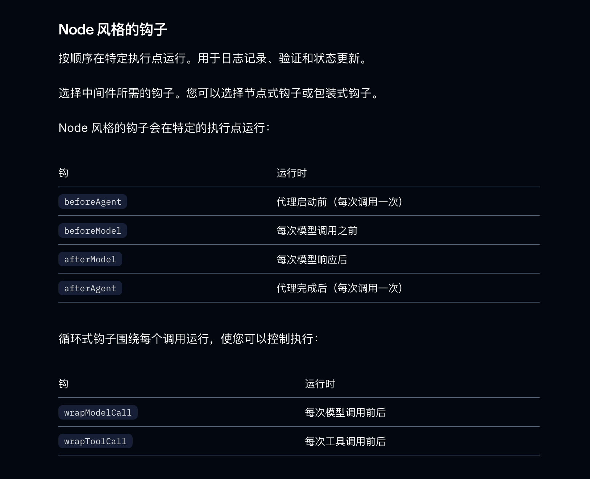

>  [上图的官网文档路径  Node-style hooks](https://docs.langchain.com/oss/javascript/langchain/middleware/custom#node-style-hooks) 
>

### Wrap Hook
**Wrap Hook 不会变成 Graph Node**

但是，`wrapModelCall` 的处理方式明显不同。

源码没有创建一个 `WrapModelCallNode`，只是把当前 Middleware 放进了数组：

```typescript
if (m.wrapModelCall) {
    wrapModelCallHookMiddleware.push(m)
}
```

这个数组最终会交给 `AgentNode`，用于包住真正的模型调用。

`wrapToolCall` 也是一样。他不会变成独立 Node，而是会在创建 `ToolNode` 时作为配置传进去：

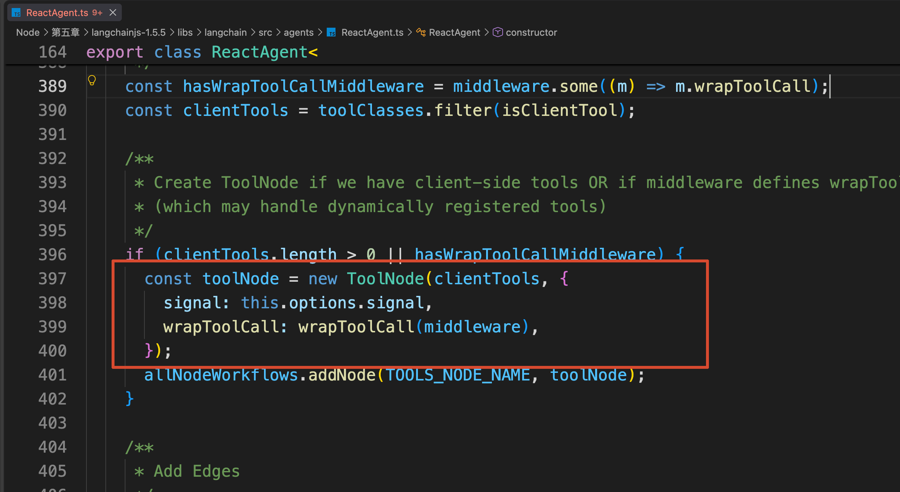

所以，Wrap Hook 的代表的是：**某个 Node 内部的一次具体调用，而不是 Agent Graph 中的一个新阶段。**

官方的文档对这一块也有专门的描述 和 `Node-style` 对应叫做： [Wrap-style hooks](https://docs.langchain.com/oss/javascript/langchain/middleware/custom#wrap-style-hooks)。

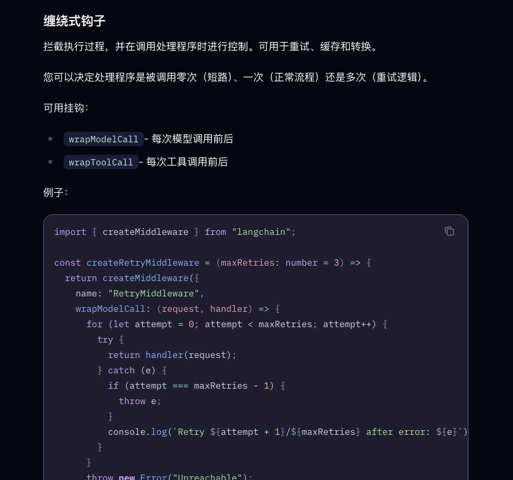

他们可以决定内部的 `handler()` 调用零次、一次还是多次，所以特别适合实现重试、缓存和调用结果转换。

到这里，Node-style 和 Wrap-style 的区别就很明确了：

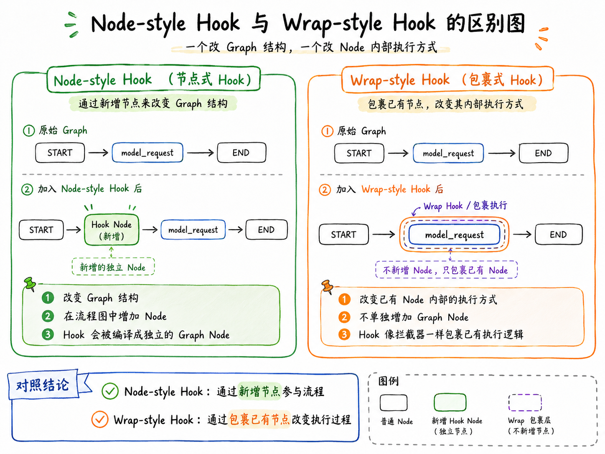

## 加入 model_request 和 tools
Middleware 处理完成以后，源码会继续加入 Agent 两个 最核心的 Node：`model_request Node  ` 和 `tools Node`

先看模型 Node：

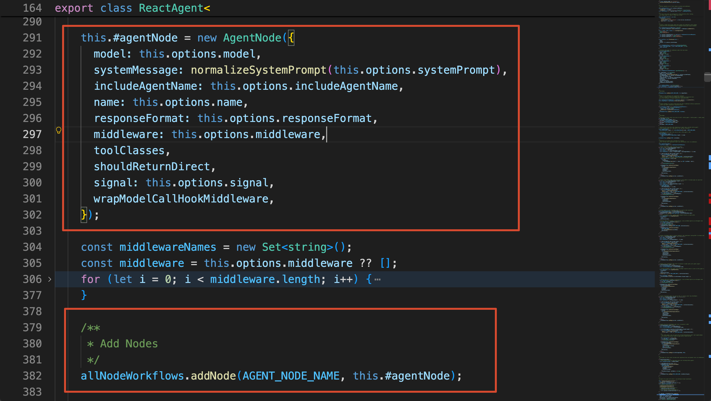

这个代码截图看也有点乱，跟大家稍微简化一下就是下面这样

```typescript
this.#agentNode = new AgentNode({
    model: this.options.model,
    systemMessage: normalizeSystemPrompt(this.options.systemPrompt),
    responseFormat: this.options.responseFormat,
    middleware: this.options.middleware,
    toolClasses,
    shouldReturnDirect,
    wrapModelCallHookMiddleware
})

allNodeWorkflows.addNode(AGENT_NODE_NAME, this.#agentNode)
```

这里涉及到一个常量，叫做：`AGENT_NODE_NAME`  。 它的值可以在 `libs/langchain/src/agents/nodes/AgentNode.ts` 这个文件中找到：

```typescript
export const AGENT_NODE_NAME = "model_request"
```

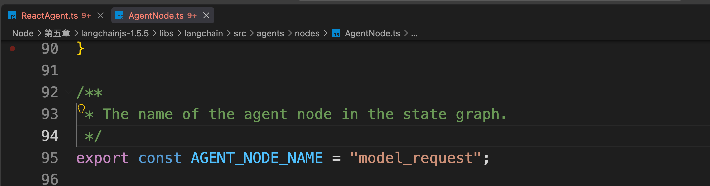

所以，**Graph 里的 **`model_request`** 就是 **`AgentNode`**。**

他拿到了模型、System Message、Structured Output 配置、Tool 信息和 `wrapModelCall` Middleware。后面真正调用模型时，这些配置都会在这个 Node 内部

接下来，再看 `tools` Node：

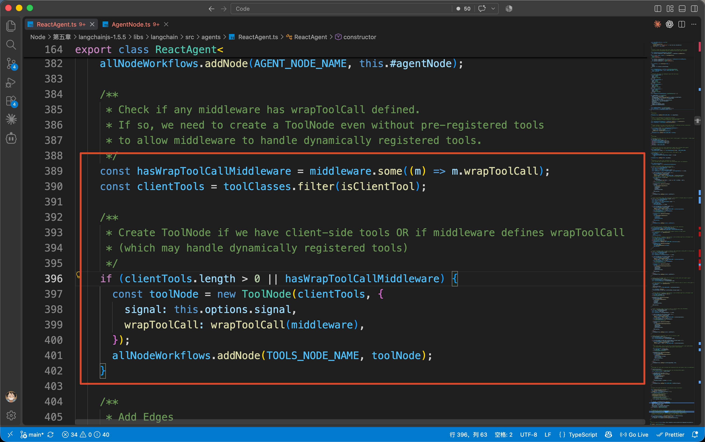

同样，还是给大家把代码和注释列出来：

```typescript
/**
 * 检查是否有任意 Middleware 定义了 wrapToolCall。
 *
 * 如果存在，那么即使当前没有预先注册的 Tool，
 * 我们仍然需要创建一个 ToolNode，
 * 以便 Middleware 能够处理动态注册的 Tool。
 */
const hasWrapToolCallMiddleware = middleware.some((m) => m.wrapToolCall);
const clientTools = toolClasses.filter(isClientTool);

/**
 * 如果存在客户端 Tool，或者 Middleware 定义了 wrapToolCall，
 * 则创建 ToolNode。
 *
 * wrapToolCall 可能会用于处理动态注册的 Tool。
 */
if (clientTools.length > 0 || hasWrapToolCallMiddleware) {
  const toolNode = new ToolNode(clientTools, {
    signal: this.options.signal,
    wrapToolCall: wrapToolCall(middleware),
  });

  allNodeWorkflows.addNode(TOOLS_NODE_NAME, toolNode);
}
```

通过上面的代码，大家也可以看出来：`ToolNode`** 并不是无条件创建的。**

只有当前 Agent 注册了需要在 Client 侧执行的 Tool，或者某个 Middleware 提供了 `wrapToolCall`，源码才会把 `tools` 加入 Graph。

那么这个时候大家可能就疑惑了，**为什么没有 Tool，仅有 **`wrapToolCall`** 也要创建 ToolNode？**

这是因为 **Middleware 可能在运行期间处理动态 Tool**。

构建 Graph 时虽然还看不到这些 Tool，但执行路径中仍然需要提前保留一个 `tools` Node。

说到这里，Graph 里的核心 Node 就都已经创建出来了，咱们看了三个：

+ Middleware 生命周期 Node
+ model_request
+ tools（存在可执行 Tool 时）

但是，这些 Node 现在还是零碎的，如果要把这些 Node 串起来，就得用到 `Edge`

`langchain` 在写这些 Edge 的时候比较有意思，他没有直接写一大堆 Edge，而是先计算了三个位置：

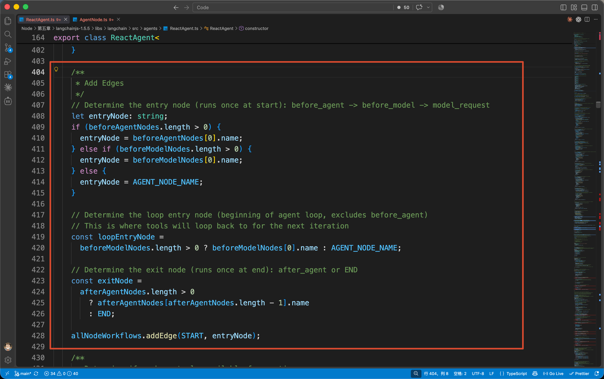

```typescript
/**
 * 添加边（Edges）
 */

// 确定入口节点（只在开始时执行一次）：before_agent -> before_model -> model_request
let entryNode: string;

if (beforeAgentNodes.length > 0) {
  entryNode = beforeAgentNodes[0].name;
} else if (beforeModelNodes.length > 0) {
  entryNode = beforeModelNodes[0].name;
} else {
  entryNode = AGENT_NODE_NAME;
}

// 确定循环入口节点（Agent 循环的起点，不包含 before_agent）
// Tool 执行完成后，会回到这里开始下一轮 Agent 循环
const loopEntryNode =
  beforeModelNodes.length > 0 ? beforeModelNodes[0].name : AGENT_NODE_NAME;

// 确定退出节点（只在结束时执行一次）：after_agent 或 END
const exitNode =
  afterAgentNodes.length > 0
    ? afterAgentNodes[afterAgentNodes.length - 1].name
    : END;

allNodeWorkflows.addEdge(START, entryNode);
```

咱们一个个来看：

+ `entryNode` 是整个 Agent 第一次启动时进入的位置。

如果存在 `beforeAgent`，就先执行 `beforeAgent`

没有的话，再看是否存在 `beforeModel`

两个都没有，才直接进入 `model_request`。

+ `loopEntryNode` 是 Tool 执行完以后，下一轮 Agent Loop 回到的位置。

这里故意排除了 `beforeAgent`。

因为 `beforeAgent` 的语义是整个 Agent 开始以前只执行一次。Tool 每执行一次就回到 `beforeAgent`，显然不对。

所以，一个加入了完整生命周期 Hook 的 Agent，第一次执行与后续循环的入口分别是：

> + 第一次启动：START → beforeAgent → beforeModel → model_request
> + Tool 执行完成：tools → beforeModel → model_request
>

+ 最后一个 `exitNode`，负责确定 Agent 真正结束以前是否还要执行 `afterAgent`。

如果没有 `afterAgent`，出口就是 `END`

如果存在，则先进入 `afterAgent`，执行完成以后再去 `END`。

接着，源码会先连接 Graph 的起点：

```typescript
allNodeWorkflows.addEdge(START, entryNode)
```

到这里，`START` 应该连向哪里就确定了。

## 模型返回以后，为什么需要条件路由
入口只是整个流程的开始。

真正决定 Agent 能不能循环起来的，是 `model_request` 后面的路由。

如果没有 `afterModel` Middleware，源码会直接为 `model_request` 添加 Conditional Edge：

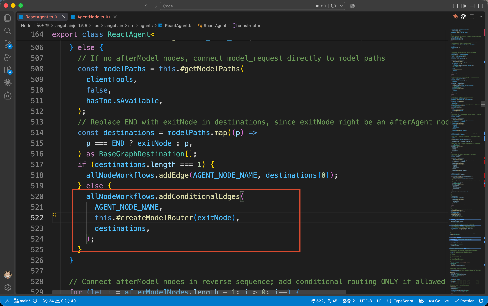

这里最重要的是 `#createModelRouter()`。

继续在 `ReactAgent.ts` 中搜索：`#createModelRouter` 应该可以找到如下代码：

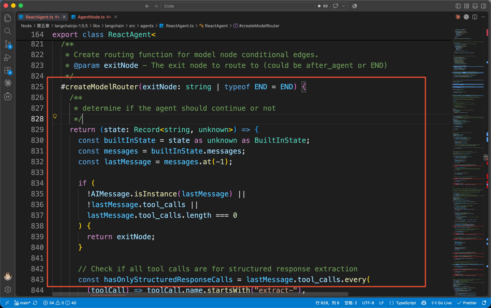

把一些 Structured Output 和并行 Tool Call 的细节先省略以后，他的核心判断其实很简单：

```typescript
return (state) => {
    const messages = state.messages
    const lastMessage = messages.at(-1)

    if (
        !AIMessage.isInstance(lastMessage) ||
        !lastMessage.tool_calls ||
        lastMessage.tool_calls.length === 0
    ) {
        return exitNode
    }

    return TOOLS_NODE_NAME
}
```

他读取 State 中最后一条 Message（lastMessage），然后做判断：

```javascript
if (最后一条 AIMessage 没有 Tool Call) {
  模型已经给出最终回答，进入 exitNode
} else {
  需要应用程序执行 Tool,进入 tools
}
```

这就是最基础的 Agent 条件路由。

模型并不是在 `model_request` 内部直接跳到了 Tool。

`AgentNode` 只负责把模型输出写回 State，真正决定 Graph 下一步去哪里的，是 `#createModelRouter()` 返回的路由函数。

## Tool 执行完成以后的逻辑
模型决定调用 Tool 以后，Graph 会进入 `tools`。

`ToolNode` 执行完成，会把 Tool Result 以 `ToolMessage` 的形式写回 `messages`。

但是，Tool Result 只是新的 Observation，并不是最终答案。

模型还需要读取这份结果，再决定继续调用其他 Tool，还是生成最终回答。

因此，普通 Tool 的返回路径是：

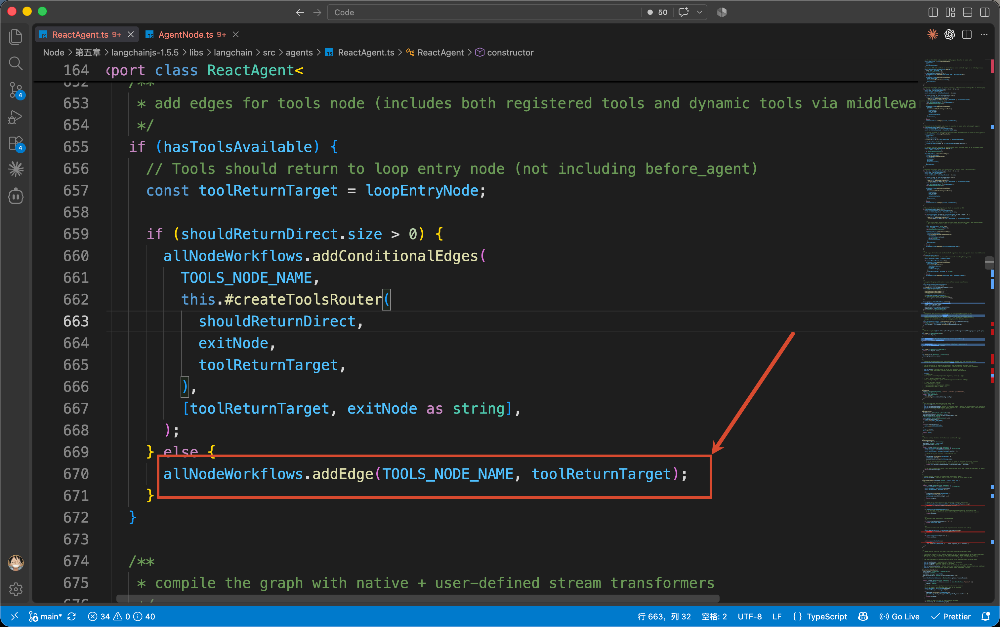

`toolReturnTarget`  其实就是 `loopEntryNode`

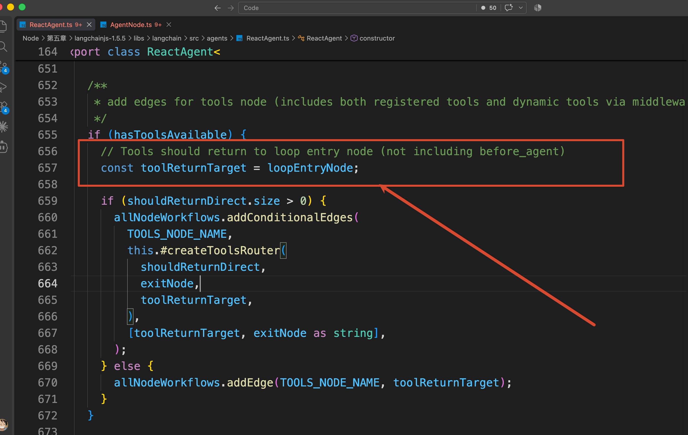

所以整个代码，理论上是这样的：

```javascript
allNodeWorkflows.addEdge(
    TOOLS_NODE_NAME,
    loopEntryNode
)
```

而 `loopEntryNode` 咱们在前面说过，他其实是：**Tool 执行完以后，下一轮 Agent Loop 回到的位置**

同时咱们在上面也提到了：**一个加入了完整生命周期 Hook 的 Agent，第一次执行与后续循环的入口分别是：**

> + 第一次启动：START → beforeAgent → beforeModel → model_request
> + Tool 执行完成：tools → beforeModel → model_request
>

这里也就是：

```latex
tools → beforeModel（如果存在） → model_request
```

这条 Edge 把 `model_request → tools → model_request` 连成了真正的 Agent Loop。

不过，有些 Tool 会设置 `returnDirect`。

这种 Tool 的返回值可以直接作为 Agent 结果，不需要模型再改写一次。

只要项目里存在 `returnDirect` Tool，`tools` 后面就不能继续使用固定 Edge，而要换成条件路由：

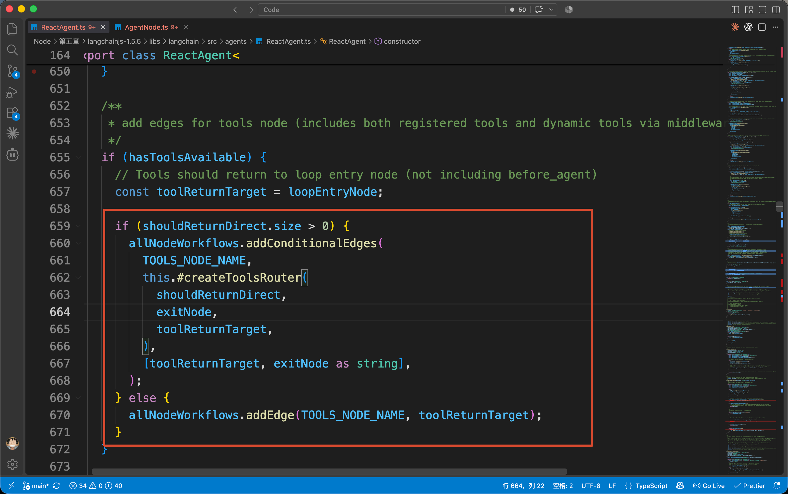

同样把注释跟大家翻译一下：

```typescript
/**
 * 为 Tools 节点添加边。
 *
 * 这里同时包括：
 * - 已注册的 Tool
 * - 通过 Middleware 动态提供的 Tool
 */
if (hasToolsAvailable) {
  // Tool 执行完成后，应返回 Agent 循环的入口节点
  // 注意：这里不包含 before_agent
  const toolReturnTarget = loopEntryNode;
    /**
   * 判断当前是否存在配置了 returnDirect 的 Tool。
   *
   * shouldReturnDirect 中保存的是：
   * “Tool 执行完成后，不需要再回到模型，而是直接结束 Agent”
   * 的 Tool 集合。
   *
   * 因此这里分成两种情况：
   *
   * 1. shouldReturnDirect.size > 0
   *
   *    说明至少有一个 Tool 可能要求“执行后直接返回”。
   *
   *    此时不能简单地把：
   *
   *      Tools -> loopEntryNode
   *
   *    写死，而是需要根据刚刚实际执行的 Tool 动态判断：
   *
   *      普通 Tool -> loopEntryNode -> 回到 Agent 循环，继续请求模型
   *
   *      returnDirect Tool -> exitNode -> 直接进入 Agent 退出流程
   *
   *    所以这里通过 addConditionalEdges 添加条件边，
   *    并由 #createToolsRouter 决定具体走哪一条路径。
   *
   * 2. shouldReturnDirect.size === 0
   *
   *    说明所有 Tool 执行完成后都必须继续 Agent 循环，
   *    不存在直接结束的 Tool。
   *
   *    因此不需要额外的 Router 判断，
   *    直接添加：
   *
   *      Tools -> loopEntryNode
   *
   *    即可。
   */
  if (shouldReturnDirect.size > 0) {
    allNodeWorkflows.addConditionalEdges(
      TOOLS_NODE_NAME,
      this.#createToolsRouter(
        shouldReturnDirect,
        exitNode,
        toolReturnTarget,
      ),
      [toolReturnTarget, exitNode as string],
    );
  } else {
    allNodeWorkflows.addEdge(TOOLS_NODE_NAME, toolReturnTarget);
  }
}
```

这里还有一个例外。

如果 Agent 配置了 `responseFormat`，即使执行的是 `returnDirect` Tool，也需要再回到 Agent Loop，生成符合 Schema 的 `structuredResponse`。

对应的逻辑在 ` #createToolsRouter` 这里：

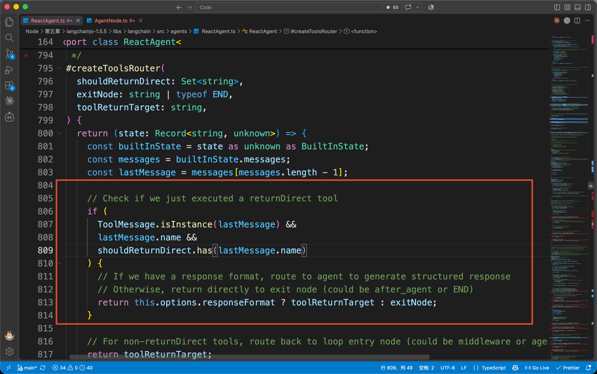

翻一下：

```typescript
// 如果配置了 responseFormat，则返回 Agent 循环入口，
// 让模型继续执行，用于生成最终的结构化响应。

// 否则，不再回到 Agent 循环，直接进入退出节点。
// exitNode 可能是 after_agent，也可能是 END。

return this.options.responseFormat ? toolReturnTarget : exitNode;
```

所以，Conditional Edge 他的作用是：**同一个 Node 执行完成以后，下一步可能由当前 State 决定。**

## 生命周期 Hook 最终是怎么连接的
前面已经知道生命周期 Hook 会成为 Node，现在把他们的连接方式完整串起来。

假设当前 Agent 配置了四个 Hook：

```latex
beforeAgent
beforeModel
afterModel
afterAgent
```

最终 Graph 大致是下面这个样：

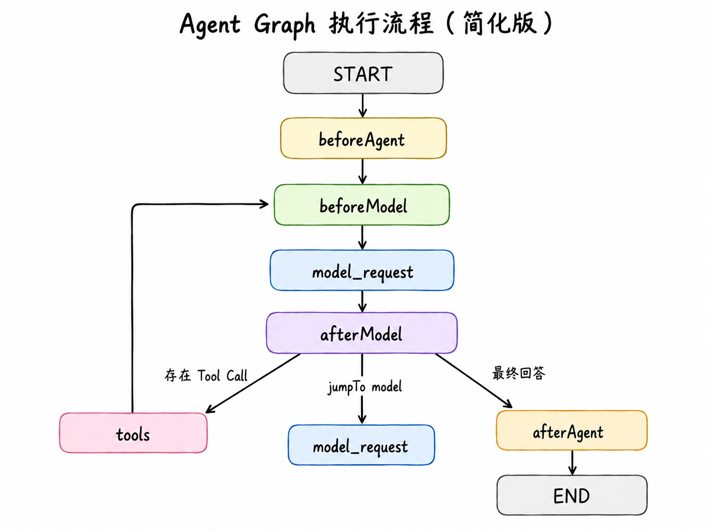

这里有两个地方需要注意。

+ 第一：`beforeAgent` 和 `afterAgent` 针对整个 Agent Run，只执行一次
+ 第二：`beforeModel` 和 `afterModel` 针对每一轮模型调用，所以 Agent 每次从 Tool 返回以后，还会再次经过他们

如果同一个阶段配置了多个 Middleware，`before` Hook 会按照 Middleware 数组的顺序执行，`after` Hook 则按照相反顺序返回。

这和函数一层层进入，再一层层退出的过程是一样的。

不过这一节先不展开多层 Middleware 的执行顺序。

咱们真正需要掌握的是：`ReactAgent`** 会根据 Middleware 定义，动态增加 Node，并重新计算 Graph 的入口、循环位置和出口。**

所有 Node 和 Edge 添加完成以后，`ReactAgent` 构造函数终于走到了最后一步：

```typescript
this.#graph = allNodeWorkflows.compile({
    checkpointer: this.options.checkpointer,
    store: this.options.store,
    name: this.options.name,
    description: this.options.description,
    transformers: compileTransformers
})
```

前面的 `allNodeWorkflows` 只是 Graph Builder。

`compile()` 会检查 Node、Edge 和 State Schema，再把他们编译成可以真正执行的 `CompiledStateGraph`。

这个过程与咱们第 07 小节手写 LangGraph 时调用的 `workflow.compile()` 是差不多的，只不过 `createAgent()` 把 Graph 的构建过程封装起来了。

传给 `compile()` 的配置中：

+ `checkpointer` 用来保存一次 Graph 运行过程中的 State，让 Agent 支持线程级状态持久化、中断和恢复
+ `store` 用来保存跨运行共享的数据。例如同一个用户跨会话使用的长期信息，不应该全部塞进当前一次 Graph State
+ `name` 和 `description` 用于标识当前 Graph，方便追踪和开发工具展示
+ `transformers` 用来转换 Agent 的流式事件。源码会把内置 Transformer、Middleware 提供的 Transformer 和用户传入的 Transformer 按顺序合并。

关于 Checkpointer、Store 和 Streaming，后面的对应章节还会继续讲。这里不用展开，只需要知道：**这些运行能力不是在 Agent Loop 中临时补上的，而是在 Graph 编译时统一交给 LangGraph Runtime。**

编译完成以后，结果会保存在：

```typescript
this.#graph
```

那么，为什么 `createAgent()` 返回的 `ReactAgent` 也可以调用 `invoke()` 和 `stream()` 呢？

继续在 `ReactAgent.ts` 中搜索 `async invoke`，可以看到：

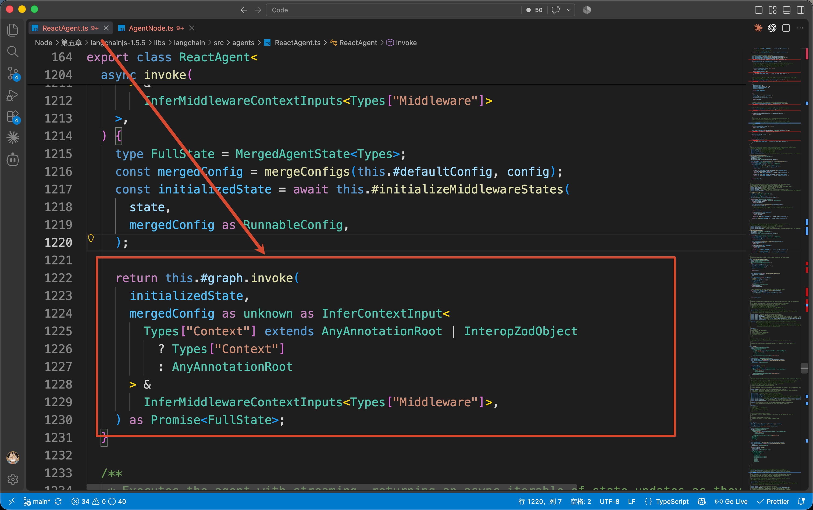

简化下代码：

```typescript
async invoke(state, config) {
    // 合并配置、初始化 Middleware State
    return this.#graph.invoke(
        initializedState,
        mergedConfig
    )
}
```

应该很好理解了，所谓的 `invoke` 的调用本质上就是 `this.#graph.invoke`

`stream()` 也是同样的处理方式，最终调用的是：

```typescript
this.#graph.stream(...)
```

所以，真正执行 Graph 的还是 `CompiledStateGraph`。

`ReactAgent` 在外面继续处理默认配置、Middleware State 和类型，再把执行交给内部的 `#graph`。

## 总结
现在，咱们把上、中两篇源码连起来看。

业务代码调用：

```typescript
createAgent({
    model,
    tools,
    stateSchema,
    contextSchema,
    responseFormat,
    middleware
})
```

框架内部会依次完成下面的流程：

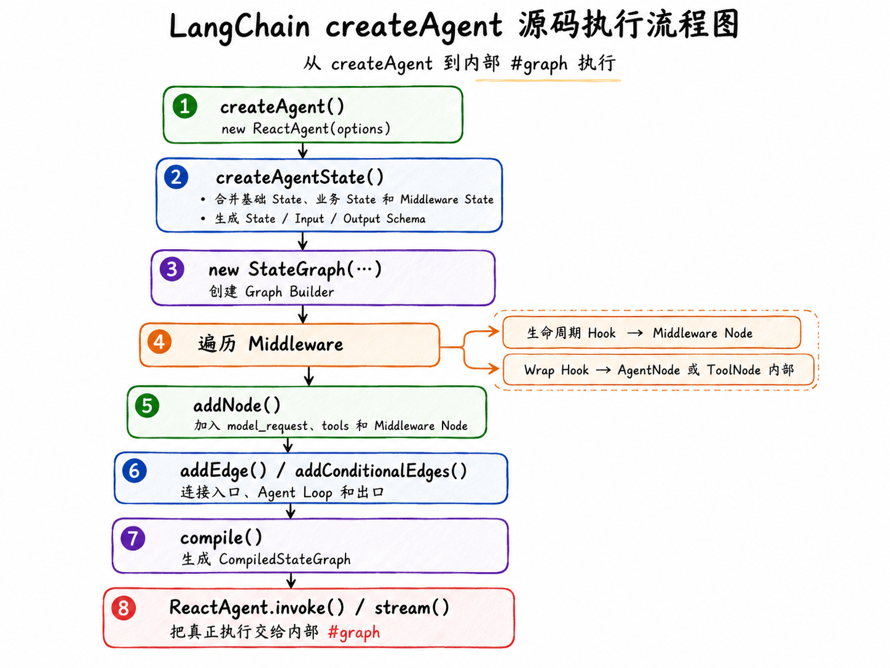

所以，`createAgent()` 实际上会根据传入的配置，动态创建了一份 State Schema，再构建出一张 LangGraph，最后把这张图编译成交给 LangGraph Runtime 执行的对象。

而针对这一小节，咱们首先得知道：`new StateGraph()` 只是创建 Graph Builder。真正的执行结构还需要继续加入 Node 和 Edge，最后调用 `compile()`。

然后，Middleware 并不都会成为 Graph Node。

`beforeAgent`、`beforeModel`、`afterModel` 和 `afterAgent` 属于生命周期阶段，因此会改变 Graph 结构

`wrapModelCall` 和 `wrapToolCall` 则包住已有 Node 内部的调用过程，不会单独出现在 Graph 中。

模型 Node 名叫 `model_request`，Tool Node 名叫 `tools`。

模型返回 Tool Call 时，条件路由进入 `tools`

没有 Tool Call 时，流程进入出口。普通 Tool 执行完成以后会回到模型循环，`returnDirect` Tool 则可能直接结束。

最后，`compile()` 会把 State Schema、Node、Edge、Checkpointer、Store 和流式 Transformer 一起交给 LangGraph，生成真正可以运行的 `CompiledStateGraph`。

到这里，咱们已经知道一张 Agent Graph 是怎么被构建出来的了。

> 更新：2026-08-24 16:42 · 原文：<https://www.yuque.com/lgdsunday/ab1dy3/ezo8rk4o0cwicqca>
