# 11 - 深入 createAgent 模型调用链路：ModelRequest 构造、Wrap Hook 编排、Tool Schema 绑定与 AIMessage 回写

上一小节最后，`ReactAgent` 已经把 Agent 编译成了一张可以执行的 `CompiledStateGraph`。

咱们也看到，调用 `agent.invoke()` 时，真正执行的是：

```typescript
this.#graph.invoke(...)
```

但是，这里还有一个最关键的问题没有解决。

Graph 运行起来以后，第一个执行的 `model_request` 里面到底做了什么？

比如用户输入：

```latex
查询 TASK-1024 的任务状态和最近一次测试结果。
```

面对这个请求，Agent 首先要完成一次模型调用，让模型判断下一步应该做什么。

但是，这次调用并不是简单执行一句 `model.invoke()`。

用户传入的 `messages` 怎样成为 Agent State？`AgentNode` 怎样整理 `ModelRequest`？LangChain 又怎样把 Tool Schema 绑定到模型，并最终得到包含 Tool Call 的 `AIMessage`？

这一小节，咱们先把第一次模型调用完整走通。

至于模型返回 Tool Call 以后，`ToolNode` 怎样执行 Tool、结果怎样回注，以及 Agent Loop 怎样结束，统一放到下一小节继续讲。

## 从 demo 开始
之前大家看源码都是直接从下载好的源码开始看的。

这次咱们稍微变一变，从一个写好的 demo 开始看，先看运行的结果，然后根据结果再来看源码流程。要是还像之前一样，估计很多同学会看不懂。

本小节的代码在：

```latex
/Code/Node/第五章/11-langchain-source-agent-run
```

我在 `scripted-model.js` 中准备了一个固定回复的模拟模型，保证大家每次运行都能得到相同的 Tool Call

真正要看的代码是：

```latex
agent-run-trace.js
```

进入项目目录，安装依赖并运行：

```bash
cd /Code/Node/第五章/11-langchain-source-agent-run
npm install
npm run trace
```

> 这里需要使用 Node.js 20 或更高版本。如果运行时出现 `ReadableStream is not defined`，先通过 `node -v` 检查当前终端是不是还在使用 Node.js 16。
>

先看下完整的输出：

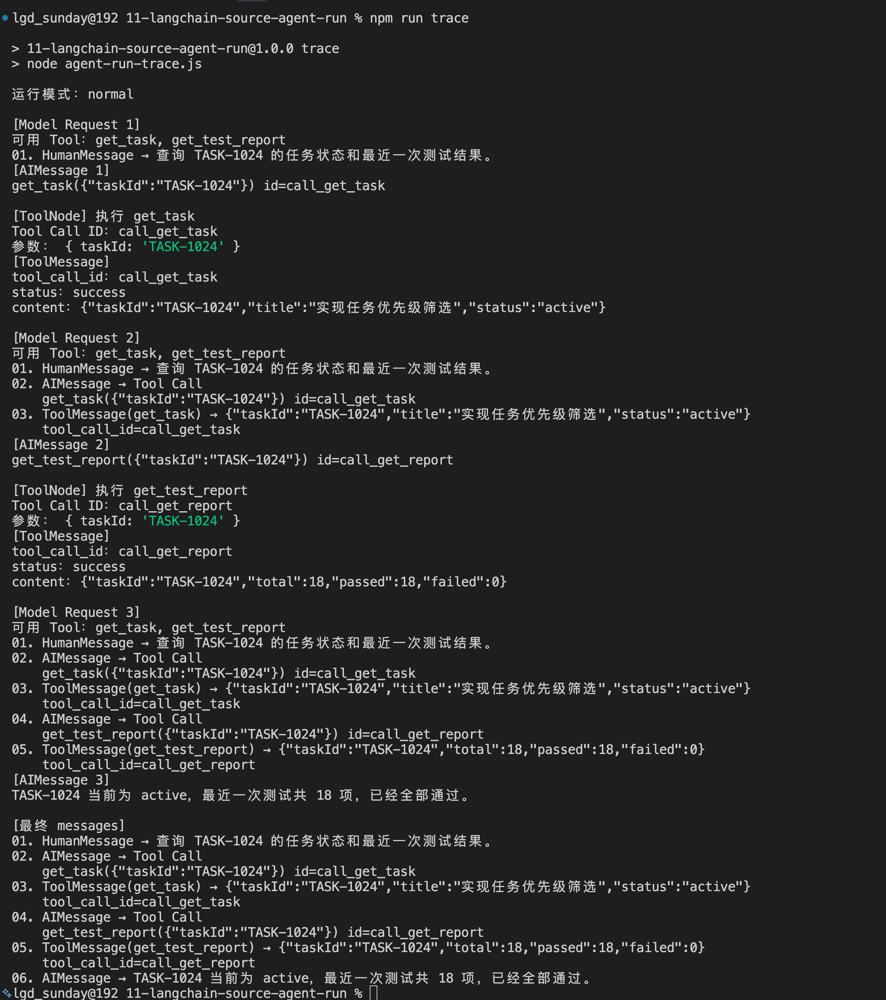

完整输出稍微有点长，大家主要看 `[最终 messages]` 里面的内容，就是下面这些：

```latex
[最终 messages]
01. HumanMessage → 查询 TASK-1024 的任务状态和最近一次测试结果。
02. AIMessage → Tool Call
    get_task({"taskId":"TASK-1024"}) id=call_get_task
03. ToolMessage(get_task) → {"taskId":"TASK-1024","title":"实现任务优先级筛选","status":"active"}
    tool_call_id=call_get_task
04. AIMessage → Tool Call
    get_test_report({"taskId":"TASK-1024"}) id=call_get_report
05. ToolMessage(get_test_report) → {"taskId":"TASK-1024","total":18,"passed":18,"failed":0}
    tool_call_id=call_get_report
06. AIMessage → TASK-1024 当前为 active，最近一次测试共 18 项，已经全部通过。
```

这六条 Message 记录了整个 Agent Run。

不过，这一小节只追踪前两条：**用户传入的 HumanMessage，怎样经过 **`model_request`**，变成第一条包含 **`get_task`** Tool Call 的 AIMessage。**

从第三条 ToolMessage 开始的 Tool 执行、消息回注和后续循环，放到下一小节继续追踪。

接下来，咱们就从项目里的 `agent.invoke()` 开始，一点点看。

## 从 agent.invoke() 进入 CompiledStateGraph
打开：

```latex
agent-run-trace.js
```

整个代码就是通过下面启动 Agent 的：

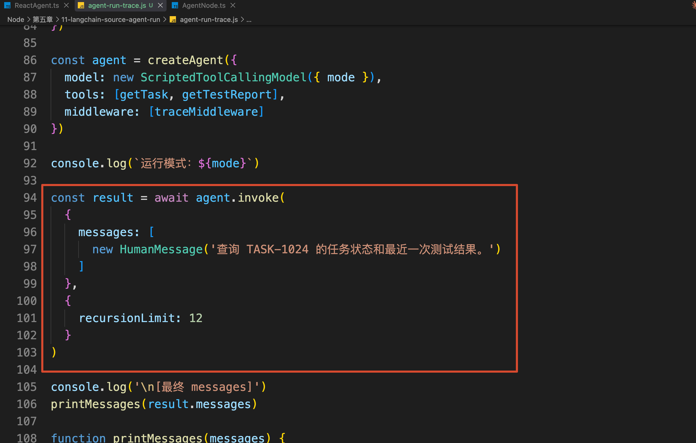

把代码单独拿出来：

```javascript
const result = await agent.invoke(
    {
        messages: [
            new HumanMessage(
                '查询 TASK-1024 的任务状态和最近一次测试结果。'
            )
        ]
    },
    {
        recursionLimit: 12
    }
)
```

`invoke()` 接收了两个参数。

第一个参数是本次运行的初始数据：

```javascript
{
    messages: [new HumanMessage('查询 TASK-1024 ...')]
}
```

这个对象进入源码以后，就叫作 `state`。

所以，`messages` 就是 ：**咱们调用 **`agent.invoke()`** 时，主动传入的一个属性。**

第二个参数是本次运行的配置：

```javascript
{
    recursionLimit: 12
}
```

这个对象进入源码以后，就叫作 `config`。

因此，进入源码以前，咱们下吧这两个参数对应上：

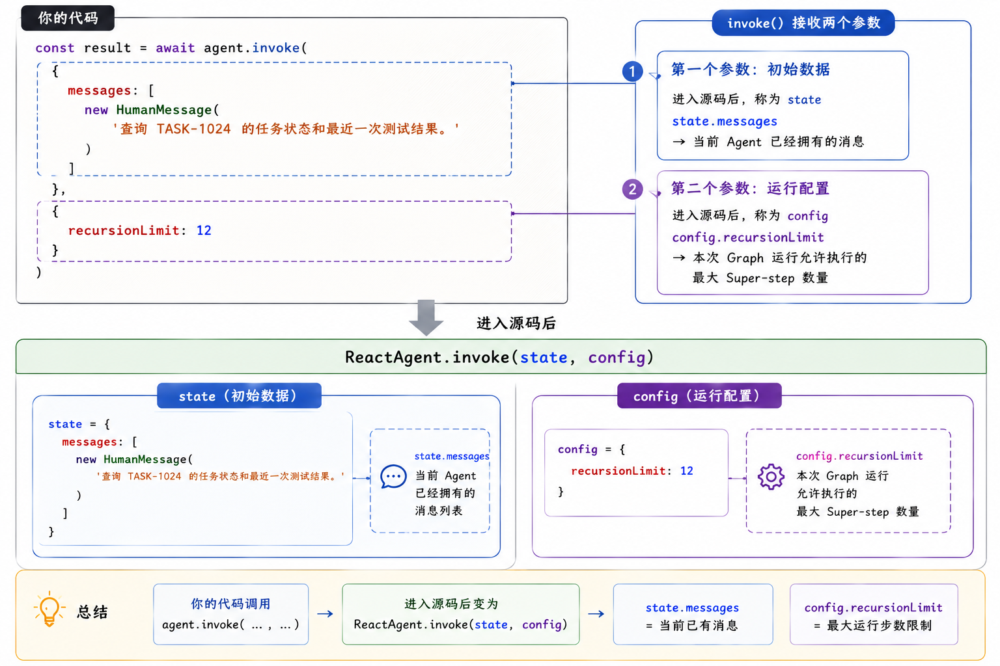

现在，回到下载好的 `langchain@1.5.5` 源码，打开：

```latex
libs/langchain/src/agents/ReactAgent.ts
```

搜索：

```latex
async invoke(
```

可以看到这样的一段代码：

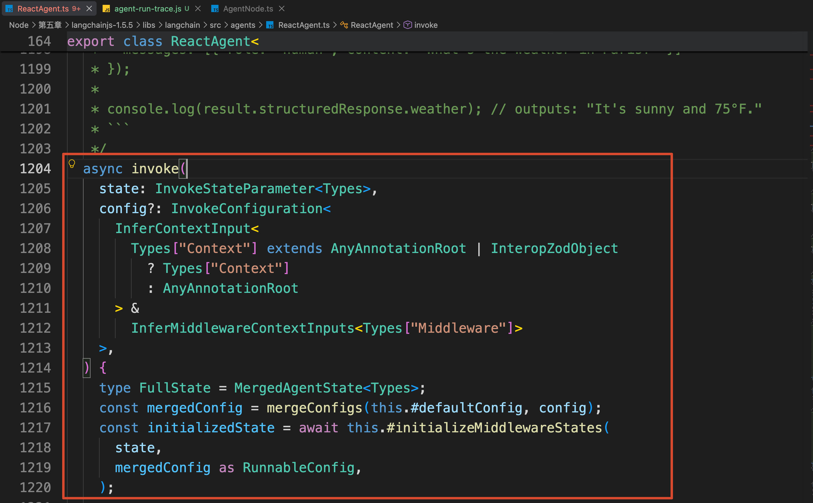

把泛型代码省略以后，核心逻辑是：

```typescript
async invoke(state, config) {
    // 第一步，合并运行配置
  const mergedConfig = mergeConfigs(
        this.#defaultConfig,
        config
    )
 // 第二步，初始化 Middleware State
    const initializedState =
        await this.#initializeMiddlewareStates(
            state,
            mergedConfig
        )

    return this.#graph.invoke(
        initializedState,
        mergedConfig
    )
}
```

现在再看这段源码，就简单多了，一共就两步。

第一步，合并运行配置：

```typescript
const mergedConfig = mergeConfigs(
    this.#defaultConfig,
    config
)
```

咱们传入的 `{ recursionLimit: 12 }`，会和 Agent 自己保存的默认配置合并，得到这次真正交给 LangGraph 的 `mergedConfig`。

第二步，初始化 Middleware State：

```typescript
const initializedState =
    await this.#initializeMiddlewareStates(
        state,
        mergedConfig
    )
```

如果某个 Middleware 定义了额外的 State 字段和默认值，这里会把缺少的字段补进去。

咱们虽然使用了 `traceMiddleware`，但是它只定义了 `wrapModelCall` 和 `wrapToolCall`，没有定义自己的 `stateSchema`。因此，这一步不会凭空增加新的业务数据。

此时最重要的 State 仍然是咱们一开始传入的 `message` ，用代码表示就是下面这样：

```javascript
state = {
  messages: [
    new HumanMessage(
      '查询 TASK-1024 的任务状态和最近一次测试结果。'
    )
  ]
}
```

说到这里，大家可能还有一个疑问：

> 咱们确实传入了 `messages`，但是 LangChain 在哪里规定 Agent State 必须认识这个属性的呢？
>

这个定义不在 `invoke()` 里，而是在创建 Graph State Schema 的地方。

打开：

```latex
libs/langchain/src/agents/annotation.ts
```

搜索：

```latex
messages: MessagesValue
```

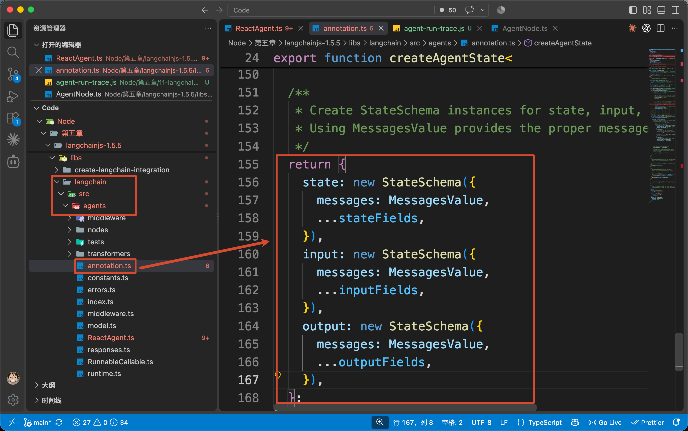

可以看到 `createAgentState()` 最后创建了三份 Schema：

```typescript
return {
    state: new StateSchema({
        messages: MessagesValue,
        ...stateFields
    }),
    input: new StateSchema({
        messages: MessagesValue,
        ...inputFields
    }),
    output: new StateSchema({
        messages: MessagesValue,
        ...outputFields
    })
}
```

这里的 `messages: MessagesValue` 是关键。

它明确规定：`messages`** 是 Agent 的基础 State 字段，而且这个字段用于保存整个执行过程中产生的 HumanMessage、AIMessage 和 ToolMessage。**

`ReactAgent` 在构造 Graph 时，会调用 `createAgentState()`，再把得到的 Schema 交给 `StateGraph`：

```typescript
const { state, input, output } = createAgentState(...)

const workflow = new StateGraph(state, {
    input,
    output,
    context: this.options.contextSchema
})
```

所以，这里的完整关系其实是：

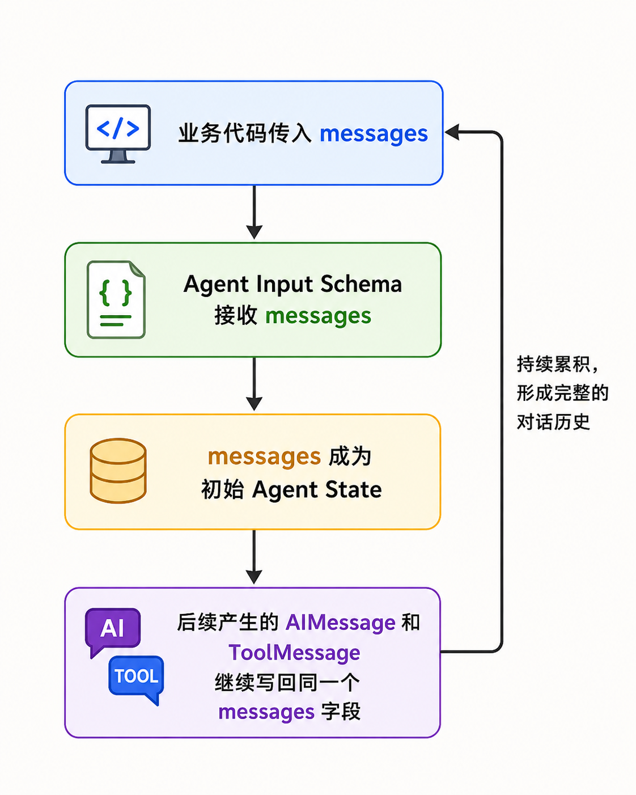

后面咱们讲“消息回注”时，操作的就是这个 State 字段。

最后，`ReactAgent 里面的 invoke() 方法` 会执行：

```typescript
return this.#graph.invoke(
    initializedState,
    mergedConfig
)
```

这里的 `#graph`，就是上一小节编译完成的 `CompiledStateGraph`。

`invoke()` 把两个东西传递给它：

+ `initializedState` 表示：以 HumanMessage 开始的初始 State
+ `mergedConfig` 表示：包含 recursionLimit 等运行配置

那么，Graph 拿到 State 以后，为什么会先执行 `model_request` 呢？

答案在 `ReactAgent` 构建 Edge 的代码里：

```typescript
let entryNode

if (beforeAgentNodes.length > 0) {
    entryNode = beforeAgentNodes[0].name
} else if (beforeModelNodes.length > 0) {
    entryNode = beforeModelNodes[0].name
} else {
  // 会执行这个
    entryNode = AGENT_NODE_NAME
}

allNodeWorkflows.addEdge(START, entryNode)
```

这段代码会确定 Graph 的第一个 Node。

如果存在 `beforeAgent`，先进入 `beforeAgent`

如果不存在 `beforeAgent`，但是存在 `beforeModel`，就先进入 `beforeModel`

这里的 Middleware 只有两个 Wrap Hook，并没有 `beforeAgent` 或 `beforeModel`，所以前两个条件都不成立，最终执行：

```typescript
entryNode = AGENT_NODE_NAME
```

而 `AGENT_NODE_NAME` 对应的值就是：`model_request`

所以，第一次进入 Graph 的真实路径是：

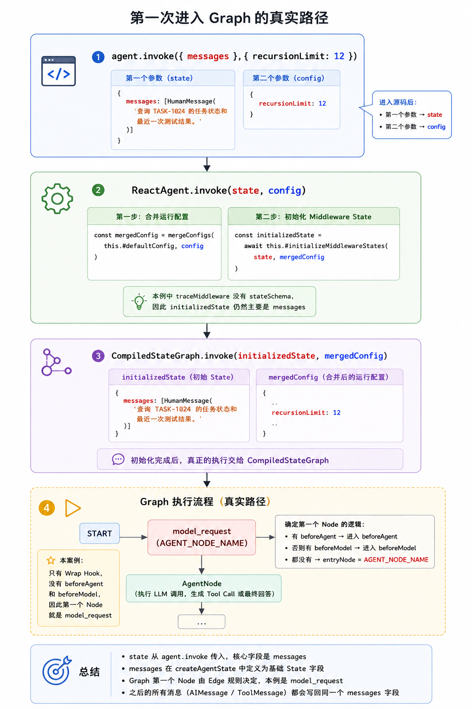

到这里，`state` 从哪里来、`messages` 在哪里定义、Graph 为什么先进入 `model_request`，就全部连起来了。

## AgentNode 的执行入口在哪里
打开：

```latex
libs/langchain/src/agents/nodes/AgentNode.ts
```

搜索：

```latex
constructor(
```

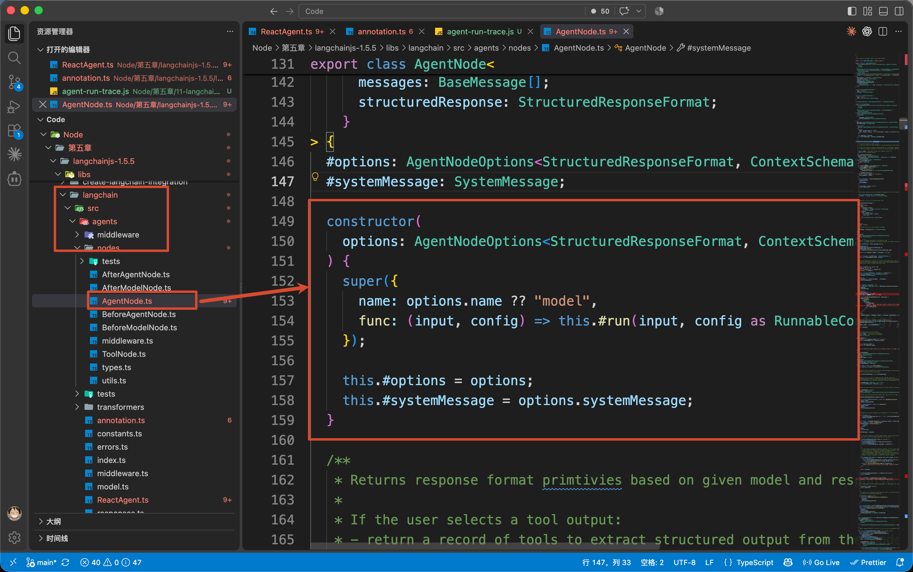

可以看到 `AgentNode` 在创建时，把自己的执行函数指向了 `#run()` （第 154 行），

同样把上面的代码简化一下，就比较简单了

```typescript
constructor(options) {
    super({
        name: options.name ?? "model",
        func: (input, config) =>
            this.#run(input, config)
    })
}
```

所以，Graph 执行 `model_request` 时，真正执行的其实是：

```latex
AgentNode.#run()
```

继续在当前文件中搜索：

```latex
async #run(
```

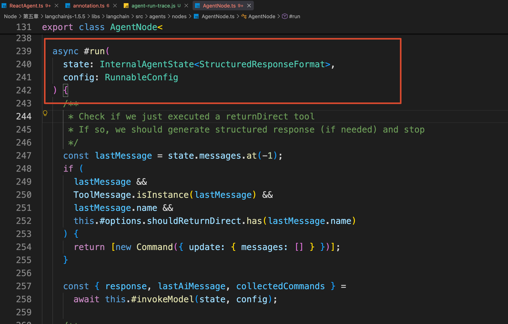

咱们先不用看 Structured Output 和 `returnDirect` 的特殊处理，普通模型调用的核心代码是：

```typescript
const {
    response,
    lastAiMessage,
    collectedCommands
} = await this.#invokeModel(state, config)
```

也就是说，`#run()` 自己并不直接调用大模型。

他会继续进入 `#invokeModel()`，由这个方法完成本轮模型调用。

咱们的源码路径现在变成了：

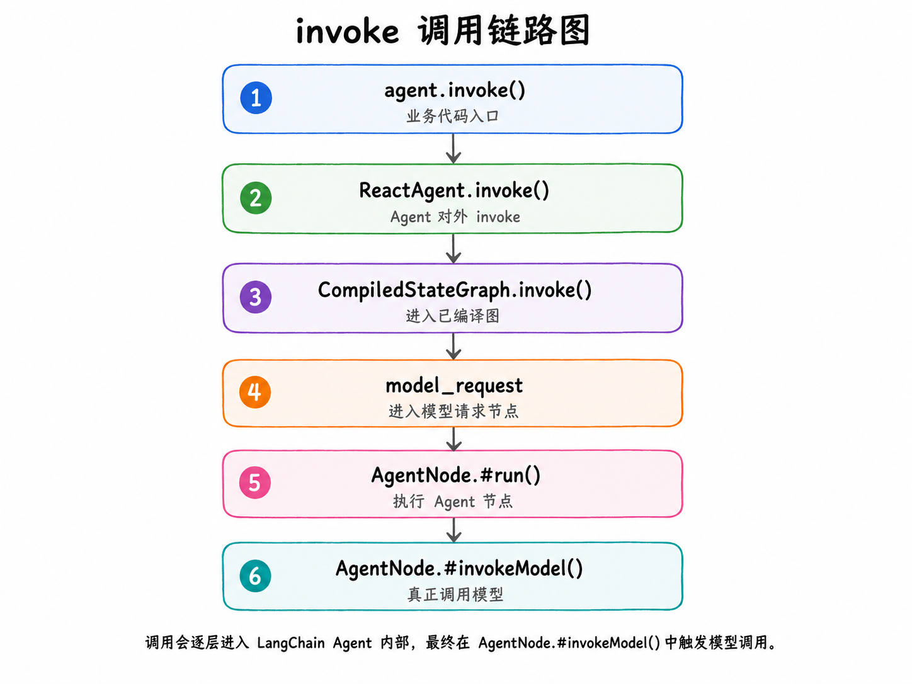

不过，执行一次模型调用，肯定不能只把 `messages` 扔给模型就完事了。

`#invokeModel()` 至少还要知道：这一轮使用哪个模型、需要带上什么 System Message、允许模型调用哪些 Tool 等等的信息

这些数据原本分散在 Agent State、Agent 配置和 LangGraph Config 中。

为了让后面的 Middleware 和模型调用逻辑能够统一处理，`#invokeModel()` 会先把它们整理成一个对象。

**这个对象，就叫作 **`ModelRequest`**。**

而 `ModelRequest` 就是：`AgentNode`** 在真正调用模型以前，整理出来的本轮模型调用参数。**

在 `AgentNode.ts` 中继续搜索：

```latex
const initialRequest
```

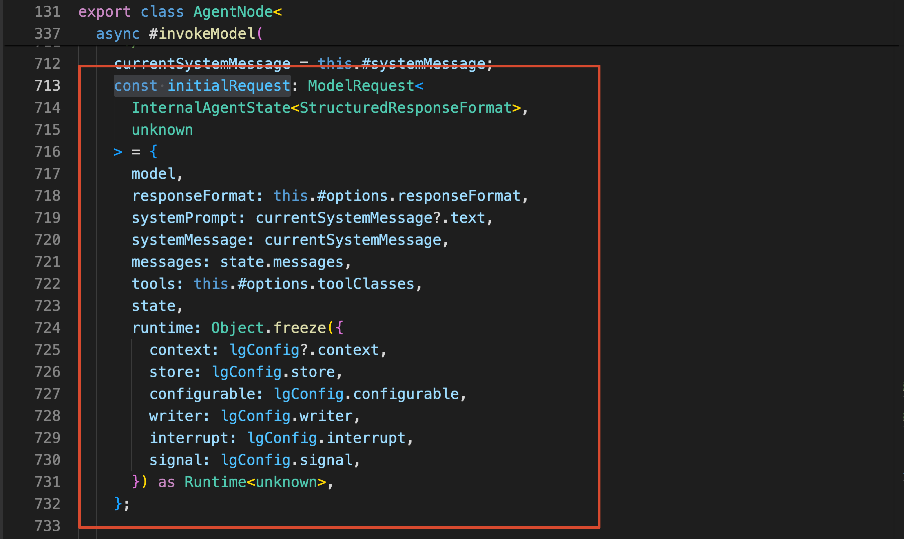

这里的`initialRequest` 就是一个符合 `ModelRequest` 接口约束的普通 JS 对象。

下面简化之后的代码（为了防止大家对属性不熟悉，已经帮大家把对应属性的配置都列出来了）：

```typescript
const initialRequest = {
  // 本轮准备调用的 Chat Model
    model,
  // 对最终结构化输出的要求
    responseFormat: this.#options.responseFormat,
  // 本轮模型需要接收的系统指令
    systemMessage: currentSystemMessage,
  // 当前 State 中已经积累的对话消息
    messages: state.messages,
  // 本轮允许模型选择的 Tool
    tools: this.#options.toolClasses,
  // 当前完整的 Agent State
    state,
  // Context、Store、Signal 等运行时能力
    runtime: {
        context: lgConfig.context,
        store: lgConfig.store,
        configurable: lgConfig.configurable,
        writer: lgConfig.writer,
        interrupt: lgConfig.interrupt,
        signal: lgConfig.signal
    }
}
```

根据这些注释，再看这个  `ModelRequest` 的实例对象，应该就比较明确了吧。

根据这个对象，咱们可以下这样一个定义：

> **ModelRequest 是 LangChain 在 AgentNode 内部整理出来的一份模型调用上下文。**
>

`ModelRequest` 准备完成以后，源码执行：

```typescript
const response = await wrappedHandler(initialRequest)
```

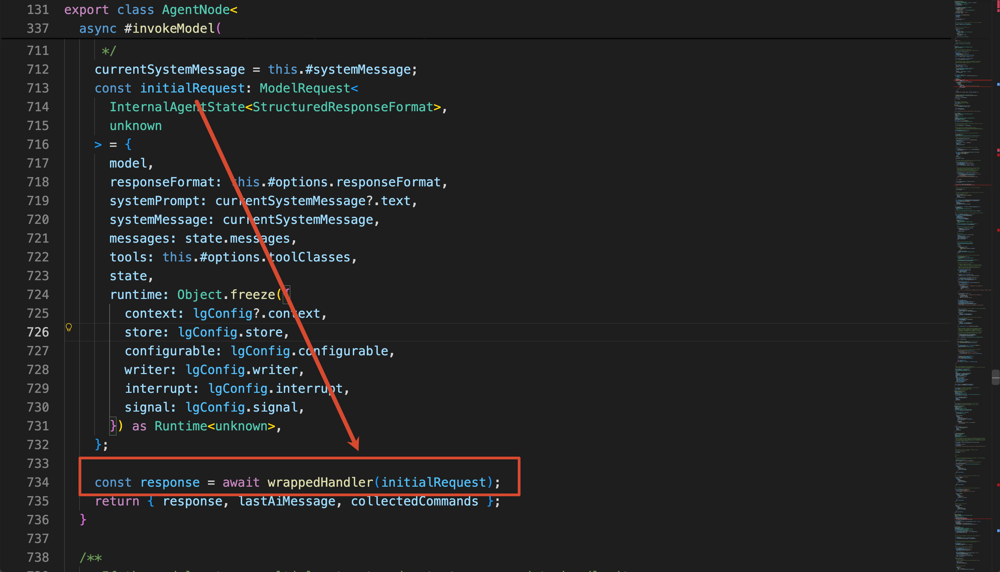

如果没有 `wrapModelCall`，这里的 `wrappedHandler` 就是内部的 `baseHandler`。

如果存在一个或多个 `wrapModelCall`，Middleware 会一层层包在 `baseHandler` 外面，最终仍然由 `baseHandler` 完成真正的模型调用。

继续在 `#invokeModel()` 搜索：

```plain
const baseHandler = async (
```

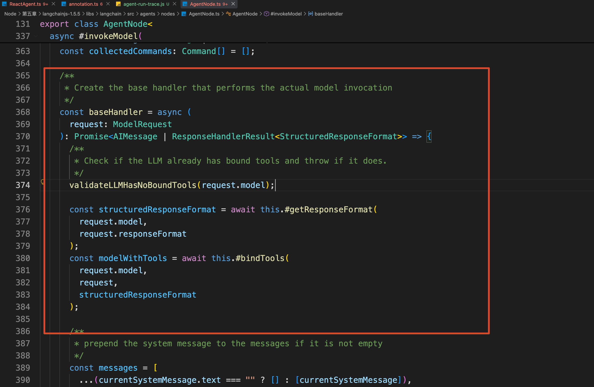

简化之后的代码：

```typescript
const baseHandler = async (request) => {
    const structuredResponseFormat =
        await this.#getResponseFormat(
            request.model,
            request.responseFormat
        )

    const modelWithTools = await this.#bindTools(
        request.model,
        request,
        structuredResponseFormat
    )

    const messages = [
        ...(currentSystemMessage.text === ""
            ? []
            : [currentSystemMessage]),
        ...request.messages
    ]

    const response = await modelWithTools.invoke(
        messages,
        config
    )

    return response
}
```

这段代码就是一次模型调用最核心的过程。

`#bindTools()` 先把 LangChain Tool 转换成当前模型能够识别的 Tool Schema，并绑定到模型实例上。

接着，源码把 `SystemMessage` 放在最前面，再拼接当前 State 中的 `request.messages`。

最后，才调用模型集成包提供的 `invoke()`。

因此，这几个对象之间的关系是：

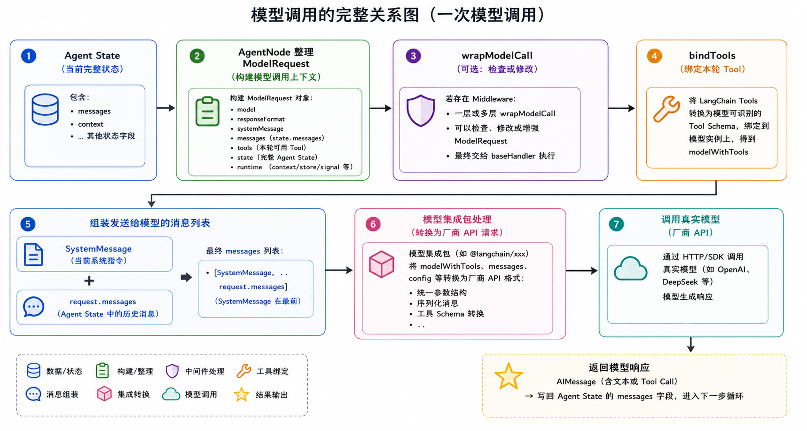

## 总结
这一小节，咱们从 `agent.invoke()` 一直看到了第一次模型返回。

业务代码传入的 `messages` 会先成为 Agent 的初始 State，`ReactAgent.invoke()` 再把 State 和运行配置交给内部的 `CompiledStateGraph`。

Graph 进入 `model_request` 后，真正执行的是 `AgentNode.#run()`。他会继续调用 `#invokeModel()`，把当前 Messages、System Message、Tools、模型和 Runtime 等数据整理成 `ModelRequest`。

随后，`#bindTools()` 将 LangChain Tool 转换成模型能够识别的 Tool Schema，模型集成包再使用整理好的 Messages 发起调用，最终返回一条包含 `get_task` Tool Call 的 `AIMessage`。

不过，此时模型只是提出了调用 `get_task` 的要求，Tool 还没有真正执行。

下一小节，咱们就从这条 AIMessage 继续往下看，看 `ToolNode` 怎样执行 Tool、ToolMessage 怎样回注 State，以及 Agent Loop 最终怎样停止的。

> 更新：2026-08-25 20:20 · 原文：<https://www.yuque.com/lgdsunday/ab1dy3/xfipy2bv7wl7n1mg>
